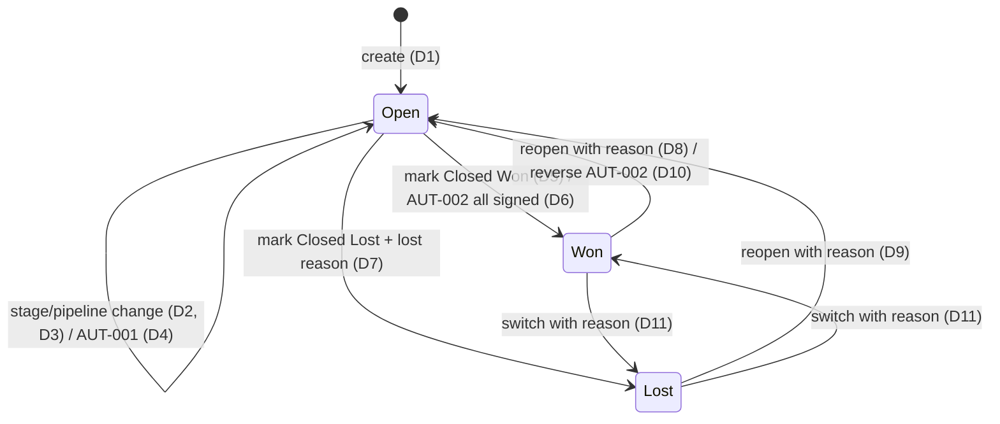
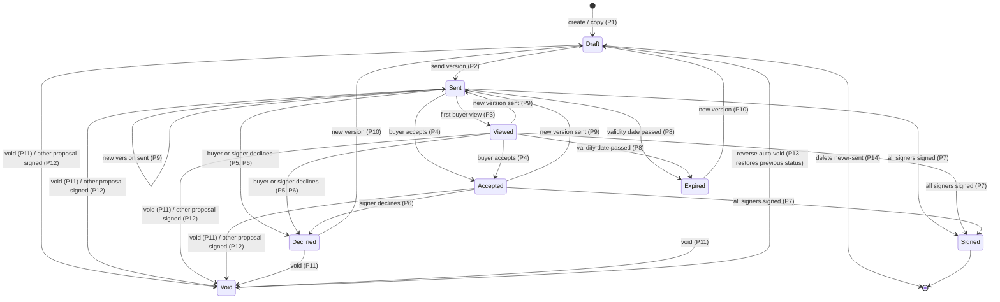
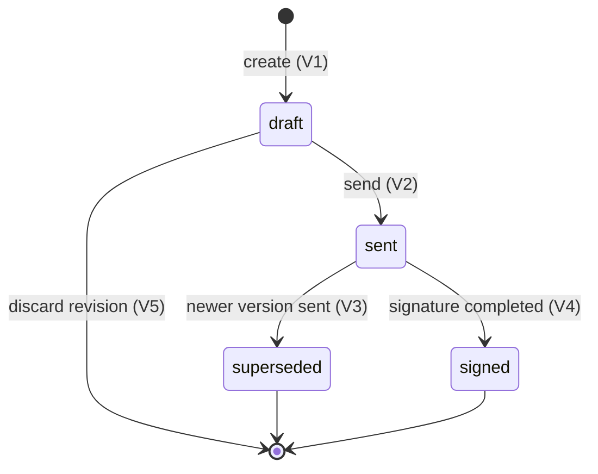
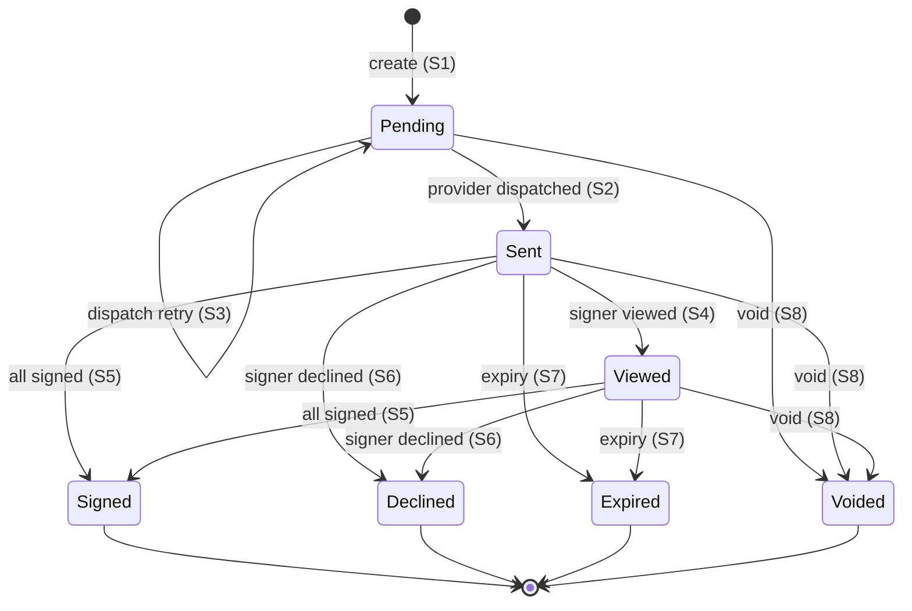
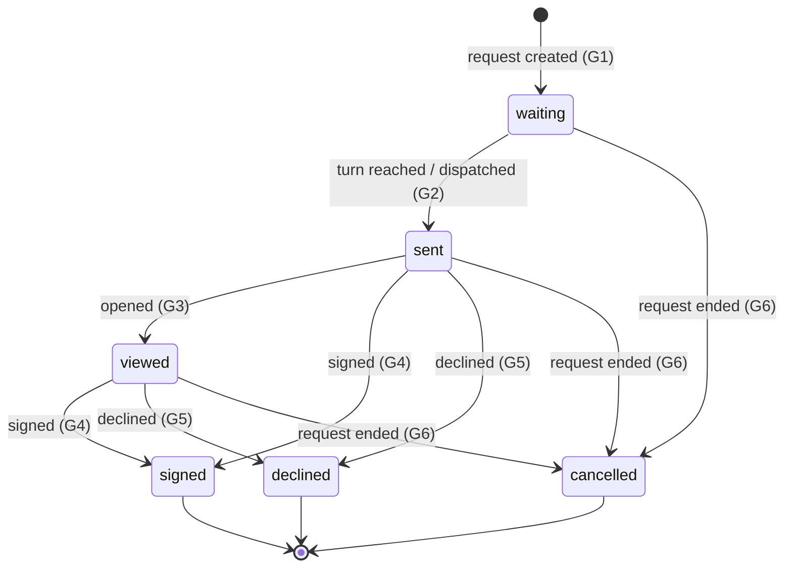
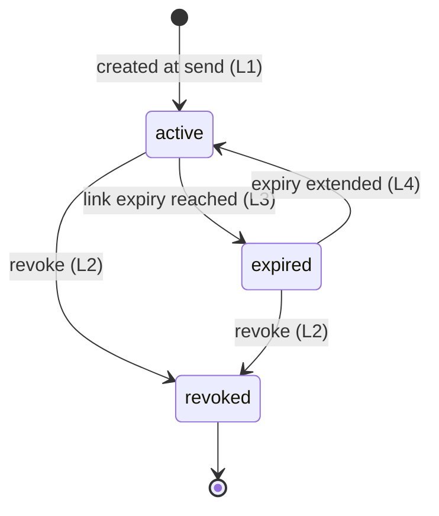
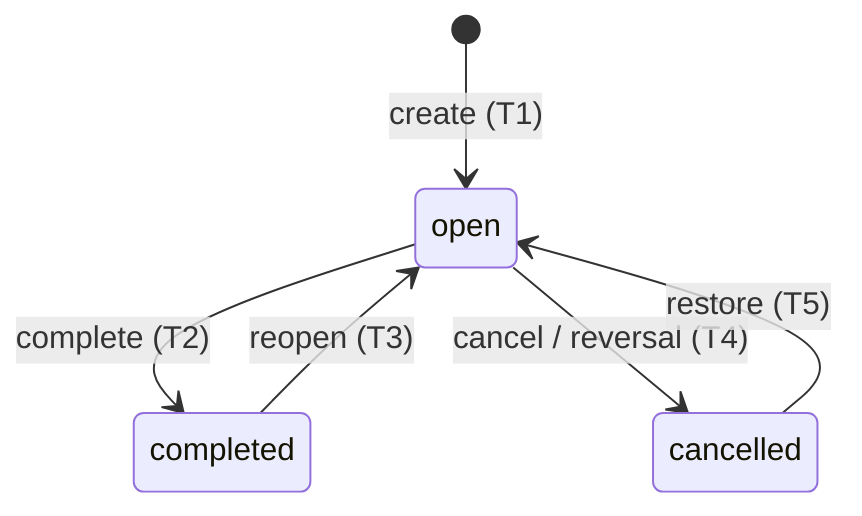
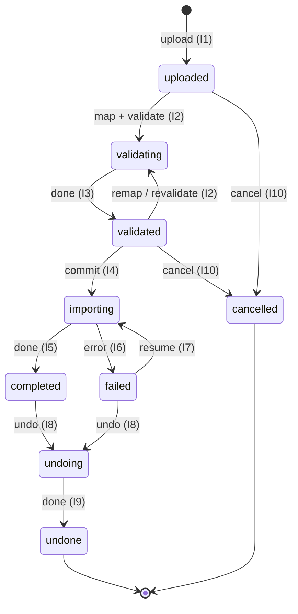
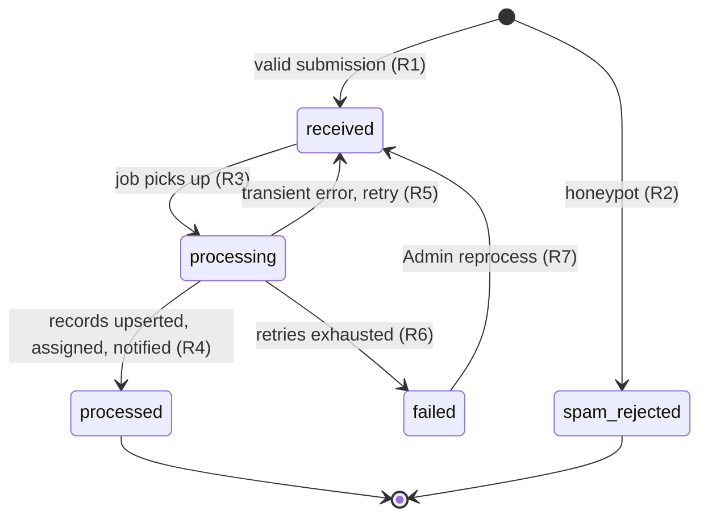
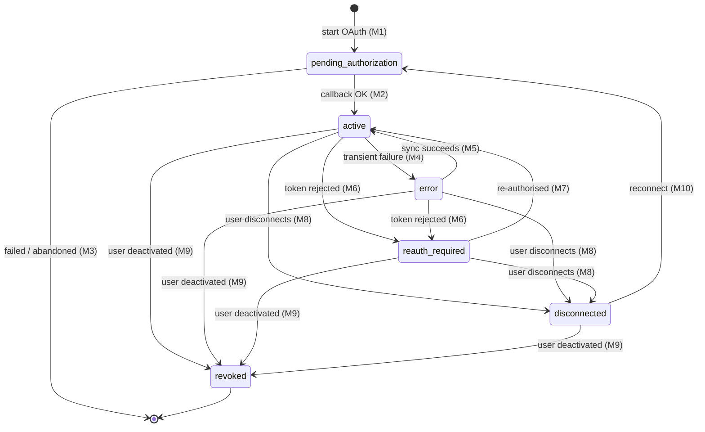

# BUSINESS RULES — Internal Sales CRM, Phase 1

| Item | Detail |
|---|---|
| Document | BUSINESS-RULES.md |
| Version | 0.1 (Draft, for review) |
| Date | 2026-11-17 |
| Author | Workflow Architect |
| Inputs | BRD v2.0 (Sales_CRM_Phase_1_BRD_v2.0), Design Foundation (IDD-01..16, OD-01..47, §5 state models, §9 analysis WAs) |
| Companion | WORKFLOWS.md (WF-NN), FUNCTIONAL-REQUIREMENTS.md (DR-*), OPEN-DECISIONS.md (OD-*), ROLE-PERMISSION-MATRIX.md (PERM-*) |

---

## 0. Conventions

### 0.1 Rule record

Every rule is one row: **ID · Rule · Source · Enforced at · Violation (code → message intent)**.

- **ID**: `RULE-<MOD>-NN`. Module = owning BRD module. Numbers are stable; retired rules are marked *Deprecated*, never renumbered.
- **Source** values:
  - `BR-xxx-nnn "…"` — direct BRD requirement (quoted or abbreviated).
  - `OD-nn WA` — working assumption from the foundation's open decision. Reversible; the rule changes if the OD is decided differently.
  - `IDD-nn` — internal deployment decision (decided).
  - `F§9 WA` — working assumption from foundation §9 (analysis findings).
  - `Derived — pending confirmation` — gap filled by this document. Not a business decision. Listed again in §19 for confirmation.
- **Enforced at** (all that apply): `UI` (client hint only, never sufficient), `API` (service-layer validation/policy — authoritative), `DB` (constraint/unique index/check/FK), `JOB` (worker/scheduled job), `PROV` (external provider — e-signature, mail, AI).
- **Violation**: proposed stable error `code` (RFC 9457 problem `code`, ADR-016) → intent of the user-facing message. HTTP status in brackets where obvious. A rule whose violation is *non-blocking* says `WARN` (no error; warning payload returned and/or recorded).
- Rules that are a pure consequence (side effect) rather than a validation say `n/a (side effect)`.

### 0.2 Common definitions used by rules

| Term | Definition | Source |
|---|---|---|
| Org timezone / Org date | Date computed in `organization_settings.timeZone` | BR-PLT-012 |
| User timezone | User profile timezone, defaulting to org timezone | Derived — pending confirmation |
| Visible to user | Record passes the central policy (role scope all / team / own / view-only setting) | F§8, OD-31 WA |
| Editable by user | Visible and not view-only and role permits edit | F§8, OD-31 WA |
| Internal user email | Email address of any active or deactivated user account, or any address at the company's own email domain(s) configured in settings | Derived — pending confirmation |
| Normalised email | `lower(trim(email))`; no provider-specific rewriting (dots/plus are kept) | OD-27 WA |
| Normalised domain | lower-case host, leading `www.` stripped, trailing dot stripped | OD-27 WA (refined) |
| Free-mail domain | Domain in a maintained list (gmail.com, outlook.com, hotmail.com, yahoo.com, icloud.com, proton.me, …) — never used for company matching | Derived — pending confirmation |
| Current sent version | The proposal's highest-numbered version whose state is `sent` or `signed` | OD-20 WA |
| Buyer activity | Any non-internal view session, download, accept/decline, signer event, or inbound email from a deal stakeholder | OD-35 WA |
| Automated actor | Timeline/audit actor type `system`, with `automationRuleId` and `automationExecutionId` | BR-AUT-008, BR-TIM-004 |

### 0.3 Rounding convention (applies to every money rule)

`round2(x)` = round half-up (away from zero) to 2 decimals. All monetary arithmetic uses exact decimal arithmetic (no binary floating point). **WA (Derived — pending confirmation, confirms OD-16/OD-44 context):** every *line-level* monetary result is rounded with `round2` at the point it is produced; all subtotals and totals are sums of already-rounded line values and are never re-rounded from unrounded intermediates.

---

## 1. Platform and accounts (PLT)

| ID | Rule | Source | Enforced at | Violation |
|---|---|---|---|---|
| RULE-PLT-01 | Exactly one organization exists per deployment. Organization settings are a singleton row; any attempt to create a second is rejected. | IDD-01; BR-PLT-001 (modified) | DB (singleton check), API | `ORG_SINGLETON_VIOLATION` [409] → "Organization already initialised." |
| RULE-PLT-02 | There is no self sign-up or trial. The first Admin is created only by the one-time bootstrap command; the bootstrap refuses to run if any user already exists. | IDD-02 | CLI/API | `BOOTSTRAP_ALREADY_DONE` → "Bootstrap already completed; use invitations." |
| RULE-PLT-03 | Users join only via an Admin invitation sent to an email address. Invitation token is single-use, stored hashed, expires after 7 days; Admin can resend (invalidates the previous token) or revoke. | BR-PLT-002 (invite part), IDD-02; expiry: Derived — pending confirmation | API, DB | `INVITATION_EXPIRED` / `INVITATION_REVOKED` / `INVITATION_USED` [410] → "This invitation is no longer valid; ask your Admin for a new one." |
| RULE-PLT-04 | An invitation may not be created for an email that already belongs to an active user. Inviting a deactivated user's email is "reactivate" (RULE-PLT-14), not a new user. | Derived — pending confirmation | API, DB (unique normalised email on user) | `USER_ALREADY_EXISTS` [409] → "A user with this email already exists." |
| RULE-PLT-05 | Each invitation specifies exactly one role (admin, sales_manager, salesperson) and optionally one team. | BR-PLT-005, OD-32 WA | API | `VALIDATION_FAILED` (field `role`) |
| RULE-PLT-06 | Sign-in methods: email+password, Google, Microsoft. OAuth sign-in is accepted only if the provider-verified email belongs to the configured company domain(s)/tenant AND matches an existing active user or a pending invitation. Admin may disable password sign-in org-wide (then password sign-in is rejected for all users except the bootstrap break-glass Admin). | BR-PLT-003, OD-12 WA; break-glass: Derived — pending confirmation | API (auth) | `AUTH_DOMAIN_NOT_ALLOWED` [403] → "Use your company account."; `AUTH_METHOD_DISABLED` [403] |
| RULE-PLT-07 | Password policy: minimum 12 characters, checked against a breached-password list; no composition rules; max 128. | Derived — pending confirmation (NIST SP 800-63B style) | API | `PASSWORD_POLICY` [422] |
| RULE-PLT-08 | Sign-in throttling: after 5 consecutive failed attempts for an account, further attempts are delayed exponentially (max 15 min); per-IP rate limit applies. Lockout does not reveal whether the account exists. | NFR-001; Derived — pending confirmation | API (rate_limit_bucket) | `AUTH_RATE_LIMITED` [429] → generic "Too many attempts, try later." |
| RULE-PLT-09 | MFA (TOTP) available to all users. When Admin sets "require MFA" for a role, users of that role must enrol at next sign-in before any other API call succeeds. Recommendation (not enforced by default): required for Admins. | BR-PLT-004, OD-13 WA | API (session middleware) | `MFA_ENROLMENT_REQUIRED` [403] → "Set up two-factor authentication to continue." |
| RULE-PLT-10 | Every user has exactly one role. Role changes take effect on the user's next request (permissions are evaluated server-side per request, not cached in the session beyond 60 s). | BR-PLT-005, ADR-006; cache window: Derived — pending confirmation | API | n/a |
| RULE-PLT-11 | The organization must always have at least one active Admin. Demoting or deactivating the last active Admin is rejected. | Derived — pending confirmation | API (transaction with count check) | `LAST_ADMIN` [409] → "At least one active Admin is required." |
| RULE-PLT-12 | A user belongs to at most one team. A team has ≥ 1 manager; a manager (role sales_manager) may manage several teams; teams are not nested. A team manager need not be a member. A team cannot be deleted while it has members — members must be moved or removed first. | BR-PLT-006, OD-32 WA; delete guard: Derived — pending confirmation | API, DB (unique team_member.user_id) | `TEAM_MEMBERSHIP_CONFLICT` [409]; `TEAM_NOT_EMPTY` [409]; `TEAM_MANAGER_REQUIRED` [422] |
| RULE-PLT-13 | Only users with role sales_manager (or admin) can be assigned as team managers. Changing a manager's role to salesperson requires removing them as manager of all teams first. | BR-PLT-006; Derived — pending confirmation | API | `MANAGER_ROLE_REQUIRED` [422] |
| RULE-PLT-14 | **Deactivation** of a user (Admin only) requires, in the same operation, a reassignment target (active user) for: open deals, open tasks, Draft/Sent/Viewed/Accepted proposals, and owned companies/contacts. Closed deals keep the deactivated owner (historical accuracy) unless Admin chooses to reassign them too. On deactivation: all sessions and bearer tokens revoked; mailbox connection revoked and sync stopped (RULE-EML-03); user removed from every round-robin pool (RULE-LED-07); user excluded from assignment rules targets (rules targeting only that user fall back, RULE-LED-09); open signature requests keep the deactivated user as "sender of record" but notifications route to the new deal owner. Reactivation restores sign-in only; nothing is re-assigned back. | BR-PLT-011, F§9 WA (deactivation effects); closed-deal default & reactivation: Derived — pending confirmation | API (single transaction + outbox), JOB (token revocation at provider) | `REASSIGNMENT_TARGET_REQUIRED` [422]; `REASSIGNMENT_TARGET_INACTIVE` [422] → "Choose an active user to take over records." |
| RULE-PLT-15 | Reassignment target must be able to own the records: any active user; if the target is a salesperson, the records become "own" for that salesperson. Admin may split by record type (e.g. deals to A, tasks to B). | BR-PLT-011; split: Derived — pending confirmation | API | `REASSIGNMENT_TARGET_INACTIVE` |
| RULE-PLT-16 | Deactivated users cannot sign in, are not selectable as owners, assignees, signers' sender, or round-robin members, but remain displayed (with "deactivated" badge) on historical records, timelines and reports. | BR-PLT-011; Derived — pending confirmation | API, UI | `USER_INACTIVE` [422] |
| RULE-PLT-17 | Organization settings (name, branding, default currency, time zone, fiscal year start month, company email domains, locale/number format) are editable by Admin only. Changing the **default currency** never converts stored amounts; Admin must confirm a warning, and reports thereafter convert via the exchange-rate table (RULE-RPT-03). Changing the time zone affects only future date boundary computations. | BR-PLT-012, BR-PRC-005, OD-15 WA; non-conversion: Derived — pending confirmation | API | `FORBIDDEN` [403]; `CONFIRMATION_REQUIRED` [428] → "Changing default currency does not convert existing amounts." |
| RULE-PLT-18 | Fiscal year start month ∈ 1..12; fiscal quarters derived from it are used by reporting date presets. | BR-PLT-012; Derived — pending confirmation | API, DB check | `VALIDATION_FAILED` |
| RULE-PLT-19 | The **audit log** records, synchronously in the originating transaction: authentication events (sign-in success/failure, MFA enrol/disable), user/role/team changes, invitations, deactivation/reassignment, settings changes, permission-relevant toggles (AI on/off, open tracking, cross-visibility), imports and undo, exports, template publish/lock changes, catalog/tax/discount-limit changes, record archive/erasure, proposal send/void, signature request create/void, link revoke, automation executions and reversals, AI generation acceptance. Audit entries are append-only (no update/delete through the application), contain actor, actor type, action, entity, before/after diff (minimised), request id, IP; visible to Admin only. | BR-PLT-009, NFR-009, F§9 (audit access restricted) | API, DB (no UPDATE/DELETE grant on audit_log for app role) | n/a (side effect) |
| RULE-PLT-20 | **Full data export** (Admin only) produces CSV and JSON per entity plus a files archive containing signed PDFs and completion certificates; private emails are exported as metadata only (OD-30); export runs as a background job; download link valid 24 h, single user (requester), access audited. At most one export job running at a time. | BR-PLT-010, IDD-12, F§9 WA (export contents); expiry & concurrency: Derived — pending confirmation | API, JOB | `EXPORT_ALREADY_RUNNING` [409]; `EXPORT_LINK_EXPIRED` [410] |
| RULE-PLT-21 | Retention: per-category retention periods are configurable by Admin within platform limits; signed documents, completion certificates and audit log are exempt from erasure; contact erasure anonymises personal fields and keeps financial records. Platform limits are TBD (OD-36). | NFR-015, OD-36 WA | API, JOB (retention sweeper) | `RETENTION_OUT_OF_RANGE` [422]; `ERASURE_EXEMPT` [409] → "Signed documents cannot be erased." |
| RULE-PLT-22 | Onboarding checklist (internal setup): Admin items = import data, configure pipeline, create first template; User items = connect mailbox, send first proposal. Items auto-complete on the first matching domain event (import.batch_completed, pipeline.updated by Admin, template.published, mailbox.connected, proposal.version_sent by that user); items can be dismissed; checklist never blocks any function. | BR-PLT-008, IDD-04; auto-completion: Derived — pending confirmation | JOB (event handler), UI | n/a |
| RULE-PLT-23 | All unsafe API requests must carry a valid session (cookie, Origin-checked) or add-in bearer token; buyer/public endpoints use share tokens only and never accept internal session cookies as authority. | ADR-006, ADR-013, ADR-016 | API | `UNAUTHENTICATED` [401]; `CSRF_ORIGIN_MISMATCH` [403] |
| RULE-PLT-24 | Concurrent edits: every mutable record update must present its `rowVersion`; mismatch is rejected. | ADR-005/016 | API, DB | `CONCURRENT_MODIFICATION` [409] → "This record was changed by someone else; reload." |
| RULE-PLT-25 | Requests flagged idempotent (send, sign request, import commit, email send, export) must carry `Idempotency-Key`; a replay with the same key and same body returns the original response; same key with a different body is rejected. Keys retained 24 h. | ADR-016; retention: Derived — pending confirmation | API, DB (idempotency_key) | `IDEMPOTENCY_KEY_REQUIRED` [428]; `IDEMPOTENCY_KEY_REUSED` [422] |

---

## 2. Data import (MIG)

| ID | Rule | Source | Enforced at | Violation |
|---|---|---|---|---|
| RULE-MIG-01 | Only Admins can create, commit, or undo imports. | BR-MIG-001, §9.17 | API | `FORBIDDEN` [403] |
| RULE-MIG-02 | Accepted file types: `.csv` (UTF-8, UTF-8 BOM, or Windows-1252 with detection), `.xlsx` (first sheet unless chosen). Max 25 MB and 100,000 data rows per file; first row is the header. Formulas in xlsx are imported as their cached values. | BR-MIG-001; limits: Derived — pending confirmation (OD-45 sizing) | API | `IMPORT_FILE_TYPE` / `IMPORT_FILE_TOO_LARGE` / `IMPORT_TOO_MANY_ROWS` [422] |
| RULE-MIG-03 | One batch imports one primary entity type (companies, contacts, or deals). A contacts file may carry company columns (company is matched/created per RULE-MIG-07); a deals file must carry a company reference (OD-33) and may carry contact email(s). | BR-MIG-001, OD-33 WA; one-type-per-batch: Derived — pending confirmation | API | `IMPORT_ENTITY_REQUIRED` [422] |
| RULE-MIG-04 | Column mapping: every column maps to a standard field, a custom field (BR-CRM-007), or "ignore". Required target fields must be mapped: company → name; contact → email or (first name or last name); deal → name, company (name or domain), stage (or a default stage chosen for the batch), pipeline (or default). Owner column maps by user email; unmapped/unknown owner → batch default owner (required). A mapping can be saved as a reusable preset. | BR-MIG-001; required set & owner fallback: Derived — pending confirmation | API, UI | `IMPORT_REQUIRED_FIELD_UNMAPPED` [422] |
| RULE-MIG-05 | **Validation before save** (all rows, no writes to business tables): type coercion per field type (number, currency, date with an explicit chosen format, dropdown value ∈ options or "create option" allowed by Admin for that column, multi-select split by `;` or `,` as chosen, checkbox yes/no/true/false/1/0), email syntax, currency ISO-4217, stage name ∈ pipeline stages, owner resolution, required values present, field length limits. Each row ends `valid`, `valid_with_warnings` or `invalid` with per-cell messages. The error report is downloadable as CSV (original row + error columns). | BR-MIG-004 | JOB (validation), API | Row-level, not request-level: `IMPORT_ROW_INVALID` with cell errors |
| RULE-MIG-06 | Commit is permitted only when validation has completed. Invalid rows are never imported; Admin chooses "import valid rows only" or fixes the file and re-uploads. Commit re-checks nothing that could have changed silently except duplicates (re-evaluated at commit, RULE-MIG-08). | BR-MIG-004; Derived — pending confirmation | API | `IMPORT_NOT_VALIDATED` [409] |
| RULE-MIG-07 | **Duplicate detection keys**: contact = normalised email; company = normalised primary domain (excluding free-mail domains), else normalised name exact match (lower-case, trimmed, internal whitespace collapsed); deal = external source id only (HubSpot/Pipedrive record id, or a mapped "external id" column). No fuzzy auto-merge; fuzzy candidates (trigram name similarity ≥ 0.6) are shown as suggestions only. Duplicates are checked both against existing records and **within the file** (second and later occurrences flagged `duplicate_in_file`). | BR-MIG-003, OD-27 WA; threshold & in-file: Derived — pending confirmation | JOB, DB (pg_trgm) | n/a (classification) |
| RULE-MIG-08 | For each duplicate the Admin chooses **skip**, **merge** or **create new** — per row, or as a batch default per entity type. Merge mode: `fill_empty` (default — only blank target fields receive imported values) or `overwrite_non_empty` (imported non-empty values overwrite). Merge never changes owner unless the owner column is mapped and Admin ticked "update owner". "Create new" for a contact whose normalised email already exists is **not allowed** (email uniqueness, RULE-CRM-06). | BR-MIG-003; merge modes & email exception: Derived — pending confirmation | API, DB | `IMPORT_DUPLICATE_EMAIL_CREATE_NOT_ALLOWED` [422] |
| RULE-MIG-09 | Every created or merged record is linked to the batch (`import_record_link`: action created/merged, before-snapshot of merged fields). Imported records get timeline event "Imported (batch N)" actor `user` (the Admin). Imports do not trigger AUT-001..006 automations, lead-assignment notifications, or "new lead" notifications. | BR-MIG-005 (enables undo); no-automation: Derived — pending confirmation | JOB | n/a |
| RULE-MIG-10 | **Undo** of a batch (Admin): created records are hard-deleted if they were not modified after import and have no dependent records created after import (proposals, emails linked, tasks, notes); otherwise they are listed as "kept — modified after import" and Admin may archive them instead. Merged records have their merged fields restored from the before-snapshot only where the current value still equals the imported value. Undo is all-or-report (per-record result list), runs as a job, is itself audited, and can be performed once. No time limit in Phase 1. | BR-MIG-005; semantics: Derived — pending confirmation | JOB, API | `IMPORT_ALREADY_UNDONE` [409]; per-record `UNDO_SKIPPED_MODIFIED` |
| RULE-MIG-11 | HubSpot/Pipedrive export import uses a predefined mapping preset per source export format (companies, contacts, deals, owners by email, pipeline/stage names, deal ↔ company/contact associations) and records the source record id as external id. Stages not present in our pipeline must be mapped to an existing stage before validation completes. Only delivered if OD-09 confirms we use one of these tools. | BR-MIG-002, OD-09 WA | API, JOB | `IMPORT_STAGE_UNMAPPED` [422] |
| RULE-MIG-12 | A DOCX uploaded as a template starting point (Admin/authorised manager) is converted to a **draft template**; headings become sections, paragraphs/tables/images become blocks; unsupported elements (text boxes, fields, tracked changes, macros) are dropped and listed in a conversion report. Max 20 MB. Macro-enabled formats rejected. | BR-MIG-006; Derived — pending confirmation | JOB, API | `DOCX_UNSUPPORTED_FORMAT` / `DOCX_TOO_LARGE` [422] |
| RULE-MIG-13 | API import from HubSpot/Pipedrive (BR-MIG-007, Could) is deferred. | BR-MIG-007, OD-09 WA | n/a | n/a |
| RULE-MIG-14 | Only one batch per entity type may be in `importing` or `undoing` at a time. | Derived — pending confirmation | API, DB | `IMPORT_BATCH_BUSY` [409] |

---

## 3. CRM records (CRM)

| ID | Rule | Source | Enforced at | Violation |
|---|---|---|---|---|
| RULE-CRM-01 | Company requires `name` (1–200 chars). Domain optional; stored normalised. A new company whose normalised domain or normalised name matches a non-archived company shows a duplicate warning with "open existing"; creation still allowed after confirmation (domains are not unique). | BR-CRM-001, OD-27 WA; allow-after-confirm: Derived — pending confirmation | API, UI | `WARN DUPLICATE_SUSPECTED` |
| RULE-CRM-02 | Company, contact, deal, template, product, content block: "delete" in the UI is **archive** (`archived_at`). Archived records are hidden from default lists, search, pickers and lead/email matching (except matching of a contact's email — an archived contact matched by email is reported, not silently re-created). Hard delete only through governed erasure (RULE-PLT-21) or import undo (RULE-MIG-10). | BR-CRM-001, ADR-005, OD-36 WA; archived-match behaviour: Derived — pending confirmation | API | n/a |
| RULE-CRM-03 | A company with open deals cannot be archived; deals must be closed, moved to another company, or archived first. | Derived — pending confirmation | API | `COMPANY_HAS_OPEN_DEALS` [409] |
| RULE-CRM-04 | Restore (un-archive) is allowed to users who could edit the record; restoring a contact whose normalised email now belongs to another active contact is rejected. | Derived — pending confirmation | API | `CONTACT_EMAIL_TAKEN` [409] |
| RULE-CRM-05 | Contact requires at least one of first name, last name, email. A contact has zero or one primary company. | BR-CRM-002, OD-33 WA | API | `VALIDATION_FAILED` |
| RULE-CRM-06 | Normalised email is unique among non-archived contacts. | OD-27 WA | DB (partial unique index), API | `CONTACT_EMAIL_TAKEN` [409] → "A contact with this email already exists" + link |
| RULE-CRM-07 | Deal requires: name, pipeline, stage in that pipeline, owner (active user), company (OD-33), currency (default = org default; non-default allowed only when BR-PRC-006 enabled). Amount ≥ 0 (numeric 18,2), optional (null = unknown). Expected close date optional. | BR-CRM-003, OD-33 WA, OD-15 WA; amount/close date optionality: Derived — pending confirmation | API, DB (FKs, checks) | `VALIDATION_FAILED`; `STAGE_NOT_IN_PIPELINE` [422] |
| RULE-CRM-08 | Deal contacts: any number of contacts, each with ≥ 0 roles from the Admin-defined contact-role list (seeded Decision-maker, Signer, Influencer, Forwarded viewer — the last is system-managed and cannot be archived). A contact appears at most once per deal. A deal contact need not belong to the deal's company. | BR-CRM-003, OD-34 WA; cross-company allowed: Derived — pending confirmation | API, DB (unique deal_id+contact_id) | `DEAL_CONTACT_DUPLICATE` [409] |
| RULE-CRM-09 | Each deal has exactly one owner. Reassignment allowed: Admin (any deal), Sales Manager (deals owned by members of teams they manage, to a member of those teams or themselves), Salesperson: never (including bulk). Reassignment writes a timeline event, notifies the new owner, and moves future notifications for the deal to the new owner. Open tasks on the deal are **not** auto-reassigned unless the user ticks "also reassign open tasks" (default on). | BR-CRM-004, §9.17, OD-31 WA, F§9 (notifications to current owner); task option: Derived — pending confirmation | API | `FORBIDDEN_REASSIGN` [403]; `REASSIGN_TARGET_OUT_OF_SCOPE` [403] |
| RULE-CRM-10 | Pipeline configuration (Admin only): each pipeline has ≥ 1 open stage plus exactly one system stage "Closed Won" (kind won, probability 100) and one "Closed Lost" (kind lost, probability 0); system stages cannot be deleted, re-kinded, or have probability changed; they are always ordered after all open stages. Open stage probability is an integer 0–100. Stage names unique within a pipeline. | BR-CRM-005, F§5 | API, DB (check, unique) | `SYSTEM_STAGE_IMMUTABLE` [409]; `VALIDATION_FAILED` |
| RULE-CRM-11 | Deleting an open stage that has deals requires choosing a target stage in the same pipeline; deals are moved (timeline: "Stage removed by Admin; moved to X", actor user). Reordering stages does not move deals. A pipeline with deals cannot be deleted; it can be archived (no new deals) once it has no open deals. At least one non-archived pipeline must exist; one pipeline is the default. | BR-CRM-005/006; Derived — pending confirmation | API | `STAGE_HAS_DEALS` [409]; `PIPELINE_HAS_DEALS` [409]; `LAST_PIPELINE` [409] |
| RULE-CRM-12 | Stage configuration also carries automation parameters: `stalledAfterDays` (null = never flag; BR-AUT-005) per stage, and per pipeline `proposalSentTargetStageId` (BR-AUT-001; must be an open stage of that pipeline or null = disabled). | BR-AUT-001, BR-AUT-005, ADR-024 | API | `VALIDATION_FAILED` |
| RULE-CRM-13 | Moving a deal to another pipeline requires selecting a stage in the target pipeline; the change is recorded as one stage-change event. A closed deal cannot change pipeline without reopening. | BR-CRM-006; Derived — pending confirmation | API | `STAGE_NOT_IN_PIPELINE` [422]; `DEAL_CLOSED` [409] |
| RULE-CRM-14 | Closing a deal as lost requires a lost reason from the Admin-defined, non-archived list; an optional free-text comment. If the deal has an **open signature request**, the user must confirm voiding it; on confirmation the request is voided (RULE-SIG-17) in the same operation; without confirmation the close is rejected. Open proposals (Draft/Sent/Viewed/Accepted) of a lost deal are left unchanged but buyers can no longer accept/sign them (RULE-SHR-14). | BR-CRM-014, F§9 WA (closed lost with open signature request); proposals untouched: Derived — pending confirmation | API | `LOST_REASON_REQUIRED` [422]; `OPEN_SIGNATURE_REQUEST_CONFIRM` [428] |
| RULE-CRM-15 | Marking Closed Won manually is allowed for an open deal; close date defaults to today (org date) and is editable; amount unchanged unless edited. If the deal has Accepted proposals, the UI offers the accepted proposal's TCV as amount (BR-PRC-004 prompt). | F§5; prompt: BR-PRC-004, OD-17 WA | API, UI | n/a |
| RULE-CRM-16 | Lost reasons, contact roles and custom fields are Admin-managed lists; items are archived, never deleted, when in use. | BR-CRM-007/014, OD-31 WA (lost reasons Admin) | API | `IN_USE_ARCHIVE_ONLY` [409] |
| RULE-CRM-17 | **Reopen** a won or lost deal: allowed to owner, the owner's manager (team scope) or Admin; requires a reason (free text, 1–500 chars) and a target open stage; clears close date and lost reason; recorded on timeline and audit. A reopened deal that was won via AUT-002 keeps the proposal Signed. | OD-31 WA (reopening requires reason), OD-24 WA | API | `REOPEN_REASON_REQUIRED` [422]; `FORBIDDEN` [403] |
| RULE-CRM-18 | Closed deals remain editable (amount, close date, fields) by owner/manager/admin; each edit is audited. Stage change of a closed deal to an open stage is a reopen (RULE-CRM-17). Changing a won deal directly to lost (or vice versa) is allowed only via reopen semantics (reason required) followed by the close rules (lost reason etc.) in one operation. | OD-31 WA; direct switch: Derived — pending confirmation | API | as RULE-CRM-14/17 |
| RULE-CRM-19 | Custom fields (Admin): types text, number, currency, date, dropdown, multi-select, checkbox; entity company/contact/deal; `key` immutable and unique per entity; type immutable once any value exists; dropdown/multi-select options can be added, renamed (label only) or archived (values retained, not selectable). Archiving a field keeps values; templates referencing an archived field are flagged by BR-TPL-008 (RULE-TPL-08). Max 100 custom fields per entity. | BR-CRM-007, F§9 WA (custom field deletion); limit: Derived — pending confirmation | API, DB | `CUSTOM_FIELD_TYPE_LOCKED` [409]; `CUSTOM_FIELD_LIMIT` [422] |
| RULE-CRM-20 | Custom field values are validated on every write against their type (number range numeric(18,4); currency amount numeric(18,2) in the record's currency for deals, org default for company/contact; date ISO date; dropdown value ∈ active options; multi-select ⊆ active options; checkbox boolean). | BR-CRM-007 | API | `VALIDATION_FAILED` (field path `customFields.<key>`) |
| RULE-CRM-21 | Custom fields are filterable, usable in saved views, report filters/grouping (dropdown, checkbox, date) and templates (placeholders). | BR-CRM-007 | API | n/a |
| RULE-CRM-22 | Task: title (1–200) required; due (date or date-time) required; optional reminder date-time (must be ≤ due date-time when due has a time, and ≥ now at creation); optional link to exactly one record (deal, company or contact); assignee (active user) defaults to creator; assignee must be able to view the linked record. Source = manual \| automation \| ai_suggested. | BR-CRM-008, F§5; single-link & assignee visibility: Derived — pending confirmation | API | `TASK_REMINDER_INVALID` [422]; `TASK_ASSIGNEE_NO_ACCESS` [422] |
| RULE-CRM-23 | A task is **overdue** when status is open and (due date-time < now) or (date-only due < today in the assignee's timezone). Overdue is computed, not stored. | BR-CRM-008/009, BR-AUT-006 (overdue concept), OD-40 WA | API (query) | n/a |
| RULE-CRM-24 | **My Day** (per user, user timezone) shows: open tasks due today; overdue open tasks; deals needing attention owned by the user = stalled flag (RULE-AUT-30), overdue flag (RULE-AUT-40), or a current sent version not viewed within the AUT-004 window (unviewed proposal, RULE-RPT-06). Managers see their own My Day (team items are in RPT-005 list). | BR-CRM-009, BR-RPT-005, OD-40 WA | API | n/a |
| RULE-CRM-25 | Notes (rich text, ≤ 20,000 chars) and manually logged calls/meetings (type, date-time, duration optional, participants = contacts, outcome text) attach to a deal, company or contact; editable/deletable only by the author within 24 h, thereafter by Admin; edits audited. Logged activities count as activity for stalled detection. | BR-CRM-010, OD-35 WA; edit window: Derived — pending confirmation | API | `NOTE_EDIT_WINDOW_CLOSED` [403] |
| RULE-CRM-26 | View-only access (Admin setting per object type for salespeople) is strictly read-only: no notes, tasks, edits, proposal creation or email sends on those records. | OD-31 WA | API (policy) | `VIEW_ONLY` [403] |
| RULE-CRM-27 | Saved views store filters, sort, columns; personal by default; Admin may publish a view to everyone; a shared view never widens visibility (results are always permission-filtered). Board view groups open deals by stage of one selected pipeline; dragging a card is a stage change subject to RULE-CRM-14/15 for system stages. | BR-CRM-011, BR-RPT-008; shared-view publishing: Derived — pending confirmation | API | n/a |
| RULE-CRM-28 | Search covers companies (name, domain), contacts (name, email, phone), deals (name), proposals (title, number) and returns only visible records; archived records only when "include archived" is set. Minimum query length 2 characters. | BR-CRM-012, ADR-005 | API | `VALIDATION_FAILED` |
| RULE-CRM-29 | Bulk edit/reassign (Should): max 500 records per operation; each record is authorised individually; result reports per-record success/failure; executed as a job when > 50 records; salesperson cannot bulk reassign. | BR-CRM-013, OD-31 WA; limits: Derived — pending confirmation | API, JOB | per-record `FORBIDDEN` |
| RULE-CRM-30 | Exchange rates (Admin): table of (currency, rate to default currency, effective date). A rate must exist for any non-default currency used by an open deal for reporting conversion; missing rate shows reports with an "unconverted" warning, never a silent zero. | OD-15 WA; missing-rate behaviour: Derived — pending confirmation | API, reporting | `WARN FX_RATE_MISSING` |

---

## 4. Email and calendar (EML)

| ID | Rule | Source | Enforced at | Violation |
|---|---|---|---|---|
| RULE-EML-01 | A user connects at most one mailbox (Gmail or Microsoft 365) and its calendar, through OAuth with offline access; only accounts in the company's Google Workspace domain / Entra tenant are accepted; the mailbox address must equal the user's sign-in email or an alias Admin allows. Phase 1 provider order per OD-06 (company's actual provider first). | BR-EML-001, OD-06 WA; one-mailbox & address match: Derived — pending confirmation | API (OAuth callback) | `MAILBOX_DOMAIN_NOT_ALLOWED` [403]; `MAILBOX_ALREADY_CONNECTED` [409]; `MAILBOX_ADDRESS_MISMATCH` [422] |
| RULE-EML-02 | OAuth tokens are encrypted at rest (AES-256-GCM, key from secrets store), never returned by any API, never logged. Requested scopes are the minimum for read, send and calendar read. | ADR-012, NFR-001 | API, DB | n/a |
| RULE-EML-03 | Mailbox connection becomes `reauth_required` when the provider rejects the refresh token; sync stops; the user gets an in-app + email notification. User disconnect, or user deactivation, revokes tokens at the provider (best effort) and deletes them locally; already-synced emails remain (subject to retention). | ADR-012, F§9 WA (deactivation); retention of synced mail: Derived — pending confirmation | JOB, API | n/a |
| RULE-EML-04 | Initial sync window: messages and calendar events from the last 90 days; thereafter incremental delta sync every 2–5 minutes. | ADR-012; 90-day window: Derived — pending confirmation | JOB | n/a |
| RULE-EML-05 | **Storage filter (data minimisation)**: a synced message is stored only if at least one non-internal participant (from/to/cc) matches a non-archived contact by normalised email, or the message belongs to a thread already linked; messages whose participants are all internal are not stored; messages with no known participant are not stored (user can "add to CRM" from the add-in). | OD-29 WA; all-internal: Derived — pending confirmation | JOB | n/a |
| RULE-EML-06 | **Exclusions** (per user): excluded domains and excluded contact emails. A message is not stored for that user if *every* non-internal participant is excluded; if a message has both excluded and non-excluded participants, it is stored but excluded participants are not linked. Adding an exclusion purges that user's stored messages that now qualify as fully excluded (job). Admin may define org-wide excluded domains (e.g. personal, legal counsel). | BR-EML-003; partial-exclusion, purge & org-wide list: Derived — pending confirmation | JOB, API | n/a |
| RULE-EML-07 | **Private emails**: a user may mark any of their synced messages (or a whole thread, or a contact/domain as "always private") private. Private = timeline shows "Private email" with date, direction, participants; subject/body/attachments visible only to the mailbox owner; excluded from AI context, report content and export bodies; metadata still counts in activity reports and stalled detection. | BR-EML-003, OD-30 WA; always-private rule: Derived — pending confirmation | API (policy), AI context builder, export | `EMAIL_PRIVATE` [403] for body fetch by others |
| RULE-EML-08 | **Linking**: every stored message links to all matched contacts and their primary companies. Deal link: if the matched contacts are on exactly one open deal → link that deal; if several → link the open deal with most recent activity and mark link `auto_review_suggested`; if none open → no deal link (contact/company only). Replies inherit the thread's existing deal link. Users who can edit the deal can add/remove links; manual links are never overridden by later automatic linking. | BR-EML-002, OD-28 WA; thread inheritance & manual-wins: Derived — pending confirmation | JOB, API | n/a |
| RULE-EML-09 | Emails sent *from the CRM* are linked explicitly to the record they were sent from (no inference). | BR-EML-004; Derived — pending confirmation | API | n/a |
| RULE-EML-10 | Sending email from the CRM requires an `active` mailbox connection; mail is sent through the user's own mailbox (appears in their Sent folder); recipients must be valid addresses; max 50 total recipients; attachments ≤ 25 MB total (provider limit may be lower). Send is idempotent (Idempotency-Key). | BR-EML-004, NFR-013; limits: Derived — pending confirmation | API, PROV | `MAILBOX_NOT_CONNECTED` [409]; `MAILBOX_REAUTH_REQUIRED` [409]; `EMAIL_TOO_MANY_RECIPIENTS` [422]; `PROVIDER_SEND_FAILED` [502, retryable] |
| RULE-EML-11 | Email templates: personal (any user) or shared (Admin, or Manager with template rights). Placeholders use the same placeholder catalogue as proposal templates (RULE-TPL-04) limited to company, contact, deal, owner, organization, and proposal link. Unresolved placeholders block send until filled or removed. | BR-EML-004, OD-31 WA; block: Derived — pending confirmation | API, UI | `EMAIL_PLACEHOLDER_UNRESOLVED` [422] |
| RULE-EML-12 | Open tracking (Should): org-level switch off by default; when Admin enables it, the user opts in per email; tracking pixel served from the buyer-link domain; opens are recorded as "possible open" (proxy/prefetch opens are not deduplicated reliably and are labelled as such). Opens do not count as buyer activity for AUT-004 "answered". | BR-EML-007, OD-37 WA; labelling & exclusion from AUT-004: Derived — pending confirmation | API | `TRACKING_DISABLED` [409] |
| RULE-EML-13 | Calendar: events with at least one attendee matching a non-archived contact are logged as meetings to those contacts, their companies, and the deal per the RULE-EML-08 deal-selection logic. Declined/cancelled events update the meeting record (cancelled meetings stay on timeline as "Cancelled"). Private calendar events (provider visibility private) are logged as metadata only. | BR-EML-006; cancelled & private handling: Derived — pending confirmation | JOB | n/a |
| RULE-EML-14 | **Inbox add-in**: authenticates with a bearer token bound to the signed-in user (same permissions as web); shows records matching the open message's participants; may create company/contact/deal (same validation as web), add the current message to CRM (overrides RULE-EML-05 for that thread), and send a proposal (same rules as RULE-PRP send and RULE-SHR-01..05). Add-in only for the company's mail provider (OD-07). | BR-EML-005, OD-07 WA, OD-29 WA | API | `UNAUTHENTICATED` [401]; same codes as web |
| RULE-EML-15 | Inbound email content (subject/body) is untrusted input: rendered sanitised (no scripts, remote images proxied or blocked) and passed to AI only as quoted data (RULE-AIA-05). | ADR-014; Derived — pending confirmation (sanitisation) | API, UI | n/a |
| RULE-EML-16 | Synced emails and meetings are timeline events with actor `buyer` (inbound from a contact) or `user` (outbound / organiser is user); they count as activity for stalled detection (OD-35). | BR-TIM-001/004, OD-35 WA | JOB | n/a |
| RULE-EML-17 | An inbound email is NOT turned into a lead automatically in Phase 1. | OD-38 WA | n/a | n/a |

---

## 5. Lead capture (LED)

| ID | Rule | Source | Enforced at | Violation |
|---|---|---|---|---|
| RULE-LED-01 | Lead forms are built and published by Admins only. A form has fields mapped to contact/company/deal standard or custom fields; `email` is mandatory on every form; consent/privacy text configurable; published forms have a public form id; embed via script snippet or iframe; hosted page also available. | BR-LED-001, §9.17; email mandatory: Derived — pending confirmation | API | `LEAD_FORM_EMAIL_REQUIRED` [422] |
| RULE-LED-02 | Editing a published form creates a new form version; submissions record the form version. Unpublishing stops accepting submissions (410). | Derived — pending confirmation | API | `LEAD_FORM_NOT_PUBLISHED` [410] |
| RULE-LED-03 | Submission validation (public endpoint): field types, required fields, max lengths, email syntax; unknown fields ignored; payload ≤ 64 KB. Invalid → 422 with field errors (shown in the form). | BR-LED-001; Derived — pending confirmation | API | `VALIDATION_FAILED` [422] |
| RULE-LED-04 | Spam protection: honeypot field filled → accept with 200 but discard (status `spam_rejected`); per-IP rate limit (default 10 submissions / 10 min / form) → 429; optional CAPTCHA (Turnstile) verified server-side when enabled for the form; failed CAPTCHA → 422. | BR-LED-006, OD-46 WA; numbers: Derived — pending confirmation | API | `RATE_LIMITED` [429]; `CAPTCHA_FAILED` [422] |
| RULE-LED-05 | Every accepted submission is stored first (raw payload, form version, source page URL, UTM/campaign parameters, referrer, IP hash, user agent, timestamp) and processed asynchronously; the public response does not wait for processing. | BR-LED-001/005, ADR-007; Derived — pending confirmation (async) | API, JOB | n/a |
| RULE-LED-06 | **Dedupe on processing** (OD-27 keys): contact by normalised email; company by normalised email domain (if not free-mail) or submitted company name (normalised exact); if the form creates deals, a new deal is created every time unless the matched contact already has an open deal in the form's target pipeline (then a timeline event + note is added to that deal and no new deal is created). Matched records are updated **fill-empty-only**: blank fields receive submitted values; non-empty values are never overwritten; differing values are recorded in the submission detail and on the timeline. | BR-LED-001, BR-LED-004, OD-27 WA, OD-33 WA; open-deal reuse & fill-empty: Derived — pending confirmation | JOB | n/a |
| RULE-LED-07 | Round-robin semantics: a pool is an ordered list of users; state = last assigned user id per rule; next assignee = the first user after the last-assigned position (wrapping) who is **active** and still in the pool; selection and state update are in one transaction with a row lock on the rule's assignment state, so concurrent submissions never assign the same slot twice. Deactivated users are removed from all pools (RULE-PLT-14). Users added to a pool are inserted at the end. | BR-LED-002, F§9 WA (deactivated removed from round-robin); algorithm: Derived — pending confirmation | JOB, DB (row lock) | n/a |
| RULE-LED-08 | Assignment rule evaluation order: (1) **existing-owner rule** — if the dedupe matched an existing contact (or company when no contact) with an active owner, assign to that owner; (2) field-value rules in Admin-defined priority order (ascending); a rule matches when *all* its conditions match (operators: equals, in list, is empty / not empty, for text: contains); **first matching rule wins**; its target is a single user or a round-robin pool; (3) the form's default rule (round-robin pool or user). | BR-LED-002; existing-owner precedence & AND semantics: Derived — pending confirmation | JOB | n/a |
| RULE-LED-09 | Fallback: if the selected target user is inactive or the pool has no active users, evaluation continues with the next rule; if nothing yields an active user, assign to the form's **fallback owner** (required at publish; must be active — if deactivated, Admin is notified and the earliest-created active Admin is used). | BR-LED-002; Derived — pending confirmation | JOB, API (publish validation) | `LEAD_FORM_FALLBACK_OWNER_REQUIRED` [422] |
| RULE-LED-10 | The assignee owns the created contact, company (if created) and deal (if created). Ownership of matched existing records is never changed by a submission. | BR-LED-001/002; Derived — pending confirmation | JOB | n/a |
| RULE-LED-11 | The assigned salesperson is notified immediately (in-app + email per preferences; `new_lead_assigned`), target < 1 min end-to-end (NFR-005). Submissions merged into an existing open deal notify the deal owner with "new submission on existing deal". | BR-LED-003, NFR-005; merged-case: Derived — pending confirmation | JOB | n/a |
| RULE-LED-12 | Lead source (Should): contact and deal (if created) store first-touch source fields (form name, page URL, UTM source/medium/campaign/term/content, referrer); subsequent submissions append to submission history but do not overwrite first-touch values. | BR-LED-005; first-touch: Derived — pending confirmation | JOB | n/a |
| RULE-LED-13 | Webhook intake (Could): per-source secret; HMAC-SHA256 signature over raw body + timestamp header; timestamps older than 5 min rejected; payload mapped by a configured field map; then identical processing to form submissions (dedupe, assignment, notification). | BR-LED-007; scheme: Derived — pending confirmation | API | `WEBHOOK_SIGNATURE_INVALID` [401]; `WEBHOOK_TIMESTAMP_STALE` [401] |
| RULE-LED-14 | Processing is idempotent per submission id; a retried job never creates a second contact/deal/notification. | ADR-022; Derived — pending confirmation | JOB, DB (unique submission→record link) | n/a |

---

## 6. Templates and content library (TPL)

| ID | Rule | Source | Enforced at | Violation |
|---|---|---|---|---|
| RULE-TPL-01 | Templates, content blocks and branding are managed by Admin, and by Sales Managers only when Admin granted the "template rights" flag. Salespeople cannot create/edit templates. | BR-TPL-001, §9.17, F§8 | API | `FORBIDDEN` [403] |
| RULE-TPL-02 | A template is an ordered list of sections; each section contains blocks (rich text, image, table, pricing table, content-block reference, signature block) per ADR-010. Each section has `editable` (bool, default true) and `required` (bool, default false — used by pre-send check RULE-AIA-11). | BR-TPL-001/003, ADR-010; `required`: Derived — pending confirmation (needed by BR-AIA-002 "missing required sections") | API | `VALIDATION_FAILED` |
| RULE-TPL-03 | Template lifecycle: edits happen in a draft; **Publish** creates an immutable template version (incrementing number); only published, non-archived templates are selectable for new proposals; a proposal pins the template version id at creation; publishing or archiving a template never alters existing proposals. | BR-TPL-004, F§9 WA (template change after proposal creation) | API, DB | `TEMPLATE_NOT_PUBLISHED` [409] |
| RULE-TPL-04 | Placeholder syntax `{{entity.field}}` with entity ∈ company, contact (primary contact of the deal — the first contact with role Decision-maker, else the first deal contact), deal, owner, organization; custom fields `{{deal.custom.<key>}}`. Placeholders are validated at template publish: unknown or archived fields are listed as errors (unknown) or warnings (archived). | BR-TPL-002, BR-TPL-008; primary-contact rule: Derived — pending confirmation | API | `TEMPLATE_PLACEHOLDER_UNKNOWN` [422] (publish blocked); `WARN TEMPLATE_PLACEHOLDER_ARCHIVED` |
| RULE-TPL-05 | Placeholder formatting: currency in record currency with org locale; numbers org locale; dates org date format; multi-select joined by ", "; checkbox "Yes"/"No"; empty value = unresolved. | F§9 WA (custom field placeholder formatting) | Renderer | n/a |
| RULE-TPL-06 | Locked sections (editable = false) cannot be modified in a proposal by any user; the server rejects a version save whose locked-section content differs from the pinned template version's content (after placeholder resolution). Changing locked content requires a template change and a new proposal or a new proposal version created from the new template version (not supported in Phase 1 — copy instead). | BR-TPL-003; "any user" & server check: Derived — pending confirmation | API | `SECTION_LOCKED` [409] → "This section is locked by your Admin." |
| RULE-TPL-07 | Content library blocks (Should) are versioned like templates; inserting a block into a proposal copies its current content (no live link) and records block id + version. Archived blocks are not insertable. | BR-TPL-005; copy semantics: Derived — pending confirmation | API | `CONTENT_BLOCK_ARCHIVED` [409] |
| RULE-TPL-08 | Missing placeholder values are flagged before generation: at proposal creation and before every send, the system lists every placeholder that resolves empty or references an archived field; the user can fill the CRM field (preferred), type a manual value for this version, or explicitly "leave blank". Send is blocked until each flagged placeholder has one of these resolutions. | BR-TPL-008; resolution options & blocking: Derived — pending confirmation | API | `PLACEHOLDER_UNRESOLVED` [422] (list) |
| RULE-TPL-09 | Branding (logo ≤ 2 MB PNG/SVG/JPG, primary/secondary colours as hex, font from an allowed list) is applied to templates' rendering, the buyer view and generated PDF/DOCX. Branding is resolved and frozen into the version snapshot on send (a later branding change does not alter sent versions). | BR-TPL-006, ADR-010; freeze: Derived — pending confirmation | API, Renderer | `VALIDATION_FAILED` |
| RULE-TPL-10 | Company starter template(s) are delivered as configuration content at go-live (seeded as published templates owned by the bootstrap Admin). | BR-TPL-007, IDD-11 | Seed | n/a |
| RULE-TPL-11 | Images in templates/proposals: PNG/JPG/SVG(sanitised)/WebP ≤ 5 MB each; stored in object storage; SVGs sanitised (no scripts/external refs). | BR-TPL-001; Derived — pending confirmation | API | `IMAGE_INVALID` [422] |

---

## 7. Product catalog, pricing tables, tax and discounts (PRC)

### 7.1 Catalog and pricing-table rules

| ID | Rule | Source | Enforced at | Violation |
|---|---|---|---|---|
| RULE-PRC-01 | Product: name (1–200), description, unit (e.g. "hour", "user", "unit"), unit price ≥ 0 numeric(18,4) in the **organization default currency**, tax category (required), type `one_time` or `recurring` with default billing period for recurring (monthly/quarterly/annual). Managed by Admin (and Managers with catalog rights). Archive only. | BR-PRC-001, BR-PRC-003, OD-44 WA, §9.17; type & default period: Derived — pending confirmation | API, DB | `FORBIDDEN` [403]; `VALIDATION_FAILED` |
| RULE-PRC-02 | Tax category: name, rate percent numeric(7,4) in [0, 100], active flag. Rate 0 = exempt/zero-rated. Changing a rate never changes existing proposal lines (lines store the rate snapshot). Archive only. | BR-PRC-001/002; snapshot: Derived — pending confirmation | API | `VALIDATION_FAILED` |
| RULE-PRC-03 | Prices are **tax-exclusive**. Tax-inclusive pricing is not supported in Phase 1. | Derived — pending confirmation | API, Renderer | n/a |
| RULE-PRC-04 | A proposal version has **at most one** pricing table block; it has two groups: one-time and recurring (BR-PRC-003). Lines can be added from the catalog (values copied; later catalog changes don't affect the line) or as free-text lines (name, unit, unit price, tax category required). | BR-PRC-002/003; one-table limit & free-text lines: Derived — pending confirmation | API | `PRICING_TABLE_LIMIT` [422] |
| RULE-PRC-05 | Line constraints: quantity > 0 (numeric(14,4)); unit price ≥ 0 (numeric(18,4)); line discount type ∈ {none, percent, amount}; percent ∈ [0, 100]; amount ∈ [0, gross]; recurring lines must have billing period ∈ {monthly = 1, quarterly = 3, annual = 12 months}; one-time lines must not. Negative lines (credits) are not allowed. | BR-PRC-002/003, OD-44 WA; amount-type & no negatives: Derived — pending confirmation | API, DB checks | `PRICING_LINE_INVALID` [422] (field path) |
| RULE-PRC-06 | Overall discount is set **per group** (one-time; recurring) as type ∈ {none, percent, amount}. An amount-type overall discount on the recurring group is allowed only when all recurring lines share one billing period. Overall amount ≤ Σ net of the group. | BR-PRC-002 ("discounts per line or overall"); per-group application: Derived — pending confirmation | API | `PRICING_OVERALL_DISCOUNT_INVALID` [422] |
| RULE-PRC-07 | Proposal has `termMonths` (integer 1–120, default 12). For each recurring line, `termMonths` must be a multiple of the line's billing-period months (quarterly → multiple of 3, annual → multiple of 12). | OD-16 WA, OD-44 WA; multiple-of check & range: Derived — pending confirmation | API | `PRICING_TERM_PERIOD_MISMATCH` [422] → "Contract term must be a whole number of billing periods." |
| RULE-PRC-08 | Proposal currency = the deal's currency at proposal creation; all lines are in that currency. When it differs from the org default, catalog unit prices are prefilled converted at the latest effective exchange rate (rounded to 4 decimals) and flagged "converted — review"; if no rate exists, unit price is left empty and must be entered. | BR-PRC-005/006, OD-15 WA; prefill: Derived — pending confirmation | API | `PRICING_UNIT_PRICE_REQUIRED` [422] |
| RULE-PRC-09 | A deal's currency cannot be changed while the deal has any proposal whose status is not Void (Draft included). | OD-15 WA; Derived — pending confirmation | API | `DEAL_CURRENCY_LOCKED` [409] → "Void or delete this deal's proposals before changing currency." |
| RULE-PRC-10 | Calculation follows §7.2 exactly; the server is authoritative (client computes for display using the shared money utility; server recomputes and stores). Stored on the version: per-line gross, line discount, net, allocated overall discount, taxable, tax, total; group/billing-period subtotals; tax by category; TCV excl. and incl. tax. Client-submitted totals are ignored. | BR-PRC-002/003, ADR-018 (shared money utils) | API | n/a |
| RULE-PRC-11 | **Deal-amount prompt** (BR-PRC-004): when a version's TCV excl. tax (OD-16) ≠ deal.amount (exact cent comparison; null amount counts as different), the user is prompted "Update deal amount to X?" — on pricing save (once per distinct TCV value) and again in the send dialog. The choice (update / keep) is recorded on the version. Updating the amount is a normal deal edit by the user (actor user, not automated). AUT-002 later sets the amount without a prompt. | BR-PRC-004, OD-16 WA; prompt points & recording: Derived — pending confirmation | API, UI | `WARN DEAL_AMOUNT_DIFFERS` |
| RULE-PRC-12 | **Discount limits** (Should): Admin sets per role `maxLineDiscountPct` and `maxOverallDiscountPct` (null = no limit). Evaluated for the role of the user saving or sending the version. Effective line % = `lineDiscount_i ÷ gross_i × 100` (skipped when gross = 0). Effective overall % (per group) = `Σ allocOverall_i ÷ Σ net_i × 100`. Exceeding → warning inline and in the pre-send check; recorded on the version (`discountWarnings[]`: user, role, limit, actual); never blocks; no approval (Phase 2). | BR-PRC-007, OD-39 WA | API, UI | `WARN DISCOUNT_LIMIT_EXCEEDED` |
| RULE-PRC-13 | Pricing is frozen with the version on send; a sent version's pricing is immutable (RULE-PRP-09). | BR-SIG-011, ADR-010 | API, DB | `VERSION_IMMUTABLE` [409] |

### 7.2 Calculation specification (normative)

All values in proposal currency. `round2` = half-up to 2 decimals (§0.3). Lines processed in display order.

**Per line i** (inputs: quantity `q`, unit price `p`, line discount `(type, v)`, tax rate `r` (%) snapshot of the line's tax category, group `g`, billing period months `m` for recurring):

| Step | Quantity | Formula |
|---|---|---|
| L1 | gross_i | `round2(q × p)` |
| L2 | lineDiscount_i | none → `0`; percent → `round2(gross_i × v ÷ 100)`; amount → `v` (validated `v ≤ gross_i`) |
| L3 | net_i | `gross_i − lineDiscount_i` |
| L4 | allocOverall_i | from group step G1 |
| L5 | taxable_i | `net_i − allocOverall_i` |
| L6 | tax_i | `round2(taxable_i × r ÷ 100)` — tax computed **per line using the line's tax category rate** |
| L7 | lineTotal_i | `taxable_i + tax_i` |

**Per group g** (one-time; recurring — recurring also displayed per billing-period bucket):

| Step | Quantity | Formula |
|---|---|---|
| G1 | Overall discount allocation | percent `D` → `allocOverall_i = round2(net_i × D ÷ 100)` for each line in g. Amount `A` → `allocOverall_i = round2(A × net_i ÷ Σ_g net)`; residual `A − Σ allocOverall_i` (± cents) added to the line with the largest `net_i` (tie → earliest line) so that `Σ allocOverall_i = A` exactly. If `Σ_g net = 0`, A must be 0. |
| G2 | Subtotal (after line discounts) | `Σ net_i` |
| G3 | Overall discount | `Σ allocOverall_i` |
| G4 | Net (taxable base) | `Σ taxable_i` |
| G5 | Tax per tax category c | `Σ tax_i over lines with category c` (one display row per category with its rate) |
| G6 | Group total | `G4 + Σ_c G5_c` |

**Order of discount application — WA (Derived — pending confirmation):** line discount → overall (group) discount → tax. Tax is always computed on the post-discount amount. **Rounding — WA (Derived — pending confirmation):** half-up to 2 decimals per line value; totals are sums of rounded line values.

**Proposal totals (OD-16, OD-44 WA):**

| Quantity | Formula |
|---|---|
| periods_i (recurring) | `termMonths ÷ m_i` (an integer by RULE-PRC-07) |
| One-time total excl. tax | `G4(one_time)` |
| Recurring contract value excl. tax | `Σ_recurring taxable_i × periods_i` |
| **TCV excl. tax (= deal amount source, OD-16)** | `G4(one_time) + Σ_recurring taxable_i × periods_i` |
| TCV incl. tax (display only) | `G6(one_time) + Σ_recurring lineTotal_i × periods_i` |

All multiplicands are already 2-decimal values and `periods_i` is an integer, so TCV needs no further rounding.

**Worked example — test vector TV-PRC-01** (termMonths = 12; one-time overall discount = amount 300.00; recurring overall discount = 5 %):

| Line | Group | q | p | Line disc. | Tax | gross | lineDisc | net | allocOverall | taxable | tax | total |
|---|---|---|---|---|---|---|---|---|---|---|---|---|
| A Consulting days | one-time | 10 | 125.50 | 10 % | 20 % | 1255.00 | 125.50 | 1129.50 | 108.28 | 1021.22 | 204.24 | 1225.46 |
| B Setup | one-time | 1 | 2000.00 | none | 0 % | 2000.00 | 0.00 | 2000.00 | 191.72 | 1808.28 | 0.00 | 1808.28 |
| C Licences | recurring / monthly | 5 | 49.99 | none | 20 % | 249.95 | 0.00 | 249.95 | 12.50 | 237.45 | 47.49 | 284.94 |

- Allocation: 300 × 1129.50 / 3129.50 = 108.276… → 108.28; 300 × 2000 / 3129.50 = 191.724… → 191.72; Σ = 300.00, no residual. Recurring: 249.95 × 5 % = 12.4975 → 12.50.
- One-time: subtotal 3129.50, overall discount 300.00, net 2829.50, tax (20 %) 204.24, tax (0 %) 0.00, total 3033.74.
- Recurring monthly: subtotal 249.95, overall discount 12.50, net 237.45, tax (20 %) 47.49, total 284.94 per month.
- **TCV excl. tax = 2829.50 + 237.45 × 12 = 5678.90** → deal amount on AUT-002. TCV incl. tax = 3033.74 + 284.94 × 12 = 6453.02.

---

## 8. Proposal generation (PRP)

| ID | Rule | Source | Enforced at | Violation |
|---|---|---|---|---|
| RULE-PRP-01 | Create proposal from an **open** deal the user can edit, selecting a published, non-archived template (RULE-TPL-03). Salesperson: own deals; Manager: team deals; Admin: all. Proposal gets a unique sequential number (`P-000001`), default title "<Deal name> — Proposal", version 1 (state draft), status Draft, currency = deal currency, termMonths 12. | BR-PRP-001, §9.17; open-deal guard & numbering: Derived — pending confirmation | API | `DEAL_CLOSED` [409]; `FORBIDDEN` [403] |
| RULE-PRP-02 | On creation and on every new version, placeholders are resolved from current CRM data (deal, company, primary contact, owner, organization) and the pricing table is initialised from the template's pricing block default lines (if any); unresolved placeholders listed (RULE-TPL-08). A new version shows the placeholder values that changed since the previous version (diff). | BR-PRP-002, F§9 WA (re-resolve with diff) | API | n/a |
| RULE-PRP-03 | A proposal is linked to its deal, the deal's company, and contacts (recipients, signers, stakeholders). If the deal's company changes, Draft proposals follow; sent versions keep the frozen company in their snapshot. | BR-PRP-008; Derived — pending confirmation | API | n/a |
| RULE-PRP-04 | Editing: only sections with `editable` = true (RULE-TPL-06), the pricing table, title, validity date, termMonths, recipients; only on a version in state draft. | BR-PRP-003, BR-TPL-003 | API | `SECTION_LOCKED` [409]; `VERSION_IMMUTABLE` [409] |
| RULE-PRP-05 | At most one draft version per proposal. "Edit" on a proposal whose latest version is sent creates draft version n+1 copied from the current sent version. | F§9 WA (editing a sent proposal creates a new draft version), OD-20 WA | API, DB (partial unique index) | `DRAFT_VERSION_EXISTS` [409] |
| RULE-PRP-06 | Preview renders with the same renderer, branding and layout as the buyer view and PDF; never creates tracking events or notifications. | BR-PRP-004, ADR-010, ADR-013 | API, Renderer | n/a |
| RULE-PRP-07 | PDF and DOCX are generated from the same block model with the same content and order; DOCX editable, not pixel-identical (OD-43). Draft exports watermarked "DRAFT". Target < 10 s (NFR-005); worker retries generation up to 3 times. | BR-PRP-005, OD-43 WA, NFR-005; watermark & retries: Derived — pending confirmation | JOB | `DOCUMENT_GENERATION_FAILED` [502, retryable] |
| RULE-PRP-08 | **Send preconditions** (all must hold): (a) proposal status not Void/Signed; (b) latest version in state draft; (c) deal open; (d) ≥ 1 recipient who is a deal contact with email; (e) pricing valid (RULE-PRC-05..07); (f) every flagged placeholder resolved (RULE-TPL-08); (g) pre-send check run on the current content hash with no blocking finding (RULE-AIA-11); (h) validity date, if set, ≥ today (org date); (i) if another version of this proposal has an open signature request, the user confirmed voiding it (OD-21); (j) the sender may send for this deal (§9.17); (k) for CRM/add-in email channel, the sender has an active mailbox. | BR-PRP-001..009, BR-AIA-002, OD-21 WA, F§9 WA | API | `PROPOSAL_NOT_SENDABLE` [409] with `reasons[]`: `DEAL_CLOSED`, `NO_RECIPIENTS`, `PLACEHOLDER_UNRESOLVED`, `PRESEND_BLOCKING_FINDINGS`, `VALIDITY_DATE_PAST`, `OPEN_SIGNATURE_REQUEST_CONFIRM`, `MAILBOX_NOT_CONNECTED` |
| RULE-PRP-09 | **Freeze on send**: the version snapshot (resolved content, pricing, branding, validity date, termMonths, response mode) becomes immutable; PDF rendered and stored with SHA-256; version → sent with `sentAt`, `sentBy`, `sentChannel` ∈ {crm_email, addin_email, manual_link}. Enforced in the service and by a DB trigger rejecting updates to frozen columns. | BR-PRP-006, BR-SIG-011, ADR-010, OD-20 WA | API, DB (trigger) | `VERSION_IMMUTABLE` [409] |
| RULE-PRP-10 | **What counts as sent**: the version link was emailed via CRM or add-in, OR the user copied a recipient link and clicked "Mark as shared manually". Generating a PDF/DOCX or previewing is not sending. | F§9 WA | API | n/a |
| RULE-PRP-11 | When version n+1 is sent, the previously sent version n becomes superseded: its links stay viewable read-only with a banner (unless revoked/expired); its open signature request is voided in the same operation; accept/decline/sign on superseded versions is impossible. | BR-PRP-006, OD-21 WA | API (same transaction + outbox), PROV (void) | n/a |
| RULE-PRP-12 | Every sent version is kept (retention-exempt while the deal exists). Any two versions of one proposal can be compared: text diff per section/block, pricing diff per line (added/removed/changed quantity, price, discount, tax category) and totals diff, metadata diff (validity, term, response mode). | BR-PRP-006 | API | n/a |
| RULE-PRP-13 | Validity date (Should, delivered with dependents per OD-40): optional; part of the version snapshot; the proposal expires at the end of that date (23:59:59.999 org timezone). Extending validity of a sent version requires a new version. | BR-PRP-009, OD-22 WA; end-of-day & extension: Derived — pending confirmation | API, JOB | `VALIDITY_DATE_PAST` [422] |
| RULE-PRP-14 | Copy to another deal (Should): target deal open and editable by the user; creates a new proposal (Draft, v1) with the source's latest version content, the same pinned template version, placeholders re-resolved against the target deal, pricing lines copied. If the target currency differs, line prices are copied unchanged and flagged "currency changed — review prices" (blocking pre-send finding `CURRENCY_REVIEW_REQUIRED` until each line is confirmed). Copy is the only way to continue from a Void or Signed proposal. | BR-PRP-010, F§9 WA; currency handling: Derived — pending confirmation | API | `DEAL_CLOSED` [409] |
| RULE-PRP-15 | Multiple proposals per deal are allowed (alternatives); only one open signature request per deal (RULE-SIG-03). | OD-23 WA | API | n/a |
| RULE-PRP-16 | Void (user): allowed from Draft, Sent, Viewed, Accepted, Declined, Expired by users allowed to void for the deal (§9.17); reason required (1–500 chars). Effects: status Void (terminal); open signature request voided; all links show "no longer available". Not allowed on Signed. | BR-PRP-007, §9.17, OD-18 WA; reason: Derived — pending confirmation | API | `PROPOSAL_SIGNED_IMMUTABLE` [409]; `VOID_REASON_REQUIRED` [422] |
| RULE-PRP-17 | A proposal never sent (only draft v1) may be hard-deleted by its creator or Admin. | Derived — pending confirmation | API | `PROPOSAL_ALREADY_SENT` [409] |
| RULE-PRP-18 | Re-send after Declined or Expired: create a new version on the same proposal (status returns to Draft until sent). Void is terminal (copy instead). Signed is terminal (copy to a new proposal for amendments — new document, new signatures). | F§9 WA; Signed-terminal: Derived — pending confirmation (interpretation of BR-SIG-011) | API | `PROPOSAL_TERMINAL` [409] |
| RULE-PRP-19 | Buyer response mode per version, chosen at send: `e_signature` (default; accept/decline hidden) or `accept_decline` (BR-SHR-010 — signature not required; accept/decline shown). | BR-SHR-010 "where a signature is not required"; flag: Derived — pending confirmation | API | n/a |
| RULE-PRP-20 | Proposal status changes only through SM-02 transitions (§17.2); no API sets status directly. | BR-PRP-007 | API | `INVALID_STATE_TRANSITION` [409] |
| RULE-PRP-21 | Proposals of a closed (won/lost) deal: no new versions, no sends, no signature requests; viewing remains. Reopening the deal re-enables them. | Derived — pending confirmation | API | `DEAL_CLOSED` [409] |

---

## 9. AI assistance (AIA)

| ID | Rule | Source | Enforced at | Violation |
|---|---|---|---|---|
| RULE-AIA-01 | AI features governed by one organization-level switch plus per-feature switches (drafting, pre-send LLM check, deal summary, rewrite, follow-up draft), Admin only. Org switch off ⇒ all AI endpoints refuse; deterministic pre-send checks still run. | BR-AIA-008, IDD-08 | API | `AI_DISABLED` [403] → "AI is turned off by your Admin." |
| RULE-AIA-02 | AI is called only server-side via the `AiProvider` adapter; no training on our data; provider covered by DPA; ZDR to confirm. | BR-AIA-009, NFR-003, OD-05 WA, IDD-07 | Architecture | n/a |
| RULE-AIA-03 | **Context limitation**: only records the requesting user can view; never private email subject/body (OD-30); no other deals' data unless visible and explicitly referenced; context capped per feature. | BR-AIA-009, IDD-07, OD-30 WA | API | n/a |
| RULE-AIA-04 | AI never sends anything externally and never changes CRM records directly; outputs stored as `ai_generation` (pending) and become content only by user acceptance. No AI path can call MailProvider, sharing, or e-signature. | BR-AIA-006, NFR-003, ADR-014 | Architecture, tests | n/a |
| RULE-AIA-05 | Inbound emails, notes, buyer-supplied text are untrusted data: delimited as data in prompts; embedded instructions ignored; no side-effecting tool calls in Phase 1. | ADR-014 | API | n/a |
| RULE-AIA-06 | AI-generated proposal content is inserted with an internal AI label ("AI draft — review") until accepted (as-is or edited) or rejected. Pending AI content is a **blocking** pre-send finding; labels never render to buyers. | BR-AIA-007, BR-AIA-001; blocking: Derived — pending confirmation | API, Renderer | `PRESEND_BLOCKING_FINDINGS` (`AI_CONTENT_PENDING`) |
| RULE-AIA-07 | Every AI call logged in `ai_usage` (feature, prompt version, model, tokens in/out, latency, outcome, user, record); acceptance decisions audited. | BR-AIA-007, NFR-009 | API | n/a |
| RULE-AIA-08 | Cost control: Admin sets monthly org token budget and per-user daily request limit; Admins notified at 80 % of budget; requests refused when exceeded. | IDD-10; thresholds: Derived — pending confirmation | API | `AI_QUOTA_EXCEEDED` [429] |
| RULE-AIA-09 | AI call timeout 60 s; no partial content stored on failure; one automatic retry on transient provider error; user may retry. | Derived — pending confirmation | API | `AI_PROVIDER_UNAVAILABLE` [503, retryable] |
| RULE-AIA-10 | Drafting targets editable sections only; sources: deal record, notes, logged activities, linked non-private emails, template section guidance; never alters pricing tables or locked sections. | BR-AIA-001, BR-TPL-003 | API | `SECTION_LOCKED` [409] |
| RULE-AIA-11 | **Pre-send check** bound to version content hash; any edit invalidates it; send auto-runs it if missing/stale. Severity ∈ {blocking, warning, info}. Deterministic (always): `PLACEHOLDER_UNRESOLVED` (blocking), `REQUIRED_SECTION_EMPTY` (blocking), `AI_CONTENT_PENDING` (blocking), `VALIDITY_DATE_PAST` (blocking), `CURRENCY_REVIEW_REQUIRED` (blocking), `PRICING_DEAL_AMOUNT_MISMATCH` (warning), `DISCOUNT_LIMIT_EXCEEDED` (warning), `DATE_IN_PAST_IN_TEXT` (warning). LLM (if enabled): `NAME_MISMATCH`, `FIGURE_INCONSISTENT`, `OUTDATED_DATE` (warning). Blocking findings must be fixed; warnings are displayed and the user confirms send. LLM unavailable → result marked "AI check not run"; send proceeds on deterministic results. | BR-AIA-002, BR-TPL-008, BR-PRC-004/007, ADR-014; severities: Derived — pending confirmation | API | `PRESEND_BLOCKING_FINDINGS` [409] |
| RULE-AIA-12 | Deal summary: on demand; uses timeline, linked non-private emails, notes; stored as ai_generation visible only to the requester; labelled "AI summary" with timestamp; never written to the timeline automatically. | BR-AIA-003/007; requester-only: Derived — pending confirmation | API | n/a |
| RULE-AIA-13 | Rewrite (Should): selection ≤ 5,000 chars; operations shorten, expand, more formal, friendlier, fix grammar; replaces selection only on accept; editable sections and email drafts only. | BR-AIA-004; limits: Derived — pending confirmation | API | `AI_INPUT_TOO_LARGE` [422] |
| RULE-AIA-14 | Follow-up draft (Should): created only as an email draft attached to the AUT-004 task or on user request; addressed to the version's recipients; requires review and explicit Send (RULE-EML-10). | BR-AIA-005/006 | API | n/a |

---

## 10. Sharing and tracking (SHR)

| ID | Rule | Source | Enforced at | Violation |
|---|---|---|---|---|
| RULE-SHR-01 | One share link per (sent version, recipient). Token = 32 random bytes base64url; SHA-256 hash stored for lookup and the token stored envelope-encrypted so authorised users can copy the link again (ADR-034, foundation §16 S1); never logged; carried in the URL fragment `https://<buyer-origin>/p#<token>` and exchanged for a link-bound HttpOnly cookie (S2, ADR-071). Recipients may be added to the current sent version later (new link each, no new version). | BR-SHR-001/003, ADR-013, ADR-034, ADR-071, F§5, F§16 S1/S2 | API, DB | n/a |
| RULE-SHR-02 | Recipients must be contacts on the deal with a valid email; the send dialog can create a contact inline (dedupe RULE-CRM-06) and add it to the deal. | BR-SHR-003, F§9 WA; inline creation: Derived — pending confirmation | API | `RECIPIENT_NOT_DEAL_CONTACT` [422] |
| RULE-SHR-03 | Delivery channels: CRM email through the sender's mailbox (each recipient gets their own link); add-in send; or copy link + "Mark as shared manually". Sharing an already-sent version with an additional recipient does not change version/proposal status and does not re-trigger AUT-001 or AUT-004. | BR-SHR-002, BR-EML-005, F§9 WA; re-share semantics: Derived — pending confirmation | API | `MAILBOX_NOT_CONNECTED` [409] |
| RULE-SHR-04 | **View recording**: each session records viewer identity, start, end, active duration (visible-time heartbeats every 15 s), device class, IP (kept 90 days then truncated), user agent. Sessions with active time < 3 s are stored but not "counted" for status/notifications. Each download recorded. | BR-SHR-004; thresholds & IP retention: Derived — pending confirmation | API | n/a |
| RULE-SHR-05 | Internal viewers (identity email is an internal user email) recorded as `internal`; never change status, notify, or count as buyer activity. | ADR-013; Derived — pending confirmation | API | n/a |
| RULE-SHR-06 | **Identity gate** (foundation §16 S3, OD-69): links are per intended recipient. First open in a browser without a valid viewer cookie shows "Continue as <recipient name>" or "I'm someone else"; the latter requires name + email (privacy notice shown) and creates a forwarded viewer (RULE-SHR-07, OD-26). If email verification (BR-SHR-006) is enabled for the proposal, both paths require the email OTP. A signed HttpOnly viewer cookie (per link, 30 days) remembers the device. | BR-SHR-005, OD-26, OD-69; F§16 S3 | API, Buyer app | `VIEWER_IDENTITY_REQUIRED` [401] |
| RULE-SHR-07 | Forwarded viewer: matched to an existing contact by normalised email, else new contact (company = deal company if email domain equals company domain, else none; owner = deal owner); added to deal with system role "Forwarded viewer"; may view and download; cannot accept/decline/sign unless later added as recipient/signer. | BR-SHR-005, OD-26 WA; contact owner: Derived — pending confirmation | API, JOB | n/a |
| RULE-SHR-08 | Email verification (Should): optional per send; every viewer must enter a 6-digit code sent to the claimed email (transactional email); valid 10 min; 5 attempts; 5 codes/hour per email+link; success sets viewer cookie. | BR-SHR-006; parameters: Derived — pending confirmation | API | `VERIFICATION_CODE_INVALID` [422]; `VERIFICATION_RATE_LIMITED` [429] |
| RULE-SHR-09 | Revoke (per §9.17): immediate and permanent for that link (a new link may be issued). Revoked/invalid links show a generic "no longer available" page without proposal data. | BR-SHR-007, §9.17; permanence: Derived — pending confirmation | API | `FORBIDDEN` [403] |
| RULE-SHR-10 | Link expiry: optional date-time ≥ now per link (or all links of a version); can be extended or cleared while not revoked; affects only that link (OD-22 b). | BR-SHR-007, OD-22 WA; extendable: Derived — pending confirmation | API, JOB | `LINK_EXPIRY_IN_PAST` [422] |
| RULE-SHR-11 | Access history visible to any user who can view the deal. | BR-SHR-008, OD-31 WA | API | n/a |
| RULE-SHR-12 | Buyer view: frozen branding of the version, responsive, WCAG 2.1 AA, no third-party trackers. | BR-SHR-009, NFR-011 | Buyer app | n/a |
| RULE-SHR-13 | Accept/decline only when the version's response mode is `accept_decline` (RULE-PRP-19). | BR-SHR-010 | API | `RESPONSE_NOT_ALLOWED` [409] |
| RULE-SHR-14 | **Buyer action eligibility** evaluated on every buyer request using §18 precedence. Accept/decline/sign additionally require: actor is a recipient (accept/decline) or the signer (sign); version is the current sent version; proposal status ∈ {Sent, Viewed}; deal open; no prior response on the version. Viewing allowed on superseded versions (banner) and on Accepted/Declined/Signed proposals (read-only). | BR-SHR-005/007/010, OD-21/22/26 WA; deal-open guard: Derived — pending confirmation | API | `PROPOSAL_NOT_AVAILABLE` [410]; `RESPONSE_NOT_ALLOWED` [409] |
| RULE-SHR-15 | Accept evidence: typed full name, confirmation checkbox, UTC timestamp, IP, user agent, viewer email, version id, PDF SHA-256. One response per version (first wins). | BR-SHR-010; evidence set: Derived — pending confirmation | API, DB (unique) | `RESPONSE_ALREADY_RECORDED` [409] |
| RULE-SHR-16 | Decline requires a reason (1–1,000 chars; optional predefined list). | BR-SHR-010 | API | `DECLINE_REASON_REQUIRED` [422] |
| RULE-SHR-17 | Superseded versions show "A newer version is available — contact the sender"; no redirect (newer links are per recipient). | OD-21 WA; no-redirect: Derived — pending confirmation | Buyer app | n/a |
| RULE-SHR-18 | Downloads: frozen PDF only (no DOCX for buyers); after Signed, the sealed signed PDF is downloadable from recipient and signer links. Server-mediated, tracked, short-lived signed URLs. | BR-SHR-004, BR-SIG-010, ADR-011; PDF-only: Derived — pending confirmation | API | n/a |
| RULE-SHR-19 | Public endpoints rate-limited (60/min per token, 300/min per IP); invalid tokens get the same response as revoked. | ADR-013; numbers: Derived — pending confirmation | API | `RATE_LIMITED` [429] |

---

## 11. Notifications (NTF)

| ID | Rule | Source | Enforced at | Violation |
|---|---|---|---|---|
| RULE-NTF-01 | Deal-related notifications go to the **current deal owner** when created (never a deactivated user); task notifications to the task assignee. | BR-NTF-001, F§9 WA | JOB | n/a |
| RULE-NTF-02 | Triggers per §11.1. | BR-NTF-001, F§5 | JOB | n/a |
| RULE-NTF-03 | Channels: in-app (SSE + notification centre) and email (transactional service, OD-14). Preferences per event type × channel; default all on. System notifications (mailbox re-auth, export ready, MFA changes, AI budget) always delivered, not configurable. | BR-NTF-001/002, OD-14 WA; non-configurable set: Derived — pending confirmation | API, JOB | n/a |
| RULE-NTF-04 | "Reopened" = a counted session by a viewer who already had a counted session on the same version, starting ≥ 30 min after that viewer's previous session ended. | BR-NTF-001; Derived — pending confirmation | JOB | n/a |
| RULE-NTF-05 | Throttling: `proposal_reopen` ≤ 1 per viewer per version per 4 h; `proposal_downloaded` ≤ 1 per viewer per version per hour; others never throttled. | Derived — pending confirmation | JOB | n/a |
| RULE-NTF-06 | `link_expiring` fires once, 48 h before the earliest effective expiry of a version's active links (link expiry or validity end), only if the proposal is Sent/Viewed. | BR-NTF-001; lead time: Derived — pending confirmation | JOB | n/a |
| RULE-NTF-07 | Internal viewers and previews never trigger buyer notifications. | ADR-013 | JOB | n/a |
| RULE-NTF-08 | In-app within 1 min of the event (NFR-005; design < 5 s); email enqueued within 1 min, retried 5× with backoff then marked failed. | NFR-005, ADR-009 | JOB | n/a |
| RULE-NTF-09 | Daily summary (Should): opt-in (default off); 07:00 user timezone; only when there was activity in the last 24 h. | BR-NTF-003; Derived — pending confirmation | JOB | n/a |
| RULE-NTF-10 | Task reminders at `reminderAt` (in-app + email, OD-47); `task_overdue` once per task on first becoming overdue. Browser push deferred. | BR-CRM-008, OD-47 WA | JOB | n/a |
| RULE-NTF-11 | Notification emails contain no proposal body content: title, deal name, viewer name/email, deep link requiring sign-in. | NFR-001; Derived — pending confirmation | JOB | n/a |
| RULE-NTF-12 | Idempotent per (domain event id, recipient, channel). | ADR-022 | DB | n/a |

### 11.1 Notification trigger catalogue

| Type | Trigger (domain event) | Guard | Recipient | Source |
|---|---|---|---|---|
| proposal_first_open | `proposal.view_counted` — first counted non-internal session on the version | — | Deal owner | BR-NTF-001 |
| proposal_reopen | `proposal.view_counted` matching RULE-NTF-04 | RULE-NTF-05 | Deal owner | BR-NTF-001 |
| proposal_forwarded_new_viewer | `share.forwarded_viewer_identified` | first time this contact views this proposal | Deal owner | BR-NTF-001, BR-SHR-005 |
| proposal_downloaded | `proposal.downloaded` | non-internal; RULE-NTF-05 | Deal owner | BR-NTF-001 |
| proposal_accepted | `proposal.accepted` | — | Deal owner | OD-17 WA |
| proposal_declined | `proposal.declined` | — | Deal owner | BR-NTF-001 |
| signer_signed | `signature.signer_signed` | not the last signer | Deal owner | F§5 (derived) |
| proposal_signed | `signature_request.completed` | — | Deal owner | BR-NTF-001 |
| signature_request_expired | `signature_request.expired` | — | Deal owner | F§5, OD-22 WA |
| link_expiring | scheduled scan | RULE-NTF-06 | Deal owner | BR-NTF-001 |
| new_lead_assigned | `lead.assigned` | — | Assignee | BR-LED-003 |
| task_due / task_overdue | scheduled scan | RULE-NTF-10 | Assignee | BR-CRM-008, OD-47 WA |
| deal_stalled | `deal.flagged` (stalled) | once per flag occurrence | Deal owner | BR-AUT-005 |
| mailbox_reauth_required | `mailbox.reauth_required` | — | Mailbox owner | Derived — pending confirmation |

---

## 12. E-signature (SIG)

| ID | Rule | Source | Enforced at | Violation |
|---|---|---|---|---|
| RULE-SIG-01 | Request signatures: Admin (all), Manager (team deals), Salesperson (own deals). | BR-SIG-001, §9.17 | API | `FORBIDDEN` [403] |
| RULE-SIG-02 | Request targets exactly one version: the current sent version, proposal status ∈ {Sent, Viewed, Accepted}, deal open, not expired. "Send for signature" on a draft performs the send (RULE-PRP-08/09, response mode e_signature) and creates the request in one user action. | BR-SIG-001/011, OD-20/21 WA; combined action & Accepted allowed: Derived — pending confirmation | API | `SIGNATURE_VERSION_NOT_ELIGIBLE` [409] |
| RULE-SIG-03 | At most one open request (Pending, Sent, Viewed) per deal. | OD-23 WA | API, DB (partial unique index) | `SIGNATURE_REQUEST_ALREADY_OPEN` [409] |
| RULE-SIG-04 | Each signer is a contact on the deal with valid email; role "Signer" added if missing. | F§9 WA, OD-34 WA | API | `SIGNER_NOT_DEAL_CONTACT` [422] |
| RULE-SIG-05 | 1–10 signers; unique emails within a request. | BR-SIG-002; limit: Derived — pending confirmation | API | `SIGNER_LIMIT` / `SIGNER_DUPLICATE` [422] |
| RULE-SIG-06 | Order mode `sequential` (orders 1..n unique, contiguous; signer k invited after k−1 signed) or `parallel` (all invited at once). | BR-SIG-002 | API | `SIGNING_ORDER_INVALID` [422] |
| RULE-SIG-07 | Identity verified by email link at minimum. | BR-SIG-004 | PROV | n/a |
| RULE-SIG-08 | SMS verification (Should): optional per signer; requires E.164 mobile. | BR-SIG-005, OD-03 WA | API, PROV | `SIGNER_PHONE_REQUIRED` [422] |
| RULE-SIG-09 | Consent (ERSD, Legal-approved wording) captured by provider before signing; included in completion evidence. | BR-SIG-006, OD-42 WA | PROV | n/a |
| RULE-SIG-10 | Automatic reminders: org default first after 2 days, then every 3 days, max 5 per signer; per-request override (0 = none); only to signers whose turn it is and who have not signed/declined. | BR-SIG-008; defaults: Derived — pending confirmation | PROV/JOB | n/a |
| RULE-SIG-11 | Manual resend for signers in `sent`/`viewed`; max 1 per signer per hour. | BR-SIG-008; throttle: Derived — pending confirmation | API | `RESEND_THROTTLED` [429] |
| RULE-SIG-12 | Request expiry = earliest of (sentAt + org default 30 days) and the proposal validity end. On expiry → request Expired, unsigned signers cancelled, proposal status unchanged (OD-22 c), owner notified. | BR-SIG-007, OD-22 WA; 30 days: Derived — pending confirmation | PROV, JOB | n/a |
| RULE-SIG-13 | Request stays Pending until provider confirms dispatch; dispatch errors retried 5× with exponential backoff; then remains Pending with `lastError`, owner notified; user may retry or void. | BR-SIG-007; retry policy: Derived — pending confirmation | JOB | `ESIGN_PROVIDER_ERROR` [502, retryable] |
| RULE-SIG-14 | Provider webhooks accepted only with valid signature/HMAC; idempotent per (envelope id, provider event id); signer status monotonic (waiting < sent < viewed < signed; declined/cancelled terminal); out-of-order/duplicate events never move status backwards. Reconciliation job runs hourly over open requests (A9, F§16 S4). | ADR-012, F§9; reconciliation: Derived — pending confirmation | API, JOB | `WEBHOOK_SIGNATURE_INVALID` [401] |
| RULE-SIG-15 | Completion: all signers signed → fetch sealed PDF + certificate; verify; compute SHA-256; store immutable, retention-exempt; request → Signed; version → signed; proposal → Signed; emit `signature_request.completed`. Idempotent per request id. | BR-SIG-009/010/011, OD-24 WA | JOB | n/a |
| RULE-SIG-16 | Certificate contains signer names, emails, timestamps, IPs, signing events (sent, viewed, consented, signed) and document fingerprint. Signed PDF tamper-evident (provider seal), stored privately, sent to all parties: provider emails all signers; deal owner notified with in-app link; non-signer recipients not emailed automatically. | BR-SIG-009/010; non-signer recipients: Derived — pending confirmation | PROV, JOB | n/a |
| RULE-SIG-17 | **Void**: only Pending/Sent/Viewed; by users allowed per §9.17; reason required; provider void; request → Voided; signers → cancelled; proposal status unchanged (OD-18). Automatic voids (system reason): proposal voided, newer version sent (OD-21), deal closed lost after confirmation (RULE-CRM-14). | BR-SIG-013, §9.17, OD-18/21 WA | API, PROV | `SIGNATURE_REQUEST_NOT_OPEN` [409] |
| RULE-SIG-18 | **Decline** (Should, delivered with dependents): any signer declining with reason → request Declined; remaining signers cancelled (provider notifies); proposal → Declined; AUT-003 task. | BR-SIG-012, OD-25 WA | PROV, JOB | n/a |
| RULE-SIG-19 | Signed version locked; Signed proposal terminal; any change requires a new proposal (copy) and new signatures. | BR-SIG-011; terminal: Derived — pending confirmation | API, DB | `PROPOSAL_SIGNED_IMMUTABLE` [409] |
| RULE-SIG-20 | Signing a superseded version is impossible: sending a newer version voids the older version's open request before the new links become active. | OD-21 WA | API, PROV | n/a |
| RULE-SIG-21 | Signer details cannot be edited on an open request; void and recreate. | Derived — pending confirmation | API | `SIGNATURE_REQUEST_IMMUTABLE` [409] |
| RULE-SIG-22 | Owner change or sender deactivation does not affect the request; sender of record unchanged; notifications go to the current deal owner. | F§9 WA | JOB | n/a |
| RULE-SIG-23 | Provider evidence and `signature_event` log are retained at least as long as the signed document (erasure-exempt). | OD-36 WA, NFR-004 | DB, JOB | n/a |

---

## 13. Automation (AUT)

Built-in rules for BR-AUT-001..006 are implemented in code with Admin parameters in `automation_setting` (ADR-024, superseding the earlier `automation_rule` rows design). Rule IDs below are grouped: 01–09 common (incl. BR-AUT-008), 10s AUT-001, 20s AUT-002, 30s AUT-005, 40s AUT-006, 50s AUT-003, 60s AUT-004, 70s AUT-007. Gaps are intentional.

### 13.1 Common automation rules

| ID | Rule | Source | Enforced at | Violation |
|---|---|---|---|---|
| RULE-AUT-01 | Built-in rules AUT-001..006 are seeded rows (trigger, conditions, action, config, enabled). Admin may enable/disable each and edit parameters (target stage per pipeline, follow-up days, stalled days per stage). Changes are audited and apply to future triggers only. | BR-AUT-001..006, ADR-024, §9.17 | API | `FORBIDDEN` [403] |
| RULE-AUT-02 | Every evaluation writes an `automation_execution` row: rule id, trigger domain event id, idempotency key, guard result, status ∈ {applied, skipped, failed, reversed}, skip reason, before/after snapshot of every changed field, created child records (task id, voided proposal ids), timestamps. | BR-AUT-008, ADR-024 | JOB, DB | n/a |
| RULE-AUT-03 | **Idempotency**: unique (rule id, idempotency key). A duplicate trigger (re-delivered event, retried job, duplicate provider webhook) finds the existing execution and does nothing. Keys are never released, including after reversal (OD-24). | ADR-024, OD-24 WA | DB | n/a |
| RULE-AUT-04 | **Concurrency**: an execution runs in one transaction that locks the target deal row, re-evaluates the guard against current data, and applies changes with optimistic version increment. If the guard no longer holds (e.g. the user moved the stage meanwhile), the execution is `skipped` with reason. User edits racing an automation get `CONCURRENT_MODIFICATION` and reload. | F§9 (concurrent manual stage change vs automation) | JOB, DB | n/a |
| RULE-AUT-05 | Every applied automated change produces a timeline event with actor `system`, label "Automated", the rule name, a human-readable change summary, and — while reversible — a "Reverse" action. Also written to the audit log. | BR-AUT-008, BR-TIM-004 | JOB | n/a |
| RULE-AUT-06 | **Reversal** (BR-AUT-008): available to users who can edit the affected record; single use per execution; restores only fields whose current value still equals the execution's *after* value; if any changed field differs, reversal is refused listing the conflicting fields (user may edit manually). Reversal is recorded (execution status `reversed`, reversal timeline event actor `user`, audit). Reversal suppresses re-triggering (idempotency key retained) and never cascades into other automations. Reversal of a reversal is not supported. | BR-AUT-008, OD-24 WA; stale check & no re-reverse: Derived — pending confirmation | API | `AUTOMATION_REVERSAL_STALE` [409]; `AUTOMATION_ALREADY_REVERSED` [409]; `FORBIDDEN` [403] |
| RULE-AUT-07 | Automations never fire for imported records (RULE-MIG-09), for internal previews, or for re-shares of an already-sent version. Automated changes do not trigger further automations except the explicitly defined AUT-002 → auto-void (OD-23). | Derived — pending confirmation | JOB | n/a |
| RULE-AUT-08 | Execution failures (exceptions) are retried 3× with backoff; final failure leaves no partial change (transaction), marks execution `failed`, and is visible to Admin in the automation log. | Derived — pending confirmation | JOB | n/a |
| RULE-AUT-09 | Automated stage changes do not count as "activity" for stalled detection (OD-35 excludes automated system events). | OD-35 WA | JOB | n/a |

### 13.2 BR-AUT-001 — Proposal sent → move stage

| ID | Rule | Source | Enforced at | Violation |
|---|---|---|---|---|
| RULE-AUT-10 | Trigger: `proposal.version_sent` (first send of each version). Config: per pipeline `proposalSentTargetStageId` (null = rule inactive for that pipeline). | BR-AUT-001, RULE-CRM-12 | JOB | n/a |
| RULE-AUT-11 | Guard: deal open AND target configured for the deal's pipeline AND current stage order < target stage order ("earlier stage"). Equal or later stage → skipped (`ALREADY_AT_OR_PAST_TARGET`). | BR-AUT-001 | JOB | n/a |
| RULE-AUT-12 | Action: set deal stage = target stage (probability follows the stage). Amount and close date unchanged. | BR-AUT-001 | JOB | n/a |
| RULE-AUT-13 | Idempotency key `AUT-001:{proposalVersionId}`. | ADR-024 | DB | n/a |
| RULE-AUT-14 | Reversal restores the previous stage if the deal is still at the target stage. | BR-AUT-008 | API | `AUTOMATION_REVERSAL_STALE` |

### 13.3 BR-AUT-002 — All signed → Closed Won

| ID | Rule | Source | Enforced at | Violation |
|---|---|---|---|---|
| RULE-AUT-20 | Trigger: `signature_request.completed` (all signers signed; RULE-SIG-15). | BR-AUT-002 | JOB | n/a |
| RULE-AUT-21 | Guards: deal open → apply. Deal already won → skipped (`DEAL_ALREADY_WON`), owner notified "Signed proposal on an already-won deal — review amount". Deal lost → skipped (`DEAL_LOST`), owner notified and a task "Signed proposal on a lost deal — review outcome" created. | BR-AUT-002; won/lost handling: Derived — pending confirmation | JOB | n/a |
| RULE-AUT-22 | Action: stage = the pipeline's system Closed Won stage; amount = signed version's TCV excl. tax (OD-16, §7.2) in deal currency (identical currency guaranteed by RULE-PRC-09); close date = org-timezone date of the request completion timestamp (last signer's signature). No BR-PRC-004 prompt. | BR-AUT-002, OD-16 WA | JOB | n/a |
| RULE-AUT-23 | Side effect (OD-23): every other proposal of the deal with status Draft, Sent, Viewed or Accepted → Void, reason "Another proposal was signed"; each void is a child execution (own before/after), labelled automated and reversible; their open links show "no longer available". Declined/Expired proposals are left unchanged. | OD-23 WA; status set: Derived — pending confirmation | JOB | n/a |
| RULE-AUT-24 | Idempotency key `AUT-002:{signatureRequestId}`; the same signature request never re-triggers, even after reversal. | OD-24 WA | DB | n/a |
| RULE-AUT-25 | Reversal restores previous stage, amount, close date from the before-snapshot (stale check RULE-AUT-06); the proposal stays Signed and the version signed. The reversal dialog offers to also reverse the child auto-voids (default on); a reversed child void restores the proposal's previous status (the expiry job then re-evaluates validity). Reversal of AUT-002 is recorded as a reopen with reason "Automated Closed Won reversed". | OD-23/24 WA; child option: Derived — pending confirmation | API | `AUTOMATION_REVERSAL_STALE` |

### 13.4 BR-AUT-005 — Stalled deals

| ID | Rule | Source | Enforced at | Violation |
|---|---|---|---|---|
| RULE-AUT-30 | Config: per open stage `stalledAfterDays` integer 1–365 or null (no flagging in that stage). | BR-AUT-005 | API | `VALIDATION_FAILED` |
| RULE-AUT-31 | `deal.lastActivityAt` = latest of: deal creation; user stage change; linked email in/out (incl. private metadata); meeting; note; logged call/meeting; task completed on the deal; proposal version sent; counted non-internal proposal view; download; buyer accept/decline; signer event. Excludes automated system events (OD-35) and internal views. | BR-AUT-005, OD-35 WA | JOB/API (maintained on write) | n/a |
| RULE-AUT-32 | Evaluation: hourly job. Deal is stalled when open AND current stage has `stalledAfterDays = N` AND `now − lastActivityAt > N days` AND not dismissed (`dismissedUntil` > now). | BR-AUT-005; hourly cadence: Derived — pending confirmation | JOB | n/a |
| RULE-AUT-33 | Action: set `deal_flag(stalled)`; automated timeline event "Flagged as stalled — no activity for N days"; `deal_stalled` notification. Idempotency key `AUT-005:{dealId}:{lastActivityAt}` (one flag per inactivity period). | BR-AUT-005, BR-AUT-008 | JOB | n/a |
| RULE-AUT-34 | Automatic clearing: on any qualifying activity, stage change, close or archive (system timeline entry "Stalled flag cleared"). | Derived — pending confirmation | JOB/API | n/a |
| RULE-AUT-35 | Reversal = dismiss: flag removed and suppressed for N days from dismissal (`dismissedUntil`). | BR-AUT-008; suppression: Derived — pending confirmation | API | n/a |

### 13.5 BR-AUT-006 — Overdue deals (Should, delivered with dependents per OD-40)

| ID | Rule | Source | Enforced at | Violation |
|---|---|---|---|---|
| RULE-AUT-40 | Deal is overdue when open AND expectedCloseDate is set AND expectedCloseDate < today (org timezone). Evaluated by a daily job at 00:15 org time and immediately when expectedCloseDate changes. | BR-AUT-006, OD-40 WA; cadence: Derived — pending confirmation | JOB | n/a |
| RULE-AUT-41 | Action: `deal_flag(overdue)` + automated timeline event; shown in My Day and RPT-005; no notification (BRD does not require one). Idempotency key `AUT-006:{dealId}:{expectedCloseDate}`. | BR-AUT-006; no-notification: Derived — pending confirmation | JOB | n/a |
| RULE-AUT-42 | Clearing: expectedCloseDate moved to ≥ today, deal closed or archived. Reversal = dismiss until expectedCloseDate changes. | Derived — pending confirmation | JOB/API | n/a |

### 13.6 BR-AUT-003 — Proposal declined → outcome task

| ID | Rule | Source | Enforced at | Violation |
|---|---|---|---|---|
| RULE-AUT-50 | Trigger: `proposal.declined` (buyer decline under accept_decline mode, or signer decline OD-25). | BR-AUT-003, OD-25 WA | JOB | n/a |
| RULE-AUT-51 | Guard: deal open (closed → skipped). | Derived — pending confirmation | JOB | n/a |
| RULE-AUT-52 | Action: task for the current deal owner, title "Record outcome — <proposal title> was declined", description = decline reason and decliner, due = next calendar day (org timezone), linked to the deal, source automation. The deal is **not** closed. | BR-AUT-003; due date: Derived — pending confirmation | JOB | n/a |
| RULE-AUT-53 | Idempotency key `AUT-003:{proposalVersionId}`. | ADR-024 | DB | n/a |
| RULE-AUT-54 | Reversal cancels the task if still open (completed → stale). | BR-AUT-008 | API | `AUTOMATION_REVERSAL_STALE` |

### 13.7 BR-AUT-004 — No engagement → follow-up task (+ AI draft)

| ID | Rule | Source | Enforced at | Violation |
|---|---|---|---|---|
| RULE-AUT-60 | On `proposal.version_sent`, schedule a check at `sentAt + followUpAfterDays` (org setting, integer 1–60; default 3). Re-shares do not reschedule. | BR-AUT-004; default: Derived — pending confirmation | JOB | n/a |
| RULE-AUT-61 | Guard at fire time: version is still the current sent version (not superseded) AND proposal status = Sent (no counted non-internal view — "not viewed") AND not answered (no accept, decline, signature completion, and no inbound email since `sentAt` from a contact who is a recipient of the version) AND deal open AND proposal not Void/Expired. Interpretation: task only if **neither viewed nor answered**. | BR-AUT-004, F§9 WA ("answered"); interpretation: Derived — pending confirmation | JOB | n/a |
| RULE-AUT-62 | Action: task "Follow up on <proposal title> — not yet viewed" for the current deal owner, due today, linked to the deal, source automation. If AI org switch + follow-up feature are on, enqueue an AI follow-up email draft (RULE-AIA-14) attached to the task; AI failure never blocks the task. | BR-AUT-004, BR-AIA-005, §11 step 10 | JOB | n/a |
| RULE-AUT-63 | Idempotency key `AUT-004:{proposalVersionId}`; checks for superseded versions are skipped (`SUPERSEDED`). | ADR-024 | DB | n/a |
| RULE-AUT-64 | Reversal cancels the task (if open) and discards a pending AI draft. | BR-AUT-008 | API | `AUTOMATION_REVERSAL_STALE` |

### 13.8 BR-AUT-007 — Configurable rules (Could)

| ID | Rule | Source | Enforced at | Violation |
|---|---|---|---|---|
| RULE-AUT-70 | Phase 1 exposes only enable/disable and parameters of built-in rules (RULE-AUT-01). A trigger/condition/action rule builder from a predefined list is delivered only if capacity allows; the `automation_setting`/`automation_execution` model is the extension point (a rule table is added only if BR-AUT-007 is built). Any configurable rule must obey RULE-AUT-02..08. | BR-AUT-007, ADR-024, IDD-13 | API | n/a |

---

## 14. Reporting and dashboards (RPT)

| ID | Rule | Source | Enforced at | Violation |
|---|---|---|---|---|
| RULE-RPT-01 | Scope: Admin = organization; Sales Manager = deals owned by members of teams they manage + own; Salesperson = own performance (own deals). Applied in SQL for every metric, list and export; the same deal set drives totals and drill-down. | BR-RPT-008, §9.17, OD-31 WA | API (repository scoping) | n/a |
| RULE-RPT-02 | Definitions (OD-35 WA): win rate (count) = won ÷ (won + lost) with close date in period; win rate (value) = won value ÷ (won value + lost value); cycle length = close date − created date (calendar days), won deals; average deal size = won value ÷ won count; proposal win rate = proposals that reached Signed or Accepted ÷ proposals sent (per proposal, by first sentAt in period). | BR-RPT-002/003/004, OD-35 WA | API | n/a |
| RULE-RPT-03 | Currency: all aggregates in org default currency. Won/lost amounts converted at the rate effective on the close date; open pipeline at the latest rate effective on the report date; deals without an applicable rate are excluded from value totals and reported as "N deals not converted". | OD-15 WA; rate-date rules: Derived — pending confirmation | API | `WARN FX_RATE_MISSING` |
| RULE-RPT-04 | Weighted pipeline = Σ over open deals of converted amount × stage probability ÷ 100 (Should, delivered with BR-CRM-005 per OD-40). Null amounts contribute 0 and are counted separately. | BR-RPT-006, BR-CRM-005, OD-40 WA | API | n/a |
| RULE-RPT-05 | Pipeline dashboard: open deal count and value by stage, owner, pipeline (filters: date range on created date, team, owner, pipeline). | BR-RPT-001, BR-RPT-007, OD-35 WA | API | n/a |
| RULE-RPT-06 | Deals needing attention = open deals with stalled flag, overdue flag, or an **unviewed proposal** (a current sent version, proposal status Sent, no counted non-internal view, sentAt older than `followUpAfterDays`). | BR-RPT-005, BR-AUT-004/005/006 | API | n/a |
| RULE-RPT-07 | Proposal metrics: time from deal creation to first proposal sent (first sent version of any proposal of the deal); proposals sent (per proposal); view rate = proposals sent with ≥ 1 counted view ÷ proposals sent; time to first view = first counted view − first sentAt; time to sign = signature completion − sentAt of the signed version; median and average shown; "deals going quiet" (§12) = proposals with no buyer activity 14 days after send. | BR-RPT-004, §12, OD-35 WA | API | n/a |
| RULE-RPT-08 | Rep attribution: won/lost metrics attributed to the owner at close time (`ownerAtClose` snapshot); open pipeline to the current owner. | BR-RPT-003; Derived — pending confirmation | API, DB | n/a |
| RULE-RPT-09 | Activity reporting (Should): emails sent/received (incl. private as count only), meetings, completed tasks per rep per period; synced emails attributed to the mailbox owner. | BR-RPT-010, OD-30 WA | API | n/a |
| RULE-RPT-10 | Date semantics: periods inclusive in org timezone; won/lost by close date; created metrics by created date; fiscal presets from fiscal year start (RULE-PLT-18). | BR-RPT-007, BR-PLT-012, OD-35 WA | API | n/a |
| RULE-RPT-11 | CSV export (Should): only the user's permitted data; UTF-8 with BOM; values starting with `=`, `+`, `-`, `@` prefixed with `'` (formula-injection guard); audited. | BR-RPT-009; Derived — pending confirmation (guard) | API | n/a |
| RULE-RPT-12 | Freshness: computed from live tables/views; if materialised for performance, staleness ≤ 5 min and the "as of" time is shown. | Derived — pending confirmation | API | n/a |
| RULE-RPT-13 | Private email subject/body never appear in reports. | OD-30 WA | API | n/a |

---

## 15. Timelines (TIM)

| ID | Rule | Source | Enforced at | Violation |
|---|---|---|---|---|
| RULE-TIM-01 | The deal timeline contains: emails, meetings, notes, logged calls/meetings, tasks (created/completed/cancelled), stage changes, ownership changes, proposal events (created, version sent, viewed, forwarded viewer, downloaded, accepted, declined, expired, voided), signing events (request created/sent, signer viewed/signed/declined, completed, expired, voided), automated actions and reversals, imports. | BR-TIM-001 | JOB/API | n/a |
| RULE-TIM-02 | Each event: occurredAt (UTC; emails use provider sent/received time), actor type ∈ {user, buyer, system, ai}, actor reference/label, event type, subject records (deal/company/contact ids), summary payload. Written in the originating transaction (sync jobs write with the sync transaction). | BR-TIM-004, ADR-022 | DB | n/a |
| RULE-TIM-03 | Ordering: occurredAt descending, tie → event id (UUIDv7) descending. | BR-TIM-001 | API | n/a |
| RULE-TIM-04 | Timeline events are immutable; corrections and reversals add new events. Edited notes show "edited". | BR-AUT-008, NFR-009 | DB (no update grant) | n/a |
| RULE-TIM-05 | Automated events show the "Automated" label, rule name and a Reverse action while reversible (RULE-AUT-05/06). AI-originated events (e.g. AI follow-up draft created) have actor `ai`; content a user accepted from AI is recorded with actor `user` and an "AI-assisted" marker. | BR-AUT-008, BR-TIM-004, BR-AIA-007 | API | n/a |
| RULE-TIM-06 | Company timeline = events whose subjects include the company, any of its contacts, or any of its deals. Contact timeline = events whose subjects include the contact (emails, meetings, notes, buyer actions by that contact, signer events, deal events of deals they are on where the contact is the actor or participant). | BR-TIM-003; contact composition: Derived — pending confirmation | API | n/a |
| RULE-TIM-07 | Events are shown only if the viewer can view at least one subject record; private email events are masked per RULE-EML-07. | F§8, OD-30 WA | API | n/a |
| RULE-TIM-08 | Filter by event type categories: email, meeting, note, call/meeting log, task, stage, proposal, signature, automation, import. | BR-TIM-002 | API | n/a |

---

## 16. Duplicate detection summary (cross-module)

| Context | Contact key | Company key | Deal key | On match | Source |
|---|---|---|---|---|---|
| Manual create | normalised email (unique; blocks) | domain or normalised name (warn, allow) | none | open existing / confirm | RULE-CRM-01/06 |
| Import | normalised email | normalised domain (non-free-mail), else normalised name | external id | skip / merge (fill_empty or overwrite) / create new (not for same email) | RULE-MIG-07/08 |
| Lead form / webhook | normalised email | email domain (non-free-mail) or submitted company name | open deal of matched contact in target pipeline | fill-empty update; reuse open deal | RULE-LED-06 |
| Forwarded viewer | normalised email | deal company if domain matches | n/a | link existing contact to deal | RULE-SHR-07 |
| Email/calendar sync | normalised participant email | via contact's primary company | OD-28 selection | link, never create | RULE-EML-05/08 |
| Fuzzy | — | trigram ≥ 0.6 on name | — | suggestion only, never auto-merge | OD-27 WA |

---

## 17. State machines

Conventions: **Actor** user / buyer / signer / system (job/automation) / provider. Every transition writes a timeline event (unless stated) and emits the domain event named in WORKFLOWS.md §0.3. Any transition not listed is invalid → `INVALID_STATE_TRANSITION` [409].

### 17.1 SM-01 Deal

Status is derived from the stage kind: open | won | lost. Archive (`archived_at`) is orthogonal and allowed only for open/closed deals without open signature requests.

| # | From | Event / trigger | Guard | To | Side effects | Actor |
|---|---|---|---|---|---|---|
| D1 | — | Create (manual, add-in, lead processing, import) | RULE-CRM-07 | Open (initial stage) | lastActivityAt = now; timeline "Deal created"; `deal.created` | user / system |
| D2 | Open | Stage change to another open stage | editable; stage in pipeline | Open | stalled flag cleared; lastActivityAt (user only); `deal.stage_changed` | user |
| D3 | Open | Pipeline change | RULE-CRM-13 | Open | as D2 | user |
| D4 | Open | AUT-001 | RULE-AUT-11 | Open (target stage) | automation execution; automated timeline | system |
| D5 | Open | Mark Closed Won | editable | Won | closeDate (default today); flags cleared; `ownerAtClose`; `deal.closed_won` | user |
| D6 | Open | AUT-002 (signature completed) | RULE-AUT-21 | Won | amount = TCV; closeDate = signing date; OD-23 auto-voids; `deal.closed_won` (automated) | system |
| D7 | Open | Mark Closed Lost | lost reason (RULE-CRM-14); open SR void confirmed | Lost | SR voided; flags cleared; `ownerAtClose`; `deal.closed_lost` | user |
| D8 | Won | Reopen | reason; owner/manager/admin | Open (chosen stage) | closeDate cleared; `deal.reopened` | user |
| D9 | Lost | Reopen | reason; owner/manager/admin | Open (chosen stage) | lost reason & closeDate cleared; `deal.reopened` | user |
| D10 | Won | Reverse AUT-002 | RULE-AUT-06 stale check | Open (previous stage) | amount/closeDate restored; optional child void reversal; `automation.reversed` | user |
| D11 | Won ⇄ Lost | Direct switch | reopen reason + target close guards | Lost / Won | as D8/D9 then D5/D7 in one transaction | user |

### 17.2 SM-02 Proposal (status — BR-PRP-007 + OD-17 "Accepted")

Status reflects the **current sent version** (OD-20). While the current sent version is live (Sent/Viewed/Accepted) a draft revision may exist without changing status (`hasDraftRevision` flag). After Declined/Expired, creating a new version returns status to Draft (F§9 WA). "Accepted" is an extension of BR-PRP-007 (OD-17). Signature request Expired/Voided never changes proposal status (OD-18, OD-22 c); partial signing shows a derived badge only (OD-19).

| # | From | Event / trigger | Guard | To | Side effects | Actor |
|---|---|---|---|---|---|---|
| P1 | — | Create from deal / copy | RULE-PRP-01 / -14 | Draft | v1 draft; placeholders resolved | user |
| P2 | Draft | Send version | RULE-PRP-08 | Sent | freeze (RULE-PRP-09); links; previous sent version superseded + its SR voided (OD-21); AUT-001 & AUT-004 scheduled; `proposal.version_sent` | user |
| P3 | Sent | First counted non-internal view of current sent version | RULE-SHR-04/05 | Viewed | `proposal.viewed`; first-open notification | buyer |
| P4 | Sent, Viewed | Buyer accepts | RULE-SHR-13/14/15 | Accepted | evidence; notification; task "Confirm Closed Won" (OD-17); `proposal.accepted` | buyer |
| P5 | Sent, Viewed | Buyer declines (accept_decline mode) | RULE-SHR-14/16 | Declined | reason; AUT-003; `proposal.declined` | buyer |
| P6 | Sent, Viewed, Accepted | Signer declines | OD-25 | Declined | SR Declined; AUT-003; `proposal.declined` | signer |
| P7 | Sent, Viewed, Accepted | Signature request completed | RULE-SIG-15 | Signed | version signed; AUT-002; `proposal.signed` | provider/system |
| P8 | Sent, Viewed | Validity end reached | RULE-PRP-13 | Expired | open SR expired (provider void); links show expired; `proposal.expired` | system |
| P9 | Sent, Viewed, Accepted | Send new version (from draft revision) | RULE-PRP-08 | Sent | as P2 | user |
| P10 | Declined, Expired | Create new version | RULE-PRP-18 | Draft | draft vN+1 | user |
| P11 | Draft, Sent, Viewed, Accepted, Declined, Expired | Void | RULE-PRP-16 | Void | open SR voided; links unavailable; `proposal.voided` | user |
| P12 | Draft, Sent, Viewed, Accepted | Another proposal of the deal signed | OD-23 | Void | child automation execution; `proposal.voided` (automated) | system |
| P13 | Void (from P12 only) | Reverse auto-void | RULE-AUT-06 | previous status | expiry re-evaluated | user |
| P14 | Draft (never sent) | Delete | RULE-PRP-17 | — (deleted) | — | user |

Terminal: Signed, Void (except P13).

(P13 restores whichever status the proposal had before the auto-void; the diagram shows one representative target.)

### 17.3 SM-03 ProposalVersion (OD-20)

| # | From | Event | Guard | To | Side effects | Actor |
|---|---|---|---|---|---|---|
| V1 | — | Proposal created / new version / copy | ≤ 1 draft (RULE-PRP-05) | draft | content copied; placeholders re-resolved | user |
| V2 | draft | Send | RULE-PRP-08 | sent | snapshot + PDF + SHA-256 frozen; links created | user |
| V3 | sent | Newer version of same proposal sent | — | superseded | open SR voided; links read-only + banner | system (in user's send) |
| V4 | sent | Signature request completed | RULE-SIG-15 | signed | signed PDF + certificate stored | provider/system |
| V5 | draft (n > 1) | Discard draft revision | creator/editor | — (deleted) | — | user |

Terminal: superseded, signed. A version of a Void proposal keeps its state; access is governed by proposal status (§18).

### 17.4 SM-04 SignatureRequest (BR-SIG-007)

| # | From | Event | Guard | To | Side effects | Actor |
|---|---|---|---|---|---|---|
| S1 | — | Create | RULE-SIG-01..06 | Pending | signers waiting; provider envelope requested; `signature_request.created` | user |
| S2 | Pending | Provider confirms dispatch | — | Sent | first/all signers sent; `signature_request.sent` | provider |
| S3 | Pending | Dispatch error | retries remain | Pending | lastError; retry scheduled; after 5 failures owner notified | system |
| S4 | Sent | First signer view | — | Viewed | signer viewed | signer |
| S5 | Sent, Viewed | Last required signer signs | all signed | Signed | RULE-SIG-15; proposal Signed; AUT-002; `signature_request.completed` | signer/provider |
| S6 | Sent, Viewed | Any signer declines | reason | Declined | others cancelled; proposal Declined; AUT-003; `signature_request.declined` | signer |
| S7 | Sent, Viewed | Provider expiry OR proposal validity end (OD-22) | — | Expired | unsigned signers cancelled; owner notified; `signature_request.expired` | provider/system |
| S8 | Pending, Sent, Viewed | Void (user) or auto-void (proposal void, newer version sent, deal lost) | RULE-SIG-17 | Voided | provider void; signers cancelled; `signature_request.voided` | user/system |

### 17.5 SM-05 Signer

| # | From | Event | Guard | To | Side effects | Actor |
|---|---|---|---|---|---|---|
| G1 | — | Request created | — | waiting | — | user |
| G2 | waiting | Request dispatched (parallel, or sequential order 1) / previous signer signed (sequential) | turn reached | sent | invitation email (provider); reminders scheduled | provider |
| G3 | sent | Opens signing session | — | viewed | `signature.signer_viewed` | signer |
| G4 | sent, viewed | Signs (consent captured) | identity verified | signed | `signature.signer_signed`; next signer → sent | signer |
| G5 | sent, viewed | Declines with reason | — | declined | request Declined (S6) | signer |
| G6 | waiting, sent, viewed | Request voided / expired / declined by another signer | — | cancelled | provider notifies | system |

### 17.6 SM-06 ShareLink

Stored status: active | revoked | expired (link clock only). Effective buyer access is computed per request (§18).

| # | From | Event | Guard | To | Side effects | Actor |
|---|---|---|---|---|---|---|
| L1 | — | Version sent / recipient added | RULE-SHR-01/02 | active | token issued once; `share_link.created` | user |
| L2 | active, expired | Revoke | §9.17 | revoked | immediate; `share_link.revoked` | user |
| L3 | active | Link expiry time reached (job or lazy on access) | — | expired | `share_link.expired` | system |
| L4 | expired | Expiry extended/cleared | RULE-SHR-10; proposal not Void/Expired | active | `share_link.updated` | user |

### 17.7 SM-07 Task

| # | From | Event | Guard | To | Side effects | Actor |
|---|---|---|---|---|---|---|
| T1 | — | Create (manual, automation AUT-003/004, ai_suggested accepted by user) | RULE-CRM-22 | open | reminder scheduled; `task.created` | user / system |
| T2 | open | Complete | assignee or editor of linked record | completed | counts as activity; `task.completed` | user |
| T3 | completed | Reopen | same | open | `task.reopened` | user |
| T4 | open | Cancel / automation reversal | same | cancelled | `task.cancelled` | user |
| T5 | cancelled | Restore | same | open | — | user |

Overdue is computed (RULE-CRM-23), not a state. Deactivation reassigns open tasks (RULE-PLT-14).

### 17.8 SM-08 Import batch

| # | From | Event | Guard | To | Side effects | Actor |
|---|---|---|---|---|---|---|
| I1 | — | Upload file | RULE-MIG-02 | uploaded | file stored; headers parsed; preset suggested | user (Admin) |
| I2 | uploaded, validated | Submit mapping / re-validate | RULE-MIG-04 | validating | validation job | user |
| I3 | validating | Validation finished | — | validated | row results, duplicate classification, error report | system |
| I4 | validated | Commit | RULE-MIG-06, RULE-MIG-14 | importing | chunked transactions | user |
| I5 | importing | All chunks done | — | completed | counts; `import.batch_completed` | system |
| I6 | importing | Unrecoverable error | — | failed | partial records linked to batch; Admin notified | system |
| I7 | failed | Resume | — | importing | continues from last committed chunk | user |
| I8 | completed, failed | Undo | RULE-MIG-10 | undoing | job | user |
| I9 | undoing | Undo finished | — | undone | per-record results; `import.batch_undone` | system |
| I10 | uploaded, validated | Cancel | — | cancelled | file purged after 7 days | user |

### 17.9 SM-09 Lead form submission

| # | From | Event | Guard | To | Side effects | Actor |
|---|---|---|---|---|---|---|
| R1 | — | Public POST passes validation | RULE-LED-03/04 | received | stored; job enqueued; 200 to visitor | visitor |
| R2 | — | Honeypot filled | — | spam_rejected | 200 to visitor (silent); not processed | system |
| R3 | received | Job starts | — | processing | — | system |
| R4 | processing | Dedupe + upsert + assign + notify succeed | RULE-LED-06..11 | processed | outcome ∈ {created, matched_updated, added_to_open_deal}; `lead.submission_processed`, `lead.assigned` | system |
| R5 | processing | Error | attempts < 5 | received | backoff retry | system |
| R6 | processing | Error | attempts = 5 | failed | Admin notified; visible in form submissions | system |
| R7 | failed | Reprocess | Admin | received | — | user |

Invalid payloads (422) and rate-limited requests (429) are not stored as submissions.

### 17.10 SM-10 Mailbox connection

| # | From | Event | Guard | To | Side effects | Actor |
|---|---|---|---|---|---|---|
| M1 | — | User starts connect | no existing connection (RULE-EML-01) | pending_authorization | OAuth state stored (10 min) | user |
| M2 | pending_authorization | OAuth callback OK | domain/address checks | active | tokens encrypted; initial sync (90 days) enqueued; `mailbox.connected` | user/provider |
| M3 | pending_authorization | Callback error / timeout / validation fail | — | — (discarded) | error shown | provider/system |
| M4 | active | Transient provider error (429/5xx/network) | — | error | backoff; after 24 h continuous error user notified | system |
| M5 | error | Successful sync | — | active | — | system |
| M6 | active, error | Refresh token rejected / consent revoked | — | reauth_required | sync stopped; `mailbox.reauth_required`; notification | provider/system |
| M7 | reauth_required | User re-authorises | same account | active | delta sync resumes from last cursor (full window re-scan if cursor expired) | user |
| M8 | active, error, reauth_required | User disconnects | — | disconnected | tokens revoked + deleted; synced data retained | user |
| M9 | any | User deactivated | — | revoked | tokens revoked + deleted | user (Admin) |
| M10 | disconnected | Reconnect | — | pending_authorization | — | user |

---

## 18. Expiry clocks and buyer-access precedence (OD-22)

### 18.1 The three clocks

| Clock | Set by | Scope | Effect when reached | Revival |
|---|---|---|---|---|
| (a) Proposal validity date | User, frozen in version (RULE-PRP-13) | Whole proposal (all versions' links) | Proposal → Expired (if Sent/Viewed); open SR → Expired (provider void with reason); all links show "expired" notice; accept/sign blocked | Only by a new version (P10) |
| (b) Link expiry | User per link (RULE-SHR-10) | That link only | Link → expired; notice page | Extend/clear expiry (L4) |
| (c) Signature request expiry | `min(sentAt + default days, validity end)` at SR creation (RULE-SIG-12) | That signature request | SR → Expired; signers cancelled; proposal status unchanged; owner notified | New signature request |

Clocks are enforced both by scheduled jobs (every 5 minutes) and **lazily on every buyer request** (so a request that arrives between job runs is still refused). "The earliest applicable clock wins for any buyer action."

### 18.2 Evaluation order for a buyer request (first matching row decides)

| Order | Check | Result for view | Result for accept/decline/sign/download | Source |
|---|---|---|---|---|
| 1 | Token unknown or link revoked | Generic "no longer available" (no data) | Refused (`PROPOSAL_NOT_AVAILABLE` 410) | RULE-SHR-09/19 |
| 2 | Proposal status Void | "This proposal has been withdrawn" (no content) | Refused | OD-18 WA |
| 3 | Proposal validity end passed (status Expired, or end passed and job not yet run) | "This proposal has expired — contact the sender" (no content) | Refused; open SR treated as expired | OD-22 (a) WA; no-content: Derived — pending confirmation |
| 4 | Link expiry passed | "This link has expired" (no content) | Refused | OD-22 (b) WA |
| 5 | Identity gate / verification not satisfied | Gate / code prompt | Refused until satisfied | RULE-SHR-06/08 |
| 6 | Version superseded | Read-only content + "newer version" banner | Download allowed; accept/decline/sign refused | OD-21 WA |
| 7 | Proposal Signed | Read-only + signed PDF download | Accept/decline refused | BR-SIG-010 |
| 8 | Proposal Accepted or Declined | Read-only + response shown | Further responses refused | RULE-SHR-15 |
| 9 | Deal closed (won/lost) | Read-only | Accept/decline/sign refused | Derived — pending confirmation |
| 10 | Action-specific: response mode, actor is recipient/signer, SR open and signer's turn, SR expiry (c) | — | Allowed only if all hold | RULE-SHR-13/14, RULE-SIG-06/12 |

---

## 19. Items marked "Derived — pending confirmation" that most need a business decision

These are numbered as open decisions in OPEN-DECISIONS.md: 1 → OD-68; 2 → OD-69; 3 → OD-81 b; 4 → OD-66; 5 → OD-67; 6 → OD-58, OD-61; 7 → §12 R8 / OD-81 e; 8 → OD-81 d (auto-void set: OD-23); 9 → OD-74; 10 → OD-81 c; 11 → OD-59; 12 → OD-56 (deterministic checks without AI: OD-55); 13 → OD-64; 14 → OD-73, OD-72; 15 → OD-72, OD-71; 16 → OD-81 k / OD-35.

1. **Buyer response mode flag** (RULE-PRP-19): how a proposal declares "signature not required" for BR-SHR-010 — per-version flag chosen at send (WA) vs template setting vs deal setting.
2. **Identity gate for original recipients** (RULE-SHR-06): every new browser must identify (WA) vs trusting the first opener of a recipient link (less friction, weaker forward detection).
3. **Signed proposal terminal** (RULE-PRP-18, RULE-SIG-19): amendments after signing via a new proposal (WA) vs new version on the same proposal (BR-SIG-011 wording "new version").
4. **Discount model details** (RULE-PRC-05/06): amount-type discounts allowed; overall discount per group; discount order line → overall → tax; tax-exclusive pricing only.
5. **Term vs billing period** (RULE-PRC-07): require term to be a whole multiple of each billing period (WA) vs pro-rating.
6. **Lead dedupe and ownership** (RULE-LED-06/08): fill-empty-only updates, reuse of an existing open deal, existing-owner precedence over assignment rules.
7. **Locked sections** (RULE-TPL-06): no one (including Admin) may edit a locked section inside a proposal.
8. **AUT-002 on already-won or lost deals** (RULE-AUT-21) and the set of proposals auto-voided (RULE-AUT-23).
9. **AUT-004 interpretation** (RULE-AUT-61): "not viewed or answered" read as *neither viewed nor answered*; default 3 days.
10. **Expired proposal links show no content** (§18.2 order 3) vs read-only content with an expired banner.
11. **Import undo semantics** (RULE-MIG-10): skip records modified after import; no time limit.
12. **Pre-send severities** (RULE-AIA-11): which findings block sending; pending AI content blocks.
13. **Internal email domain(s)** setting and internal-viewer detection (RULE-SHR-05, RULE-EML-05).
14. **Notification thresholds** (RULE-NTF-04/05/06): 30-min reopen gap, throttles, 48 h link-expiring lead time.
15. **E-signature defaults** (RULE-SIG-05/10/12): max 10 signers; reminder cadence 2 d + every 3 d, max 5; request expiry 30 days. Internal countersignature (our own signatory) is not supported because signers must be deal contacts (F§9 WA) — confirm whether a company countersigner is needed.
16. **Rep attribution** (RULE-RPT-08): owner at close time for won/lost metrics.

---

## 20. Error code index (proposed, stable)

| Area | Codes |
|---|---|
| Generic | `VALIDATION_FAILED`, `UNAUTHENTICATED`, `FORBIDDEN`, `VIEW_ONLY`, `CONCURRENT_MODIFICATION`, `INVALID_STATE_TRANSITION`, `IDEMPOTENCY_KEY_REQUIRED`, `IDEMPOTENCY_KEY_REUSED`, `RATE_LIMITED`, `CONFIRMATION_REQUIRED`, `CSRF_ORIGIN_MISMATCH` |
| PLT | `ORG_SINGLETON_VIOLATION`, `BOOTSTRAP_ALREADY_DONE`, `INVITATION_EXPIRED`, `INVITATION_REVOKED`, `INVITATION_USED`, `USER_ALREADY_EXISTS`, `AUTH_DOMAIN_NOT_ALLOWED`, `AUTH_METHOD_DISABLED`, `PASSWORD_POLICY`, `AUTH_RATE_LIMITED`, `MFA_ENROLMENT_REQUIRED`, `LAST_ADMIN`, `TEAM_MEMBERSHIP_CONFLICT`, `TEAM_NOT_EMPTY`, `TEAM_MANAGER_REQUIRED`, `MANAGER_ROLE_REQUIRED`, `REASSIGNMENT_TARGET_REQUIRED`, `REASSIGNMENT_TARGET_INACTIVE`, `USER_INACTIVE`, `EXPORT_ALREADY_RUNNING`, `EXPORT_LINK_EXPIRED`, `RETENTION_OUT_OF_RANGE`, `ERASURE_EXEMPT` |
| MIG | `IMPORT_FILE_TYPE`, `IMPORT_FILE_TOO_LARGE`, `IMPORT_TOO_MANY_ROWS`, `IMPORT_ENTITY_REQUIRED`, `IMPORT_REQUIRED_FIELD_UNMAPPED`, `IMPORT_ROW_INVALID`, `IMPORT_NOT_VALIDATED`, `IMPORT_DUPLICATE_EMAIL_CREATE_NOT_ALLOWED`, `IMPORT_ALREADY_UNDONE`, `UNDO_SKIPPED_MODIFIED`, `IMPORT_STAGE_UNMAPPED`, `IMPORT_BATCH_BUSY`, `DOCX_UNSUPPORTED_FORMAT`, `DOCX_TOO_LARGE` |
| CRM | `DUPLICATE_SUSPECTED` (warn), `COMPANY_HAS_OPEN_DEALS`, `CONTACT_EMAIL_TAKEN`, `STAGE_NOT_IN_PIPELINE`, `DEAL_CONTACT_DUPLICATE`, `FORBIDDEN_REASSIGN`, `REASSIGN_TARGET_OUT_OF_SCOPE`, `SYSTEM_STAGE_IMMUTABLE`, `STAGE_HAS_DEALS`, `PIPELINE_HAS_DEALS`, `LAST_PIPELINE`, `DEAL_CLOSED`, `LOST_REASON_REQUIRED`, `OPEN_SIGNATURE_REQUEST_CONFIRM`, `IN_USE_ARCHIVE_ONLY`, `REOPEN_REASON_REQUIRED`, `CUSTOM_FIELD_TYPE_LOCKED`, `CUSTOM_FIELD_LIMIT`, `TASK_REMINDER_INVALID`, `TASK_ASSIGNEE_NO_ACCESS`, `NOTE_EDIT_WINDOW_CLOSED`, `FX_RATE_MISSING` (warn) |
| EML | `MAILBOX_DOMAIN_NOT_ALLOWED`, `MAILBOX_ALREADY_CONNECTED`, `MAILBOX_ADDRESS_MISMATCH`, `MAILBOX_NOT_CONNECTED`, `MAILBOX_REAUTH_REQUIRED`, `EMAIL_TOO_MANY_RECIPIENTS`, `PROVIDER_SEND_FAILED`, `EMAIL_PLACEHOLDER_UNRESOLVED`, `EMAIL_PRIVATE`, `TRACKING_DISABLED` |
| LED | `LEAD_FORM_EMAIL_REQUIRED`, `LEAD_FORM_NOT_PUBLISHED`, `LEAD_FORM_FALLBACK_OWNER_REQUIRED`, `CAPTCHA_FAILED`, `WEBHOOK_SIGNATURE_INVALID`, `WEBHOOK_TIMESTAMP_STALE` |
| TPL | `TEMPLATE_NOT_PUBLISHED`, `TEMPLATE_PLACEHOLDER_UNKNOWN`, `TEMPLATE_PLACEHOLDER_ARCHIVED` (warn), `SECTION_LOCKED`, `CONTENT_BLOCK_ARCHIVED`, `PLACEHOLDER_UNRESOLVED`, `IMAGE_INVALID` |
| PRC | `PRICING_TABLE_LIMIT`, `PRICING_LINE_INVALID`, `PRICING_OVERALL_DISCOUNT_INVALID`, `PRICING_TERM_PERIOD_MISMATCH`, `PRICING_UNIT_PRICE_REQUIRED`, `DEAL_CURRENCY_LOCKED`, `DEAL_AMOUNT_DIFFERS` (warn), `DISCOUNT_LIMIT_EXCEEDED` (warn) |
| PRP | `PROPOSAL_NOT_SENDABLE`, `VERSION_IMMUTABLE`, `DRAFT_VERSION_EXISTS`, `DOCUMENT_GENERATION_FAILED`, `VALIDITY_DATE_PAST`, `PROPOSAL_SIGNED_IMMUTABLE`, `VOID_REASON_REQUIRED`, `PROPOSAL_ALREADY_SENT`, `PROPOSAL_TERMINAL`, `NO_RECIPIENTS` |
| AIA | `AI_DISABLED`, `AI_QUOTA_EXCEEDED`, `AI_PROVIDER_UNAVAILABLE`, `AI_INPUT_TOO_LARGE`, `PRESEND_BLOCKING_FINDINGS` |
| SHR | `RECIPIENT_NOT_DEAL_CONTACT`, `VIEWER_IDENTITY_REQUIRED`, `VERIFICATION_CODE_INVALID`, `VERIFICATION_RATE_LIMITED`, `LINK_EXPIRY_IN_PAST`, `RESPONSE_NOT_ALLOWED`, `PROPOSAL_NOT_AVAILABLE`, `RESPONSE_ALREADY_RECORDED`, `DECLINE_REASON_REQUIRED` |
| SIG | `SIGNATURE_VERSION_NOT_ELIGIBLE`, `SIGNATURE_REQUEST_ALREADY_OPEN`, `SIGNER_NOT_DEAL_CONTACT`, `SIGNER_LIMIT`, `SIGNER_DUPLICATE`, `SIGNING_ORDER_INVALID`, `SIGNER_PHONE_REQUIRED`, `RESEND_THROTTLED`, `ESIGN_PROVIDER_ERROR`, `SIGNATURE_REQUEST_NOT_OPEN`, `SIGNATURE_REQUEST_IMMUTABLE` |
| AUT | `AUTOMATION_REVERSAL_STALE`, `AUTOMATION_ALREADY_REVERSED` |
| Added by TLD (ERROR-HANDLING-AND-VALIDATION §4) | `NOT_FOUND` [404], `REAUTH_REQUIRED` [403, OD-83], `TEMPORARILY_UNAVAILABLE` [503], `AI_PROVIDER_REFUSED` [422], `SEND_ATTEMPT_EXPIRED` [409, ADR-081/OD-105]; internal-only (not returned to clients): `ESIGN_HASH_MISMATCH`, `WEBHOOK_UNKNOWN_ENVELOPE` |
