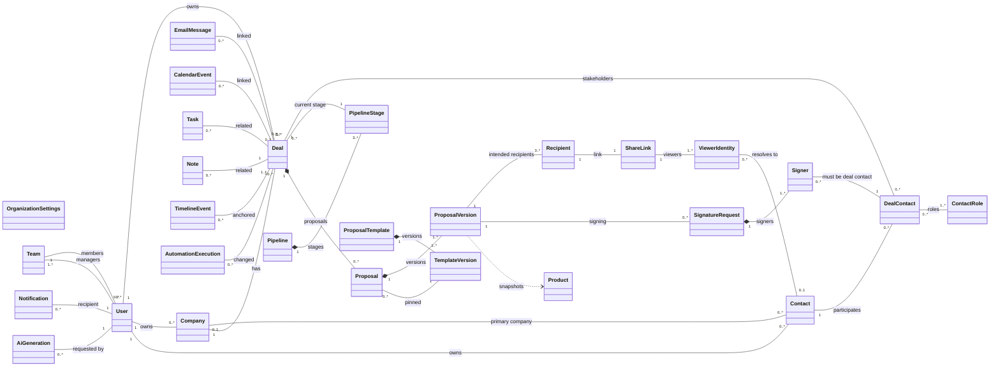
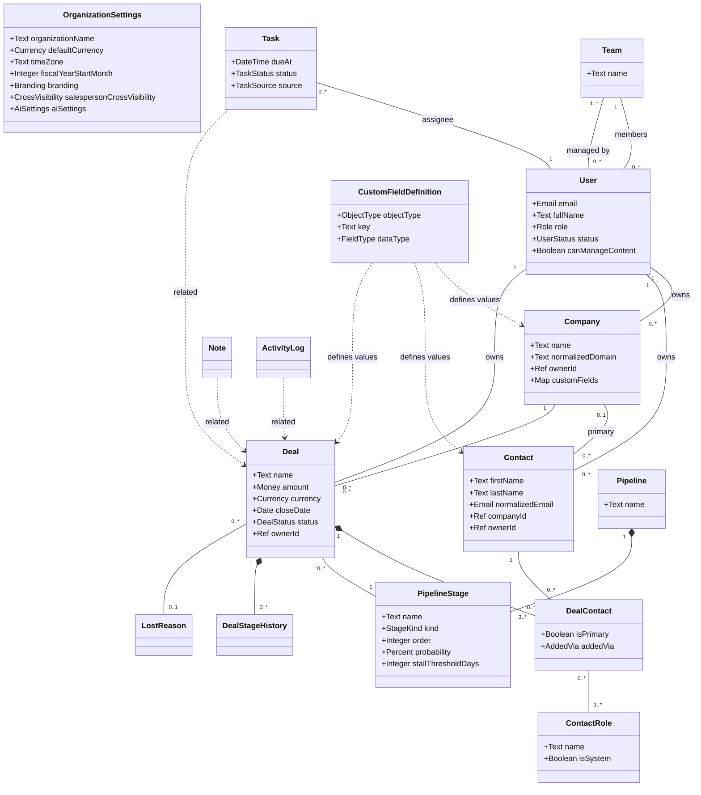
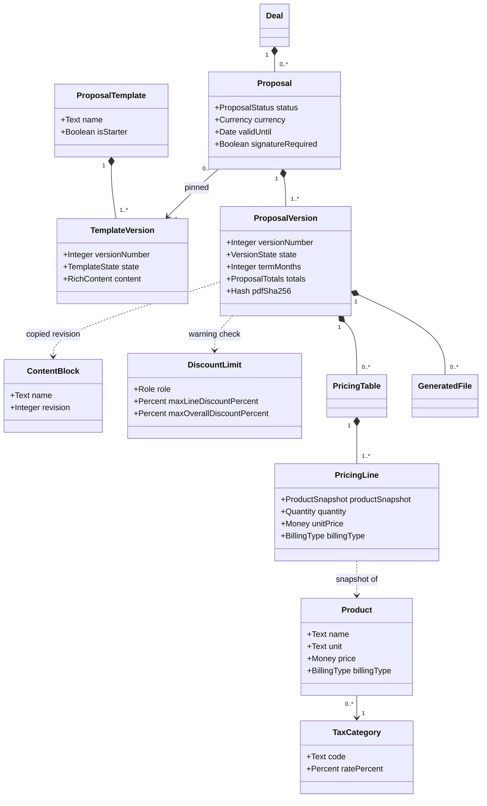
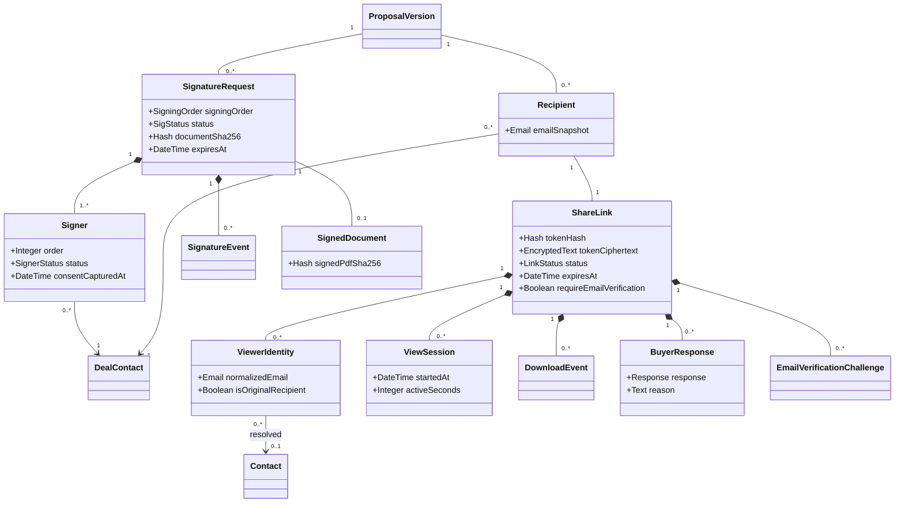
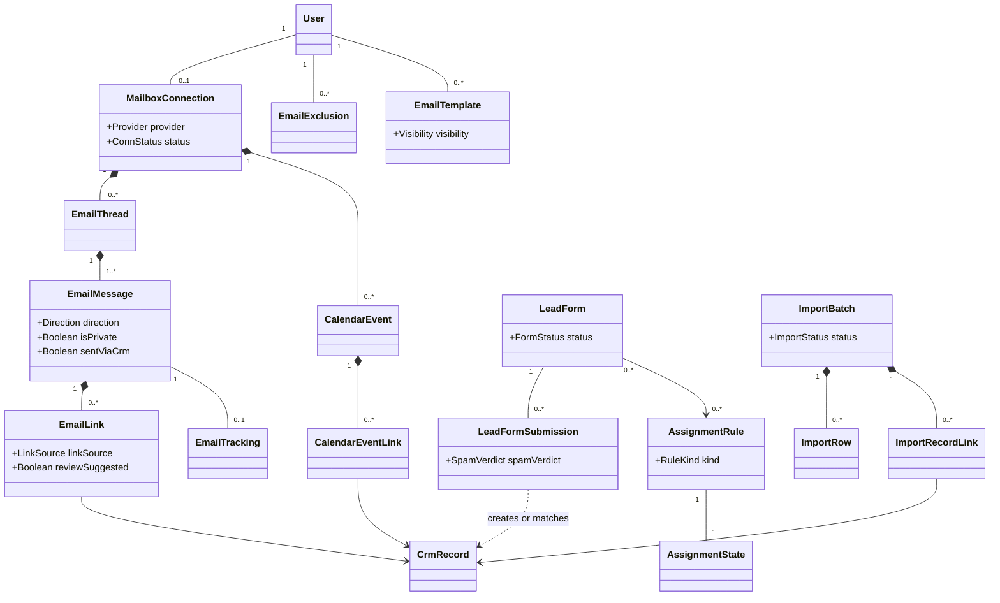
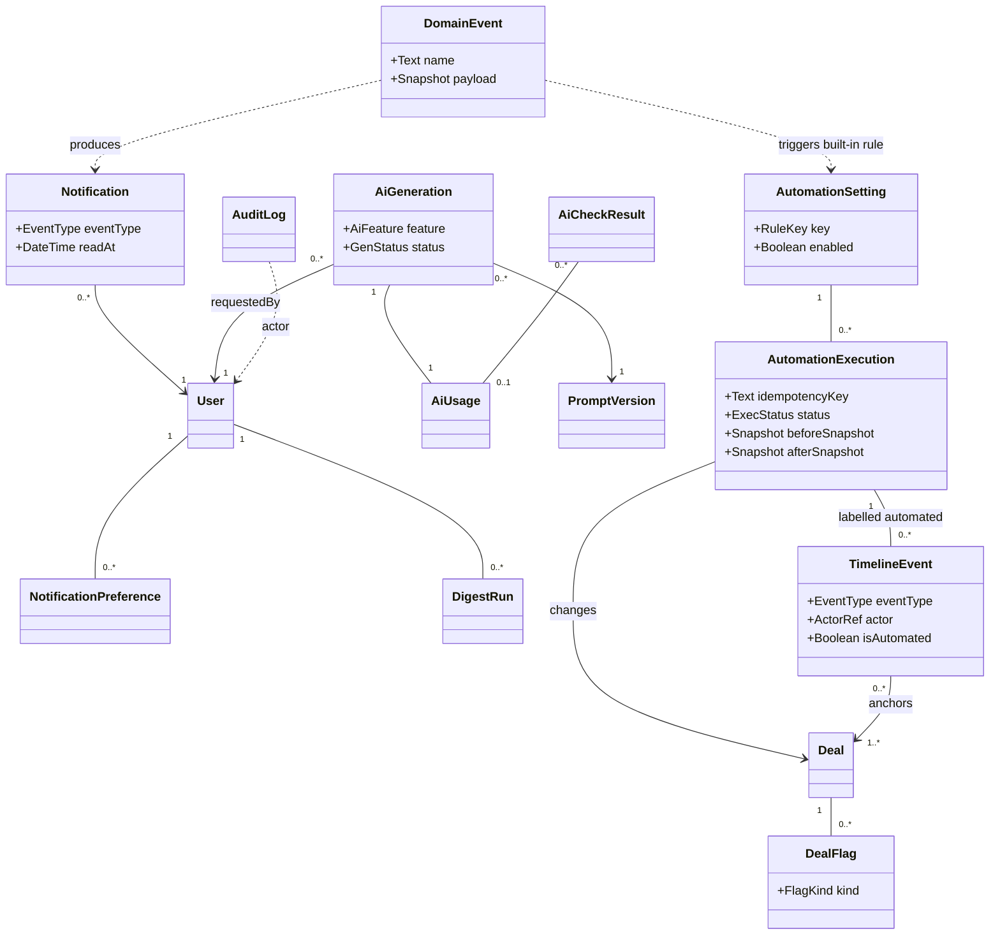

# Domain Model — Internal Sales CRM (Phase 1)

| Item | Detail |
|---|---|
| Document | DOMAIN-MODEL.md (business domain model, not the physical schema) |
| Applies to | BRD v2.0 Phase 1, single-company internal deployment (IDD-01..IDD-16) |
| Binding inputs | Design foundation (§3 IDD, §4 OD working assumptions, §5 vocabulary, §7 module map, §8 permissions); BRD v2.0 §9, §10, §11, §17.1 |
| Companion documents | ROLE-PERMISSION-MATRIX.md (authoritative permissions), BUSINESS-RULES.md (RULE-*), WORKFLOWS.md (WF-*), DATA-MODEL / TLD documents (physical schema) |
| Status | Draft for review |

Conventions:
- BRD IDs are quoted unchanged (`BR-<MOD>-NNN`, `NFR-NNN`). Where this model depends on a foundation working assumption it cites the `OD-NN`; where it depends on an internal deployment decision it cites `IDD-NN`.
- Anything not traceable to the BRD, an IDD or an OD WA is marked **Derived — pending confirmation** (abbreviated **DPC** in tables).
- "Entity" = has identity and lifecycle. "Value object" (VO) = no identity, owned by and replaced with its entity.
- Physical table names follow foundation §7; refinements made here are listed in §13.

---

## 1. Business attribute types

| Business type | Meaning | Physical hint (foundation ADR-005) |
|---|---|---|
| Id | Surrogate identity, UUIDv7, system-generated, immutable | `uuid` |
| Text / LongText | Single-line (≤ 255) / multi-line plain text | `text` with length check |
| RichContent | Structured document content (ProseMirror JSON / block document, ADR-010) | `jsonb` |
| Email | RFC 5322 address; stored as entered plus a normalised form (lower-case, trimmed, OD-27) | `text` + `citext`/normalised column |
| Phone, Url | Free text with format validation | `text` |
| Integer, Number | Whole number / decimal | `integer` / `numeric` |
| Money | Amount + Currency (VO). Amounts `numeric(18,2)`; unit prices `numeric(18,4)` | `numeric` + `char(3)` |
| Currency | ISO-4217 code | `char(3)` |
| Percent | 0–100 with 4 decimals | `numeric(7,4)` |
| Quantity | Decimal quantity | `numeric(14,4)` |
| Date / DateTime | Calendar date in org time zone / instant in UTC | `date` / `timestamptz` |
| Boolean | Yes/No | `boolean` |
| Enum(x\|y) | Closed list of values (code values in lower snake case) | `text` + check / pg enum |
| Ref(Entity) | Reference to another entity's Id | FK `uuid` |
| Set(...) / List(...) | Collection of values or refs | join table or `jsonb` |
| File | Ref(FileObject) — binary stored in object storage (ADR-011) | FK `uuid` |
| Hash | SHA-256 hex digest | `char(64)` |
| Snapshot | Frozen copy of other entities' data at a point in time | `jsonb` |

Required column legend: **Y** = required, **N** = optional, **C** = conditionally required (condition stated).

### 1.1 Common attributes (all mutable entities; not repeated per entity)
| Attribute | Type | Meaning |
|---|---|---|
| id | Id | Surrogate identity (ADR-005) |
| createdAt / createdBy | DateTime / Ref(User) or actor | Creation instant and actor (null `createdBy` = system/external actor, see `createdByActorType`) |
| updatedAt / updatedBy | DateTime / Ref(User) | Last modification |
| rowVersion | Integer | Optimistic concurrency token (ADR-016: 409 on mismatch) |
| archivedAt / archivedBy | DateTime / Ref(User) | Present only on archivable entities: Company, Contact, Deal, ProposalTemplate, Product, ContentBlock, and configuration lists (DPC for configuration lists) |

Append-only entities (TimelineEvent, AuditLog, ViewSession, DownloadEvent, SignatureEvent, AiUsage, DomainEvent, AutomationExecution, DealStageHistory) have `createdAt` only and are never updated except for explicitly listed status fields.

### 1.2 Actor model (used by every "who did it" attribute)
| Actor type | Description | Source |
|---|---|---|
| user | An authenticated internal user (Admin, Sales Manager, Salesperson) | BR-PLT-003, BR-TIM-004 |
| buyer | An external person acting through a share-link token (recipient or forwarded viewer) or through the e-signature provider (signer) | BR-TIM-004, BR-SHR-005, BR-SIG-* |
| system | Platform jobs, automation rules, integrations (mail sync, provider webhooks, lead intake) | BR-TIM-004, BR-AUT-008 |
| ai | AI-generated content or checks, always on behalf of a requesting user | BR-TIM-004, BR-AIA-007 |

`ActorRef` VO = { actorType, userId?, viewerIdentityId?, signerId?, systemComponent? (`automation`, `scheduler`, `mail_sync`, `esign_webhook`, `lead_intake`, `import`), automationExecutionId?, aiGenerationId? }.

---

## 2. Bounded modules

Modules follow foundation §7. A module owns its entities; other modules use its service API and domain events, never its tables.

| Module | BRD | Aggregates (roots in bold) | Upstream dependencies (calls / consumes) |
|---|---|---|---|
| identity | PLT-002..006, 011, 012 | **User** (+TeamMembership), **Team** (+TeamManager), **Invitation**, **OrganizationSettings** (singleton) | platform (audit) |
| crm | CRM-001..014 | **Company**, **Contact**, **Deal** (+DealContact, DealStageHistory), **Pipeline** (+PipelineStage), **CustomFieldDefinition**, **LostReason**, **ContactRole**, **Task**, **Note**, **ActivityLog**, **SavedView**, **ExchangeRate** | identity, timeline, platform |
| import | MIG-001..007 | **ImportBatch** (+ImportRow, ImportRecordLink) | crm, templates (MIG-006), platform |
| comms | EML-001..007 | **MailboxConnection**, **EmailThread** (+EmailMessage, EmailLink), **EmailExclusion**, **EmailTemplate**, **CalendarEvent** (+CalendarEventLink), **EmailTracking** | identity, crm, timeline |
| leads | LED-001..007 | **LeadForm**, **LeadFormSubmission**, **AssignmentRule** (+AssignmentState) | crm, identity, notifications |
| templates | TPL-001..008 | **ProposalTemplate** (+TemplateVersion), **ContentBlock** | crm (field catalogue), identity (branding in settings) |
| catalog | PRC-001, 005, 007 | **Product**, **TaxCategory**, **DiscountLimit** | identity |
| proposals | PRP-001..010, PRC-002..006 | **Proposal** (+ProposalVersion, PricingTable VO, PricingLine VO, GeneratedFile) | crm, templates, catalog, ai, sharing, esign |
| sharing | SHR-001..010 | **ShareLink** (+Recipient, ViewerIdentity, ViewSession, DownloadEvent, BuyerResponse, EmailVerificationChallenge) | proposals, crm (stakeholder creation), comms (send) |
| esign | SIG-001..013 | **SignatureRequest** (+Signer, SignatureEvent, SignedDocument) | proposals, crm |
| ai | AIA-001..009 | **AiGeneration**, **AiCheckResult**, **AiUsage**, **PromptVersion** | crm, comms, proposals (read context), identity (switches) |
| notifications | NTF-001..004 | **Notification**, **NotificationPreference**, **DigestRun** | all producers via events |
| automation | AUT-001..008 | **AutomationSetting**, **AutomationExecution**, **DealFlag** | crm, proposals, sharing, esign (events) |
| reporting | RPT-001..010 | none (read models only) | all |
| timeline | TIM-001..004 | **TimelineEvent** | written by every module in-transaction (ADR-022) |
| platform | PLT-009, PLT-010, NFR-015 | **AuditLog**, **FileObject**, **ExportJob**, **DomainEvent**, **IdempotencyKey**, **RateLimitBucket**, **RetentionPolicy**, **ErasureRequest** | — |

---

## 3. Overview class diagram



Note: Task, Note, ActivityLog, EmailLink, CalendarEventLink and TimelineEvent relate to Company / Contact / Deal polymorphically; the overview shows only the Deal side.

---

## 4. Module: identity

### 4.1 OrganizationSettings (singleton, IDD-01)
Purpose: the one organization's configuration (BR-PLT-012). Exactly one instance exists for the deployment; created by the bootstrap command (IDD-02); never deleted.
Identity: fixed singleton (single row, constant key). No tenant id anywhere else (IDD-01).

| Attribute | Type | Req | Meaning | Source |
|---|---|---|---|---|
| organizationName | Text | Y | Legal/display name used in placeholders (`organization.*`) and buyer view | BR-PLT-012, BR-TPL-002 |
| defaultCurrency | Currency | Y | Default currency for deals, products, reports | BR-PRC-005, OD-15 |
| enabledCurrencies | Set(Currency) | Y | Currencies users may pick for deals (defaults to {defaultCurrency}) | BR-PRC-006, OD-15 |
| timeZone | Text (IANA) | Y | Org time zone for dates, due dates, digests, "today" | BR-PLT-012 |
| locale | Text (BCP-47) | Y | Number/date/currency formatting for placeholders | Foundation §9 (placeholder formatting) |
| fiscalYearStartMonth | Integer 1–12 | Y | Fiscal-period filters in reporting | BR-PLT-012, BR-RPT-007 |
| branding | Branding VO | Y | Logo (File), primaryColor, secondaryColor, fontFamily (from allowed list), buyer-view footer text | BR-TPL-006, BR-SHR-009 |
| buyerLinkDomain | Text | N | Hostname used for share links (foundation §10) | ADR-013 |
| salespersonCrossVisibility | VO {companies, contacts, deals: Enum(none\|view_only)} | Y | Admin setting granting salespeople view-only access to others' records per object type; default none | §9.17, OD-31 |
| loginMethods | VO {password: Boolean, google: Boolean, microsoft: Boolean, allowedDomains: Set(Text)} | Y | Enabled sign-in methods restricted to company domain/tenant | BR-PLT-003, OD-12 |
| mfaPolicy | Enum(optional\|required_admins\|required_all) | Y | MFA requirement | BR-PLT-004, OD-13 |
| aiSettings | VO {enabled: Boolean, features: Map(feature → Boolean), monthlyTokenBudget?: Integer, perUserDailyLimit?: Integer} | Y | Org AI switch + per-feature switches + internal budget | BR-AIA-008, IDD-08, IDD-10 |
| emailOpenTrackingAllowed | Boolean | Y | Org-wide enablement of BR-EML-007; default false | OD-37 |
| esignDefaults | VO {reminderScheduleDays: List(Integer), requestExpiryDays: Integer, smsVerificationAllowed: Boolean} | Y | Defaults for signature requests | BR-SIG-005, BR-SIG-008 |
| shareDefaults | VO {defaultLinkExpiryDays?: Integer, linkExpiringNoticeHours: Integer, requireEmailVerificationDefault: Boolean} | Y | Defaults for share links | BR-SHR-006, BR-SHR-007, BR-NTF-001 |
| proposalDefaults | VO {defaultTermMonths: Integer (12), defaultValidityDays?: Integer} | Y | Defaults for new proposals | OD-16, OD-44, BR-PRP-009 |
| defaultLeadOwnerId | Ref(User) | N | Fallback owner when no assignment rule matches | BR-LED-002, OD-54 item o |
| freeMailDomains | Set(Text) | Y | Admin-maintained free-mail domains (seeded: gmail.com, outlook.com, hotmail.com, yahoo.com, icloud.com, …) excluded from company domain matching | §12 resolution R3, DR-LED-04 |
| internalDomains | Set(Text) | Y | Our own email domains, excluded from linking and forwarded-viewer detection; defaults to login allowed domains | OD-64 |
| privacyNoticeText / privacyNoticeVersion | LongText / Integer | Y | Notice shown at forwarded-viewer identity gate | OD-26 |
| notificationDefaults | Map(eventType → {inApp, email}) | Y | Defaults applied to new users | BR-NTF-002 (DPC) |

Invariants: `defaultCurrency ∈ enabledCurrencies`; at least one login method enabled; if `password=false` then at least one OAuth method enabled; changing `defaultCurrency` after deals exist is blocked (DPC — reporting conversion base would change).
Visibility: all authenticated users read non-secret fields (branding, currency, time zone, locale, fiscal year); only Admin edits (PERM matrix).

### 4.2 User
Purpose: an internal person with credentials and one application role (BR-PLT-003, BR-PLT-005). Authentication data (credentials, sessions, OAuth accounts, TOTP secrets) is owned by Better Auth (ADR-006); this entity is the application profile.
Identity: Id; natural key `normalizedEmail` (unique across all users including deactivated).

| Attribute | Type | Req | Meaning | Source |
|---|---|---|---|---|
| email / normalizedEmail | Email | Y | Sign-in and notification address; company domain | BR-PLT-003, OD-12 |
| fullName | Text | Y | Display name; `owner.*` placeholders | BR-TPL-002 |
| title, phone | Text, Phone | N | `owner.*` placeholders | BR-TPL-002 |
| role | Enum(admin\|sales_manager\|salesperson) | Y | Exactly one role | BR-PLT-005 |
| status | Enum(invited\|active\|deactivated) | Y | Lifecycle | BR-PLT-002, BR-PLT-011 |
| canManageContent | Boolean | Y | Admin-granted "Optional" right for Sales Managers to manage templates, content library and product catalog (ignored for other roles); does NOT include section locking or DOCX upload, which stay Admin-only (§12 R8) | §9.17, §12 R8 |
| canManageSharedEmailTemplates | Boolean | Y | Admin-granted right for Sales Managers to manage shared email templates | OD-31 |
| timeZone | Text (IANA) | N | Personal override for display/reminders; defaults to org | DPC |
| emailSignature | RichContent | N | Appended to CRM-sent emails | BR-EML-004 (DPC) |
| mfaEnabled | Boolean (read from auth) | Y | Whether TOTP enrolled | BR-PLT-004 |
| lastSignInAt | DateTime | N | Adoption reporting | §12 Adoption |
| deactivatedAt / deactivatedBy / reassignedToUserId | DateTime / Ref(User) / Ref(User) | C (status=deactivated) | Deactivation record | BR-PLT-011 |
| roundRobinEligible | Boolean | Y | Included in assignment pools (false when deactivated) | BR-LED-002, foundation §9 |

Lifecycle: `invited → active → deactivated → active` (reactivation by Admin, DPC). Deactivation preconditions and effects: see ROLE-PERMISSION-MATRIX §6.
Invariants: at least one active Admin must always exist; a user cannot change their own role; a user with `role ≠ sales_manager` cannot be a TeamManager (DPC); deactivated users cannot own open deals, open tasks or non-terminal proposals (they must be reassigned first — foundation §9).

### 4.3 Invitation
Purpose: Admin invites a person by email (IDD-02 replaces self sign-up).
Identity: Id; the token is never stored, only its Hash.

| Attribute | Type | Req | Meaning | Source |
|---|---|---|---|---|
| email | Email | Y | Invitee | BR-PLT-002, IDD-02 |
| role | Enum | Y | Role on acceptance | BR-PLT-005 |
| teamId | Ref(Team) | N | Team on acceptance | BR-PLT-006 |
| tokenHash | Hash | Y | SHA-256 of single-use token | ADR-006 |
| status | Enum(pending\|accepted\|revoked\|expired) | Y | Lifecycle | DPC |
| expiresAt | DateTime | Y | Default 7 days | DPC |
| invitedBy | Ref(User) | Y | Admin | §9.17 |

Invariants: at most one pending invitation per normalised email; cannot invite an email of an existing active user.

### 4.4 Team, TeamMembership, TeamManager
Purpose: grouping for manager visibility (BR-PLT-006, OD-32).

| Entity | Attribute | Type | Req | Meaning | Source |
|---|---|---|---|---|---|
| Team | name | Text | Y | Unique among non-archived teams | BR-PLT-006 |
| Team | archivedAt | DateTime | N | Archive only when no members | DPC |
| TeamMembership | teamId, userId | Ref, Ref | Y | User belongs to **at most one** team (unique userId) | OD-32 |
| TeamMembership | startedAt, endedAt | DateTime | Y/N | Membership history | ROLE-PERMISSION-MATRIX §6 |
| TeamMembership | isActive | Boolean | Y | false when the member is deactivated; the membership is **retained** so managers keep visibility of the member's records (§12 resolution R7) | §12 R7, OD-32 |
| TeamManager | teamId, userId | Ref, Ref | Y | A team has **one or more** managers; a manager may manage several teams; no nested teams | OD-32 |

Invariants: every non-archived team has ≥ 1 TeamManager (DPC: enforced when the team gets its first member); TeamManager.user.role = sales_manager (DPC); a manager may also be a member of one team (typically one they manage).
Team scope of a manager = own records + records owned by members (active or inactive) AND co-managers of the teams they manage (§12 resolution R7; ROLE-PERMISSION-MATRIX §2.2).

---

## 5. Module: crm

### 5.1 Company
Purpose: a B2B organization we sell to (BR-CRM-001). Root of the account aggregate.
Identity: Id; duplicate-match keys `normalizedDomain` (primary), else `normalizedName` exact (OD-27). `normalizedDomain` unique among non-archived companies (OD-60 WA — makes OD-27 matching deterministic). Free-mail domains (Admin-maintained list, `OrganizationSettings.freeMailDomains`) are never stored as `normalizedDomain` nor used for matching (§12 resolution R3, DR-LED-04).

| Attribute | Type | Req | Meaning | Source |
|---|---|---|---|---|
| name / normalizedName | Text | Y | Company name; normalisation = lower-case, trimmed, collapsed whitespace, legal suffixes kept | BR-CRM-001, OD-27 |
| domain / normalizedDomain | Text | N | Primary web/email domain (no scheme, no `www.`) | OD-27, OD-26, OD-33 |
| ownerId | Ref(User) | Y | Owner for visibility (§9.17 "Own") — default creator, lead assignee or import default; reassignment mirrors deals (PERM-041) | §9.17, §12 resolution R6 |
| industry, size, phone, website, address (VO) | Text/Enum/Phone/Url/Address | N | Standard descriptive fields; `company.*` placeholders | BR-TPL-002 (field list DPC) |
| customFields | Map(definitionKey → CustomFieldValue) | N | Values for company custom fields | BR-CRM-007 |
| source | SourceAttribution VO | N | Lead source (form, campaign tags, page) or import batch | BR-LED-005, BR-MIG-001 |
| externalIds | Map(system → Text) | N | Source ids from HubSpot/Pipedrive/CSV for re-import matching | BR-MIG-002, OD-27 |
| archivedAt | DateTime | N | Archived (BR-CRM-001) | BR-CRM-001 |

Lifecycle: active ⇄ archived. Hard delete only via ErasureRequest (OD-36).
Invariants: cannot be archived while it has open deals (DPC); archiving hides it from pickers but keeps relations; a company's custom field values must conform to their definitions.

### 5.2 Contact
Purpose: a person on the buyer side (BR-CRM-002). Becomes a stakeholder through DealContact.
Identity: Id; match key `normalizedEmail` (OD-27). Unique among non-archived contacts when present (OD-60 WA). Contacts without email are allowed (manual entry) but cannot be recipients or signers.

| Attribute | Type | Req | Meaning | Source |
|---|---|---|---|---|
| firstName, lastName | Text | C (at least one of name/email) | Name; `contact.*` placeholders | BR-CRM-002 |
| email / normalizedEmail | Email | N | Primary email; key for email linking, form dedupe, forwarded viewer matching | OD-27, OD-26, BR-EML-002 |
| additionalEmails | Set(Email) | N | Secondary addresses used for email matching | BR-EML-002 (DPC) |
| phone, mobilePhone, jobTitle | Phone, Phone, Text | N | Descriptive; mobile used as default for SMS verification | BR-SIG-005 |
| companyId | Ref(Company) | N | **Zero or one primary company** | BR-CRM-002, OD-33 |
| ownerId | Ref(User) | Y | Owner for visibility; reassignment mirrors deals (PERM-046) | §9.17, §12 resolution R6 |
| customFields | Map | N | Contact custom fields | BR-CRM-007 |
| source | SourceAttribution VO | N | Lead/import/forwarded-viewer origin | BR-LED-005, OD-26 |
| emailSyncExcluded | Boolean (derived from EmailExclusion) | — | Excluded from sync | BR-EML-003 |
| anonymisedAt | DateTime | N | Set by governed erasure; personal fields blanked, financial records kept | OD-36 |

Invariants: `companyId` must reference a non-archived company at assignment time; a contact created as a forwarded viewer gets `companyId` = deal's company only if email domain = company `normalizedDomain` (never for free-mail domains, §12 R3), else none (OD-26). Visibility: anyone who can view a deal can read the deal's company and deal contacts regardless of owner (§12 resolution R6; ROLE-PERMISSION-MATRIX §4.4).

### 5.3 Deal
Purpose: a sales opportunity with commercial value (BR-CRM-003, §17.1). Root of the deal aggregate and the visibility root for proposals, sharing, signatures and most activity.
Identity: Id; import match key = external source id only (OD-27); no natural business key.

| Attribute | Type | Req | Meaning | Source |
|---|---|---|---|---|
| name | Text | Y | Deal name | BR-CRM-003 |
| companyId | Ref(Company) | Y | **Exactly one company** (B2B) | BR-CRM-003, OD-33 |
| ownerId | Ref(User) | Y | **Exactly one owner** | BR-CRM-004 |
| pipelineId / stageId | Ref(Pipeline) / Ref(PipelineStage) | Y | Exactly one pipeline and one stage of that pipeline | BR-CRM-003, BR-CRM-005, Foundation §5 |
| status | Enum(open\|won\|lost) — derived from stage.kind | Y | Not independently editable | Foundation §5 |
| amount | Money | N (Y when won, DPC) | Deal value in deal currency | BR-CRM-003 |
| amountSource | VO {kind: Enum(manual\|proposal\|automation), proposalVersionId?} | Y | Provenance of the amount (BR-PRC-004 prompt, BR-AUT-002) | BR-PRC-004, BR-AUT-002, OD-16 |
| currency | Currency | Y | Defaults to org default; ∈ enabledCurrencies | BR-PRC-006, OD-15 |
| closeDate | Date | N (Y when closed) | Expected close date while open; actual close date when closed (AUT-002 sets signing date) | BR-CRM-003, BR-AUT-002, BR-AUT-006 |
| closedAt | DateTime | C (status ≠ open) | System instant of closing | OD-35 |
| lostReasonId / lostReasonNote | Ref(LostReason) / LongText | C (status=lost: reason Y, note N) | Required lost reason | BR-CRM-014 |
| wonFromProposalId | Ref(Proposal) | N | Proposal whose signature closed it | BR-AUT-002, OD-23 |
| reopenReason | LongText | C (on reopen) | Required reason when a closed deal is reopened (kept in history) | OD-31 |
| lastActivityAt | DateTime | N | Last qualifying activity per OD-35 (for stalled detection) | BR-AUT-005, OD-35 |
| stageEnteredAt | DateTime | Y | When current stage was entered (stalled threshold base, DPC) | BR-AUT-005 |
| customFields | Map | N | Deal custom fields | BR-CRM-007 |
| source | SourceAttribution VO | N | Lead form / import origin | BR-LED-005 |
| externalIds | Map | N | Import source ids | OD-27 |
| archivedAt | DateTime | N | Archived (soft delete) | Foundation ADR-005 |

Lifecycle (stage-kind driven):
```
open ──(manual stage move / AUT-001)──> open
open ──(manual Won | AUT-002 signature.completed)──> won
open ──(manual Lost + lost reason)──> lost
won|lost ──(reopen + reason, OD-31 | AUT reversal OD-24)──> open
any ──archive──> archived (orthogonal flag)
```
Invariants:
- stage ∈ pipeline.stages; moving pipelines requires choosing a stage in the target pipeline (DPC).
- status = lost ⇒ lostReasonId present (BR-CRM-014).
- status ≠ open ⇒ closeDate present.
- Manual Closed Lost while a signature request is open ⇒ user must confirm and the request is voided (foundation §9).
- currency cannot change once any proposal version of the deal has been sent (DPC — sent snapshots are in deal currency, OD-15).
- At most one open SignatureRequest across all proposals of the deal (OD-23).
- companyId change is allowed only while the deal has no sent proposal version (DPC).

### 5.4 DealContact (Stakeholder)
Purpose: a contact's participation in a deal with one or more roles (BR-CRM-003). "Stakeholder" (§17.1) = DealContact. Forwarded viewers become DealContacts with the system role "Forwarded viewer" (OD-26).
Identity: Id; natural key (dealId, contactId) unique.

| Attribute | Type | Req | Meaning | Source |
|---|---|---|---|---|
| dealId, contactId | Ref | Y | Participation | BR-CRM-003 |
| roleIds | Set(Ref(ContactRole)) | Y (≥ 1) | Several roles allowed on one deal | OD-34 |
| isPrimary | Boolean | Y | Primary contact; default source for `contact.*` placeholders; at most one per deal | BR-TPL-002 (DPC) |
| addedVia | Enum(manual\|import\|lead_form\|forwarded_viewer\|email_link\|signer_add) | Y | Provenance | OD-26 |
| addedBy | ActorRef | Y | Who added it (buyer actor for forwarded viewer) | BR-TIM-004 |

Invariants: contact must not be archived when added; removing a DealContact that is a Signer on an open SignatureRequest is blocked; the "Forwarded viewer" role is system-assigned and cannot be removed while it is the only role (replace with another role instead, DPC).

### 5.5 ContactRole
Purpose: Admin-defined list of deal roles (OD-34). Seeded: Decision-maker, Signer, Influencer, **Forwarded viewer (system, non-deletable)**.
Attributes: name (Text, Y, unique), isSystem (Boolean), sortOrder (Integer), archivedAt. Archived roles stay on existing DealContacts.

### 5.6 Pipeline and PipelineStage
Purpose: configurable sequence of sales stages with win probabilities (BR-CRM-005, BR-CRM-006).

| Entity | Attribute | Type | Req | Meaning | Source |
|---|---|---|---|---|---|
| Pipeline | name | Text | Y | Unique | BR-CRM-006 |
| Pipeline | isDefault | Boolean | Y | Exactly one default | DPC |
| Pipeline | archivedAt | DateTime | N | Archive only with no open deals | DPC |
| PipelineStage | name | Text | Y | Unique within pipeline | BR-CRM-005 |
| PipelineStage | kind | Enum(open\|won\|lost) | Y | Exactly one `won` ("Closed Won", probability 100) and one `lost` ("Closed Lost", probability 0) per pipeline, system-owned | Foundation §5 |
| PipelineStage | order | Integer | Y | Position; won/lost always last; "earlier stage" for AUT-001 = lower order among open stages | BR-AUT-001 |
| PipelineStage | probability | Percent | Y | Win probability (weighted pipeline) | BR-CRM-005, BR-RPT-006 |
| PipelineStage | stallThresholdDays | Integer | N | Days without activity before flag (null = no flag) | BR-AUT-005 |
| PipelineStage | isSystem | Boolean | Y | true for won/lost | Foundation §5 |

Invariants: ≥ 1 open stage; stages with deals cannot be deleted — they are archived after moving deals (DPC); system stages cannot be renamed to change kind, probability fixed.

### 5.7 DealStageHistory (refinement, §13)
Purpose: append-only record of each stage change, used for cycle-length reporting, AUT-001 precondition, reversal (OD-24) and timeline.
Attributes: dealId, fromStageId (N for creation), toStageId, changedAt, actor (ActorRef), automationExecutionId (N), reason (N, e.g. reopen reason). Source: BR-TIM-001, BR-RPT-003, BR-AUT-008.

### 5.8 LostReason
Admin-defined list (BR-CRM-014, OD-31). Attributes: name (Y, unique), sortOrder, archivedAt. Archived reasons remain on deals and in reports.

### 5.9 CustomFieldDefinition and CustomFieldValue (VO)
Purpose: Admin-defined fields on companies, contacts and deals usable in filters, reports and templates (BR-CRM-007).

| Attribute | Type | Req | Meaning | Source |
|---|---|---|---|---|
| objectType | Enum(company\|contact\|deal) | Y | Target entity | BR-CRM-007 |
| key | Text (snake_case, immutable) | Y | Stable key used in placeholders (`deal.cf.<key>`) and imports; unique per objectType | BR-TPL-002 |
| label | Text | Y | Display label | BR-CRM-007 |
| dataType | Enum(text\|number\|currency\|date\|dropdown\|multi_select\|checkbox) | Y | Exactly the BRD list; immutable after values exist | BR-CRM-007 |
| options | List({value, label, archived}) | C (dropdown, multi_select) | Allowed values | BR-CRM-007 |
| required | Boolean | Y | Required on create/edit via UI (not enforced on import rows — they get validation errors) | BR-MIG-004 (DPC) |
| helpText, sortOrder | Text, Integer | N | UI | DPC |
| archivedAt | DateTime | N | Archived definitions keep values; templates referencing them are flagged by BR-TPL-008 | Foundation §9 |

CustomFieldValue VO by dataType: text → Text; number → Number; currency → Money (currency = record currency: deal currency for deals, org default for company/contact, DPC); date → Date; dropdown → option value; multi_select → Set(option value); checkbox → Boolean.
Placeholder formatting: org locale; currency per currency rules; multi-select joined by ", "; checkbox "Yes"/"No" (foundation §9).

### 5.10 Task
Purpose: a to-do with due date and reminder linked to a record (BR-CRM-008); also created by automation (BR-AUT-003/004, OD-17) and AI suggestion.

| Attribute | Type | Req | Meaning | Source |
|---|---|---|---|---|
| title | Text | Y | What to do | BR-CRM-008 |
| description | LongText | N | Details | BR-CRM-008 |
| related | RecordRef VO {type: company\|contact\|deal, id} | Y | Linked record (exactly one primary link, DPC) | BR-CRM-008 |
| assigneeId | Ref(User) | Y | Responsible user (defaults to record owner) | BR-CRM-008 |
| dueAt | DateTime (or Date for all-day) | Y | Due date | BR-CRM-008 |
| reminderAt | DateTime | N | Reminder instant (in-app + email, OD-47) | BR-CRM-008, OD-47 |
| status | Enum(open\|completed\|cancelled) | Y | Lifecycle | Foundation §5 |
| completedAt / completedBy | DateTime / ActorRef | C | Completion | BR-RPT-010 |
| source | Enum(manual\|automation\|ai_suggested) | Y | Origin | Foundation §5 |
| automationExecutionId | Ref | C (source=automation) | Reversal link | BR-AUT-008 |
| overdue | Boolean (derived: status=open ∧ dueAt < now) | — | Overdue (My Day, BR-AUT-006 is for deals) | BR-CRM-009 |

Invariants: assignee must be active; completing/cancelling is terminal except "reopen" by an editor (DPC).

### 5.11 Note
Purpose: free-text note on a record (BR-CRM-010). Attributes: body (RichContent, Y), related (RecordRef, Y), authorId (Y), pinned (Boolean, N, DPC). Author may edit; edits recorded in audit.

### 5.12 ActivityLog
Purpose: manually logged call or meeting (BR-CRM-010).
Attributes: kind (Enum call|meeting, Y), occurredAt (DateTime, Y), durationMinutes (Integer, N), outcome (Text, N), notes (RichContent, N), related (RecordRef, Y), participantContactIds (Set(Ref(Contact)), N), loggedBy (Ref(User), Y). Counts as activity for OD-35 and BR-RPT-010.

### 5.13 SavedView
Purpose: filter/sort/column configuration of a list or board (BR-CRM-011).
Attributes: name (Y), objectType (Enum company|contact|deal|proposal|task, Y), layout (Enum list|board), filters (structured, Y — standard + custom fields), sort, columns, ownerId (Y), sharing (Enum personal|team|organization — DPC), isDefault. A view never widens visibility; results are always permission-scoped.

### 5.14 ExchangeRate
Purpose: Admin-maintained rates to convert to org default currency for reporting (OD-15) and to convert catalog prices on lines in a non-default currency at line creation (§12 R10, OD-57).
Attributes: fromCurrency (Y), toCurrency (= org default, Y), rate (Number > 0, Y), effectiveFrom (Date, Y). Unique (fromCurrency, effectiveFrom). Reports use the rate effective on the metric date (close date for won/lost, report date for open pipeline — DPC).

### 5.15 Value objects (crm)
- **SourceAttribution**: kind (Enum lead_form|import|manual|forwarded_viewer|email_addin|webhook), leadFormId?, submissionId?, importBatchId?, utm {source, medium, campaign, term, content}?, pageUrl?, referrer? (BR-LED-005).
- **Address**: line1, line2, city, region, postalCode, country (ISO-3166).
- **RecordRef**: {type, id}.

---

## 6. Module: import

### 6.1 ImportBatch
Purpose: one import run (BR-MIG-001..005).
Attributes: source (Enum csv|xlsx|hubspot_export|pipedrive_export|api — api is BR-MIG-007 Could), entityTypes (Set(company|contact|deal)), sourceFileIds (List(File)), mapping (column → standard/custom field per entity), defaults (owner, pipeline, stage), duplicateStrategyDefault (Enum skip|merge|create), status (Enum uploaded|mapped|validating|validated|committing|committed|undoing|undone|failed), counts {rows, valid, errors, created, merged, skipped}, createdBy (Admin), committedAt, undoneAt/undoneBy.
Lifecycle: `uploaded → mapped → validating → validated → committing → committed → undoing → undone`; any → failed. Nothing is saved to CRM entities before `committing` (BR-MIG-004).

### 6.2 ImportRow
Attributes: batchId, rowNumber, entityType, rawData (Snapshot), mappedData (Snapshot), validationErrors (List({field, code, message})), duplicateCandidates (List(RecordRef + matchKey)), resolution (Enum skip|merge|create, Y when candidates exist), outcome (Enum pending|created|merged|skipped|error).

### 6.3 ImportRecordLink
Purpose: enables undo (BR-MIG-005). Attributes: batchId, rowId, record (RecordRef), action (Enum created|merged), beforeSnapshot (C, merged), afterVersion (rowVersion after import).
Undo rule (DPC): created records whose rowVersion is unchanged are hard-removed; created records modified after import and merged records whose fields changed after import are listed in an undo report and left in place (merged ones restored only for fields unchanged since import). Undo is blocked when a created deal has a sent proposal.

---

## 7. Module: comms (email and calendar)

### 7.1 MailboxConnection
Purpose: a user's connected Gmail or Microsoft 365 mailbox and calendar (BR-EML-001, BR-EML-006).
Identity: Id; natural key (userId, provider) unique; one connection per user (DPC).

| Attribute | Type | Req | Meaning | Source |
|---|---|---|---|---|
| userId | Ref(User) | Y | Owner (mailbox owner) | BR-EML-001 |
| provider | Enum(google\|microsoft) | Y | Adapter | OD-06 |
| emailAddress | Email | Y | Mailbox address | BR-EML-001 |
| status | Enum(active\|reauth_required\|error\|disconnected) | Y | Connection health | DPC |
| grantedScopes | Set(Text) | Y | OAuth scopes | ADR-012 |
| encryptedTokens | secret (never exposed) | Y | AES-256-GCM | ADR-012 |
| mailSyncCursor / calendarSyncCursor | Text | N | Delta tokens | ADR-012 |
| lastSyncedAt, lastErrorAt, lastErrorCode | DateTime, DateTime, Text | N | Health | DPC |
| calendarSyncEnabled | Boolean | Y | Calendar logging on | BR-EML-006 |

Invariants: disconnect or user deactivation revokes tokens and stops sync (foundation §9); already-synced messages remain (subject to retention, OD-36).

### 7.2 EmailThread and EmailMessage
Purpose: synced or CRM-sent emails with known contacts (BR-EML-002, BR-EML-004). Unknown-sender emails are not stored unless their thread is already linked (OD-29).

| Attribute (EmailMessage) | Type | Req | Meaning | Source |
|---|---|---|---|---|
| mailboxConnectionId | Ref | Y | Mailbox (owner = mailbox user) | BR-EML-001 |
| threadId | Ref(EmailThread) | Y | Conversation | BR-AIA-003 |
| providerMessageId / internetMessageId | Text | Y | Provider id (unique per mailbox) / RFC 5322 Message-ID (cross-mailbox de-duplication on timelines, DPC) | ADR-012 |
| direction | Enum(inbound\|outbound) | Y | Relative to the mailbox owner | BR-EML-002 |
| sentAt | DateTime | Y | Timestamp | BR-TIM-001 |
| from, to, cc, bcc | EmailParticipant VO list {email, name, contactId?} | Y (from, to) | Participants; contactId resolved by normalised email | BR-EML-002 |
| subject | Text | N | Subject (hidden if private for non-owners) | OD-30 |
| bodyText / bodyHtml | LongText | N | Content (hidden if private; untrusted data for AI, ADR-014) | OD-30 |
| attachments | List({fileName, size, contentType, providerAttachmentId}) | N | Metadata only by default (DPC) | DPC |
| isPrivate | Boolean | Y | Marked private by mailbox owner | BR-EML-003, OD-30 |
| sentViaCrm | Boolean | Y | Sent from CRM/add-in | BR-EML-004 |
| emailTemplateId | Ref | N | Template used | BR-EML-004 |
| relatedProposalVersionId | Ref | N | Email carried proposal share links | BR-SHR-002 |
| trackingEnabled | Boolean | Y | Open tracking for this email | BR-EML-007, OD-37 |

EmailThread attributes: mailboxConnectionId, providerThreadId, subject, lastMessageAt, isLinked (Boolean).

### 7.3 EmailLink
Purpose: association of an email message to a company, contact or deal; automatic or user-corrected (BR-EML-002, OD-28).
Attributes: emailMessageId (Y), target (RecordRef, Y), linkSource (Enum auto|manual|thread_inherited), reviewSuggested (Boolean — set when OD-28 picked one of several open deals), state (Enum active|removed), linkedBy/removedBy (ActorRef).
Rules (OD-28): always link to matching contacts and their primary companies; link to the single open deal of those contacts if exactly one; if several, link to the open deal with most recent activity with `reviewSuggested=true`; users can add/remove links.

### 7.4 EmailExclusion
Purpose: exclude domains or contacts from syncing (BR-EML-003).
Attributes: scope (Enum user|organization — organization scope DPC), ownerUserId (C, scope=user), kind (Enum domain|email_address|contact), value (Y), createdBy. Matching emails are not stored; previously stored messages matching a new exclusion are removed from the CRM (DPC).

### 7.5 EmailTemplate
Purpose: email templates with placeholders (BR-EML-004).
Attributes: name (Y), subject (Y, may contain placeholders), body (RichContent with placeholder nodes, Y), visibility (Enum personal|shared, OD-31), ownerUserId (C personal), archivedAt.

### 7.6 CalendarEvent and CalendarEventLink
Purpose: meetings with known contacts logged to timelines (BR-EML-006).
CalendarEvent attributes: mailboxConnectionId, providerEventId (unique per mailbox), iCalUid (cross-mailbox de-dup, DPC), title, startAt, endAt, organizer, attendees (EmailParticipant list), location / onlineMeetingUrl, status (Enum confirmed|tentative|cancelled), isPrivate (provider-private or user-marked; same rules as OD-30, DPC). Only events with ≥ 1 attendee matching a known contact are stored (OD-29 analogue, DPC).
CalendarEventLink: same shape and rules as EmailLink.

### 7.7 EmailTracking
Purpose: open tracking for CRM-sent emails (BR-EML-007, OD-37).
Attributes: emailMessageId (Y, unique), pixelTokenHash (Y), firstOpenedAt, lastOpenedAt, openCount. Opens are approximate (image proxies); never used for automation preconditions (DPC).

---

## 8. Module: leads

### 8.1 LeadForm
Purpose: Admin-built embeddable web form creating/updating contacts and companies, optionally deals (BR-LED-001).

| Attribute | Type | Req | Meaning | Source |
|---|---|---|---|---|
| name | Text | Y | Internal name | BR-LED-001 |
| publicKey | Text (random, unique) | Y | Embed/hosted-page identifier | ADR-013 analogue |
| status | Enum(draft\|published\|unpublished\|archived) | Y | Only published forms accept submissions | DPC |
| fields | List(FormField VO {label, target: standard or custom field ref, inputType, required, options, hidden, defaultValue}) | Y | Field definitions mapped to CRM fields | BR-LED-001 |
| createDeal | VO {enabled, pipelineId, stageId, dealNameTemplate} | N | Optional deal creation | BR-LED-001 |
| assignmentRuleIds | List(Ref(AssignmentRule)) ordered | N | Rules evaluated in order; fallback defaultLeadOwnerId | BR-LED-002 |
| spamProtection | VO {honeypot: Boolean, captcha: Boolean, rateLimitPerIpPerHour: Integer} | Y | Spam controls | BR-LED-006, OD-46 |
| consentText | LongText | N | Privacy/consent text shown on form | NFR-002 (DPC) |
| successMessage / redirectUrl | Text / Url | N | Post-submit behaviour | DPC |
| allowedOrigins | Set(Url) | N | Embedding origins | DPC |

### 8.2 LeadFormSubmission
Purpose: one received submission (BR-LED-001, 004, 005).
Attributes: leadFormId, receivedAt, payload (Snapshot), source (SourceAttribution VO: utm, pageUrl, referrer), ipHash, spamVerdict (Enum clean|rejected_honeypot|rejected_captcha|rate_limited), dedupeResult ({contact: created|matched, company: created|matched|none, deal: created|none}), resultingRecords (List(RecordRef)), assignedUserId, assignmentRuleId (N), processingStatus (Enum received|processed|rejected|failed).
Invariants: processing is idempotent per submission; matching follows OD-27 (contact by normalised email; company by domain from email — never a free-mail domain — or company name, §12 R3); matched records are updated only for empty fields and keep their existing owner (OD-58 WA — never overwrite existing values from an anonymous form); a deal is created only when a company is resolved (a deal requires a company, OD-33): otherwise the contact is created/updated and assigned without a deal (§12 resolution R3).

### 8.3 AssignmentRule and AssignmentState
Purpose: route leads by round-robin or field value (BR-LED-002).
AssignmentRule: name (Y), kind (Enum round_robin|field_value), conditions (List(AssignmentCondition VO {fieldRef, operator: equals|in|contains, values}); empty = always), pool (List(Ref(User)), Y ≥ 1 active, eligible), active (Boolean), priority (Integer).
AssignmentState: ruleId (unique), cursorUserId / lastAssignedAt — updated atomically to keep round-robin fair across concurrent submissions.
Invariants: deactivated users are removed from pools (foundation §9); a rule with an empty effective pool is skipped.

---

## 9. Module: templates

### 9.1 ProposalTemplate
Purpose: reusable proposal design (BR-TPL-001). Root of template aggregate.
Attributes: name (Y, unique among active), description (N), status (Enum active|archived), currentPublishedVersionId (N until first publish), isStarter (Boolean — IDD-11 starter template), sourceDocxFileId (N — BR-MIG-006), defaultPricingTableConfig (N), ownerId/createdBy.

### 9.2 TemplateVersion
Purpose: immutable published snapshot that proposals pin (BR-TPL-004).

| Attribute | Type | Req | Meaning | Source |
|---|---|---|---|---|
| templateId, versionNumber | Ref, Integer | Y | Sequential per template | BR-TPL-004 |
| state | Enum(draft\|published\|retired) | Y | Only `published` can be chosen for new proposals; at most one draft per template | DPC |
| content | RichContent (block document: sections → blocks, ADR-010) | Y | Sections with text, images, tables, pricing_table, content_block_ref, signature_block | BR-TPL-001 |
| sections[].locked | Boolean | Y | Locked vs editable. Set only by Admin (§12 R8); a locked section is read-only inside every proposal for every role, Admin included | BR-TPL-003, §12 R8 |
| sections[].required | Boolean | Y | Required section (pre-send check) | BR-AIA-002 (DPC) |
| sections[].aiDraftable | Boolean | N | Section offered for AI drafting | BR-AIA-001 (DPC) |
| placeholderRefs | Set(PlaceholderRef VO {namespace: company\|contact\|deal\|owner\|organization, fieldKey, isCustom}) | Y | Extracted placeholders for BR-TPL-008 and archived-field detection | BR-TPL-002, BR-TPL-008 |
| publishedAt / publishedBy | DateTime / Ref | C | Publication | BR-TPL-004 |

Invariants: published versions are immutable; editing creates a new draft version; proposals pin `templateVersionId` at creation and are never altered by template changes (foundation §9).

### 9.3 ContentBlock
Purpose: reusable content (case studies, team bios, terms) (BR-TPL-005).
Attributes: name (Y), category (Enum case_study|team_bio|terms|other), content (RichContent, Y), revision (Integer, increments on edit), tags (Set(Text)), status (active|archived).
Insertion semantics (DPC): inserting into a proposal draft copies content and records {contentBlockId, revision}; later library edits never change sent versions; drafts show "newer revision available".

### 9.4 Branding (VO in OrganizationSettings) — see §4.1. Applied to templates and buyer view (BR-TPL-006).

---

## 10. Module: catalog

### 10.1 Product
Purpose: catalog item (BR-PRC-001).
Attributes: name (Y), description (N), sku (N, unique when present, DPC), unit (Text, Y — e.g. hour, licence, month), prices (List(Money); tax-exclusive price in org default currency Y; others N — DPC; when a line is added in another currency without a per-currency price, the default price is converted at the ExchangeRate effective at line creation and is editable by the user; no rate → the user enters the price; §12 resolution R10, OD-57), taxCategoryId (Y), billingType (Enum one_time|recurring, Y), defaultBillingPeriod (Enum month|quarter|year, C recurring), status (active|archived).
Invariant: archived products cannot be added to new pricing lines; existing snapshots unaffected.

### 10.2 TaxCategory
Purpose: tax treatment for products and lines (BR-PRC-001, BR-PRC-002). Attributes: name (Y), code (Y, unique), ratePercent (Percent, Y), isDefault (one default), archivedAt. Prices are tax-exclusive; tax is computed per line, then summed (§12 resolution R11, WA pending OD-49).

### 10.3 DiscountLimit
Purpose: max discount per role (BR-PRC-007, OD-39). Attributes: role (Enum, unique), maxLineDiscountPercent (Percent), maxOverallDiscountPercent (Percent). Exceeding shows a warning recorded on the version; no approval (Phase 2).

---

## 11. Module: proposals

### 11.1 Proposal
Purpose: a document generated from a template and deal data and sent to a buyer (§17.1). Root of the proposal aggregate. A deal has 0..* proposals (alternatives, OD-23).

| Attribute | Type | Req | Meaning | Source |
|---|---|---|---|---|
| dealId | Ref(Deal) | Y | Owning deal (immutable) | BR-PRP-001, BR-PRP-008 |
| companyId | Ref(Company) | Y | = deal.companyId at creation (BR-PRP-008); kept in sync while no version sent | BR-PRP-008 |
| primaryContactId | Ref(Contact) | N | Contact used for `contact.*` placeholders; must be a DealContact | BR-PRP-008, BR-TPL-002 |
| title | Text | Y | Proposal name | DPC |
| templateId / templateVersionId | Ref / Ref | Y | **Pinned template version** | BR-TPL-004 |
| currency | Currency | Y | Always deal.currency | OD-15 |
| status | Enum(draft\|sent\|viewed\|accepted\|signed\|declined\|expired\|void) | Y | BRD status (+accepted per OD-17) reflecting the current version | BR-PRP-007, OD-17, OD-20 |
| currentVersionId | Ref(ProposalVersion) | Y | Latest version (draft or sent) | OD-20 |
| validUntil | Date | N | Validity date (clock (a) of OD-22) | BR-PRP-009, OD-22 |
| copiedFromProposalId | Ref(Proposal) | N | Source when copied to another deal | BR-PRP-010 |
| voidReason / voidedBy | Text / ActorRef | C (status=void) | Void details (automation actor for OD-23 auto-void) | BR-PRP-007, OD-23 |
| acceptedAt / signedAt / declinedAt | DateTime | C | Outcome instants | BR-SHR-010, BR-SIG-* |
| outcomeVersionId | Ref(ProposalVersion) | C (accepted/signed/declined) | Version accepted, signed or declined | BR-SIG-011 |
| declineReason | LongText | C (declined) | Buyer/signer reason | BR-SHR-010, BR-SIG-012 |
| signatureRequired | Boolean | Y | true ⇒ buyer accept/decline disabled, signature flow used | BR-SHR-010 (DPC) |

Proposal status machine (foundation §5, OD-17..25, §9):
```
draft ──send version──> sent ──first buyer view──> viewed
sent|viewed ──buyer accept (signatureRequired=false)──> accepted       (OD-17)
sent|viewed ──signature.completed──> signed                            (terminal)
sent|viewed ──buyer decline | signer decline──> declined                (OD-25)
sent|viewed|accepted ──validUntil reached──> expired                    (OD-22a)
declined|expired ──create new version──> draft                         (foundation §9)
sent|viewed|accepted ──create new draft version──> (status unchanged until the new version is sent; then sent)
any non-terminal ──void (user | OD-23 automation)──> void              (terminal; copy to a new proposal)
```
Terminal: signed, void. Accepted → signed is allowed (signature requested after acceptance, DPC).
Invariants: status is derived from current sent version events, never set directly by clients; at most one version in state `draft`; `signed` ⇒ outcomeVersionId.state = signed.

### 11.2 ProposalVersion
Purpose: one version of a proposal; sent versions are immutable snapshots (BR-PRP-006, BR-SIG-011).

| Attribute | Type | Req | Meaning | Source |
|---|---|---|---|---|
| proposalId, versionNumber | Ref, Integer | Y | Sequential | BR-PRP-006 |
| state | Enum(draft\|sent\|superseded\|signed) | Y | Version state | OD-20 |
| basedOnVersionId | Ref | N | Previous version it was created from | BR-PRP-006 |
| content | RichContent (block document) | Y | Sections/blocks with locked flags inherited from template | BR-PRP-003, ADR-010 |
| pricingTables | List(PricingTable VO) | N | Pricing | BR-PRC-002 |
| termMonths | Integer | Y | Contract term for TCV (default org setting) | OD-16, OD-44 |
| totals | ProposalTotals VO | Y | Computed totals | BR-PRC-002, BR-PRC-003, OD-16 |
| placeholderBindings | Snapshot (placeholder → resolved value + source) | Y | Resolved CRM data; re-resolved at version creation, frozen at send | BR-PRP-002, foundation §9 |
| missingPlaceholders | List(PlaceholderRef) | Y (may be empty) | BR-TPL-008 flags | BR-TPL-008 |
| discountWarnings | List({lineRef?, appliedPercent, limitPercent, role, acknowledgedBy, at}) | N | Recorded discount overrun | BR-PRC-007, OD-39 |
| sentAt / sentBy / sentChannel | DateTime / Ref(User) / Enum(crm_email\|addin_email\|manual_link) | C (state ≠ draft) | Send details ("sent" definition, foundation §9) | BR-SHR-002, BR-AUT-001 |
| frozenSnapshot | Snapshot | C (sent) | Fully resolved render model | ADR-010 |
| pdfFileId / pdfSha256 | File / Hash | C (sent) | Rendered PDF + fingerprint | BR-PRP-005, BR-SIG-009 |
| docxFileId | File | N | DOCX rendition (OD-43) | BR-PRP-005 |
| supersededAt | DateTime | C (superseded) | When replaced by a newer sent version | OD-21 |
| lastPreSendCheckId | Ref(AiCheckResult) | N | Latest check | BR-AIA-002 |

Invariants: content, pricing, bindings and files are immutable once state ≠ draft; sending a version sets the previous sent version to `superseded` and voids its open SignatureRequest after user confirmation (OD-21); a superseded version cannot be signed (OD-21); version comparison (BR-PRP-006) is a computed diff of two versions' frozen snapshots (not an entity).

### 11.3 PricingTable (VO) and PricingLine (VO)
PricingTable: tableId (stable within version), title, lines (List(PricingLine)), overallDiscount ({type: percent|amount, value}, N), sortOrder.

| PricingLine attribute | Type | Req | Meaning | Source |
|---|---|---|---|---|
| lineId | Text | Y | Stable id within the version (for diffs) | BR-PRP-006 |
| productSnapshot | ProductSnapshot VO {productId, sku, name, description, unit, catalogUnitPrice, taxCategory {code, name, ratePercent}} | N (null for custom lines) | **Copy of catalog data at insertion**; catalog changes never alter it | BR-PRC-001, BR-PRC-002 |
| name, description, unit | Text | Y | Editable copies (default from snapshot) | BR-PRC-002 |
| quantity | Quantity > 0 | Y | Quantity | BR-PRC-002 |
| unitPrice | Money (proposal currency) | Y | Price used; defaults to product price in proposal currency, else must be entered (DPC) | BR-PRC-002, BR-PRC-006 |
| discount | {type: percent\|amount, value} | N | Line discount | BR-PRC-002 |
| taxRatePercent / taxCategoryCode | Percent / Text | Y | Tax applied | BR-PRC-002 |
| billingType | Enum(one_time\|recurring) | Y | Separation of totals | BR-PRC-003 |
| billingPeriod | Enum(month\|quarter\|year) | C (recurring) | Recurrence | OD-44 |
| lineSubtotal, lineDiscountAmount, lineTax, lineTotal | Money | Y (computed) | Calculated | BR-PRC-002 |

ProposalTotals VO: oneTime {subtotal, discount, tax, total}, recurring per period {subtotal, discount, tax, total} (per billing period), overallDiscount, grandTotalFirstPeriod, **tcvExclTax** (= one-time total excl. tax + Σ recurring line total excl. tax × number of periods in termMonths) (OD-16, OD-44). Deal amount sync compares deal.amount with tcvExclTax (BR-PRC-004).
Rounding (§12 resolution R11, WA pending OD-49): line totals rounded half-up to 2 decimals (currency minor units); subtotals, taxes and totals are sums of rounded lines; tax computed per line, then summed.

### 11.4 GeneratedFile
Purpose: rendered PDF/DOCX for a version (BR-PRP-005). Attributes: proposalVersionId, format (Enum pdf|docx), purpose (Enum preview|sent), fileObjectId, sha256, generatedAt, renderer version. Preview files are disposable; sent files are permanent (retention per OD-36).

---

## 12. Module: sharing

### 12.1 Recipient
Purpose: an intended recipient of a sent version (BR-SHR-003). Attributes: proposalVersionId (Y), contactId (Y — must be a DealContact with an email), nameSnapshot, emailSnapshot (Y), deliveredVia (Enum crm_email|addin_email|manual_link). Unique (proposalVersionId, contactId).

### 12.2 ShareLink
Purpose: unique, secure, tracked link per proposal version **per intended recipient** (BR-SHR-001, foundation §5); no general links (foundation §16 S3).

| Attribute | Type | Req | Meaning | Source |
|---|---|---|---|---|
| proposalVersionId | Ref | Y | Exactly one version | BR-SHR-001 |
| recipientId | Ref(Recipient) | Y | One link per recipient | BR-SHR-003, Foundation §5 |
| tokenHash | Hash | Y | SHA-256 of 32-byte token; used for lookup (unique). The token travels only in the URL fragment and is exchanged for a link-bound session cookie (foundation §16 S2, ADR-071) | ADR-013, ADR-034, §16 S1 |
| tokenCiphertext / tokenKeyId | EncryptedText / Text | Y | The token envelope-encrypted (key id per ciphertext for rotation, A10) so authorised users can copy an existing link again (PERM-118); never logged | §12 resolution R5, ADR-034 |
| status | Enum(active\|revoked\|expired) | Y | Link state | Foundation §5 |
| expiresAt | DateTime | N | Link expiry (clock (b) OD-22) | BR-SHR-007 |
| requireEmailVerification | Boolean | Y | Verification before view | BR-SHR-006 |
| revokedAt / revokedBy / revokeReason | DateTime / Ref(User) / Text | C (revoked) | Revocation | BR-SHR-007 |
| firstViewedAt / lastViewedAt | DateTime | N | Derived tracking aggregates | BR-SHR-004 |
| expiringNotifiedAt | DateTime | N | BR-NTF-001 "about to expire" sent once | BR-NTF-001 |

Effective buyer access = link.active ∧ ¬link expired ∧ proposal.status ≠ void ∧ (version state ∈ {sent, signed} ∨ superseded-read-only) and blocked actions per OD-22 clocks. Revoked links are never reactivated (DPC — issue a new link).

### 12.3 ViewerIdentity
Purpose: a person who viewed through a link — the original recipient or a forwarded viewer (BR-SHR-005, OD-26).
Attributes: shareLinkId (Y), name (Y for forwarded), email/normalizedEmail (Y), isOriginalRecipient (Boolean), contactId (resolved/created contact, Y after resolution), dealContactId (Y after resolution), emailVerifiedAt (C when verification required), privacyNoticeVersionAccepted (C forwarded), deviceKeyHash (cookie-bound identifier to recognise returning viewers, DPC), firstSeenAt.
Invariants: forwarded viewers get DealContact role "Forwarded viewer" (OD-26); they can view and download only.

### 12.4 ViewSession and DownloadEvent
ViewSession (BR-SHR-004): shareLinkId, viewerIdentityId, startedAt, lastHeartbeatAt, endedAt, activeSeconds, isFirstViewOfProposal (Boolean), isReopen (Boolean), userAgent, ipTruncated (privacy, DPC), country (N). Internal previews never create sessions (ADR-013).
DownloadEvent: shareLinkId, viewerIdentityId, format (pdf; docx only if offered, DPC), at.

### 12.5 BuyerResponse
Purpose: accept or decline without signature (BR-SHR-010, OD-17).
Attributes: shareLinkId, viewerIdentityId (must be isOriginalRecipient), proposalVersionId, response (Enum accept|decline), reason (C decline: Y), respondedAt, ipTruncated, typedName (N, DPC).
Invariants: allowed only when proposal.signatureRequired = false, version is current sent version, proposal status ∈ {sent, viewed}, no OD-22 clock expired; one response per proposal version (DPC — first response wins; later attempts see the recorded outcome).

### 12.6 EmailVerificationChallenge
Purpose: email verification before viewing (BR-SHR-006). Attributes: shareLinkId, email, codeHash, expiresAt (10 min, DPC), attempts (max 5), verifiedAt.

---

## 13. Module: esign

### 13.1 SignatureRequest
Purpose: request to sign a specific proposal version through the e-signature provider (BR-SIG-001, OD-02).

| Attribute | Type | Req | Meaning | Source |
|---|---|---|---|---|
| proposalVersionId | Ref | Y | Exact version (must be the current sent version) | BR-SIG-001, BR-SIG-011 |
| dealId | Ref | Y | Denormalised for "one open request per deal" | OD-23 |
| requestedBy / senderOfRecord | Ref(User) | Y | Requester; sender of record kept when owner changes | Foundation §9 |
| provider / providerEnvelopeId | Enum / Text | Y / C (after dispatch) | Provider adapter id | OD-02, OD-03 |
| signingOrder | Enum(sequential\|parallel) | Y | Order mode | BR-SIG-002 |
| status | Enum(pending\|sent\|viewed\|signed\|declined\|expired\|voided) | Y | BRD statuses | BR-SIG-007 |
| documentSha256 | Hash | Y | Fingerprint of the version PDF sent to provider | BR-SIG-009 |
| smsVerification | Boolean | Y | SMS code required | BR-SIG-005 |
| reminderScheduleDays | List(Integer) | Y | Automatic reminders | BR-SIG-008 |
| expiresAt | DateTime | Y | Request expiry (clock (c) OD-22) | OD-22 |
| voidedAt / voidedBy / voidReason | DateTime / ActorRef / Text | C | Void (user, OD-21 supersede, OD-22, deal lost, proposal void) | BR-SIG-013, OD-18 |
| declinedAt / declineReason / declinedBySignerId | — | C | Decline | BR-SIG-012, OD-25 |
| completedAt | DateTime | C (signed) | All signers signed | BR-AUT-002 |

Status machine: `pending → sent → viewed → signed`; `pending|sent|viewed → declined | expired | voided`. Terminal: signed, declined, expired, voided.
Invariants: at most one non-terminal request per deal (OD-23); the version must be the proposal's current sent version and not superseded; signers ≥ 1; voiding a request does not void the proposal, voiding a proposal voids its open request (OD-18); a completed request triggers AUT-002 exactly once (idempotency key = signatureRequestId, OD-24).

### 13.2 Signer
Attributes: signatureRequestId, dealContactId (Y — **signer must be a contact on the deal**, foundation §9), contactId, nameSnapshot, emailSnapshot (Y), phone (C smsVerification), order (Integer, C sequential), status (Enum waiting|sent|viewed|signed|declined|cancelled), consentCapturedAt (BR-SIG-006), viewedAt, signedAt, declinedAt, declineReason, ipAddress (from provider evidence), providerRecipientId.
Invariants: emails unique within a request; a forwarded viewer can sign only after the user adds them as signer (OD-26); when request becomes declined/expired/voided, remaining signers → cancelled.

### 13.3 SignatureEvent
Append-only provider/evidence events (BR-SIG-009): signatureRequestId, signerId (N), type (Enum dispatched|delivered|viewed|consented|signed|declined|reminder_sent|resent|expired|voided|completed), occurredAt, providerEventId (unique — webhook idempotency), source (Enum provider_webhook|user_action|scheduler), rawPayloadRef (File, N).

### 13.4 SignedDocument
Purpose: tamper-evident signed PDF and completion certificate (BR-SIG-009, BR-SIG-010).
Attributes: signatureRequestId (unique), signedPdfFileId (Y), signedPdfSha256 (Y), certificateFileId (Y), certificateSha256, sourceDocumentSha256 (= request.documentSha256), sealedAt, distributedAt (sent to all parties), retention: exempt from erasure (OD-36).

---

## 14. Module: ai

### 14.1 AiGeneration
Purpose: an AI output pending human review (BR-AIA-001, 003, 004, 005, 007).
Attributes: feature (Enum draft_section|rewrite_text|deal_summary|follow_up_email), requestedBy (Ref(User), Y), target (RecordRef or {proposalVersionId, sectionId}), promptVersionId (Y), contextRefs (List(RecordRef) used — only records requester may view, private emails excluded; ADR-014, IDD-07, OD-30), output (RichContent/Text), status (Enum pending|accepted|edited_accepted|rejected|discarded), decidedBy/decidedAt, aiUsageId.
Invariants: content is labelled AI-generated until accepted (BR-AIA-007); acceptance writes content as the accepting user with `aiAssisted=true` provenance; AI never sends externally (BR-AIA-006) — follow-up drafts become an email draft that the user must send.

### 14.2 AiCheckResult
Purpose: pre-send check (BR-AIA-002).
Attributes: proposalVersionId, requestedBy (user or system at send), status (Enum running|completed|failed), findings (List(AiFinding VO {category: name_mismatch|figure_mismatch|empty_placeholder|missing_required_section|outdated_date|other, severity: blocker|warning|info, origin: deterministic|llm, location {sectionId, blockId?}, message, acknowledgedBy?}), completedAt, aiUsageId (N for deterministic-only).
Rule (DPC): blocker findings from deterministic checks (empty placeholders, missing required sections) block send; LLM findings are warnings the user acknowledges.

### 14.3 AiUsage
Append-only log of every AI provider call (BR-AIA-007, NFR-003): feature, provider, model, promptVersionId, userId, record (RecordRef), inputTokens, outputTokens, latencyMs, estimatedCost (Money), outcome (Enum success|error|blocked_disabled|blocked_limit|blocked_permission), occurredAt.

### 14.4 PromptVersion
Versioned prompt templates (ADR-014): key, version, contentHash, model defaults, active (Boolean), releasedAt.

---

## 15. Module: notifications

### 15.1 Notification
Purpose: in-app and email alerts (BR-NTF-001, BR-LED-003, BR-CRM-008, BR-AUT-005).
Attributes: recipientUserId (Y — current deal owner at event time; reassignment re-targets future notifications, foundation §9), eventType (Enum per foundation §5: proposal_first_open, proposal_reopen, proposal_forwarded_new_viewer, proposal_downloaded, proposal_signed, proposal_declined, proposal_accepted, link_expiring, signer_signed, signature_request_expired, new_lead_assigned, task_due, task_overdue, deal_stalled), subject (RecordRef), title, body, sourceEventId (DomainEvent id), dedupeKey (unique), channels (Set(in_app|email)), emailStatus (Enum not_sent|queued|sent|failed), readAt, createdAt.

### 15.2 NotificationPreference
userId, eventType, inApp (Boolean), email (Boolean); plus digest {enabled, localTime} (BR-NTF-002, BR-NTF-003). Unique (userId, eventType). Defaults from OrganizationSettings.notificationDefaults.

### 15.3 DigestRun
userId, digestDate (Date in user time zone), status (Enum pending|sent|skipped_empty|failed), sentAt. Unique (userId, digestDate) — idempotent daily summary (BR-NTF-003).

---

## 16. Module: automation

### 16.1 AutomationSetting (replaces the earlier AutomationRule entity — ADR-024)
Purpose: Admin parameters of the built-in rules BR-AUT-001..006 (+ OD-17 accept task, OD-23 sibling auto-void). The rules themselves are implemented in code; BR-AUT-007 (Could) would add a configurable rule entity only if built.

| Attribute | Type | Req | Meaning | Source |
|---|---|---|---|---|
| ruleKey | Enum(aut_001_stage_on_send\|aut_002_won_on_signed\|aut_003_task_on_decline\|aut_004_follow_up_unanswered\|aut_005_stalled_flag\|aut_006_overdue_flag\|od17_task_on_accept\|od23_void_siblings) | Y | Built-in rule | BR-AUT-001..006, OD-17, OD-23 |
| pipelineId | Ref(Pipeline) | N | Pipeline-specific parameters (null = global) | BR-AUT-001 |
| enabled | Boolean | Y | On/off (Admin) | §9.17 |
| config | Structured | Y | e.g. targetStageId (AUT-001), followUpAfterDays + aiDraft (AUT-004); stall days live on PipelineStage | BR-AUT-001, BR-AUT-004, BR-AUT-005 |

### 16.2 AutomationExecution
Append-only record per rule firing (BR-AUT-008, OD-24).
Attributes: ruleId, triggerEventId (DomainEvent) or scheduleRunId, idempotencyKey (unique, e.g. `aut_002:{signatureRequestId}`), target (RecordRef), status (Enum applied|skipped_precondition|skipped_conflict|failed|reversed), beforeSnapshot / afterSnapshot (changed fields only), createdRecords (List(RecordRef) — e.g. task), executedAt, reversedAt / reversedBy / reversalReason.
Invariants: reversal restores beforeSnapshot fields only if they still equal afterSnapshot (otherwise the user resolves manually, DPC); reversal never un-signs a proposal (OD-24); a reversed execution never re-fires for the same idempotency key.

### 16.3 DealFlag
Purpose: stalled and overdue flags (BR-AUT-005, BR-AUT-006).
Attributes: dealId, kind (Enum stalled|past_close_date), raisedAt, clearedAt (cleared automatically when the condition stops holding), ruleId, automationExecutionId. At most one uncleared flag per (deal, kind). "Unviewed proposal" in BR-RPT-005 is computed by reporting from ShareLink/ViewSession, not a flag (DPC).

---

## 17. Module: timeline

### 17.1 TimelineEvent
Purpose: single chronological history for deals, companies, contacts (BR-TIM-001..004).

| Attribute | Type | Req | Meaning | Source |
|---|---|---|---|---|
| eventType | Enum (email, meeting, note, call_log, meeting_log, task_created, task_completed, stage_changed, deal_won, deal_lost, deal_reopened, owner_changed, proposal_created, proposal_version_sent, proposal_viewed, proposal_forwarded, proposal_downloaded, proposal_accepted, proposal_declined, proposal_expired, proposal_voided, signature_requested, signer_signed, signature_completed, signature_declined, signature_voided, signature_expired, automation_applied, automation_reversed, lead_submitted, import_created, ai_content_accepted, stakeholder_added) | Y | Filterable type (BR-TIM-002) | BR-TIM-001, BR-TIM-002 |
| anchors | Set(RecordRef) | Y (≥ 1) | Deal/company/contact timelines the event appears on | BR-TIM-003 |
| source | RecordRef | Y | Originating entity (determines visibility) | ROLE-PERMISSION-MATRIX §5 |
| actor | ActorRef | Y | user, buyer, system or ai | BR-TIM-004 |
| occurredAt | DateTime | Y | Business time of the event | BR-TIM-004 |
| summary | Text | Y | Human-readable line (no private email content) | OD-30 |
| isAutomated | Boolean | Y | Labelled "Automated" + reversal action | BR-AUT-008 |
| automationExecutionId | Ref | C (isAutomated) | Reversal link | BR-AUT-008 |
| privacy | Enum(normal\|private_email) | Y | Private emails render as "Private email" metadata only | OD-30 |

Anchor rule: an event about a deal is anchored to the deal, its company and the involved contacts; an email/meeting is anchored to every linked record; company timeline = events anchored to the company (which includes its deals' and contacts' events through anchoring at write time, DPC — re-anchoring when links change is a projection update).

---

## 18. Module: platform

| Entity | Purpose | Key attributes | Source |
|---|---|---|---|
| AuditLog | Append-only record of key user, admin, system and AI actions | occurredAt, actor (ActorRef), action (dot.case, e.g. `user.role_changed`), target (RecordRef), changes (redacted before/after diff), requestId, ipTruncated, userAgent, outcome (success\|denied) | BR-PLT-009, NFR-009 |
| FileObject | Metadata for stored binaries | storageKey, contentType, sizeBytes, sha256, purpose (Enum proposal_pdf\|proposal_docx\|signed_pdf\|certificate\|template_asset\|branding\|import_source\|export_archive\|attachment), owner (RecordRef), retentionClass, uploadedBy | ADR-011 |
| ExportJob | Full organization export | requestedBy (Admin), status (queued\|running\|completed\|failed\|expired), contents manifest (entity CSV/JSON + files archive; private email metadata only), fileObjectId, expiresAt | BR-PLT-010, IDD-12 |
| DomainEvent | Append-only event history (not a dispatch queue; jobs are enqueued in-transaction via pg-boss, ADR-022) | name (dot.case), aggregate (RecordRef), payload, actor, occurredAt, requestId | ADR-022 |
| IdempotencyKey | Replay protection for unsafe POSTs | key, scope (user + endpoint), requestHash, responseSnapshot, expiresAt | ADR-016 |
| RateLimitBucket | Public endpoint throttling | key (e.g. ip+route), windowStart, count | ADR-013, OD-46 |
| RetentionPolicy | Configurable retention per data category | category (Enum synced_email\|calendar_event\|view_session\|lead_submission\|ai_usage\|audit_log\|import_source\|...), retentionDays (within platform min/max), action (delete\|anonymise), exempt (Boolean — signed documents, certificates, audit log per OD-36) | NFR-015, OD-36 |
| ErasureRequest | Governed erasure of a person's data | subject (RecordRef contact), requestedBy (Admin), reason, status (requested\|completed\|rejected), completedAt, summary (what was anonymised/retained) | NFR-002, OD-36 |

---

## 19. Relationship catalogue

| REL | From | To | Cardinality (from : to) | Optionality / rule | Source |
|---|---|---|---|---|---|
| REL-01 | Team | User (member) | 1 : 0..* ; User 0..1 team | At most one team per user | OD-32 |
| REL-02 | Team | User (manager) | 1..* managers per team ; manager manages 0..* teams | No nested teams | OD-32 |
| REL-03 | User | Company / Contact / Deal (owner) | 1 : 0..* | Every record has exactly one owner | BR-CRM-004, §9.17 |
| REL-04 | Contact | Company (primary) | 0..* : 0..1 | No many-to-many in Phase 1 | OD-33 |
| REL-05 | Deal | Company | 0..* : 1 | Required | OD-33 |
| REL-06 | Deal | Contact via DealContact | * : * | Unique pair; ≥ 1 role each | BR-CRM-003, OD-34 |
| REL-07 | DealContact | ContactRole | 0..* : 1..* | Several roles per participation | OD-34 |
| REL-08 | Pipeline | PipelineStage | 1 : 3..* | ≥ 1 open + 1 won + 1 lost | BR-CRM-005, Foundation §5 |
| REL-09 | Deal | PipelineStage | 0..* : 1 | Stage within deal's pipeline | BR-CRM-003 |
| REL-10 | Deal | Proposal | 1 : 0..* | Alternatives allowed | OD-23 |
| REL-11 | Proposal | ProposalVersion | 1 : 1..* | ≤ 1 draft at a time | BR-PRP-006, OD-20 |
| REL-12 | Proposal | TemplateVersion (pinned) | 0..* : 1 | Pinned at creation | BR-TPL-004 |
| REL-13 | ProposalTemplate | TemplateVersion | 1 : 1..* | ≤ 1 draft; published immutable | BR-TPL-004 |
| REL-14 | ProposalVersion | Recipient | 1 : 0..* (≥ 1 once sent via CRM) | Recipient is a DealContact with email | BR-SHR-003 |
| REL-15 | Recipient | ShareLink | 1 : 1 | One link per version per recipient | BR-SHR-001, Foundation §5 |
| REL-16 | ShareLink | ViewerIdentity | 1 : 0..* | Original recipient + forwarded viewers | BR-SHR-005 |
| REL-17 | ViewerIdentity | Contact / DealContact | 0..* : 1 (after resolution) | Created or matched by normalised email | OD-26, OD-27 |
| REL-18 | ShareLink | ViewSession / DownloadEvent | 1 : 0..* | Tracking | BR-SHR-004 |
| REL-19 | ProposalVersion | SignatureRequest | 1 : 0..* ; ≤ 1 non-terminal per deal | Version must be current sent version | BR-SIG-001, OD-23 |
| REL-20 | SignatureRequest | Signer | 1 : 1..* | Signer ⇒ DealContact of the proposal's deal | BR-SIG-002, Foundation §9 |
| REL-21 | SignatureRequest | SignedDocument | 1 : 0..1 | Exists iff signed | BR-SIG-010 |
| REL-22 | PricingLine | Product (snapshot) | 0..* : 0..1 | Snapshot, not live reference | BR-PRC-002 |
| REL-23 | Product | TaxCategory | 0..* : 1 | Required | BR-PRC-001 |
| REL-24 | MailboxConnection | User | 0..1 : 1 | One mailbox per user | BR-EML-001 |
| REL-25 | EmailMessage | Company / Contact / Deal via EmailLink | * : * | Auto + corrected links | BR-EML-002, OD-28 |
| REL-26 | CalendarEvent | Company / Contact / Deal via CalendarEventLink | * : * | Known contacts only | BR-EML-006 |
| REL-27 | Task / Note / ActivityLog | Company \| Contact \| Deal | 0..* : 1 | Exactly one primary related record | BR-CRM-008, BR-CRM-010 |
| REL-28 | Task | User (assignee) | 0..* : 1 | Active user | BR-CRM-008 |
| REL-29 | CustomFieldDefinition | Company/Contact/Deal values | 1 : 0..* | Value conforms to dataType | BR-CRM-007 |
| REL-30 | LeadForm | LeadFormSubmission | 1 : 0..* | — | BR-LED-001 |
| REL-31 | LeadFormSubmission | Contact/Company/Deal | 1 : 1..3 | Contact always; company if derivable; deal optional | BR-LED-001, OD-33 |
| REL-32 | ImportBatch | ImportRow / ImportRecordLink | 1 : 0..* | Undo via links | BR-MIG-005 |
| REL-33 | TimelineEvent | Company/Contact/Deal (anchors) | * : 1..* | Visibility by source record | BR-TIM-001..003 |
| REL-34 | AutomationExecution | AutomationSetting (by ruleKey) | 0..* : 1 | — | BR-AUT-008, ADR-024 |
| REL-35 | Notification | User | 0..* : 1 | Recipient only | BR-NTF-001 |
| REL-36 | AiGeneration / AiUsage | User | 0..* : 1 | Requesting user | BR-AIA-007 |
| REL-37 | DealFlag | Deal | 0..* : 1 | ≤ 1 uncleared per kind | BR-AUT-005, BR-AUT-006 |
| REL-38 | Proposal | Proposal (copiedFrom) | 0..* : 0..1 | Copy to another deal | BR-PRP-010 |

---

## 20. Detail diagrams

### 20.1 Identity and CRM core


### 20.2 Proposals, templates, catalog


### 20.3 Sharing and e-signature


### 20.4 Communications, leads, import

`CrmRecord` stands for Company | Contact | Deal.

### 20.5 Automation, AI, notifications, timeline, platform


---

## 21. Aggregates and consistency rules

| Aggregate (root) | Members | Transactional invariants (enforced in one DB transaction) | Cross-aggregate rules (eventual, via domain events or orchestrating service) |
|---|---|---|---|
| OrganizationSettings | — | Singleton; currency/login invariants (§4.1) | Branding change affects only new renders; sent versions keep frozen snapshot |
| User | TeamMembership | ≥ 1 active Admin; role constraints; ≤ 1 team | Deactivation is orchestrated: reassignment of open deals/tasks/proposals completes before status change (ROLE-PERMISSION-MATRIX §6) |
| Team | TeamManager | ≥ 1 manager when members exist | — |
| Company | — | Normalised domain uniqueness; archive guard (no open deals) | — |
| Contact | — | Normalised email uniqueness | Forwarded-viewer creation happens in the sharing transaction through the crm service API |
| Deal | DealContact, DealStageHistory | Stage ∈ pipeline; lost ⇒ reason; closed ⇒ closeDate; stage change writes history + timeline + outbox in one transaction; optimistic lock on rowVersion | ≤ 1 open SignatureRequest per deal (checked in esign transaction with a lock on the deal row, DPC); AUT-001/002 via events |
| Pipeline | PipelineStage | One won + one lost stage; ≥ 1 open | — |
| Proposal | ProposalVersion, GeneratedFile, PricingTable/Line VOs | ≤ 1 draft version; status derivation; sent version immutability; supersede on send (old version state + new version state in one transaction) | Voiding open SignatureRequest on supersede (OD-21) and on proposal void (OD-18) — same transaction through esign service API (synchronous, DPC, because a signable superseded version must never exist); deal amount prompt (BR-PRC-004) is UI-driven |
| ShareLink | Recipient, ViewerIdentity, ViewSession, DownloadEvent, BuyerResponse, EmailVerificationChallenge | Token uniqueness; one response per version; access checks | Proposal status `viewed`/`accepted`/`declined` updated by proposals consuming `share.*` events — **synchronous in the same request** for accept/decline (buyer must see the result, DPC); first view → `viewed` may be eventual (≤ seconds) |
| SignatureRequest | Signer, SignatureEvent, SignedDocument | Status machine; webhook idempotency (providerEventId unique); signer ⇒ DealContact | `signature.completed` → proposals (signed, OD-23 void others) → automation AUT-002 (idempotent per signatureRequestId) |
| ProposalTemplate | TemplateVersion | ≤ 1 draft; published immutable | Archived custom fields flag templates (BR-TPL-008) — computed on read |
| ImportBatch | ImportRow, ImportRecordLink | Commit is chunked; each chunk transactional; batch status reflects progress | Undo is a separate orchestrated job |
| AutomationExecution | — | Idempotency key unique; before/after snapshots recorded with the change in the same transaction as the target update | Precondition re-checked inside the transaction; on stale rowVersion → `skipped_conflict` (foundation §9 races) |
| Notification | — | dedupeKey unique | Created by worker from outbox events; SSE fan-out via LISTEN/NOTIFY (ADR-009) |
| TimelineEvent, AuditLog | — | Written in the originating transaction (ADR-022); append-only | — |

General consistency rules:
1. **Outbox atomicity** — every state change that has consumers writes its DomainEvent in the same transaction (ADR-022). Consumers are idempotent (dedupe by event id or business idempotency key).
2. **Snapshot over reference for anything sent externally** — ProposalVersion (content, placeholders, product snapshot, tax rate, branding), Signer name/email, Recipient name/email are snapshots; later CRM changes never change what the buyer saw or signed (BR-SIG-011, BR-TPL-004).
3. **Optimistic concurrency** on all mutable aggregates (ADR-016). Automation never overwrites a concurrent user change (foundation §9).
4. **Status derivation** — Deal.status from stage kind; Proposal.status from version/share/signature events; clients cannot set them directly.
5. **Earliest clock wins** for buyer actions (OD-22).
6. **Archive, not delete** — hard delete only via ErasureRequest or import undo (OD-36, BR-MIG-005).

---

## 22. Domain events catalogue

Naming: `<aggregate>.<past_tense_verb>` in dot.case. All events carry the envelope `{eventId, name, occurredAt, actor (ActorRef), aggregate (RecordRef), correlationId, payload}`. Payload carries ids and changed fields, never private email content or tokens. "Timeline" below means the timeline entry is written synchronously by the producer (ADR-022), not by consuming the event.

| Event | Producer | Payload summary | Consumers |
|---|---|---|---|
| user.invited | identity | invitationId, email, role, teamId | platform (audit), transactional email |
| user.activated | identity | userId, role | onboarding checklist, leads (pool eligibility) |
| user.role_changed | identity | userId, fromRole, toRole | permission cache invalidation, audit |
| user.deactivated | identity | userId, reassignedToUserId, reassignment summary | comms (revoke tokens, stop sync), leads (remove from pools), notifications (retarget), sessions revoke |
| team.membership_changed | identity | teamId, userId, change (added\|removed), managers | permission cache invalidation, reporting |
| organization.settings_updated | identity | changed keys | ai (switch cache), sharing (defaults), audit |
| company.created / company.updated / company.archived / company.restored | crm | companyId, changed fields, source | timeline, search index, ai (context invalidation) |
| company.owner_changed | crm | companyId, fromOwnerId, toOwnerId | notifications (DPC), audit |
| contact.created / contact.updated / contact.archived | crm | contactId, companyId, source | comms (re-match unlinked thread participants, DPC), search |
| contact.owner_changed | crm | contactId, from, to | audit |
| deal.created | crm | dealId, ownerId, pipelineId, stageId, companyId, source | automation (activity baseline), reporting |
| deal.updated | crm | dealId, changed fields (amount, closeDate, custom) | automation (AUT-006 re-evaluate on closeDate), reporting |
| deal.stage_changed | crm | dealId, fromStageId, toStageId, actor, automationExecutionId? | automation (AUT-005 baseline reset), notifications (none by default), reporting |
| deal.won | crm | dealId, amount, closeDate, wonFromProposalId? | proposals (void other open proposals when not via signature, DPC prompt), reporting |
| deal.lost | crm | dealId, lostReasonId | esign (void open request after confirmation — synchronous call, event is informational), automation (clear flags) |
| deal.reopened | crm | dealId, reason, toStageId | automation (re-evaluate flags) |
| deal.owner_changed | crm | dealId, fromOwnerId, toOwnerId | notifications (future alerts to new owner), tasks reassignment prompt (DPC) |
| deal.contact_added / deal.contact_roles_changed / deal.contact_removed | crm | dealId, contactId, roleIds, addedVia | timeline, sharing (eligible recipients) |
| deal.flagged / deal.flag_cleared | automation | dealId, kind | notifications (deal_stalled), reporting (BR-RPT-005) |
| task.created / task.completed / task.cancelled | crm | taskId, related, assigneeId, source | automation (activity), notifications (assignment, DPC), reporting (BR-RPT-010) |
| task.due / task.overdue | crm (scheduler) | taskId, assigneeId, dueAt | notifications (task_due/task_overdue) |
| note.created | crm | noteId, related | automation (activity) |
| activity.logged | crm | activityLogId, kind, related | automation (activity), reporting |
| import.validated / import.committed / import.undone | import | batchId, counts | notifications (to Admin, DPC), audit |
| mailbox.connected / mailbox.disconnected / mailbox.sync_failed | comms | mailboxConnectionId, userId, errorCode? | notifications (sync_failed to user, DPC), onboarding checklist |
| email.received / email.sent | comms | emailMessageId, threadId, direction, linkedRecords, isPrivate, sentViaCrm | automation (activity; AUT-004 "answered" when inbound from a deal recipient), timeline, ai (none — content fetched on demand) |
| email.linked / email.link_corrected | comms | emailMessageId, target, linkSource, reviewSuggested | timeline (re-anchor), reporting |
| email.marked_private | comms | emailMessageId | timeline (redact), ai (exclude) |
| email.opened | comms | emailMessageId, openCount | timeline (DPC), reporting |
| meeting.synced | comms | calendarEventId, linkedRecords, startAt | automation (activity), timeline, reporting |
| lead.submitted | leads | submissionId, formId, resultingRecords, source | automation (activity baseline), reporting |
| lead.assigned | leads | submissionId, assignedUserId, ruleId, recordRefs | notifications (new_lead_assigned, immediate, BR-LED-003) |
| lead.rejected | leads | submissionId, verdict | reporting (spam stats, DPC) |
| template.version_published / template.archived | templates | templateId, versionId | proposals (none for existing; new proposals use new version) |
| content_block.updated | templates | contentBlockId, revision | proposals (flag "newer revision available" on drafts) |
| product.updated / product.archived | catalog | productId, changed fields | none for existing snapshots |
| proposal.created | proposals | proposalId, dealId, templateVersionId, copiedFromProposalId? | timeline, reporting (time to first proposal) |
| proposal.version_created | proposals | proposalId, versionId, basedOnVersionId | ai (offer pre-send check) |
| proposal.check_completed | ai | proposalVersionId, blockerCount, warningCount | proposals (send gate) |
| proposal.version_sent | proposals | proposalId, versionId, dealId, sentChannel, recipientIds, supersededVersionId? | automation (AUT-001 stage move, AUT-004 schedule follow-up check), sharing (activate links), esign (void on superseded, synchronous), notifications (none), reporting |
| proposal.status_changed | proposals | proposalId, from, to, versionId, actor | reporting, timeline |
| proposal.viewed | proposals (from share.viewed) | proposalId, versionId, firstView, viewerIdentityId | automation (cancel pending AUT-004 check, activity), notifications (proposal_first_open / proposal_reopen) |
| proposal.accepted | proposals (from share.response_submitted) | proposalId, versionId, viewerIdentityId | automation (OD-17 "Confirm Closed Won" task), notifications (proposal_accepted) |
| proposal.declined | proposals (from share.response_submitted or signature.declined) | proposalId, versionId, reason, source (buyer\|signer) | automation (AUT-003 task), notifications (proposal_declined) |
| proposal.expired | proposals (scheduler) | proposalId, validUntil | esign (expire open request), sharing (links show expired), notifications (DPC) |
| proposal.voided | proposals | proposalId, reason, actor (user\|automation) | esign (void open request — synchronous), sharing (links blocked), timeline |
| proposal.signed | proposals (from signature.completed) | proposalId, versionId, signatureRequestId | automation (AUT-002, OD-23 void others), notifications (proposal_signed) |
| proposal.discount_limit_exceeded | proposals | proposalVersionId, appliedPercent, limitPercent, role | audit, reporting (DPC) |
| share.link_created | sharing | shareLinkId, versionId, recipientId, expiresAt | none |
| share.viewed | sharing | shareLinkId, viewSessionId, viewerIdentityId, isFirstViewOfProposal, isReopen | proposals (status viewed), timeline |
| share.view_ended | sharing | viewSessionId, activeSeconds | reporting (time viewed) |
| share.forwarded_viewer_identified | sharing | shareLinkId, viewerIdentityId, contactId, dealContactId, contactCreated | crm (stakeholder already created synchronously; event informs), notifications (proposal_forwarded_new_viewer), timeline |
| share.downloaded | sharing | shareLinkId, viewerIdentityId, format | notifications (proposal_downloaded), timeline |
| share.response_submitted | sharing | shareLinkId, versionId, response, reason | proposals (accepted/declined) |
| share.link_revoked | sharing | shareLinkId, actor, reason | audit, timeline |
| share.link_expiring | sharing (scheduler) | shareLinkId, expiresAt | notifications (link_expiring) |
| share.link_expired | sharing (scheduler) | shareLinkId | timeline (DPC) |
| signature.requested | esign | signatureRequestId, versionId, signerIds, signingOrder | timeline, reporting (time to sign) |
| signature.sent | esign | signatureRequestId, providerEnvelopeId | timeline |
| signature.viewed | esign | signatureRequestId, signerId | timeline, automation (activity) |
| signature.signer_signed | esign | signatureRequestId, signerId, signedAt, remainingCount | notifications (signer_signed), timeline |
| signature.completed | esign | signatureRequestId, versionId, dealId, completedAt, signedDocumentId | proposals (signed), automation (AUT-002), notifications (proposal_signed via proposal.signed), reporting |
| signature.declined | esign | signatureRequestId, signerId, reason | proposals (declined, OD-25) |
| signature.expired | esign | signatureRequestId | proposals (status back to sent/viewed, OD-22c), notifications (signature_request_expired) |
| signature.voided | esign | signatureRequestId, actor, reason | timeline, audit |
| signature.reminder_sent | esign | signatureRequestId, signerId, manual (Boolean) | timeline |
| ai.generation_created / ai.generation_decided | ai | aiGenerationId, feature, target, status | timeline (on accept only), audit |
| ai.usage_limit_reached | ai | scope (org\|user), limit | notifications (Admin, DPC) |
| automation.executed | automation | executionId, ruleKey, target, status | timeline (written synchronously), notifications (none) |
| automation.reversed | automation | executionId, actor, restoredFields | timeline, audit |
| notification.created | notifications | notificationId, recipientUserId | SSE stream (ADR-009), email delivery job |
| export.completed | platform | exportJobId | notifications (Admin, DPC), audit |
| erasure.completed | platform | erasureRequestId, subject | audit |

---

## 23. Glossary (consistent with BRD §17.1; IDD reinterpretations noted)

| Term | Definition in this model |
|---|---|
| Organization | The single company operating this deployment; represented by the OrganizationSettings singleton (IDD-01). BRD "workspace" has no separate meaning here. |
| ICP | Reference context only (IDD-05). Not modelled. |
| User | Internal person with credentials and one role: Admin, Sales Manager, Salesperson. |
| Team | Group of users (≤ 1 team per user) with ≥ 1 managers (OD-32). |
| Owner | The user responsible for a record; drives visibility scope. |
| Company | Buyer-side organization (B2B). |
| Contact | Buyer-side person; ≤ 1 primary company (OD-33). |
| Deal | A sales opportunity with commercial value; exactly one company, owner, pipeline and stage. |
| Pipeline | A configurable sequence of sales stages, each with a win probability. |
| Stage kind | open, won (Closed Won) or lost (Closed Lost). |
| Stakeholder | Any person on the buyer's side involved in a deal, including people the proposal was forwarded to = DealContact with ≥ 1 role. |
| Contact role | Role of a stakeholder on a deal (Decision-maker, Signer, Influencer, Forwarded viewer, Admin-defined others). |
| Forwarded viewer | A person who opened a share link forwarded by a recipient and identified by name + email (OD-26). |
| Proposal | A document generated from a template and deal data and sent to a buyer; carries the BRD status. |
| Proposal version | One numbered revision of a proposal; immutable once sent; state draft/sent/superseded/signed (OD-20). |
| Superseded | A sent version replaced by a newer sent version; read-only for buyers, never signable (OD-21). |
| Void (proposal) / Voided (signature request) | Cancelled; BRD labels kept (OD-18). |
| Accepted | Buyer accepted without signature (OD-17 extension of BR-PRP-007). |
| Pricing table | Line items, quantities, prices, discounts, taxes and totals within a proposal version. |
| TCV | Total contract value excluding tax; sets deal amount (OD-16). |
| Product snapshot | Copy of catalog data stored on a pricing line at insertion. |
| Template version | Immutable published template revision pinned by proposals (BR-TPL-004). |
| Locked section | Template section salespeople cannot edit in proposals (BR-TPL-003). |
| Content library | Reusable blocks of proposal content (ContentBlock). |
| Placeholder | Token in a template resolved from company, contact, deal, owner or organization fields (standard or custom). |
| Share link | A secure, tracked link to one proposal version for one recipient. |
| Recipient | Intended receiver of a sent version (a DealContact with email). |
| Access history | Views, downloads, forwards and responses of a proposal (BR-SHR-008). |
| Signature request | Request to sign one specific version via the e-signature provider. |
| Signer | Deal contact who must sign; signs through the provider. |
| Completion certificate | The record of the signing process: signers, timestamps, IPs, events and document fingerprint. |
| Domain event | Fact recorded in the outbox in the same transaction as the state change (ADR-022). |
| Automation execution | Record of one automated change with before/after snapshot, enabling reversal (BR-AUT-008). |
| Deal flag | Stalled or past-close-date marker. |
| Weighted pipeline | Pipeline value × stage probability. |
| Activity | Qualifying user or buyer action for stalled detection (OD-35). |
| Private email | Email whose subject/body only the mailbox owner can see (OD-30). |
| Human in the loop | A person reviews and approves before an AI action takes effect externally (BR-AIA-006). |
| Design partner | Reinterpreted as our own sales team during internal rollout (IDD-14, IDD-15). |

---

## 24. Refinements to foundation §7 table list

| Refinement | Module | Reason |
|---|---|---|
| `deal_stage_history` added | crm | Cycle length (BR-RPT-003), AUT-001 precondition, reversal (OD-24) |
| `email_verification_challenge` added | sharing | BR-SHR-006 |
| `retention_policy`, `erasure_request` added | platform | NFR-015, OD-36 |
| `pricing_table` / `pricing_line` modelled as value objects inside `proposal_version` (may be stored as child tables for reporting) | proposals | Immutability with the version (BR-SIG-011) |
| `recipient` explicitly 1:1 with `share_link` | sharing | Per-recipient tracking (foundation §5) |
| `email_participant` VO on `email_message` | comms | Matching and display |
| `team_membership` carries start/end dates and `isActive`; retained on deactivation | identity | Visibility of deactivated owners' records (§12 R7) |
| `share_link.token_ciphertext` added next to `token_hash` | sharing | Copy an existing link again (§12 R5, ADR-034) |
| Refinements accepted | all | Stage history, email verification codes (buyer OTP), retention policy and erasure request tables are accepted by foundation §12 resolution R9 |

## 25. Items marked Derived — pending confirmation (candidate open decisions)

1. ~~Companies and contacts carry an owner~~ — resolved by §12 R6 (reassignment mirrors deals).
2. ~~Associated read~~ — resolved by §12 R6: a user who can **view** a deal may read its company and deal contacts (ROLE-PERMISSION-MATRIX §4.4).
3. Normalised contact email and company domain are unique among non-archived records (hard constraint, not only a warning) — OD-60.
4. Products: price in org default currency required; per-currency prices optional; otherwise conversion at line creation (§12 R10) — OD-57.
5. ~~Prices are tax-exclusive; line-level rounding half-up~~ — WA per §12 R10/R11, pending OD-49.
6. ~~Locked sections~~ — resolved by §12 R8 (read-only for every role; only template editing changes them).
7. Deal currency and company cannot change once a version has been sent.
8. Import undo leaves records modified after import in place and reports them — OD-59.
9. One buyer response per version; first response wins.
10. Deterministic pre-send blockers (empty placeholders, missing required sections) block send and run even when AI is off — OD-55 (§12 R4), OD-56.
11. ~~TeamMembership retained~~ — resolved by §12 R7.
12. Organization-level email exclusions and shared saved views (team/organization).
