# PRD: Internal Sales CRM, Phase 1 (Core)

| Item | Detail |
|---|---|
| Status | Draft, In Review |
| Version | 0.1, 17 Nov 2026 |
| Author | Product Owner |
| Source requirements | BRD v2.0 "Sales CRM Platform: Phase 1 (Core Platform)" (requirement of record; not modified) |
| Reviewers | Product Owner · Technical Lead · Internal sales leadership sponsor (replaces "Client sponsor (design partner)", IDD-15) · Leadership |
| Companion documents | SCOPE-RECONCILIATION.md (disposition of every BRD item) · OPEN-DECISIONS.md (OD-01..OD-104) · FUNCTIONAL-REQUIREMENTS.md · ROLE-PERMISSION-MATRIX.md · ARCHITECTURE-DECISIONS.md |

Reading rules: BRD IDs (BR-*, NFR-*, AC-*, OQ-*, P*, §11 step N) are preserved exactly. **IDD** = Internal Deployment Decision (decided). **OD** = Open Decision; the design uses its **Working Assumption (WA)** until the owner decides. Anything marked WA is reversible and is not a business answer.

---

## 1. Purpose and problem

### 1.1 Product statement

The BRD describes a commercial multi-customer product. This PRD covers the **single-company, single-tenant internal production Sales CRM** for our own sales team: one deployment, one organization, roles Admin, Sales Manager and Salesperson. External buyers and signers still receive, view, forward and sign proposals. There is no tenant provisioning, subscription or billing (IDD-01, IDD-02, IDD-03).

The BRD's Phase 1 promise is kept unchanged: *"Go from deal to signed proposal in one place, without the busywork."* (BRD §2)

### 1.2 Internal launch announcement (press-release test)

> Our sales team now runs every deal from first contact to signed contract in one system. Deal data flows straight into branded proposals with accurate pricing, and AI drafts the narrative and checks for mistakes before anything is sent. Salespeople are alerted the moment a buyer opens or forwards a proposal. Buyers sign legally valid e-signatures on any device, and the deal closes itself with the correct amount. Managers see the real pipeline, not the one reported in Monday meetings, and nobody re-types data between a CRM, Word and an e-signature tool again.

### 1.3 Problems to solve (BRD §7, P1–P9)

| # | BRD pain (quoted) | Applies internally? | Phase 1 response (BRD) | Modules | Release (§7) |
|---|---|---|---|---|---|
| P1 | "Proposals are slow to build and contain errors" | Yes | Templates with CRM data, pricing tables, content library, AI drafting, pre-send checks | TPL, PRC, PRP, AIA | R1 (templates, pricing), R2 (AI), R3 (content library BR-TPL-005) |
| P2 | "No visibility after a proposal is sent" | Yes | View tracking, forwarded viewers, real-time alerts, follow-up tasks | SHR, NTF, AUT | R1 |
| P3 | "Version confusion during negotiation" | Yes | Version history, comparison, signing tied to exact version | PRP, SIG | R1 (versions), R2 (signing) |
| P4 | "Signing delays" | Yes | Legally valid e-signature, signing order, automatic reminders | SIG | R2 |
| P5 | "Managers can't see the real pipeline" | Yes | Team dashboards, proposal metrics, stalled-deal flags, weighted pipeline | RPT, AUT | R1 |
| P6 | "Reps spend too much time on admin" | Yes | Email/calendar sync, automatic stage updates, timeline logging | EML, AUT, TIM | R1 (automation, timeline), R2 (sync) |
| P7 | "Leads are entered manually or lost" | Yes | Website forms, assignment rules, alerts | LED | R1 |
| P8 | "Knowledge stays with individuals" | Yes | Shared templates and content library | TPL | R1 / R3 |
| P9 | "Switching is too hard" | Yes, as **our own** migration from current tools | Data import, guided onboarding | MIG, PLT | R1 (CSV/Excel), R3 or earlier (HubSpot/Pipedrive, OD-09) |

Not addressed: "Handoff to delivery (the after-sale gap) is deferred to Phase 3." (BRD §7)

---

## 2. Objectives and success metrics

### 2.1 Objectives

| ID | Objective | Pains | Primary metrics |
|---|---|---|---|
| O1 | Proposals produced faster and with fewer errors | P1, P8 | M1, M2 |
| O2 | Signatures obtained faster on the exact agreed version | P3, P4 | M3 |
| O3 | Salespeople act on buyer engagement, and fewer proposals go quiet | P2 | M4, M5 |
| O4 | The pipeline maintains itself, so managers see reality | P5, P6 | M6 |
| O5 | The sales team adopts the system and the previous tools are retired | P7, P9 | M7, M8, M9; AC-15..AC-18 |

### 2.2 Metrics (BRD §12, adapted per IDD-10 / IDD-14)

BRD: *"Baselines are to be measured with the design-partner client before launch. Targets are proposed and to be confirmed after the baseline."* Internally, baselines are measured on **our own sales team's current process**. **All baselines are TBD (OD-10).** The owner and the sign-off owners for AC-15..AC-18 are open under OD-10.

| ID | Metric (BRD) | BRD definition (quoted) | Operational definition (system) | Baseline measurement method | Baseline | Proposed target (BRD) | Disposition |
|---|---|---|---|---|---|---|---|
| M1 | Time to proposal | "Deal creation (or discovery call) to first proposal sent" | Median days from `deal.created_at` to the first proposal version reaching "sent" (definition of sent: OD-54), per deal | Sample of recent deals from current tools (deal date → proposal email date) | TBD (OD-10) | 50% reduction | Unchanged |
| M2 | Proposal production effort | "Hands-on time to produce a standard proposal" | Not system-measurable. Time study of a standard proposal | Timed observation / self-report, n ≥ 5 proposals | TBD (OD-10) | Under 30 minutes | Unchanged |
| M3 | Time to sign | "Final proposal sent to fully signed" | Median days from the sent timestamp of the signed version to the signature request reaching Signed | Current e-sign tool history | TBD (OD-10) | 30% reduction | Unchanged |
| M4 | Proposal win rate | "Signed proposals ÷ proposals sent" | Proposals with status Signed **or Accepted** ÷ proposals sent, per proposal (OD-35, OD-17) | Current tools, last 2–4 quarters | TBD (OD-10) | "Measurable increase; target set after baseline" | Clarified (INC-14) |
| M5 | Deals going quiet after proposal | "Share of proposals with no buyer activity after 14 days" | Sent proposals with no buyer event (view, download, accept/decline, sign, inbound email from a recipient) within 14 days of send ÷ proposals sent (OD-35) | Not measurable with current tools. Baseline = first 4 weeks of use, or TBD | TBD (OD-10) | 30% reduction | Unchanged |
| M6 | Automatic activity capture | "Share of emails and meetings with known contacts logged without manual entry" | Synced emails + calendar meetings linked to a known contact ÷ (those + manually logged emails/meetings with known contacts) | n/a | n/a | 80% or more | Unchanged |
| M7 | Adoption | "Share of licensed salespeople active weekly" | Active internal Salesperson-role users with ≥ 1 user action (not system/automation) in the ISO week ÷ active Salesperson-role users | n/a | n/a | 80% or more by week 4 | Modified (IDD-14: "licensed" → active internal users) |
| M8 | Time to value | "Sign-up to first proposal sent" | Days from a user's first sign-in after invitation to their first proposal sent | n/a | n/a | Within 7 days | Modified (IDD-02: no sign-up) |
| M9 | Switching effort | "Time for an ICP-sized organization to import data and go live" | Elapsed working time for our import (start of first import batch → all batches validated and accepted) | n/a | n/a | Under 1 working day for import | Modified (IDD-14) |
| — | Commercial | "Trial-to-paid conversion; 90-day customer retention" | — | — | — | — | **Out of scope** (IDD-10) |

Supporting definitions (OD-35 WA): win rate = won ÷ (won + lost) by close date in the period (count and value variants). Cycle length = deal created → closed, won deals, calendar days. Stalled-deal "activity" excludes automated system events.

### 2.3 Operational health indicators (no targets; for monitoring only)

These are not BRD metrics. They are tracked so that problems with the metrics above can be diagnosed. Targets are not set here.

| Indicator | Why | Source |
|---|---|---|
| AI draft acceptance rate (accepted ÷ generated) | Shows whether AI drafting (BR-AIA-001) helps O1 | `ai_generation` |
| Pre-send check findings per proposal | Error prevention (BR-AIA-002) | `ai_check_result` |
| Automation reversal rate | Trust in automated stage changes (BR-AUT-008) | `automation_execution` |
| Email links corrected by users ÷ auto-linked | Quality of BR-EML-002 linking (OD-28) | `email_link` |
| AI cost per month | Internal budget control (IDD-10, proposed OD-53) | `ai_usage` |

### 2.4 Business acceptance (AC-15..AC-18 as internal rollout acceptance, IDD-14)

| BRD AC | Internal restatement | Sign-off owner |
|---|---|---|
| AC-15 | Our sales team runs live deals on the platform for at least 30 days | OD-10 (WA: internal sales leadership sponsor) |
| AC-16 | ≥ 80% of our active salespeople are active weekly by week 4 (M7) | OD-10 |
| AC-17 | Time to proposal (M1) and time to sign (M3) improve against the baseline per §2.2 targets | OD-10 |
| AC-18 | Internal written decision to retire the previous CRM, document and e-signature tools | OD-10. Cutover depends on proposed OD-48 and OD-50 |

---

## 3. Users and personas (BRD §6, IDD-05 / IDD-16)

| Persona | Role in system | Who they are (BRD) | Goals (BRD) | Phase 1 success looks like (BRD) | Internal note |
|---|---|---|---|---|---|
| Salesperson (primary user) | `salesperson` | "Account executive managing 10–40 open deals" | "Send strong proposals fast, follow up at the right time, close more" | "Proposal ready in minutes, alerted when buyers engage, pipeline updates itself" | Scope = own records (+ view-only of others if the Admin allows, OD-31) |
| Sales Manager | `sales_manager` | "Leads 3–10 salespeople, owns the team target" | "Know the real pipeline, coach, rescue stalled deals" | "Live view of team pipeline and proposal activity, stalled deals flagged" | Scope = teams managed + own records (OD-31, OD-32). Template/catalog rights only if the Admin grants them |
| Admin / Sales Ops | `admin` | "Sets up and maintains the system" | "Configure quickly, keep data clean, control templates and branding" | "One place to manage users, pipeline, templates, fields and imports" | Scope = all. Owns import, export, settings, AI switches, audit log access |
| Recipient / Signer (external) | No account; share-link token or provider signing session | "The client's customer reviewing the proposal" (internally: **our** customer's staff) | "Understand the offer, share it internally, sign easily" | "Clean branded proposal on any device, easy forwarding, sign in minutes" | Sub-type **Forwarded viewer**: identifies at a gate with a privacy notice, can view and download, cannot accept or sign (OD-26) |
| Economic buyer (reference only) | None | "Head of Sales, COO or founder who purchases the product" | "Grow revenue, lower tool costs, see results" | "Clear return: faster cycles, higher win rate, fewer tools" | Maps to the **internal leadership sponsor** (IDD-05). Consumer of §2 metrics, not a system user |

The ICP (BRD §5) is kept as reference context describing our own sales motion (B2B, custom offerings, multi-touch cycles). It informs sizing (OD-45) but is not a requirement (IDD-05).

---

## 4. Scope summary per module

The Release column refers to the recommendation in §7. Requirement-level dispositions are in SCOPE-RECONCILIATION.md.

| Module | Why it exists (pain) | Primary users | Key capabilities | BRD IDs | Key ODs / IDDs | Release |
|---|---|---|---|---|---|---|
| PLT Platform and accounts | Secure single-org operation; P9 | Admin | Bootstrapped first Admin + email invitations; email/password + Google/Microsoft sign-in limited to the company domain; TOTP MFA; roles and teams; internal setup checklist; audit log; full export; deactivate and reassign; org settings (branding, currency, time zone, fiscal year) | BR-PLT-001..012 (007 Out) | IDD-01..04, IDD-12, OD-12, OD-13, OD-31, OD-32 | R1 |
| MIG Data import | P9 (our own switch) | Admin | CSV/Excel import with mapping to standard and custom fields; validation report; duplicate skip/merge/create; batch undo; HubSpot/Pipedrive export import if used; DOCX template upload | BR-MIG-001..007 (007 Deferred) | OD-09, OD-27 | R1 (incl. MIG-006 DOCX upload); MIG-002 R3 |
| CRM Records | Single source of deal truth; P5, P6 | All internal | Companies, contacts, deals with roles; pipelines and stages with probabilities; 7 custom field types; tasks with reminders; My Day; notes, call/meeting logs; list views, board, saved views; global search; bulk edit; lost reasons | BR-CRM-001..014 | OD-15, OD-31..34, OD-40, OD-47 | R1; CRM-006 UI and CRM-013 R3 |
| EML Email and calendar | Remove manual logging; P6 | Salesperson, Manager | Mailbox connection (company provider first); auto-linking with correction; exclusions and private emails; send from CRM via own mailbox with templates; calendar meeting logging; inbox add-in; optional open tracking | BR-EML-001..007 | OD-06, OD-07, OD-28..30, OD-37 | R2 (incl. EML-007); EML-005 R3 |
| LED Lead capture | Leads are not lost; P7 | Admin (forms, rules), Salesperson (receives) | Form builder + embed; create/update contact and company, optional deal; round-robin / field-based assignment; immediate notification; duplicate check; source capture; spam protection; webhook (Could) | BR-LED-001..007 | OD-27, OD-33, OD-46 | R1 (incl. LED-006 spam protection, §12 R1); LED-005 R3; LED-007 R3 if capacity |
| TPL Templates and content | Consistent, fast proposals; P1, P8 | Admin (+ Manager if granted) | Section-based templates with text, images, tables; placeholders including custom fields; locked/editable sections; template versions pinned per proposal; branding; missing-placeholder flags; content library; company starter template | BR-TPL-001..008 | IDD-11, OD-31 | R1 (incl. TPL-007 starter template); TPL-005 R3 |
| PRC Catalog and pricing | Accurate pricing; P1 | Admin (catalog), Salesperson (pricing) | Catalog with tax category; pricing tables with line/overall discounts, taxes; separate one-time and recurring totals; prompt to update deal amount (TCV); default and non-default currency; discount-limit warnings | BR-PRC-001..007 | OD-15, OD-16, OD-39, OD-44, proposed OD-49 | R1; PRC-006/007 R3 |
| PRP Proposal generation | Deal to document without retyping; P1, P3 | Salesperson | Create from deal + template; auto-population; edit editable sections; exact buyer preview; PDF + DOCX; immutable sent versions + comparison; statuses (+ Accepted extension); validity date; copy to another deal | BR-PRP-001..010 | OD-17..23, OD-43 | R1; PRP-010 R3 |
| AIA AI assistance | Faster, error-free drafting; P1 | Salesperson; Admin (switches) | Draft narrative sections; pre-send check; deal email/history summary; rewrite; follow-up email draft; never sends externally; labelling and usage log; org + per-feature switches; no training, permission-limited context | BR-AIA-001..009 | IDD-07, IDD-08, OD-05, OD-30 | R2; AIA-004/005 R3 |
| SHR Sharing and tracking | Visibility after send; P2 | Salesperson; external buyers | Per-version, per-recipient secure links; send via own mailbox / add-in / manual share; view and download tracking; forwarded-viewer identification as stakeholder; email verification; revoke and expiry; access history; branded mobile buyer view; buyer accept/decline | BR-SHR-001..010 | OD-17, OD-21, OD-22, OD-26 | R1 (SHR-002 completes R3); SHR-006 R3 |
| NTF Notifications | Act at the right moment; P2 | All internal | Real-time in-app (SSE) + email notifications to the deal owner; preferences; daily summary | BR-NTF-001..004 (004 Deferred) | OD-14, OD-47 | R1; NTF-003 R3 |
| SIG E-signature | Remove signing delays; P3, P4 | Salesperson; external signers | Partner-provided legally valid SES on a specific version; multiple signers, sequential/parallel; email (+ SMS) verification; consent; statuses; reminders; completion certificate; sealed PDF stored and distributed; version lock; decline with reason; void | BR-SIG-001..013 | OD-01..03, OD-18, OD-19, OD-21, OD-25, OD-42 | R2; SIG-005 R3 |
| AUT Automation | Pipeline maintains itself; P2, P5, P6 | System; all internal | Stage advance on send; Closed Won on full signature; task on decline; follow-up task when no view/answer; stalled and overdue flags; labelled, reversible automated changes; rules stored as data | BR-AUT-001..008 | OD-16, OD-23, OD-24, OD-35, OD-40 | R1; AUT-002 R2; AUT-007 not scheduled |
| RPT Reporting | Real pipeline for managers; P5 | Manager, Admin, Salesperson (own) | Pipeline, won/lost, rep performance, proposal metrics, needs-attention list, weighted pipeline, filters, permission-scoped, CSV export, activity reporting | BR-RPT-001..010 | OD-15, OD-35, OD-40 | R1; RPT-009/010 R3 |
| TIM Timelines | Full history in one place; P6 | All internal | Single chronological deal timeline; filters; combined company/contact timelines; actor (user, buyer, system, AI) + time | BR-TIM-001..004 | — | R1 (email/signing entries from R2) |

### 4.1 Non-goals (this product)

| Not building | Why | Ref |
|---|---|---|
| Multi-tenant provisioning, self sign-up, trials | Single internal organization | IDD-01, IDD-02 |
| Subscription billing, plans, payment, invoices | No commercial model | IDD-03 |
| Commercial metrics, packaging, competitive positioning | Not applicable internally | IDD-10 |
| Industry template packs | Replaced by company starter template(s) | IDD-11 |
| Phase 2–3 capabilities (BRD §8.2) | Future phases; extension points only | IDD-13, OD-41 |
| Marketing automation, in-product payment collection, native mobile apps, phone dialer | BRD §8.3 "Not planned in any phase" | BRD §8.3 |
| Automatic lead creation from inbound email | No backing requirement | OD-38 |
| Browser push notifications | Could; deferred | OD-47 |
| API import from HubSpot/Pipedrive | Could; deferred | OD-09 |
| Building e-signature cryptography in-house | Partner integration | OD-02 |
| Enterprise SAML SSO | Phase 3 | OD-12 |

---

## 5. End-to-end process (BRD §11, 15 steps)

| Step | BRD text (quoted) | Modules | BRD requirements | Internal notes / WAs | First complete in |
|---|---|---|---|---|---|
| 1 | "A lead arrives through a website form, an email or manual entry. The record is created and assigned to a salesperson, who is notified." | LED, CRM, NTF | BR-LED-001..004, BR-CRM-001..003, BR-NTF-001 | "Email" path has no requirement (INC-03). WA: manual creation or from the inbox add-in only (OD-38). A form submission without a resolvable company creates/updates the contact without a deal (§12 R3, OD-33) | R1 |
| 2 | "The salesperson's emails and meetings with the lead are logged to the deal automatically." | EML, TIM | BR-EML-001, -002, -006, BR-TIM-001 | Linking rules OD-28; unknown senders not stored (OD-29); private emails OD-30 | R2 |
| 3 | "The salesperson qualifies the lead, creates or updates the deal and adds notes." | CRM | BR-CRM-003, -010 | A deal requires a company (OD-33) | R1 |
| 4 | "The deal moves through the pipeline. Stalled deals are flagged." | CRM, AUT | BR-CRM-005, -011, BR-AUT-005, -006 | Activity definition OD-35 | R1 |
| 5 | "The salesperson creates a proposal from the deal, selecting a template." | PRP, TPL | BR-PRP-001, BR-TPL-004 | Template version pinned; several proposals per deal allowed (OD-23) | R1 |
| 6 | "The proposal fills in CRM data and pricing. AI drafts the narrative sections." | PRP, PRC, AIA | BR-PRP-002, BR-PRC-002..004, BR-AIA-001 | Amount prompt uses TCV (OD-16) | R1 data/pricing; R2 AI |
| 7 | "The salesperson edits and previews it. The AI pre-send check flags any issues." | PRP, TPL, AIA | BR-PRP-003, -004, BR-TPL-008, BR-AIA-002 | Deterministic pre-send checks (placeholders, totals, dates, required sections) from R1 and always on, even with AI disabled; LLM consistency check in R2 (§12 R4, OD-55) | R2 |
| 8 | "The salesperson sends the proposal from the CRM or the inbox. The deal stage moves forward automatically." | SHR, EML, AUT | BR-SHR-001..003, BR-EML-004, -005, BR-AUT-001 | "Sent" definition (OD-54). R1 manual link share; R2 CRM mailbox send; R3 inbox | R3 (inbox) |
| 9 | "The buyer opens, reads and forwards the proposal. The salesperson gets real-time alerts, and new viewers are added as stakeholders." | SHR, NTF | BR-SHR-004, -005, BR-NTF-001 | Forwarded viewer gate (OD-26) | R1 |
| 10 | "If there is no engagement, a follow-up task is created and AI drafts a follow-up email." | AUT, AIA | BR-AUT-004, BR-AIA-005 | AI follow-up draft is Should (R3). The task part is R1 | R1 task; R3 AI draft |
| 11 | "During negotiation, revised versions are created and compared." | PRP | BR-PRP-006 | Superseding rules OD-20, OD-21 | R1 |
| 12 | "The salesperson requests signatures on the final version. Signers are reminded automatically." | SIG | BR-SIG-001, -002, -008 | One open request per deal (OD-23) | R2 |
| 13 | "All parties sign. The signed PDF and completion certificate are stored and sent to everyone." | SIG | BR-SIG-009, -010 | "Everyone" not defined (OD-54) | R2 |
| 14 | "The deal is marked Closed Won automatically, with amount and date set." | AUT | BR-AUT-002, -008 | TCV excl. tax (OD-16); sibling proposals Void (OD-23); reversal (OD-24). The non-signature path: Accepted → task "Confirm Closed Won" (OD-17). BR-AUT-002 is built in R1 (§12 R1: AUT in R1); its signature trigger first fires when SIG goes live | R2 |
| 15 | "The full history is visible on the deal timeline. Dashboards update for the manager and admin." | TIM, RPT | BR-TIM-001..004, BR-RPT-001..008 | Permission-scoped (BR-RPT-008) | R1 |

```mermaid
flowchart LR
  S1[1 Lead in] --> S2[2 Email/meetings logged] --> S3[3 Qualify, deal] --> S4[4 Pipeline, stall flags]
  S4 --> S5[5 Create proposal] --> S6[6 Data, pricing, AI draft] --> S7[7 Edit, preview, pre-send check]
  S7 --> S8[8 Send, stage advances] --> S9[9 Views, forwards, alerts]
  S9 -->|no engagement| S10[10 Follow-up task, AI email]
  S9 --> S11[11 Revise, compare versions] --> S12[12 Request signatures]
  S10 --> S11
  S12 --> S13[13 All sign, PDF + certificate] --> S14[14 Closed Won automatically] --> S15[15 Timeline, dashboards]
```

---

## 6. Requirement baseline

| Item | Count | Source |
|---|---|---|
| BRD business requirements | 130 = **101 Must / 25 Should / 4 Could** (BRD §9.16 states 100/26/4 in error; PRC is 5 Must / 2 Should) | SCOPE-RECONCILIATION.md §5 |
| Dispositions | Unchanged 42 · Clarified 79 · Modified 6 · Deferred 2 · Out of scope 1 | SCOPE-RECONCILIATION.md §4 |
| Musts retained in some form | 100 (BR-PLT-007 Out) | IDD-03 |

---

## 7. Release recommendation (OD-08 WA)

OD-08 (launch date, team capacity) is open. This is a **recommendation**. BRD priority labels are not changed (OD-40).

### 7.1 Release themes

| Release | Theme (OD-08 WA) | Exit outcome |
|---|---|---|
| R1 | Core CRM + proposals + sharing + lead capture | Our data imported; deals managed; website forms (with spam protection) create assigned records; proposals generated, shared by link and tracked with alerts; automation and dashboards live. May run as a pilot |
| R2 | Email/calendar + AI + e-signature | Activity captured automatically; send from own mailbox; AI drafting and checks; legally valid signing closes deals automatically. **Recommended internal go-live** (OD-48) |
| R3 | Inbox add-in (BR-EML-005), HubSpot/Pipedrive import (BR-MIG-002), remaining Shoulds, Coulds if capacity | All Musts complete; Should backlog delivered |

This plan is authoritative per foundation §12 resolution R1; USER-STORIES.md release tags match it. Lead capture (LED) is in R1 **including BR-LED-006 spam protection**: public forms must not go live without it (OD-46). Internal go-live is recommended at the end of R2 (OD-48); R1 may run as a pilot.

### 7.2 Must requirements by release (100 retained Musts)

| Release | Musts | Count |
|---|---|---|
| R1 | BR-PLT-001, -002, -003, -005, -006, -008, -009, -010, -011, -012 · BR-MIG-001, -003, -004, -005 · BR-CRM-001..005, -007..012, -014 · BR-LED-001..004 · BR-TPL-001, -002, -003, -004, -006, -008 · BR-PRC-001..005 · BR-PRP-001..008 · BR-SHR-001, -003, -004, -005, -007, -008, -009 · BR-NTF-001, -002 · BR-AUT-001..005, -008 · BR-RPT-001..005, -007, -008 · BR-TIM-001..004 | 75 |
| R2 | BR-EML-001, -002, -003, -004, -006 · BR-AIA-001, -002, -003, -006, -007, -008, -009 · BR-SIG-001..004, -006..011, -013 | 23 |
| R3 | BR-EML-005 | 1 |
| R1 → R3 (staged) | BR-SHR-002: R1 manual link share ("link shared manually", OD-54) → R2 send via own mailbox from CRM → R3 send from inbox add-in | 1 |
| Out | BR-PLT-007 (IDD-03) | 1 |
| **Total** | | **101** |

Partial-in-release notes: BR-AUT-002 (Closed Won on signature) is built in R1 but first fires when SIG is live in R2. BR-NTF-001 "signed" events, BR-RPT-004 "time to sign" and signing entries on BR-TIM-001 become live in R2. In-scope Musts: R1 75 + R2 23 + R3 1 + staged 1 = **100** (only BR-PLT-007 Out). The BR-PLT-008 "connect mailbox" checklist item activates in R2.

### 7.3 Should requirements by release

| Release | Shoulds | Basis |
|---|---|---|
| R1 | BR-AUT-006 (overdue → BR-CRM-009, BR-RPT-005) · BR-PRP-009 (Expired → BR-PRP-007) · BR-SHR-010 (Declined/Accepted → BR-PRP-007, BR-NTF-001, BR-AUT-003) · BR-RPT-006 (sole consumer of BR-CRM-005 probabilities) | OD-40 dependency-driven |
| R1 | BR-PLT-004 (TOTP MFA) | OD-13, NFR-001 |
| R1 | BR-LED-006 (spam protection) | §12 R1, OD-46: public forms must not go live without it |
| R1 | BR-MIG-006 (DOCX template upload, Admin-only) | §12 R1, §12 R8 |
| R1 | BR-TPL-007 (company starter template, configuration content) | IDD-11 "supplied at go-live"; §12 R1 (TPL in R1) |
| R2 | BR-EML-007 (open tracking, off by default) | §12 R1, OD-37 |
| R2 | BR-SIG-012 (Declined → BR-PRP-007, BR-NTF-001, BR-AUT-003 via signing) | OD-40 dependency-driven |
| R3 | BR-MIG-002, BR-CRM-006 (UI), BR-CRM-013, BR-LED-005, BR-TPL-005, BR-PRC-006, BR-PRC-007, BR-PRP-010, BR-AIA-004, BR-AIA-005, BR-SHR-006, BR-NTF-003, BR-SIG-005, BR-RPT-009, BR-RPT-010 | OD-08 WA "remaining Shoulds" (15) |
| **Total** | R1 8 · R2 2 · R3 15 | **25 Shoulds** |

Could items: BR-LED-007 and BR-AUT-007 are R3 candidates "if capacity allows". BR-MIG-007 and BR-NTF-004 are Deferred (OD-09, OD-47).

### 7.4 Recommended pull-forwards (PM recommendation, not WA)

| Item | From → To | Reason | Decision |
|---|---|---|---|
| BR-MIG-002 HubSpot/Pipedrive import | R3 → before go-live | Only if OD-09 confirms we use either. §13.2 says switching capability must not be cut | OD-09, proposed OD-48 |
| BR-PRC-006 non-default currency | R3 → R1 | Only if we quote in more than one currency today | OD-15 |
| BR-SIG-005 SMS verification | R3 → R2 | Only if the chosen provider supports it with configuration only | OD-03 |

### 7.5 Release gates (functional acceptance)

| Gate | BRD acceptance criteria demonstrable | Other exit conditions |
|---|---|---|
| R1 exit | AC-01 (as modified), AC-02 (CSV part), AC-03, AC-06, AC-07, AC-09, AC-12, AC-14 (as modified) | NFR-001, -005, -009, -011 verified for R1 surfaces; BR-LED-006 spam protection live before any public form (§12 R1); OD-11/12/13/14/15/16/17/20/22/31/32/33/35/36/45/46 decided or WA explicitly accepted |
| R2 exit | AC-04 (company provider), AC-08, AC-10, AC-11, AC-13 | OD-01/02/03/05/06/42 decided; Legal sign-off on signing evidence; DPIA complete; penetration test passed before go-live (OD-86) |
| R3 exit | AC-05, AC-02 (HubSpot/Pipedrive part, if applicable) | All Musts done |
| Business acceptance | AC-15..AC-18 (IDD-14) | Start of the 30-day window = internal go-live (proposed OD-48) |

### 7.6 Go-live tension (escalated)

The BRD defines Must as "required for launch". Under the OD-07 WA, BR-EML-005 (Must) is delivered in R3. Internal go-live therefore either (a) waits for R3, or (b) happens at R2 with one Must outstanding. The §13.2 non-negotiables (import, email sync, legally valid signing) are all complete at R2. Recommendation: **(b) go-live at R2 exit with a dated R3 commitment for the add-in**, at ~65% confidence. It depends on how much our sales team works from the inbox, which we have not measured. Decision: proposed **OD-48**.

---

## 8. Assumptions, constraints, dependencies and risks (BRD §13 adapted)

### 8.1 Assumptions

| ID | Assumption (internal) | BRD origin | Ref |
|---|---|---|---|
| A1 | Our own sales team is the only user population. The internal sales leadership sponsor replaces the design partner | §13.1 "design partner and first paying customer" | IDD-14, IDD-15 |
| A2 | Our sales motion resembles the BRD ICP (B2B, tailored proposals, multi-touch cycles) | §13.1, §5 | IDD-05 |
| A3 | English-language UI. Signers are B2B in jurisdictions to be confirmed. SES under ESIGN/UETA/eIDAS is sufficient | §13.1 "English-language first" | OD-01 (WA) |
| A4 | Paid third-party services are permitted: AI model, e-signature partner, transactional email, cloud hosting. Payment processing is not needed | §13.1 | IDD-03, OD-02, OD-05, OD-11, OD-14 |
| A5 | Web application; mobile-friendly web meets mobile needs | §13.1 | — |
| A6 | The company uses Google Workspace or Microsoft 365. The actual provider is built first | §13.1 | OD-06 (WA) |
| A7 | Internal volumes ≤ 150 users, ≤ 200k contacts, ≤ 100k companies, ≤ 100k deals, ≤ 5M synced emails, ≤ 20k proposals/year | NFR-007 replaced | IDD-06, OD-45 (WA) |

### 8.2 Constraints

| ID | Constraint | BRD origin | Ref |
|---|---|---|---|
| C1 | Real data from day one, so security, privacy, legal compliance and auditability are launch requirements | §13.2 (commercial framing removed) | IDD-10 |
| C2 | AI never sends externally without explicit user action | §13.2, BR-AIA-006 | — |
| C3 | Cut breadth (Should/Could) before cutting import, email sync or legally valid signing. Dependency-driven Shoulds are exempt | §13.2 | OD-40 |
| C4 | Architecture: modular monolith, one PostgreSQL database, no microservices, no Redis or message broker without demonstrated need | Project objective | ADR-001, ADR-007, ADR-019 |
| C5 | BRD priority labels and IDs are never changed in derived documents | — | OD-40 |

### 8.3 Dependencies

| ID | Dependency | Needed by | Owner | Ref |
|---|---|---|---|---|
| D1 | Google Cloud project (OAuth client, Gmail/Calendar API, Workspace add-on) and/or Microsoft Entra app registration (Graph Mail/Calendars, Outlook add-in centralized deployment). Internal app type may avoid public verification (verify with IT) | R2 (start registration in R1) | IT | OD-06, OD-07 |
| D2 | AI provider contract with no-training terms; zero-data-retention option confirmed | R2 | Tech Lead | OD-05 |
| D3 | E-signature provider account, API keys, webhook secret | R2 | Tech Lead | OD-02, OD-03 |
| D4 | Transactional email provider + DNS (SPF/DKIM/DMARC on a company subdomain) | R1 | Tech Lead / IT | OD-14 |
| D5 | Hosting: container platform, managed PostgreSQL 18 (target; 17 fallback only, foundation §15), object storage, secrets store, TLS certificates and domains (app, buyer links, form embed) | R1 | IT | OD-11 |
| D6 | Legal input: jurisdictions, consent wording, retention schedule, tracking consent, privacy notices, DPIA | R1 (retention, privacy) / R2 (signing) | Legal / DPO | OD-01, OD-36, OD-37, OD-42 |
| D7 | Baseline measurement of current process | Before go-live | Product + Sales Leadership | OD-10 |
| — | Payment and subscription billing provider (BRD §13.3) | — | — | Out of scope, IDD-03 |
| — | OpenCRM foundation confirmation (BRD §13.3) | — | — | WA: not adopted (OD-04) |

### 8.4 Risks

| ID | Risk | Likelihood | Impact | Mitigation | Ref |
|---|---|---|---|---|---|
| RK1 | Phase 1 scope too large for available capacity (≈100 Musts; heaviest: inbox add-in, three AI Musts, forwarded-viewer identification, PDF+DOCX parity, version comparison, form builder) | High | Late go-live | Release plan R1–R3; Shoulds after Musts except OD-40 items; e-sign via partner; capacity decision OD-08 | BRD §13.4, OD-08 |
| RK2 | Mail API access / admin consent delays | Medium | R2 email sync and R3 add-in late | Internal OAuth app type; start IT registration during R1 | OD-06 |
| RK3 | E-signature evidence does not meet Legal's requirements | Low (with partner) | Cannot close deals in-system | Partner with completion certificate and sealed PDF; Legal sign-off before R2 exit | OD-01, OD-02, OD-42 |
| RK4 | AI output errors reach buyers | Medium | Loss of buyer trust | Human review; deterministic + AI pre-send checks; labelling until accepted | BR-AIA-002, -006, -007 |
| RK5 | AI spend exceeds internal budget | Medium | Budget overrun | Usage logging, per-feature switches, limits | IDD-10, proposed OD-53 |
| RK6 | Poor-quality imported data | Medium | Low trust, low adoption | Validation report, exact-key dedupe, undo | BR-MIG-003..005, OD-27 |
| RK7 | Employees resist mailbox sync (privacy) | Medium | M6 and M7 missed | Exclusions, private emails, unknown senders not stored, employee privacy notice | OD-29, OD-30, proposed OD-52 |
| RK8 | Sales team keeps using old tools in parallel | Medium | AC-15..18 not met; split data | Cutover plan, retirement date, historical document migration | IDD-14, proposed OD-48, OD-50 |
| RK9 | Single internal team must operate production (on-call, backups, upgrades) | Medium | Availability below NFR-006 | Managed database with PITR; runbooks; health checks | OD-11, OD-45 |
| RK10 | Automation changes deals unexpectedly | Low | Loss of trust in the pipeline | Labelled, reversible automation; idempotency; precondition re-check | BR-AUT-008, OD-24 |

Risks removed: "Strong competitors" and "AI usage costs grow faster than revenue" in its commercial form (IDD-10). "OpenCRM foundation unsuitable" is retired if OD-04 is confirmed.

---

## 9. Roadmap context (Phases 2–3, future only; IDD-13, OD-41)

Phases 2 and 3 remain intended as future internal phases (OD-41 WA). They are **not designed** here. Phase 1 keeps the extension points below (NFR-014).

| Phase | BRD promise | Capabilities (BRD §15) | Phase 1 extension point preserved |
|---|---|---|---|
| 2 Win more | "Know what every buyer is doing, and act at the right moment." | Conversation intelligence; deal agents; tiered options/add-ons/approvals; risk scoring, AI forecast, weekly brief; section-level analytics, win/loss; Slack/Teams, buyer comments | Domain-event outbox; calendar events; view sessions; block-based proposal model; discount warnings recorded; stage probabilities; `AiProvider` adapter; notification channels |
| 3 Grow | "AI that fills the pipeline and runs the routine work." | AI lead research and scoring, outbound, sequences; autonomous agents; delivery handoff, invoicing, renewals; customer portal, procurement; open API, marketplace, SSO, data residency, industry packs | Lead forms; mail adapter; central policy module; automation rule table; recurring lines + term (OD-44); versioned REST API with OpenAPI; buyer app |

Roadmap gates (BRD §15.3, adapted): Phase 1 → Phase 2 requires AC-15..AC-18 met and §2.2 metrics trending to target. The "defined number of paying organizations" criterion is removed (IDD-10). Phase 2 → Phase 3 requires Phase 2 adoption and AI spend within the internal budget. §15.4 packaging is Out (IDD-10).

---

## 10. Glossary

| Term | Definition |
|---|---|
| ICP | Ideal customer profile: the type of company the product is built for (BRD). Internally: reference description of our own sales motion (IDD-05) |
| Organization / workspace | BRD: "One customer company's separate space on the platform". Internally: the single organization of this deployment, configured in one settings record (IDD-01) |
| Deal | A sales opportunity with commercial value |
| Pipeline | A configurable sequence of sales stages. Each pipeline has the system stages Closed Won and Closed Lost |
| Proposal | A document generated from a template and deal data and sent to a buyer |
| Pricing table | Line items, quantities, prices, discounts, taxes and totals within a proposal |
| Content library | Reusable blocks of proposal content |
| Share link | A secure, tracked link to a proposal version (one per intended recipient) |
| Stakeholder | Any person on the buyer's side involved in a deal, including people the proposal was forwarded to (contact + deal role) |
| Completion certificate | The record of the signing process: signers, timestamps, events and document fingerprint |
| Weighted pipeline | Pipeline value adjusted by each stage's win probability |
| Design partner | BRD: "The first client, who uses the product early and shapes it". Internally: role taken by our sales team, represented by the internal sales leadership sponsor (IDD-14, IDD-15) |
| Human in the loop | A person reviews and approves before an AI action takes effect externally |
| **Accepted** | Proposal status added as a labelled extension of BR-PRP-007: the buyer accepted without signature (BR-SHR-010). Notifies the owner and creates a "Confirm Closed Won" task. Does not close the deal (OD-17 WA) |
| **Superseded** | State of a sent proposal version replaced by a newer sent version. Its links stay read-only with a "newer version available" banner, and it cannot be signed (OD-20, OD-21 WA) |
| **TCV** | Total Contract Value excluding tax = one-time total + Σ(recurring line total per billing period × number of periods in the proposal term). Sets the deal amount (OD-16 WA) |
| **Working Assumption (WA)** | The reversible answer the design uses for an open decision until its owner decides. Not a business decision |
| **IDD** | Internal Deployment Decision: a decided change to how a BRD item applies, because the product is single-tenant and internal (IDD-01..IDD-16) |
| **OD** | Open Decision: an unresolved business or technical question with an owner, a WA and a needed-by release (OPEN-DECISIONS.md) |
| **DR** | Derived requirement `DR-<MOD>-NN`: a gap filled by analysis, always "Derived — pending confirmation" and linked to its BR/OD (FUNCTIONAL-REQUIREMENTS.md) |
| Void / Voided | "Void" = proposal status (BR-PRP-007). "Voided" = signature request status (BR-SIG-007). Voiding a proposal voids its open signature request, not the reverse (OD-18) |
| Forwarded viewer | A person who opens a forwarded share link and identifies by name and email. Recorded as a stakeholder with role "Forwarded viewer" (OD-26) |
| R1 / R2 / R3 | Recommended delivery releases of Phase 1 (OD-08 WA) |

---

## 11. Open items owned by this PRD

| Item | Ref |
|---|---|
| Launch date, capacity and go-live release | OD-08, proposed OD-48 |
| Baselines and AC-15..18 sign-off owners | OD-10 |
| Proposed new decisions found while writing this PRD and the specifications | OD-48..OD-54, OD-55..OD-81 and OD-82..OD-104 in OPEN-DECISIONS.md |
