# WORKFLOWS — Internal Sales CRM, Phase 1

| Item | Detail |
|---|---|
| Document | WORKFLOWS.md |
| Version | 0.1 (Draft, for review) |
| Date | 2026-11-17 |
| Author | Workflow Architect |
| Inputs | BRD v2.0, Design Foundation (IDD/OD/ADR), BUSINESS-RULES.md (RULE-*, SM-01..SM-10) |
| Status | Draft — not yet verified against code (no code exists); Reality Checker pass required once implementation starts |

---

## 0. Conventions

### 0.1 Workflow record

Each workflow `WF-NN` has: header (BRD IDs, §11 steps, actors, trigger, preconditions, rules/ODs, events), **Main flow** (numbered), **Alternative flows** (`A1…`), **Exceptions & recovery** (`E1…`), **Postconditions**. Anything not traceable to the BRD, an IDD or an OD working assumption is marked **Derived — pending confirmation** (the underlying rule in BUSINESS-RULES.md carries the same mark). State names follow BUSINESS-RULES.md §17 (SM-01..SM-10).

### 0.2 Actors

| Actor | Description |
|---|---|
| Admin | Role admin (Sales Ops) |
| Manager | Role sales_manager |
| Salesperson | Role salesperson |
| User | Any of the three internal roles, subject to permissions |
| Buyer / Recipient | External person holding a recipient share link |
| Forwarded viewer | External person who opened a forwarded link and identified themselves (OD-26) |
| Signer | External contact signing via the e-signature provider |
| Visitor | Anonymous website visitor submitting a lead form |
| Server | HTTP process (`server`) |
| Worker | Background process (`worker`, pg-boss jobs and schedules) |
| MailProvider | Gmail API / Microsoft Graph (OD-06) |
| ESignProvider | E-signature partner (OD-02/03) |
| AiProvider | LLM provider (OD-05) |
| TxEmail | Transactional email service (OD-14) |

### 0.3 Domain event catalogue (outbox `domain_event`, ADR-022)

| Module | Events |
|---|---|
| identity | `user.invited`, `user.activated`, `user.role_changed`, `user.deactivated`, `user.reactivated`, `records.reassigned`, `team.updated`, `settings.updated` |
| import | `import.batch_validated`, `import.batch_completed`, `import.batch_failed`, `import.batch_undone` |
| crm | `company.created`, `company.updated`, `company.archived`, `contact.created`, `contact.updated`, `contact.archived`, `deal.created`, `deal.updated`, `deal.stage_changed`, `deal.owner_changed`, `deal.closed_won`, `deal.closed_lost`, `deal.reopened`, `deal.flagged`, `deal.flag_cleared`, `deal.contact_added`, `task.created`, `task.completed`, `task.cancelled`, `task.reopened`, `task.reminder_due`, `task.overdue`, `note.created`, `activity.logged` |
| comms | `mailbox.connected`, `mailbox.reauth_required`, `mailbox.disconnected`, `mailbox.sync_completed`, `email.stored`, `email.linked`, `email.link_corrected`, `email.marked_private`, `email.sent`, `email.opened`, `calendar.meeting_logged` |
| leads | `lead.submission_received`, `lead.submission_processed`, `lead.submission_failed`, `lead.assigned` |
| templates | `template.published`, `template.archived`, `content_block.published` |
| proposals | `proposal.created`, `proposal.version_created`, `proposal.version_sent`, `proposal.version_superseded`, `proposal.view_counted`, `proposal.viewed`, `proposal.downloaded`, `proposal.accepted`, `proposal.declined`, `proposal.expired`, `proposal.voided`, `proposal.signed`, `proposal.copied`, `proposal.document_generated` |
| sharing | `share_link.created`, `share_link.revoked`, `share_link.expired`, `share_link.updated`, `share.forwarded_viewer_identified`, `share.viewer_verified` |
| esign | `signature_request.created`, `signature_request.sent`, `signature_request.dispatch_failed`, `signature_request.viewed`, `signature_request.completed`, `signature_request.declined`, `signature_request.expired`, `signature_request.voided`, `signature.signer_viewed`, `signature.signer_signed`, `signature.signer_declined`, `signature.reminder_sent` |
| ai | `ai.generation_created`, `ai.generation_accepted`, `ai.generation_rejected`, `ai.presend_check_completed` |
| automation | `automation.executed`, `automation.skipped`, `automation.reversed` |
| notifications | `notification.created`, `notification.email_failed`, `digest.sent` |
| platform | `export.requested`, `export.completed`, `export.failed` |

`proposal.view_counted` fires for each counted non-internal session (RULE-SHR-04); `proposal.viewed` fires once when status moves Sent → Viewed.

### 0.4 BRD §11 end-to-end process → workflows

| §11 step | Description (abridged) | Workflows |
|---|---|---|
| 1 | Lead arrives (form, email, manual); created, assigned, notified | WF-09, WF-10, WF-11, WF-16 (email via add-in, OD-38) |
| 2 | Emails and meetings logged automatically | WF-12, WF-13, WF-14 |
| 3 | Qualify, create/update deal, notes | WF-11, WF-17 |
| 4 | Pipeline movement; stalled flagged | WF-17, WF-18 |
| 5 | Create proposal from template | WF-19 |
| 6 | CRM data + pricing; AI drafts narrative | WF-19, WF-20 |
| 7 | Edit, preview, AI pre-send check | WF-20, WF-21 |
| 8 | Send from CRM or inbox; stage moves | WF-22, WF-23 |
| 9 | Buyer opens/reads/forwards; alerts; stakeholders | WF-24, WF-25 |
| 10 | No engagement → follow-up task + AI draft | WF-26 |
| 11 | Negotiation versions and comparison | WF-28 |
| 12 | Signature request; reminders | WF-29 |
| 13 | All sign; signed PDF + certificate stored and sent | WF-32 |
| 14 | Deal Closed Won automatically | WF-32, WF-33 |
| 15 | Timeline; dashboards update | WF-37 |

### 0.5 Workflow index

| WF | Name | Primary actor | Diagram |
|---|---|---|---|
| WF-01 | Organization bootstrap and admin setup | Admin | flowchart |
| WF-02 | User invitation and first sign-in | Admin, invitee | — |
| WF-03 | Teams, roles and visibility settings | Admin | — |
| WF-04 | User deactivation with reassignment | Admin | flowchart |
| WF-05 | Data import from CSV/Excel | Admin | flowchart |
| WF-06 | Guided import from HubSpot/Pipedrive exports | Admin | — |
| WF-07 | Undo an import batch | Admin | — |
| WF-08 | Template, content library and catalog authoring | Admin / Manager | — |
| WF-09 | Lead capture via web form → assignment → notification | Visitor, Worker | sequence |
| WF-10 | Lead capture via webhook | External site, Worker | — |
| WF-11 | Manual lead entry, qualification and deal creation | Salesperson | — |
| WF-12 | Mailbox connection and initial sync | User | — |
| WF-13 | Incremental email and calendar sync with linking | Worker | sequence |
| WF-14 | Email privacy controls and link correction | User | — |
| WF-15 | Send email from the CRM | User | — |
| WF-16 | Inbox add-in: context, create records, add email | User | — |
| WF-17 | Deal management and pipeline movement | User, Worker | — |
| WF-18 | Tasks, reminders and My Day | User, Worker | — |
| WF-19 | Create proposal from template (placeholders, pricing) | Salesperson | — |
| WF-20 | AI drafting and AI rewrite | Salesperson | — |
| WF-21 | Preview, pre-send check, PDF/DOCX export | Salesperson | — |
| WF-22 | Send proposal from the CRM (incl. end-to-end overview) | Salesperson | sequence |
| WF-23 | Send proposal from the inbox add-in | Salesperson | — |
| WF-24 | Buyer view: identity gate, verification, forward, download | Buyer | sequence |
| WF-25 | Engagement notifications and daily summary | Worker | — |
| WF-26 | No-engagement follow-up and AI follow-up draft | Worker | — |
| WF-27 | Buyer accept / decline without signature | Buyer | — |
| WF-28 | Negotiation: new version, comparison, re-send | Salesperson | flowchart |
| WF-29 | Signature request with order and reminders | Salesperson, Signer | sequence |
| WF-30 | Signer declines | Signer | — |
| WF-31 | Void signature request, void proposal, revoke link | User | — |
| WF-32 | Signature completion → documents → Closed Won | Worker | sequence |
| WF-33 | Reverse an automated change | User | — |
| WF-34 | Expiry: proposal validity, link expiry, signature request expiry | Worker | flowchart |
| WF-35 | Close deal as lost; reopen deal | User | — |
| WF-36 | Copy proposal to another deal | Salesperson | — |
| WF-37 | Timelines, reporting refresh and dashboards | Worker, User | — |
| WF-38 | Full data export | Admin | — |
| WF-39 | Deal reassignment (single and bulk) | Manager / Admin | — |

---

## 1. Platform and administration

### WF-01 Organization bootstrap and admin setup

| Field | Value |
|---|---|
| BRD | BR-PLT-002 (modified), BR-PLT-005, BR-PLT-008, BR-PLT-012, BR-CRM-005/006/007/014, BR-PRC-001/005/007, BR-TPL-006/007, BR-AIA-008, BR-AUT-001/004/005, BR-LED-001 |
| Actors | Operator (IT, runs CLI), first Admin, Server |
| Trigger | New deployment; operator runs the one-time bootstrap command |
| Preconditions | Database migrated; secrets configured (auth secret, token-encryption key, storage, TxEmail); no user exists |
| Rules / ODs | IDD-02, IDD-04, IDD-11, RULE-PLT-01/02/17/18/22, RULE-CRM-10/12/16/19, RULE-PRC-01/02/12, RULE-AIA-01/08, RULE-AUT-01, OD-12, OD-13, OD-15 |
| Events | `settings.updated`, `user.activated`, `template.published`, `team.updated` |

**Main flow**
1. Operator runs bootstrap with organization name, Admin email, default currency, time zone. Server refuses if any user exists (RULE-PLT-02).
2. System creates the singleton `organization_settings` row, seeds: one default pipeline with system stages Closed Won/Closed Lost and placeholder open stages; contact roles (Decision-maker, Signer, Influencer, Forwarded viewer); built-in automation rules (disabled parameters where a stage must be chosen); company starter template(s) (IDD-11); AI switches off by default (Derived — pending confirmation).
3. System emails the Admin a one-time set-password / sign-in link (TxEmail) valid 24 h (Derived — pending confirmation).
4. Admin signs in, enrols MFA if required (OD-13), lands on the setup checklist (IDD-04): import data, configure pipeline, create first template.
5. Admin completes settings: branding (logo, colours, font), fiscal year start, company email domain(s) (used for OAuth restriction and internal-email detection), locale, login methods (OD-12), MFA requirement per role.
6. Admin configures pipeline(s): open stages, order, probabilities, `stalledAfterDays` per stage, `proposalSentTargetStageId` per pipeline (RULE-CRM-10/12).
7. Admin configures lists: lost reasons, contact roles, custom fields (RULE-CRM-19), tax categories, products (RULE-PRC-01/02), discount limits per role (OD-39), exchange rates if multi-currency (OD-15).
8. Admin configures automation parameters (follow-up days, enable/disable rules), notification defaults, AI org/feature switches and budget (IDD-08, RULE-AIA-08), open tracking switch (OD-37), cross-visibility settings (OD-31), retention settings (OD-36).
9. Admin connects their own mailbox (WF-12) and invites users (WF-02). Checklist items auto-complete on matching events (RULE-PLT-22).

**Alternative flows**
- A1 Admin skips checklist items — allowed; checklist never blocks (RULE-PLT-22).
- A2 Multiple pipelines (BR-CRM-006 Should): Admin adds pipelines; one is marked default.

**Exceptions & recovery**
- E1 Bootstrap re-run → `BOOTSTRAP_ALREADY_DONE`; no change.
- E2 TxEmail unavailable at step 3 → command prints a one-time link to the operator console (Derived — pending confirmation); link still single-use.
- E3 Admin enters invalid stage configuration (e.g. deletes system stage) → `SYSTEM_STAGE_IMMUTABLE`.

**Postconditions**: organization configured; ≥ 1 active Admin; at least one pipeline; audit entries for every setting change.

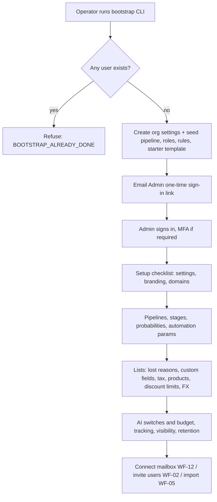

### WF-02 User invitation and first sign-in

| Field | Value |
|---|---|
| BRD | BR-PLT-002 (invite part), BR-PLT-003, BR-PLT-004, BR-PLT-005, BR-PLT-006, AC-01 (modified, IDD-02) |
| Actors | Admin, Invitee, Server, TxEmail |
| Trigger | Admin clicks "Invite user" |
| Preconditions | Inviter is Admin; email not an active user (RULE-PLT-04) |
| Rules / ODs | RULE-PLT-03..10, RULE-PLT-12, OD-12, OD-13, OD-32 |
| Events | `user.invited`, `user.activated` |

**Main flow**
1. Admin enters email, role, optional team.
2. Server validates (RULE-PLT-04/05), creates invitation (hashed token, 7-day expiry), sends email via TxEmail, writes audit.
3. Invitee opens link; Server validates token (not expired/revoked/used).
4. Invitee chooses sign-in method: set password (RULE-PLT-07) or Google/Microsoft (domain/tenant restricted, RULE-PLT-06).
5. If MFA required for the role, invitee enrols TOTP (RULE-PLT-09).
6. Server activates the user (role, team membership), marks invitation used, starts session; user sees personal checklist (connect mailbox, send first proposal).

**Alternative flows**
- A1 Admin resends invitation → old token invalidated, new 7-day token.
- A2 Admin revokes invitation → token unusable.
- A3 Invited email belongs to a deactivated user → Admin is directed to reactivate (RULE-PLT-14) instead.

**Exceptions & recovery**
- E1 Expired/used/revoked token → `INVITATION_EXPIRED`/`_USED`/`_REVOKED`; page tells invitee to contact Admin.
- E2 OAuth account outside company domain → `AUTH_DOMAIN_NOT_ALLOWED`; invitee may retry with the correct account.
- E3 OAuth email ≠ invited email → refused (Derived — pending confirmation: must match invited email exactly).
- E4 Email delivery fails → invitation stays pending; Admin sees "delivery failed" and can resend or copy the link (Derived — pending confirmation).

**Postconditions**: active user with exactly one role, ≤ 1 team; audit trail of invitation and activation.

### WF-03 Teams, roles and visibility settings

| Field | Value |
|---|---|
| BRD | BR-PLT-005, BR-PLT-006, §9.17 |
| Actors | Admin |
| Trigger | Admin edits teams, roles, or cross-visibility settings |
| Preconditions | Admin session |
| Rules / ODs | RULE-PLT-10..13, RULE-CRM-26, OD-31, OD-32 |
| Events | `team.updated`, `user.role_changed`, `settings.updated` |

**Main flow**
1. Admin creates a team, assigns ≥ 1 manager (role sales_manager) and members (each user ≤ 1 team).
2. Admin changes a user's role where needed; guards: last Admin (RULE-PLT-11), managers must be removed from teams before demotion (RULE-PLT-13).
3. Admin sets salesperson cross-visibility per object type (companies, contacts, deals: none / view-only) (OD-31).
4. Admin optionally grants managers "template/content/catalog rights" (§9.17 Optional).
5. Changes apply on the next request (RULE-PLT-10); audit written.

**Exceptions & recovery**
- E1 Adding a user already in another team → `TEAM_MEMBERSHIP_CONFLICT`; Admin moves the user explicitly (remove + add in one action).
- E2 Removing the last manager → `TEAM_MANAGER_REQUIRED`.
- E3 Demoting last Admin → `LAST_ADMIN`.

**Postconditions**: manager visibility = own records + records owned by members of managed teams.

### WF-04 User deactivation with reassignment

| Field | Value |
|---|---|
| BRD | BR-PLT-011, BR-CRM-004 |
| Actors | Admin, Server, Worker, MailProvider |
| Trigger | Admin clicks "Deactivate user" |
| Preconditions | Target user active; not the last active Admin |
| Rules / ODs | RULE-PLT-11, RULE-PLT-14..16, RULE-EML-03, RULE-LED-07/09, RULE-SIG-22, F§9 WA (deactivation effects) |
| Events | `user.deactivated`, `records.reassigned`, `deal.owner_changed` (per deal), `mailbox.disconnected` |

**Main flow**
1. Admin opens deactivation dialog; Server returns counts of open deals, open tasks, live proposals (Draft/Sent/Viewed/Accepted), owned companies/contacts, open signature requests where the user is sender, round-robin pools and assignment rules referencing the user, lead forms where the user is fallback owner.
2. Admin selects reassignment target(s) per record type (RULE-PLT-15) and chooses whether closed deals are also reassigned (default no).
3. Server, in one transaction: sets user inactive; reassigns selected records (owner changes recorded on each timeline with actor Admin); removes user from round-robin pools; flags assignment rules/lead forms that now need attention; revokes sessions and bearer tokens; sets mailbox connection `revoked`; writes outbox events and audit.
4. Worker revokes OAuth tokens at the MailProvider (best effort) and deletes local tokens.
5. Worker notifies new owners (one summary notification per new owner — Derived — pending confirmation).

**Alternative flows**
- A1 User owns nothing open → step 2 skipped.
- A2 Reactivation later → sign-in restored only (RULE-PLT-14).

**Exceptions & recovery**
- E1 No target chosen while open records exist → `REASSIGNMENT_TARGET_REQUIRED`; nothing changed.
- E2 Target becomes inactive concurrently → transaction fails `REASSIGNMENT_TARGET_INACTIVE`; Admin retries.
- E3 Provider token revocation fails → retried 3×; local tokens deleted regardless; logged warning.
- E4 Large reassignment (> 5,000 records) → reassignment executed as job; user is deactivated immediately (sign-in blocked) while ownership moves progressively; Admin sees progress (Derived — pending confirmation).

**Postconditions**: no open work owned by an inactive user; pending signature requests continue with sender of record unchanged; future deal notifications go to new owners.

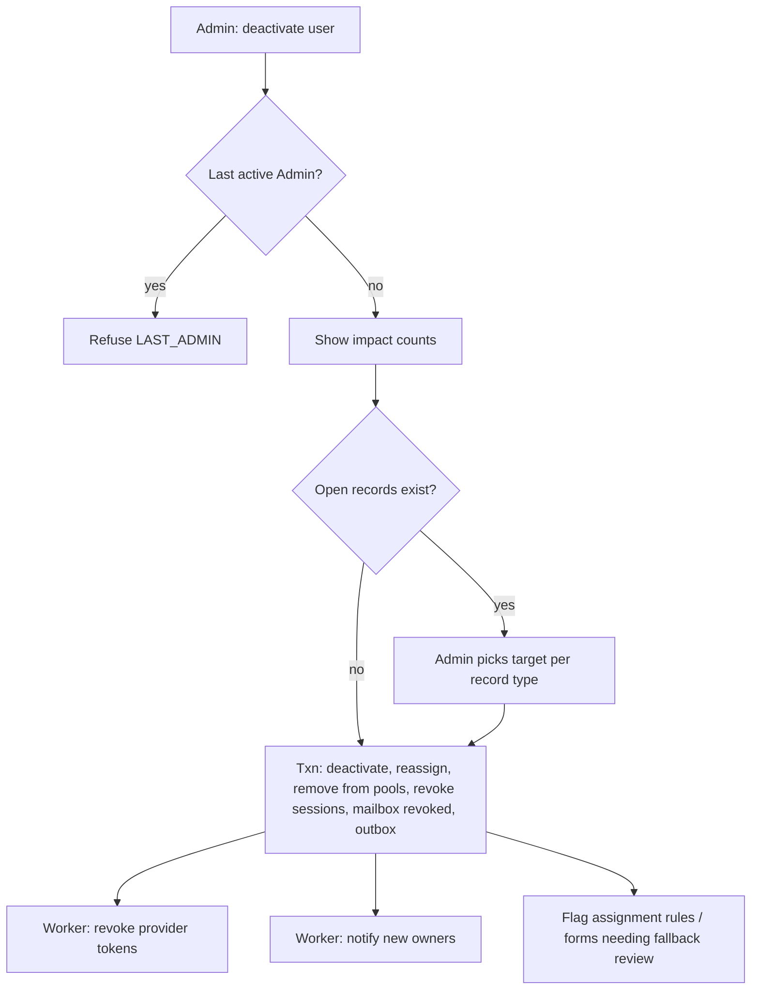

---

## 2. Data import (MIG)

### WF-05 Data import from CSV/Excel

| Field | Value |
|---|---|
| BRD | BR-MIG-001, BR-MIG-003, BR-MIG-004, AC-02 |
| Actors | Admin, Server, Worker |
| Trigger | Admin uploads a file in Import |
| Preconditions | Admin; no batch of same entity in importing/undoing (RULE-MIG-14) |
| Rules / ODs | RULE-MIG-01..09, RULE-MIG-14, RULE-CRM-06/07, OD-27, OD-33; SM-08 |
| Events | `import.batch_validated`, `import.batch_completed`, `import.batch_failed` |

**Main flow**
1. Admin selects entity type (companies / contacts / deals) and uploads CSV/XLSX. Server checks type/size/rows (RULE-MIG-02), stores file privately, parses header → batch `uploaded`.
2. Server proposes a column mapping (header name similarity + saved presets); Admin adjusts mapping, chooses date format, multi-select separator, default owner, default pipeline/stage (deals), duplicate default action and merge mode (RULE-MIG-08).
3. Admin submits → batch `validating`; Worker validates every row (RULE-MIG-05), resolves owners, stages, companies, and classifies duplicates against existing records and within the file (RULE-MIG-07) → batch `validated`.
4. Admin reviews summary: valid / warnings / invalid counts, duplicates with suggested matches and fuzzy candidates; downloads the error report; overrides per-row duplicate action where needed.
5. Admin commits with Idempotency-Key → batch `importing`. Worker processes rows in chunks of 500 (Derived — pending confirmation), each chunk one transaction: re-checks duplicates (RULE-MIG-06), creates/merges records, writes `import_record_link` with before-snapshots, timeline "Imported (batch N)". No automations or lead notifications fire (RULE-MIG-09).
6. Batch → `completed` with counts (created, merged, skipped, invalid). Admin notified; onboarding item "import data" completes.

**Alternative flows**
- A1 Admin edits mapping after validation → re-validation (validated → validating).
- A2 Admin cancels before commit → `cancelled`; file purged after 7 days.
- A3 Contacts file with company columns → company matched/created per OD-27 and linked as primary company (OD-33).

**Exceptions & recovery**
- E1 File unreadable/encoding error → `IMPORT_FILE_TYPE` with hint; nothing created.
- E2 Required field unmapped → `IMPORT_REQUIRED_FIELD_UNMAPPED`; Admin fixes mapping.
- E3 All rows invalid → commit disabled; Admin fixes file.
- E4 Duplicate created concurrently between validation and commit (e.g. a user created the same contact) → row re-classified at commit as duplicate and default duplicate action applied; reported in results.
- E5 Worker crash mid-import → batch `failed` with committed chunks linked; Admin can **resume** (continues after the last committed chunk) or **undo** (WF-07).
- E6 "Create new" chosen for an existing email → `IMPORT_DUPLICATE_EMAIL_CREATE_NOT_ALLOWED` on that row (treated as invalid).

**Postconditions**: every created/merged record traceable to the batch; undo possible (WF-07); audit entries for upload, commit, completion.

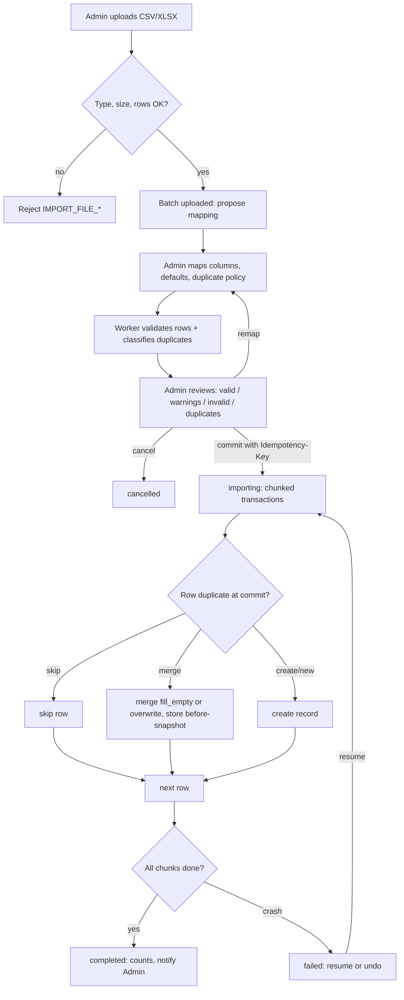

### WF-06 Guided import from HubSpot / Pipedrive exports

| Field | Value |
|---|---|
| BRD | BR-MIG-002 (Should), AC-02 |
| Actors | Admin, Worker |
| Trigger | Admin chooses "Import from HubSpot export" or "Pipedrive export" |
| Preconditions | OD-09 confirms we use the source tool; export files available |
| Rules / ODs | RULE-MIG-11, plus all WF-05 rules; OD-09 |
| Events | as WF-05 |

**Main flow**
1. Admin selects source; the wizard lists the expected export files (companies/organizations, contacts/persons, deals) and the import order: companies → contacts → deals.
2. For each file the WF-05 flow runs with the source's mapping preset preloaded; source record ids stored as external ids.
3. Before validating deals, Admin maps every source pipeline/stage to our pipeline/stage (RULE-MIG-11); owners mapped by email (unmatched → default owner).
4. Deal associations (company, contacts) resolved via external ids imported in earlier steps; unresolved associations become row warnings.
5. Completion summary across the three batches.

**Exceptions & recovery**
- E1 Unmapped stage → `IMPORT_STAGE_UNMAPPED`.
- E2 Deals file imported before companies → association warnings; Admin may undo the deals batch and re-run in the right order.
- E3 Unrecognised export format (columns missing) → preset not applied; Admin maps manually (falls back to WF-05).

**Postconditions**: three batches, each independently undoable.

### WF-07 Undo an import batch

| Field | Value |
|---|---|
| BRD | BR-MIG-005, AC-02 |
| Actors | Admin, Worker |
| Trigger | Admin clicks "Undo import" on a completed or failed batch |
| Preconditions | Batch state completed or failed; not undone (RULE-MIG-10) |
| Rules / ODs | RULE-MIG-10, RULE-MIG-14; SM-08 |
| Events | `import.batch_undone` |

**Main flow**
1. Server shows impact preview: records to delete, merged records to restore, records modified after import (will be kept), records with dependants.
2. Admin confirms → batch `undoing`; Worker processes `import_record_link` rows in reverse order: deals → contacts → companies.
3. Created & unmodified & no dependants → hard delete (cascade of import-created links only). Merged → restore fields whose current value equals the imported value.
4. Batch `undone`; per-record result report; audit; Admin notified.

**Alternative flows**
- A1 Admin chooses "archive kept records" from the report → bulk archive (RULE-CRM-02).

**Exceptions & recovery**
- E1 Worker failure mid-undo → job retried from the last processed link (idempotent: already-deleted rows skipped).
- E2 Batch already undone → `IMPORT_ALREADY_UNDONE`.

**Postconditions**: CRM returns to pre-import state for all untouched data; modified records preserved and listed.

---

## 3. Templates, content and catalog

### WF-08 Template, content library and catalog authoring

| Field | Value |
|---|---|
| BRD | BR-TPL-001..008, BR-MIG-006, BR-PRC-001, BR-PRC-007 |
| Actors | Admin, Manager (with template/catalog rights) |
| Trigger | Create/edit template, content block, product, tax category or discount limit |
| Preconditions | Actor has rights (RULE-TPL-01, RULE-PRC-01) |
| Rules / ODs | RULE-TPL-01..11, RULE-MIG-12, RULE-PRC-01/02/12, OD-39, IDD-11 |
| Events | `template.published`, `template.archived`, `content_block.published` |

**Main flow (template)**
1. Author creates a template (blank, from starter template, or from DOCX upload — WF-08 A1).
2. Author adds sections; per section sets editable/locked and required; adds blocks (rich text with placeholders, images, tables, pricing table with optional default lines, content-block references, signature block).
3. Author previews with sample data from a chosen deal (no tracking).
4. Author publishes: Server validates placeholders (unknown → blocks; archived → warning) and creates immutable template version n+1.
5. Existing proposals stay pinned to their versions (RULE-TPL-03).

**Alternative flows**
- A1 DOCX upload (BR-MIG-006): Worker converts to a draft template, returns conversion report of dropped elements; author fixes and publishes.
- A2 Content block: create/edit/publish block versions; archive retired blocks.
- A3 Catalog: create product (unit price in default currency, tax category, one-time/recurring); create tax category; set discount limits per role.
- A4 Archive template: no longer selectable; existing proposals unaffected.

**Exceptions & recovery**
- E1 Unknown placeholder at publish → `TEMPLATE_PLACEHOLDER_UNKNOWN` with list.
- E2 Concurrent edit of the same draft → `CONCURRENT_MODIFICATION`; author reloads (draft autosave keeps local copy — Derived — pending confirmation).
- E3 Image invalid/too large → `IMAGE_INVALID`.

**Postconditions**: published template version available for new proposals; audit entries for publish, lock changes, catalog and limit changes.

---

## 4. Lead capture and record creation

### WF-09 Lead capture via web form → assignment → notification

| Field | Value |
|---|---|
| BRD | BR-LED-001..006, BR-CRM-003, BR-TIM-001, AC-06, NFR-005, §11 step 1 |
| Actors | Visitor, Server (public endpoint), Worker, assigned Salesperson |
| Trigger | Visitor submits an embedded or hosted lead form |
| Preconditions | Form published with fallback owner (RULE-LED-09) |
| Rules / ODs | RULE-LED-01..12, RULE-LED-14, RULE-CRM-06/07, RULE-NTF-01/08, OD-27, OD-33, OD-46; SM-09 |
| Events | `lead.submission_received`, `contact.created`/`contact.updated`, `company.created`, `deal.created`, `lead.assigned`, `lead.submission_processed`, `notification.created` |

**Main flow**
1. Visitor submits. Server checks published form, payload size, honeypot, rate limit, CAPTCHA if enabled, field validation (RULE-LED-03/04).
2. Server stores the submission (raw payload, form version, page URL, UTM, referrer, IP hash) as `received`, enqueues processing, returns success (thank-you message / redirect).
3. Worker (`processing`): normalises email and domain; matches contact by email, company by domain (non-free-mail) or name (RULE-LED-06).
4. Worker determines assignee (RULE-LED-08): existing active owner of matched contact/company → else first matching field-value rule → else form default rule (round-robin with row lock, skipping inactive users, RULE-LED-07) → fallback owner (RULE-LED-09).
5. In one transaction: create or fill-empty-update company and contact (owner = assignee for created records); if the form creates deals: reuse the contact's open deal in the target pipeline (add note + timeline) or create a new deal in the form's pipeline/initial stage with company and contact (role per form config) and lead-source fields (RULE-LED-12); write timeline "Form submission: <form>" (actor buyer); outbox events.
6. Submission → `processed` with outcome and links to records.
7. Notification handler creates `new_lead_assigned` for the assignee: in-app via SSE + email per preferences, within 1 min (RULE-LED-11).

**Alternative flows**
- A1 Matched existing contact with active owner → assignee = that owner; no round-robin pointer movement.
- A2 Form configured without deal creation → only contact/company created/updated; notification still sent ("new lead") to the contact owner.
- A3 Honeypot filled → `spam_rejected`, 200 returned, nothing processed.
- A4 Matched contact is archived → no new contact is created for the same email (RULE-CRM-02/06); the submission links to the archived contact, marks it "archived contact re-engaged", and notifies its last active owner (else the form's fallback owner) to decide whether to restore it (Derived — pending confirmation).

**Exceptions & recovery**
- E1 Validation errors → 422 with field errors; not stored.
- E2 Rate limit exceeded → 429; not stored.
- E3 CAPTCHA provider unreachable → WA (OD-62): fail-open — the submission is accepted and marked "unverified"; honeypot and rate limits still apply. Admin setting `leadForms.captchaFailMode` can switch to fail-closed ("try again later", 503).
- E4 Processing exception → retried with backoff up to 5 times (RULE-LED-14 idempotency prevents duplicates); then `failed`, Admin notified; Admin can reprocess.
- E5 Assignee deactivated between selection and commit → transaction re-runs selection (lock ensures consistency).

**Postconditions**: one contact (and possibly company/deal) owned by the assignee; submission traceable; assignee notified; round-robin state advanced exactly once.

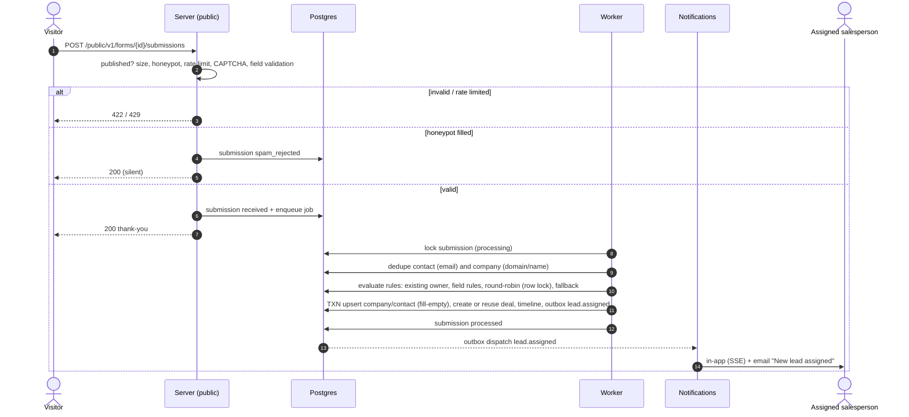

### WF-10 Lead capture via webhook

| Field | Value |
|---|---|
| BRD | BR-LED-007 (Could), BR-LED-002..005 |
| Actors | External website/form tool, Server, Worker |
| Trigger | POST to the webhook intake endpoint |
| Preconditions | Admin created a webhook source with secret and field map |
| Rules / ODs | RULE-LED-13, RULE-LED-05..12/14 |
| Events | as WF-09 |

**Main flow**
1. Source posts JSON with signature + timestamp headers.
2. Server verifies HMAC and timestamp (≤ 5 min), maps fields via the configured map, validates, stores submission `received`, returns 202.
3. Steps 3–7 of WF-09.

**Exceptions & recovery**
- E1 Bad signature → 401 `WEBHOOK_SIGNATURE_INVALID`; logged (no payload stored).
- E2 Stale timestamp → 401 `WEBHOOK_TIMESTAMP_STALE`.
- E3 Same external event delivered twice → deduplicated by (source, external event id) when provided (Derived — pending confirmation); otherwise processed as a new submission and caught by contact dedupe.

### WF-11 Manual lead entry, qualification and deal creation

| Field | Value |
|---|---|
| BRD | BR-CRM-001..003, BR-CRM-007, BR-CRM-010, BR-TIM-001, §11 steps 1 (manual), 3; OD-38 |
| Actors | Salesperson (or Manager/Admin) |
| Trigger | User creates company/contact/deal manually or from a record page |
| Preconditions | User can create records |
| Rules / ODs | RULE-CRM-01..08, RULE-CRM-20, RULE-CRM-25, OD-27, OD-33, OD-34, OD-38 |
| Events | `company.created`, `contact.created`, `deal.created`, `deal.contact_added`, `note.created`, `activity.logged` |

**Main flow**
1. User creates a contact (email checked for duplicates — blocks; RULE-CRM-06) and links/creates its company (duplicate warning by domain/name).
2. User qualifies: logs call/meeting, adds notes (count as activity).
3. User creates a deal: name, pipeline, stage, company (required), currency, amount, expected close date, custom fields; adds contacts with roles. Owner defaults to the creator (Salesperson cannot set another owner — RULE-CRM-09).
4. Timeline shows creation events; deal appears on the board.

**Alternative flows**
- A1 Lead arrived by email (§11 step 1, OD-38): user creates records from the inbox add-in (WF-16); no automatic lead-from-email.
- A2 Manager/Admin creates a deal for a team member → owner may be set within scope.

**Exceptions & recovery**
- E1 Duplicate email → `CONTACT_EMAIL_TAKEN` with link to existing contact; user opens it instead.
- E2 Duplicate company suspected → warning; user confirms or opens existing.
- E3 View-only user tries to add a note on another's deal → `VIEW_ONLY`.

**Postconditions**: qualified deal with company and contacts; ready for proposal.

---

## 5. Email and calendar

### WF-12 Mailbox connection and initial sync

| Field | Value |
|---|---|
| BRD | BR-EML-001, BR-EML-006, AC-04, P6, §11 step 2 |
| Actors | User, Server, Worker, MailProvider |
| Trigger | User clicks "Connect mailbox" (settings or checklist) |
| Preconditions | No existing connection for the user (RULE-EML-01); provider enabled (OD-06) |
| Rules / ODs | RULE-EML-01..05, OD-06, OD-29; SM-10 |
| Events | `mailbox.connected`, `email.stored`, `email.linked`, `calendar.meeting_logged`, `mailbox.sync_completed` |

**Main flow**
1. Server creates OAuth state (PKCE, 10 min) → `pending_authorization`; user is redirected to the provider consent screen with minimal scopes (mail read, send, calendar read).
2. Provider redirects back; Server exchanges the code, verifies account domain/tenant and mailbox address (RULE-EML-01), encrypts and stores tokens → `active`; employee privacy notice acknowledged (compliance task, F§9).
3. Worker runs initial sync for the last 90 days (RULE-EML-04): pages messages and calendar events; applies storage filter (RULE-EML-05), exclusions (RULE-EML-06), linking (RULE-EML-08), calendar logging (RULE-EML-13); stores the delta cursor.
4. `mailbox.sync_completed`; onboarding item "connect mailbox" completes; schedule incremental sync (WF-13).

**Exceptions & recovery**
- E1 User denies consent / closes window → state expires; connection discarded; user can retry.
- E2 Wrong domain/tenant → `MAILBOX_DOMAIN_NOT_ALLOWED`; nothing stored.
- E3 Provider throttling during initial sync → backoff and resume from page token; connection shows "Initial sync in progress (x %)".
- E4 Token exchange fails → error shown; retry.

**Postconditions**: active connection; historical emails/meetings with known contacts on timelines.

### WF-13 Incremental email and calendar sync with linking

| Field | Value |
|---|---|
| BRD | BR-EML-002, BR-EML-003, BR-EML-006, BR-TIM-001, BR-TIM-003, AC-04, §11 step 2, §12 automatic activity capture |
| Actors | Worker (scheduled), MailProvider |
| Trigger | Schedule every 2–5 min per active connection (optional provider push notification triggers an earlier run) |
| Preconditions | Connection `active` or `error` |
| Rules / ODs | RULE-EML-04..08, RULE-EML-13, RULE-EML-15/16, RULE-AUT-31, OD-28, OD-29, OD-30; SM-10 |
| Events | `email.stored`, `email.linked`, `calendar.meeting_logged`, `deal.flag_cleared`, `mailbox.reauth_required` |

**Main flow**
1. Worker acquires a singleton lock per connection (pg-boss singleton key) and fetches changes since the cursor (Gmail history id / Graph delta token).
2. For each new/changed message: collect participants; drop if all participants are internal; drop if no participant matches a non-archived contact and the thread is not already linked (OD-29); apply user and org exclusions (RULE-EML-06).
3. Store message metadata and body (sanitised), thread, direction, provider ids; apply "always private" rules (RULE-EML-07).
4. Link: contacts (all matched), companies (primary companies), deal per OD-28 (single open deal → link; several → most recent activity + `auto_review_suggested`; reply → inherit thread link; manual links kept).
5. Write timeline events (actor buyer for inbound from contact, user for outbound), update `lastActivityAt` of linked deals (RULE-AUT-31) and clear stalled flags (RULE-AUT-34).
6. If an inbound message comes from a recipient of a current sent proposal version, mark that version "answered" for AUT-004 (RULE-AUT-61).
7. Calendar: upsert events with known attendees as meetings; cancelled → "Cancelled"; private → metadata only.
8. Commit cursor in the same transaction as the processed page; release lock.

**Alternative flows**
- A1 Message deleted at provider → stored copy retained (Derived — pending confirmation; CRM is a record of correspondence) unless user later marks it private/excluded.
- A2 Cursor expired (provider history gap) → full re-scan of the last 7 days with idempotent upsert by provider message id (Derived — pending confirmation).

**Exceptions & recovery**
- E1 429/5xx/network → connection `error`, exponential backoff; cursor unchanged so nothing is lost; after 24 h continuous error user notified.
- E2 invalid_grant / consent revoked → `reauth_required`, sync stops, `mailbox_reauth_required` notification (WF-12 re-auth path M7).
- E3 Malformed message / parse failure → message skipped and logged with provider id; does not block the page (dead-letter list visible to Admin — Derived — pending confirmation).
- E4 Two workers race on the same connection → prevented by singleton lock; idempotent upsert by provider id as second guard.

**Postconditions**: emails/meetings with known contacts linked; privacy controls honoured; cursor advanced.

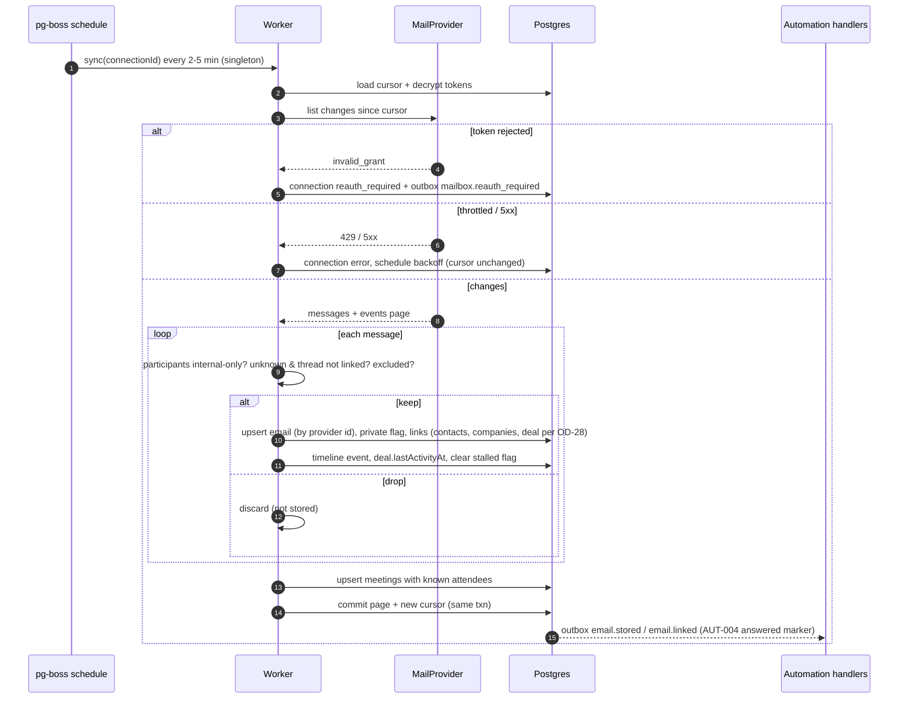

### WF-14 Email privacy controls and link correction

| Field | Value |
|---|---|
| BRD | BR-EML-002 ("users can correct the links"), BR-EML-003, NFR-002, §13.4 privacy risk |
| Actors | User (mailbox owner), User with edit rights on the deal |
| Trigger | User marks private, edits exclusions, or corrects links |
| Preconditions | Email stored |
| Rules / ODs | RULE-EML-06..08, RULE-AIA-03, OD-28, OD-30 |
| Events | `email.marked_private`, `email.link_corrected` |

**Main flow**
1. Mailbox owner marks an email/thread private (or a contact/domain "always private") → subject/body hidden from others, excluded from AI/export bodies (OD-30); timeline shows "Private email".
2. Mailbox owner adds an exclusion (domain or contact) → future messages filtered; purge job removes that user's stored messages now fully excluded (RULE-EML-06).
3. A user who can edit the deal removes a wrong deal link or adds the correct deal; `auto_review_suggested` cleared; manual links persist through later syncs.

**Exceptions & recovery**
- E1 Non-owner tries to mark another user's email private → `FORBIDDEN` (only the mailbox owner — Derived — pending confirmation).
- E2 Purge job failure → retried; exclusion is effective for new syncs immediately regardless.

**Postconditions**: privacy choices enforced in UI, API, AI context, reports and exports.

### WF-15 Send email from the CRM

| Field | Value |
|---|---|
| BRD | BR-EML-004, BR-EML-007, NFR-013 |
| Actors | User, Server, MailProvider |
| Trigger | User composes an email from a contact/deal/company page |
| Preconditions | Active mailbox; user can edit the record |
| Rules / ODs | RULE-EML-09..12, OD-37 |
| Events | `email.sent`, `email.opened` |

**Main flow**
1. User selects recipients (contacts or addresses), optional email template; placeholders resolved against the record; unresolved placeholders must be filled (RULE-EML-11).
2. Optional: AI rewrite of selected text (WF-20 A2); open tracking checkbox if Admin enabled it (OD-37).
3. User clicks Send (Idempotency-Key). Server sends via MailProvider from the user's mailbox; stores the sent message linked explicitly to the record (RULE-EML-09); timeline event.
4. If tracking on: pixel opens recorded as "possible open" (`email.opened`), not counted as "answered".

**Exceptions & recovery**
- E1 Mailbox not connected / re-auth required → `MAILBOX_NOT_CONNECTED` / `MAILBOX_REAUTH_REQUIRED`; draft kept; user reconnects.
- E2 Provider send failure (5xx) → `PROVIDER_SEND_FAILED` retryable; Idempotency-Key prevents a double send on retry; if the provider accepted but the response was lost, the next sync de-duplicates by Message-ID (Derived — pending confirmation).
- E3 Recipient count > 50 → `EMAIL_TOO_MANY_RECIPIENTS`.

**Postconditions**: email in the user's Sent folder and on the record timeline.

### WF-16 Inbox add-in: context, create records, add email

| Field | Value |
|---|---|
| BRD | BR-EML-005, AC-05, §11 steps 1 and 8, OD-07, OD-38 |
| Actors | User (in Outlook/Gmail), Add-in, Server |
| Trigger | User opens a message with the add-in pane |
| Preconditions | Add-in deployed for the company's provider (OD-07); user signed in (bearer token) |
| Rules / ODs | RULE-EML-14, RULE-EML-05, RULE-CRM-01..08, OD-29 |
| Events | `contact.created`, `company.created`, `deal.created`, `email.stored`, `email.linked` |

**Main flow**
1. Add-in reads message participants (and internet message id) and calls Server with the bearer token.
2. Server returns matched contacts, companies, open deals and recent proposals within the user's permissions.
3. User actions: (a) create contact/company/deal prefilled from the sender (same validation as web); (b) "Add this email to CRM" — stores the message/thread and links it, overriding the unknown-sender filter for that thread (OD-29); (c) send a proposal (WF-23).

**Alternative flows**
- A1 Not signed in / token expired → add-in shows sign-in (OAuth popup / dialog API), then retries.
- A2 Sender unknown and user does nothing → nothing stored (OD-29).

**Exceptions & recovery**
- E1 Mailbox not connected → add-in still works for lookup/creation; "Add email" stores via provider fetch requires connection → prompt to connect (WF-12).
- E2 Duplicate contact on create → `CONTACT_EMAIL_TAKEN`; add-in opens existing.

**Postconditions**: records created/linked without leaving the inbox.

---

## 6. CRM operations

### WF-17 Deal management and pipeline movement

| Field | Value |
|---|---|
| BRD | BR-CRM-003..007, BR-CRM-011, BR-CRM-013, BR-AUT-005, BR-AUT-006, BR-AUT-008, §11 step 4, AC-03 |
| Actors | User, Worker |
| Trigger | User edits a deal / drags a card on the board; scheduled flag jobs |
| Preconditions | User can edit the deal |
| Rules / ODs | RULE-CRM-07..18, RULE-CRM-27, RULE-CRM-29, RULE-AUT-30..42, OD-31, OD-35, OD-40; SM-01 |
| Events | `deal.updated`, `deal.stage_changed`, `deal.flagged`, `deal.flag_cleared`, `deal.closed_won`, `deal.closed_lost`, `deal.reopened` |

**Main flow**
1. User moves a deal to another open stage (form or board drag) with `rowVersion`.
2. Server validates (stage in pipeline, permissions), updates stage, writes timeline (actor user), updates `lastActivityAt`, clears stalled flag.
3. Worker hourly: evaluates stalled deals (RULE-AUT-32) → flag, automated timeline, `deal_stalled` notification. Daily: evaluates overdue deals (RULE-AUT-40) → flag.
4. Flags appear on the board, My Day (WF-18) and the "deals needing attention" report.

**Alternative flows**
- A1 Drag to Closed Won → close-won dialog (close date, amount suggestion from accepted proposal) (RULE-CRM-15).
- A2 Drag to Closed Lost → WF-35.
- A3 Change pipeline → choose stage in target pipeline (RULE-CRM-13).
- A4 Dismiss stalled/overdue flag → reversal semantics (RULE-AUT-35/42).
- A5 Bulk edit (Should) → job for > 50 records; per-record results (RULE-CRM-29).

**Exceptions & recovery**
- E1 Concurrent edit or concurrent automation → `CONCURRENT_MODIFICATION`; UI reloads the deal and re-applies the user's intent if still valid.
- E2 View-only → `VIEW_ONLY`.

**Postconditions**: stage history complete on timeline; flags accurate.

### WF-18 Tasks, reminders and My Day

| Field | Value |
|---|---|
| BRD | BR-CRM-008, BR-CRM-009, BR-RPT-005, BR-AUT-003/004, OD-47 |
| Actors | User, Worker |
| Trigger | Task create/complete; reminder time; user opens My Day |
| Preconditions | — |
| Rules / ODs | RULE-CRM-22..24, RULE-NTF-10, RULE-AUT-52/62; SM-07 |
| Events | `task.created`, `task.completed`, `task.reminder_due`, `task.overdue` |

**Main flow**
1. User creates a task (title, due, optional reminder, linked record, assignee).
2. Worker fires reminder at `reminderAt` (in-app + email) and `task_overdue` once when overdue.
3. User opens My Day: today's tasks, overdue tasks, own deals that are stalled/overdue/have unviewed proposals (RULE-CRM-24); can complete tasks inline (counts as deal activity).

**Alternative flows**
- A1 Automation tasks (AUT-003/004, OD-17 "Confirm Closed Won") appear with "Automated" label and optional AI draft attachment (WF-26).
- A2 Task linked to a deal that is reassigned → open tasks follow if "also reassign open tasks" was ticked (RULE-CRM-09).

**Exceptions & recovery**
- E1 Reminder after due → `TASK_REMINDER_INVALID`.
- E2 Assignee cannot view linked record → `TASK_ASSIGNEE_NO_ACCESS`.
- E3 Reminder job missed (worker down) → on restart, reminders with `reminderAt` in the past 24 h and not sent are sent once (Derived — pending confirmation).

**Postconditions**: tasks tracked; overdue visible.

---

## 7. Proposals

### WF-19 Create proposal from template (placeholders and pricing)

| Field | Value |
|---|---|
| BRD | BR-PRP-001, BR-PRP-002, BR-PRP-003, BR-PRP-008, BR-TPL-002/003/004/008, BR-PRC-002..007, AC-07, §11 steps 5–6 |
| Actors | Salesperson (or Manager/Admin) |
| Trigger | "Create proposal" on a deal |
| Preconditions | Deal open; user may create proposals for the deal; ≥ 1 published template |
| Rules / ODs | RULE-PRP-01..05, RULE-TPL-03..08, RULE-PRC-04..12, OD-15, OD-16, OD-39, OD-44; SM-02, SM-03 |
| Events | `proposal.created`, `proposal.version_created` |

**Main flow**
1. User selects a template; Server creates proposal (Draft) and version 1 (draft) pinned to the template version; currency = deal currency; termMonths = 12.
2. Server resolves placeholders from deal, company, primary contact, owner, organization; returns unresolved/archived placeholder list (BR-TPL-008).
3. User resolves flagged placeholders: update CRM field (preferred), manual value for this version, or explicit "leave blank".
4. User edits editable sections; locked sections read-only.
5. User builds the pricing table: adds catalog products (copied values; converted prices flagged if non-default currency) or free-text lines; sets quantities, line discounts, group overall discounts, billing periods; sets termMonths. Server recomputes per §7.2 on every save and returns totals and warnings (discount limits, deal-amount difference).
6. On TCV ≠ deal amount → prompt "Update deal amount to X?" (BR-PRC-004); choice recorded.
7. Autosave persists the draft version (rowVersion).

**Alternative flows**
- A1 AI drafting of narrative sections → WF-20.
- A2 Insert content-library block (copied) (RULE-TPL-07).
- A3 Recipients chosen now or at send.

**Exceptions & recovery**
- E1 Deal closed → `DEAL_CLOSED`.
- E2 Term not a multiple of billing period → `PRICING_TERM_PERIOD_MISMATCH`.
- E3 Edit attempt on locked section (crafted request) → `SECTION_LOCKED`.
- E4 Concurrent edit by two users → `CONCURRENT_MODIFICATION`; second user reloads (no merge).

**Postconditions**: Draft proposal with priced, populated content.

### WF-20 AI drafting and AI rewrite

| Field | Value |
|---|---|
| BRD | BR-AIA-001, BR-AIA-004, BR-AIA-006..009, AC-08, §11 step 6 |
| Actors | Salesperson, Server, AiProvider |
| Trigger | "Draft with AI" on an editable section; "Rewrite" on selected text |
| Preconditions | AI org + feature switches on; budget available |
| Rules / ODs | RULE-AIA-01..10, RULE-AIA-13, IDD-07, IDD-08, OD-05, OD-30 |
| Events | `ai.generation_created`, `ai.generation_accepted`, `ai.generation_rejected` |

**Main flow (drafting)**
1. User requests a draft for sections (introduction, needs summary, scope summary).
2. Server builds context: deal fields, notes, logged activities, linked non-private emails (permission-checked), section guidance; untrusted content delimited.
3. Server calls AiProvider (60 s timeout); logs `ai_usage`; stores `ai_generation` pending.
4. Draft inserted into the section with internal "AI draft — review" label.
5. User edits and clicks Accept (or Reject → removed). Acceptance audited; label removed.

**Alternative flows**
- A1 Regenerate → new generation; previous rejected.
- A2 Rewrite (Should): select ≤ 5,000 chars, choose operation; preview side-by-side; accept replaces selection.

**Exceptions & recovery**
- E1 AI disabled → `AI_DISABLED`; UI hides AI actions.
- E2 Budget exceeded → `AI_QUOTA_EXCEEDED`.
- E3 Provider error/timeout → `AI_PROVIDER_UNAVAILABLE`; no partial content; user retries or writes manually.
- E4 User sends with pending AI content → blocked by pre-send check (`AI_CONTENT_PENDING`).

**Postconditions**: only user-accepted AI content can reach a buyer.

### WF-21 Preview, pre-send check, PDF/DOCX export

| Field | Value |
|---|---|
| BRD | BR-PRP-004, BR-PRP-005, BR-AIA-002, BR-TPL-008, BR-PRC-004/007, AC-07, AC-08, NFR-005, §11 step 7 |
| Actors | Salesperson, Server, Worker, AiProvider |
| Trigger | "Preview", "Check before sending", "Download PDF/DOCX" |
| Preconditions | Draft version exists |
| Rules / ODs | RULE-PRP-06/07, RULE-AIA-11, RULE-TPL-08, OD-43 |
| Events | `ai.presend_check_completed`, `proposal.document_generated` |

**Main flow**
1. Preview: Server renders the version with the buyer renderer and branding in an internal frame; no tracking.
2. Pre-send check: Server runs deterministic checks, then (if enabled) LLM consistency check; stores findings bound to the content hash; UI lists blocking findings (must fix) and warnings (acknowledge at send).
3. Export: Worker renders PDF (Playwright) and DOCX (docx library) from the same block model; drafts watermarked; files stored; download links returned (target < 10 s).

**Exceptions & recovery**
- E1 LLM unavailable → deterministic results only, marked "AI check not run".
- E2 Rendering failure → retried 3×; then `DOCUMENT_GENERATION_FAILED` with retry button; incident logged.
- E3 Content edited after the check → check invalidated; send re-runs it automatically.

**Postconditions**: user knows exactly what the buyer will see and which issues remain.

### WF-22 Send proposal from the CRM (and end-to-end overview)

| Field | Value |
|---|---|
| BRD | BR-PRP-006/007, BR-SHR-001/002/003/006/007, BR-AUT-001, BR-AUT-004, BR-EML-004, BR-PRC-004, AC-09, AC-11, §11 step 8 |
| Actors | Salesperson, Server, Worker, MailProvider |
| Trigger | "Send" on a draft version |
| Preconditions | RULE-PRP-08 (a)–(k) |
| Rules / ODs | RULE-PRP-08..11, RULE-PRP-19, RULE-SHR-01..03/08/10, RULE-AUT-10..14, RULE-AUT-60, OD-20, OD-21; SM-02, SM-03, SM-06 |
| Events | `proposal.version_sent`, `proposal.version_superseded`, `share_link.created`, `email.sent`, `signature_request.voided` (if OD-21 applies), `automation.executed` |

**Main flow**
1. User opens the send dialog: selects recipients (deal contacts; inline contact creation), response mode (e-signature default, or accept/decline), optional email verification, optional link expiry, email subject/body (template/AI follow-up style allowed, user-reviewed); dialog shows pre-send warnings and the BR-PRC-004 deal-amount prompt.
2. If an older version has an open signature request → confirmation dialog "Sending will void the open signature request" (OD-21).
3. User confirms Send (Idempotency-Key).
4. Server re-validates RULE-PRP-08; in one transaction: freezes the snapshot, marks version sent, marks the previous sent version superseded, creates one share link per recipient (tokens returned once, only hashes stored), sets proposal status Sent, writes timeline/audit, writes outbox (`proposal.version_sent`, `proposal.version_superseded`, void command for the old signature request).
5. Worker renders and stores the frozen PDF + SHA-256 (document must exist before buyer download; buyer view renders HTML from the snapshot meanwhile).
6. Server (or Worker) sends one email per recipient through the user's mailbox containing that recipient's link; stored as sent emails linked to the deal.
7. Outbox handlers: void old signature request at ESignProvider (WF-31 path); AUT-001 stage move (RULE-AUT-10..12); schedule AUT-004 check (RULE-AUT-60); onboarding item "send first proposal".

**Alternative flows**
- A1 "Copy link / mark as shared manually": links created without email; user copies a recipient link and confirms "Mark as shared manually" → same state changes as step 4 with `sentChannel = manual_link`.
- A2 Add a recipient to an already-sent version → new link + email; no version/status change; no AUT-001/004 (RULE-SHR-03).
- A3 "Send for signature" → WF-29 combined action.

**Exceptions & recovery**
- E1 Any precondition fails → `PROPOSAL_NOT_SENDABLE` with reasons; nothing changes.
- E2 Mailbox send fails for one or more recipients after the version was frozen → version stays sent (freeze is not rolled back); failed recipients are listed with "Retry send" / "Copy link" actions; AUT-004 still scheduled from `sentAt` (Derived — pending confirmation). Idempotency-Key prevents duplicate emails on retry.
- E3 PDF rendering fails → retried; buyer view still works from snapshot HTML; download shows "preparing" until available; owner alerted after 3 failures.
- E4 ESignProvider void of the old request fails → retried with backoff; old version already superseded so buyer signing on it is blocked at our side (RULE-SHR-14) and a late completion webhook for a superseded version is rejected and alerted to Admin (Derived — pending confirmation).
- E5 Double click / network retry → Idempotency-Key returns original result.

**Postconditions**: version frozen and sent; per-recipient tracked links live; deal stage advanced if configured; follow-up check scheduled.

**End-to-end: proposal send → buyer engagement → signature → Closed Won**

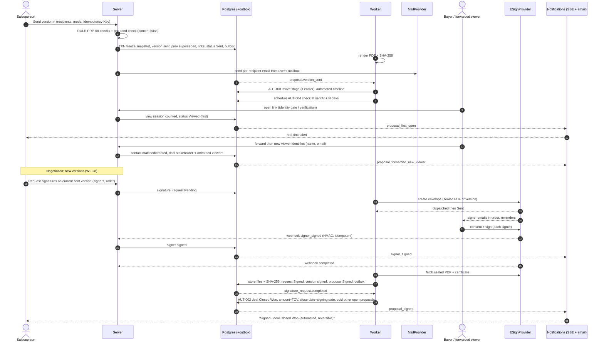

### WF-23 Send proposal from the inbox add-in

| Field | Value |
|---|---|
| BRD | BR-EML-005, BR-SHR-002, AC-05, §11 step 8, OD-07 |
| Actors | Salesperson in Outlook/Gmail, Add-in, Server |
| Trigger | "Send proposal" in the add-in pane |
| Preconditions | Matched deal visible to user; a sendable draft version exists (or a template to create one) |
| Rules / ODs | RULE-EML-14, RULE-PRP-08..11, RULE-SHR-01..03 |
| Events | as WF-22 (`sentChannel = addin_email`) |

**Main flow**
1. Add-in shows open deals for the message's participants and their proposals with status.
2. User picks a proposal with a draft version (or creates one from a template — WF-19 steps 1–3 in a compact form; detailed editing deep-links to the web app).
3. Add-in shows pre-send findings; user resolves blocking items (deep link) and confirms warnings.
4. Default: add-in inserts the recipient's tracked link into a reply compose window (Office.js `displayReplyForm` / Gmail compose action) and the user sends from the inbox; Server marks the version sent when the user confirms "Sent" in the pane (equivalent to manual share, F§9 WA) — OR user chooses "Send from CRM" (Server sends via MailProvider as WF-22). Default path: Derived — pending confirmation.
5. Same state changes and automations as WF-22.

**Exceptions & recovery**
- E1 Multiple recipients in a single reply → one link per recipient is required; the add-in sends via CRM (one email each) or warns that a single shared link cannot attribute views (Derived — pending confirmation).
- E2 Compose window closed without sending → version not marked sent unless user confirms; no state change.
- E3 Token expired → re-sign-in, then retry.

**Postconditions**: as WF-22.

### WF-24 Buyer view: identity gate, verification, forward, download

| Field | Value |
|---|---|
| BRD | BR-SHR-004..009, BR-NTF-001, BR-TIM-001, AC-09, NFR-011, §11 step 9 |
| Actors | Recipient, Forwarded viewer, Server (public API), Worker |
| Trigger | Buyer opens a share link |
| Preconditions | Link exists |
| Rules / ODs | RULE-SHR-04..12, RULE-SHR-14, RULE-SHR-17..19, RULE-NTF-04..07, OD-21, OD-22, OD-26; §18 precedence |
| Events | `proposal.view_counted`, `proposal.viewed`, `share.forwarded_viewer_identified`, `share.viewer_verified`, `proposal.downloaded`, `deal.contact_added` |

**Main flow**
1. Buyer opens URL `https://<buyer-origin>/p#<token>`; the buyer page posts the fragment token to `/public/v1/session/exchange`; Server hashes the token, applies rate limits and the BUSINESS-RULES §18 precedence checks, sets a short-lived link-bound HttpOnly cookie, and the page clears the fragment (foundation §16 S2, ADR-071).
2. No viewer cookie → identity gate (foundation §16 S3, OD-69): "Continue as <recipient name>" → recipient identity; "I'm someone else" → name + email with privacy notice → forwarded viewer (OD-26).
3. If verification required (BR-SHR-006) → both gate paths require a 6-digit code via TxEmail; buyer enters code; device cookie set.
4. Buyer views branded, mobile-friendly proposal (frozen snapshot). Client sends view start, heartbeats every 15 s while visible, end.
5. Server records the session; when active time ≥ 3 s it is counted: first counted view on the version → status Viewed, `proposal_first_open` notification; later sessions → reopen rules.
6. Buyer downloads the PDF → `proposal.downloaded` (tracked, server-mediated).
7. Timeline entries (actor buyer) on the deal; deal `lastActivityAt` updated; stalled flag cleared.

**Alternative flows**
- A1 Forwarded viewer: email ≠ recipient → contact matched/created (OD-26), added to deal with role "Forwarded viewer", `proposal_forwarded_new_viewer` notification; may view/download only.
- A2 Returning viewer with valid cookie → gate skipped.
- A3 Superseded version → read-only view with "newer version available" banner; actions blocked.
- A4 Signed proposal → read-only plus signed PDF download.
- A5 Viewer email is internal → recorded as internal; no notifications or status change.

**Exceptions & recovery**
- E1 Revoked/unknown token → generic unavailable page (410).
- E2 Proposal Void / Expired / link expired → corresponding notice, no content (§18).
- E3 Wrong verification code ×5 → `VERIFICATION_CODE_INVALID`, new code required; rate limits apply.
- E4 Heartbeats lost (tab closed) → session end inferred at last heartbeat + 15 s (Derived — pending confirmation).
- E5 Buyer opens before the PDF finished rendering → view works (HTML); download shows "preparing".

**Postconditions**: who/when/how long recorded; new stakeholders on the deal; owner alerted in real time.

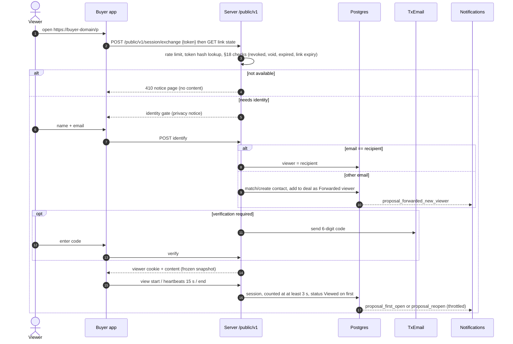

### WF-25 Engagement notifications and daily summary

| Field | Value |
|---|---|
| BRD | BR-NTF-001, BR-NTF-002, BR-NTF-003, BR-LED-003, NFR-005, AC-09 |
| Actors | Worker, Notifications module, deal owner, TxEmail |
| Trigger | Outbox events in the §11.1 trigger catalogue (BUSINESS-RULES.md); scheduled scans |
| Preconditions | Recipient active |
| Rules / ODs | RULE-NTF-01..12, OD-14, OD-47, ADR-009 |
| Events | `notification.created`, `notification.email_failed`, `digest.sent` |

**Main flow**
1. Worker dispatches an outbox event to the notification handler.
2. Handler resolves the recipient (current deal owner / task assignee), applies guards and throttles, checks preferences per channel.
3. Creates the in-app notification (idempotent per event+recipient+channel) → `pg_notify` → the server instance holding the user's SSE stream pushes it (< 5 s design target).
4. Enqueues the email via TxEmail (no proposal body content, RULE-NTF-11).
5. Scheduled scans: `link_expiring` (48 h before effective expiry), task reminders/overdue, daily summary at 07:00 user time for opted-in users with activity.

**Exceptions & recovery**
- E1 User offline → notification stored; delivered on next SSE connect / visible in notification centre.
- E2 TxEmail failure → 5 retries with backoff, then `notification.email_failed`; in-app remains system of record.
- E3 Deal reassigned between event and dispatch → recipient resolved at dispatch time (current owner).
- E4 SSE instance restarted → client reconnects with `Last-Event-ID` and receives missed notifications (Derived — pending confirmation).

**Postconditions**: owner alerted within NFR-005 target; preferences honoured.

### WF-26 No-engagement follow-up and AI follow-up draft

| Field | Value |
|---|---|
| BRD | BR-AUT-004, BR-AIA-005, BR-AIA-006, BR-AUT-008, §11 step 10, §12 "deals going quiet" |
| Actors | Worker, AiProvider, deal owner |
| Trigger | AUT-004 scheduled check fires at `sentAt + followUpAfterDays` |
| Preconditions | Check scheduled by WF-22 for the version |
| Rules / ODs | RULE-AUT-60..64, RULE-AIA-14, F§9 WA ("answered") |
| Events | `automation.executed` / `automation.skipped`, `task.created`, `ai.generation_created` |

**Main flow**
1. Worker loads the version and re-evaluates guards (RULE-AUT-61): current sent version, status Sent (not viewed), not answered, deal open, not Void/Expired.
2. Creates the follow-up task for the current deal owner (automated, reversible) and records the execution.
3. If AI follow-up enabled: builds context (proposal summary, recipients, deal, recent non-private emails), generates an email draft, stores it pending, attaches to the task.
4. Owner is notified (`automation_task_created` via task assignment notification); opens the task, reviews/edits the draft, and sends it explicitly (WF-15). Nothing is sent by AI.

**Alternative flows**
- A1 Guard fails (viewed, answered, superseded, deal closed) → execution `skipped` with reason; no task.
- A2 AI disabled/over budget → task created without draft.

**Exceptions & recovery**
- E1 Job runs twice → idempotency key `AUT-004:{versionId}` → no duplicate task.
- E2 AI failure → task kept; "Generate draft" button allows manual retry.

**Postconditions**: unengaged proposals get exactly one follow-up task per sent version.

### WF-27 Buyer accept / decline without signature

| Field | Value |
|---|---|
| BRD | BR-SHR-010 (Should), BR-PRP-007 (extended by OD-17), BR-AUT-003, BR-NTF-001 |
| Actors | Recipient, Server, Worker, deal owner |
| Trigger | Recipient clicks Accept or Decline on a version sent with response mode `accept_decline` |
| Preconditions | RULE-SHR-13/14 (recipient, current sent version, status Sent/Viewed, deal open, no prior response) |
| Rules / ODs | RULE-SHR-13..16, RULE-AUT-50..54, OD-17, OD-26 |
| Events | `proposal.accepted` / `proposal.declined`, `task.created`, `automation.executed` |

**Main flow (accept)**
1. Recipient clicks Accept; enters full name and ticks confirmation.
2. Server re-checks eligibility in a transaction, records the response with evidence (RULE-SHR-15), sets proposal Accepted, timeline (actor buyer).
3. Notification `proposal_accepted` to owner; automated task "Confirm Closed Won" (OD-17) — deal NOT auto-closed.
4. Owner later marks the deal Closed Won (WF-17 A1) with the accepted TCV suggested.

**Alternative flow (decline)**
- A1 Recipient clicks Decline, gives a reason → proposal Declined, `proposal_declined` notification, AUT-003 outcome task (RULE-AUT-52); deal not closed.

**Exceptions & recovery**
- E1 Forwarded viewer tries to respond → `RESPONSE_NOT_ALLOWED`; UI hides buttons for them.
- E2 Two recipients respond concurrently → first wins; second gets `RESPONSE_ALREADY_RECORDED` and sees the recorded response.
- E3 Proposal expired/voided/superseded between page load and click → `PROPOSAL_NOT_AVAILABLE` / `RESPONSE_NOT_ALLOWED`; page refreshes to the notice.

**Postconditions**: response evidence stored; owner informed; deal outcome remains a human decision.

### WF-28 Negotiation: new version, comparison, re-send

| Field | Value |
|---|---|
| BRD | BR-PRP-006, BR-PRP-007, BR-SIG-011, BR-SHR-001, P3, §11 step 11 |
| Actors | Salesperson, Server, Worker, ESignProvider |
| Trigger | User clicks "Edit / new version" on a sent, declined or expired proposal |
| Preconditions | Proposal not Void/Signed; deal open; no other draft version (RULE-PRP-05) |
| Rules / ODs | RULE-PRP-02, RULE-PRP-05, RULE-PRP-08..12, RULE-PRP-18, RULE-SIG-20, OD-20, OD-21, F§9 WA; SM-02, SM-03 |
| Events | `proposal.version_created`, `proposal.version_sent`, `proposal.version_superseded`, `signature_request.voided` |

**Main flow**
1. Server creates draft version n+1 copied from the current sent version; re-resolves placeholders from current CRM data and shows the diff of changed values (F§9 WA). Proposal status: unchanged if Sent/Viewed/Accepted (draft revision flag); returns to Draft if Declined/Expired.
2. User edits content/pricing (WF-19 steps 3–6), runs preview/check (WF-21).
3. User compares versions (any two): section text diff, pricing line diff, totals diff, metadata diff.
4. User sends v n+1 (WF-22). If v n has an open signature request, the confirmation dialog voids it (OD-21). v n → superseded; its links read-only with banner; proposal → Sent; AUT-001 evaluated again (no effect if already at/after target); AUT-004 scheduled for v n+1.

**Alternative flows**
- A1 User discards the draft revision → version deleted; proposal status unchanged.
- A2 Re-send after Declined/Expired → same flow; status Draft → Sent.

**Exceptions & recovery**
- E1 Void/Signed proposal → `PROPOSAL_TERMINAL`; offer "Copy to new proposal" (WF-36 within the same deal).
- E2 Draft already exists → `DRAFT_VERSION_EXISTS`; open existing draft.
- E3 Signer signs v n at the provider at the same moment v n+1 is sent → send transaction voids the request first via outbox; if the provider reports completion before void succeeds, completion for a superseded version is rejected by our side, the provider envelope is voided/flagged, and Admin + owner are alerted for manual resolution (race noted in F§9; Derived — pending confirmation for the resolution). Preferred mitigation: send of v n+1 performs the provider void synchronously before committing (≤ 10 s timeout); on void failure the send is aborted with `ESIGN_PROVIDER_ERROR` and nothing changes (Derived — pending confirmation).

**Postconditions**: every sent version retained and comparable; signing always tied to the latest sent version.

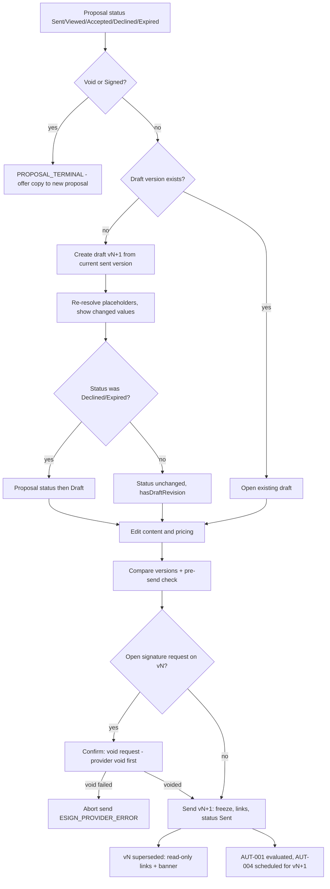

---

## 8. E-signature

### WF-29 Signature request with order and reminders

| Field | Value |
|---|---|
| BRD | BR-SIG-001..010, BR-SIG-013, AC-10, P4, §11 step 12 |
| Actors | Salesperson, Server, Worker, ESignProvider, Signers |
| Trigger | "Request signatures" on the current sent version (or "Send for signature" on a draft) |
| Preconditions | RULE-SIG-01..03; signers are deal contacts |
| Rules / ODs | RULE-SIG-01..14, RULE-SIG-22, OD-01, OD-02, OD-03, OD-22, OD-23, OD-42; SM-04, SM-05 |
| Events | `signature_request.created`, `signature_request.sent`, `signature_request.dispatch_failed`, `signature.signer_viewed`, `signature.reminder_sent`, `signature.signer_signed` |

**Main flow**
1. User chooses signers (deal contacts; role Signer added), order mode (sequential with order numbers, or parallel), optional SMS per signer, reminder schedule (org default or override), message to signers.
2. Server validates and creates the request (Pending) with expiry = min(now + default days, proposal validity end) (RULE-SIG-12); signers `waiting`.
3. Worker calls ESignProvider: create envelope with the version's frozen PDF, signer list/order, verification methods, consent (ERSD) settings, expiry, reminders, webhook callback.
4. Provider confirms dispatch → request Sent; first signer (sequential) or all signers (parallel) `sent`; provider emails them.
5. Signers open (viewed), verify identity by email link (and SMS code if set), consent, sign; provider sends reminders per schedule; user may resend manually (throttled).
6. Webhooks (HMAC-verified, idempotent, monotonic) update signer statuses; each signature → `signer_signed` notification; next sequential signer invited by provider.
7. When the last signer signs → WF-32.

**Alternative flows**
- A1 "Send for signature" on a draft: WF-22 send (response mode e_signature) + steps 1–4 in one action; if the request creation fails after the send committed, the version stays sent and the user is prompted to retry the request (Derived — pending confirmation).
- A2 UI shows "Signing in progress (x of n)" badge (OD-19).

**Exceptions & recovery**
- E1 Another open request on the deal → `SIGNATURE_REQUEST_ALREADY_OPEN`.
- E2 Version superseded/expired/void → `SIGNATURE_VERSION_NOT_ELIGIBLE`.
- E3 Provider dispatch error → 5 retries; then Pending with `lastError`, owner notified; Retry or Void (WF-31).
- E4 Webhook lost → reconciliation poll after 24 h silence (RULE-SIG-14).
- E5 Webhook with invalid signature → 401, logged, ignored.
- E6 Signer email bounces (provider event) → owner notified; void and recreate with corrected email (RULE-SIG-21).

**Postconditions**: signers invited in the right order; evidence captured by provider.

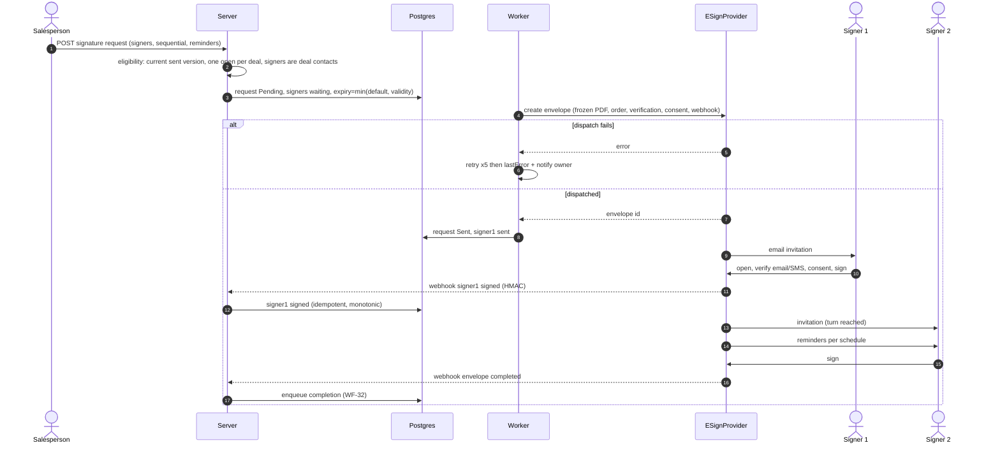

### WF-30 Signer declines

| Field | Value |
|---|---|
| BRD | BR-SIG-012 (Should), BR-AUT-003, BR-NTF-001, BR-PRP-007 |
| Actors | Signer, ESignProvider, Worker, deal owner |
| Trigger | Signer chooses "Decline to sign" and gives a reason |
| Preconditions | Request Sent/Viewed; signer's turn |
| Rules / ODs | RULE-SIG-18, RULE-AUT-50..54, OD-25 |
| Events | `signature.signer_declined`, `signature_request.declined`, `proposal.declined`, `task.created` |

**Main flow**
1. Provider records the decline + reason, cancels remaining signers and notifies them (OD-25).
2. Webhook → request Declined, signer declined, others cancelled; proposal → Declined; timeline (actor signer).
3. `proposal_declined` notification to owner; AUT-003 outcome task; deal stays open.
4. Owner may create a new version (WF-28) or close the deal lost (WF-35).

**Exceptions & recovery**
- E1 Decline webhook arrives after a completion webhook (impossible by provider semantics) or duplicate → monotonic status rules ignore it; logged.

**Postconditions**: request terminal; proposal Declined; follow-up task exists.

### WF-31 Void signature request, void proposal, revoke link

| Field | Value |
|---|---|
| BRD | BR-SIG-013, BR-PRP-007, BR-SHR-007, §9.17 |
| Actors | User (Admin all, Manager team, Salesperson own deals), Worker, ESignProvider |
| Trigger | "Void signature request", "Void proposal", "Revoke link" |
| Preconditions | Permission per §9.17; target in a voidable/revocable state |
| Rules / ODs | RULE-SIG-17, RULE-PRP-16, RULE-SHR-09, OD-18 |
| Events | `signature_request.voided`, `proposal.voided`, `share_link.revoked` |

**Main flow — void signature request**
1. User gives a reason; Server marks a void command (request keeps status until provider confirms; buyer signing blocked at our side immediately via a `voidRequestedAt` marker — Derived — pending confirmation).
2. Worker calls provider void; on success request → Voided, signers cancelled; proposal status unchanged; timeline/audit.

**Main flow — void proposal**
1. User gives a reason; Server sets proposal Void; any open request voided (as above); all links show "withdrawn"; AUT-004 pending checks will skip.

**Main flow — revoke link**
1. User revokes one link (or all links of a version); immediate; the recipient sees the generic unavailable page; a new link can be issued later.

**Exceptions & recovery**
- E1 Provider void fails → retried with backoff; request shows "Void pending"; if provider reports completion meanwhile, completion wins only if it was timestamped before `voidRequestedAt` (Derived — pending confirmation); otherwise Admin alerted.
- E2 Void a Signed proposal → `PROPOSAL_SIGNED_IMMUTABLE`.
- E3 Request already terminal → `SIGNATURE_REQUEST_NOT_OPEN`.

**Postconditions**: no buyer can act on voided/revoked items.

### WF-32 Signature completion → documents → Closed Won

| Field | Value |
|---|---|
| BRD | BR-SIG-009, BR-SIG-010, BR-SIG-011, BR-AUT-002, BR-AUT-008, BR-NTF-001, BR-TIM-001, AC-10, AC-11, §11 steps 13–14 |
| Actors | ESignProvider, Server, Worker, deal owner, all parties |
| Trigger | Provider "envelope completed" webhook (or reconciliation poll) |
| Preconditions | Request Sent/Viewed; all signers signed |
| Rules / ODs | RULE-SIG-15/16/19/23, RULE-AUT-20..25, RULE-PRC (TCV §7.2), OD-16, OD-23, OD-24 |
| Events | `signature_request.completed`, `proposal.signed`, `deal.closed_won`, `proposal.voided` (auto, other proposals), `automation.executed` |

**Main flow**
1. Server verifies webhook signature; stores the event (idempotent by provider event id); enqueues completion job (singleton per request).
2. Worker downloads sealed PDF and completion certificate; verifies the provider's document hash; computes SHA-256; stores both privately (retention-exempt).
3. One transaction: request Signed; version signed; proposal Signed; signed document records; timeline (signing events, actor signer/system); outbox `signature_request.completed`.
4. Provider distributes the final PDF to all signers (BR-SIG-010); owner notified `proposal_signed` with in-app access to the documents.
5. AUT-002 handler (idempotency key = signatureRequestId): lock deal; guard; set stage Closed Won, amount = signed version TCV excl. tax, close date = completion date (org tz); record before/after; automated timeline entry with Reverse action.
6. OD-23: other Draft/Sent/Viewed/Accepted proposals of the deal → Void (child executions, reversible); their open links show withdrawn.
7. Dashboards reflect the win (WF-37).

**Alternative flows**
- A1 Deal already Won → AUT-002 skipped; owner notified to review amount.
- A2 Deal Lost → AUT-002 skipped; owner notified + review task.

**Exceptions & recovery**
- E1 Document download fails → retried with backoff (up to 24 h); request stays Sent/Viewed with "Completion processing" badge; owner notified after 1 h of failures (Derived — pending confirmation). Steps 3–6 only after documents are stored, so the system never shows Signed without the evidence.
- E2 Duplicate completion webhooks → idempotent (event id, request id); AUT-002 key prevents a second Closed Won.
- E3 Hash mismatch → do not mark Signed; Admin security alert; provider support case (Derived — pending confirmation).
- E4 Completion for a superseded/voided request (race, WF-28 E3 / WF-31 E1) → not applied automatically; Admin + owner alerted for manual resolution.
- E5 Concurrent user edit on the deal → AUT-002 waits for the row lock; re-evaluates guard.

**Postconditions**: signed, tamper-evident PDF + certificate stored and sent; deal Closed Won with amount and date (reversible via WF-33).

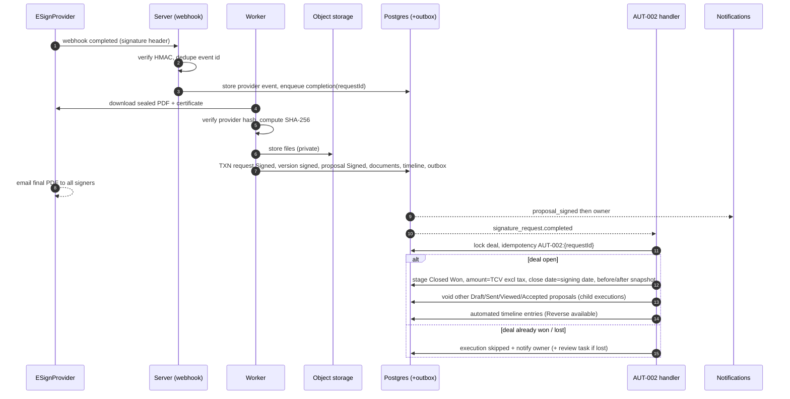

### WF-33 Reverse an automated change

| Field | Value |
|---|---|
| BRD | BR-AUT-008, BR-TIM-001, BR-TIM-004 |
| Actors | User with edit rights on the record |
| Trigger | "Reverse" on an automated timeline entry |
| Preconditions | Execution status applied; not already reversed |
| Rules / ODs | RULE-AUT-06, RULE-AUT-14, RULE-AUT-25, RULE-AUT-35, RULE-AUT-42, RULE-AUT-54, RULE-AUT-64, OD-24 |
| Events | `automation.reversed`, plus the restored entity events (`deal.reopened`, `deal.stage_changed`, `task.cancelled`, `proposal.*`) |

**Main flow**
1. Server loads the execution and compares current values with the execution's after-snapshot.
2. Shows a confirmation listing what will be restored (for AUT-002: stage, amount, close date; checkbox "also restore proposals voided by this automation", default on).
3. On confirm: one transaction restores values, marks execution reversed, writes timeline (actor user, "Reversed automated change"), audit; idempotency key retained so the trigger never re-fires.

**Exceptions & recovery**
- E1 Values changed since → `AUTOMATION_REVERSAL_STALE` listing fields; user edits manually.
- E2 Already reversed → `AUTOMATION_ALREADY_REVERSED`.
- E3 No permission → `FORBIDDEN`.

**Postconditions**: record back to its pre-automation state; Signed proposals remain Signed (OD-24).

### WF-34 Expiry: proposal validity, link expiry, signature request expiry

| Field | Value |
|---|---|
| BRD | BR-PRP-009, BR-SHR-007, BR-SIG-007, BR-NTF-001 (link about to expire) |
| Actors | Worker (every 5 min), Server (lazy checks), ESignProvider |
| Trigger | Clock reaches validity end / link expiry / request expiry |
| Preconditions | — |
| Rules / ODs | RULE-PRP-13, RULE-SHR-10, RULE-SIG-12, RULE-NTF-06, OD-22; BUSINESS-RULES.md §18 |
| Events | `proposal.expired`, `share_link.expired`, `signature_request.expired` |

**Main flow**
1. 48 h before the earliest effective expiry of an active version → `link_expiring` notification (once).
2. Validity end passed and proposal Sent/Viewed → proposal Expired; open request on the deal for that proposal → provider void with reason "expired" and request Expired; links show expired notice; owner notified (Derived — pending confirmation: a `proposal_expired` notification type is not in BR-NTF-001; WA sends it as in-app only).
3. Link expiry passed → that link expired (other links unaffected).
4. Provider signals request expiry → request Expired, signers cancelled, proposal status unchanged; `signature_request_expired` notification.
5. Buyer requests between job runs are evaluated lazily with the same rules (§18).

**Alternative flows**
- A1 User extends a link's expiry → link active again (not possible for proposal validity: new version required).
- A2 Accepted proposals do not expire (validity no longer governs after acceptance — Derived — pending confirmation).

**Exceptions & recovery**
- E1 Provider void fails during proposal expiry → retried; our side blocks signing immediately (§18 order 3).

**Postconditions**: earliest clock wins for every buyer action; revival only via new version (proposal) or new request (signature).

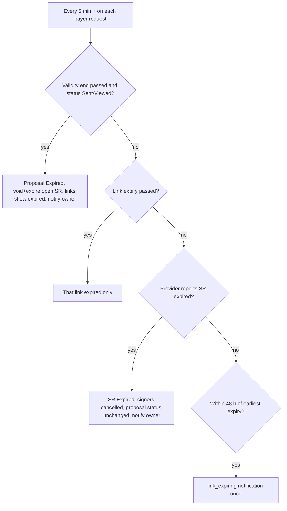

---

## 9. Deal outcomes, reporting and data

### WF-35 Close deal as lost; reopen deal

| Field | Value |
|---|---|
| BRD | BR-CRM-014, BR-RPT-002, BR-AUT-003, OD-31 |
| Actors | User (owner/manager/admin) |
| Trigger | "Mark as lost" / drag to Closed Lost; "Reopen" |
| Preconditions | Deal open (lost) or closed (reopen) |
| Rules / ODs | RULE-CRM-14, RULE-CRM-17, RULE-CRM-18, RULE-SIG-17, F§9 WA (closed lost with open signature request) |
| Events | `deal.closed_lost`, `signature_request.voided`, `deal.reopened` |

**Main flow — close lost**
1. User selects a lost reason (Admin list) and optional comment.
2. If an open signature request exists → dialog "This will void the open signature request"; user confirms.
3. One transaction: stage Closed Lost, `ownerAtClose`, flags cleared, void command for the request; timeline/audit.
4. Worker voids at provider. Open proposals untouched but buyers can no longer accept/sign (§18 order 9).

**Main flow — reopen**
1. Owner/manager/admin chooses an open stage and gives a reason.
2. Deal open; close date and lost reason cleared; timeline/audit; proposals become actionable again (subject to their own states).

**Exceptions & recovery**
- E1 No lost reason → `LOST_REASON_REQUIRED`.
- E2 Open request not confirmed → `OPEN_SIGNATURE_REQUEST_CONFIRM`.
- E3 Reopen without reason → `REOPEN_REASON_REQUIRED`.

**Postconditions**: lost reasons available for reporting.

### WF-36 Copy proposal to another deal

| Field | Value |
|---|---|
| BRD | BR-PRP-010 (Should) |
| Actors | Salesperson |
| Trigger | "Copy to deal…" |
| Preconditions | Source visible; target deal open and editable |
| Rules / ODs | RULE-PRP-14, RULE-PRP-18 |
| Events | `proposal.copied`, `proposal.created` |

**Main flow**
1. User selects target deal (may be the same deal — used after Void/Signed).
2. Server creates a new Draft proposal (v1) with the source's latest version content, same pinned template version, re-resolved placeholders, copied pricing; currency mismatch → lines flagged for review.
3. User continues with WF-19.

**Exceptions & recovery**
- E1 Target closed → `DEAL_CLOSED`.

### WF-37 Timelines, reporting refresh and dashboards

| Field | Value |
|---|---|
| BRD | BR-TIM-001..004, BR-RPT-001..010, AC-12, AC-13, §11 step 15 |
| Actors | User (role-scoped), Worker |
| Trigger | Any domain change (timeline written synchronously); user opens dashboards |
| Preconditions | — |
| Rules / ODs | RULE-TIM-01..08, RULE-RPT-01..13, OD-15, OD-35 |
| Events | (consumer only) |

**Main flow**
1. Every state change writes its timeline event in the originating transaction; automated events labelled; private emails masked.
2. User opens deal/company/contact timeline; filters by event type.
3. User opens dashboards; Server computes metrics from live tables/views scoped to the user (Admin org, Manager teams, Salesperson own); applies date range/team/owner/pipeline filters; converts currency per RULE-RPT-03.
4. Deals-needing-attention list (stalled/overdue/unviewed) refreshed on open.
5. Optional CSV export of report data (WF-38 A1).

**Exceptions & recovery**
- E1 Missing FX rate → "N deals not converted" warning, never zero.
- E2 Slow query beyond NFR-005 → served from materialised view refreshed every 5 min with "as of" time (Derived — pending confirmation).

**Postconditions**: managers and admins see updated pipeline, won/lost, rep, proposal and activity metrics.

### WF-38 Full data export

| Field | Value |
|---|---|
| BRD | BR-PLT-010, BR-RPT-009, AC-14 (export part), IDD-12 |
| Actors | Admin, Worker |
| Trigger | Admin requests "Export all data" |
| Preconditions | Admin; no export running |
| Rules / ODs | RULE-PLT-20, RULE-EML-07, RULE-RPT-11, OD-30, OD-36 |
| Events | `export.requested`, `export.completed`, `export.failed` |

**Main flow**
1. Admin requests export (Idempotency-Key); audit written.
2. Worker streams each entity to CSV and JSON, private emails as metadata only, plus a files archive of signed PDFs and certificates; packages into an encrypted-at-rest archive in object storage.
3. Admin notified; downloads via short-lived link (24 h, requester only, audited).

**Alternative flows**
- A1 Report CSV export (BR-RPT-009) → permission-scoped, synchronous for ≤ 50k rows, else job.

**Exceptions & recovery**
- E1 Export running → `EXPORT_ALREADY_RUNNING`.
- E2 Worker failure → job retried from scratch; partial files deleted; after 3 failures `export.failed`, Admin notified.
- E3 Link expired → `EXPORT_LINK_EXPIRED`; Admin re-runs.

**Postconditions**: complete, standard-format copy of organization data for backup/exit/compliance.

### WF-39 Deal reassignment (single and bulk)

| Field | Value |
|---|---|
| BRD | BR-CRM-004, BR-CRM-013 (Should), §9.17, BR-NTF-001 |
| Actors | Manager (team scope), Admin |
| Trigger | "Change owner" on a deal or bulk selection |
| Preconditions | Actor may reassign (Salesperson never) |
| Rules / ODs | RULE-CRM-09, RULE-CRM-29, RULE-NTF-01, RULE-SIG-22, OD-31 |
| Events | `deal.owner_changed`, `records.reassigned` |

**Main flow**
1. Actor selects new owner (active; within managed teams for Managers).
2. Server updates owner, optionally open tasks; timeline/audit; notifies new owner.
3. Future notifications for the deal go to the new owner; open signature requests continue unchanged.

**Exceptions & recovery**
- E1 Salesperson attempts → `FORBIDDEN_REASSIGN`.
- E2 Target outside scope → `REASSIGN_TARGET_OUT_OF_SCOPE`.
- E3 Bulk partial failures → per-record result list.

**Postconditions**: single owner per deal maintained.

---

## 10. Cross-workflow test seeds (derived from branches)

| Test | Workflow / branch | Expected |
|---|---|---|
| TC-WF-01 | WF-09 round-robin with concurrent submissions | Each submission gets a distinct next active user; pointer advances once per submission |
| TC-WF-02 | WF-09 A1 existing owner | Existing active owner assigned; pointer unchanged |
| TC-WF-03 | WF-05 E5 crash mid-import → resume | No duplicate records; batch completes |
| TC-WF-04 | WF-07 undo with modified record | Modified record kept and reported; others removed/restored |
| TC-WF-05 | WF-13 E2 token revoked | Connection reauth_required; no data loss after re-auth |
| TC-WF-06 | WF-22 E2 mailbox send fails after freeze | Version sent; failed recipients retryable; no duplicate email on retry |
| TC-WF-07 | WF-24 A1 forwarded viewer | Contact created/matched, role Forwarded viewer, one notification |
| TC-WF-08 | WF-26 A1 viewed before N days | AUT-004 skipped; no task |
| TC-WF-09 | WF-28 E3 sign vs new-version race | No Closed Won from superseded version; alert raised |
| TC-WF-10 | WF-32 E2 duplicate completion webhooks | Single Closed Won execution |
| TC-WF-11 | WF-32 TV-PRC-01 pricing | Deal amount = 5678.90 |
| TC-WF-12 | WF-33 E1 stale reversal | `AUTOMATION_REVERSAL_STALE` with field list |
| TC-WF-13 | WF-34 lazy expiry between job runs | Buyer action refused at validity end + 1 s |
| TC-WF-14 | WF-35 close lost with open request | Request Voided at provider; buyer cannot sign |
| TC-WF-15 | WF-04 deactivation | No open records owned by inactive user; removed from pools; tokens revoked |

---

## 11. Assumptions and open points raised by these workflows

| # | Assumption / open point | Where | Risk if wrong |
|---|---|---|---|
| WA-1 | Add-in default send path inserts tracked link into a reply and user confirms "Sent" (manual-share semantics) | WF-23 | Add-in sends not tracked as sent if user forgets to confirm |
| WA-2 | New-version send performs provider void synchronously and aborts on failure | WF-28 E3 | Send blocked during provider outage |
| WA-3 | Completion applied only after documents stored | WF-32 E1 | Deal shows open for minutes after signing |
| WA-4 | Expired proposal links show a notice without content | WF-24 E2, §18 | Buyers lose reference copy of an expired offer |
| WA-5 | Accepted proposals do not expire | WF-34 A2 | Stale acceptances on validity-limited offers |
| WA-6 | `proposal_expired` in-app notification added | WF-34 | Notification list deviates from BR-NTF-001 |
| WA-7 | Archived contact matched by a lead form is not auto-restored | WF-09 A4 | Re-engaged leads remain hidden until owner acts |
| WA-8 | CAPTCHA outage fails open, submission marked "unverified" (OD-62; aligned with FUNCTIONAL-REQUIREMENTS §19) | WF-09 E3 | Spam records during a CAPTCHA outage |
| WA-9 | Deleted-at-provider emails are retained | WF-13 A1 | Privacy expectation mismatch |

All items above are "Derived — pending confirmation" and are numbered for decision in OPEN-DECISIONS.md: WA-2/3/4/5/7/9 → OD-81; WA-6 → OD-72; WA-8 → OD-62; WA-1 → OD-54 item a. See BUSINESS-RULES.md §19 for rule-level items.
