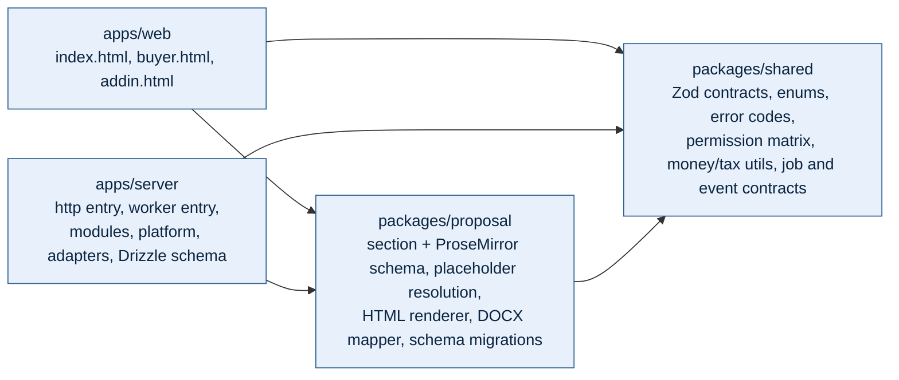
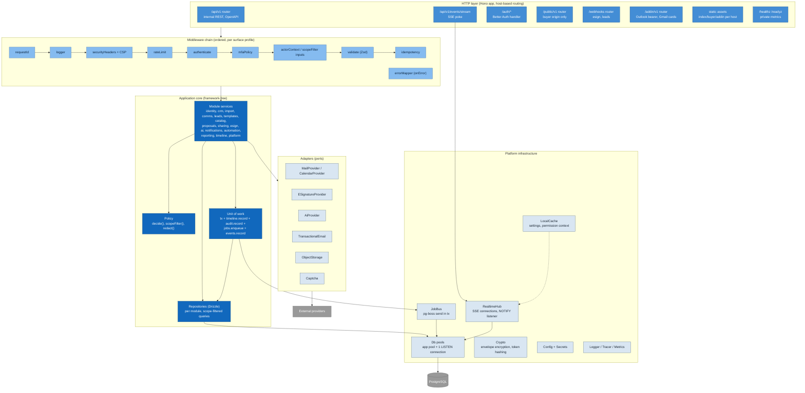
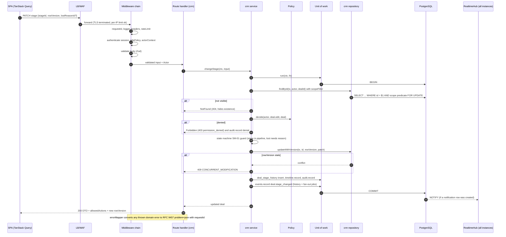
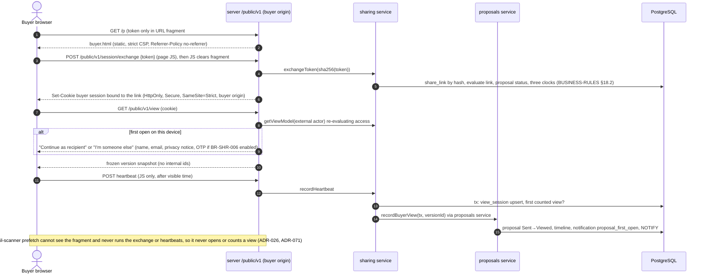
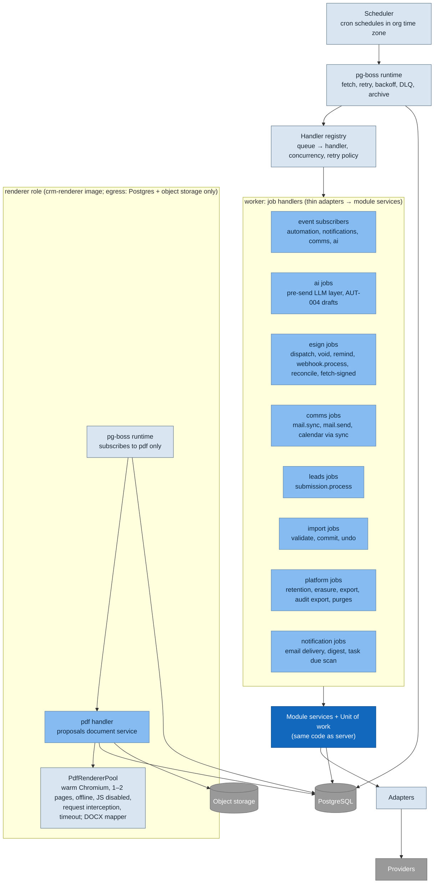
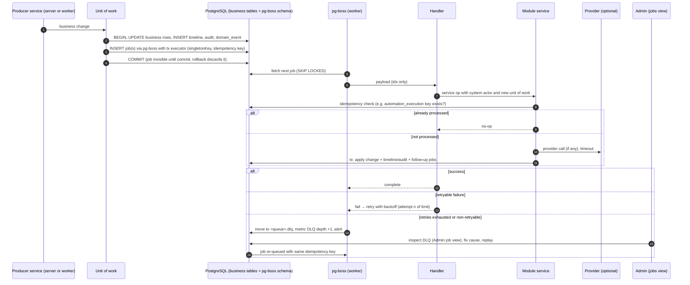
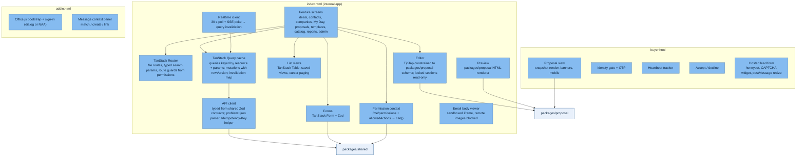
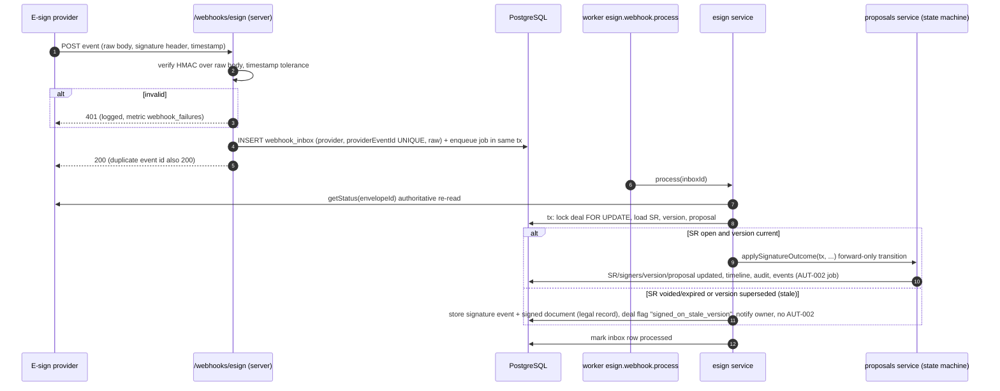

# Component Architecture — Internal Sales CRM (Phase 1)

| Item | Detail |
|---|---|
| Document | 02-hld/COMPONENT-ARCHITECTURE.md (C4 level 3: components inside each container) |
| Binding inputs | Design foundation §6, §11 (A1–A18), §12–§16; ROLE-PERMISSION-MATRIX §7; BUSINESS-RULES (RULE-*, SM-01..SM-10, §18 access precedence, §20 error codes); WORKFLOWS (WF-01..WF-39, domain event catalogue — authoritative event names); DOMAIN-MODEL §21–§22; SECURITY-ARCHITECTURE, AI-ARCHITECTURE, DEPLOYMENT-ARCHITECTURE |
| Companion documents | SYSTEM-ARCHITECTURE.md, MODULE-ARCHITECTURE.md, ARCHITECTURE-DECISIONS.md |
| Status | Draft for review |

This document describes components, their responsibilities and their interfaces. Interfaces are named operations with one-line contracts; exact TypeScript signatures, schemas and routes are TLD material. No application code.

---

## 1. Repository and package map (ADR-018, ADR-021)

Dependency rules (dependency-cruiser, CI-blocking): `packages/*` never import `apps/*`; `packages/shared` imports nothing internal; `apps/web` never imports `apps/server`; `packages/proposal` has no Node-only or DOM-only dependencies in its core (renderer must run in browser preview and in the worker).

---

## 2. Server container (`server` process)

### 2.1 Component diagram

### 2.2 HTTP surfaces
| Surface | Host | Clients | Authentication | CSP / headers | Rate limit tier | Body limits / notes |
|---|---|---|---|---|---|---|
| `/api/v1/*` | App origin | `index.html` SPA | Better Auth session cookie (SameSite=Lax, Secure, HttpOnly) + Origin check on unsafe methods | App CSP (`default-src 'self'`, nonce-less, no inline script; `frame-src` only for sandboxed email-body iframe) | LB tier; Postgres buckets on auth-sensitive routes | JSON ≤ 1 MB default; uploads via dedicated multipart endpoints with per-purpose limits |
| `/api/v1/events/stream` | App origin | SPA | Session cookie | `Cache-Control: no-store`; `X-Accel-Buffering: no` | Max N connections per user (setting) | 20 s heartbeat; id-only events (ADR-023) |
| `/auth/*` | App origin | SPA, OAuth callbacks | Better Auth | App CSP | Postgres buckets (login, reset, TOTP) | Implicit sign-up disabled (ADR-027) |
| `/public/v1/*` | **Buyer origin only** | `buyer.html`, hosted lead form | Token carried only in the URL fragment, posted by page JS to `/public/v1/session/exchange` → short-lived HttpOnly buyer cookie bound to the link (ADR-071); form public key | Buyer CSP (strict, `frame-ancestors` = company site for form pages only, `'none'` for proposal pages); `Referrer-Policy: no-referrer` | LB + Postgres buckets (identity gate, OTP, submissions) + in-memory (heartbeats) | Tokens redacted from logs; no internal ids in responses |
| `/public/v1/t/{pixel}` | Buyer origin | Email clients | Pixel token | `no-store` | LB | Open tracking only when enabled (OD-37) |
| `/webhooks/esign/{provider}` | App origin | E-sign provider | HMAC over raw body + timestamp tolerance | n/a | LB allow-list optional | Raw body retained for verification; persisted to inbox; 2xx fast (ADR-025, ADR-053) |
| `/webhooks/leads/{formKey}` | App origin | External systems (BR-LED-007, Could) | HMAC-SHA256 shared secret per form | n/a | Postgres bucket | Same pipeline as form submissions (ADR-053) |
| `/addin/v1/*` | App origin | Outlook task pane; Gmail add-on (Card JSON) | Outlook: add-in session bearer token (Office dialog or NAA); Gmail: Google-signed ID token → active invited user (ADR-027, ADR-074) | Add-in CSP allowing Office.js host only | LB | No cookies |
| Static | App origin: `index.html`, `addin.html`; buyer origin: `buyer.html` | Browsers | none | Per entry | LB | Immutable hashed assets; `index.html` never served on buyer origin and vice versa |
| `/healthz`, `/readyz`, `/metrics` | Private port | LB, monitoring | Network policy | n/a | n/a | Readiness checks DB and LISTEN connection |

Host-based routing is the first routing decision (host-based sub-apps with per-origin headers, ADR-075): a request whose `Host` does not match the surface's origin returns 404 (prevents serving internal surfaces on the buyer origin and vice versa) (ADR-020).

### 2.3 Middleware chain
Each surface uses a profile of the same ordered chain. Order matters: identification before logging, headers before any response, rate limiting before expensive auth, authentication before policy inputs, validation last before the handler.

| # | Middleware | Responsibility | `/api/v1` | `/public/v1` | `/webhooks` | `/addin/v1` | SSE |
|---|---|---|---|---|---|---|---|
| 1 | `requestId` | Accept/validate or generate `X-Request-Id`; put in async context; echo in response | Y | Y | Y | Y | Y |
| 2 | `logger` | Structured access log (pino): method, route template (no raw URL with tokens), status, latency, request id, user id; redaction rules | Y | Y (token redaction) | Y | Y | open/close only |
| 3 | `securityHeaders` | HSTS, CSP per entry/origin, `X-Content-Type-Options`, `Referrer-Policy`, `Permissions-Policy`, `frame-ancestors` | Y | Y (buyer profile) | minimal | Y (add-in profile) | Y |
| 4 | `rateLimit` | Tier 2 Postgres bucket or tier 3 in-memory per route class (ADR-026); 429 problem with `Retry-After` | auth routes | gate/OTP/submission/heartbeat | per provider | Y | connection cap |
| 5 | `authenticate` | Resolve principal: session (Better Auth), buyer cookie/token, add-in bearer/Google ID token, webhook signature; reject inactive users | session | buyer token | HMAC | bearer / ID token | session |
| 6 | `mfaPolicy` | If org/role requires MFA and session lacks second factor → 403 `MFA_ENROLMENT_REQUIRED` except enrolment routes (OD-13, ADR-027) | Y | – | – | Y | Y |
| 7 | `actorContext` | Build immutable `Actor` {type, userId, role, flags, TeamScope ids, crossVisibility, aiFeatures} from LocalCache (TTL + NOTIFY invalidation, ADR-054); this is the input to `decide()`/`scopeFilter()` | Y | external actor {shareLinkId, viewerIdentityId} | system actor | Y | Y |
| 8 | `validate` | Zod parse of params, query, body against `packages/shared` contracts; 400 problem with field `errors[]` | Y | Y | provider schema (lenient, stored raw) | Y | – |
| 9 | `idempotency` | For routes flagged sensitive (send, sign, import commit, email send, buyer response): require `Idempotency-Key`; replay stored response on same key+hash; 409 `IDEMPOTENCY_KEY_REUSED` on hash mismatch (ADR-016) | Y | responses | dedupe by provider event id (in service) | Y | – |
| – | `errorMapper` (`onError`) | Map domain errors → RFC 9457 problem (status, stable `code`, `title`, `detail`, `errors[]`, `requestId`); unknown errors → 500 without internals, logged with stack + sent to error tracking | Y | Y (generic messages) | Y (5xx triggers provider retry) | Y | – |

Not in the chain by design: authorization (`decide()` runs inside services because it needs the loaded resource and its visibility root; ROLE-PERMISSION-MATRIX §7 rule 1) and CORS (single origin per surface; no CORS except none).

### 2.4 Application core components
| Component | Responsibility | Interface (operations, one-line contracts) |
|---|---|---|
| Route handlers (per module, per surface) | Thin adapters: map validated input + Actor to a service call; map result to DTO with `allowedActions` | `handle(c) → DTO` — no business logic, no DB access |
| Module services | Use cases and state machines of one module; call `decide()`; open/join a unit of work; call own repositories and other modules' services | `op(ctx, input) → result` where `ctx = {actor, uow?, requestId, clock}`; throw typed domain errors |
| Policy | Shared permission matrix evaluation (ROLE-PERMISSION-MATRIX §7) | `decide(actor, permKey, resource?, input?) → Allow \| Deny(reason, hide)`; `scopeFilter(actor, recordType, access) → SQL predicate`; `redact(actor, resource) → resource`; `allowedActions(actor, resource) → PermKey[]` |
| Scope predicate registry | Each module registers predicates for its record types; child types join to their visibility root (ROLE-PERMISSION-MATRIX §4.2) | `register(recordType, builder)`; `predicateFor(actor, recordType, access)` |
| Unit of work | One DB transaction plus cross-cutting writers bound to it (ADR-028) | `run(ctx, fn)`; inside: `timeline.record(tx, entry)`, `audit.record(tx, entry)`, `jobs.enqueue(tx, job)`, `events.record(tx, event)` (history + fan-out to subscribed queues, ADR-055), `notify.afterCommit(channel, id)` |
| Repositories | Module-private Drizzle access; scoped by construction — a repository instance is created from the Actor and every list/search/read query applies `scopeFilter` without opt-in (unscoped access only via explicitly named system repositories, audited in review) (ADR-076); optimistic update helpers | `findById(tx, actor, id)`, `list(tx, actor, filter, cursor)`, `updateWithVersion(tx, id, rowVersion, patch) → conflict \| row` |
| State-machine functions | Pure transition tables (BUSINESS-RULES §17) evaluated inside services | `transition(current, event, guardCtx) → next \| INVALID_STATE_TRANSITION` |
| DTO mappers | Domain → API shape; applies `redact()`; never leaks tokens or private email content | `toDto(actor, entity) → DTO` |

### 2.5 Platform infrastructure components
| Component | Responsibility | Interface |
|---|---|---|
| Db | `app` role pool (sized per instance), separate dedicated LISTEN connection; statement timeout per surface | `withTx(fn)`, `query(sql)`; `listen(channel, handler)` |
| JobBus | pg-boss client bound to the tx executor (ADR-022) | `enqueue(tx, queue, payload, {singletonKey?, startAfter?, idempotencyKey})`; `schedule(name, cron, tz)` (worker only) |
| Event recorder | Writes `domain_event` history row; fans out to subscribed queues from the static subscription registry (ADR-055) | `record(tx, eventEnvelope)` |
| RealtimeHub | Holds SSE connections per user on this instance; LISTENs `notif_user` and `cache_inval` channels; pushes id-only pokes; heartbeats | `subscribe(userId, stream)`, `poke(userId, {type,id})` |
| LocalCache | Per-instance cache of org settings, permission context (TeamScope, flags), AI switches; TTL ≤ 60 s + NOTIFY invalidation (ADR-054) | `get(key, loader)`, `invalidate(key)` |
| Crypto | Envelope encryption via KMS keyring (AES-256-GCM DEKs, key id per ciphertext, AAD) (ADR-073), SHA-256 token hashing, random token generation; audit hash chain computed by the async sealer (ADR-072) | `seal(plaintext, aad) → ciphertext`; `open(ciphertext, aad)`; `newToken() → {token, hash}` |
| Config/Secrets | Boot-time validated configuration; secrets from managed store | `config.get()` (typed) |
| Observability | pino logger with redaction, OpenTelemetry tracer, metrics registry, error tracking | — |
| Clock | Injectable time source; org time zone helpers | `now()`, `todayInOrgTz()` |

### 2.6 Adapters (ports and drivers)
| Port | Operations (contract) | Phase 1 driver(s) | Credentials | Caller |
|---|---|---|---|---|
| `MailProvider` | `listChanges(cursor) → {messages, nextCursor} \| CursorExpired`; `getMessage(id)`; `send(rawMime, threadRef?) → providerMessageId`; `refreshToken()`; `revoke()` | Gmail API or Microsoft Graph (company provider first, OD-06) | Per-user OAuth offline token (encrypted) | worker (sync, send) |
| `CalendarProvider` | `listChanges(cursor)`; `getEvent(id)` | Google Calendar or Graph | Same mailbox consent | worker |
| `ESignatureProvider` | `createEnvelope(pdf, sha256, signers, order, expiry, consentText) → envelopeId`; `void(envelopeId, reason)`; `remind(envelopeId, signerId)`; `getStatus(envelopeId)`; `downloadSigned(envelopeId) → {pdf, certificate}`; `verifyWebhook(rawBody, headers) → event` | Selected provider (OD-03) | API key/OAuth, webhook secret | worker; server (webhook verify) |
| `AiProvider` | `complete(promptVersion, input, schema, limits) → {output, usage}` | Anthropic Claude API (OD-05 WA) | API key | server (interactive), worker (background) |
| `TransactionalEmail` | `send(message, idempotencyKey) → providerId` | SES / Postmark / ACS (OD-14) | API key or SMTP | worker |
| `ObjectStorage` | `put(key, stream, sha256, {immutable?})`; `get(key)`; `presign(key, ttl)`; `delete(key)` (non-immutable only) | S3-compatible (MinIO dev) or Azure Blob — one production driver (ADR-036) | Bucket credentials / workload identity | server, worker |
| `Captcha` | `verify(token, ip) → ok \| fail \| unavailable` | Cloudflare Turnstile (OD-46, optional) | Site + secret key | server |
| `DocumentRenderer` (internal) | `renderPdf(html, assets) → {pdf, sha256}`; `renderDocx(snapshot) → docx` | Playwright Chromium pool; `docx` library | none | renderer (ADR-045) |

Adapter rules: adapters translate provider errors into a small set (`Retryable`, `AuthRevoked`, `NotFound`, `Rejected`, `RateLimited`); they never write to the database; contract tests run against provider sandboxes; a fake driver exists for every port for tests and local development.

---

## 3. Request lifecycle (internal API write)

Example: Salesperson moves a deal to another stage (`PATCH /api/v1/deals/{id}/stage`).

### 3.1 Buyer request lifecycle (token exchange, view counting)

Identity gate behaviour follows foundation §16 S3 (per-recipient links only; device remembered by HttpOnly cookie) — recorded as an OD pending Legal/Product confirmation. Detailed controls: SECURITY-ARCHITECTURE.md §8.

---

## 4. Worker and renderer containers (`worker` and `renderer` roles)

Both run the same codebase and the same pg-boss runtime; they differ in which queues they subscribe to and in their network/credential envelope (ADR-045). `worker` consumes every queue except `pdf` plus all schedules (single instance, ADR-037); `renderer` consumes only `pdf` and has egress only to Postgres and object storage, with no third-party credentials.

### 4.1 Component diagram

### 4.2 Queues
Defaults (TLD may tune): retry limit 5 with exponential backoff (30 s base, max 1 h) unless stated; each queue has a dead-letter queue `<queue>.dlq`; all handlers idempotent (ADR-022). Payloads carry ids only (no personal data, no tokens).

| Queue | Producer | Consumer module | Concurrency | Singleton / idempotency | Notes |
|---|---|---|---|---|---|
| `evt.<event>.<subscriber>` (one per subscription, ADR-055) | `events.record` in producer tx | automation, notifications, comms, ai, sharing, proposals per subscription registry | 5 | Idempotency by `eventId` + subscriber | E.g. `evt.proposal.version_sent.automation-aut001` |
| `pdf` (**renderer role only**) | proposals (send, export, preview-to-PDF, DOCX export) | proposals document service | 1–2 per renderer instance | singletonKey `versionId:format` | Offline Chromium pool (PDF) and `docx` mapper (DOCX, OD-43) unless TLD moves DOCX to the worker; asserts SHA-256 of snapshot; NFR-005 < 10 s (ADR-045) |
| `esign.dispatch` | esign (create request) | esign | 2 | key `signatureRequestId` | Asserts PDF hash equals frozen hash before upload (ADR-025); 5 failures → owner notified (SM-04 S3) |
| `esign.void` | proposals/esign/crm hooks | esign | 2 | key `signatureRequestId` | Provider void; local status already Voided |
| `esign.remind` | esign (manual/automatic reminders) | esign | 2 | key `signatureRequestId:signerId:date` | Throttled |
| `esign.webhook.process` | `/webhooks/esign` inbox insert | esign | 4 | dedupe on provider event id | Re-reads authoritative status from provider; forward-only transitions |
| `esign.fetch-signed` | esign (on completion) | esign | 2 | key `signatureRequestId` | Stores sealed PDF + certificate immutably |
| `mail.sync` | `mail.sync-dispatch` schedule | comms | 4 | singletonKey `mailboxConnectionId` | Delta sync; bounded full resync on cursor expiry; OD-29 filtering before persist (ADR-031) |
| `mail.send` | comms (user send, sharing send in R2) | comms | 4 | `Idempotency-Key` of originating request | Sends via user mailbox; records `sentViaCrm` |
| `lead.submission.process` | leads intake (form/webhook) | leads | 4 | key `submissionId` | Dedupe, upsert, assign, notify (SM-09) |
| `import.validate` / `import.commit` / `import.undo` | import | import | 1 each | singletonKey `batchId` | Chunked commits, each chunk one tx (DOMAIN-MODEL §21) |
| `notify.email` | notifications | notifications | 4 | key `notificationId:email` | Transactional email adapter |
| `ai.generate` | automation (AUT-004 draft), ai (pre-send LLM layer, other background generations) | ai | 2 (bounded, ADR-043) | key `aiGenerationId` / content hash | Budget checked before call (ADR-043); model per feature (ADR-041); failure never blocks the task or the deterministic send gate. Interactive AI is streamed by `server` (ADR-040) |
| `audit.seal` (schedule, every minute) | scheduler; rows come from `audit.record` in-tx inserts | platform | 1 (singleton, ordered) | last sealed sequence | Seals unsealed entries in id order into `audit_chain`; hourly WORM anchor; daily verification (ADR-072) |
| `export.full` | platform (Admin request) | platform | 1 | singletonKey `export` | CSV/JSON + files archive; private email metadata only |
| `erasure.execute` | platform (Admin) | platform → module handlers | 1 | key `erasureRequestId` | Calls registered anonymise handlers |
| `audit.export` | schedule | platform | 1 | daily key | Hash-chained export to immutable storage |

### 4.3 Schedules (cron, org time zone unless noted)
| Schedule | Cadence | Action | Source |
|---|---|---|---|
| `mail.sync-dispatch` | every 3 min (2–5 configurable) | Enqueue `mail.sync` for every active mailbox (singleton) | ADR-031 |
| `proposal.expiry-scan` | every 15 min | Proposals past validity → Expired; enqueue `esign.void` for open requests; access-time guard also enforces (OD-22a) | BR-PRP-009, ADR-025 |
| `share.link-expiry-scan` | hourly | Expire links; emit `share_link.expiring (proposed)` notices at configured lead time | BR-SHR-007 |
| `esign.reconcile` | hourly | Re-read status of all open requests from provider; apply missed transitions | ADR-025 |
| `task.reminder-scan` | every 5 min | Emit `task.reminder_due` / `task.overdue` notifications | BR-CRM-008, OD-47 |
| `automation.aut005-stalled` | hourly | Evaluate stalled deals (RULE-AUT-32) | BR-AUT-005 |
| `automation.aut006-overdue` | daily 00:15 | Evaluate overdue deals (RULE-AUT-40) | BR-AUT-006 |
| `notify.digest` | daily (user preference time) | Digest notifications | BR-NTF-003 |
| `retention.sweep` | daily 02:00 | Apply `retention_policy` per category via module handlers | NFR-015, OD-36 |
| `audit.export` | daily 03:00 | Export audit chain segment | ADR-026 |
| `purge.idempotency`, `purge.rate-limit`, `purge.webhook-inbox` | daily | Delete expired operational rows | ADR-016 |
| `ops.queue-health` | every 5 min | Metrics collector: queue lag, DLQ depth, oldest job age, mailbox-sync lag, webhook failures, PDF render time, AI spend; alert thresholds | ADR-030, ADR-051 |

AUT-004 follow-up checks are not a cron: on `proposal.version_sent` a job is enqueued with `startAfter = sentAt + followUpAfterDays` (RULE-AUT-60).

### 4.4 Job lifecycle

### 4.5 PDF renderer pool (ADR-010, ADR-026, ADR-045)
| Aspect | Design |
|---|---|
| Process | Chromium launched by Playwright inside the separate `renderer` container (`crm-renderer` image); warm browser; 1–2 concurrent pages; scale 1 → 2 instances on `pdf` queue lag |
| Credentials | DB (`app` role, or a dedicated `renderer` role proposed in DEPLOYMENT-ARCHITECTURE) and object-storage identity only; no OAuth tokens, provider keys or KEK access |
| Input | HTML produced by `packages/proposal` renderer from the frozen snapshot; assets copied to object storage at upload time and served to the page through an in-process asset handler |
| Isolation | Request interception denies all network except the asset handler; JavaScript disabled; no `file://`; container has no egress for Chromium; low-privilege user |
| Limits | Render timeout (e.g. 30 s); page count limit; memory watchdog; browser recycled after N renders or on crash |
| Output | Tagged PDF with embedded fonts; SHA-256 stored on `generated_file`; for send, hash recorded with the frozen version |

---

## 5. Web application (`apps/web`)

### 5.1 Component diagram

### 5.2 Web components and interfaces
| Component | Responsibility | Interface / rules |
|---|---|---|
| Router | Route tree per entry; search params are the source of truth for filters, sort, cursor, tab; route `beforeLoad` checks `can()` for navigation only | Deep-linkable URLs; no permission decision is final on the client |
| Query cache | Server-state cache; stale-while-revalidate; optimistic updates only for low-risk fields (e.g. task complete) | Mutations send `rowVersion`; 409 → refetch + "changed by someone else" banner (FUNCTIONAL-REQUIREMENTS common behaviour) |
| API client | Typed request/response from shared contracts; attaches `Idempotency-Key` for flagged operations; parses problem+json into field errors | Never constructs URLs to other origins |
| Permission context | Loads `/api/v1/me/permissions`; `can(permKey, resource?)` uses per-resource `allowedActions` when present | Refreshed on SSE `perm_changed` poke |
| Realtime client | Polls `/api/v1/notifications?since=cursor` every 30 s; on SSE poke refetches immediately; exponential reconnect | Works with SSE blocked (polling only) |
| Editor | TipTap with only the node/mark set supported by HTML + DOCX renderers (ADR-029); placeholder chips; pricing-table node editor; no TipTap Pro extensions | Serialises ProseMirror JSON per section; server re-validates against schema |
| Buyer app | Renders only `/public/v1` responses; heartbeats only when visible; no third-party scripts | Strict CSP; WCAG 2.1 AA |
| Add-in | Short-lived bearer token; calls `/addin/v1` only | Office host requirements (NFR-012) |

---

## 6. Shared packages

### 6.1 `packages/shared`
| Content | Used by | Contract |
|---|---|---|
| Zod schemas for every `/api/v1`, `/public/v1`, `/addin/v1` request/response | web, server (OpenAPI via `@hono/zod-openapi`) | Breaking change ⇒ new endpoint version or additive field only (ADR-016) |
| Enums and state vocabularies (proposal status, version state, SR status, signer status, stage kind, task status/source, actor types, notification event types) | web, server | Single source; DB check constraints generated from the same lists |
| Error code registry (BUSINESS-RULES §20) | web, server | Stable `code` values |
| Permission matrix (`PERMISSIONS: PermKey → PermDef`) and grant semantics | web, server | ROLE-PERMISSION-MATRIX §7 |
| Money, rounding, tax and TCV calculation (BUSINESS-RULES §7.2, OD-16, OD-44, R11) | web (live totals), server (authoritative) | Same function both sides; server result wins |
| Job and event contracts (names, payload schemas) | server, worker | Payloads contain ids only |

### 6.2 `packages/proposal`
| Content | Used by | Contract |
|---|---|---|
| Section + ProseMirror schema (nodes: paragraph, heading, list, table, image, placeholder, pricing_table, content_block_ref, signature; marks restricted) with `schemaVersion` | web editor, server validation | Stored JSON migrated forward by versioned migrations (ADR-029) |
| Placeholder catalogue and resolution (company, contact, deal, owner, organization, proposal fields, custom fields; formatting rules) | server (resolve on version creation), web (chip labels) | Unresolved placeholders reported for deterministic pre-send checks (R4) |
| HTML renderer (schema-allowlisted serializer, escaping) | web preview, buyer view, worker PDF | Same output for preview, buyer, PDF (BR-PRP-004) |
| DOCX mapper | worker | Same content and order as PDF (OD-43) |
| Diff (per-section text diff + pricing diff) | server, web | Version comparison (BR-PRP-006) |

---

## 7. Webhook processing (e-sign) — component interaction

---

## 8. Error mapping (errorMapper)
| Domain error class | HTTP | Problem `code` examples (BUSINESS-RULES §20) |
|---|---|---|
| ValidationError | 400 / 422 | `VALIDATION_FAILED` (+ `errors[]`) |
| Unauthenticated | 401 | `UNAUTHENTICATED` |
| MfaRequired | 403 | `MFA_ENROLMENT_REQUIRED` |
| Confirmation needed (e.g. close lost with open signature request, RULE-CRM-14) | 409 | `CONFIRMATION_REQUIRED` |
| Forbidden (readable resource) | 403 | `FORBIDDEN`, `VIEW_ONLY` |
| NotFound / out-of-scope read | 404 | `NOT_FOUND` |
| Conflict (optimistic lock) | 409 | `CONCURRENT_MODIFICATION` |
| InvalidStateTransition / business guard | 409 or 422 | `INVALID_STATE_TRANSITION`, `SIGNATURE_REQUEST_ALREADY_OPEN`, `VERSION_IMMUTABLE`, `AUTOMATION_REVERSAL_STALE` |
| Idempotency | 400 / 409 | `IDEMPOTENCY_KEY_REQUIRED`, `IDEMPOTENCY_KEY_REUSED` |
| RateLimited | 429 | `RATE_LIMITED` (+ `Retry-After`) |
| ProviderUnavailable | 502 / 503 | `AI_PROVIDER_UNAVAILABLE`, `PROVIDER_SEND_FAILED` |
| Unexpected | 500 | `INTERNAL_ERROR` (no details; request id for support) |

`NOT_FOUND` and `INTERNAL_ERROR` are not yet in the BUSINESS-RULES §20 index; they are proposed generic additions (SYSTEM-ARCHITECTURE §13 OI-04).

Buyer surface uses generic messages (BUSINESS-RULES §18.2 texts) and never distinguishes "does not exist" from "revoked" beyond the specified messages.
