# Data Flow Architecture — Internal Sales CRM, Phase 1 (HLD)

| Item | Detail |
|---|---|
| Document | DATA-FLOW-ARCHITECTURE.md (High-Level Design) |
| Version | 0.1 (Draft, for review) |
| Date | 2026-11-17 |
| Author | Backend Architect |
| Binding inputs | Design foundation §1–§13 (incl. addenda §11 A1–A18, §12 R1–R12, §13 ADR numbering); DOMAIN-MODEL.md; BUSINESS-RULES.md; OPEN-DECISIONS.md; FUNCTIONAL-REQUIREMENTS.md (EML, LED, MIG, SHR, SIG, AIA, NTF, AUT, PLT); BRD v2.0 |
| Companion | INTEGRATION-ARCHITECTURE.md (external systems, adapters, sequence diagrams), ARCHITECTURE-DECISIONS.md, SECURITY-ARCHITECTURE.md, TLD data model |
| Note | WORKFLOWS.md was not present at the time of writing; business-process references therefore point to BUSINESS-RULES.md state machines (SM-01..SM-10) and FUNCTIONAL-REQUIREMENTS.md. |

Conventions: BRD IDs unchanged (`BR-<MOD>-NNN`, `NFR-NNN`). Working assumptions are cited by `OD-NN`; rules by `RULE-<MOD>-NN`; derived requirements by `DR-<MOD>-NN`; architecture decisions by `ADR-NNN` (numbering per foundation §13). Items this document needed but could not find a decision for are recorded as **Open item → OD (proposed)** in §9 — they are not answered here. Table names follow foundation §7 and DOMAIN-MODEL §24; names introduced here are marked *(proposed name, TLD to confirm)*. No application code.

---

## 1. Scope and reading guide

This document describes **how data moves** through the modular monolith (ADR-001): which process handles each step, which tables are written in which transaction, what is deferred to background jobs, what leaves the system boundary, and how each data class is protected and retained. It covers:

| § | Content |
|---|---|
| 2 | Runtime topology and data stores relevant to all flows |
| 3 | The common write pattern (unit of work: business rows + timeline + audit + domain_event history + in-transaction job enqueue) |
| 4 | Data flows F-01..F-15 (diagram, step table, transaction boundaries, failure handling) |
| 5 | Data classification (personal, confidential commercial, credentials/tokens, public) |
| 6 | Database architecture overview (schema areas, transaction boundaries, read vs write paths, search, storage sizing per OD-45) |
| 7 | Job and schedule catalogue (pg-boss queues) |
| 8 | Proposed ADRs |
| 9 | Specification conflicts found and open items (proposed ODs) |

Flow index:

| Flow | Name | Release (foundation §12 R1) | Main BR |
|---|---|---|---|
| F-01 | Lead form → contact/company/deal → assignment → notification | R1 | BR-LED-001..006, BR-NTF-001 |
| F-02 | CSV/Excel import (upload → parse → map → validate → dedupe → commit → undo) | R1 | BR-MIG-001, 003, 004, 005 |
| F-03 | Mailbox sync (delta poll → filter → sanitise → persist → link → timeline → activity) | R2 | BR-EML-001, 002, 003 |
| F-04 | Calendar sync | R2 | BR-EML-006 |
| F-05 | Send email from CRM | R2 | BR-EML-004, BR-SHR-002 |
| F-06 | Proposal generation and send (template version → … → storage with hashes) | R1 (AI parts R2) | BR-PRP-001..009, BR-PRC-002..004, BR-AIA-001/002 |
| F-07 | Share and tracking | R1 | BR-SHR-001..010 |
| F-08 | E-signature | R2 | BR-SIG-001..013, BR-AUT-002 |
| F-09 | Automation and scheduled scans | R1 (AUT-002 R2) | BR-AUT-001..008 |
| F-10 | Notifications and digest | R1 | BR-NTF-001..003, BR-LED-003, BR-CRM-008 |
| F-11 | Reporting reads | R1 | BR-RPT-001..010 |
| F-12 | Audit, timeline and domain_event writes | R1 | BR-PLT-009, BR-TIM-001..004 |
| F-13 | Full export | R1 | BR-PLT-010 |
| F-14 | Erasure and retention | R1 | NFR-002, NFR-015, OD-36 |
| F-15 | AI request (context build → provider → generation) | R2 | BR-AIA-001..009 |

---

## 2. Runtime topology for data flows

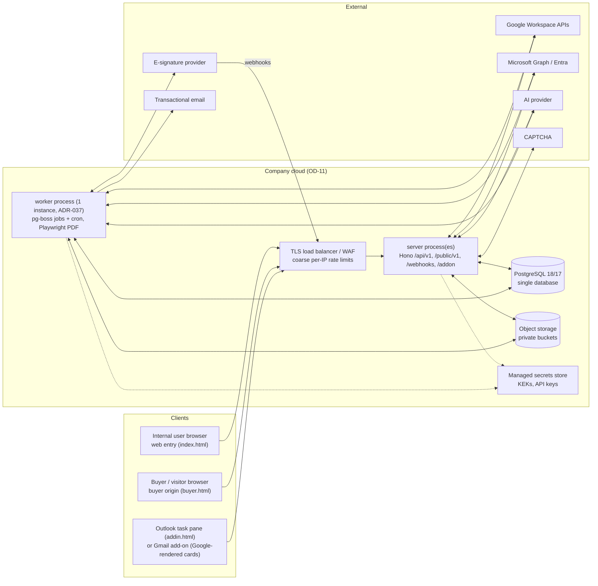

| Element | Data responsibility | Source |
|---|---|---|
| server | All synchronous user, buyer, add-in and webhook requests; writes business rows + timeline + audit + domain_event + job enqueue in one transaction; serves SSE poke stream; never holds a DB transaction open across an external call | ADR-001, ADR-003, A1, A4, A5 |
| worker | Background jobs and cron (pg-boss); mailbox/calendar sync; PDF/DOCX render; provider dispatch; webhook-inbox processing; automation; notifications email; export; retention; reconciliation | ADR-007, ADR-022, ADR-037 |
| PostgreSQL | System of record for all structured data incl. queue tables (pg-boss), notification table, idempotency keys, rate-limit buckets | ADR-005, ADR-032 |
| Object storage | All binaries: proposal PDFs/DOCX, signed PDFs, certificates, template assets, branding, import sources, export archives, audit archive | ADR-011, ADR-036 |
| Secrets store | KEK(s) for envelope encryption; provider credentials; Better Auth secret | A10, foundation §10 |
| Buyer origin | Separate hostname served by the same server; no internal cookies; strict CSP | A2, ADR-020 |

Process rule: **no external network call is made inside a database transaction.** Every flow that touches an external system is split into (a) a local transaction that records intent and enqueues a job, (b) the external call, (c) a second local transaction that records the outcome. This is the basis of every transaction-boundary table below.

---

## 3. Common write pattern (unit of work)

Every state-changing operation, whether initiated by a user request, a buyer request, a webhook-processing job or an automation job, follows the same unit-of-work shape (ADR-022, ADR-028).

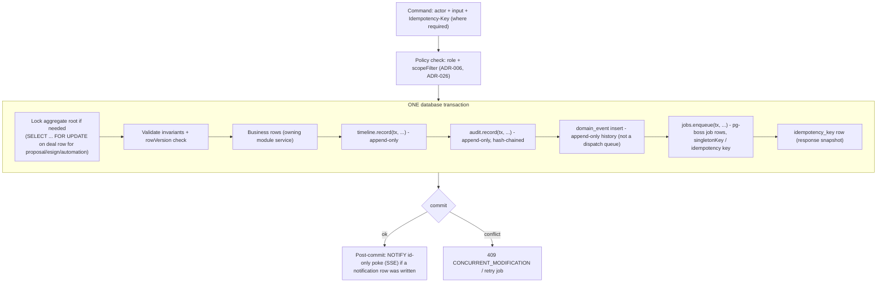

| Rule | Detail | Source |
|---|---|---|
| Single transaction | Business rows, `timeline_event`, `audit_log`, `domain_event` and the pg-boss job rows commit or roll back together. If pg-boss cannot use the caller's executor for the pinned version, a minimal outbox table drained by the worker replaces in-tx enqueue (A4 fallback). | A4, ADR-022 |
| At-least-once handlers | Every job handler is idempotent: business idempotency key (e.g. `AUT-002:{signatureRequestId}`), unique constraints, or dedupe key on the produced row. | RULE-AUT-03, RULE-NTF-12, RULE-LED-14 |
| Optimistic concurrency | Mutable aggregates carry `row_version`; mismatch → 409. Automation re-checks guards under a row lock and records `skipped_conflict`. | ADR-005, RULE-PLT-24, RULE-AUT-04 |
| Audit failure is fatal | If the audit insert fails, the whole command rolls back. | BR-PLT-009 FR |
| Actor stamping | Every timeline/audit/domain_event row carries `ActorRef` (user, buyer, system, ai). | DOMAIN-MODEL §1.2, BR-TIM-004 |
| No secrets or bodies in events | `domain_event.payload` carries ids and changed field names/values only; never tokens, never private email content. | DOMAIN-MODEL §22 |
| Dead-letter | Each queue has a DLQ; DLQ depth alerts; Admin job/DLQ view with replay. | A4, A14 |

---

## 4. Data flows

Each flow lists: diagram, steps, **transaction boundaries** (TX-n = one DB transaction), data written, external data egress, failure handling.

### F-01 Lead form → contact/company/deal → assignment → notification

Sources: BR-LED-001..006, BR-NTF-001, RULE-LED-01..14, SM-09, OD-27, OD-33, OD-46, foundation R3 (free-mail), DR-LED-01..06.

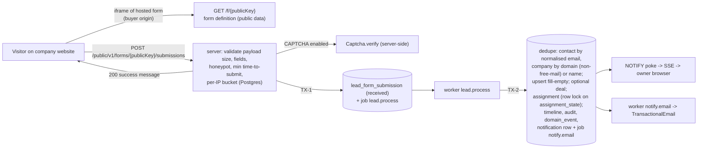

| Step | Process | Action | Data |
|---|---|---|---|
| 1 | server (buyer origin) | Serve hosted form page (iframe source; postMessage auto-resize). Embed allowed only from `allowedOrigins` (CSP `frame-ancestors`). | `lead_form` published definition (public) |
| 2 | server | Validate: payload ≤ 64 KB, field types/lengths, required, email syntax (RULE-LED-03); honeypot, minimum time-to-submit, per-IP rate bucket (RULE-LED-04, BR-LED-006 FR); CAPTCHA token verified via `Captcha` adapter when enabled (OD-46). | `rate_limit_bucket` (key = ipHash + formId) |
| 3 | server TX-1 | Persist submission **before** processing (DR-LED-03): raw payload, form version, page URL, UTM, referrer, IP hash, user agent, spam verdict; enqueue `lead.process` (job key = submissionId). Respond 200. | `lead_form_submission` |
| 4 | worker TX-2 | Normalise; match contact (normalised email incl. additional emails; archived match handled per DR-LED-05); company (domain unless free-mail, else name); create/update fill-empty only (RULE-LED-06); create deal if enabled and company resolvable (R3: no company ⇒ no deal); duplicate-deal suppression (RULE-LED-06 / DR-LED-05); evaluate assignment (existing-owner → field rules → default → fallback; RULE-LED-07..09) with `SELECT … FOR UPDATE` on `assignment_state`; set owners (RULE-LED-10); first-touch source (RULE-LED-12); timeline `lead_submitted`; audit; `domain_event` `lead.submitted`, `lead.assigned`; notification row `new_lead_assigned` (dedupe key = submissionId+recipient); enqueue `notify.email`. | `contact`, `company`, `deal`, `deal_contact`, `assignment_state`, `lead_form_submission.processingStatus=processed`, `timeline_event`, `audit_log`, `domain_event`, `notification` |
| 5 | server | Post-commit `NOTIFY` (id-only) → SSE poke to owner; client fetches `GET /api/v1/notifications?since=` (ADR-023). | — |
| 6 | worker | `notify.email` → TransactionalEmail adapter; `notification.emailStatus` updated. | `notification` |

| Boundary | Contents | Isolation / locks | Failure handling |
|---|---|---|---|
| TX-1 (server) | submission row + job row | READ COMMITTED | Validation fail → 422 not stored; rate limit → 429 not stored; honeypot → 200, stored as `spam_rejected` per FR BR-LED-006 (see §9 C-07) |
| TX-2 (worker) | all upserts, assignment, timeline, audit, events, notification, email job | row lock on `assignment_state` (round-robin fairness); unique (`lead_form_submission` → record link) for idempotency | Exception → retry with backoff up to 5 (SM-09 R5); then `failed`, visible to Admin with reprocess (R7) |

Egress: CAPTCHA token + visitor IP to the CAPTCHA provider (if enabled); notification email (no proposal content; RULE-NTF-11) to the assignee via the transactional email provider.

Latency budget (NFR-005, ≤ 1 min end-to-end): TX-1 < 200 ms; job pickup ≤ 2 s (pg-boss polling interval configured ≤ 2 s for the `lead` queue); TX-2 < 500 ms; SSE poke < 1 s; email enqueue immediate.

### F-02 CSV/Excel import pipeline

Sources: BR-MIG-001..005, RULE-MIG-01..14, SM-08, DR-MIG-01..05, OD-09, OD-27, OD-33.

```mermaid
flowchart TB
  U1["Admin uploads .csv/.xlsx"] -->|"multipart, size check"| S1["server: store source file<br/>(object storage, import bucket)"]
  S1 -->|"TX-1"| B1[("import_batch: uploaded<br/>file_object")]
  B1 --> P["worker import.parse: detect encoding/delimiter,<br/>header row, preview 20 rows"]
  P --> M["Admin maps columns -> standard/custom fields,<br/>defaults (owner, pipeline, stage), date format"]
  M -->|"TX-2 status validating + job"| VJ["worker import.validate: per row type coercion,<br/>required, options, owner/stage resolution,<br/>in-file and existing duplicates (exact keys),<br/>pg_trgm fuzzy suggestions"]
  VJ -->|"TX-3 chunks"| R[("import_row: mappedData, errors,<br/>duplicateCandidates; batch validated")]
  R --> D["Admin reviews error report (CSV download)<br/>and duplicate actions skip/merge/create"]
  D -->|"Idempotency-Key, TX-4 status committing + job"| CJ["worker import.commit"]
  CJ -->|"TX-5..n per chunk"| C[("company/contact/deal upserts,<br/>import_record_link (before snapshot),<br/>timeline 'Imported', audit")]
  C --> DONE["batch committed; notification to Admin"]
  DONE -->|"Admin undo"| UJ["worker import.undo (chunked)"]
  UJ --> UD[("hard delete untouched created rows;<br/>restore merged fields still equal to imported;<br/>report kept rows; batch undone")]
```

| Step | Detail | Data |
|---|---|---|
| Upload | Admin only (RULE-MIG-01). Limits: file size 25 MB; row limit and undo window conflict between specs (§9 C-01). MIME sniffing, xlsx zip-bomb limits, password-protected detection (A10). Source file stored in a private bucket with lifecycle deletion (DR-MIG-01: 30 days). | `file_object` (purpose `import_source`), `import_batch` |
| Parse | Streaming parser in worker; never loads whole file into memory; writes `import_row.rawData` in chunks of ~1,000 rows. | `import_row` |
| Map | Mapping saved on batch; reusable presets per source profile (BR-MIG-002 conditional on OD-09). | `import_batch.mapping` |
| Validate | No writes to business tables (BR-MIG-004). Duplicate keys per OD-27 (contact normalised email; company normalised domain excluding free-mail, else normalised name; deal external id). Fuzzy candidates via `pg_trgm` similarity ≥ 0.6 shown as suggestions only (RULE-MIG-07). | `import_row.validationErrors`, `duplicateCandidates` |
| Commit | Duplicates re-evaluated at commit (RULE-MIG-06). Each record linked to batch with before-snapshot for merges (RULE-MIG-09). Imports do **not** trigger AUT rules, assignment or lead notifications (RULE-MIG-09, DR-MIG-05) — the commit transaction writes timeline and audit but enqueues no automation jobs. | `company`, `contact`, `deal`, `deal_contact`, `import_record_link`, `timeline_event`, `audit_log`, `domain_event` (`import.committed`) |
| Undo | Created rows hard-deleted only if unchanged (`row_version` = `afterVersion`) and without dependants; merged fields restored only where current value equals imported value (RULE-MIG-10, DR-MIG-02). | `import_record_link`, business tables, `audit_log` |

| Boundary | Contents | Notes |
|---|---|---|
| TX-1 | batch row + file_object + parse job | File already in object storage before TX-1 (orphan object cleaned by lifecycle if TX-1 fails) |
| TX-3 (per validation chunk) | import_row updates | Validation restartable from last chunk |
| TX-4 | batch → committing, `IMPORT_BATCH_BUSY` guard (RULE-MIG-14: one batch per entity type in importing/undoing) | Requires `Idempotency-Key` (RULE-PLT-25) |
| TX-5..n (per commit chunk, e.g. 500 rows) | upserts + record links + timeline + audit | **Conflict**: RULE-MIG/SM-08 allow chunked commit with `failed → resume`, FR BR-MIG-001/003 require all-or-nothing per batch (§9 C-01). HLD design supports both: chunked commit with a batch-level "compensate on failure" option that runs the undo logic over committed chunks. Decision required. |
| Undo chunks | per chunk delete/restore + link status | Undo is itself audited; cannot be undone |

Egress: none.

### F-03 Mailbox sync

Sources: BR-EML-001..003, RULE-EML-01..08, RULE-EML-15..17, SM-10, DR-EML-01..06, OD-06, OD-28, OD-29, OD-30, OD-51, A16, ADR-031. Provider mechanics are in INTEGRATION-ARCHITECTURE §5.2/§6.2.

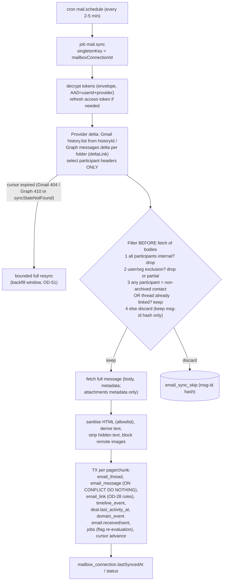

| Stage | Rule | Detail |
|---|---|---|
| Scheduling | ADR-031, A8 | Cron enqueues one `mail.sync` job per active connection with `singletonKey = mailboxConnectionId` so a mailbox is never synced concurrently. Interval 2–5 min (ADR-012). Polling only in Phase 1 (A16). |
| Token use | A10, RULE-EML-02 | Refresh token decrypted in worker memory only for the call; never logged; new access token not persisted (or persisted encrypted with expiry). Refresh rejected → status `reauth_required`, sync stops, notification `mailbox_reauth_required` (RULE-EML-03, SM-10 M6). |
| Delta | ADR-012 | Gmail `history.list` with `historyTypes=messageAdded` from stored `historyId`; Graph `messages/delta` for Inbox and Sent Items (folder scope open, §9 O-03). Cursor stored on `mailbox_connection.mailSyncCursor`. |
| Cursor expiry | A16, SM-10 M7 | Gmail `startHistoryId` too old → HTTP 404; Graph delta token invalid → 410 / `syncStateNotFound`. Action: bounded full resync over the backfill window; idempotent by unique `(mailbox_connection_id, provider_message_id)`. |
| Pre-persist filter | OD-29, RULE-EML-05/06, A16 | Applied on **header metadata only** (From/To/Cc/Bcc for sent; Message-ID; thread/conversation id), *before* body download — minimises personal data fetched as well as stored (proposed ADR-080, §8). Internal-only mail dropped; exclusions applied; unknown participants discarded with only a message-id hash retained (DR-EML-01). |
| Body fetch + sanitise | A10, RULE-EML-15, A15 | Server-side HTML sanitisation to an allowlist; remote images blocked; hidden text removed for AI use; stored as `bodyHtml` (sanitised) + `bodyText`. Attachments: metadata only (A16). |
| Persist + link | OD-28, RULE-EML-08 | Link to all matched contacts and their primary companies; deal = single open deal, else most-recent-activity open deal with `reviewSuggested=true`; replies inherit thread links; manual links never overridden. |
| Timeline | RULE-EML-16, OD-30 | One `timeline_event` per message anchored to linked records; actor buyer (inbound from contact) or user (outbound). Private messages: `privacy=private_email`, summary without subject. Cross-mailbox duplicates (same `internetMessageId`) produce one timeline entry (DOMAIN-MODEL §7.2 DPC; privacy interaction open, §9 O-06). |
| Activity | OD-35, RULE-AUT-31 | `deal.last_activity_at` updated in the same TX (private metadata counts). Enqueue `automation.flags.reevaluate` with `singletonKey = dealId` to clear a stalled flag (RULE-AUT-34). Inbound mail from a recipient of a sent version is an "answer" for AUT-004 — evaluated at AUT-004 fire time by query, no extra job. |
| Exclusion added | RULE-EML-06, DR-EML-04 | Job `mail.exclusion.purge` hard-deletes that user's stored messages now fully excluded, their links and timeline entries (timeline immutability exception — governed deletion, audited). |
| Disconnect / deactivation | SM-10 M8/M9, RULE-PLT-14 | Tokens revoked at provider (best effort) and deleted locally; synced data retained per retention (OD-36). |

| Boundary | Contents | Notes |
|---|---|---|
| TX per page (≤ 50 messages) | thread/message/link/timeline/deal activity/domain_event/jobs + cursor advance when the page is the last of a delta response | Cursor is advanced only in the transaction that commits the last message of the page, so a crash re-processes at most one page; unique constraints make reprocessing harmless |
| Purge TX (per 500 messages) | delete messages, links, timeline rows | Audited with counts |

Egress: OAuth refresh to provider; Graph/Gmail API reads. Nothing about our CRM data is sent to the mail provider during sync.

### F-04 Calendar sync

Sources: BR-EML-006, RULE-EML-13, OD-28, OD-29 analogue, OD-30, OD-35.

| Stage | Detail |
|---|---|
| Schedule | Same job family as F-03 (`calendar.sync`, `singletonKey = mailboxConnectionId:cal`), only when `calendarSyncEnabled`. |
| Delta | Google Calendar `events.list` with `syncToken` (410 GONE → full resync over window); Graph `calendarView/delta` with start/end window. Window: sync start date → +90 days ahead (BR-EML-006 FR). |
| Filter | Store only events with ≥ 1 attendee matching a non-archived contact (DOMAIN-MODEL §7.6 DPC). Provider-private events → metadata only. |
| Persist | `calendar_event` upsert by `(mailbox_connection_id, providerEventId)`; `iCalUid` for cross-mailbox dedupe; `calendar_event_link` per OD-28 logic; timeline `meeting` (cancelled → status update, entry stays as "Cancelled"). |
| Activity | Meeting counts as activity when its end time has passed (BR-EML-006 FR): on persist, if `endAt ≤ now` update `deal.last_activity_at` in-TX; else enqueue `deal.activity_touch` with `startAfter = endAt` (idempotent on eventId+endAt). Rescheduling re-enqueues with the new end time. |

### F-05 Send email from CRM

Sources: BR-EML-004, BR-EML-007, BR-SHR-002, RULE-EML-09..12, DR-EML-02, OD-37, A10. Sequence diagram in INTEGRATION-ARCHITECTURE §10.3.

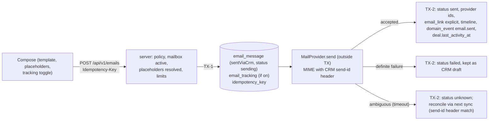

| Boundary | Contents | Notes |
|---|---|---|
| TX-1 | outgoing `email_message` row (status `sending`, proposed state column), tracking row, idempotency key | Same `Idempotency-Key` replay returns the stored response; no second provider call (RULE-PLT-25) |
| External | Provider send through the user's own mailbox (NFR-013) | Synchronous within the request with a 20 s budget; tracking pixel URL on buyer origin, token hash stored (`email_tracking.pixelTokenHash`) |
| TX-2 | outcome + linking + timeline | Linked explicitly to the record it was sent from (RULE-EML-09); sync later sees the same message in Sent Items and dedupes on `(mailbox, provider_message_id)` or the send-id header |

Ambiguous outcomes are never blindly re-sent (proposed ADR-084, §8). The open-tracking pixel (`GET` on buyer origin) updates `email_tracking` counters only — it never counts as buyer activity or answers AUT-004 (RULE-EML-12).

### F-06 Proposal generation and send

Sources: BR-TPL-002/004/008, BR-PRC-002..004/007, BR-PRP-001..009, BR-AIA-001/002/006/007, RULE-PRP-01..21, RULE-PRC-10..13, RULE-AIA-06/11, ADR-010, ADR-029, ADR-025, A9, A10, A13, OD-16, OD-20, OD-21, OD-43, OD-44.

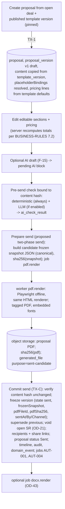

| Step | Detail | Source |
|---|---|---|
| Template version pin | Proposal stores `templateVersionId`; template changes never alter it. | BR-TPL-004, RULE-TPL-03 |
| Placeholder resolution | `packages/proposal` resolver reads deal, company, primary contact, owner, organization (incl. custom fields) through crm/identity service APIs; formatting per org locale (RULE-TPL-05); unresolved list stored on version (`missingPlaceholders`). New version re-resolves and shows a diff (RULE-PRP-02). | BR-PRP-002, BR-TPL-008 |
| Pricing | Draft `pricing_line` rows (A12) recomputed server-side on every save with exact decimal arithmetic; client totals ignored (RULE-PRC-10); TCV excl. tax per OD-16; deal-amount prompt recorded on version (RULE-PRC-11); discount warnings recorded (RULE-PRC-12). | BR-PRC-002..004/007 |
| AI drafting | See F-15. Output lands as a pending AI node; pending AI content is a blocking pre-send finding (RULE-AIA-06). | BR-AIA-001/007 |
| Pre-send checks | Deterministic checks run even when AI is off (R4); LLM consistency check only when enabled; result bound to the content hash; any edit invalidates. | BR-AIA-002, RULE-AIA-11 |
| Freeze | Canonical snapshot JSON (resolved content, pricing, totals, branding, validity, termMonths, response mode) + SHA-256 of snapshot and of PDF; DB trigger rejects UPDATE of frozen columns once state ∈ {sent, superseded, signed}. | RULE-PRP-09, A9 |
| PDF render | Worker queue `pdf` concurrency 1–2, warm browser, no network except in-process asset handler (images fetched from object storage by the handler), JS disabled, render timeout; retries 3 (RULE-PRP-07); target < 10 s (NFR-005). | A10, ADR-026 |
| DOCX | Same block model → `docx` mapper; optional, not on the send critical path (OD-43). | BR-PRP-005 |
| Storage | `file_object` with sha256, purpose `proposal_pdf`; documents bucket; retention: sent files permanent while the deal exists (RULE-PRP-12). | ADR-036 |

Two-phase send (proposed ADR-081, §8) exists because FUNCTIONAL-REQUIREMENTS BR-SHR-002 requires that the version is frozen only after at least one recipient email is accepted by the provider, while RULE-PRP-09 and A9 require an immutable freeze with DB-enforced immutability. Phase 1 ("prepare") produces the candidate snapshot, PDF and per-recipient link tokens without changing the version state and holds a send lock on the draft (edits rejected); phase 2 ("commit") freezes. Channel mapping:

| Channel | Phase 2 trigger |
|---|---|
| `crm_email` | First recipient email accepted by the provider (F-05 TX-2) |
| `addin_email` | Add-in reports the send, or user confirms "Mark as sent" (BR-EML-005 FR) |
| `manual_link` | User confirms "I shared this link manually" (RULE-PRP-10) |

Prepared-but-uncommitted sends are discarded after a timeout (value not specified — §9 O-01). Buyer requests on a prepared-but-not-committed link return "not yet available".

| Boundary | Contents | Locks |
|---|---|---|
| TX-1 create | proposal + version + bindings + pricing lines + timeline + audit + domain_event `proposal.created` | none beyond deal read (deal must be open) |
| TX save (per edit) | version content, pricing lines, totals, `row_version` | optimistic (`row_version`) |
| TX-P prepare | `generated_file` (candidate), share-link rows in `pending` state *(proposed state, see §9 C-02)*, send lock | `SELECT … FOR UPDATE` on deal row |
| TX-C commit | freeze + supersede + SR void request + recipients/links active + status + timeline + audit + events + jobs (AUT-001 `startAfter=now`, AUT-004 `startAfter=sentAt+N days`, `esign.void` for superseded SR) | `SELECT … FOR UPDATE` on deal row (single proposals state-machine function, A9) |

Egress: none in generation itself; AI egress in F-15; send egress in F-05.

### F-07 Share and tracking

Sources: BR-SHR-001..010, RULE-SHR-01..19, §18 precedence, SM-06, OD-21, OD-22, OD-26, OD-27, OD-34, ADR-013, ADR-034, A10.

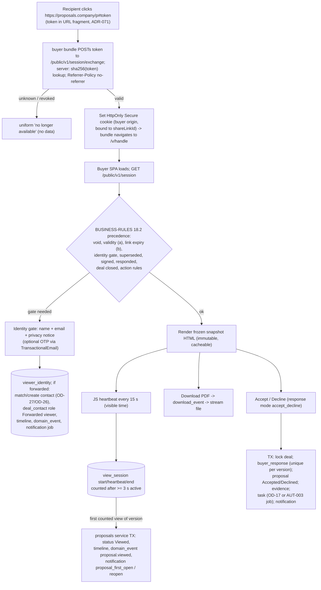

| Data item | Written by | Notes |
|---|---|---|
| `share_link.tokenHash` + encrypted token | F-06 TX-C | SHA-256 for lookup; envelope-encrypted token so authorised users can copy the link again (R5, ADR-034) |
| Buyer cookie | server | Exchanged from URL token; HttpOnly, Secure, SameSite=Lax, path `/`, buyer origin only; contains a signed opaque session id (not the token) |
| `viewer_identity` | gate | name, normalised email, isOriginalRecipient, contactId, dealContactId, privacyNoticeVersionAccepted, deviceKeyHash, emailVerifiedAt |
| `email_verification_challenge` | gate (OTP) | code hash, 10 min, 5 attempts; 5 codes/hour/email+link (RULE-SHR-08) |
| `view_session` | heartbeat endpoint | start, lastHeartbeatAt, endedAt, activeSeconds, flags first/reopen, UA, IP (retained 90 days then truncated per RULE-SHR-04), country |
| `download_event` | download endpoint | server-mediated; short-lived signed URL or stream |
| `buyer_response` | accept/decline | typed name, checkbox, timestamp, IP, UA, email, versionId, PDF SHA-256, terms text shown (A9, RULE-SHR-15) |

Write-amplification control: heartbeats update one `view_session` row (no per-heartbeat rows); in-memory per-instance rate limit on heartbeats (A10); status transitions to Viewed happen once per version (guarded update). Mail-scanner prefetch only performs the cookie exchange — it never runs JS, so it creates no session, no "first open" and no gate submission (A10, DR-SHR-04). Internal viewers (identity email is internal, or internal session present in the browser) are recorded as internal and never change status or notify (RULE-SHR-05, DR-PRP-03).

Rendering read path: the buyer view renders the **frozen snapshot**, which is immutable; rendered HTML may be cached in-process keyed by `(versionId, snapshotSha256)` — no Redis (ADR-019).

| Boundary | Contents |
|---|---|
| Gate TX | viewer_identity + (forwarded) contact/deal_contact via crm service API + timeline + audit + domain_event `share.forwarded_viewer_identified` + notification row + email job |
| View-counted TX | view_session flag + proposal status (proposals service, deal row lock not required for Sent→Viewed guarded update) + timeline + domain_event + notification |
| Response TX | buyer_response + proposal status + timeline + audit + domain_event + jobs (OD-17 task or AUT-003, notification) — synchronous (DOMAIN-MODEL §21) |

Egress: OTP email via TransactionalEmail (code + recipient address only); buyer-initiated "Forward" email (DR-SHR-07) via TransactionalEmail.

### F-08 E-signature

Sources: BR-SIG-001..013, BR-AUT-002, RULE-SIG-01..23, SM-04, SM-05, OD-01..03, OD-18, OD-19, OD-21..25, OD-42, A9, ADR-025. Sequence diagrams: INTEGRATION-ARCHITECTURE §10.6.

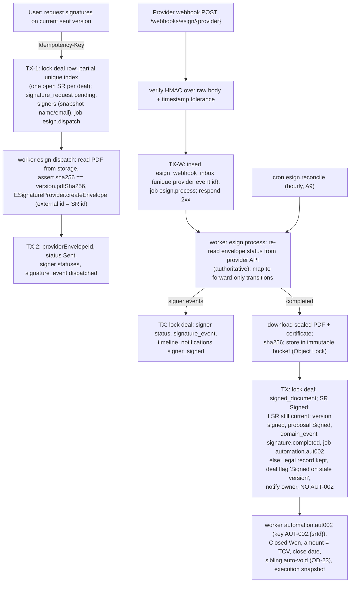

| Data | Location | Integrity / retention |
|---|---|---|
| Original PDF sent to provider | documents bucket (already stored at send) | `signature_request.documentSha256` must equal `proposal_version.pdfSha256` (A9) |
| Raw webhook payload | `esign_webhook_inbox` *(proposed name)* (JSONB) and/or object storage reference `rawPayloadRef` | Unique provider event id; retained ≥ signed document lifetime when linked to a signed request (RULE-SIG-23); otherwise retention per OD-36 (§9 O-08) |
| Signer evidence | `signer` (consentCapturedAt, IP from provider), `signature_event` | Erasure-exempt (RULE-SIG-23, OD-36) |
| Signed PDF + certificate | signed bucket with versioning + Object Lock / immutable policy | SHA-256 stored on `signed_document`; erasure-exempt; not marked Signed until both stored and hashed (BR-SIG-009 FR) |

Transaction boundaries and guards:

| Boundary | Contents | Guard |
|---|---|---|
| TX-1 create | SR + signers + job | Deal row `FOR UPDATE`; partial unique index `signature_request(deal_id) WHERE status IN (pending,sent,viewed)`; version is current sent version; proposal status ∈ {Sent, Viewed, Accepted} (RULE-SIG-02/03) |
| TX-2 dispatched | provider ids + status | Dispatch retried 5× (RULE-SIG-13); conflict on final failure: RULE-SIG-13 (stay Pending, notify) vs FR BR-SIG-001 (auto-void "Dispatch failed") — §9 C-03 |
| TX-W inbox | raw verified event | Return 2xx fast; duplicate event id → 200 no-op |
| TX state | all SR/signer/proposal changes through the single proposals state-machine function under the deal row lock; forward-only transitions (RULE-SIG-14) | Completion keyed by SR id (idempotent) |
| Void (user/auto) | local status `voiding` then provider void via job; if provider reports completion first, completion wins (BR-SIG-013 FR); completion on voided/superseded/expired SR handled as stale (A9) | — |

Egress: proposal PDF, signer names, emails, optional mobile numbers (SMS), message to signers, our external reference id → e-signature provider.

### F-09 Automation and scheduled scans

Sources: BR-AUT-001..008, RULE-AUT-01..64, ADR-024 (A6), OD-17, OD-23, OD-24, OD-35, OD-40.

Note: BUSINESS-RULES §13, DOMAIN-MODEL §16.1 and FR BR-AUT-007 previously described rules as `automation_rule` rows (superseded ADR-015) — **resolved**: specifications updated to ADR-024. This HLD follows binding foundation A6/ADR-024: **built-in rules in code + `automation_setting` table + `automation_execution`** (§9 C-04).

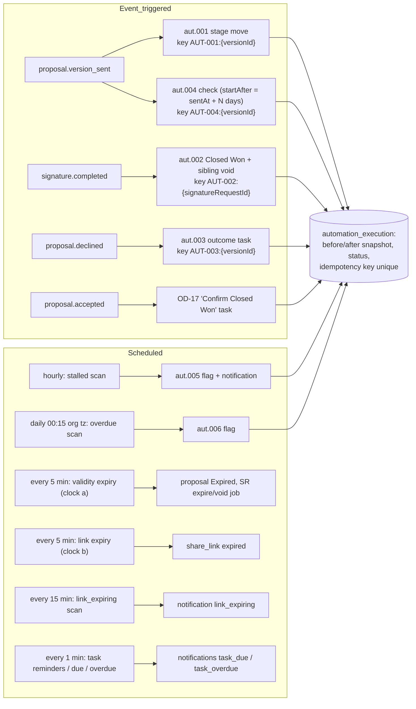

| Rule | Trigger data path | Transaction | Reversal data |
|---|---|---|---|
| AUT-001 | Job from F-06 TX-C | Lock deal; guard (open, target configured in `automation_setting`, current order < target); update stage; `deal_stage_history`; timeline (automated); audit; execution | before stage |
| AUT-002 | Job from F-08 completion | Lock deal; guard (open ⇒ apply; won/lost handling conflict §9 C-05); stage Closed Won, amount TCV, close date; sibling proposals Void (child executions); cancel AUT follow-up tasks; timeline; audit | before stage/amount/close date + sibling prior statuses (A9) |
| AUT-003 | Job from decline TX | Task insert; execution | task id |
| AUT-004 | Delayed job | Guard at fire time: version current, status Sent, no counted non-internal view, not answered (accept/decline/sign or inbound mail from a recipient since sentAt), deal open (RULE-AUT-61); task; optional AI follow-up draft job (F-15) whose failure never blocks the task | task id, AI generation id |
| AUT-005 | Hourly scan: `deal.status=open ∧ stage.stalledAfterDays=N ∧ now − last_activity_at > N ∧ not dismissed` | Per deal TX: `deal_flag`, timeline, notification `deal_stalled`; key `AUT-005:{dealId}:{lastActivityAt}` | flag id, dismissal |
| AUT-006 | Daily scan + on closeDate change | `deal_flag(past_close_date)`; key `AUT-006:{dealId}:{closeDate}` | flag id |
| Reversal (AUT-008) | User request | Compare-and-swap on deal `row_version` / after-values; restore; execution `reversed`; timeline actor user; audit; key retained (never re-fires) | — |

Scans read with keyset pagination over indexed predicates (`deal(status, stage_id, last_activity_at)`, `proposal(status, valid_until)`, `share_link(status, expires_at)`, `task(status, reminder_at)`, `task(status, due_at)`) and enqueue per-record jobs (singletonKey = record id) rather than updating in one large transaction. Expiry clocks are additionally enforced lazily on every buyer request (§18.1). Imported records and internal previews never trigger automation (RULE-AUT-07).

### F-10 Notifications and digest

Sources: BR-NTF-001..003, BR-LED-003, BR-CRM-008, RULE-NTF-01..12, DR-NTF-01..04, ADR-023, OD-14, OD-47.

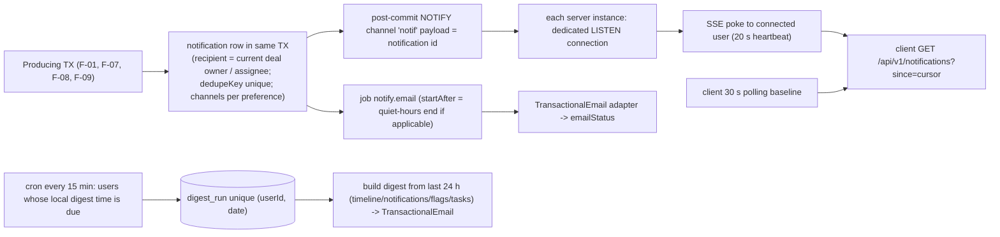

| Aspect | Detail |
|---|---|
| Recipient resolution | At event time: current deal owner (RULE-NTF-01); deactivated not yet reassigned → team managers, else Admins (DR-NTF-01). |
| Throttling | `proposal_reopen` and `proposal_downloaded` throttles — conflicting values between FR (2 h) and BR (4 h) for reopen (§9 C-06); implemented as dedupe key windows (e.g. `reopen:{viewerId}:{versionId}:{window}`). |
| Email content | No proposal body content; title, deal name, viewer name/email, deep link requiring sign-in (RULE-NTF-11). |
| Delivery | Email retried 5× with backoff then `failed` (RULE-NTF-08). |
| Digest | Default on/08:00 (FR BR-NTF-003) vs default off/07:00 (RULE-NTF-09) — parameterised as settings; conflict §9 C-06. |
| Source of truth | `notification` table; SSE is only a poke (A5). |

### F-11 Reporting reads

Sources: BR-RPT-001..010, RULE-RPT-01..13, OD-15, OD-35, A10 (scopeFilter), RULE-RPT-12.

| Aspect | Design |
|---|---|
| Path | Browser → `GET /api/v1/reports/...` → reporting module (read-only, A12 exception) → SQL over primary tables and SQL views; every query is composed with mandatory `scopeFilter(actor, 'deal')`; the same scoped deal set drives totals and drill-down (RULE-RPT-01). |
| Currency | Join `exchange_rate` on metric date (close date for won/lost, report date for open pipeline); missing rate → excluded and counted (RULE-RPT-03, RULE-CRM-30). |
| Freshness | Live queries by default; if a view is materialised for performance, refresh ≤ 5 min and "as of" shown (RULE-RPT-12). At OD-45 sizing (≤ 100k deals, ≤ 20k proposals/year) live aggregate queries on indexed columns are expected to meet NFR-005 (< 2 s p95); materialisation is a fallback, not a starting point. |
| Privacy | Private email subject/body never selected (RULE-RPT-13); activity reports count private emails as metadata (OD-30). |
| Guardrails | `statement_timeout` for report queries (e.g. 10 s); dedicated connection pool slice so reports cannot starve OLTP; CSV export with formula-injection guard (RULE-RPT-11), audited. |
| Read replica | Not required at OD-45 sizing; documented as the scale path (reporting and export move to a replica with the `readonly` role). |

### F-12 Audit, timeline and domain_event writes

Sources: BR-PLT-009, NFR-009, BR-TIM-001..004, RULE-TIM-01..08, RULE-PLT-19, A4, A10, A12.

| Store | Writer | Shape | Immutability | Read path |
|---|---|---|---|---|
| `timeline_event` (+ anchors) | `timeline.record(tx, …)` from every module in the originating TX | eventType, anchors (deal/company/contact), source RecordRef, actor, occurredAt, summary, isAutomated, automationExecutionId, privacy | No UPDATE grant for the app role except governed deletions (exclusion purge, erasure, import undo) | Per record, keyset on `(occurred_at desc, id desc)` (RULE-TIM-03), visibility filtered by source record (RULE-TIM-07) |
| `audit_log` | `audit.record(tx, …)` | occurredAt, actor, action, target, redacted diff, requestId, ipTruncated, userAgent, outcome, `prev_hash`, `hash` | App role INSERT/SELECT only; hash chain; periodic export to immutable storage (A10) | Admin only; filters date ≤ 366 days per query |
| `domain_event` | producing service in TX | `{eventId, name, occurredAt, actor, aggregate, correlationId, payload}` | Append-only history; **not** a dispatch queue (A4) — DOMAIN-MODEL §18 `status/attempts` columns are superseded (§9 C-04) | Debugging, Phase 2 analytics |

Timeline anchors: a deal event is anchored to the deal, its company and involved contacts at write time (DOMAIN-MODEL §17.1). Physical model proposal: `timeline_event` plus `timeline_event_anchor(record_type, record_id, occurred_at, event_id)` with index `(record_type, record_id, occurred_at desc, event_id desc)` for keyset paging of company timelines that aggregate many deals *(proposed, TLD to confirm; proposed ADR-082)*.

Audit hash chain: each row stores `hash = SHA-256(prev_hash || canonical(row))`; chain is written under a short advisory lock (`pg_advisory_xact_lock(audit_chain)`) to serialise chain extension. At OD-45 volumes (≈ 30k–60k audit rows/day) the serialisation cost is acceptable; if contention appears, chain per day-partition. A nightly job verifies the chain and exports the previous day to the audit-archive bucket (immutable).

### F-13 Full export

Sources: BR-PLT-010, IDD-12, RULE-PLT-20, DR-PLT-06, OD-30.

```mermaid
flowchart LR
  A["Admin requests export (Idempotency-Key)"] -->|"TX: export_job queued (one running max)"| J["worker export.run"]
  J --> R["read each entity in keyset pages<br/>(REPEATABLE READ, READ ONLY; readonly-equivalent scope = all)"]
  R --> Z["stream CSV + NDJSON per entity into ZIP<br/>(multipart upload to exports bucket)"]
  Z --> F["optional files/: signed PDFs, certificates,<br/>proposal PDFs, images (server-side copy)"]
  F --> M["manifest.json: counts, schema version,<br/>SHA-256 per file"]
  M --> D["TX: export_job completed, notification to Admin,<br/>audit export.completed"]
  D --> DL["download via signed URL (24 h, requester only, audited)"]
  DL --> LC["lifecycle delete after 7 days"]
```

| Concern | Design |
|---|---|
| Consistency vs bloat | A single REPEATABLE READ snapshot gives a consistent export but holds back vacuum for the export duration. At OD-45 sizing the largest table (`email_message`, ≤ 5M rows) streams in minutes; acceptable. If exports exceed ~30 min, switch to per-entity snapshots and record per-entity `exported_at` in the manifest. |
| Privacy | Private emails exported as metadata only (OD-30, RULE-PLT-20). Tokens, OAuth secrets, password hashes, TOTP secrets are never exported. |
| Location | Exports bucket, server-side encryption, lifecycle 7 days (DR-PLT-06). |

### F-14 Erasure and retention

Sources: NFR-002, NFR-015, OD-36, RULE-PLT-21, DOMAIN-MODEL §18 (`retention_policy`, `erasure_request`), A12 (anonymise handler per module), RULE-SIG-23, DR-PLT-07, DR-LED-06, DR-MIG-01, RULE-SHR-04.

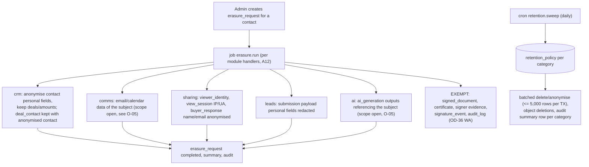

| Category (DOMAIN-MODEL §18 `retention_policy.category`) | Default in specs | Action |
|---|---|---|
| synced_email | Not defined — OD-36 | delete (bodies) / anonymise (TBD) |
| calendar_event | Not defined — OD-36 | delete |
| view_session | IP retained 90 days then truncated (RULE-SHR-04); session rows: OD-36 | truncate IP; delete rows per policy |
| lead_submission | Per category (DR-LED-06); spam-rejected deleted after 30 days | delete / anonymise |
| ai_usage | Not defined — OD-36 | delete |
| ai_generation output | Per OD-36 (A15) | delete output text |
| audit_log | Default 7 years proposed (DR-PLT-07) — OD-36 | archive then delete partitions |
| import_source | 30 days (DR-MIG-01) | object lifecycle |
| export archive | 7 days (DR-PLT-06) | object lifecycle |
| idempotency_key | 24 h (RULE-PLT-25) | delete |
| email_verification_challenge | 10 min validity; rows: not defined | delete after expiry + 24 h *(operational)* |
| domain_event history | Not defined — OD-36 | delete partitions |
| pg-boss completed jobs | Operational (pg-boss archive settings, e.g. 7 days) | delete |
| Signed documents, certificates, signer evidence, audit log | Exempt from erasure (OD-36 WA, RULE-SIG-23) | — |

---

## 5. Data classification

Classification levels (this document): **P** = Personal data (any information about an identifiable natural person — buyer-side people, website visitors, signers and our own employees); **C** = Confidential commercial (non-personal business data whose disclosure harms the company); **S** = Credentials, tokens and secrets; **Pub** = Public (intentionally exposed to unauthenticated parties). Many records mix P and C; the stricter handling applies.

Common controls for all classes: TLS 1.2+ in transit (load balancer and every outbound call); encryption at rest by the managed database and object storage (provider-managed keys or KMS, OD-11); least-privilege DB roles `app` / `migrator` / `readonly` (A10); access through the central policy module only (ADR-006); logs contain ids, never personal data or secrets (ADR-017).

| # | Data item | Class | Stored where | Additional encryption / protection | Retention (OD-36) | Access |
|---|---|---|---|---|---|---|
| D-01 | Buyer contacts: names, emails, phones, job title, custom fields | P | `contact`, `deal_contact` | Normalised email indexed; erasure = anonymise | Until erasure; retention category for inactive contacts not defined — OD-36 | Policy scope (own/team/all; view-only setting OD-31; associated read R6) |
| D-02 | Company records | C (+P if sole trader) | `company` | — | Archive only; no defined period — OD-36 | Policy scope |
| D-03 | Deals, amounts, stages, lost reasons, forecasts | C | `deal`, `deal_stage_history` | — | Indefinite while business need; OD-36 | Policy scope |
| D-04 | Proposal content, pricing, totals, frozen snapshots | C (+P: names in content) | `proposal`, `proposal_version`, `pricing_line` | DB trigger immutability for sent versions; SHA-256 | Sent versions kept while deal exists (RULE-PRP-12); OD-36 | Deal scope; buyers only via share token for one version |
| D-05 | Proposal PDFs / DOCX | C (+P) | Documents bucket (`file_object`) | Private bucket, SSE, short-lived signed URLs / server-mediated download, SHA-256 | As D-04 | Deal scope; buyers via token (PDF only, RULE-SHR-18) |
| D-06 | Signed PDFs and completion certificates | C + P (signer IPs, emails) | Signed bucket (`signed_document`) | Versioning + Object Lock / immutable policy (A7), SHA-256 | **Exempt from erasure** (OD-36 WA); period per Legal | Users who can view the deal; signers/recipients via provider and token |
| D-07 | Signer evidence and signature events | P + C | `signer`, `signature_event`, `esign_webhook_inbox` | Append-only | Exempt, ≥ signed document lifetime (RULE-SIG-23) | Deal scope (read); Admin for raw inbox |
| D-08 | Synced email (participants, subject, sanitised body, attachments metadata) | P (third parties and employees) + C | `email_thread`, `email_message`, `email_link` | Sanitised; private flag hides subject/body from non-owners (OD-30); excluded from AI, reports, export bodies | Category `synced_email`, not defined — OD-36; backfill window OD-51 | Linked-record scope; private content = mailbox owner only |
| D-09 | Calendar events (title, attendees, location, description) | P + C | `calendar_event`, `calendar_event_link` | Private events metadata only | Category `calendar_event`, not defined — OD-36 | Linked-record scope |
| D-10 | Email discard markers (message-id hash) | P (pseudonymous) | `email_sync_skip` *(proposed name)* | Hash only | Backfill window — OD-51 | System only |
| D-11 | Buyer viewing data: viewer identity, sessions, IP, UA, country, downloads | P | `viewer_identity`, `view_session`, `download_event` | IP truncated after 90 days (RULE-SHR-04) | Category `view_session`, OD-36 | Anyone who can view the deal (OD-31 access history) |
| D-12 | Buyer responses with evidence | P + C | `buyer_response` | Unique per version | Same as proposal; OD-36 | Deal scope |
| D-13 | Lead form submissions (raw payload, UTM, IP hash, UA, consent) | P | `lead_form_submission` | IP stored as hash | Category `lead_submission`; spam 30 days (DR-LED-06) | Admin; assignee via resulting records |
| D-14 | Import source files and rows | P + C | Import bucket, `import_row` | Private bucket | 30 days (DR-MIG-01); rows: not defined — OD-36 | Admin |
| D-15 | Notes, logged calls/meetings, tasks | P + C | `note`, `activity_log`, `task` | — | OD-36 | Record scope |
| D-16 | AI generations (output text), check results | C (+P) | `ai_generation`, `ai_check_result` | Never logged; requester-only for summaries (RULE-AIA-12) | Per OD-36 (A15) | Requester; proposal editors for accepted content |
| D-17 | AI usage metadata | C | `ai_usage` | No prompt/output content | Category `ai_usage`, OD-36 | Admin |
| D-18 | Internal users: name, email, role, team, sign-in times | P (employees) | Better Auth `user`, `app_user_profile`, team tables | — | Employment-based; OD-36 | Admin manages; all users see names |
| D-19 | Audit log (actor, IP, UA, diffs) | P + C | `audit_log`, audit-archive bucket | INSERT/SELECT only, hash chain, immutable archive | Exempt from erasure; default 7 years proposed (DR-PLT-07) | Admin only |
| D-20 | Timeline events | P + C | `timeline_event` (+ anchors) | Private email masking | Follows source records; OD-36 | Visible if viewer can see a subject record |
| D-21 | Notifications | P + C | `notification` | No proposal body in email (RULE-NTF-11) | Not defined — OD-36 | Recipient only |
| D-22 | Export archives | P + C + (no secrets) | Exports bucket | SSE; signed URL 24 h requester-only | 7 days (DR-PLT-06) | Requesting Admin |
| D-23 | OAuth mailbox tokens (refresh/access) | S | `mailbox_connection.encryptedTokens` | Envelope encryption AES-256-GCM, key id per ciphertext, AAD = userId+provider (A10) | Until disconnect/deactivation, then deleted | Worker/server process only; never via API |
| D-24 | Better Auth `account` tokens (login OAuth) | S | Better Auth `account` | Encrypted (A10) | Session lifetime | Auth module only |
| D-25 | Password hashes, TOTP secrets, session tokens, add-in bearer tokens | S | Better Auth tables | Password hash (Better Auth default algorithm, TLD to confirm); TOTP secret encrypted; sessions hashed/opaque | Session: idle 12 h / absolute 30 days (DR-PLT-08) | Auth module only |
| D-26 | Share-link tokens | S | `share_link.tokenHash` + encrypted token (R5) | SHA-256 + envelope encryption; redacted in logs | Life of link; OD-36 | Deal scope can copy link |
| D-27 | Invitation tokens, OTP codes, email tracking pixel tokens | S | `invitation.tokenHash`, `email_verification_challenge.codeHash`, `email_tracking.pixelTokenHash` | Hash only | Invitation 7 days; OTP 10 min | System |
| D-28 | Provider credentials (AI key, e-sign keys, webhook secrets, email provider keys, storage keys, CAPTCHA secret, Google/Microsoft client secrets) | S | Managed secrets store (never DB, never repo) | KMS-backed; rotation per INTEGRATION-ARCHITECTURE §11 | Rotated | Deployment identity of server/worker |
| D-29 | Envelope-encryption KEKs, Better Auth secret, DB credentials | S | Managed secrets store / KMS | — | Rotated | Deployment identity; ops break-glass |
| D-30 | Organization settings, pipelines, templates, catalog, tax categories | C | identity/crm/templates/catalog tables | — | Indefinite | All users read non-secret settings; Admin edits |
| D-31 | Branding assets as rendered in buyer view, organization name | Pub (once published) | Documents bucket / settings | — | — | Public via buyer view |
| D-32 | Published lead form definitions and hosted form page | Pub | `lead_form` | Only published fields exposed | — | Public |
| D-33 | Buyer-view static bundle, privacy notice text | Pub | App build artefacts / settings | — | — | Public |

---

## 6. Database architecture overview

### 6.1 Logical schema areas per module

One PostgreSQL database, one application schema owner (`migrator`). Module ownership per foundation §7 and A12 (module owns its tables; other modules use its service API; reporting is the read-only exception). Recommendation: group tables by module with a module prefix or one Postgres schema per module; the choice is a TLD decision (dependency-cruiser enforces boundaries in code either way, ADR-021).

| Area | Module | Tables (foundation §7 + DOMAIN-MODEL §24 + this doc) | Hot paths |
|---|---|---|---|
| Identity & auth | identity (+ Better Auth) | `user`, `session`, `account`, `verification`, `two_factor` (Better Auth); `app_user_profile`, `team`, `team_member`, `team_manager`, `organization_settings`, `invitation` | session lookup per request |
| CRM core | crm | `company`, `contact`, `deal`, `deal_contact`, `deal_stage_history`, `pipeline`, `pipeline_stage`, `custom_field_definition`, `lost_reason`, `contact_role`, `task`, `note`, `activity_log`, `saved_view` | list views, board, search, My Day |
| Import | import | `import_batch`, `import_row`, `import_record_link` | bulk write in chunks |
| Communications | comms | `mailbox_connection`, `email_thread`, `email_message`, `email_link`, `email_exclusion`, `email_template`, `calendar_event`, `calendar_event_link`, `email_tracking`, `email_sync_skip` *(proposed)* | sync inserts; timeline reads |
| Leads | leads | `lead_form`, `lead_form_submission`, `assignment_rule`, `assignment_state` | public intake |
| Templates | templates | `proposal_template`, `template_version`, `content_block` | editor reads |
| Catalog | catalog | `product`, `tax_category`, `discount_limit`, `exchange_rate` (moved to catalog by A12) | pricing |
| Proposals | proposals | `proposal`, `proposal_version`, `pricing_line` (draft rows), `generated_file` | editor, send |
| Sharing | sharing | `recipient`, `share_link`, `viewer_identity`, `view_session`, `download_event`, `buyer_response`, `email_verification_challenge` | public buyer endpoints, heartbeats |
| E-signature | esign | `signature_request`, `signer`, `signature_event`, `signed_document`, `esign_webhook_inbox` *(proposed)* | webhooks |
| AI | ai | `ai_generation`, `ai_usage`, `ai_check_result`, `prompt_version` | per AI call |
| Notifications | notifications | `notification`, `notification_preference`, `digest_run` | bell polling |
| Automation | automation | `automation_setting` (A6), `automation_execution`, `deal_flag` | scans |
| Timeline | timeline | `timeline_event`, `timeline_event_anchor` *(proposed)* | record pages |
| Platform | platform | `audit_log`, `export_job`, `file_object`, `domain_event`, `idempotency_key`, `rate_limit_bucket`, `retention_policy`, `erasure_request`; pg-boss schema (`pgboss.*`) | every write |
| Reporting | reporting | SQL views only (no owned writes) | dashboards |

### 6.2 Transaction boundaries for key operations

| Operation | Single-TX contents | Locks / constraints | Deferred (jobs after commit) |
|---|---|---|---|
| Create/update deal | deal + stage history + timeline + audit + domain_event | `row_version` | flag re-evaluation |
| Close deal Lost with open SR | deal + SR status `voiding` + timeline + audit | deal `FOR UPDATE`; confirmation required (RULE-CRM-14) | `esign.void` |
| Proposal send commit | see F-06 TX-C | deal `FOR UPDATE`; frozen-column trigger; partial unique "≤ 1 draft version per proposal" | AUT-001, AUT-004, `esign.void`, `docx.render`, emails (if not already sent in phase 1) |
| Buyer accept/decline | buyer_response + proposal status + timeline + audit + domain_event | deal `FOR UPDATE`; unique (proposal_version_id) on buyer_response | task/AUT-003, notifications |
| Signature request create | SR + signers + job | deal `FOR UPDATE`; partial unique open SR per deal | `esign.dispatch` |
| Signature completion | signed_document + SR + version + proposal (+ stale flag) | deal `FOR UPDATE`; unique `signed_document.signature_request_id` | `automation.aut002`, notifications |
| AUT-002 apply | deal + sibling proposals + tasks cancelled + execution + timeline + audit | deal `FOR UPDATE`; unique execution key | — |
| Lead processing | F-01 TX-2 | `assignment_state FOR UPDATE` | email notification |
| Mail sync page | F-03 TX per page | unique `(mailbox_connection_id, provider_message_id)` | flag re-evaluation |
| Import commit chunk | F-02 TX-5..n | `IMPORT_BATCH_BUSY` guard; unique normalised email | next chunk |
| User deactivation | profile status + reassignments + session revocation + round-robin removal + audit | single TX (RULE-PLT-14, BR-PLT-011 FR "partial failure → rolled back") | provider token revocation job |
| Automation reversal | restore fields + execution `reversed` + timeline + audit | compare-and-swap on deal `row_version` | — |

Isolation: READ COMMITTED everywhere, with explicit row locks for invariants spanning aggregates (A9). SERIALIZABLE is not required.

### 6.3 Read vs write paths

| Path | Clients | Mechanism | Notes |
|---|---|---|---|
| OLTP writes | server (API, buyer, webhooks), worker | `app` role, pooled connections (server pool sized per instance; worker separate pool) | Short transactions; no external calls inside TX |
| OLTP reads | server | Same pool; `scopeFilter` on every list/search/report query (A10) | Keyset pagination (ADR-016) |
| Buyer reads | server (buyer origin) | Token → link → frozen snapshot; in-process cache of rendered HTML by version hash | Strict rate limits (RULE-SHR-19) |
| Real-time | server | Dedicated non-pooled LISTEN connection per instance (A5) | Payload = id only |
| Background reads (scans, export) | worker | Keyset scans on partial indexes; export in REPEATABLE READ READ ONLY | Separate pool so scans cannot starve the API |
| Reporting | server | Same DB, `statement_timeout`, optional `readonly` role on a replica later | §F-11 |
| Ops / support | humans | `readonly` role, no access to S-class columns (column privileges revoked on encrypted token columns) | Break-glass audited |

### 6.4 Search (tsvector / pg_trgm)

Scope per RULE-CRM-28: companies (name, domain), contacts (name, email, phone), deals (name), proposals (title, number); results permission-scoped; archived only on request; minimum 2 characters. Emails are not in global search in Phase 1 (private emails are excluded from search regardless, BR-EML-003 FR).

| Table | Generated column | Index | Use |
|---|---|---|---|
| company | `search_tsv = to_tsvector('simple', name || ' ' || coalesce(domain,''))` | GIN (`search_tsv`); GIN trigram on `normalized_name`; btree unique-ish on `normalized_domain` (partial, non-archived) | global search, dedupe suggestions (OD-27) |
| contact | `search_tsv` over first/last name, email, phone | GIN; trigram on full name; partial unique `normalized_email WHERE archived_at IS NULL` (RULE-CRM-06) | search, matching for sync/lead/viewer |
| deal | `search_tsv` over name | GIN; trigram on name | search |
| proposal | `search_tsv` over title + number | GIN | search |

Text configuration `simple` (names and emails must not be stemmed); `unaccent` via an immutable wrapper function if accent-insensitive search is needed (TLD). Query strategy: `websearch_to_tsquery('simple', q)` with prefix matching on the last term, union trigram `similarity()` ≥ threshold for typo tolerance on names, ranked, limit 20 per entity, then `scopeFilter`. Duplicate suggestions (import, manual create) use trigram ≥ 0.6 on normalised names (RULE-MIG-07). Email participant matching uses exact normalised-email lookups on `contact.normalized_email` and `additional_emails` (GIN on a normalised array column or a child table — TLD).

### 6.5 Key indexes for the flows above (non-exhaustive)

| Purpose | Index |
|---|---|
| One open SR per deal (OD-23) | `UNIQUE (deal_id) WHERE status IN ('pending','sent','viewed')` on `signature_request` |
| ≤ 1 draft version per proposal | `UNIQUE (proposal_id) WHERE state = 'draft'` |
| Share-link lookup | `UNIQUE (token_hash)` |
| Webhook dedupe | `UNIQUE (provider, provider_event_id)` on inbox; `UNIQUE (provider_event_id)` on `signature_event` |
| Mail idempotency | `UNIQUE (mailbox_connection_id, provider_message_id)`; index `internet_message_id` |
| Calendar idempotency | `UNIQUE (mailbox_connection_id, provider_event_id)`; index `ical_uid` |
| Automation idempotency | `UNIQUE (rule_key, idempotency_key)` on `automation_execution` |
| Notification dedupe | `UNIQUE (dedupe_key)` |
| Stalled scan | `deal (stage_id, last_activity_at) WHERE status = 'open'` |
| Expiry scans | `proposal (valid_until) WHERE status IN ('sent','viewed','accepted')`; `share_link (expires_at) WHERE status='active'`; `task (reminder_at) WHERE status='open'` |
| Timeline paging | `timeline_event_anchor (record_type, record_id, occurred_at desc, event_id desc)` |
| Lead submission idempotency | `UNIQUE` on submission → resulting record link |

### 6.6 Storage sizing (OD-45 working assumption)

Inputs (OD-45 WA): ≤ 150 users, ≤ 200k contacts, ≤ 100k companies, ≤ 100k deals, ≤ 5M synced emails, ≤ 20k proposals/year. Further assumptions are mine and labelled **[est]**; replace with measurements during R1/R2.

| Data set | Volume basis | Avg size per row incl. indexes/TOAST [est] | Size [est] |
|---|---|---|---|
| Contacts | 200k | 2.5 KB (custom fields JSONB, tsvector, trigram) | 0.5 GB |
| Companies | 100k | 2 KB | 0.2 GB |
| Deals + stage history | 100k deals × ~6 history rows | 2 KB + 0.2 KB × 6 | 0.3 GB |
| Synced email messages | 5M (cap) | 8 KB (metadata + participants JSONB + sanitised HTML + text, TOAST-compressed) | **40 GB** |
| Email links | 5M × ~2.5 links | 0.15 KB | 1.9 GB |
| Email skip markers | ~3× stored volume over backfill window | 0.1 KB | 1.5 GB |
| Calendar events + links | 150 users × ~20 qualifying events/week × 52 | 3 KB | 0.5 GB/year |
| Timeline events + anchors | ~10M events/year (emails, meetings, proposals, tasks, automation) × ~3 anchors | 0.6 KB + 3 × 0.1 KB | 9 GB/year |
| Proposal versions (snapshot JSON, pricing) | 20k proposals × ~2.5 versions | 60 KB (compressed JSONB snapshot + draft content) | 3 GB/year |
| View sessions + downloads | 20k × ~2 recipients × ~8 sessions | 0.4 KB | 0.13 GB/year |
| Notifications | 150 users × ~30/day | 0.4 KB | 0.7 GB/year |
| Audit log | ~45k rows/day (users + system + automation) | 0.8 KB | 13 GB/year (7-year default ⇒ ~90 GB, mostly archived) |
| domain_event history | ~12M/year | 0.5 KB | 6 GB/year |
| AI generations + usage | ~60k/year | 6 KB | 0.4 GB/year |
| pg-boss (active + 7-day archive) | transient | — | < 2 GB |
| **Database total, end of year 1** | | | **≈ 80–90 GB** (email cap dominates) |

| Object storage set | Basis | Size [est] |
|---|---|---|
| Sent proposal PDFs | 50k versions/year × 2 MB | 100 GB/year |
| Draft/preview renders | disposable, lifecycle 7 days | < 10 GB |
| DOCX renditions | if generated for 30% of versions × 0.5 MB | 7.5 GB/year |
| Signed PDFs + certificates | ~6k/year × 2.5 MB | 15 GB/year (immutable, versioned) |
| Template/branding images | — | < 5 GB |
| Import sources | 30-day lifecycle | < 2 GB |
| Exports | 7-day lifecycle; full export incl. files ≈ size of DB dump + documents | transient 50–200 GB peaks |
| Audit archive | daily exports, compressed | ~3 GB/year |

Recommendations:
- Provision 200 GB database storage with autogrow and alert at 70%; PITR enabled (A14) — WAL archive volume ≈ 2–3× daily write volume.
- Partition by month only the append-only, high-volume, time-retained tables: `audit_log` and `domain_event` (proposed ADR-083). `email_message` (≤ 5M rows) and `timeline_event` (~10M rows/year) do not require partitioning at OD-45 volumes; reassess at 25M rows.
- `pg_trgm` and GIN indexes on contact/company names fit comfortably in memory at these volumes (< 1 GB). A 4 vCPU / 16 GB managed instance is a reasonable starting point; validate with load tests against NFR-005.

---

## 7. Job and schedule catalogue (pg-boss)

| Queue / job | Trigger | Key (singleton / idempotency) | Retry | Flow |
|---|---|---|---|---|
| `lead.process` | F-01 TX-1 | submissionId | 5, backoff | F-01 |
| `import.parse` / `import.validate` / `import.commit` / `import.undo` | user action | batchId | 3 | F-02 |
| `mail.schedule` (cron 2–5 min) → `mail.sync` | cron | mailboxConnectionId | backoff; 24 h error → notify | F-03 |
| `calendar.sync` | cron | mailboxConnectionId:cal | as above | F-04 |
| `mail.exclusion.purge` | exclusion added | exclusionId | 3 | F-03 |
| `deal.activity_touch` | meeting end | eventId:endAt | 3 | F-04 |
| `pdf.render` (concurrency 1–2) / `docx.render` | send prepare / user | versionId:snapshotHash | 3 (RULE-PRP-07) | F-06 |
| `email.send` (if asynchronous resend chosen) | send | outgoing message id | provider-specific; no blind resend | F-05 |
| `esign.dispatch` / `esign.process` / `esign.void` / `esign.reconcile` (hourly) | SR create / webhook / void / cron | SR id / inbox event id | 5 (RULE-SIG-13) | F-08 |
| `automation.aut001..aut006`, `automation.flags.reevaluate` | events / cron | per rule key | 3 (RULE-AUT-08) | F-09 |
| `expiry.validity`, `expiry.link`, `notify.link_expiring`, `task.reminders` | cron (5 / 5 / 15 / 1 min) | record id | 3 | F-09 |
| `notify.email`, `digest.run` | notification / cron 15 min | notificationId / userId:date | 5 / 2 h window | F-10 |
| `ai.generate`, `ai.check.llm`, `ai.followup_draft` | user / AUT-004 | generationId | 1 automatic retry (RULE-AIA-09) | F-15 |
| `export.run` | Admin | exportJobId (one running) | 1 | F-13 |
| `erasure.run`, `retention.sweep` (daily), `audit.chain.verify_export` (daily) | Admin / cron | requestId / date | 3 | F-12, F-14 |
| `user.provider_token_revoke` | deactivation | userId | 5 | F-03 |

Every queue has a dead-letter queue; DLQ depth, queue lag and job age are alerted (A14).

### F-15 AI request (supporting flow)

Sources: BR-AIA-001..009, RULE-AIA-01..14, ADR-014/ADR-035 (A15), IDD-07, IDD-08, IDD-10, OD-05, OD-30, OD-53.

| Step | Detail |
|---|---|
| 1 Gate | Org + feature switches (RULE-AIA-01); per-user and org token caps checked **before** the call (A15, RULE-AIA-08; values OD-53). |
| 2 Context build | Per request for the requesting user only: records passing `scopeFilter`; private emails excluded; hidden text stripped from email HTML; untrusted content delimited as data (RULE-AIA-05); context ids recorded (`contextRefs`). No cross-user cached context (A15). |
| 3 Call | `AiProvider` adapter from server (interactive) or worker (follow-up draft, LLM check); timeout 60 s, one retry on transient error (RULE-AIA-09). |
| 4 Persist | TX: `ai_generation` (pending, output), `ai_usage` (metadata only), audit on acceptance later; output sanitised (no auto-loaded links/images; flag URLs not in context, DR-AIA-01). |
| 5 Decide | Accept/edit/reject by user; acceptance writes content as the accepting user with AI provenance; timeline only on acceptance. |

Egress: context (deal/contact/company fields, notes, non-private email excerpts, template guidance, proposal text and pricing) to the AI provider. Prompts and outputs are never logged (A15).

---

## 8. Proposed ADRs (new, numbered from ADR-080 per foundation §13)

| ADR | Title | Decision proposed | Rationale |
|---|---|---|---|
| ADR-080 | Metadata-first mail fetch | Mail sync fetches participant headers only, applies OD-29/exclusion/internal filters, and downloads bodies only for qualifying messages. | Data minimisation at fetch time, lower bandwidth and quota use; refines ADR-031 |
| ADR-081 | Two-phase proposal send (prepare → commit) | Prepare builds snapshot, PDF and link tokens under a send lock without changing version state; commit freezes on first accepted email, add-in confirmation or manual-share confirmation. | Reconciles BR-SHR-002 FR ("freeze only after ≥ 1 email accepted") with RULE-PRP-09 / A9 DB-enforced immutability (see §9 C-02) |
| ADR-082 | Timeline anchor table | `timeline_event_anchor` child table with composite keyset index instead of an array column. | Efficient company/contact timelines aggregating many deals; simple re-anchoring when links change |
| ADR-083 | Monthly partitioning of `audit_log` and `domain_event` | Native range partitioning by month; archive/drop whole partitions under retention. | Append-only, highest-volume, time-retained tables; cheap retention and archival |
| ADR-084 | No blind resend for ambiguous mailbox sends | Outgoing mail carries a CRM send-id header; on ambiguous provider outcome the message is marked `unknown` and reconciled from the next sync, never resent automatically. | Gmail/Graph send endpoints are not idempotent; duplicates to buyers are worse than a delayed status |

---

## 9. Specification conflicts and open items

### 9.1 Conflicts between specification documents (need owner resolution)

| # | Conflict | Documents | HLD handling |
|---|---|---|---|
| C-01 | Import limits and semantics: 100,000 rows vs 50,000 rows per file; undo with no time limit vs 30-day window; chunked commit with resume vs all-or-nothing batch | RULE-MIG-02/10, SM-08 vs FR BR-MIG-001/005, DR-MIG-01/02 | Parameterised limits; chunked commit with optional compensating undo; foundation R12 already lists "import limits/undo window" for consolidation as OD-55+ |
| C-02 | When the version freezes: RULE-PRP-09 freeze on send vs FR BR-SHR-002 freeze only after ≥ 1 email accepted (version stays draft if all fail); SM-06 has no `pending` link state | BUSINESS-RULES §8, SM-06 vs FUNCTIONAL-REQUIREMENTS BR-SHR-002 | Proposed ADR-081 two-phase send with internal `pending` link state; needs confirmation |
| C-03 | Signature dispatch final failure: stay Pending with error and notify (RULE-SIG-13) vs auto-void "Dispatch failed" (FR BR-SIG-001) | BUSINESS-RULES vs FR | Implement retry then configurable outcome; decision needed |
| C-04 | Automation storage: `automation_rule` rows (BUSINESS-RULES §13, DOMAIN-MODEL §16.1, FR AUT) vs built-in code + `automation_setting` (foundation A6/ADR-024, binding). DomainEvent `status/attempts` as outbox (DOMAIN-MODEL §18/§21) vs history only (A4/ADR-022, binding) | Specs vs foundation | Foundation followed; specs need editorial update |
| C-05 | AUT-002 when deal is Closed Lost: skip + notify + task (RULE-AUT-21) vs move to Closed Won and notify (FR BR-AUT-002) | BUSINESS-RULES vs FR | Guard implemented as a setting-free branch pending decision |
| C-06 | Notification parameters: reopen throttle 4 h (RULE-NTF-05) vs 2 h (DR-NTF-02); digest default off 07:00 (RULE-NTF-09) vs on 08:00 business days (FR BR-NTF-003); reminder max 5 (RULE-SIG-10) vs 3 (FR BR-SIG-008); reconciliation cadence 24 h-silent (RULE-SIG-14) vs 15 min (FR BR-SIG-007) vs hourly (foundation A9, binding) | BUSINESS-RULES vs FR vs foundation | Parameterised; foundation hourly reconciliation used |
| C-07 | Lead spam: per-IP default 10 / 10 min (RULE-LED-04) vs 5 / 10 min (FR BR-LED-006); honeypot submissions "not processed" (SM-09) and FR stores spam-rejected for 30 days with "Process anyway"; CAPTCHA provider outage fail-open (FR, pending) | BUSINESS-RULES vs FR | Parameterised; fail mode is in foundation R12 list (OD-55+) |
| C-08 | Identity gate for original recipients: every new browser must identify (RULE-SHR-06) vs assume recipient unless "I'm not <name>" (FR BR-SHR-005) | BUSINESS-RULES vs FR (also BUSINESS-RULES §19 item 2) | Flow F-07 supports both modes behind a setting; decision needed |
| C-09 | Share-link token storage: "only SHA-256 stored" (DOMAIN-MODEL §12.2, RULE-SHR-01, FR BR-SHR-001) vs hash + encrypted token (foundation R5/ADR-034, binding) | Specs vs foundation | Foundation followed |
| C-10 | Mailbox backfill: default 90 days (RULE-EML-04, DR-EML-06 selectable 30–365) while OD-51 has no WA | BUSINESS-RULES/FR vs OPEN-DECISIONS | 90 days used as configurable default pending OD-51 |

### 9.2 Open items (proposed ODs — not numbered here; for the OD register owner)

| # | Question | Why it matters | Owner (suggested) |
|---|---|---|---|
| O-01 | How long may a prepared (phase-1) send remain uncommitted before its candidate PDF and pending links are discarded? | Storage of candidate artefacts; buyer links in limbo | Product |
| O-02 | Behaviour when a synced message is deleted or moved to trash/spam in the user's mailbox after being stored | Data accuracy vs record keeping; privacy | Product + Legal |
| O-03 | Which mailbox folders/labels are synced (Inbox + Sent only, or all except Spam/Trash/Drafts)? | Coverage of "automatic capture ≥ 80%" vs minimisation; Graph delta is per folder | Product |
| O-04 | Retention defaults per category in `retention_policy` (synced email, calendar, view sessions, notifications, domain_event history, AI generations, webhook inbox) | NFR-015; storage sizing | Legal/DPO (extends OD-36) |
| O-05 | Erasure scope for synced emails, calendar events and AI generations that mention or include an erased contact | NFR-002 erasure completeness vs record integrity | Legal/DPO (extends OD-36) |
| O-06 | Same email synced in two mailboxes where one copy is marked private | One timeline entry vs privacy | Product + Legal (extends OD-30) |
| O-07 | Transactional email bounce/complaint handling (suppression list; effect on OTP and notifications) | Deliverability (NFR-013) and buyer OTP reliability | Tech Lead |
| O-08 | Retention of raw e-signature webhook payloads not tied to a completed request | Evidence vs minimisation | Legal (extends OD-36) |
| O-09 | Data residency requirements for AI, e-signature, email and storage providers | Provider configuration (regions, `inference_geo`), DPIA | Legal/DPO + IT (relates to OD-01, OD-11) |
