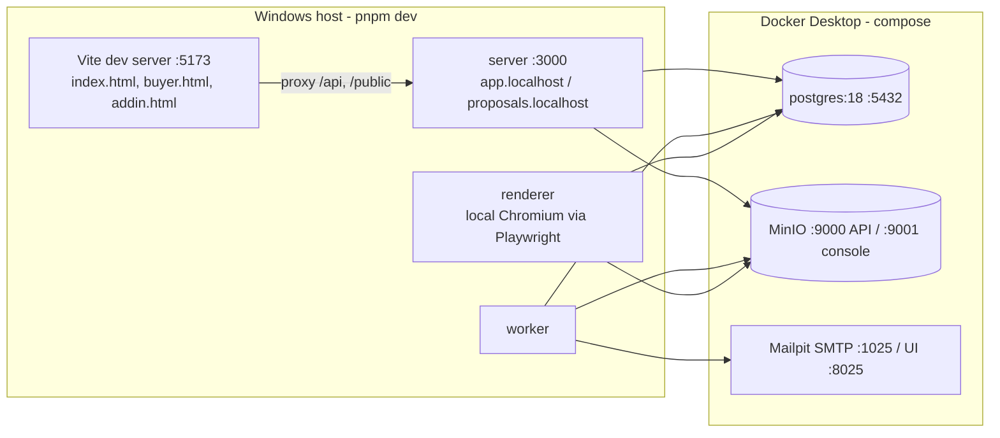
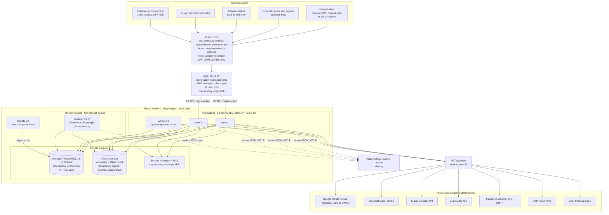
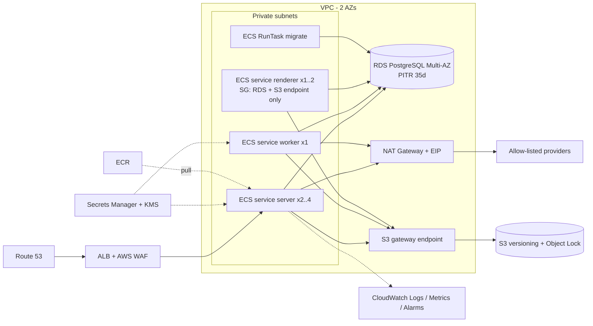
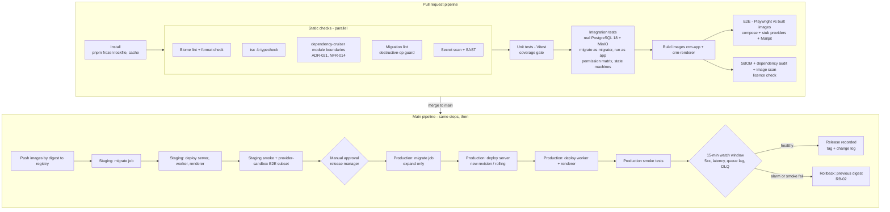
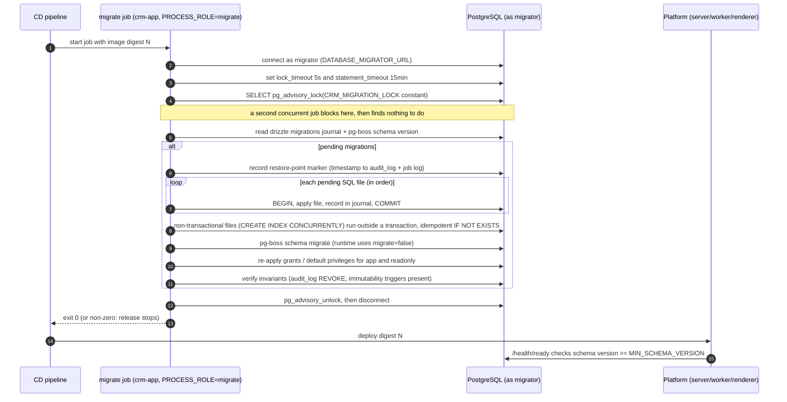

# Deployment Architecture: Internal Sales CRM, Phase 1

| Item | Detail |
|---|---|
| Document | DEPLOYMENT-ARCHITECTURE.md (High-Level Design) |
| Status | Draft, v0.1, 17 Nov 2026 |
| Owner | Tech Lead / IT (hosting decision OD-11) |
| Binding inputs | Design foundation §6, §10, §11 (A7, A8, A10, A14, A17, A18), §12, §13 · OPEN-DECISIONS.md (OD-11, OD-14, OD-45, OD-53) · FUNCTIONAL-REQUIREMENTS.md §17 (NFR-001..NFR-015) · PRD.md §7–§8 |
| Related | ARCHITECTURE-DECISIONS.md · SECURITY-ARCHITECTURE.md (HLD) · TLD documents in `docs/03-tld` · runbooks (proposed `docs/04-engineering/runbooks/`) |

Scope: how the modular monolith (ADR-001) is built, shipped, run, observed and recovered. It covers the environments, the production runtime topology, reference deployments for both OD-11 candidates (Azure, AWS), images, CI/CD, database migrations, configuration and secrets, scaling, availability and DR, observability, runbooks and cost. It does not specify application code. Dockerfile and pipeline snippets are illustrative only.

Conventions: `company.example` stands for the company's real domain (to be set under OD-11). Every place that depends on a Working Assumption cites its OD. New ADRs proposed here start at ADR-045 (foundation §13). New open decisions are listed in §17 as *Proposed* and are not numbered.

---

## 1. Deployment principles

| # | Principle | Consequence |
|---|---|---|
| DP-1 | **Simplest production-grade platform.** Use a managed container platform plus managed PostgreSQL, object storage and secrets. | No Kubernetes cluster to operate (see DP-2). No VMs to patch. TLS certificates, backups and failover are managed services. |
| DP-2 | **No Kubernetes unless justified.** Three long-running containers and one release job do not need a scheduler, service mesh or operator. | Azure Container Apps or AWS ECS Fargate (§5). Revisit only if the number of runtime units passes about 10, or if the company already runs a shared, centrally operated cluster that IT wants to use. Proposed **ADR-047**. |
| DP-3 | **No Redis, no broker** (ADR-007, ADR-019, ADR-022). | PostgreSQL is the only stateful runtime dependency: data, pg-boss queues, LISTEN/NOTIFY fan-out (ADR-023), rate-limit buckets (ADR-026). |
| DP-4 | **One codebase, build once, promote by digest.** | One application image for `server`, `worker` and `migrate` roles, plus one renderer image (§6). The same image digest goes from CI to staging to production. Configuration is injected at runtime. Proposed **ADR-046**. |
| DP-5 | **Least privilege at every layer.** | Separate DB roles `app` / `migrator` / `readonly` (ADR-026). Workload identities instead of static cloud keys. The renderer has no internet egress (A10). No public DB or storage endpoints. |
| DP-6 | **Stateless compute.** | No local disk state on any container. Files go to object storage (ADR-011, ADR-036), sessions and jobs to Postgres. Any container can be killed at any time. pg-boss handlers are idempotent (ADR-022). |
| DP-7 | **Schema changes are a release step, not a startup side effect.** | One-shot migration job, `migrator` role, advisory lock, expand/contract (A14, ADR-030). Containers never run DDL at boot. |
| DP-8 | **Observability is mandatory** (A14, ADR-017, ADR-030). | Structured logs, error tracking, metrics and alerts (§13) are go-live gates for R1, not later improvements. |
| DP-9 | **Single tenant = single deployment** (IDD-01). | One production stack per company. NFR-001 data separation is met by a dedicated database, bucket and secrets store. |
| DP-10 | **Single-cloud adapters** (A7). | Only the object-storage driver for the OD-11 target is built, plus the S3-compatible driver for local MinIO. |
| DP-11 | **Windows-friendly developer loop** (ADR-018, ADR-033). | Docker Desktop (WSL 2) for backing services. Node scripts, not bash scripts. The repository lives outside OneDrive (`C:\dev\sales-crm`). |

---

## 2. Runtime units

| Unit | Image | Entrypoint role | Instances (prod) | Inbound | Outbound | Notes |
|---|---|---|---|---|---|---|
| `server` | `crm-app` | `PROCESS_ROLE=server` | ≥ 2 (NFR-006), autoscale to 4 | HTTPS from edge only | Postgres, object storage, secrets/KMS, allow-listed providers (§8.3) | Hono API `/api/v1`, buyer API `/public/v1`, webhooks, SSE, static SPA assets for `index.html` / `buyer.html` / `addin.html`. Uses host-based routing: app origin and buyer origin (ADR-020). One dedicated non-pooled LISTEN connection per instance (ADR-023). |
| `worker` | `crm-app` | `PROCESS_ROLE=worker` | **1** (A8, ADR-037) | none (health probe only) | Postgres, object storage, secrets/KMS, allow-listed providers | Runs all pg-boss queues **except** `pdf`, cron schedules, mailbox sync (`singletonKey` per mailbox), webhook-inbox processing, e-sign reconciliation, retention, the metrics collector (§13.3), and audit export. |
| `renderer` | `crm-renderer` | `PROCESS_ROLE=renderer` | 1 (scale to 2 on queue lag) | none (health probe only) | **Postgres and object storage private endpoints only. No internet.** | Consumes only the `pdf` queue. Warm Chromium via Playwright, concurrency 1–2 (A10). Also runs DOCX generation if the TLD keeps it on the `pdf` queue. Proposed **ADR-045**. |
| `migrate` | `crm-app` | `PROCESS_ROLE=migrate` | one-shot job per release | none | Postgres (as `migrator`) | Applies Drizzle SQL migrations and the pg-boss schema, then exits (§10). |
| `bootstrap-admin` | `crm-app` | `PROCESS_ROLE=cli` + command | one-shot, manual | none | Postgres | Creates the first Admin (IDD-02). Run once per environment through the platform's job feature. Audited. |

### 2.1 Where the PDF renderer runs (A10 evaluation)

A10 requires Chromium to run in a "no-egress, low-privilege worker container". The worker itself needs egress to Google, Microsoft, the e-sign provider, the AI provider and the email provider. Network egress rules apply to a whole container or subnet, not to one process, so the requirement conflicts with a single worker container.

| Option | Description | Egress isolation of Chromium | Image size / patching | Ops cost | Verdict |
|---|---|---|---|---|---|
| A | Chromium inside the single `worker` image | Application-level only (Playwright request interception, `--proxy-server` to a dead address). A Chromium exploit inherits the worker's internet egress and provider credentials. | Worker image about 1.2–1.6 GB. Every Chromium CVE forces a worker redeploy. | Lowest (1 unit) | Rejected. It does not meet A10's network-level intent. The blast radius includes OAuth tokens and API keys. |
| B | **Separate `renderer` container from the same codebase, own image, consumes only the `pdf` queue** | Network-level: subnet / security group allows only Postgres and object storage private endpoints. No secrets except the DB and storage identity. | Renderer image is large. `crm-app` stays slim. Chromium is patched independently. | +1 small container | **Recommended (ADR-045).** |
| C | Third-party HTML-to-PDF SaaS | None (document content leaves our boundary) | n/a | Vendor + DPA | Rejected. It sends proposal content to another processor and conflicts with the offline-render rule (A10). |

Renderer hardening (option B):
- It runs as a non-root user (`pwuser`, UID 1000+). The root filesystem is read-only, `/tmp` is a writable tmpfs, all Linux capabilities are dropped, and there is no shell in the final stage where feasible.
- Chromium runs with JavaScript disabled for render pages. Requests are intercepted and served only by the in-process asset handler. `file://` is denied. Each render has a timeout (default 30 s, hard kill at 45 s). The browser recycles after N renders (default 200) or on memory pressure.
- Managed platforms (Container Apps, Fargate) do not allow custom seccomp profiles. If Chromium's own sandbox cannot start, `--no-sandbox` is accepted **only** because the compensating controls are network isolation, non-root execution, JS-off rendering of schema-serialised HTML (ADR-026, ADR-029), and the fact that the renderer holds no third-party credentials. Record this trade-off in SECURITY-ARCHITECTURE.
- The renderer's DB credential is the `app` role. **Proposed refinement:** a dedicated `renderer` DB role limited to pg-boss tables and `generated_file`/`file_object` inserts. To be decided in TLD as part of ADR-045.

---

## 3. Environments

### 3.1 Overview

| Aspect | Local dev (Windows) | CI | Staging | Production |
|---|---|---|---|---|
| Purpose | Feature development, debugging | Verify every PR and main commit | Release candidate verification, provider sandbox integration, UAT, restore drills | Live internal use |
| Compute | Node 26 on host (`pnpm dev`): Vite dev server + `server` + `worker` + `renderer` processes. Optional `compose --profile app` runs built images. | Ephemeral Linux runners. Images built once per commit. | Same IaC as production, smaller sizes. `server` ×2 (to exercise LISTEN/NOTIFY fan-out and sticky-free SSE), `worker` ×1, `renderer` ×1 | `server` ×2..4, `worker` ×1, `renderer` ×1..2 |
| PostgreSQL | Docker `postgres:18` (A17) | Service container `postgres:18` (same major as prod) | Managed, single instance, PITR 7 days | Managed, **HA (zone-redundant / Multi-AZ) recommended**, PITR 35 days (§12) |
| Object storage | MinIO (S3 API), versioning on | MinIO service container | Cloud bucket/containers, versioning on, Object Lock in **governance** mode | Cloud, versioning + Object Lock / immutability (A7, ADR-036) |
| Email (system) | Mailpit (SMTP sink + UI) | Mailpit | Real provider (OD-14) in sandbox mode, or with a recipient allow-list (company domain + test inboxes) | Real provider, authenticated subdomain (NFR-013) |
| Mailbox sync (Gmail/Graph) | Stub adapter by default. Optional real test mailbox against a **dev OAuth client** | Stub adapter (contract tests with recorded fixtures) | Real APIs, **staging OAuth clients**, test mailboxes only | Real APIs, production OAuth clients |
| E-signature | Stub adapter. Optional provider sandbox through a dev tunnel for webhooks | Stub adapter + webhook signature fixtures | Provider **sandbox/demo** account (OD-03) | Provider production account |
| AI | Stub adapter (deterministic fixtures). Optional real key with a tiny cap | Stub adapter only (no external calls from CI) | Real provider, low org token cap (OD-53) | Real provider, budget caps (OD-53) |
| CAPTCHA | Provider test keys (always pass) | Test keys | Test or real keys | Real keys (OD-46) |
| Data | Seed script (synthetic) | Fixtures per test | Synthetic data only. Production copies are **not** allowed. An anonymised copy needs DPO approval (proposed OD) | Real |
| Secrets | `.env.local` (git-ignored), generated by `pnpm setup:env` with dev-only values | CI secret store (only registry push and deploy credentials; tests use no real secrets) | Cloud secrets store (separate vault/account) | Cloud secrets store + KMS |
| Domains | `app.localhost`, `proposals.localhost` (separate origins on loopback) | `localhost` | `app.staging.company.example`, `proposals.staging.company.example` | `app.company.example`, `proposals.company.example`, optional `forms.company.example` |
| Edge / WAF | none | none | Same edge product as prod. WAF in **detection** first, then prevention | Edge + WAF in **prevention** mode |
| Observability | pino pretty logs. Error tracking off | Test reports, coverage, traces of failed E2E | Same stack as prod, separate project/workspace. Alerts to the dev channel only | Full stack, alerts routed per §13.4 |
| Human access | Developers | Pipeline identity | Developers + testers (SSO). DB access through `readonly` | No standing human DB/infra write access. Break-glass via PIM / IAM Identity Center, audited |
| Deploy trigger | n/a | PR, push to `main` | Automatic on `main` after green CI | Manual approval of a staged digest |

### 3.2 Local development on Windows (Docker Compose)

Prerequisites: Windows 11, Docker Desktop with the WSL 2 backend, Node 26 LTS, pnpm (via Corepack), Git. The repository must be at `C:\dev\sales-crm` and **not** under OneDrive (ADR-033). OneDrive sync breaks pnpm's symlinked `node_modules` and file watchers.



Illustrative `compose.yaml` (backing services only):

```yaml
# illustrative only - final file lives in the code repository
services:
  postgres:
    image: postgres:18            # pin minor in repo, e.g. postgres:18.x
    environment:
      POSTGRES_PASSWORD: dev_only_password
      POSTGRES_DB: crm
    ports: ["5432:5432"]
    volumes: ["pgdata:/var/lib/postgresql"]
    healthcheck: { test: ["CMD-SHELL", "pg_isready -U postgres"], interval: 5s }
  minio:
    image: minio/minio            # pin release tag in repo
    command: server /data --console-address ":9001"
    environment: { MINIO_ROOT_USER: dev, MINIO_ROOT_PASSWORD: dev_only_password }
    ports: ["9000:9000", "9001:9001"]
    volumes: ["minio:/data"]
  minio-init:                      # creates buckets, enables versioning (+ object lock on the signed bucket)
    image: minio/mc
    depends_on: [minio]
  mailpit:
    image: axllent/mailpit         # pin tag in repo
    ports: ["1025:1025", "8025:8025"]
volumes: { pgdata: {}, minio: {} }
```

Local conventions:
- `pnpm db:reset` is a Node script. It drops and recreates the dev DB, creates the `app` / `migrator` / `readonly` roles, runs migrations **as `migrator`** (the same path as production), and seeds data. `drizzle-kit push` is allowed only against local throw-away databases and never in shared environments (A14).
- `app.localhost` and `proposals.localhost` resolve to loopback in Chromium-based browsers and Firefox. They give two real origins, so cookie isolation and buyer-origin CSP (ADR-020, ADR-026) behave as in production.
- Line endings are enforced by `.gitattributes` (`* text=auto eol=lf`) so that SQL migration checksums match across Windows and Linux.
- Webhook testing against a provider sandbox uses a developer tunnel on a personal sandbox account only. It is never pointed at staging or production data.

### 3.3 CI environment

- Linux runners. The pipeline platform is a proposed OD (§17). GitHub Actions syntax is used below for illustration only.
- Integration tests use a **real PostgreSQL 18** service container and MinIO. They do not use SQLite or an in-memory DB. Migrations run from an empty schema as `migrator` on every run, and tests run as `app` to prove the grants (ADR-026: `app` has no DDL, and no UPDATE/DELETE on `audit_log`).
- E2E tests run Playwright against the **built images** (`crm-app` + `crm-renderer`) in compose with stub providers. The artifact under test is the same one that is deployed.
- A small Windows job runs `pnpm install` and the cross-platform dev scripts (`setup:env`, `db:reset` against a service DB) so that ADR-018 Windows-friendliness does not regress.

### 3.4 Staging

- Same IaC modules as production with different parameters (sizes, HA off, PITR 7 days, WAF detection to prevention).
- Separate cloud subscription/account, secrets store, OAuth clients (Google, Entra), e-sign sandbox, AI key and email sending identity. **No production credential is ever present in staging.**
- Staging is also where the quarterly **restore drill** runs (§12.4) and where SSE is verified through the edge (§5.5).

### 3.5 Production

Described in §4–§5 and §11–§14.

---

## 4. Production runtime topology (cloud-neutral)



### 4.1 DNS and hostnames

| Hostname | Routed to | Serves | Cookies | Notes |
|---|---|---|---|---|
| `app.company.example` | edge → `server` | Internal SPA (`index.html`), `/api/v1`, SSE, `/webhooks/*`, Gmail add-on card endpoints, `addin.html` + add-in manifest assets | Better Auth session cookie (`Secure; HttpOnly; SameSite=Lax`, host-only) | Strict CSP (ADR-026). Add-in manifests (Outlook, Gmail) reference this host. |
| `proposals.company.example` | edge → `server` (host routing to buyer entry) | `buyer.html`, `/public/v1/*`, hosted lead-form page | Short-lived buyer cookie only (A10). Internal cookies are never set on this host. | `Referrer-Policy: no-referrer`. Separate CSP. Tokens are redacted by both the edge and the app logs. |
| `forms.company.example` (optional) | edge → same `server`, buyer entry | Hosted lead-form page and iframe embed | none | Only if marketing wants the form host separate from proposal links. Otherwise the forms are served on `proposals.*` (A2). Frame-ancestors allow-list = company websites. |
| `notify.company.example` | not routed (mail DNS only) | SPF, DKIM (CNAMEs from the provider), DMARC `p=quarantine` or stricter, bounce/return-path | n/a | NFR-013, OD-14. |

`server` decides the surface from the `Host` header. It accepts only the configured hosts (`ALLOWED_HOSTS`) and only traffic that carries the edge's origin-lock proof (§5). This prevents host-header spoofing past the edge.

### 4.2 Network rules

| From → To | Allowed | Mechanism |
|---|---|---|
| Internet → server | Only through the edge | Azure: Front Door Private Link origin or ingress restricted to the Front Door service tag + `X-Azure-FDID` check. AWS: ALB security group, CloudFront prefix list if CloudFront is used, and a secret origin header. |
| server/worker → PostgreSQL | TLS (`sslmode=verify-full`) to the private endpoint | DB public access disabled. Firewall/SG allows only app and render subnets plus the migrate job. |
| renderer → anything except DB and object storage | **Denied** | NSG / security group egress deny-all except the private-endpoint ranges (ADR-045). |
| server/worker → internet | Only §8.3 destinations | Layer 1: application outbound allow-list (HTTP client refuses unknown hosts, logs and counts denials). Layer 2 (optional, proposed OD): FQDN firewall (Azure Firewall / AWS Network Firewall). |
| Humans → DB | Break-glass only | Bastion / SSM Session Manager or Azure Bastion + PIM elevation, `readonly` role by default. |

---

## 5. Reference deployments for OD-11

OD-11 (hosting target) is **open**. The WA is containerised deployment on the company's cloud. Both references below implement §4 and are built from the same images and configuration contract. **The final choice remains OD-11.** Only the object-storage driver differs in code (A7, ADR-036): `azure-blob` or `s3`.

### 5.1 Azure reference

| Concern | Recommended service | Alternative | Notes |
|---|---|---|---|
| Containers | **Azure Container Apps** (workload-profiles environment, VNet-integrated) | App Service for Containers (Linux, P1v3) | Container Apps provides revisions with traffic split, min replicas, KEDA scaling, **Container Apps Jobs** for `migrate`, managed identity, and Key Vault secret references. App Service fits the server well but needs a WebJob or a separate plan for the worker and has no first-class one-shot job. |
| Renderer isolation | Separate Container Apps **environment** in its own subnet, with an NSG denying Internet outbound | Same environment with a UDR to Azure Firewall deny rule | NSGs apply per subnet and an environment owns one subnet, so isolation needs a second environment. Workload-profile environments have no standing fee beyond the compute used. Verify current pricing. |
| Edge + WAF | **Azure Front Door Premium** (managed WAF rule set, bot rules, rate limiting, Private Link to origin, managed certs) | Application Gateway WAF_v2 in the VNet | Front Door Standard supports only custom WAF rules. Managed OWASP/DRS rules need Premium. |
| PostgreSQL | **Azure Database for PostgreSQL Flexible Server**, General Purpose, PG 18 if GA in region (else 17, A17), **zone-redundant HA**, private access (VNet), backup retention 35 days, geo-redundant backup | Burstable tier for staging only | PITR is native (restore to a new server). Use Entra authentication for humans. App roles use password auth from Key Vault (see §11.3). |
| Object storage | **Blob Storage** (StorageV2, ZRS or GZRS), private endpoint, blob versioning, soft delete (blobs + containers), **version-level immutability** on the `signed` and `audit-archive` containers | — | Lifecycle: exports deleted after 7 days. Older versions move to the cool tier after 30 days. |
| Secrets / keys | **Key Vault** (RBAC mode, soft delete + purge protection), keys for envelope encryption (KEK), secrets for app config | Managed HSM (not needed) | Container Apps reference secrets through managed identity. A rotation creates a new revision. |
| Egress | **NAT Gateway** (static IP) + application allow-list | Azure Firewall Basic/Standard with FQDN rules | The firewall adds a significant fixed monthly cost (§16). Proposed OD. |
| Registry | **Azure Container Registry** (Standard), private endpoint optional, content trust / Notation signing optional | GHCR | |
| Observability | Log Analytics workspace + **Application Insights** (OpenTelemetry distro), Azure Monitor alerts, availability (URL ping) tests | Grafana (Azure Managed Grafana) | Error tracking: App Insights exceptions, or Sentry (proposed OD). |
| DNS / certs | Azure DNS (or the company's DNS) + Front Door managed certificates | — | |
| IaC | **Bicep** or Terraform (`azurerm`) | — | Use whatever IT already standardises on. |

```mermaid
flowchart LR
  AFD[Front Door Premium + WAF] -->|Private Link| CAE1
  subgraph VNET[VNet]
    subgraph CAE1[Container Apps env: app subnet]
      SRV[server x2..4]
      WRK[worker x1]
      JOB[Job: migrate]
    end
    subgraph CAE2[Container Apps env: render subnet, NSG deny Internet]
      RND[renderer x1..2]
    end
    PGF[(PostgreSQL Flexible Server<br/>zone-redundant HA, PITR 35d)]
    BLOB[(Blob Storage<br/>versioning + immutability)]
    KV[Key Vault]
    NATG[NAT Gateway]
  end
  CAE1 --> PGF
  CAE2 --> PGF
  CAE1 --> BLOB
  CAE2 --> BLOB
  CAE1 --> KV
  CAE1 --> NATG --> NET[Allow-listed providers]
  ACR[Container Registry] -.pull.-> CAE1
  ACR -.pull.-> CAE2
  CAE1 -.-> LAW[Log Analytics + App Insights]
  CAE2 -.-> LAW
```



### 5.2 AWS reference

| Concern | Recommended service | Alternative | Notes |
|---|---|---|---|
| Containers | **ECS on Fargate** (one cluster, services `server`, `worker`, `renderer`, task definition `migrate` run with `RunTask`) | App Runner | App Runner is request-driven and HTTP-only. It cannot host the long-running `worker` or `renderer` or run a one-shot migration task, so it would need ECS anyway. ECS gives rolling deploys with **deployment circuit breaker + automatic rollback**. |
| Renderer isolation | Own **security group**: egress only to the RDS SG on 5432 and the S3 **gateway VPC endpoint** prefix list | Separate private subnet without a NAT route | Per-task security groups make this simpler than on Azure. |
| Edge + WAF | **Application Load Balancer + AWS WAF** (AWS managed rule groups: Core, Known Bad Inputs, IP reputation; rate-based rules) | CloudFront + WAF in front of the ALB | ACM certificates on the ALB. Add CloudFront only if global latency or edge caching is needed (not expected for an internal app). |
| PostgreSQL | **RDS for PostgreSQL** 18 if available in region (else 17, A17), **Multi-AZ** (single standby), gp3, encryption with a KMS CMK, automated backups 35 days, **PITR** | Aurora PostgreSQL | Aurora adds cost and operational differences without benefit at OD-45 volumes. |
| Object storage | **S3** with versioning, **Object Lock** (bucket-level, required at create or enable later) on `signed` and `audit-archive`, SSE-KMS, Block Public Access, gateway VPC endpoint | — | Optional Cross-Region Replication for DR (§12). |
| Secrets / keys | **Secrets Manager** (rotation for the RDS `app` / `migrator` passwords) + **KMS** CMKs (envelope KEK, RDS, S3) | SSM Parameter Store for non-secret config | ECS injects secrets at task start through the task execution role. Rotation means forcing a new deployment. |
| Egress | **NAT Gateway** (one, static Elastic IP) + application allow-list | AWS Network Firewall with domain allow-list | One NAT in one AZ is a cost trade-off: an AZ loss stops outbound provider calls but not the app. Two NATs for full AZ resilience. |
| Registry | **ECR** (scan on push, immutable tags, lifecycle policy) | — | |
| Observability | CloudWatch Logs (awslogs / FireLens), CloudWatch metrics (embedded metric format) + alarms → SNS, **CloudWatch Synthetics** canaries, ADOT collector for traces (optional) | Amazon Managed Grafana | Error tracking: Sentry (proposed OD) or CloudWatch-only. |
| DNS / certs | Route 53 (or the company's DNS) + ACM | — | |
| IaC | **Terraform** (`aws`) or CDK | — | |



### 5.3 Recommendation criteria for OD-11

| Criterion | Weight | Azure reference | AWS reference | Comment |
|---|---|---|---|---|
| Existing company cloud landing zone, billing, IT operations skills | **High (deciding)** | — | — | Pick the cloud IT already runs. A second cloud just for the CRM adds governance cost that outweighs any service difference below. |
| Identity alignment with the mail provider (OD-06) | Medium | Strong if the company is on Microsoft 365 (same Entra tenant for Graph app, add-in, PIM) | Neutral | Not deciding: Entra and Google OAuth work from either cloud. |
| Managed PostgreSQL 18 availability in the chosen region (A17) | Medium | Verify Flexible Server PG 18 GA in region | Verify RDS PG 18 GA in region | Fallback to 17 is accepted (A17). The app generates UUIDv7 in either case. |
| Renderer egress isolation effort (ADR-045) | Medium | Second Container Apps environment + NSG | Per-task security group | AWS is simpler. Azure is still fine. |
| Edge + WAF cost and capability | Medium | Front Door Premium has a high fixed base fee. App Gateway WAF_v2 is comparable | ALB + WAF is low fixed cost | §16 |
| One-shot release job support | Medium | Container Apps Jobs | ECS RunTask | Both adequate. |
| Object immutability for signed documents (ADR-036) | Medium | Version-level immutability (WORM) | S3 Object Lock | Both adequate. |
| HA DB + PITR meeting §12 targets | High | Zone-redundant HA, PITR ≤ 35 days | Multi-AZ, PITR ≤ 35 days | Both meet RPO ≤ 5 min / RTO ≤ 8 h. |
| Data residency region (OD-01 jurisdictions) | High | Region choice | Region choice | Both have the regions. A proposed OD covers region selection. |
| Estimated monthly run cost (production) | Medium | Higher fixed cost (Front Door Premium, optional firewall) | Lower fixed cost | §16. Order of magnitude only. |

**Recommendation:** decide OD-11 by the first criterion (existing landing zone and operations team). If the company has no preference, choose AWS ECS Fargate for lower fixed cost and simpler renderer isolation. If the company is Microsoft-365-centric with an existing Azure tenant and operations, choose Azure Container Apps. Avoid App Service and App Runner as primary platforms for the reasons above.

### 5.4 Deployment strategy per unit

| Unit | Strategy | Health gate | Automatic rollback |
|---|---|---|---|
| `server` | Rolling / new revision. Azure: new revision at 0 % traffic, smoke on the revision URL, then 100 % switch (blue-green). AWS: rolling with `minimumHealthyPercent=100`, `maximumPercent=200`. | `/health/ready` (DB reachable, schema version ≥ `MIN_SCHEMA_VERSION`, LISTEN connection up) | Azure: shift traffic back to the previous revision. AWS: ECS deployment circuit breaker with rollback + CloudWatch alarm-based rollback (5xx rate, §13.4). |
| `worker` | Stop old then start new (`maximumPercent=100`, `minimumHealthyPercent=0` / single-revision mode). This guarantees one instance (A8). | Process heartbeat row updated ≤ 60 s; `/health/live` | Redeploy previous digest (RB-02). |
| `renderer` | Rolling (may overlap: pdf jobs are independent and idempotent) | Warm browser launched; test render of a built-in fixture at start | Redeploy previous digest. |
| `migrate` | Runs before any unit is updated | Exit code 0 | None. Migrations are forward-only (§10). |

Graceful shutdown (all units): on `SIGTERM`, `server` stops accepting connections, closes SSE streams with `retry:` hints, and drains for up to 30 s. `worker` and `renderer` call pg-boss `stop({ graceful: true, timeout: 60s })`. Jobs that do not finish are retried by pg-boss after expiry, and handlers are idempotent (ADR-022). The platform stop timeout must be set ≥ 75 s (Container Apps termination grace period, ECS `stopTimeout` max 120 s).

### 5.5 SSE through the edge

SSE (ADR-023) needs long-lived responses without buffering. Azure Front Door and AWS ALB both pass streaming responses, but idle and origin timeouts apply (ALB idle timeout default 60 s; Front Door origin response timeout). The 20 s heartbeat keeps streams below those limits. **Verify in staging** that events arrive unbuffered through the chosen edge. If they do not, the 30 s polling baseline still meets NFR-005 (A5), so this is a latency optimisation, not a correctness risk. No sticky sessions are needed: each instance fans out via LISTEN/NOTIFY.

---

## 6. Container images

### 6.1 Images

| Image | Contents | Base (pin by digest) | Approx. size | Runs as |
|---|---|---|---|---|
| `crm-app` | Compiled `apps/server` (server, worker, migrate, cli entrypoints), built `apps/web` static assets (three entries), Drizzle SQL migrations, production `node_modules` only | Node 26 LTS, Debian slim or distroless Node 26 if published | ~150–250 MB | non-root `node` (UID 1000) |
| `crm-renderer` | Same compiled server bundle (renderer entrypoint + `packages/proposal`), Playwright + **Chromium only**, fonts embedded by the renderer (tagged PDF, A10) | Playwright image matching the pinned Playwright npm version, or Node 26 slim + `playwright install --with-deps chromium` | ~1.0–1.5 GB | non-root (`pwuser`) |

Both images:
- **Immutable tags** = git SHA (`crm-app:3f2c1ab`) + semantic release tag. Deploys reference the **digest**.
- Labels: OCI `org.opencontainers.image.revision`, `.source`, `.version`, build time.
- `APP_VERSION` / `GIT_SHA` are baked in and reported by `/health/live`, logs and error tracking `release`.
- Read-only root filesystem, writable tmpfs at `/tmp`, no package manager in the final stage where possible, `HEALTHCHECK` delegated to platform probes.
- SBOM (CycloneDX) generated and attached as an attestation. Vulnerability scan gates: **fail on Critical or High with a fix available**. Waivers need a time-boxed exception file reviewed in PR.
- Optional image signing (cosign / Notation) verified at deploy (ECR / ACR policy). Recommended once the pipeline is stable.

### 6.2 Illustrative Dockerfile (`crm-app`)

```dockerfile
# illustrative only - the real file lives in the code repository
FROM node:26-bookworm-slim AS build            # pin by digest in the repo
WORKDIR /repo
RUN corepack enable
COPY pnpm-lock.yaml pnpm-workspace.yaml package.json ./
COPY apps/server/package.json apps/server/
COPY apps/web/package.json apps/web/
COPY packages/shared/package.json packages/shared/
COPY packages/proposal/package.json packages/proposal/
RUN pnpm install --frozen-lockfile
COPY . .
RUN pnpm -r build \
 && pnpm --filter @crm/server deploy --prod /out   # pruned prod node_modules

FROM node:26-bookworm-slim AS runtime          # or distroless nodejs26 if available
ENV NODE_ENV=production
WORKDIR /app
COPY --from=build --chown=1000:1000 /out ./
COPY --from=build --chown=1000:1000 /repo/apps/web/dist ./public
COPY --from=build --chown=1000:1000 /repo/apps/server/drizzle ./drizzle
USER 1000
EXPOSE 3000
ENTRYPOINT ["node", "dist/main.js"]            # PROCESS_ROLE selects server|worker|migrate|cli
```

The renderer image is built the same way. Its runtime stage starts from the Playwright base, installs only Chromium, and sets `ENTRYPOINT` with `PROCESS_ROLE=renderer`.

---

## 7. CI/CD pipeline

### 7.1 Flow



### 7.2 Stage details

| Stage | Tooling (WA) | Gate / failure policy |
|---|---|---|
| Install | pnpm via Corepack, lockfile frozen, store cache | Lockfile drift fails |
| Lint / format | Biome | Any error fails |
| Typecheck | `tsc -b` (strict) across all 4 packages | Any error fails |
| Module boundaries | dependency-cruiser (ADR-021) | Cross-module table or internal import fails (NFR-014 acceptance) |
| Migration lint | Custom Node script over new SQL files | Fails on `DROP COLUMN/TABLE`, `RENAME`, `ALTER COLUMN TYPE`, `SET NOT NULL` without a prior backfill migration, non-`CONCURRENTLY` index on large tables, unless the PR carries a `contract-migration` label and references the expand release (§10.3) |
| Secret scan | gitleaks (or platform equivalent) | Any finding fails |
| SAST | CodeQL or Semgrep | High findings fail |
| Unit | Vitest | Coverage thresholds set per package in TLD |
| Integration | Vitest + Testcontainers or CI service containers: **PostgreSQL 18**, MinIO | Migrations from empty DB as `migrator`. Tests as `app`. Grants assertions (no UPDATE/DELETE on `audit_log`). Permission matrix per PERM row (ADR-026 `scopeFilter`). DB immutability trigger tests (ADR-025). Also a **N-1 compatibility check**: previous release's API smoke suite against the new schema (expand/contract proof). |
| E2E | Playwright against the built images in compose, stub `MailProvider`, `ESignatureProvider`, `AiProvider`, Mailpit for email, MinIO | Core flows: sign-in, create deal, build and send a proposal (copy link), buyer view with identity gate and heartbeat, accept/decline, automation, notifications. Cross-browser subset (NFR-012). axe accessibility checks (NFR-011). |
| Dependency audit | `pnpm audit --prod` + OSV-Scanner | Critical/High with a fix available fails. Others are reported |
| SBOM + image scan | Syft (CycloneDX) + Trivy or Grype; registry scan on push | Critical/High fixable fails |
| Licence check | licence allow-list (MIT, Apache-2.0, BSD, ISC, …) | Copyleft in runtime dependencies fails unless approved |
| Push | Registry by digest | Main only |
| Migration job | §10 | Non-zero exit stops the release (no app deploy) |
| Deploy | IaC parameter update of image digests (Bicep/Terraform) or platform CLI | Platform health gate (§5.4) |
| Smoke | Node script: `/health/ready` on both hosts, sign-in with a synthetic smoke user, list deals, canary buyer link renders, enqueue + complete a no-op job on every queue, test PDF render, outbound allow-list probe for each provider host (TLS handshake only) | Any failure → rollback |
| Watch window | Alarms from §13.4 tagged `deploy-guard` | Alarm → automatic rollback (AWS) or traffic shift back (Azure) + page |

Branching: trunk-based. Short-lived branches, `main` protected with required checks and one review. Releases are tagged from `main`. Hotfixes go through the same pipeline (no manual production builds).

Pipeline identity: OIDC federation from CI to the cloud (no long-lived cloud keys in CI). The production deploy role can update services and run the migrate task. It cannot read application secrets.

### 7.3 Illustrative pipeline fragment

```yaml
# illustrative only (GitHub Actions syntax); CI platform is a proposed OD
jobs:
  integration:
    runs-on: ubuntu-latest
    services:
      postgres:
        image: postgres:18
        env: { POSTGRES_PASSWORD: ci }
        ports: ["5432:5432"]
        options: >-
          --health-cmd "pg_isready -U postgres" --health-interval 5s --health-retries 20
      minio:
        image: minio/minio
        # MinIO needs a command; usually started as a step instead of a service
    steps:
      - uses: actions/checkout@v4
      - run: corepack enable && pnpm install --frozen-lockfile
      - run: pnpm db:roles && pnpm db:migrate        # as migrator
      - run: pnpm test:integration                   # as app role
  deploy-prod:
    needs: [deploy-staging]
    environment: production                          # manual approval
    permissions: { id-token: write, contents: read } # OIDC to cloud
    steps:
      - run: node scripts/release/run-migrate-job.mjs --digest "$APP_DIGEST"
      - run: node scripts/release/deploy.mjs --unit server --digest "$APP_DIGEST"
      - run: node scripts/release/deploy.mjs --unit worker --digest "$APP_DIGEST"
      - run: node scripts/release/deploy.mjs --unit renderer --digest "$RENDERER_DIGEST"
      - run: node scripts/release/smoke.mjs --env production
```

---

## 8. External dependencies and egress

### 8.1 Inbound integrations

| Source | Endpoint (host / path, WA) | Authentication | Edge handling |
|---|---|---|---|
| E-sign provider webhooks | `app.company.example/webhooks/esign/{provider}` | HMAC over the raw body + timestamp tolerance (ADR-025). Optional provider IP allow-list as a second layer | WAF body-inspection exclusions scoped to this path only (signed payloads trigger false positives). Rate limit per IP. |
| Gmail add-on (R3, OD-07) | `app.company.example/addons/gmail/*` | Google-signed ID token, audience check (A11) | Allow Google's user agents. No CSRF cookie. |
| Outlook add-in (R3) | `app.company.example/addin.html`, `/api/v1/*` with bearer token | Entra token / Better Auth bearer (A11) | Standard. |
| Lead-form iframe (R1 per foundation §12 R1) | `proposals.` or `forms.company.example/f/{formId}` | Public. Honeypot + per-IP rate limit + CAPTCHA (OD-46) | Edge rate-based rule as a coarse layer (A10). |
| Buyer links | `proposals.company.example/p#{token}` | Token in URL fragment, exchanged by the buyer bundle for a link-bound cookie (ADR-034, ADR-071) | The token never reaches edge logs (fragments are not sent); edge log retention still short and access restricted. |

### 8.2 Release dependency on externals

| Release | External services that must be provisioned (PRD §8.3 D1–D5) |
|---|---|
| R1 | Hosting (OD-11), DNS + certs for app/proposals(/forms), transactional email + DNS records (OD-14), Google/Microsoft **login** OAuth clients (OD-12), CAPTCHA keys (OD-46, because public forms ship in R1 with spam protection, foundation §12 R1), error tracking, uptime monitor |
| R2 | Mailbox OAuth (Gmail/Graph scopes, A16), AI provider key + ZDR terms (OD-05), e-sign provider account + webhook secret (OD-02/03) |
| R3 | Outlook add-in centralised deployment / Google Workspace add-on deployment (OD-07) |

### 8.3 Outbound allow-list

Hostnames are indicative and must be confirmed against provider documentation at OD-03/05/06/14/46 decision time. The allow-list is configuration (`OUTBOUND_HOST_ALLOWLIST`), not code.

| Destination (indicative) | Purpose | From | Release |
|---|---|---|---|
| `accounts.google.com`, `oauth2.googleapis.com`, `openidconnect.googleapis.com`, `www.googleapis.com` (JWKS/certs, Calendar) | Google sign-in, token refresh, add-on ID-token verification, Calendar API | server, worker | R1 (login), R2 (calendar) |
| `gmail.googleapis.com` | Gmail delta sync and send (A16) | worker (sync), server/worker (send) | R2 |
| `login.microsoftonline.com` | Entra sign-in, token refresh (single-tenant authority) | server, worker | R1 |
| `graph.microsoft.com` | Mail, calendar, send | worker, server | R2 |
| E-sign provider API + OAuth hosts (OD-03, e.g. sandbox vs production hosts differ per provider) | Create/void requests, fetch status and sealed documents, reconciliation | worker (server only if synchronous calls are designed in TLD) | R2 |
| AI provider API (OD-05 WA: `api.anthropic.com`) | Drafting, summaries, consistency check (ADR-035) | server and/or worker per TLD | R2 |
| Transactional email API or SMTP submission host (OD-14) | Notifications, buyer emails, OTP | worker | R1 |
| CAPTCHA verify endpoint (OD-46 WA Cloudflare Turnstile: `challenges.cloudflare.com`) | Form submission verification | server | R1 |
| Error-tracking ingest host (proposed OD) | Exceptions | server, worker (renderer reports through logs only) | R1 |
| Cloud control plane / monitoring endpoints | Telemetry, secrets, storage | all (via private endpoints or service tags where available) | R1 |

Any denied outbound attempt is logged (`egress_denied`, host only) and counted (§13.4).

---

## 9. Data stores

### 9.1 PostgreSQL

| Item | Production WA |
|---|---|
| Version | **18** (A17, ADR-032). 17 if the managed offering lacks 18 in the chosen region at decision time. The app generates UUIDv7 regardless, so a later in-place major upgrade to 18 does not change application code. |
| Extensions | `pg_trgm` (ADR-005), `pgcrypto` only if needed by TLD. Verify each against the managed offering's allow-list. |
| Roles (ADR-026) | `migrator`: owns the schemas, DDL. `app`: DML only, no UPDATE/DELETE on `audit_log`, pg-boss DML. `readonly`: SELECT on reporting views for support. Human Entra/IAM principals map to `readonly` by default. |
| Schemas | `public` (application, module-owned tables), `pgboss` (queues). |
| Connection budget | `server` pool 10 + 1 LISTEN per instance × max 4 = 44; `worker` pool 10; `renderer` pool 3 × max 2 = 6; `migrate` 2; humans/monitoring 5 → **≤ 70**. The smallest recommended tier (§11) allows well above this. No PgBouncer in Phase 1. If a pooler is added later, LISTEN connections must bypass it. |
| Parameters | `statement_timeout` 30 s for `app` (overridden per job where needed), `idle_in_transaction_session_timeout` 60 s, `lock_timeout` 5 s for `migrator` sessions, `log_min_duration_statement` 500 ms, `pg_stat_statements` on. |
| Encryption | At rest: platform encryption (CMK optional). In transit: TLS `verify-full`. |
| Maintenance window | Provider-managed patching in a declared window (WA Sunday 02:00–04:00 company time). Announced windows are excluded from NFR-006 measurement. |

### 9.2 Object storage layout

Buckets/containers are separate where policies differ (Object Lock is bucket/container-level).

| Bucket / container | Contents | Versioning | Immutability | Lifecycle |
|---|---|---|---|---|
| `crm-documents` | Uploaded images (re-encoded), DOCX uploads (BR-MIG-006), template assets, draft/preview PDFs and DOCX, sent-version PDFs (also hashed, ADR-010) | On | none | Old versions → cool tier after 30 d. Non-current versions expire after 90 d. Draft previews expire after 7 d (prefix rule). |
| `crm-signed` | Provider-sealed signed PDFs, completion certificates (BR-SIG-009/010), Accept evidence snapshots (A9) | On | **Object Lock / version-level WORM.** Governance mode until Legal confirms the retention period (OD-36), then compliance mode | No expiry (retention per OD-36) |
| `crm-imports` | Raw import files (BR-MIG-001) | On | none | Expire per OD-36 retention category "uploaded import files" |
| `crm-exports` | Full exports (BR-PLT-010), erasure evidence packages | On | none | Delete after 7 days (downloaded via short-lived signed URL) |
| `crm-audit-archive` | Periodic audit-log exports with hash-chain anchors (A10) | On | **Object Lock** (as `crm-signed`) | Retention per OD-36 audit retention |

Access: private only, Block Public Access / `allowBlobPublicAccess=false`. Workload identity per unit: renderer gets write access to `crm-documents` only. Downloads are server-mediated or use ≤ 5-minute signed URLs (ADR-011).

---

## 10. Database migration release job

### 10.1 Mechanics



Rules:
- **Never `drizzle-kit push`** outside local throw-away databases (A14). Migrations are generated with `drizzle-kit generate`, reviewed and committed as SQL.
- pg-boss is started with `migrate: false` in `server`, `worker` and `renderer`. Only the job (as `migrator`) creates or upgrades the `pgboss` schema, so the `app` role needs no DDL (proposed **ADR-050**; verify the option against the pinned pg-boss version).
- Each migration is checksum-verified. Editing an applied file fails the job.
- The job is idempotent: re-running after success is a no-op.
- Long data backfills do **not** run in the migration job. They run as resumable, batched pg-boss jobs (`backfill:<name>`) after deploy. The contract step waits until they report complete.
- Before a release with migrations, the pipeline records the current time as the PITR restore target. On AWS it may also take a manual RDS snapshot for releases labelled `risky-migration`.

### 10.2 Expand / contract

| Phase | Release | Allowed changes | Application code |
|---|---|---|---|
| Expand | N | Add tables, nullable columns, columns with defaults, new indexes (`CONCURRENTLY`), new enum values (append only), new triggers that tolerate old writers | N writes both old and new shapes where needed. N-1 still works on the expanded schema (verified by the N-1 check in CI). |
| Migrate data | N (+ post-deploy jobs) | Batched backfill jobs | Reads tolerate both. |
| Contract | N+1 or later | Drop old columns, add `NOT NULL` (via `NOT VALID` check + `VALIDATE`), drop old indexes | N+1 no longer references the old shape. Labelled `contract-migration`. |

Rollback of the application is always to a version compatible with the current schema (N-1 after expand). **DB down-migrations are not used.** A broken migration is fixed forward. Data damage is handled by PITR (RB-09). Proposed **ADR-052** covers rollout and rollback policy.

---

## 11. Configuration and secrets

### 11.1 Rules

- Configuration comes from environment variables, validated at startup by a Zod schema in `apps/server` (fail fast with the variable **name** only, never the value).
- **Secrets** come from the cloud secrets store via platform references (Container Apps Key Vault references / ECS `secrets`). They are never in images, IaC state outputs, CI logs or the repository.
- Organisation-level behaviour (password login allowed, MFA required, AI switches, retention, automation settings) lives in the database (`organization_settings`, `automation_setting`, IDD-08). It is not in environment variables. Env-level **kill switches** exist only for incident response.
- Cloud resource access (storage, KMS, secrets) uses **workload identity** (managed identity / ECS task role). Static cloud keys are used only for MinIO locally.
- Every secret has an owner, a rotation cadence and a runbook (RB-05).

### 11.2 Environment variables (names and purpose)

Names are the WA for TLD. "S" = secret (from the secrets store). "C" = plain configuration.

| Category | Variable | S/C | Purpose |
|---|---|---|---|
| Runtime | `NODE_ENV` | C | `production` in all deployed images |
| | `APP_ENV` | C | `local` \| `ci` \| `staging` \| `production`. Drives provider-sandbox guards and the email allow-list |
| | `PROCESS_ROLE` | C | `server` \| `worker` \| `renderer` \| `migrate` \| `cli` |
| | `PORT` | C | HTTP listen port (`server`) and health port (others) |
| | `LOG_LEVEL` | C | pino level (default `info`) |
| | `APP_VERSION`, `GIT_SHA` | C (baked) | Release identity for logs, errors, `/health/live` |
| | `SHUTDOWN_GRACE_MS` | C | Drain timeout (§5.4) |
| Hosts / edge | `APP_BASE_URL` | C | Internal app origin (`https://app.company.example`) |
| | `BUYER_BASE_URL` | C | Buyer origin (`https://proposals.company.example`) |
| | `FORMS_BASE_URL` | C | Optional forms origin. Defaults to `BUYER_BASE_URL` |
| | `ALLOWED_HOSTS` | C | Host-routing allow-list (§4.1) |
| | `TRUSTED_PROXY_HOPS` | C | Number of proxies for client-IP extraction (rate limiting, audit IP) |
| | `EDGE_ORIGIN_SECRET` / `EDGE_FRONTDOOR_ID` | S / C | Origin-lock proof that traffic came through the edge |
| | `FRAME_ANCESTORS_FORMS` | C | Websites allowed to iframe the lead form |
| Database | `DATABASE_URL` | S | `app` role connection (pool) |
| | `DATABASE_MIGRATOR_URL` | S | `migrator` role. **Present only in the migrate job** |
| | `DATABASE_READONLY_URL` | S | `readonly` role (support tooling, optional) |
| | `DB_POOL_MAX`, `DB_SSL_MODE`, `DB_SSL_CA` | C | Pool size per process, TLS verification |
| | `MIN_SCHEMA_VERSION` | C (baked) | Readiness check against the migrations journal |
| Jobs | `PGBOSS_SCHEMA` | C | `pgboss` |
| | `QUEUE_CONCURRENCY_<QUEUE>` | C | Per-queue worker concurrency (§11.4 defaults) |
| | `PDF_CONCURRENCY` | C | Renderer browser pages in parallel (1–2, A10) |
| | `PDF_RENDER_TIMEOUT_MS`, `PDF_BROWSER_RECYCLE_AFTER` | C | Render limits |
| | `MAIL_SYNC_INTERVAL_SECONDS` | C | 120–300 (ADR-012, ADR-031) |
| Object storage | `STORAGE_DRIVER` | C | `s3` \| `azure-blob` (A7) |
| | `STORAGE_BUCKET_DOCUMENTS`, `_SIGNED`, `_IMPORTS`, `_EXPORTS`, `_AUDIT_ARCHIVE` | C | Bucket/container names (§9.2) |
| | `S3_REGION`, `S3_ENDPOINT`, `S3_FORCE_PATH_STYLE` | C | S3 / MinIO addressing |
| | `AZURE_STORAGE_ACCOUNT_URL` | C | Blob endpoint (Azure) |
| | `S3_ACCESS_KEY_ID`, `S3_SECRET_ACCESS_KEY` | S | **Local/CI MinIO only.** Cloud uses workload identity |
| | `SIGNED_URL_TTL_SECONDS` | C | ≤ 300 |
| Encryption | `KMS_KEY_ID` / `KEY_VAULT_KEY_URI` | C | Key-encryption key for envelope encryption (OAuth tokens, share-link tokens, ADR-026, ADR-034) |
| | `ENCRYPTION_ACTIVE_KEY_ID` | C | Key id stamped on new ciphertexts (rotation) |
| | `LOCAL_DEV_MASTER_KEY` | S | Local/CI only, replaces KMS |
| | `AUDIT_CHAIN_HMAC_KEY` | S | Keyed hash-chain anchor for `audit_log` (if TLD chooses HMAC over plain SHA-256) |
| Auth | `BETTER_AUTH_SECRET` | S | Session/cookie signing (ADR-006) |
| | `BETTER_AUTH_URL` | C | = `APP_BASE_URL` |
| | `BUYER_SESSION_SECRET` | S | Signs the short-lived buyer cookie (A10) |
| | `GOOGLE_LOGIN_CLIENT_ID`, `GOOGLE_LOGIN_CLIENT_SECRET` | C / S | Google sign-in (login scopes only, A10) |
| | `GOOGLE_ALLOWED_HD` | C | Company Workspace domain(s) for the `hd` claim (A11) |
| | `MICROSOFT_LOGIN_CLIENT_ID`, `MICROSOFT_LOGIN_CLIENT_SECRET` (or certificate) | C / S | Entra sign-in |
| | `MICROSOFT_TENANT_ID` | C | Single-tenant authority + `tid` check (A11) |
| Mailbox / calendar (R2) | `GOOGLE_MAILBOX_CLIENT_ID`, `GOOGLE_MAILBOX_CLIENT_SECRET` | C / S | Separate consent flow with offline access, Gmail/Calendar scopes (A10, A16). May be the same OAuth client as login with different scopes. Kept as separate names so they can diverge |
| | `MS_GRAPH_CLIENT_ID`, `MS_GRAPH_CLIENT_SECRET` (or certificate) | C / S | Graph Mail/Calendars delegated scopes |
| Add-ins (R3) | `GOOGLE_ADDON_AUDIENCE`, `GOOGLE_ADDON_SERVICE_ACCOUNT` | C | Verify Google-signed ID tokens on add-on calls (A11) |
| | `OUTLOOK_ADDIN_CLIENT_ID` | C | Entra app for add-in sign-in / NAA |
| E-signature (R2) | `ESIGN_PROVIDER` | C | Adapter driver (OD-03) |
| | `ESIGN_API_BASE_URL`, `ESIGN_AUTH_BASE_URL`, `ESIGN_ACCOUNT_ID`, `ESIGN_CLIENT_ID` | C | Provider addressing (sandbox vs prod) |
| | `ESIGN_API_SECRET` / `ESIGN_PRIVATE_KEY` | S | API credential (key or JWT-grant private key, provider-dependent) |
| | `ESIGN_WEBHOOK_SECRET` | S | HMAC verification (ADR-025). Supports two active values during rotation |
| AI (R2) | `AI_PROVIDER` | C | Adapter driver (OD-05) |
| | `AI_API_KEY` | S | Provider key (e.g. Anthropic) |
| | `AI_MODEL_DEFAULT`, `AI_MODEL_<FEATURE>` | C | Model ids per feature, pinned |
| | `AI_ORG_MONTHLY_TOKEN_CAP_DEFAULT` | C | Bootstrap default until Admin sets it (OD-53, ADR-035) |
| Transactional email | `EMAIL_PROVIDER` | C | Adapter driver (OD-14) |
| | `SMTP_HOST`, `SMTP_PORT`, `SMTP_USER` / `EMAIL_API_BASE_URL` | C | Provider addressing |
| | `SMTP_PASSWORD` / `EMAIL_API_KEY` | S | Provider credential |
| | `EMAIL_FROM_NOTIFICATIONS`, `EMAIL_FROM_BUYER`, `EMAIL_RETURN_PATH_DOMAIN` | C | Senders on `notify.company.example` (NFR-013) |
| | `EMAIL_RECIPIENT_ALLOWLIST` | C | **Non-production only.** Prevents mail to real buyers from staging |
| CAPTCHA | `CAPTCHA_PROVIDER`, `CAPTCHA_SITE_KEY` | C | OD-46 |
| | `CAPTCHA_SECRET_KEY` | S | Server-side verification |
| Egress | `OUTBOUND_HOST_ALLOWLIST` | C | §8.3 |
| | `OUTBOUND_HTTP_TIMEOUT_MS` | C | Default provider call timeout |
| Observability | `OTEL_SERVICE_NAME`, `OTEL_EXPORTER_OTLP_ENDPOINT`, `OTEL_TRACES_SAMPLER_ARG` | C | Traces/metrics export (optional, ADR-017) |
| | `APPLICATIONINSIGHTS_CONNECTION_STRING` | S | Azure option |
| | `ERROR_TRACKING_DSN` | S | Error tracking (Sentry or equivalent) |
| | `METRICS_COLLECTOR_INTERVAL_SECONDS` | C | §13.3 |
| Kill switches | `KILL_AI`, `KILL_MAIL_SYNC`, `KILL_OUTBOUND_EMAIL`, `KILL_ESIGN_DISPATCH`, `MAINTENANCE_MODE` | C | Incident and post-restore controls (RB-09, RB-12). Changing one creates a new revision / deployment |

### 11.3 External credentials register (foundation §10)

| # | Credential / configuration | Held in | Used by | Owner | Rotation (WA) | Release |
|---|---|---|---|---|---|---|
| X1 | PostgreSQL `app` / `migrator` / `readonly` passwords (or Entra/IAM auth for humans) | Secrets store | server, worker, renderer / migrate job / support | Tech Lead | 90 days, automated where the platform supports it (Secrets Manager rotation). Dual-user rotation pattern to avoid downtime | R1 |
| X2 | Object storage access | Workload identity (no secret). MinIO keys locally | all | IT | n/a (identity) | R1 |
| X3 | KMS / Key Vault key-encryption key for envelope encryption | KMS / Key Vault (non-exportable) | server, worker | Security | Annual new key version. Re-wrap job rewraps data keys (RB-05) | R1 |
| X4 | `BETTER_AUTH_SECRET` | Secrets store | server | Tech Lead | On compromise only (rotation signs out all users). Announce | R1 |
| X5 | `BUYER_SESSION_SECRET` | Secrets store | server | Tech Lead | 180 days. Buyer cookies are short-lived, so impact is minimal | R1 |
| X6 | Google Cloud project: OAuth client(s) for login and mailbox, Gmail/Calendar API enablement, Workspace add-on deployment | Client secret in secrets store. Project owned by IT | server, worker | IT | Annual or on staff change | R1 (login), R2, R3 |
| X7 | Microsoft Entra app registration(s): login, Graph Mail/Calendars, Outlook add-in manifest via centralised deployment | Secret or certificate in secrets store | server, worker | IT | Certificate preferred. ≤ 12-month expiry with a 30-day expiry alert | R1, R2, R3 |
| X8 | AI provider API key (OD-05) | Secrets store | server/worker | Tech Lead | 90 days. Org spend limit also set at the provider console | R2 |
| X9 | E-sign provider account, API key or JWT private key, webhook HMAC secret (OD-03) | Secrets store | worker, server | Tech Lead | 180 days. Webhook secret rotated with dual-validation window | R2 |
| X10 | Transactional email provider credential + DNS (SPF, DKIM keys, DMARC) on `notify.company.example` (OD-14) | Secrets store / DNS | worker | IT | DKIM key rotation annually (provider-managed where possible) | R1 |
| X11 | CAPTCHA site key + secret key (OD-46) | Config / secrets store | server, web | Tech Lead | Annual | R1 |
| X12 | TLS certificates for app, proposals, forms domains | Edge-managed certificates (Front Door / ACM) | edge | IT | Automatic | R1 |
| X13 | DNS zone control (app, proposals, forms, notify) | Company DNS | — | IT | n/a | R1 |
| X14 | Error-tracking DSN, uptime monitor account | Secrets store / vendor | all | Tech Lead | On compromise | R1 |
| X15 | Edge origin-lock secret | Secrets store + edge config | edge, server | Tech Lead | 180 days | R1 |
| X16 | Container registry pull identity, CI → cloud OIDC trust | Platform identity | platform, CI | IT | n/a | R1 |

### 11.4 Default queue concurrency (worker unless noted)

| Queue group | Concurrency (WA) | Notes |
|---|---|---|
| `notifications`, `notification-email` | 8 | NFR-005 ≤ 60 s p99 |
| `automation` | 4 | ADR-024, idempotency keys |
| `mail-sync` (per mailbox `singletonKey`) | 4 | Initial backfill is throttled separately (OD-51) |
| `mail-send` | 4 | Provider rate limits |
| `esign-dispatch`, `esign-webhook`, `esign-reconcile` | 2 / 4 / 1 | Reconcile hourly (A9) |
| `ai` | 4 | Caps checked before each call (ADR-035) |
| `import` | 1 | Large files, batched |
| `export`, `retention`, `audit-export`, `backfill:*` | 1 each | Off-peak schedules |
| `pdf` (renderer) | `PDF_CONCURRENCY` = 2 | A10 |

---

## 12. Scaling, availability and disaster recovery

### 12.1 Sizing (OD-45 WA: ≤ 150 users, ≤ 200k contacts, ≤ 100k companies, ≤ 100k deals, ≤ 5M emails, ≤ 20k proposals/year)

| Component | Start size (prod) | Scaling rule | Headroom reasoning |
|---|---|---|---|
| `server` | 2 × (1 vCPU, 2 GiB) across 2 zones | Horizontal 2→4 on CPU > 70 % for 5 min **or** concurrent requests > 50 per instance. Scale-in at < 30 % for 15 min. Never below 2 | 150 users, ~50 concurrently active, about 5–20 req/s peak. SSE connections (~300 incl. tabs) are cheap in Node. NFR-007 acceptance asks for 2× OD-45 volumes with horizontal server scaling only. |
| `worker` | 1 × (1 vCPU, 2 GiB) | **Vertical only** (A8, ADR-037): 2 vCPU / 4 GiB if queue lag alerts recur | Mail sync: 150 mailboxes per 2–5 min ≈ 0.5–1.25 jobs/s. Notifications and automation are small. |
| `renderer` | 1 × (2 vCPU, 4 GiB), `PDF_CONCURRENCY=2` | Horizontal 1→2 when `pdf` queue lag > 30 s for 5 min (pdf jobs are independent, so multiple consumers are safe) | 20k sent proposals/yr ≈ 80/working day. Plus drafts/previews/DOCX, assume ×10 → ~800 renders/day at 2–5 s each. Under 5 % utilisation. Spikes are absorbed by the queue. Chromium needs about 1 GiB per busy page. |
| PostgreSQL | 2 vCPU / 8 GiB general purpose (Azure D2ds_v5-class / AWS db.m7g.large-class), 128 GiB storage with auto-grow, HA | Vertical. Storage auto-grow, alert at 80 % | Largest table group is email: 5M messages × ~8–15 KB sanitised body and metadata ≈ 40–75 GB plus indexes and `tsvector`. Other CRM data < 10 GB. Revisit at 70 % storage or sustained CPU > 60 %. |
| Object storage | Pay per use | n/a | 20k proposals/yr × (sent PDF ~1–3 MB + DOCX + signed PDF + certificate) ≈ 60–150 GB/yr, plus uploads. |
| Edge / WAF | Managed | n/a | |

Load test (NFR-005, NFR-007): staging at 2× OD-45 data volumes with 150 concurrent virtual users. Pass criteria are in FUNCTIONAL-REQUIREMENTS §17. Run before R1 exit and before go-live (OD-48).

### 12.2 Availability (NFR-006: 99.5 % monthly for the app and buyer links, measured separately)

99.5 % allows about 3.6 h of downtime per month, excluding announced maintenance (≤ 4 h/month, outside business hours).

| Failure | Mitigation | Expected impact |
|---|---|---|
| One `server` instance crash | ≥ 2 instances behind the edge, health-checked. Platform restarts the failed one | None (in-flight requests retried by the client) |
| `worker` crash / hang | Platform restart on liveness failure. Heartbeat alert (P1) at 3 min. Jobs resume (pg-boss) | Background delay of minutes. Interactive app and buyer links unaffected |
| `renderer` crash | Platform restart. Jobs retried | PDF generation delayed |
| Zone failure | Servers spread across zones. DB HA standby in a second zone (automatic failover ~60–120 s) | Short outage during DB failover |
| DB without HA (if the HA proposed OD is declined) | Restore from PITR to a new server | Outage up to RTO (hours). This consumes the entire 99.5 % budget for the month. **That is why HA is recommended.** |
| Provider outage (AI, e-sign, mail, email) | Adapters degrade gracefully (DR-AIA-03). Jobs retry with backoff and go to DLQ after the limit. Kill switches | Feature-level degradation, not downtime |
| Edge/WAF false positive | WAF in detection mode in staging first. Rule exclusions per path. Runbook | Partial outage of the affected path |
| Region failure | Out of scope for active-active. Restore in the paired/secondary region from geo-redundant backups + replicated objects (§12.3) | Up to RTO 8 h |
| Deployment defect | Smoke + watch window + automatic rollback (§7) | Minutes |

Deployments are zero-downtime for `server` (rolling/blue-green). Worker restarts during deploy delay jobs by seconds. These do not count as downtime.

### 12.3 Backup and recovery targets

| Item | NFR-008 (OD-45 WA) | **Recommended (A14, ADR-030)** | Mechanism |
|---|---|---|---|
| Database RPO | 24 h | **≤ 5 min** | Managed PITR (continuous WAL archiving). Retention **35 days** (≥ NFR-008's 30 days) |
| Database RTO | 8 h | **≤ 8 h** (target ≤ 2 h for a same-region PITR restore at OD-45 size) | Restore to a new server, repoint `DATABASE_URL` secrets, restart units (RB-09) |
| Geo copy of DB backups | — | Recommended | Azure geo-redundant backup / AWS cross-region automated backup replication |
| Object storage RPO | — | Near-zero for overwrite/delete (versioning). Region-loss RPO depends on replication | Versioning + soft delete + Object Lock. GZRS (Azure) or CRR (AWS) for `crm-signed` and `crm-audit-archive` at minimum |
| Object storage RTO | — | ≤ 8 h | Restore previous versions (RB-10) |
| Secrets / keys | — | Recoverable | Key Vault soft delete + purge protection / KMS deletion window 30 days. **Losing the KEK makes encrypted OAuth and share tokens unrecoverable**, so key deletion needs two-person approval |
| Configuration | — | Rebuildable | IaC in Git. Image digests in the release record |

Long-term logical backups beyond 35 days are **not** recommended by default. A backup that outlives the erasure window re-introduces erased personal data (OD-36, NFR-002). Proposed OD in §17.

### 12.4 Restore drill (quarterly, A14)

1. In staging (or an isolated recovery subscription/account), restore the production DB to a chosen timestamp T into a new server. Restore object-storage versions to T for a sample.
2. Point a disposable stack (same digests) at it with `MAINTENANCE_MODE=true` and all outbound kill switches **on**. A drill must never email buyers, sync mailboxes or call the e-sign provider with production credentials.
3. Verify: row counts and checksums on key tables, audit hash-chain verification, sample signed PDF SHA-256 matches DB, a sample proposal renders.
4. Record timings against RTO 8 h and data age against the RPO target. File the drill report (NFR-008 acceptance).
5. Destroy the restored environment. Production personal data must not persist outside production.

### 12.5 Post-restore reconciliation (production restore to time T)

A restore rewinds the DB while external systems moved on. Before reopening the app:

| Step | Action | Why |
|---|---|---|
| 1 | Start with `MAINTENANCE_MODE=true`, `KILL_OUTBOUND_EMAIL`, `KILL_ESIGN_DISPATCH`, `KILL_MAIL_SYNC` on | Prevent duplicate side effects from jobs whose completion was lost |
| 2 | Write an audit entry `system.restore` (T, restore time, operator). Start a new hash-chain segment anchored to the last exported anchor | Audit continuity (A10) |
| 3 | **E-sign reconciliation**: for every signature request created or updated since T − 1 h, and every request open at T, fetch authoritative status and documents from the provider. Apply forward transitions only (ADR-025). Store missing sealed PDFs/certificates. Ask the provider to replay webhooks since T where supported | Signatures completed after T must not be lost (legal record) |
| 4 | **Requests created after T are unknown to the DB.** List provider envelopes created after T (by account / sender tag). Report orphans for manual re-linking or voiding | The provider has requests we have no record of |
| 5 | **Mailbox re-sync**: reset each mailbox cursor to T − 1 h, or run a bounded full resync if the cursor is invalid (A16). Dedupe by provider message id | Emails captured after T were lost |
| 6 | **OAuth tokens**: run a refresh test per mailbox. Microsoft may have rotated refresh tokens after T, so mark failing connections "reconnect required" and notify users | Token state rewound |
| 7 | **Object storage**: scan for objects written after T with no DB row and keep them in quarantine. Verify that every DB file reference resolves | Orphans from rewound transactions |
| 8 | **Jobs**: review pg-boss jobs active at T. Handlers are idempotent. Outbound notification/email jobs older than a cutoff are cancelled instead of sent late | Avoid stale or duplicate emails |
| 9 | **Buyer links** created after T no longer exist. Buyers may get "link not found". Owners are told which proposals to re-share | Data-loss communication |
| 10 | Disable kill switches one at a time with checks between them, then clear maintenance mode. Notify users of the data-loss window (T → incident) | Controlled reopening |

### 12.6 Object storage backup specifics

- Versioning on all buckets. Soft delete for blobs and containers (Azure) / versioned delete markers (AWS) retained 30 days.
- `crm-signed` and `crm-audit-archive`: Object Lock / immutability. **Governance** mode (removable by a privileged role with audit) until Legal fixes the retention in OD-36. Then **compliance** mode, which cannot be shortened by anyone, including us. Proposed OD.
- Replication of `crm-signed` and `crm-audit-archive` to a second region (GZRS or CRR). `crm-documents` replication is optional because sent PDFs can be re-rendered from frozen snapshots with SHA-256 verification (ADR-010). Signed documents cannot be re-created by us.
- Deletion of objects only happens through the governed erasure/retention jobs (OD-36), which delete DB references first and then object versions (except locked ones).

---

## 13. Observability

### 13.1 Signals

| Signal | Implementation | Retention (WA) |
|---|---|---|
| Structured logs | pino JSON to stdout: `ts`, `level`, `msg`, `requestId` (`X-Request-Id`), `userId`, `role`, `module`, `jobId`, `queue`, `durationMs`, `release`. **No PII beyond ids. No tokens. No prompts or AI outputs** (ADR-035). Buyer tokens redacted (A10) | 30 days hot, 90 days archive (security events 1 year). Logs contain ids only |
| Error tracking | Error-tracking SDK in `server`, `worker`, and the browser for `web` / `buyer`. PII scrubbing, release + environment tags, source maps uploaded by CI (not served publicly). Renderer reports errors through logs | 90 days |
| Metrics | Platform metrics (CPU, memory, restarts, request counts, edge 4xx/5xx), DB metrics, plus **application metrics** (§13.3) through OTel or the cloud's metric API | 13 months for trend metrics |
| Traces | OpenTelemetry (optional, ADR-017). Sampling 5–10 %, 100 % of errors | 14 days |
| Uptime | External monitor, 1-minute checks from ≥ 2 locations: `https://app.company.example/health/ready` and a **canary buyer link** (synthetic proposal) on `proposals.*` (NFR-006 acceptance) | 13 months (SLA reporting) |
| Audit | `audit_log` in DB (not logs). Periodic export to `crm-audit-archive` (A10) | OD-36 |

Health endpoints: `/health/live` (process up, version), `/health/ready` (DB reachable, schema version, LISTEN up for server). Non-server roles expose the same on an internal port for platform probes. The worker also writes a heartbeat row every 30 s, which the server-side collector reads.

### 13.2 Dashboards

1. **Service overview**: request rate, 5xx rate, p50/p95/p99 latency by route group (`api`, `public`, `webhooks`, `sse`), instance count, CPU/memory.
2. **Jobs**: per-queue depth, oldest-job age (lag), throughput, failures, DLQ depth, worker heartbeat.
3. **Integrations**: mailbox sync lag distribution, OAuth refresh failures, e-sign webhook intake/processing, reconciliation drift, transactional email send/bounce, outbound egress denials.
4. **Documents**: PDF render duration histogram, failures, browser recycles, queue lag.
5. **AI**: tokens and estimated spend month-to-date vs budget (OD-53), calls by feature, error rate, latency.
6. **Database**: CPU, memory, IOPS, connections, storage, slow queries (`pg_stat_statements`), replication/HA status, backup status.
7. **Admin in-app views** (BR level, ADR-022): job/DLQ view with replay, mailbox connection health. These complement the dashboards and are not a replacement for alerting.

### 13.3 Application metrics collector

A pg-boss cron job in `worker` (every 60 s, singleton) reads Postgres and publishes gauges. Queries are cheap index scans:

| Metric | Source |
|---|---|
| `queue_lag_seconds{queue}` | age of the oldest job in `created`/`retry` state with `start_after <= now()` |
| `queue_depth{queue}`, `dlq_depth{queue}` | pg-boss tables |
| `worker_heartbeat_age_seconds` | heartbeat row |
| `mailbox_sync_lag_seconds{p50,p95,max}`, `mailbox_sync_stale_count` | `mailbox_connection.last_success_at` for active connections |
| `oauth_refresh_failures_total` | counter from sync job logs/table |
| `webhook_inbox_unprocessed_age_seconds`, `webhook_verification_failures_total` | webhook inbox table, server counter |
| `esign_reconcile_drift_total` | reconciliation job result |
| `pdf_render_seconds` (histogram), `pdf_render_failures_total` | renderer (emitted per job) |
| `ai_tokens_month_to_date`, `ai_spend_estimate_month_to_date`, `ai_budget_utilisation_ratio` | `ai_usage` × price table (OD-53) |
| `email_send_failures_total`, `email_bounces_total` | transactional email adapter + provider webhooks/feedback |
| `egress_denied_total{host}` | outbound HTTP client |
| `audit_chain_verify_ok` | daily verification job |

### 13.4 Alerts

Severity: **P1** = page on-call (any time within the support model, proposed OD); **P2** = ticket + chat alert, act within business hours; **P3** = informational to Admin/Tech Lead. Thresholds are WAs to tune after the R1 pilot.

| # | Alert | Condition (WA) | Sev | Ref | Runbook |
|---|---|---|---|---|---|
| A-01 | App unavailable | Uptime check on `app.*/health/ready` fails from ≥ 2 locations for 2 consecutive minutes | P1 | NFR-006 | RB-12, RB-13 |
| A-02 | Buyer links unavailable | Canary buyer link check fails from ≥ 2 locations for 2 consecutive minutes | P1 | NFR-006 | RB-12 |
| A-03 | High 5xx rate | 5xx > 2 % of requests over 5 min (min 50 requests) | P1 | ADR-017 | RB-02 |
| A-04 | Elevated 5xx rate | 5xx > 0.5 % over 15 min | P2 | | RB-02 |
| A-05 | API latency vs NFR-005 | p95 of list/detail API > 500 ms for 15 min | P2 | NFR-005 | RB-14 |
| A-06 | Severe latency | p95 of list/detail API > 2 s for 5 min | P1 | NFR-005 | RB-14 |
| A-07 | Buyer view latency | p95 `/public/v1` > 800 ms for 15 min | P2 | NFR-005 | RB-14 |
| A-08 | Worker down | `worker_heartbeat_age_seconds` > 180 | P1 | A8 | RB-13 |
| A-09 | Notification lag | `queue_lag_seconds` for notifications or automation > 60 s for 5 min | P2 | NFR-005 (≤ 60 s p99) | RB-13 |
| A-10 | Severe queue lag | any queue lag > 10 min, or notifications lag > 5 min | P1 | | RB-13 |
| A-11 | DLQ — critical queues | `dlq_depth` increases on `esign-*`, `mail-send`, `notification-email`, `automation` | P2 (immediate) | ADR-022 | RB-07 |
| A-12 | DLQ — other queues | `dlq_depth` > 10 on any queue | P2 | ADR-022 | RB-07 |
| A-13 | Mailbox sync lag | `mailbox_sync_stale_count` (last success > 30 min) > 10 % of active mailboxes | P2 | ADR-031 | RB-06 |
| A-14 | Mailbox sync outage | > 80 % of active mailboxes stale > 15 min | P1 | | RB-06, RB-12 |
| A-15 | OAuth refresh failures | > 5 distinct mailboxes fail refresh within 1 h | P2 | A16 | RB-06 |
| A-16 | Webhook verification failures | `webhook_verification_failures_total` > 5 in 10 min | P2 (security) | ADR-025 | RB-08, RB-05 |
| A-17 | Webhook processing stuck | `webhook_inbox_unprocessed_age_seconds` > 600 | P2 | ADR-025 | RB-08 |
| A-18 | E-sign drift | reconciliation finds ≥ 1 status mismatch, or a "signed on stale version" flag is raised | P2 | A9 | RB-08 |
| A-19 | PDF render slow | `pdf_render_seconds` p95 > 8 s over 1 h (NFR-005 is 10 s) | P2 | NFR-005, A10 | RB-14 |
| A-20 | PDF render failing | ≥ 3 failures or timeouts in 15 min, or `pdf` queue lag > 2 min | P2 | | RB-13 |
| A-21 | AI budget warning | `ai_budget_utilisation_ratio` ≥ 0.8 | P3 (Admin + Tech Lead) | OD-53, ADR-035 | — |
| A-22 | AI budget reached | ratio ≥ 1.0 (caps then enforced in app) | P2 | OD-53 | — |
| A-23 | AI provider errors | AI error rate > 20 % over 10 min | P2 | DR-AIA-03 | RB-12 |
| A-24 | Transactional email failures | send failures > 5 in 15 min, or bounce rate > 5 % per day | P2 | NFR-013 | RB-12 |
| A-25 | DB resource pressure | CPU > 80 % for 15 min, storage > 80 %, connections > 80 % of max | P2 | §12.1 | RB-14 |
| A-26 | DB failover / backup failure | HA failover event (P3 info). Automated backup failed or PITR unavailable (P1) | P1/P3 | NFR-008 | RB-09 |
| A-27 | Audit chain broken | `audit_chain_verify_ok` = 0 | P1 (security) | A10, NFR-009 | RB-16 |
| A-28 | Egress denied | `egress_denied_total` increases | P2 (security) | §8.3 | RB-16 |
| A-29 | Auth anomaly | Failed sign-ins > 50 in 10 min across accounts, or > 10 lockouts per hour | P2 (security) | DR-PLT-05 | RB-16 |
| A-30 | Secret / certificate expiry | Entra app secret/cert, e-sign key or custom TLS cert expires in < 30 days | P2 | §11.3 | RB-05 |
| A-31 | Container restarts | > 3 restarts of a unit in 15 min | P2 | | RB-13 |
| A-32 | Deploy guard | A-03, A-06 or a smoke failure within the 15-min watch window | automatic rollback + P1 | §7 | RB-02 |

---

## 14. Operational runbook index

Runbooks are written during R1 hardening in `docs/04-engineering/runbooks/` (proposed location). Each has: trigger/alerts, prerequisites and access, steps, verification, rollback, and an audit/communication note.

| ID | Runbook | Trigger | Key points |
|---|---|---|---|
| RB-01 | **Deploy a release** | Planned release | Approve the staged digest → migrate job → server → worker/renderer → smoke → watch window. Release notes. Contract migrations only after the expand release has been in production ≥ 1 release |
| RB-02 | **Rollback** | Smoke failure, A-03/A-32, user-reported regression | Redeploy previous digests (schema stays; N-1 is compatible by expand/contract). Never run down-migrations. If data was damaged, escalate to RB-09 |
| RB-03 | Hotfix | P1 defect | Branch from `main`, full pipeline (expedited approval), no manual builds |
| RB-04 | Failed migration job | Migrate job non-zero exit | App not deployed (still on old digest). Inspect the journal. Fix forward in a new migration. Release the advisory lock if a session died (check `pg_locks`) |
| RB-05 | **Rotate keys and secrets** | Schedule (§11.3), expiry alert A-30, suspected leak | Per credential: create new → dual-valid window (webhook secrets, DB dual users) → deploy new revision → revoke old. **KEK rotation:** new key version → set `ENCRYPTION_ACTIVE_KEY_ID` → run re-wrap job → verify no ciphertext references the old id → disable old version (never delete before verification). `BETTER_AUTH_SECRET` rotation signs everyone out |
| RB-06 | **Re-sync a mailbox** | A-13/A-14/A-15, user report, history-id/delta reset | Check connection status and token refresh. If the token is invalid, ask the user to reconnect. Otherwise trigger a bounded resync (A16) for that mailbox or all mailboxes. Monitor lag. Exclusions (OD-29/30) are reapplied before persisting |
| RB-07 | **Replay DLQ** | A-11/A-12 | Classify the failure from the job error (transient / poison / bug). Fix the cause first. Replay selected jobs from the Admin job/DLQ view or CLI (`cli dlq:replay --queue --ids`). Handlers are idempotent. Poison jobs are archived with a reason. Audit entry per replay |
| RB-08 | **Reconcile e-sign** | A-16/A-17/A-18, provider incident, post-restore | Run reconcile for open and recent requests. Compare with provider status. Forward transitions only. Resolve "signed on stale version" flags with the deal owner (A9). Request provider webhook replay. Verify the webhook secret if verification failures occurred |
| RB-09 | **Database point-in-time restore** | Data corruption, destructive bug, A-26 | Choose T. Restore to a new server. Maintenance mode + kill switches. Repoint secrets. Deploy. Run **post-restore reconciliation (§12.5)**. Communicate the data-loss window |
| RB-10 | Object storage restore | Accidental overwrite/delete, ransomware indicators | Restore previous versions / undelete. Locked objects cannot be lost. Verify SHA-256 against DB |
| RB-11 | Quarterly restore drill | Calendar | §12.4. Report filed |
| RB-12 | Provider outage (AI, e-sign, Google, Microsoft, email, CAPTCHA) | A-14/A-23/A-24, provider status page | Confirm with the provider status page. Set the kill switch if retries harm quotas. Inform users (banner). After recovery, replay the DLQ (RB-07) and reconcile (RB-06/08) |
| RB-13 | Worker / renderer stuck or down | A-08/A-10/A-20/A-31 | Check heartbeat and logs. Restart the unit. Inspect long-running jobs (pg-boss `active` past expiry). Check DB locks. Renderer: check memory and browser recycling |
| RB-14 | Performance degradation / scale | A-05/A-06/A-07/A-19/A-25 | Check top queries (`pg_stat_statements`). Scale `server` out, worker/renderer/DB up. Look for N+1 queries or missing indexes. File a TLD follow-up |
| RB-15 | Buyer-link incident | Link leaked or sent to the wrong recipient | Revoke the link(s) (BR-SHR-007). If a version must be withdrawn, void the proposal. Review access history (BR-SHR-008). Notify DPO if personal data was exposed |
| RB-16 | Security incident / suspected compromise | A-16/A-27/A-28/A-29, external report | Contain (kill switches, revoke sessions, rotate the affected secrets per RB-05). Preserve logs. Verify the audit chain. Notify DPO/Legal (breach assessment) |
| RB-17 | Bootstrap first Admin | New environment (IDD-02) | Run the `cli` job `bootstrap-admin --email`. One-time. Audited. The invitation email is sent through the transactional provider |
| RB-18 | Domain / certificate / DNS change | New domain, provider change | Edge config, `ALLOWED_HOSTS`, OAuth redirect URIs (Google, Entra), add-in manifests, e-sign webhook URL, CSP `frame-ancestors`, DMARC/SPF/DKIM |
| RB-19 | Retention / erasure job failure | Job DLQ / Admin report | Re-run idempotently. Verify that locked objects are excluded. Report to DPO if a statutory deadline is at risk (NFR-002 30 days) |
| RB-20 | Onboard / offboard staff access | Joiner/leaver in engineering/IT | Grant/revoke cloud roles, break-glass eligibility, CI access, provider consoles. Quarterly access review |

---

## 15. Security-relevant deployment controls (summary)

Detailed in SECURITY-ARCHITECTURE (HLD). Deployment-level items:

- TLS 1.2+ only at the edge. HSTS on both origins. Internal hops use TLS (edge → origin, app → DB with `verify-full`, app → storage HTTPS) (NFR-001).
- WAF managed rules + rate-based rules (coarse per-IP layer, A10). Path-scoped exclusions for webhooks only.
- No public endpoints for DB, storage, secrets. Private endpoints only.
- Workload identities, least-privilege IAM per unit. Renderer is the most restricted (no internet, no third-party secrets, write-only to one bucket).
- CI uses OIDC federation. The production deploy identity cannot read secrets. Production deploys require manual approval.
- Images: pinned bases by digest, non-root, read-only root fs, SBOM, vulnerability gates, optional signing.
- Penetration test before go-live (NFR-001 acceptance) against staging with production-equivalent configuration.

---

## 16. Cost awareness

Order-of-magnitude **list-price** monthly estimates for **production** at OD-45 size, single region, as of late 2026. They must be validated with the provider pricing calculators during OD-11. They exclude tax, enterprise discounts and support plans.

| Item | Azure reference (USD/month, approx.) | AWS reference (USD/month, approx.) | Notes / levers |
|---|---|---|---|
| Compute: server ×2, worker ×1, renderer ×1 | 150–250 (Container Apps, always-on replicas) | 120–200 (Fargate, x86. Graviton/ARM ~20 % cheaper if Chromium/arm64 images are validated) | Right-size after load test. Renderer could scale to 0 outside business hours, but cold-start Chromium adds ~3–5 s to the first render |
| PostgreSQL (2 vCPU / 8 GiB, HA, 128 GiB) | 300–400 | 300–400 | **HA roughly doubles DB cost.** It is the largest single lever (proposed OD) |
| Edge + WAF | 330–400 (Front Door Premium base + requests) or 250–350 (App Gateway WAF_v2) | 30–60 (ALB + WAF web ACL + managed rules + requests) | Biggest difference between the two clouds |
| NAT gateway + egress | 35–60 | 35–80 (one NAT, + data processing) | Optional FQDN firewall adds 300–900 (Azure Firewall Basic/Standard; AWS Network Firewall per AZ) |
| Object storage + replication | 10–40 | 10–40 | Lifecycle rules keep this small |
| Secrets / KMS | < 10 | 10–20 | |
| Logs / metrics / traces | 30–100 (Log Analytics ingestion) | 30–100 (CloudWatch) | Keep `info` logging lean. Sample traces. Set daily ingestion caps |
| Registry | ~20 | ~5–10 | |
| **Production total (excl. optional firewall)** | **~900–1,300** | **~550–900** | |
| Staging | ~35–50 % of production | ~35–50 % of production | No HA, burstable DB, 1–2 small replicas. Can be stopped outside working hours (DB stop/start) |
| Third-party (not hosting) | E-sign seats/envelopes (OD-03), AI tokens (OD-53), transactional email volume (OD-14), error tracking, uptime monitor | same | AI spend is the most variable. It is capped in-app (ADR-035) and also at the provider console |

Cost guardrails: budgets and alerts at 80 %/100 % in the cloud billing console per environment; tag all resources (`app=sales-crm`, `env`, `owner`); quarterly right-sizing review against the metrics in §13; avoid paying for a firewall or Front Door Premium unless the proposed ODs decide that their security value is required.

---

## 17. Proposed decisions and ADRs

### 17.1 Proposed ADRs (start at ADR-045, foundation §13)

| ADR | Title | Summary |
|---|---|---|
| ADR-045 | Separate `renderer` runtime unit for PDF (and DOCX) generation | Same codebase, own image with Chromium, consumes only the `pdf` queue, network-level no-egress (Postgres and object storage private endpoints only), no third-party credentials, may scale 1→2. Refines A10 / ADR-026. A8/ADR-037 (single worker) still applies to `worker`. |
| ADR-046 | Single application image, role by `PROCESS_ROLE`; build once, promote by digest | `crm-app` for server/worker/migrate/cli plus `crm-renderer`. Immutable tags. Same digest from CI to staging to production. |
| ADR-047 | Managed container PaaS, no Kubernetes | Azure Container Apps or AWS ECS Fargate (per OD-11). App Service / App Runner rejected as primary platforms. Kubernetes only on demonstrated need. |
| ADR-048 | Two-layer egress control | Application outbound host allow-list (always) + NAT static IP. Network FQDN firewall optional pending a proposed OD. |
| ADR-049 | Production database HA + PITR 35 days + geo backup | Zone-redundant HA / Multi-AZ, RPO ≤ 5 min, RTO ≤ 8 h. Refines ADR-030. |
| ADR-050 | pg-boss schema owned by the migration job | Runtime `migrate: false`. `app` role has no DDL. |
| ADR-051 | Observability stack | Cloud-native logs and metrics + error tracking + external uptime monitor. In-DB metrics collector job for queue lag, DLQ, sync lag, webhooks, PDF, AI spend. Alert catalogue §13.4. Refines ADR-017/030. |
| ADR-052 | Rollout and rollback policy | Rolling/blue-green server, stop-start worker, forward-only migrations with expand/contract, N-1 compatibility test in CI, automatic rollback in the watch window. |

### 17.2 Proposed open decisions (unnumbered; to be consolidated as OD-55+)

| Proposed decision | Owner | Options | Recommendation | Needed by |
|---|---|---|---|---|
| Cloud region and data residency | IT + Legal/DPO | Company's primary region / EU / US | Same region as the company's other systems, matching OD-01 jurisdictions | R1 (with OD-11) |
| Production database HA | Tech Lead / IT + Finance | HA on / off | **On.** Without HA a single DB incident can consume the full monthly NFR-006 budget | R1 |
| Network-level egress firewall | Security + IT | App allow-list + NAT only / + FQDN firewall | App allow-list + NAT for Phase 1. Firewall if the security policy requires network enforcement | R1 |
| Error-tracking and uptime vendor | Tech Lead + DPO | Sentry (EU/US region) / cloud-native only / other | Cloud-native logs + Sentry, PII scrubbing on, DPA signed. Or cloud-native only if vendor count matters more | R1 |
| Support and on-call model | Leadership + IT | Business hours only / extended / 24×7 | Business hours + best-effort P1 paging for app/buyer-link outages. Buyers in other time zones are the main out-of-hours risk | R1 |
| CI/CD platform | Tech Lead + IT | GitHub Actions / Azure DevOps / GitLab | Whatever hosts the repository | R1 |
| Maintenance window definition (NFR-006 exclusion) | IT + Sales Leadership | Weekly window / monthly window | Sunday 02:00–04:00 company time, announced ≥ 48 h ahead | R1 |
| Object Lock mode and retention for signed documents and audit archive | Legal/DPO (depends on OD-36) | Governance / compliance, N years | Governance until OD-36 is decided, then compliance | R2 (signing) |
| Long-term DB backups beyond PITR window vs erasure | Legal/DPO | None / monthly logical dump for N months | None (35-day PITR only) unless Legal requires otherwise | R1 |
| Staging data policy | DPO + Tech Lead | Synthetic only / anonymised copy | Synthetic only | R1 |

### 17.3 Challenges to foundation and source documents

- **LED release placement conflict:** foundation §12 R1 (binding) puts LED, including BR-LED-006, in R1. PRD.md §7.1/§7.2 still places LED in R2 (and BR-LED-006 in R3 in §7.3). This document follows the foundation: public forms, the CAPTCHA keys and the forms hostname are provisioned for R1. PRD needs reconciliation.
- **A10 wording "no-egress worker container":** this cannot be satisfied by the single worker, which needs provider egress. It is resolved by ADR-045 (separate renderer unit). A8 stays valid for `worker`.
- **OD-11 WA text says PostgreSQL 17**, while A17/ADR-032 prefer 18. This document follows A17. OPEN-DECISIONS OD-11 option text should be updated to "PostgreSQL 18 (17 fallback)".
- **PRD §8.3 D5 says "managed PostgreSQL 17"**: same update needed.
