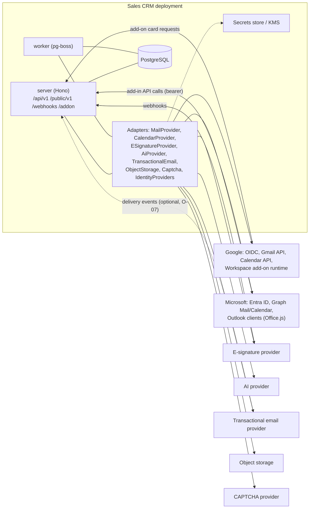
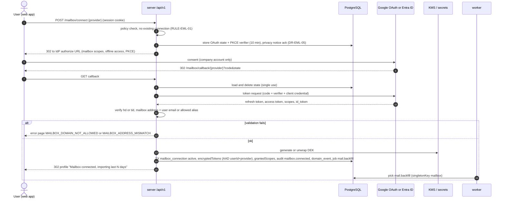
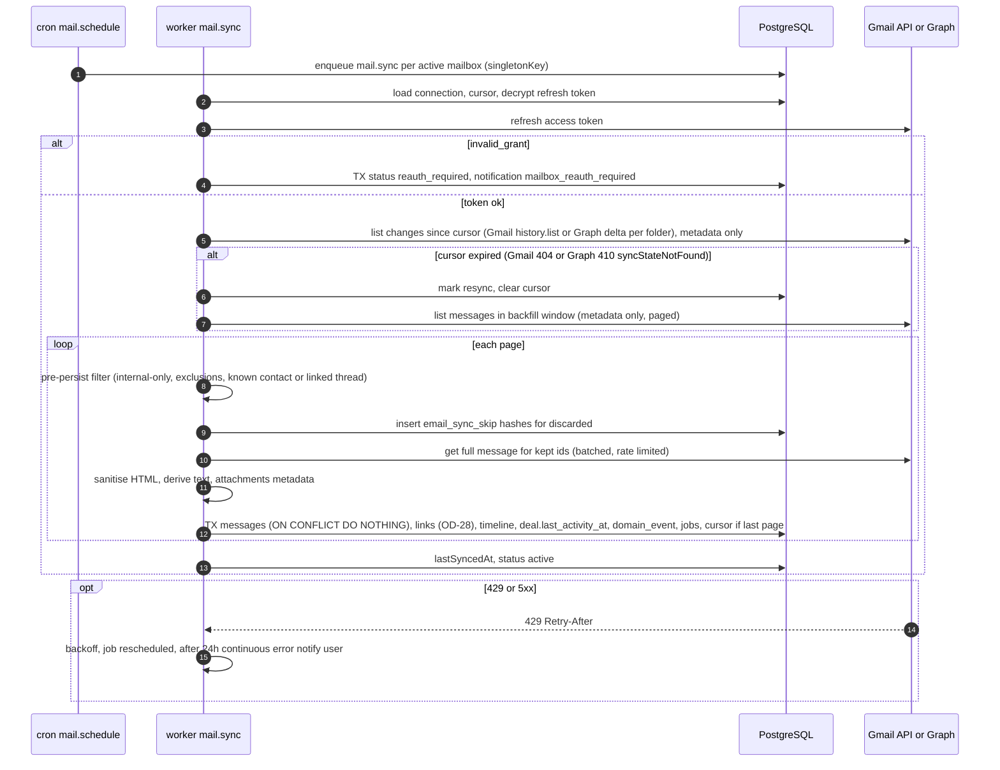
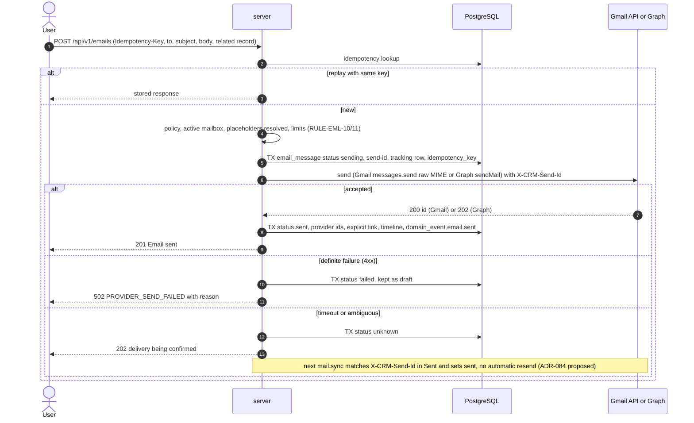
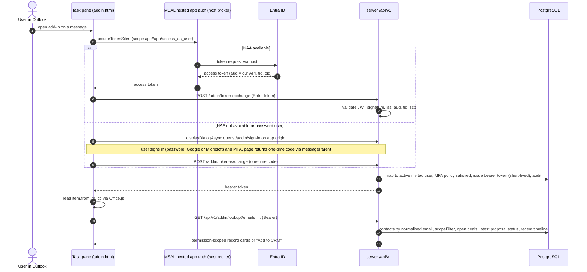
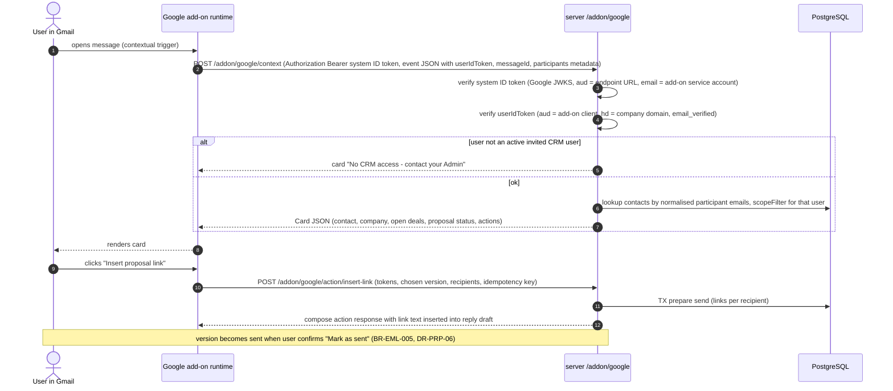
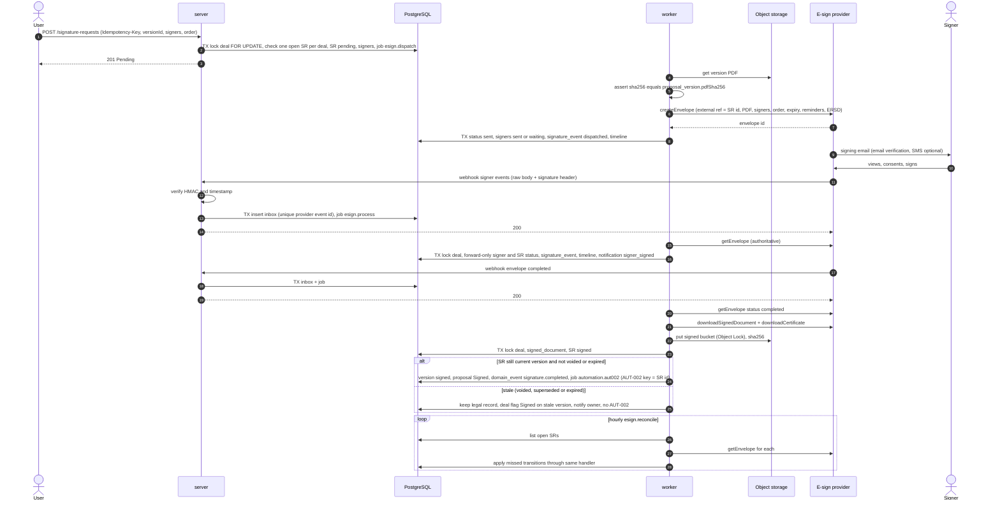
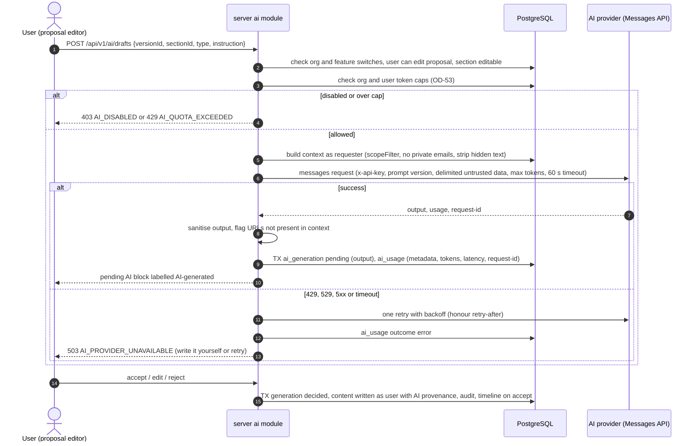
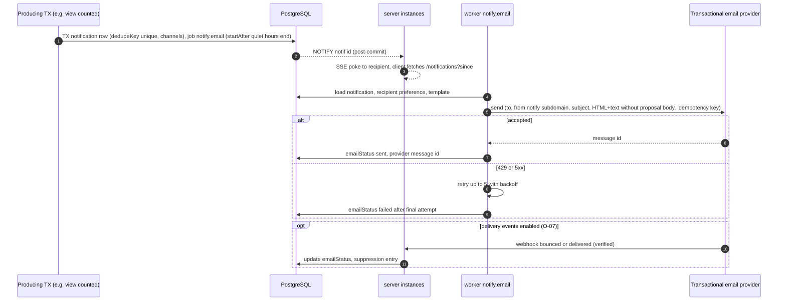
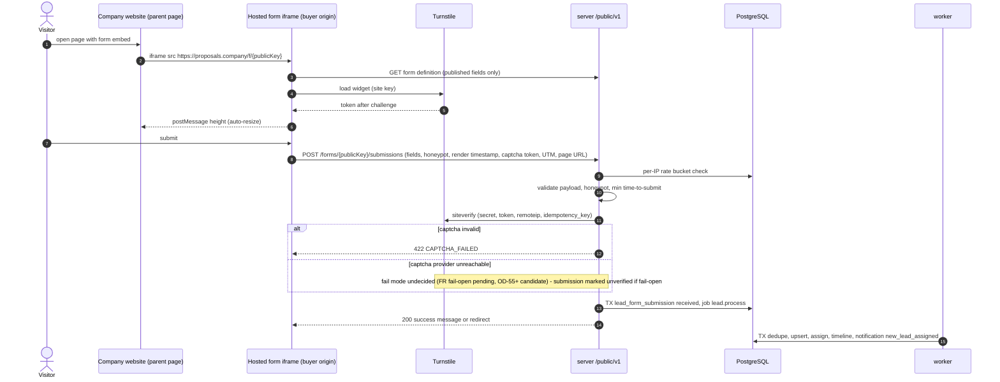

# Integration Architecture — Internal Sales CRM, Phase 1 (HLD)

| Item | Detail |
|---|---|
| Document | INTEGRATION-ARCHITECTURE.md (High-Level Design) |
| Version | 0.1 (Draft, for review) |
| Date | 2026-11-17 |
| Author | Backend Architect |
| Binding inputs | Design foundation §1–§13 (ADR-012, ADR-013, ADR-020, ADR-022, ADR-025..027, ADR-031, ADR-034..037; addenda A2, A9–A11, A15, A16; §10 credential list); OPEN-DECISIONS.md (OD-01..OD-07, OD-11, OD-12, OD-14, OD-29, OD-30, OD-37, OD-42, OD-46, OD-51..OD-53); BUSINESS-RULES.md; FUNCTIONAL-REQUIREMENTS.md (EML, LED, SHR, SIG, AIA, NTF, AUT); DOMAIN-MODEL.md |
| Companion | DATA-FLOW-ARCHITECTURE.md (internal data flows, data classification, database), SECURITY-ARCHITECTURE.md, ARCHITECTURE-DECISIONS.md |

Conventions: BRD/OD/ADR/RULE/DR IDs as in the foundation. Provider facts (scopes, limits, endpoints, headers) are as published by the providers at the time of writing and are marked **[verify]** where they must be re-checked against current provider documentation during TLD; they are design inputs, not decisions. Unresolved items are cited as existing ODs or listed as proposed ODs in §13 — they are not answered here. No application code; adapter interfaces are described as operation contracts in tables.

---

## 1. Integration inventory

| # | Integration | Purpose | Release (foundation §12 R1) | Direction | Main BR | Decision basis |
|---|---|---|---|---|---|---|
| I-01 | Google sign-in (OIDC) | Sign in with company Google account | R1 | Outbound redirect + back-channel token exchange | BR-PLT-003 | OD-12, ADR-006, ADR-027 |
| I-02 | Gmail API | Mailbox sync and send through user's mailbox | R2 | Outbound (polling, send) | BR-EML-001..004, BR-SHR-002 | OD-06, ADR-012, ADR-031 |
| I-03 | Google Calendar API | Meeting sync | R2 | Outbound (polling) | BR-EML-006 | OD-06, ADR-031 |
| I-04 | Google Workspace add-on (Gmail, HTTP runtime) | Inbox add-in for Gmail (card JSON from our server) | R3 | Inbound (Google calls our card endpoints) | BR-EML-005 | OD-07, ADR-027 |
| I-05 | Microsoft Entra ID (single-tenant app) | Sign in with company Microsoft account; token issuer for Graph and add-in | R1 | Outbound redirect + token exchange | BR-PLT-003 | OD-12, ADR-027 |
| I-06 | Microsoft Graph — Mail | Mailbox sync and send | R2 | Outbound | BR-EML-001..004, BR-SHR-002 | OD-06, ADR-031 |
| I-07 | Microsoft Graph — Calendar | Meeting sync | R2 | Outbound | BR-EML-006 | OD-06 |
| I-08 | Outlook add-in (Office.js task pane) | Inbox add-in for Outlook | R3 | Inbound (task pane calls our API) | BR-EML-005 | OD-07, ADR-027 |
| I-09 | E-signature provider | Legally valid e-signature, evidence, sealed PDF | R2 | Outbound API + inbound webhooks | BR-SIG-001..013, BR-AUT-002 | OD-01, OD-02, OD-03, OD-42, ADR-025 |
| I-10 | AI provider | Drafting, LLM pre-send check, summaries, rewrite, follow-up drafts | R2 | Outbound | BR-AIA-001..009 | OD-05, OD-53, ADR-014, ADR-035 |
| I-11 | Transactional email | System notifications, invitations, buyer OTP, buyer forward, digest | R1 | Outbound (+ optional inbound delivery events) | BR-NTF-001..003, BR-SHR-006, BR-PLT-002, NFR-013 | OD-14 |
| I-12 | Object storage | All binaries; immutable storage for signed artefacts | R1 | Outbound | BR-PRP-005, BR-SIG-009/010, BR-PLT-010 | OD-11, ADR-011, ADR-036 |
| I-13 | CAPTCHA (Cloudflare Turnstile WA) | Optional spam protection on lead forms | R1 (with BR-LED-001, foundation R1) | Browser widget + outbound server verification | BR-LED-006 | OD-46 |

Out of scope for Phase 1 integrations: Gmail Pub/Sub push and Graph change notifications (polling only, A16); HubSpot/Pipedrive APIs (BR-MIG-007 deferred, OD-09); lead webhook intake from third-party forms (BR-LED-007 Could — scheme in RULE-LED-13 if built); browser push (BR-NTF-004 deferred, OD-47); enterprise SAML SSO (Phase 3).

Provider selection status: Google vs Microsoft first (OD-06: build the company's actual provider first; both adapters designed); e-signature provider (OD-03: provider-neutral); AI provider (OD-05 WA: Anthropic Claude API); transactional email (OD-14: SMTP-compatible provider, e.g. Amazon SES / Postmark / Azure Communication Services); storage (OD-11: S3-compatible or Azure Blob); CAPTCHA (OD-46 WA: Cloudflare Turnstile).

---

## 2. Integration context

---

## 3. Common integration patterns

### 3.1 Adapter rule

All external systems are reached only through module-owned adapter interfaces (ADR-012). Domain services depend on the interface; one driver per provider is implemented (only the drivers the ODs select, A7). Drivers translate provider errors into a common error taxonomy (§3.3). No adapter is callable by the AI module for sending (RULE-AIA-04, BR-AIA-006 — enforced by dependency rules, ADR-021).

### 3.2 Outbound call policy

| Concern | Policy | Source |
|---|---|---|
| Transactions | Never call an external system inside a DB transaction; record intent → call → record outcome (DATA-FLOW §2) | A1, A4 |
| Timeouts | Per-call connect 5 s; read timeout per integration (table §4–§9); overall request budget for user-facing synchronous calls ≤ 20 s (AI ≤ 60 s, RULE-AIA-09) | NFR-005 |
| Retries | Only for transient errors (network, 408, 429, 5xx, provider "busy"); exponential backoff with full jitter (base 1 s, factor 2, cap 5 min for jobs; ≤ 2 retries in user requests); honour `Retry-After` | RULE-SIG-13, RULE-NTF-08, RULE-AIA-09 |
| Idempotency | Every job carries a business key; provider idempotency key / external reference used where supported; non-idempotent providers protected by reconciliation, not blind retry (proposed ADR-084) | ADR-022 |
| Bulkheads | Separate pg-boss queues and concurrency limits per integration (`mail`, `calendar`, `pdf`, `esign`, `ai`, `email`) so one provider's outage or throttling cannot starve others | A4 |
| Circuit breaking | Per-provider failure counter in worker memory; after N consecutive transient failures the queue pauses for a cool-down (e.g. 60 s, doubling to 15 min) and an alert fires; user-facing calls fail fast with a retryable problem code | NFR-006 |
| Rate limiting (ours) | Token-bucket per provider and per mailbox in the worker, set below published limits; per-user AI caps checked before calls (A15) | A10, A15 |
| Observability | Every call logged (pino) with provider, operation, latency, status, request id from provider, correlation id; never bodies, tokens or personal data; metrics: error rate, latency, throttling count, queue lag; alerts on webhook failures, mailbox-sync lag, AI spend (A14) | ADR-017, A14 |

### 3.3 Error taxonomy (driver → domain)

| Class | Examples | Domain behaviour |
|---|---|---|
| `transient` | network error, timeout, 429, 500–504, provider overloaded | Retry with backoff; job stays queued; status unchanged |
| `auth_revoked` | OAuth `invalid_grant`, 401 after refresh, consent revoked | Mailbox → `reauth_required` (SM-10 M6); provider credential → alert Admin/ops |
| `permanent_input` | 400 validation, unsupported recipient, document rejected | Fail the operation with a stable problem code; no retry |
| `not_found` / `gone` | message deleted, envelope unknown, Gmail history 404, Graph delta 410 | Flow-specific (resync, mark stale) |
| `quota_exhausted` | daily send cap, AI budget | Fail with `*_QUOTA_EXCEEDED`; notify user/Admin |
| `ambiguous` | timeout after request body sent to a non-idempotent send endpoint | Mark `unknown`; reconcile; no blind resend |

### 3.4 Inbound webhook pattern (webhook inbox)

Used by I-09 (and optionally I-11). Endpoint per provider: `POST /webhooks/<integration>/<provider>` on the internal app hostname (not the buyer origin), excluded from session/CSRF middleware, protected by signature verification only.

| Step | Rule | Source |
|---|---|---|
| 1 | Read **raw body** before JSON parsing; verify signature (HMAC or provider-specific) with constant-time comparison; verify timestamp tolerance where the provider supplies one (≤ 5 min) | A9, RULE-SIG-14 |
| 2 | Reject invalid signature with 401, log a security event (no payload) | BR-SIG-007 FR |
| 3 | Insert raw verified event into the inbox table with unique `(provider, provider_event_id)`; duplicate → 200 no-op | A9 |
| 4 | Enqueue processing job in the same transaction; respond 2xx immediately (target < 500 ms) | A9 |
| 5 | Processing job re-reads authoritative state from the provider API; applies forward-only transitions | A9, RULE-SIG-14 |
| 6 | Reconciliation cron (hourly) re-reads all open objects to cover missed webhooks | A9 |

### 3.5 Credential handling

| Rule | Detail | Source |
|---|---|---|
| Storage | Deployment-level credentials (client secrets, API keys, webhook secrets) only in the managed secrets store, injected at runtime; never in DB, repository, images or logs | foundation §10, A10 |
| Per-user tokens | OAuth tokens per mailbox encrypted with envelope encryption (AES-256-GCM DEK per ciphertext, KEK in KMS, key id stored, AAD = userId + provider); Better Auth `account` tokens encrypted | A10, RULE-EML-02 |
| Least privilege | Separate OAuth consents: login scopes (I-01/I-05) are separate from mailbox scopes (I-02/I-03/I-06/I-07) | A10, A16 |
| Workload identity | Prefer cloud workload identity (IAM role / managed identity) over static keys for object storage and KMS | OD-11 |
| Rotation | Every credential has an owner, rotation interval and procedure (§11) | A14 |

---

## 4. Adapter interfaces (conceptual contracts)

Operation contracts only; types are described, not coded. All operations take a `context` (correlation id, actor) and return either a result or a typed error from §3.3.

### 4.1 `MailProvider` (drivers: `gmail`, `graph`) — owner: comms

| Operation | Input | Output | Semantics |
|---|---|---|---|
| `buildAuthorizationUrl` | userId, provider, state, PKCE challenge, login hint | URL | Mailbox consent flow with offline access and mailbox scopes only (A10) |
| `exchangeCode` | code, PKCE verifier | token set (refresh, access, expiry, granted scopes), mailbox address, tenant/domain claims | Caller validates domain/tenant and address match (RULE-EML-01) before persisting |
| `refreshAccessToken` | encrypted refresh token | access token + expiry, possibly rotated refresh token | `auth_revoked` on `invalid_grant` |
| `revoke` | token set | ok | Best effort (RULE-EML-03) |
| `listChangesSince` | cursor (Gmail historyId / Graph deltaLink per folder), page token, page size | message refs with participant headers only, next cursor, `cursorExpired` flag | Metadata-only page (proposed ADR-080); `cursorExpired` triggers bounded resync |
| `listMessagesInWindow` | since date (backfill window, OD-51), page token | message refs with participant headers | Initial backfill and resync |
| `getMessage` | provider message id | full message: headers, participants, subject, HTML/text body, attachment metadata, thread/conversation id, internetMessageId, labels/folder | Called only for messages passing the pre-persist filter |
| `sendMessage` | from (mailbox), to/cc/bcc, subject, HTML+text body, attachments (≤ limits, RULE-EML-10), CRM send-id header, optional tracking pixel URL | provider message id / thread id when returned; or `ambiguous` | Not idempotent at provider; caller holds Idempotency-Key and reconciles (proposed ADR-084) |
| `findSentByCrmSendId` | send id, time window | provider message id or none | Reconciliation for ambiguous sends [verify per provider] |

### 4.2 `CalendarProvider` (drivers: `google_calendar`, `graph_calendar`) — owner: comms

| Operation | Input | Output | Semantics |
|---|---|---|---|
| `listChangesSince` | sync token / deltaLink, window (start date → +90 days) | events (id, iCalUid, title, start/end, organizer, attendees, location/online URL, status, visibility, description), next cursor, `cursorExpired` | Google `syncToken` 410 → full resync; Graph delta token invalid → reset |
| `listEventsInWindow` | window | events | Initial and resync |

### 4.3 `ESignatureProvider` (driver: per OD-03) — owner: esign

| Operation | Input | Output | Semantics |
|---|---|---|---|
| `createEnvelope` | external reference (signatureRequestId), PDF bytes + SHA-256, document name, signers [{order, name, email, role label, SMS phone?, auth = email (+SMS)}], signing order (sequential/parallel), field placement (from template signature block or provider default), message, expiry (RULE-SIG-12), reminder schedule (RULE-SIG-10), consent/ERSD configuration id (OD-42), webhook configuration | provider envelope id, per-signer provider recipient ids | Idempotent by external reference where the provider supports it; otherwise guarded by our job key + lookup by external reference before retry |
| `getEnvelope` | envelope id | authoritative status, per-signer status and timestamps, decline reason, consent events, IPs where exposed | Used by webhook processing and reconciliation |
| `voidEnvelope` | envelope id, reason | ok / already-completed / already-terminal | Asynchronous at provider; completion may win (BR-SIG-013 FR, A9) |
| `sendReminder` | envelope id, signer id | ok | Manual resend ≤ 1 per signer per hour (RULE-SIG-11) |
| `downloadSignedDocument` | envelope id | sealed PDF bytes | Stored immutable with SHA-256 (BR-SIG-010) |
| `downloadCertificate` | envelope id | completion certificate (PDF/JSON) | Must contain fields required by BR-SIG-009 |
| `getSigningUrl` (optional) | envelope id, signer id, return URL | short-lived embedded signing URL | Only if provider supports embedded signing with email verification (BR-SIG-004) |
| `verifyWebhook` | raw body, headers, secret | verified event(s) {provider event id, envelope id, type, occurredAt} | §3.4; provider-specific scheme (§7) |

Provider status → our status mapping is owned by the driver; the domain only sees `pending | sent | viewed | signed | declined | expired | voided` (BR-SIG-007) and signer `waiting | sent | viewed | signed | declined | cancelled`.

### 4.4 `AiProvider` (driver: per OD-05 WA, Anthropic) — owner: ai

| Operation | Input | Output | Semantics |
|---|---|---|---|
| `generate` | feature, prompt version id, system instructions, delimited context blocks (untrusted data marked), user instruction, output constraints (max tokens, structured schema for checks), model id (configuration), timeout | output (text or structured findings), stop reason, input/output token counts, provider request id, latency | Server-side only; no tools/side effects in Phase 1 (RULE-AIA-05); caller enforces caps before and logs `ai_usage` after |
| `estimateTokens` (optional) | same input | token count | Budget pre-check (A15, OD-53) |

### 4.5 `TransactionalEmail` (driver: per OD-14) — owner: notifications (platform-shared)

| Operation | Input | Output | Semantics |
|---|---|---|---|
| `send` | message type (notification, digest, invitation, buyer_otp, buyer_forward, export_ready, password_reset), to (single recipient), from identity (per type), reply-to, subject, HTML + text, idempotency key (notificationId + channel), tags | provider message id | One recipient per message; idempotency key passed where the provider supports it, else our dedupe key prevents duplicates (RULE-NTF-12) |
| `parseDeliveryEvent` (optional) | raw webhook | {message id, event: delivered/bounced/complained, reason} | Proposed O-07 |

### 4.6 `ObjectStorage` (driver: `s3` or `azure_blob`, plus MinIO for dev, A7) — owner: platform

| Operation | Input | Output | Semantics |
|---|---|---|---|
| `put` | bucket class, key, stream, content type, SHA-256 (verified), metadata, retention mode (none / governance / compliance-locked) | version id, size | Multipart for large objects; server-side encryption; immutability for signed class |
| `get` | key (+ version) | stream, metadata | Server-mediated reads for tracked downloads |
| `presignGet` | key, TTL (≤ 5 min), content-disposition | URL | Internal downloads and export link (24 h exception for exports, RULE-PLT-20) |
| `delete` | key | ok / refused (locked) | Refused for retention-locked objects |
| `copy` | source key, dest key | ok | Export packaging (server-side copy) |

### 4.7 `Captcha` (driver: `turnstile`, OD-46) — owner: leads

| Operation | Input | Output | Semantics |
|---|---|---|---|
| `verify` | token, remote IP, form id, idempotency key | success, hostname, action, challenge timestamp, error codes | Server-side verification; single-use tokens; fail mode is an open decision (§13) |

### 4.8 Identity integrations (Better Auth social providers + add-in verifiers) — owner: identity

| Operation | Input | Output | Semantics |
|---|---|---|---|
| `socialSignIn(google|microsoft)` | redirect, PKCE | verified identity (email, email_verified, `hd` / `tid`, subject) | Implicit sign-up disabled; must match an active user or pending invitation (RULE-PLT-06, A11) |
| `verifyGoogleAddonRequest` | system ID token, user ID token, endpoint URL | verified user email + Google subject | §5.4 |
| `exchangeAddinToken` | Entra access token for our API (NAA) or one-time code from Office dialog sign-in | CRM bearer token (Better Auth bearer plugin), expiry | §6.4 |

---

## 5. Google Workspace

Prerequisite (all I-01..I-04): one Google Cloud project owned by company IT; OAuth consent screen user type **Internal** so only company Workspace accounts can authorise and restricted scopes (Gmail read) do not require public verification (OD-06 WA — IT to confirm).

### 5.1 I-01 Google sign-in (OIDC)

| Attribute | Detail |
|---|---|
| Purpose | Sign in with company Google account (BR-PLT-003, OD-12) |
| BR IDs | BR-PLT-003, BR-PLT-004 (MFA via our TOTP; IdP MFA not relied upon, OD-13) |
| Direction | Browser redirect to Google; server back-channel code exchange |
| Protocol | OAuth 2.0 authorization code + PKCE, OpenID Connect; HTTPS |
| Auth & scopes | `openid`, `email`, `profile` only (login scopes separate from mailbox scopes, A10). `hd=<company domain>` request parameter as UX hint; **server verifies `hd` claim** and `email_verified` (A11) |
| Credentials / config | OAuth client (web application) ID + secret; authorised redirect URI `https://<app-domain>/api/auth/callback/google` [verify path with Better Auth]; allowed domain list in `organization_settings.loginMethods.allowedDomains`. **Provisioned by:** company Google Workspace admin / IT in the Google Cloud project |
| Rate limits | Not material at 150 users |
| Failure modes | Google outage → password login (if enabled) or wait; wrong domain → `AUTH_DOMAIN_NOT_ALLOWED`; no matching user/invitation → reject (implicit sign-up disabled, A11) |
| Retry | None (interactive) |
| Idempotency | State + PKCE single-use |
| Webhook verification | n/a |
| Data sent / received | Sent: client id, redirect, state. Received: ID token (sub, email, name, hd), access token (not stored beyond Better Auth `account`, encrypted A10) |
| Privacy | Only identity claims of our own employees |

### 5.2 I-02 Gmail API (sync and send)

| Attribute | Detail |
|---|---|
| Purpose | Sync emails with known contacts; send from user's mailbox (BR-EML-001..004, BR-SHR-002) |
| BR IDs | BR-EML-001, 002, 003, 004, 007; BR-SHR-002; BR-AUT-004 (answered); BR-AIA-001/003 (context) |
| Direction | Outbound only (polling; no push in Phase 1, A16) |
| Protocol | REST/JSON over HTTPS (`gmail.googleapis.com/gmail/v1`) |
| Auth & scopes | Per-user OAuth 2.0 with offline access (`access_type=offline`, `prompt=consent` on first connect) — separate consent from login. Scopes: `https://www.googleapis.com/auth/gmail.readonly`, `https://www.googleapis.com/auth/gmail.send` (A16). Add `.../auth/userinfo.email` + `openid` to read the mailbox address for RULE-EML-01 [verify]. No `gmail.modify` / `gmail.compose` |
| Credentials / config | Same Google Cloud project; Gmail API enabled; OAuth client (may be the same web client as I-01 with a separate consent request, or a dedicated client — TLD); redirect `https://<app-domain>/api/v1/mailbox/callback/google`; KEK for token encryption (KMS). Optional alternative: domain-wide delegation via service account — **not** used (per-user consent preserves user control, BR-EML-003). **Provisioned by:** IT (project, API enablement, consent screen Internal); each user grants consent |
| Rate limits [verify] | Per-project daily quota units and per-user rate limit (≈ 250 quota units/user/second moving average); cost per call: `history.list` 2 units, `messages.get` 5, `messages.list` 5, `messages.send` 100. Workspace sending limit ≈ 2,000 messages/user/day. Our worker limits each mailbox to a fraction of the per-user rate and processes ≤ 1 mailbox job per mailbox at a time (singletonKey) |
| Sync mechanics | Backfill: `messages.list` with `q=after:<epoch>` over the backfill window (OD-51; 90-day default, RULE-EML-04) and `format=metadata` + `metadataHeaders=From,To,Cc,Bcc,Subject,Date,Message-ID,In-Reply-To,References` via batch requests; pre-persist filter; `messages.get format=full` for kept messages. Incremental: `history.list` from stored `historyId`, `historyTypes=messageAdded`; store new `historyId` per page. Spam/Trash/Drafts excluded by label (folder policy open, O-03) |
| History expiry | `history.list` returns **404** when `startHistoryId` is too old (typically after about a week, not guaranteed) → bounded full resync over the backfill window; dedupe by unique `(mailbox, providerMessageId)` (A16, SM-10 M7) |
| Send | `users.messages.send` with RFC 2822 `raw` (base64url) containing our `X-CRM-Send-Id` header and per-recipient share-link body (one email per recipient, BR-SHR-002 FR); appears in Sent. Reconcile ambiguous outcome by searching `rfc822msgid:` / the send-id header in Sent [verify that Gmail preserves client-supplied headers] |
| Failure modes | 401/`invalid_grant` → `reauth_required` (notify user); 403 `rateLimitExceeded`/`userRateLimitExceeded`, 429, 5xx → backoff; 404 history → resync; 400 send (bad recipient) → `PROVIDER_SEND_FAILED` with reason, message kept as CRM draft |
| Retry / backoff | Exponential with jitter, honour `Retry-After`; after 24 h of continuous transient errors user notified (SM-10 M4) |
| Idempotency | Sync: unique constraints; cursor advance in same TX as last page commit. Send: Idempotency-Key + no blind resend (proposed ADR-084) |
| Webhook verification | n/a (no push) |
| Data sent / received | Sent: OAuth tokens, API queries; outgoing mail content composed by the user. Received: message headers for all new mail (minimised by metadata-first fetch), full content of qualifying messages only |
| Privacy | Employee mailbox privacy notice and acknowledgement before connect (DR-EML-05, OD-52); OD-29 pre-persist filter; exclusions (BR-EML-003); private emails (OD-30) — private content never leaves our DB to AI (RULE-AIA-03) |

### 5.3 I-03 Google Calendar API

| Attribute | Detail |
|---|---|
| Purpose | Log meetings with known contacts (BR-EML-006) |
| BR IDs | BR-EML-006; BR-AUT-005 (activity); BR-CRM-009 (My Day upcoming meetings) |
| Direction | Outbound polling |
| Protocol | REST/JSON (`www.googleapis.com/calendar/v3`) |
| Auth & scopes | Same per-user mailbox consent: `https://www.googleapis.com/auth/calendar.readonly` (or narrower `calendar.events.readonly` if sufficient [verify]) |
| Credentials / config | Calendar API enabled in the same project; no extra secrets. Provisioned by IT |
| Rate limits [verify] | Per-project and per-user quotas (queries per minute per user); low volume at 150 users |
| Mechanics | `events.list` on primary calendar with `singleEvents=true`, `timeMin` = sync start, `timeMax` = now + 90 days for initial; incremental with `syncToken`; `410 GONE` → discard token, full resync of window |
| Failure modes / retry | As I-02 |
| Idempotency | Unique `(mailbox, providerEventId)`; `iCalUID` for cross-mailbox dedupe |
| Data | Received: event metadata incl. attendees and description; private events stored metadata only (RULE-EML-13) |
| Privacy | Only events with ≥ 1 known-contact attendee stored |

### 5.4 I-04 Google Workspace add-on (Gmail, HTTP / alternate runtime)

| Attribute | Detail |
|---|---|
| Purpose | Show CRM context for the open Gmail message; create records; add message to CRM; insert proposal links into a reply (BR-EML-005, OD-07) |
| BR IDs | BR-EML-005, BR-SHR-001..003, BR-CRM-001..003, AC-05 |
| Direction | Inbound: Google's add-on runtime POSTs event JSON to our card endpoints `https://<app-domain>/addon/google/<action>`; we return Card JSON (no frontend code in Gmail, A2) |
| Protocol | HTTPS POST, JSON event objects in, Card/Action JSON out; response time budget ≈ < 3 s for homepage/contextual triggers [verify current limit] |
| Auth & scopes | Manifest scopes (deployment): `https://www.googleapis.com/auth/gmail.addons.execute`, `https://www.googleapis.com/auth/gmail.addons.current.message.metadata` (participants only — sufficient for record lookup; `…current.message.readonly` only if "add to CRM" must store the body), `https://www.googleapis.com/auth/gmail.addons.current.action.compose` (insert link into reply draft), `https://www.googleapis.com/auth/userinfo.email` [verify]. Request authentication (A11): (1) **system ID token** in `Authorization: Bearer` signed by Google for the add-on's service account — verify signature (Google JWKS), `iss`, `aud` = endpoint URL, `email` = the deployment's service account; (2) **user ID token** (`authorizationEventObject.userIdToken`) — verify signature, `aud` = add-on client id, `email_verified`, `hd` = company domain; map email to an **active invited** user; no CRM session cookie involved |
| Credentials / config | Add-on deployment (HTTP deployment resource) in the Google Cloud project; deployment manifest (endpoints, scopes, logo, triggers); service-account email to trust; Workspace admin installs the add-on domain-wide (or users install from internal Marketplace listing). **Provisioned by:** IT (deployment + domain install); dev team supplies manifest |
| Rate limits | Driven by user clicks; our endpoints apply per-user rate limits |
| Failure modes | Token invalid/expired → sign-in/denied card; user not invited/deactivated → "No CRM access" card; server error → error card "Can't reach the CRM" (BR-EML-005 FR) |
| Retry | User-driven |
| Idempotency | Create actions accept a client-generated idempotency key embedded in card action parameters |
| Data sent / received | Received: message id, participants (metadata scope), optionally access token to read the current message; Sent: card content with CRM data the user may see (permission-scoped exactly as web, RULE-EML-14) — names, deal names, stages, amounts, proposal status; rendered by Google in the user's Gmail |
| Privacy | CRM data rendered inside Google's UI for the same authenticated employee; no data stored at Google beyond its normal add-on operation; OD-29 override only on explicit "Add to CRM" |

---

## 6. Microsoft 365

Prerequisite (I-05..I-08): one **single-tenant** app registration in the company Entra tenant (OD-06 WA); admin consent for delegated Graph permissions granted tenant-wide by IT so users see no consent prompt for mailbox scopes (users still explicitly start the mailbox connection, BR-EML-001).

### 6.1 I-05 Microsoft Entra ID sign-in

| Attribute | Detail |
|---|---|
| Purpose | Sign in with company Microsoft account (BR-PLT-003, OD-12) |
| Direction / protocol | Browser redirect, OAuth 2.0 authorization code + PKCE, OIDC v2.0 endpoints; single-tenant authority `https://login.microsoftonline.com/<tenant-id>/v2.0` |
| Auth & scopes | `openid`, `profile`, `email` (and `User.Read` if needed for profile [verify with Better Auth]); **server verifies `tid` = company tenant id and `iss`** (A11); implicit sign-up disabled |
| Credentials / config | Application (client) ID, tenant ID, client credential — prefer **certificate** credential over client secret; redirect URI `https://<app-domain>/api/auth/callback/microsoft` [verify]. **Provisioned by:** IT (Entra admin) |
| Rate limits | Not material |
| Failure modes | Wrong tenant → `AUTH_DOMAIN_NOT_ALLOWED`; Conditional Access may require MFA at the IdP (independent of our TOTP, OD-13) |
| Data | Received: ID token (oid, tid, preferred_username/email, name) |
| Privacy | Employee identity only |

### 6.2 I-06 Microsoft Graph — Mail

| Attribute | Detail |
|---|---|
| Purpose / BR | As I-02 (BR-EML-001..004, BR-SHR-002) |
| Direction / protocol | Outbound REST/JSON `https://graph.microsoft.com/v1.0` |
| Auth & scopes | Delegated, per user, separate consent from login: `Mail.Read`, `Mail.Send`, `offline_access`, `User.Read` (mailbox address) (A16). No `Mail.ReadWrite` (no drafts), no application permissions |
| Credentials / config | Same app registration; redirect `https://<app-domain>/api/v1/mailbox/callback/microsoft`; delegated permissions + tenant admin consent; KEK for token encryption. **Provisioned by:** IT |
| Rate limits [verify] | Graph throttling returns 429 with `Retry-After`; Outlook service limits ≈ 10,000 requests per 10 minutes per app per mailbox and ≈ 4 concurrent requests per mailbox; Exchange Online sending limits ≈ 10,000 recipients/day and 30 messages/minute per mailbox. Worker uses ≤ 2 concurrent requests per mailbox and honours `Retry-After` |
| Sync mechanics | Delta is **per folder**: `GET /me/mailFolders/{inbox|sentitems}/messages/delta` with `$select` limited to `id, conversationId, internetMessageId, from, toRecipients, ccRecipients, bccRecipients, sentDateTime, receivedDateTime, parentFolderId` (metadata-first, proposed ADR-080) and `Prefer: odata.maxpagesize`; store `@odata.deltaLink` per folder; kept messages fetched with `GET /me/messages/{id}?$select=…body,subject,hasAttachments` and `Prefer: outlook.body-content-type="html"`; attachments metadata via `/attachments?$select=name,size,contentType`. Backfill window via `$filter=receivedDateTime ge …` on initial delta round [verify filter support on delta] |
| Delta reset | `410 Gone` / `syncStateNotFound` / invalid delta token → discard cursor, bounded resync of window (A16) |
| Send | `POST /me/sendMail` (202 Accepted, no message id returned) with `internetMessageHeaders` containing `X-CRM-Send-Id`; `saveToSentItems=true`. Ambiguous/202 → sent message identified by next Sent Items delta via header or internetMessageId [verify header round-trip] (proposed ADR-084) |
| Failure modes | 401 / `invalid_grant` / `AADSTS` consent revoked → `reauth_required`; 429/503/504 → backoff with `Retry-After`; 400 → permanent; mailbox not licensed → permanent, notify user |
| Idempotency / webhook | As I-02; no change notifications in Phase 1 |
| Data / privacy | As I-02 |

### 6.3 I-07 Microsoft Graph — Calendar

| Attribute | Detail |
|---|---|
| Purpose / BR | BR-EML-006 |
| Auth & scopes | Delegated `Calendars.Read` (+ `offline_access`) in the mailbox consent (A16) |
| Mechanics | `GET /me/calendarView/delta?startDateTime=…&endDateTime=…` (window start → +90 days); deltaLink stored; reset on invalid token |
| Rate limits / failures / idempotency | As I-06; unique `(mailbox, providerEventId)`, `iCalUId` for cross-mailbox dedupe |
| Data / privacy | Event metadata, attendees, body preview; `sensitivity = private` → metadata only (RULE-EML-13) |

### 6.4 I-08 Outlook add-in (Office.js task pane)

| Attribute | Detail |
|---|---|
| Purpose | As I-04 for Outlook (BR-EML-005, OD-07) |
| Direction / protocol | Task pane page `https://<app-domain>/addin.html` (A2 multi-entry) loaded by Outlook; calls our `/api/v1` with `Authorization: Bearer` (no third-party cookies, A11) |
| Auth options | **(a) Nested App Authentication (NAA)**: task pane uses MSAL.js nested public client to obtain an Entra access token for our API scope `api://<app-id>/access_as_user`; server validates JWT (signature via Entra JWKS, `iss`, `aud`, `tid`, `scp`), maps `oid`/email to an active user, issues a short-lived CRM bearer token (Better Auth bearer plugin). **(b) Office dialog sign-in**: `displayDialogAsync` opens our sign-in page on the app origin (password, Google or Microsoft per OD-12, MFA enforced), result returned with `messageParent` as a one-time code exchanged for a bearer token. Proposed ADR-085: NAA primary, dialog fallback for clients without NAA support and for password-only users [verify NAA client support matrix] |
| Item access | Office.js `Office.context.mailbox.item` (from, to, cc, subject, itemId); `body.setSelectedDataAsync` / `displayReplyForm` to insert share links; no EWS/REST tokens needed for lookup |
| Credentials / config | Add-in manifest (add-in-only XML manifest or unified JSON manifest [decide in TLD]) with app domain, permissions `ReadWriteItem` (insert link) [verify minimum], icons; Entra app exposes API scope and registers the NAA broker redirect `brk-multihub://<app-domain>` [verify]; **centralized deployment** via Microsoft 365 admin center → Integrated apps. **Provisioned by:** IT (deployment, admin consent); dev team supplies manifest |
| Rate limits | User-driven; per-user API rate limits apply |
| Failure modes | Token expired → silent re-acquire (NAA) or re-open dialog; deactivated user → 401 and sign-out (A11: deactivation revokes bearer tokens); server unreachable → error banner |
| Idempotency | Client idempotency keys on create/send actions (ADR-016) |
| Data | Received: message participants and ids; Sent: permission-scoped CRM data rendered in task pane |
| Privacy | Same as web; "Add to CRM" overrides OD-29 for that thread only (RULE-EML-14) |

---

## 7. I-09 E-signature provider

| Attribute | Detail |
|---|---|
| Purpose | Legally valid e-signature on the exact frozen version with evidence, sealed PDF and certificate (BR-SIG-001..013) |
| BR IDs | BR-SIG-001..013, BR-PRP-007, BR-AUT-002, BR-AUT-003, BR-NTF-001; NFR-004 |
| Decision basis | OD-02 WA partner; OD-03 provider-neutral shortlist DocuSign eSignature, Dropbox Sign, Adobe Acrobat Sign, BoldSign; OD-01 SES evidence; OD-42 consent wording |
| Direction | Outbound REST (create, get, void, remind, download) + inbound webhooks |
| Protocol | HTTPS REST/JSON; webhook HTTPS POST (JSON or form-encoded depending on provider) |
| Auth (outbound) [verify per provider] | DocuSign: OAuth 2.0 JWT grant (service integration, RSA key pair, impersonated sender user) ; Dropbox Sign: API key (HTTP basic) or OAuth; Adobe Acrobat Sign: OAuth 2.0 / integration key; BoldSign: API key header or OAuth. WA: one company "integration sender" account; sender of record per request kept as metadata (RULE-SIG-22) |
| Webhook verification [verify per provider] | DocuSign Connect: HMAC-SHA256 of raw body with Connect key, header `X-DocuSign-Signature-1` (+ mTLS optional). Dropbox Sign: `event_hash` = HMAC-SHA256(api key, event_time + event_type) in payload, endpoint must reply with the expected acknowledgement string. Adobe Acrobat Sign: webhook verification of intent via `X-AdobeSign-ClientId` echo, no body HMAC — compensate with secret URL path + IP allow-list + mandatory API re-read. BoldSign: `X-BoldSign-Signature` HMAC-SHA256 with timestamp. Common rule: verification + timestamp tolerance + **authoritative re-read via API before any state change** (A9) |
| Credentials / config | Provider account (production + sandbox), API credentials (JWT private key / API key), webhook HMAC secret(s) (two active during rotation), webhook URL `https://<app-domain>/webhooks/esign/<provider>`, consent/ERSD text approved by Legal (OD-42), branding, default reminder/expiry settings (org defaults, RULE-SIG-10/12), data-residency region (OD-01, O-09), sandbox for non-prod. **Provisioned by:** Tech Lead with Procurement/Legal (contract, DPA); Legal supplies ERSD wording |
| Rate limits [verify] | Provider-specific hourly API limits (e.g. DocuSign ≈ 3,000 calls/hour/account and polling restrictions — reconciliation must stay within polling guidance); our volume ≈ 20k proposals/year ⇒ well below limits; reconciliation hourly over open requests only |
| Failure modes | Dispatch failure (5xx/timeout) → retry 5× with backoff (RULE-SIG-13), final outcome conflict C-03 in DATA-FLOW §9; document rejected → permanent error; webhook delivery failure → provider retries + our hourly reconciliation; void races completion → completion wins (BR-SIG-013 FR); completion on stale version → legal record kept, no AUT-002, deal flag (A9) |
| Retry / backoff | Jobs: exponential with jitter, cap 15 min; downloads of signed PDF/certificate retried, alert after 1 h (BR-SIG-009 FR) |
| Idempotency | Create: external reference = signatureRequestId; before retrying a create after ambiguous failure, search by external reference/metadata [verify capability per provider]. Webhooks: unique provider event id. Completion: keyed by signatureRequestId; AUT-002 key `AUT-002:{signatureRequestId}` (OD-24) |
| Data sent | Frozen proposal PDF (hash asserted equal to `proposal_version.pdfSha256`, A9), document title, signer names, emails, optional mobile numbers, signing order, message, expiry, reminders, our external id; no CRM data beyond the document and signer details |
| Data received | Envelope/signer statuses, timestamps, IPs, user agents, consent events, decline reasons, sealed signed PDF, completion certificate |
| Privacy | Provider is a processor: DPA required (IDD-09); signer evidence and signed documents erasure-exempt (OD-36, RULE-SIG-23); data-residency per OD-01/O-09; forwarded viewers cannot sign (OD-26) |

---

## 8. I-10 AI provider

| Attribute | Detail |
|---|---|
| Purpose | Proposal section drafting, LLM pre-send consistency check, deal/thread summary, rewrite, follow-up draft (BR-AIA-001..005) |
| BR IDs | BR-AIA-001..009; NFR-003; BR-AUT-004 (follow-up draft) |
| Decision basis | OD-05 WA: Anthropic Claude API, server-side only, behind `AiProvider`; IDD-07/08/10; OD-53 budgets |
| Direction | Outbound only |
| Protocol | HTTPS REST/JSON, Anthropic Messages API `POST https://api.anthropic.com/v1/messages`; streaming (server-sent events) optional for interactive drafting |
| Auth | Header `x-api-key: <key>` plus `anthropic-version` header; alternatively Workload Identity Federation (short-lived tokens exchanged from the cloud workload identity) if the account supports it — avoids a static key (TLD decision) |
| Model | Configuration value (not hard-coded); one model per feature allowed; pinned per prompt version (DR-AIA-04) |
| Credentials / config | API key (or WIF federation rule), workspace id, model ids per feature, per-feature max tokens, org/user caps (OD-53), optional `inference_geo` for data residency (O-09) [verify availability]. **Provisioned by:** Tech Lead under a company Anthropic organization with commercial terms (no training on inputs) and zero-data-retention arrangement requested/confirmed (OD-05); Finance approves budget |
| Rate limits | Organization-tier limits on requests per minute and input/output tokens per minute; exceeding returns HTTP 429 with `retry-after`; responses carry `anthropic-ratelimit-*` headers (used for adaptive throttling); HTTP 529 = provider overloaded |
| Timeouts | 60 s per call (RULE-AIA-09); streaming for long outputs to avoid HTTP timeouts |
| Failure modes | 429/529/5xx/timeout → one automatic retry with backoff then `AI_PROVIDER_UNAVAILABLE` (RULE-AIA-09); 400 → permanent, logged without prompt content; model refusal / safety stop reason → treated as "no draft", user informed; budget exceeded (ours) → `AI_QUOTA_EXCEEDED` before call; outage never blocks non-AI work (DR-AIA-03) — deterministic pre-send checks still run (R4) |
| Idempotency | Not required at provider (no side effects); our `ai_generation` id dedupes retries |
| Webhook | n/a |
| Data sent | Per request, only records the requesting user may view: deal/company/contact fields, notes, logged activities, non-private email excerpts (hidden text stripped, delimited as untrusted data), template section guidance, current proposal content and pricing (RULE-AIA-03/05, A15) |
| Data received | Generated text or structured findings; token usage; provider `request-id` response header (stored in `ai_usage` for support correlation) |
| Privacy | No training on our data (BR-AIA-009); ZDR to be confirmed (OD-05) — note that some provider features are not ZDR-eligible (e.g. server-side conversation retention features) and are therefore not used; private emails never sent (OD-30); prompts and outputs never logged (A15); DPA with provider (IDD-09); data residency O-09 |

---

## 9. I-11 Transactional email, I-12 Object storage, I-13 CAPTCHA

### 9.1 I-11 Transactional email (OD-14)

| Attribute | Detail |
|---|---|
| Purpose | System notifications (BR-NTF-001), task reminders (BR-CRM-008), digest (BR-NTF-003), invitations (BR-PLT-002), password reset, mailbox re-auth notices, export-ready, buyer email OTP (BR-SHR-006), buyer-initiated forward (DR-SHR-07), new-lead alerts (BR-LED-003). **Not** used for proposal delivery from users (that goes through the user's mailbox, NFR-013) |
| Direction | Outbound; optional inbound delivery-event webhooks (O-07) |
| Protocol | Provider HTTPS API (preferred: per-message ids, tags, idempotency where supported) or SMTP submission (port 587, STARTTLS) |
| Auth | API key / SMTP credentials (SES: IAM role preferred; Postmark: server token; ACS: connection string or managed identity) |
| Credentials / config | Provider account; sending subdomain e.g. `notify.<company-domain>` with **SPF**, **DKIM** (provider keys), **DMARC** policy (start `p=quarantine` after monitoring), optional custom MAIL FROM / return-path; from identities per message type (`no-reply@`, `proposals@` for buyer OTP/forward); webhook secret if delivery events used. **Provisioned by:** IT (DNS records), Tech Lead (account, keys) |
| Rate limits [verify] | Provider sending quotas (e.g. SES sandbox exit and per-second send rate); our volume ≈ a few thousand emails/day ⇒ low |
| Failure modes | 429/5xx → retry 5× with backoff, then `notification.emailStatus=failed` (RULE-NTF-08); hard bounce → (proposed) suppression, OTP shows "couldn't send code" (O-07); provider outage → in-app notifications unaffected (BR-NTF-001 FR) |
| Idempotency | Dedupe key per (notification id, channel) (RULE-NTF-12); OTP: one code per challenge row |
| Webhook verification | If used: SES via SNS signed messages (verify SNS signature + topic ARN); Postmark via basic auth on webhook URL + IP allow-list; ACS via Event Grid validation handshake + AAD auth [verify] |
| Data sent | Recipient address (employee or buyer), subject, body: titles, deal names, viewer name/email, deep links requiring sign-in — **no proposal body content** (RULE-NTF-11); OTP code; forward: forwarder name, organization name, general link |
| Privacy | Processor DPA; minimal content; buyer OTP emails to external addresses only on buyer request |

### 9.2 I-12 Object storage (OD-11, ADR-036)

| Attribute | Detail |
|---|---|
| Purpose | Store proposal PDFs/DOCX, template/branding assets, signed PDFs and certificates, import sources, export archives, audit archive (BR-PRP-005, BR-SIG-009/010, BR-PLT-010, BR-MIG-001) |
| Direction / protocol | Outbound; S3 API (SigV4) or Azure Blob REST; only one production driver per OD-11 plus MinIO (S3) for local dev (A7) |
| Auth | Workload identity (IAM role / Azure managed identity) preferred; static access keys only for dev/MinIO |
| Bucket classes | `documents` (PDF/DOCX, assets; versioning on), `signed` (signed PDFs + certificates; versioning + Object Lock compliance mode / Azure immutable blob time-based retention — period from Legal, OD-36), `imports` (lifecycle delete 30 days, DR-MIG-01), `exports` (lifecycle 7 days, DR-PLT-06), `audit-archive` (immutable) |
| Encryption | Server-side encryption with KMS key (SSE-KMS / Azure CMK optional); TLS in transit; buckets private, public access blocked |
| Access | Server/worker identities only; users receive presigned URLs (≤ 5 min; export 24 h) or server-mediated streams for tracked buyer downloads (ADR-011) |
| Credentials / config | Bucket names, region, KMS key id, retention configuration, lifecycle rules, CORS (none needed — downloads are same-origin or presigned GET). **Provisioned by:** IT / cloud platform team |
| Rate limits | Not material at OD-45 volumes |
| Failure modes | 5xx/timeouts → retry; write of signed artefact failing → completion not marked Signed until stored and hashed (BR-SIG-009 FR); delete refused on locked object → expected |
| Idempotency | Keys derived from ids (e.g. `proposals/<versionId>/<sha256>.pdf`) so re-uploads are idempotent; SHA-256 verified on upload |
| Data | All binary classes listed in DATA-FLOW §5 (P, C) |
| Privacy | Region per OD-11/O-09; versioning means deletions for erasure must remove all versions except legally locked ones |

### 9.3 I-13 CAPTCHA (OD-46 WA Cloudflare Turnstile)

| Attribute | Detail |
|---|---|
| Purpose | Optional bot protection on public lead forms (BR-LED-006) in addition to honeypot, time-to-submit and per-IP limits |
| Direction / protocol | Browser loads widget script from `https://challenges.cloudflare.com` on the hosted form page (buyer origin; CSP allows this origin on the form page only); server POSTs `secret`, `response` token, `remoteip`, `idempotency_key` to `https://challenges.cloudflare.com/turnstile/v0/siteverify` [verify] |
| Auth | Site key (public, in form page) + secret key (server) |
| Credentials / config | Turnstile widget with allowed hostnames = buyer/form origin; site key + secret key per environment. **Provisioned by:** IT / web team (Cloudflare account) |
| Rate limits | Not material |
| Token rules | Tokens single-use and short-lived (≈ 300 s) [verify]; `idempotency_key` allows safe retry of verification |
| Failure modes | Invalid token → `CAPTCHA_FAILED` 422; provider unreachable → fail mode undecided (FR BR-LED-006 "fail-open, pending confirmation"; foundation R12 "CAPTCHA fail mode" OD-55+) — design supports both: fail-open marks submission `unverified` for Admin review |
| Data sent / received | Sent: token, visitor IP; Received: success, hostname, action, error codes |
| Privacy | Visitor IP shared with Cloudflare (processor); privacy notice on form (DR-LED-02) must mention it |

---

## 10. Integration sequence diagrams

### 10.1 Mailbox OAuth connect

### 10.2 Gmail / Graph delta sync including history expiry resync

### 10.3 Send from CRM

### 10.4 Outlook add-in sign-in and record lookup

### 10.5 Gmail add-on card request

### 10.6 Signature request create → signer events → completion webhook → reconciliation

### 10.7 AI draft call

### 10.8 Transactional notification email

### 10.9 Lead form iframe submit with CAPTCHA

---

## 11. Credentials and configuration register

| # | Credential / configuration | Integration | Type | Stored in | Provisioned by | Rotation | Environments |
|---|---|---|---|---|---|---|---|
| K-01 | Google OAuth web client ID + secret (login) | I-01 | Client credential | Secrets store (secret), config (ID) | IT (Google Cloud project, consent screen Internal) | Annual or on exposure | dev / staging / prod clients separate |
| K-02 | Google OAuth client for mailbox consent (may equal K-01) + enabled Gmail and Calendar APIs | I-02, I-03 | Client credential + project config | Secrets store | IT | Annual | per env |
| K-03 | Google Workspace add-on HTTP deployment, manifest, add-on service-account email, add-on OAuth client id | I-04 | Deployment config | Config | IT (deploy + domain install); dev (manifest) | On change | staging / prod deployments |
| K-04 | Entra app registration: client ID, tenant ID, certificate (preferred) or client secret, redirect URIs, delegated permissions with admin consent, exposed API scope `access_as_user`, NAA broker redirect | I-05, I-06, I-07, I-08 | App registration + credential | Secrets store (cert/secret), config | IT (Entra admin) | Certificate ≤ 1 year; secret ≤ 6 months | separate registrations per env recommended |
| K-05 | Outlook add-in manifest + centralized deployment | I-08 | Deployment config | Repo (manifest), M365 admin center | IT | On change | test group then all users |
| K-06 | Token-encryption KEK(s) | I-02, I-03, I-06, I-07, Better Auth accounts, share-link tokens (ADR-034) | KMS key | KMS | IT / cloud platform | Annual rotation with key ids retained for decryption | per env |
| K-07 | E-signature account, API credential (JWT key pair / API key), integration sender user, webhook HMAC secret(s), ERSD text, sandbox account | I-09 | API credential + secret | Secrets store; ERSD in provider config | Tech Lead + Procurement/Legal; Legal wording (OD-42) | Keys annual; webhook secret dual-key rotation | sandbox for dev/staging |
| K-08 | AI provider organization, API key or WIF rule, workspace id, model ids, caps | I-10 | API credential + config | Secrets store; config | Tech Lead; Finance (budget, OD-53) | Quarterly key rotation | dev workspace with low caps |
| K-09 | Transactional email account, API key / SMTP credentials, DNS (SPF, DKIM, DMARC, MAIL FROM) on sending subdomain, webhook secret (optional) | I-11 | API credential + DNS | Secrets store; DNS | IT (DNS), Tech Lead (account) | Annual; DKIM key rotation per provider | separate subdomain or sandbox for non-prod |
| K-10 | Object storage buckets, KMS key, Object Lock retention, lifecycle rules, workload identity binding | I-12 | Infra config | IaC | IT / cloud platform | n/a (identity-based) | per env |
| K-11 | Turnstile site key + secret key, allowed hostnames | I-13 | Key pair | Config (site key), secrets store (secret) | IT / web team | On exposure | per env |
| K-12 | Better Auth secret | identity | Secret | Secrets store | Tech Lead | Rotation invalidates sessions — planned | per env |
| K-13 | PostgreSQL connection (app, migrator, readonly roles) | platform | DB credentials | Secrets store | IT | Quarterly / managed identity | per env |
| K-14 | TLS certificates and domain names: app domain, buyer-link domain (`proposals.<company-domain>`), notify subdomain | all | Certificates / DNS | Load balancer / certificate manager | IT | Automated renewal | per env |

---

## 12. Operations and monitoring per integration

| Integration | Health signal | Alert threshold (initial) | Runbook action |
|---|---|---|---|
| Mail/calendar sync | per-mailbox `lastSyncedAt` lag; reauth count; throttling rate | lag > 30 min for > 10% of mailboxes; any provider auth outage | Check provider status; pause queue; notify users |
| Add-ins | 4xx/5xx rate on `/addon` and add-in endpoints; token-exchange failures | error rate > 5% over 15 min | Check JWKS fetch, clock skew, deployment |
| E-signature | webhook verification failures; inbox processing lag; open requests not reconciled > 2 h; completion downloads pending > 1 h | any verification-failure spike; lag > 15 min | Rotate/verify secret; run reconcile manually |
| AI | error rate, latency p95, spend vs budget (OD-53), 429 count | error > 10%; spend ≥ 80% budget | Lower concurrency; inform Admin |
| Transactional email | failed/bounced rate | failures > 2% daily | Check DNS/DKIM, provider quotas |
| Object storage | put/get errors; signed-bucket write failures | any signed-bucket failure | Retry; block completion until stored |
| CAPTCHA | verification error rate; provider unreachable | unreachable > 5 min | Apply decided fail mode |

---

## 13. Conflicts, open items and proposed decisions

### 13.1 Conflicts found (integration-relevant)

| # | Conflict | Sources | Handling |
|---|---|---|---|
| IC-1 | E-sign reconciliation cadence: 24 h-silent requests (RULE-SIG-14) vs every 15 min (FR BR-SIG-007, DR-SIG-03) vs hourly (foundation A9, binding) | BUSINESS-RULES, FR, foundation | Hourly used; specs to align |
| IC-2 | Final dispatch failure: stay Pending (RULE-SIG-13) vs auto-void (FR BR-SIG-001) | BUSINESS-RULES vs FR | Configurable; decision needed |
| IC-3 | Reminder defaults: max 5 (RULE-SIG-10) vs max 3 (FR BR-SIG-008); request expiry default 30 days (RULE-SIG-12) vs days-until-validity (FR BR-SIG-001) | BUSINESS-RULES vs FR | Parameterised org defaults |
| IC-4 | Share-link "only SHA-256 stored" (DOMAIN-MODEL, RULE-SHR-01, FR) vs hash + encrypted token (R5, ADR-034) | Specs vs foundation | Foundation followed |
| IC-5 | Internal countersigner: FR BR-SIG-002/DR-SIG-01 model an internal signer (active user) while BUSINESS-RULES §19 item 15 and the foundation WA require signers to be deal contacts | FR vs BUSINESS-RULES/foundation §9 | Adapter supports any signer; domain restriction pending (foundation R12 lists "internal countersigner" for OD-55+) |
| IC-6 | Lead rate limit default 10 vs 5 per 10 min; CAPTCHA fail mode undecided | RULE-LED-04 vs FR BR-LED-006 | Parameterised |

### 13.2 Open items (proposed ODs, not numbered)

| # | Question | Owner (suggested) |
|---|---|---|
| IO-1 | Outlook add-in authentication method: NAA token exchange, Office dialog sign-in, or both (support matrix of the company's Outlook clients) | IT + Tech Lead |
| IO-2 | Gmail add-on message scope: metadata only (record lookup) vs readonly (store body on "Add to CRM") | Product + Legal |
| IO-3 | Single combined Google/Microsoft OAuth client for login and mailbox consent vs separate clients | IT |
| IO-4 | E-sign embedded signing from the buyer page vs provider email-only signing | Product (relates to OD-03, BR-SIG-001 FR "or embedded where supported") |
| IO-5 | Data residency per processor (AI region / `inference_geo`, e-sign region, email provider region, storage region) | Legal/DPO + IT (relates to OD-01, OD-11) |
| IO-6 | Transactional email delivery-event webhooks and suppression behaviour (O-07 in DATA-FLOW) | Tech Lead |
| IO-7 | Mailbox folders/labels in scope for sync (O-03 in DATA-FLOW) | Product |
| IO-8 | AI authentication: static API key vs Workload Identity Federation | Tech Lead |

### 13.3 Proposed ADRs (numbering from ADR-080; ADR-080..044 are proposed in DATA-FLOW-ARCHITECTURE §8)

| ADR | Title | Proposal |
|---|---|---|
| ADR-080 | Metadata-first mail fetch | See DATA-FLOW §8 (applies to I-02/I-06 drivers) |
| ADR-084 | No blind resend for ambiguous mailbox sends | See DATA-FLOW §8 (applies to `MailProvider.sendMessage`) |
| ADR-085 | Outlook add-in authentication | NAA + server token exchange to a short-lived CRM bearer token as primary; Office dialog sign-in fallback; no cookies in the add-in |
| ADR-086 | Webhook verification baseline for providers without body signatures | Where a provider offers no body HMAC (e.g. some e-sign providers), require secret URL path segment + IP allow-list where published + mandatory authoritative API re-read before any state change |
| ADR-087 | Per-integration bulkheads and circuit breaking in the worker | Dedicated pg-boss queues and concurrency per provider, in-memory failure counters pausing a queue, alerts; no external circuit-breaker component |
