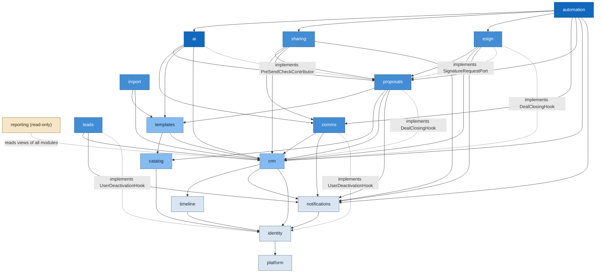

# Module Architecture — Internal Sales CRM (Phase 1)

| Item | Detail |
|---|---|
| Document | 02-hld/MODULE-ARCHITECTURE.md (backend modules inside the modular monolith) |
| Binding inputs | Design foundation §7 (module map), §11 A4, A6, A9, A12, §14–§16; WORKFLOWS (WF-01..WF-39, event catalogue); §13 ADR-021, ADR-022, ADR-024, ADR-025, ADR-028; DOMAIN-MODEL §2, §21, §22, §24; BUSINESS-RULES §13, §17; ROLE-PERMISSION-MATRIX §4, §7 |
| Companion documents | SYSTEM-ARCHITECTURE.md, COMPONENT-ARCHITECTURE.md, ARCHITECTURE-DECISIONS.md |
| Status | Draft for review |

Operation names below are the module's **public service API** (used by its own routes/handlers and by other modules). Each has a one-line contract. Exact signatures, DTOs and table columns are TLD material. Operations that change state run inside a unit of work and are listed with the cross-cutting writes they perform where relevant. No application code.

---

## 1. Module rules

### 1.1 Anatomy of a module (`apps/server/src/modules/<module>/`)
| Part | Visibility | Content |
|---|---|---|
| `index` (public API) | Exported to other modules | Service operations, port interfaces the module defines, public types (re-exported from `packages/shared` where they are wire contracts) |
| `service/` | Module-private | Use cases, state machines, guards |
| `repo/` | Module-private | Drizzle queries for the module’s own tables, scoped by construction from the Actor (ADR-076); scope predicates for its record types |
| `schema/` | Module-private (migrations global) | Drizzle table definitions for owned tables |
| `routes/` | Module-private | Hono route adapters per surface (`api`, `public`, `webhooks`, `addin`) |
| `jobs/` | Module-private | pg-boss handlers (thin adapters) and schedule definitions |
| `hooks/` | Module-private, registered at the composition root | Implementations of ports defined by other modules (ADR-055) |
| `erasure/`, `retention/`, `export/` | Registered with platform | Per-module privacy handlers (OD-36, NFR-015, BR-PLT-010) |

### 1.2 Dependency rules (enforced by dependency-cruiser in CI, ADR-021)
| # | Rule |
|---|---|
| D1 | A module may import only another module's `index`. Importing `service/`, `repo/`, `schema/`, `routes/`, `jobs/` of another module is a build failure. |
| D2 | Only a module's own `repo/` may reference its `schema/` tables. Cross-module joins are forbidden except in `reporting` (D7) and in scope predicates obtained through the registry. |
| D3 | Module imports must follow the allowed-direction graph in §2 (acyclic). Any new edge requires an ADR or an update of this document. |
| D4 | Upward needs (a lower module must trigger behaviour in a higher one) use ports defined by the lower module and implemented by the higher one, registered at the composition root (ADR-055), or event subscriptions (jobs). Never a direct import. |
| D5 | `service/` code must not import Hono, pg-boss, Better Auth or HTTP types; it receives a context `{actor, uow, clock, requestId}` (foundation A1). |
| D6 | `platform` imports no business module. `packages/*` import no `apps/*`. |
| D7 | `reporting` may read other modules' tables through read-only SQL views defined in `reporting/views`, using the `readonly`-compatible query path and mandatory `scopeFilter`; it never writes and is not imported by other modules. |
| D8 | Adapters live under `platform/adapters/<port>`; modules depend on the port interface, the composition root binds the driver. |

### 1.3 Unit-of-work convention (ADR-022, ADR-028)
Every state-changing operation follows the same shape:

| Step | Rule |
|---|---|
| 1 | Open (or join, if called by another module inside a transaction) one DB transaction via `uow.run`. A callee module never opens its own transaction when given one. |
| 2 | Load aggregates with the actor's scope predicate; take row locks where a business rule requires it (deal row `FOR UPDATE` for any proposal/signature transition, ADR-025). |
| 3 | `decide()` the permission; evaluate state-machine guards (BUSINESS-RULES §17); violations → typed errors (403/404 vs 409/422 per ROLE-PERMISSION-MATRIX §7 rule 1). |
| 4 | Apply changes with optimistic `row_version` checks. |
| 5 | Cross-cutting writes, all with the same `tx`: `timeline.record(tx, …)` for every BR-TIM event; `audit.record(tx, …)` for privileged/admin/system/AI actions (NFR-009); `events.record(tx, …)` for every catalogued domain event (writes `domain_event` history and fans out to subscribed job queues); `jobs.enqueue(tx, …)` for direct work (PDF render, provider calls); `notifications.notify(tx, …)` for user notifications. |
| 6 | Commit. Jobs and NOTIFY pokes become visible only on commit; rollback discards everything. |
| 7 | Provider calls are never made inside the transaction (no network I/O while holding locks); they are jobs, or performed before the transaction with the result applied idempotently afterwards. |

### 1.4 Ports defined for upward calls (ADR-055)
| Port | Defined by | Implemented by | Purpose |
|---|---|---|---|
| `ScopePredicateRegistry` | identity (policy) | crm, comms, proposals, sharing, esign, leads, ai, timeline, notifications | Each module contributes predicates for its record types; children reuse the root predicate (ROLE-PERMISSION-MATRIX §4.2) |
| `UserDeactivationHook` | identity | crm (reassignment execution), comms (stop sync, revoke tokens), leads (remove from pools), notifications (retarget pending) | Orchestrated deactivation (RULE-PLT-14) |
| `DealClosingHook` | crm | esign (void open request on close lost after confirmation, RULE-CRM-14), proposals (handle open proposals on close won/lost per spec) | Keep crm below proposals/esign |
| `SignatureRequestPort` | proposals | esign | `voidOpenForVersion`, `voidOpenForProposal`, `openRequestForDeal` inside the proposals transaction (OD-18, OD-21, OD-23) |
| `PreSendCheckContributor` | proposals | ai | LLM consistency findings for the version content hash (RULE-AIA-11); absent/disabled → "AI check not run" |
| `ErasureHandler`, `RetentionHandler`, `ExportContributor` | platform | every module with personal data or exportable data | OD-36, NFR-015, BR-PLT-010 |

---

## 2. Module dependency graph (allowed directions)

Arrows point from the depending module to the module it may call (`A --> B`: A imports B's public API). Dotted arrows are port implementations registered at the composition root (no static import from the port owner). The graph is acyclic.

Implicit edges not drawn to keep the diagram legible: every module may import `platform`, `identity` (actor/policy) and `timeline` (record) — they sit at the base. `reporting` depends on `identity` (policy/scope) and reads views; nothing depends on `reporting`.

### 2.1 Allowed-direction matrix (Y = may import)
| From \ To | platform | identity | timeline | notifications | crm | catalog | templates | proposals | comms | sharing | esign | leads | import | ai | automation | reporting |
|---|---|---|---|---|---|---|---|---|---|---|---|---|---|---|---|---|
| platform | – | | | | | | | | | | | | | | | |
| identity | Y | – | | | | | | | | | | | | | | |
| timeline | Y | Y | – | | | | | | | | | | | | | |
| notifications | Y | Y | | – | | | | | | | | | | | | |
| crm | Y | Y | Y | Y | – | | | | | | | | | | | |
| catalog | Y | Y | Y | | | – | | | | | | | | | | |
| templates | Y | Y | Y | | Y | Y | – | | | | | | | | | |
| proposals | Y | Y | Y | Y | Y | Y | Y | – | | | | | | | | |
| comms | Y | Y | Y | Y | Y | | | | – | | | | | | | |
| sharing | Y | Y | Y | Y | Y | | | Y | Y | – | | | | | | |
| esign | Y | Y | Y | Y | Y | | | Y | | | – | | | | | |
| leads | Y | Y | Y | Y | Y | | | | | | | – | | | | |
| import | Y | Y | Y | Y | Y | | Y | | | | | | – | | | |
| ai | Y | Y | Y | | Y | | Y | Y | Y | | | | | – | | |
| automation | Y | Y | Y | Y | Y | | | Y | Y | Y | Y | | | Y | – | |
| reporting | Y | Y | | | (views) | (views) | (views) | (views) | (views) | (views) | (views) | (views) | (views) | (views) | (views) | – |

---

## 3. State-machine ownership

| State machine (BUSINESS-RULES §17) | Owning module (only writer of the status column) | Other modules change it only via |
|---|---|---|
| SM-01 Deal (stage, status open/won/lost, reopen) | crm | `crm.changeStage`, `crm.closeWon`, `crm.closeLost`, `crm.reopen`, `crm.applyAutomationChange` (automation) |
| SM-02 Proposal status (Draft, Sent, Viewed, Accepted, Signed, Declined, Expired, Void) | **proposals** | `proposals.markVersionSent` (sharing), `proposals.recordBuyerView` / `recordBuyerResponse` (sharing), `proposals.applySignatureOutcome` (esign), `proposals.voidByAutomation` / `restoreFromAutomation` (automation), `proposals.expireDue` (own schedule) |
| SM-03 ProposalVersion state | proposals | same as SM-02 (one state-machine function updates proposal + version together) |
| SM-04 SignatureRequest, SM-05 Signer | esign (tables), but every transition that also changes proposal/version status is executed inside **one proposals state-machine call in one transaction holding the deal row lock** (foundation A9) | esign calls `proposals.applySignatureOutcome(tx, …)`; proposals calls `SignatureRequestPort` for voids within the same tx |
| SM-06 ShareLink | sharing | `sharing.revokeLink`, own expiry schedule; proposal Void/Expired is evaluated at access time (BUSINESS-RULES §18), not copied into link status |
| SM-07 Task | crm | `crm.createTask` / `completeTask` / `cancelTask` (automation creates/cancels via crm) |
| SM-08 Import batch | import | — |
| SM-09 Lead form submission | leads | — |
| SM-10 Mailbox connection | comms | identity deactivation hook calls `comms.disconnectForUser` |

Invariant enforcement below the application (ADR-025): partial unique index "one open signature request per deal"; trigger rejecting UPDATE of content columns of `proposal_version` in state sent/superseded/signed; check constraints on enum columns generated from `packages/shared`.

---

## 4. Module catalogue

Legend for "Events": events recorded by the module via `events.record` (names from the WORKFLOWS.md §0.3 domain event catalogue, authoritative per foundation §15; events not in that catalogue are marked proposed). "Subscribes": event-job subscriptions handled by the module (ADR-055). "Jobs": queues/schedules owned by the module (COMPONENT-ARCHITECTURE §4.2–4.3).

### 4.1 platform
| Aspect | Detail |
|---|---|
| Purpose | Technical foundation shared by all modules: audit log, files, job bus, domain event history, idempotency, rate-limit buckets, retention and erasure orchestration, full export, adapters, crypto, observability |
| BRD served | BR-PLT-009, BR-PLT-010, NFR-009, NFR-015, NFR-002 (erasure orchestration), BR-LED-006 (rate-limit buckets), ADR-016 idempotency |
| Owned tables | `audit_log`, `file_object`, `export_job`, `domain_event`, `idempotency_key`, `rate_limit_bucket`, `retention_policy`, `erasure_request` (+ pg-boss schema, managed by pg-boss) |
| Public API | `audit.record(tx, entry)` — append audit row with sequence number in the caller tx (hash chain sealed asynchronously by `audit.seal`, ADR-072); `audit.query(actor, filter)` — Admin-only search (PERM audit rows); `events.record(tx, envelope)` — write history row and fan out to subscribed queues; `jobs.enqueue(tx, queue, payload, opts)` — enqueue in-tx; `jobs.listFailed / replay(actor, jobId)` — Admin DLQ view and replay; `files.store(tx, purpose, stream, owner)` → FileObject with SHA-256 and validated MIME; `files.openForDownload(actor, fileId)` → stream or presigned URL per purpose; `idempotency.begin/complete(scope, key, requestHash)` — replay protection; `rateLimit.consume(key, policy)` → allowed / retryAfter; `retention.getPolicies / updatePolicy(actor, category, days)` — within platform limits (`RETENTION_OUT_OF_RANGE`); `erasure.request(actor, contactId, reason)` / `erasure.execute(requestId)` — orchestrates registered handlers, records summary (`ERASURE_EXEMPT` items listed); `export.requestFull(actor)` / `export.download(actor, jobId)` — BR-PLT-010 |
| Events | `export.completed`, `erasure.completed` |
| Jobs | `audit.seal` (ordered), `export.full`, `erasure.execute`, `audit.export`, `retention.sweep`, `purge.*`, `ops.queue-health` |
| Dependencies | none (adapters, Db, Crypto are inside platform) |
| Erasure | Audit log exempt (OD-36); stores reference ids instead of personal data where possible (ADR-026) |
| Notes | `domain_event` has no dispatch status (ADR-022; CF-02). Audit table: `app` role INSERT/SELECT only. |

### 4.2 identity
| Aspect | Detail |
|---|---|
| Purpose | Users, authentication integration, roles, teams, organization settings, invitations, onboarding checklist, the central policy (`decide`, `scopeFilter`, `redact`) |
| BRD served | BR-PLT-001 (Modified, IDD-01), BR-PLT-002 (invite only, IDD-02), BR-PLT-003..006, BR-PLT-008 (IDD-04), BR-PLT-011, BR-PLT-012, BR-AIA-008 switches storage (IDD-08), NFR-001 |
| Owned tables | Better Auth: `user`, `session`, `account`, `verification`, `two_factor`; app: `app_user_profile` (role — single source of truth, flags e.g. content-management, status), `team`, `team_member` (with start/end, DOMAIN-MODEL §24), `team_manager`, `organization_settings` (singleton: name, branding, currency, time zone, fiscal year, login methods, MFA policy, cross-visibility, AI switches), `invitation` |
| Public API | `bootstrapFirstAdmin(cli)` — one-time (`BOOTSTRAP_ALREADY_DONE`); `inviteUser(actor, email, role, teamId)` — sends invitation via transactional email; `acceptInvitation(token, credentials)` — creates user (implicit sign-up disabled); `changeRole(actor, userId, role)` — keeps ≥ 1 active Admin (`LAST_ADMIN`); `deactivateUser(actor, userId, reassignmentPlan)` — runs `UserDeactivationHook`s in one tx then revokes sessions/tokens; `reactivateUser`; `createTeam / renameTeam / setMembers / setManagers`; `getSettings / updateSettings(actor, patch)` — audited, emits `settings.updated`; `getActorContext(principal)` → Actor (cached, ADR-054); `getMyPermissions(actor)` → `/me/permissions` payload; `policy.decide(actor, permKey, resource, input)`; `policy.scopeFilter(actor, recordType, access)`; `policy.redact(actor, resource)`; `policy.registerScopePredicate(recordType, builder)`; `resolveAddinPrincipal(token)` — Google ID token / Outlook bearer → active user; `getChecklist(actor)` / `markChecklistItem` |
| Events | `user.invited`, `user.activated`, `user.role_changed`, `user.deactivated`, `team.updated`, `settings.updated` (all also NOTIFY cache invalidation, ADR-054) |
| Ports defined | `ScopePredicateRegistry`, `UserDeactivationHook` |
| Dependencies | platform |
| Erasure | Internal users are not erased through contact erasure; deactivated user profiles anonymised per retention schedule (OD-36, proposed) |

### 4.3 timeline
| Aspect | Detail |
|---|---|
| Purpose | Single chronological history for deals, companies and contacts with actor and automation labelling |
| BRD served | BR-TIM-001..004, BR-AUT-008 (labelling), OD-30 (private email rendering) |
| Owned tables | `timeline_event` (anchors, source, actor, occurredAt, eventType, summary, isAutomated, automationExecutionId, privacy) |
| Public API | `timeline.record(tx, entry)` — append (called by every module in its tx); `timeline.list(actor, anchorRef, {types, cursor})` — anchor must be readable; events filtered by source visibility through `ScopePredicateRegistry` (ROLE-PERMISSION-MATRIX §4.2); `timeline.reanchor(tx, sourceRef, anchors)` — on email link correction (projection update); `timeline.redactSource(tx, sourceRef)` — private/erased content |
| Events | none |
| Dependencies | identity (policy), platform |
| Erasure | Summaries never contain private email content; erased contacts' names replaced in summaries by handler |

### 4.4 notifications
| Aspect | Detail |
|---|---|
| Purpose | In-app and email notifications, preferences, daily digest; real-time poke |
| BRD served | BR-NTF-001..003 (BR-NTF-004 Deferred), BR-LED-003, BR-CRM-008 reminders, OD-47 |
| Owned tables | `notification` (recipient, eventType, subject ref, dedupeKey unique, readAt), `notification_preference`, `digest_run` |
| Public API | `notify(tx, {eventType, recipientUserIds, subjectRef, payload, dedupeKey})` — inserts rows respecting preferences, enqueues `notify.email`, NOTIFY poke after commit; `list(actor, sinceCursor)` — source of truth for clients (ADR-023); `markRead(actor, ids)`; `getPreferences / updatePreferences(actor, matrix)` |
| Events | `notification.created` (history only) |
| Jobs | `notify.email`, `notify.digest`; implements `UserDeactivationHook` (pending digests retargeted/cancelled) |
| Dependencies | identity, platform (TransactionalEmail adapter) |
| Notes | Recipient resolution ("current deal owner", RULE-SIG-22) is done by the producer, which passes user ids. Notifications never reads other modules' tables. |

### 4.5 crm
| Aspect | Detail |
|---|---|
| Purpose | System of record for companies, contacts, deals, pipelines, custom fields, stakeholders and roles, tasks, notes, logged calls/meetings, saved views, search, My Day, duplicate detection |
| BRD served | BR-CRM-001..014, BR-PRP-008 (links), BR-RPT-005 inputs (flags read), BR-MIG-003 / BR-LED-004 matching (OD-27, R3) |
| Owned tables | `company`, `contact`, `deal`, `deal_contact`, `deal_stage_history`, `pipeline`, `pipeline_stage`, `custom_field_definition` (values as JSONB on records), `lost_reason`, `contact_role`, `task`, `note`, `activity_log`, `saved_view`. (`exchange_rate` moved to catalog, foundation A12.) |
| Public API | Companies/contacts: `createCompany`, `updateCompany`, `archiveCompany` (`COMPANY_HAS_OPEN_DEALS`), `restoreCompany`, `reassignCompanyOwner`, same set for contacts; Deals: `createDeal` (company required, OD-33), `updateDeal` (rowVersion), `changeStage`, `closeWon(actor, dealId, {fromProposalId?})`, `closeLost(actor, dealId, lostReasonId, {confirmVoidSignature})` — runs `DealClosingHook`s (`CONFIRMATION_REQUIRED`), `reopen(actor, dealId, reason)`, `reassignDeal` / `bulkReassign` (scope checks, PERM-057/060), `applyAutomationChange(tx, dealId, expectedRowVersion, patch, executionId)` — compare-and-swap used by automation (skips on conflict); Stakeholders: `addDealContact`, `setContactRoles`, `removeDealContact`, `ensureStakeholder(tx, dealId, {email, name}, role)` — match by normalised email else create contact (OD-26, OD-27, R3) used by sharing; Configuration: `managePipeline`, `manageStages` (system won/lost stages protected), `defineCustomField` / `archiveCustomField`, `manageLostReasons`, `manageContactRoles`; Work items: `createTask`, `completeTask`, `cancelTask`, `reassignTask`, `addNote`, `logActivity`; Views and search: `list<Entity>(actor, filter, sort, cursor)`, `saveView`, `search(actor, q)` (FTS + `pg_trgm`, includes proposals via proposals search contributor read through registry), `findDuplicateCandidates(input)` (suggestions only, OD-27), `myDay(actor)`; Data for others: `getPlaceholderContext(actor, dealId)` → resolved company/contact/deal/owner/custom-field values; `touchActivity(tx, dealId, at, kind)` — maintains `last_activity_at` (RULE-AUT-31); `upsertFromLead(tx, mappedFields, owner)`; `importRecords(tx, chunk, policy)` |
| Events | `company.created/updated/archived/restored/owner_changed`, `contact.created/updated/archived/owner_changed`, `deal.created/updated/stage_changed/won/lost/reopened/owner_changed`, `deal.contact_added/contact_roles_changed/contact_removed`, `task.created/completed/cancelled/due/overdue`, `note.created`, `activity.logged` |
| Jobs | `task.reminder_due-scan` schedule |
| Ports defined | `DealClosingHook` |
| Implements | `UserDeactivationHook` (execute reassignment of open deals/tasks per plan); scope predicates for company/contact/deal/task/note/activity_log |
| Dependencies | identity, timeline, notifications, platform |
| Erasure | `anonymiseContact(tx, contactId)` — personal fields nulled/pseudonymised, deal and financial records kept (OD-36); notes mentioning the contact are flagged for manual review (proposed) |

### 4.6 catalog
| Aspect | Detail |
|---|---|
| Purpose | Products, tax categories, discount limits, exchange rates and price conversion |
| BRD served | BR-PRC-001, BR-PRC-005, BR-PRC-006 (rates, OD-15), BR-PRC-007 (limits, OD-39), R10 |
| Owned tables | `product`, `tax_category`, `discount_limit`, `exchange_rate` (moved from crm, A12) |
| Public API | `createProduct / updateProduct / archiveProduct`; `listProducts(actor, filter)`; `manageTaxCategories`; `setDiscountLimits(actor, role, {line, overall})`; `getDiscountLimit(role)`; `setExchangeRate(actor, from, to, rate, effectiveFrom)`; `convert(amount, from, to, at)` → amount + rate used (`FX_RATE_MISSING` per proposed OD); `productSnapshot(productId)` → immutable snapshot for a pricing line |
| Events | `product.updated`, `product.archived` |
| Dependencies | identity, timeline, platform |
| Erasure | none (no personal data) |

### 4.7 templates
| Aspect | Detail |
|---|---|
| Purpose | Proposal templates with versioning and locked sections, content-block library, placeholder catalogue, branding application |
| BRD served | BR-TPL-001..008 (TPL-007 as company starter content, IDD-11), BR-MIG-006 (DOCX starting point, with import), R8 |
| Owned tables | `proposal_template`, `template_version` (sections JSON, `schemaVersion`, state draft/published), `content_block` (+ revisions). Branding values live in `organization_settings` (identity); templates reads them via identity. |
| Public API | `createTemplate`, `createDraftVersion(templateId)`, `editDraftVersion(sections)` — validated against `packages/proposal` schema, `setSectionLock(actor, sectionId, locked)` — Admin only (R8), `publishVersion` — immutable afterwards, `archiveTemplate`; `getPublishedVersion(versionId)` — for pinning (BR-TPL-004); `placeholderCatalogue()` — standard + custom fields from crm definitions; `validatePlaceholders(versionId)` → unknown/archived placeholders (BR-TPL-008); `createContentBlock / reviseContentBlock / archiveContentBlock`; `getContentBlockRevision(id, rev)`; `createDraftFromDocx(tx, fileId)` — DOCX → sections (import uses it; Admin only) |
| Events | `template.published`, `template.archived`, `content_block.published` |
| Dependencies | crm (custom field definitions), catalog (default products in template pricing tables), identity, timeline, platform |
| Erasure | none |

### 4.8 import
| Aspect | Detail |
|---|---|
| Purpose | CSV/Excel import with mapping, validation report, duplicate handling, chunked commit and undo; DOCX template import; HubSpot/Pipedrive export mappers (R3, OD-09) |
| BRD served | BR-MIG-001, -003, -004, -005, -006; BR-MIG-002 (R3); BR-MIG-007 Deferred |
| Owned tables | `import_batch`, `import_row`, `import_record_link` |
| Public API | `createBatch(actor, fileId, entityType)`; `setMapping(actor, batchId, mapping)`; `validate(actor, batchId)` → enqueues `import.validate`, report (BR-MIG-004); `commit(actor, batchId, duplicatePolicy)` → enqueues `import.commit` (Idempotency-Key); `undo(actor, batchId)` → enqueues `import.undo` (records modified after import are left and reported, `UNDO_SKIPPED_MODIFIED`); `getReport(actor, batchId)`; `importDocxTemplate(actor, fileId)` → templates draft |
| Events | `import.batch_validated`, `import.batch_completed`, `import.batch_undone` |
| Jobs | `import.validate`, `import.commit`, `import.undo` (singleton per batch) |
| Dependencies | crm, templates, identity, timeline, notifications, platform |
| Erasure | `import_row` raw values purged by retention category `import_source`; erasure handler nulls raw row data for the subject |
| Notes | Imported records never trigger automations (RULE-AUT-07); import acts with the committing Admin's authority (ROLE-PERMISSION-MATRIX §5.1) |

### 4.9 comms
| Aspect | Detail |
|---|---|
| Purpose | Mailbox and calendar connection, delta sync, linking, privacy, exclusions, email templates, sending via the user's mailbox, open tracking, add-in context lookups |
| BRD served | BR-EML-001..004, BR-EML-006, BR-EML-007 (Should, OD-37), BR-EML-005 add-in (R3, OD-07), BR-SHR-002 via mailbox (R2), OD-28..30, OD-51, OD-52 |
| Owned tables | `mailbox_connection` (encrypted tokens, cursor, status), `email_thread`, `email_message` (sanitised body, participants VO, isPrivate), `email_link`, `email_exclusion`, `email_template`, `calendar_event`, `calendar_event_link`, `email_tracking` |
| Public API | `startMailboxConsent(actor)` / `completeMailboxConsent(actor, code)` — separate OAuth flow with offline access (ADR-027); `disconnectMailbox(actor)`; `getMailboxStatus(actor)`; `syncMailbox(mailboxId)` (job) — OD-29 filtering before persist, exclusions, linking (OD-28), meetings (BR-EML-006); `listEmailsForRecord(actor, recordRef, cursor)` — redacted per OD-30; `getEmail(actor, id)`; `markPrivate(actor, id)`; `correctLink(actor, emailId, targets)`; `manageExclusions(actor, scope personal\|org, entries)` — purges matching stored mail; `manageEmailTemplates(actor, …)` (personal/shared, OD-31); `sendEmail(actor, {to, subject, body, templateId?, placeholders, trackOpens?, relatedRecords})` → enqueues `mail.send` (Idempotency-Key); `recordOpen(pixelToken)`; `hasInboundFromSince(dealId, contactIds, since)` — for AUT-004 "answered"; `addinContext(actor, messageRef)` — matching records for add-in; `disconnectForUser(tx, userId)` |
| Events | `mailbox.connected/disconnected/sync_failed`, `email.stored/sent/linked/link_corrected/marked_private/opened`, `calendar.meeting_logged` |
| Jobs | `mail.sync` (singleton per mailbox), `mail.send`, schedule `mail.sync-dispatch` |
| Implements | `UserDeactivationHook` (stop sync, revoke tokens); scope predicates for email/calendar (mailbox owner OR linked record) |
| Dependencies | crm (match, link, touchActivity), identity, timeline, notifications, platform (MailProvider, CalendarProvider adapters) |
| Erasure | Purge stored messages/events whose only CRM link is the erased contact; anonymise participant address in others; retention `synced_email`, `calendar_event` |

### 4.10 leads
| Aspect | Detail |
|---|---|
| Purpose | Form builder, hosted form and iframe embed, public intake with spam protection, durable processing, deduplication, assignment, source capture, webhook intake |
| BRD served | BR-LED-001..006, BR-LED-007 (Could), DR-LED-03 (durable intake), R3, OD-46 |
| Owned tables | `lead_form` (versioned definition, public key, status), `lead_form_submission` (raw payload, spam verdict, status SM-09, outcome), `assignment_rule`, `assignment_state` (round-robin pointer) |
| Public API | `createForm / updateForm / publishForm / unpublishForm(actor, …)`; `getEmbedSnippet(actor, formId)` — iframe of the buyer-origin hosted page; `submit(formKey, payload, clientMeta)` (public) — validate, honeypot, rate limit, optional CAPTCHA, persist then enqueue (ADR-053); `submitViaWebhook(formKey, rawBody, signature)` (Could); `processSubmission(submissionId)` (job) — dedupe (OD-27), crm upsert, deal only if company resolvable (R3), assign by rule, notify assignee immediately (BR-LED-003); `manageAssignmentRules(actor, …)`; `listSubmissions(actor, filter)` |
| Events | `lead.submission_received`, `lead.assigned`, `lead.submission_processed (spam verdict)` |
| Jobs | `lead.submission.process` |
| Implements | `UserDeactivationHook` (remove from pools) |
| Dependencies | crm, identity, timeline, notifications, platform (Captcha adapter, rate limit) |
| Erasure | Anonymise submission payload of the subject; retention `lead_submission` |

### 4.11 proposals
| Aspect | Detail |
|---|---|
| Purpose | Proposal lifecycle and **owner of proposal and version status** (SM-02, SM-03): creation from template, editing within locks, pricing tables and totals, deterministic pre-send checks, version freeze, PDF/DOCX generation, comparison, validity expiry, void, copy |
| BRD served | BR-PRP-001..010, BR-PRC-002..004, BR-PRC-006 (proposal side), BR-PRC-007 warning, BR-TPL-008 at generation, BR-AIA-002 deterministic part (R4), OD-16..23, OD-43, OD-44 |
| Owned tables | `proposal`, `proposal_version` (sections, snapshot, totals, termMonths, contentSha256, pdfSha256, state), `pricing_table` and `pricing_line` (real rows for draft versions, frozen JSON snapshot on send, foundation A12), `generated_file` |
| Public API | `createProposal(actor, dealId, templateVersionId)` — pins template version, resolves placeholders (BR-PRP-001/002); `copyProposal(actor, proposalId, targetDealId)` (BR-PRP-010); `getProposal(actor, id)`; `editSection(actor, versionId, sectionId, doc, rowVersion)` — `SECTION_LOCKED`, `VERSION_IMMUTABLE`; pricing: `addLine / updateLine / removeLine / setOverallDiscount / setTerm` — totals via `packages/shared` money functions, discount warning (OD-39); `createNewVersion(actor, proposalId)` — re-resolves placeholders, diff shown (foundation §9); `discardDraftVersion`; `compareVersions(actor, a, b)` — section text + pricing diff (BR-PRP-006); `runPreSendChecks(actor, versionId)` — deterministic checks (always) + `PreSendCheckContributor` findings (RULE-AIA-11); `markVersionSent(tx, actor, versionId, {acknowledgedWarnings, channel})` — called by sharing: locks deal, blocks on blocking findings (`PRESEND_BLOCKING_FINDINGS`), freezes snapshot + SHA-256, supersedes prior sent version and voids its open request via `SignatureRequestPort` (OD-21), sets status Sent, enqueues `pdf`, records `proposal.version_sent`; `requestExport(actor, versionId, pdf\|docx)`; `preview(actor, versionId)` — HTML via shared renderer, never tracked (ADR-013); `voidProposal(actor, id, reason)` — terminal, voids open request via port (OD-18); `deleteDraftProposal`; `recordBuyerView(tx, versionId, firstCountedView)` — Sent → Viewed; `recordBuyerResponse(tx, versionId, accept\|decline, evidence)` — Accepted/Declined (OD-17, evidence captured, A9); `applySignatureOutcome(tx, signatureRequestId, outcome signed\|declined\|expired)` — single state-machine entry for signature-driven transitions (A9); `expireDue(now)` (schedule) — Expired + enqueue provider voids (OD-22a); `voidByAutomation(tx, proposalId, executionId)` / `restoreFromAutomation(tx, proposalId, priorStatus, executionId)` (OD-23/24); `getVersionSnapshot(versionId)` — for buyer view, signing and AI context; `getSignableVersion(tx, proposalId)` — current sent version for signing |
| Events | `proposal.created`, `proposal.version_created`, `proposal.version_sent`, `proposal.status_changed`, `proposal.viewed`, `proposal.accepted`, `proposal.declined`, `proposal.expired`, `proposal.voided`, `proposal.signed`, `proposal.discount_limit_exceeded` |
| Jobs | `pdf` (PDF and DOCX; executed by the `renderer` role, ADR-045), schedule `proposal.expiry-scan` |
| Ports defined | `SignatureRequestPort`, `PreSendCheckContributor` |
| Implements | `DealClosingHook` (spec-defined handling of open proposals on close); scope predicates (root = deal) |
| Dependencies | crm (deal lock, placeholder context, amount update prompt BR-PRC-004 via `crm.updateDeal`), templates, catalog, identity, timeline, notifications, platform (ObjectStorage, DocumentRenderer) |
| Erasure | Signed versions exempt (OD-36); unsigned draft snapshots containing the subject's personal data anonymised; sent unsigned versions retained as commercial records (Legal to confirm, OD-36) |

### 4.12 sharing
| Aspect | Detail |
|---|---|
| Purpose | Per-version, per-recipient share links, sending (copy link / mark shared manually in R1, via mailbox in R2), buyer access with token exchange, identity gate, email verification, tracking, downloads, accept/decline, revoke/expiry, access history |
| BRD served | BR-SHR-001..010, BR-NTF-001 triggers (open, reopen, forward, download), OD-21, OD-22, OD-26, R5 |
| Owned tables | `share_link` (token SHA-256 hash + encrypted token, status, expiry, requireEmailVerification), `recipient`, `viewer_identity`, `view_session`, `download_event`, `buyer_response`, `email_verification_challenge` |
| Public API (internal) | `sendVersion(actor, versionId, {recipients, channel copy_link\|mailbox\|manual, expiry, requireVerification, email?})` — one tx: `proposals.markVersionSent`, create links per recipient, `comms.sendEmail` enqueue when channel = mailbox (R2) (Idempotency-Key); `markSharedManually(actor, versionId)` — counts as sent (foundation §9); `copyLink(actor, linkId)` — decrypt stored token (R5, ADR-034); `revokeLink(actor, linkId, reason)`; `setLinkExpiry(actor, linkId, at)`; `accessHistory(actor, proposalId)` (BR-SHR-008, visible to deal readers, OD-31) |
| Public API (buyer, external actor) | `exchangeToken(token)` → buyer session cookie or refusal message (BUSINESS-RULES §18.2); `getViewModel(session)` — re-evaluates link, proposal status and three clocks on every call; `identifyViewer(session, name, email)` — `crm.ensureStakeholder` (OD-26), notification `proposal_forwarded_new_viewer`; `requestCode / verifyCode(session, email)` (BR-SHR-006, rate-limited); `heartbeat(session, viewSessionId, visibleSeconds)` — first counted view → `proposals.recordBuyerView`, notifications open/reopen, `crm.touchActivity`; `endView`; `download(session, format)` — server-mediated stream, `download_event`; `respond(session, accept\|decline, reason, evidence)` — `proposals.recordBuyerResponse` synchronously |
| Events | `share_link.created`, `proposal.view_counted`, `share.forwarded_viewer_identified`, `proposal.downloaded`, `share_link.revoked`, `share_link.expiring (proposed)`, `share_link.expired`, `share.viewer_verified` |
| Jobs | schedule `share.link-expiry-scan` |
| Dependencies | proposals, comms (send), crm (stakeholders, activity), identity, timeline, notifications, platform (Crypto, rate limits, files) |
| Erasure | Anonymise viewer identities and buyer responses (evidence for Accepted retained as commercial record — Legal, OD-36); truncate IPs in view sessions; retention `view_session` |

### 4.13 esign
| Aspect | Detail |
|---|---|
| Purpose | Signature requests on a specific sent version via the provider: signers and order, consent, reminders, void, webhook inbox, reconciliation, signed document and certificate storage, stale-version handling |
| BRD served | BR-SIG-001..013, NFR-004, OD-01..03, OD-19, OD-22c, OD-23, OD-25, OD-42 |
| Owned tables | `signature_request` (status SM-04, provider envelope id, documentSha256, expiresAt), `signer` (SM-05, order, snapshot name/email/phone), `signature_event` (append-only), `signed_document` (sealed PDF + certificate file refs, SHA-256), `esign_webhook_inbox` (provider event id unique, raw verified payload, processed status) — refinement of foundation §7, ADR-053 |
| Public API | `createRequest(actor, proposalId, {signers, order, expiry, reminders})` — locks deal, signers must be deal contacts (RULE-SIG), version must be current sent (`SIGNATURE_VERSION_NOT_ELIGIBLE`), one open per deal (`SIGNATURE_REQUEST_ALREADY_OPEN`, DB index), status Pending, enqueue `esign.dispatch`; `voidRequest(actor, id, reason)` — local Voided + enqueue provider void (RULE-SIG-17); `remind(actor, id, signerId?)`; `getRequest / listForDeal(actor, dealId)` — derived badge "Signing in progress (x of n)" (OD-19); `receiveWebhook(provider, rawBody, headers)` — verify, persist inbox, enqueue (server); `processWebhookEvent(inboxId)` (job) — authoritative re-read, forward-only transitions, `proposals.applySignatureOutcome` when valid, stale path otherwise (A9); `reconcileOpenRequests()` (hourly); `fetchSignedDocument(id)` (job) — verify hash, store immutably (ADR-036); `downloadSigned(actor, id)`; port implementations: `voidOpenForVersion(tx, …)`, `voidOpenForProposal(tx, …)`, `openRequestForDeal(tx, dealId)` |
| Events | `signature_request.created`, `signature_request.sent`, `signature.signer_viewed`, `signature.signer_signed`, `signature_request.completed`, `signature_request.declined`, `signature_request.expired`, `signature_request.voided`, `signature.reminder_sent`, `signature_request.completed_on_stale_version` (proposed, A9) |
| Jobs | `esign.dispatch`, `esign.void`, `esign.remind`, `esign.webhook.process`, `esign.fetch-signed`, schedule `esign.reconcile` |
| Implements | `SignatureRequestPort` (proposals), `DealClosingHook` (crm: void on close lost after confirmation, RULE-CRM-14) |
| Dependencies | proposals, crm (deal contacts, deal lock, flags via crm? no — stale flag via automation/crm API `crm.raiseFlag` is not available; see note), identity, timeline, notifications, platform (ESignatureProvider, ObjectStorage) |
| Erasure | Exempt: signed documents, certificates, signature events (RULE-SIG-23, OD-36) |
| Notes | The "Signed on stale version" deal flag is stored in automation's `deal_flag`. To keep the graph acyclic, esign records `signature_request.completed_on_stale_version`; automation subscribes and raises the flag and notification (eventual, seconds). |

### 4.14 ai
| Aspect | Detail |
|---|---|
| Purpose | AI drafting, consistency check, summaries, rewrite, follow-up drafts; context building within the requester's scope; usage logging and caps; prompt versioning; human-in-the-loop decisions |
| BRD served | BR-AIA-001..009, NFR-003, IDD-07, IDD-08, OD-05, OD-53, R4 |
| Owned tables | `ai_generation` (pending → accepted/rejected/edited, output text, target ref, requester), `ai_usage` (metadata only: feature, model, tokens, latency, user, record), `ai_check_result` (bound to version content hash), `prompt_version` |
| Public API | `draftProposalSections(actor, proposalId, sectionIds)` (BR-AIA-001); `runConsistencyCheck(actor, versionId)` (BR-AIA-002 LLM part) — structured findings, warnings only (RULE-AIA-11); `summarizeRecord(actor, recordRef)` (BR-AIA-003) — never served across users with different scope (A15); `rewriteText(actor, text, instruction)` (BR-AIA-004); `draftFollowUp(actor or system-on-behalf, proposalVersionId, taskId?)` (BR-AIA-005); `decideGeneration(actor, generationId, accept\|reject\|edit, editedText?)` — on accept applies via the target module service (e.g. `proposals.editSection` with `aiGenerationId`), labelled until accepted (BR-AIA-007); `getUsage(actor, filter)`; `checkBudget(actor, feature)` — per-user and org monthly token caps (OD-53); implements `PreSendCheckContributor` |
| Events | `ai.generation_created`, `ai.generation_accepted`, `ai.generation_rejected`, `ai.usage_limit_reached` |
| Jobs | `ai.generate` (pre-send LLM layer, AUT-004 drafts; worker). Interactive features stream from `server` (ADR-040); model routing ADR-041; output contracts without tool use ADR-042; budget ADR-043; eval harness ADR-044 |
| Dependencies | proposals (snapshots, apply accepted content), comms (thread content minus private, sanitised, hidden text stripped), templates, crm (record context), identity (switches, policy), platform (AiProvider) |
| Erasure | Delete/anonymise `ai_generation` outputs referencing the subject; `ai_usage` holds no content; retention `ai_usage` |
| Notes | AI never calls send, sign, stage-change or any external write (BR-AIA-006); prompts/outputs never logged (ADR-035) |

### 4.15 automation
| Aspect | Detail |
|---|---|
| Purpose | Built-in rules BR-AUT-001..006 plus OD-17 accept task and OD-23 sibling void, implemented in code with Admin settings; execution records with before/after snapshots; reversal; deal flags |
| BRD served | BR-AUT-001..006, BR-AUT-008, BR-CRM-009/BR-RPT-005 flags, OD-17, OD-23, OD-24, OD-35, OD-40 (BR-AUT-007 Could deferred) |
| Owned tables | `automation_setting` (per rule and per pipeline/stage parameters: AUT-001 target stage per pipeline, AUT-004 follow-up days, AUT-005 stalled days per stage, enabled flags) — replaces `automation_rule` (CF-01, ADR-024); `automation_execution` (rule key, trigger event id, idempotency key unique, status applied/skipped/failed/reversed, before/after snapshot, created records, parent execution for child voids); `deal_flag` (kind stalled \| past_close_date \| signed_on_stale_version, raised/cleared, dismissedUntil) |
| Public API | `getSettings / updateSettings(actor, ruleKey, params)` — Admin, audited, future triggers only (RULE-AUT-01); `listExecutions(actor, filter)` — Admin automation log; `reverseExecution(actor, executionId, {includeChildVoids})` — CAS on deal `row_version`, refuses stale (`AUTOMATION_REVERSAL_STALE`), single use (`AUTOMATION_ALREADY_REVERSED`) (RULE-AUT-06, A9); `dismissFlag(actor, dealId, kind)`; `listFlags(actor, scope)` — for My Day and RPT-005 |
| Subscribes (event jobs) | `proposal.version_sent` → AUT-001 (stage move) and schedule AUT-004 check (`startAfter`); `proposal.viewed`, `proposal.accepted`, `proposal.declined`, `email.stored` → AUT-004 cancellation/answered checks; `signature_request.completed` → AUT-002 (Closed Won, amount TCV, siblings void as child executions); `signature_request.completed_on_stale_version` → flag + owner notification; `proposal.declined` → AUT-003 task; `proposal.accepted` → "Confirm Closed Won" task (OD-17); activity events (`email.*`, `calendar.meeting_logged`, `note.created`, `activity.logged`, `task.completed`, `share.*`, `signature.signer_viewed`) → clear stalled flag; `deal.updated` (close date) → AUT-006 re-evaluation; `deal.closed_won/lost/reopened` → clear/re-evaluate flags |
| Jobs | `automation.aut004-check` (delayed), schedules `automation.aut005-stalled` (hourly), `automation.aut006-overdue` (daily) |
| Events | `automation.executed`, `automation.reversed`, `deal.flagged`, `deal.flag_cleared` |
| Dependencies | crm (`applyAutomationChange`, tasks), proposals (`voidByAutomation`, `restoreFromAutomation`), esign (request lookup), sharing (view state reads), comms (`hasInboundFromSince`), ai (`draftFollowUp` when enabled), identity, timeline, notifications, platform |
| Erasure | none beyond references (snapshots contain ids and amounts, not personal data) |
| Notes | Every handler: idempotency key unique (RULE-AUT-03), one tx locking the deal, guard re-check, `skipped_*` on conflict (RULE-AUT-04), timeline "Automated" entry + audit (RULE-AUT-05); imported records and internal previews never trigger (RULE-AUT-07) |

### 4.16 reporting
| Aspect | Detail |
|---|---|
| Purpose | Dashboards and reports over all modules; read-only |
| BRD served | BR-RPT-001..010, OD-15 (FX conversion), OD-35 (metric definitions) |
| Owned tables | none written. Owns read-only SQL views in `reporting/views` (e.g. `rpt_deal_facts`, `rpt_proposal_facts`, `rpt_activity_facts`); materialised views only if measured necessary (staleness ≤ 5 min shown "as of", RULE-RPT-12) |
| Public API | `pipelineDashboard(actor, filters)` (RPT-001, RPT-006 weighted); `wonLost(actor, filters)` (RPT-002); `repPerformance(actor, filters)` (RPT-003); `proposalMetrics(actor, filters)` (RPT-004); `dealsNeedingAttention(actor, filters)` (RPT-005, flags + unviewed proposals computed); `activity(actor, filters)` (RPT-010); `exportCsv(actor, reportKey, filters)` (RPT-009) |
| Events / jobs | none (optional materialised view refresh job if introduced) |
| Dependencies | identity (policy, team scope), scope predicates from the registry; reads views over crm, proposals, sharing, esign, comms, automation, catalog (`exchange_rate`) |
| Read exception (D7) | The only module allowed to read other modules' tables, and only through versioned views that (1) expose no private email content (OD-30: metadata counts only), (2) are always combined with `scopeFilter(actor, recordType, read)` (BR-RPT-008, ADR-026 "every report query passes scopeFilter"), (3) are covered by the permission test matrix. Views are part of the owning modules' migration review: a column change in an owned table that breaks a view fails CI. |

---

## 5. Cross-module flows (who calls whom)

| Flow | Sequence of module calls (single tx unless marked async) |
|---|---|
| Send version (R1 copy link) | sharing.sendVersion → proposals.markVersionSent (→ esign.voidOpenForVersion via port) → sharing creates links → timeline/audit/events; async: `pdf`, `esign.void`, automation AUT-001, AUT-004 delayed check |
| Send via mailbox (R2) | as above + comms.sendEmail enqueue `mail.send`; async: comms records `email.sent` |
| Buyer first view | sharing.heartbeat → proposals.recordBuyerView → notifications.notify → crm.touchActivity; async: automation cancels AUT-004 check, clears stalled flag |
| Forwarded viewer | sharing.identifyViewer → crm.ensureStakeholder → notifications.notify (forwarded) → timeline |
| Buyer accept | sharing.respond → proposals.recordBuyerResponse (Accepted, evidence) → notifications.notify; async: automation creates "Confirm Closed Won" task |
| Signature completed | esign.processWebhookEvent → proposals.applySignatureOutcome(signed) (deal locked) → notifications.notify; async: esign.fetch-signed, automation AUT-002 → crm.applyAutomationChange + proposals.voidByAutomation (siblings) |
| Stale completion | esign stores event + document → events `signature_request.completed_on_stale_version`; async: automation raises `deal_flag(signed_on_stale_version)` + notifies owner; no AUT-002 |
| Close lost with open request | crm.closeLost(confirmVoidSignature) → DealClosingHook: esign.voidOpenForDeal (local Voided) → async `esign.void` |
| Lead submission | leads.submit (persist) → async leads.processSubmission → crm.upsertFromLead → notifications.notify (assignee) |
| User deactivation | identity.deactivateUser → hooks: crm reassignment, comms disconnect, leads pools, notifications retarget → sessions revoked |
| Contact erasure | platform.erasure.execute → handlers: crm, comms, sharing, leads, ai, import, proposals (drafts), timeline (summaries) → `erasure.completed` |

---

## 6. Erasure, retention and export handlers (OD-36, NFR-015, BR-PLT-010)

| Module | Erasure handler (`anonymiseContact`) | Retention categories handled | Export contribution |
|---|---|---|---|
| crm | Anonymise contact personal fields; keep deals/financials; stakeholders keep pseudonymised label | — | companies, contacts, deals, stakeholders, tasks, notes, activity logs, pipelines, custom field definitions (CSV/JSON) |
| comms | Purge messages/events linked only to subject; anonymise addresses elsewhere | `synced_email`, `calendar_event` | email metadata (private: metadata only), calendar events, templates |
| leads | Anonymise submission payloads | `lead_submission` | forms, submissions |
| sharing | Anonymise viewer identities, truncate IPs; Accepted evidence retained (Legal) | `view_session` | links (no tokens), access history |
| proposals | Anonymise draft snapshots; signed versions exempt | — | proposals, versions, pricing, generated files archive |
| esign | Exempt (RULE-SIG-23) | — | requests, signers, events; signed PDFs and certificates in files archive |
| ai | Delete/anonymise outputs referencing subject | `ai_usage` (and `ai_generation` outputs) | usage metadata |
| import | Null raw row values | `import_source` | batch reports |
| timeline | Replace subject name in summaries | follows source categories | timeline events |
| platform | Audit exempt (references ids) | `audit_log` (min/max limits; exempt from erasure) | audit log (Admin) |
| identity, catalog, templates, notifications, automation, reporting | Not applicable / references only | notifications (proposed category) | users/teams/settings (no secrets), catalog, templates, automation log |

---

## 7. Refinements to foundation §7 recorded by this document
| Refinement | Module | Reason |
|---|---|---|
| `automation_rule` replaced by `automation_setting` | automation | ADR-024 (A6) |
| `deal_flag.kind` adds `signed_on_stale_version` | automation | ADR-025 (A9) |
| `esign_webhook_inbox` added | esign | ADR-025, ADR-053 |
| `exchange_rate` owned by catalog | catalog | A12 |
| `pricing_line` real rows for drafts + frozen JSON on send | proposals | A12 |
| Scope predicates contributed by each module via registry in identity | all | ADR-026, ADR-055 |
| Branding stored in `organization_settings` (identity), applied by templates/sharing | identity/templates | Foundation §7 "branding (in settings)" |
