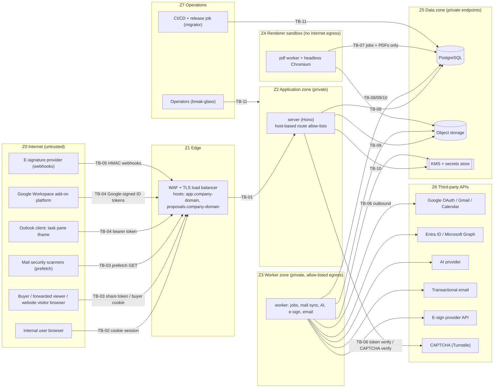
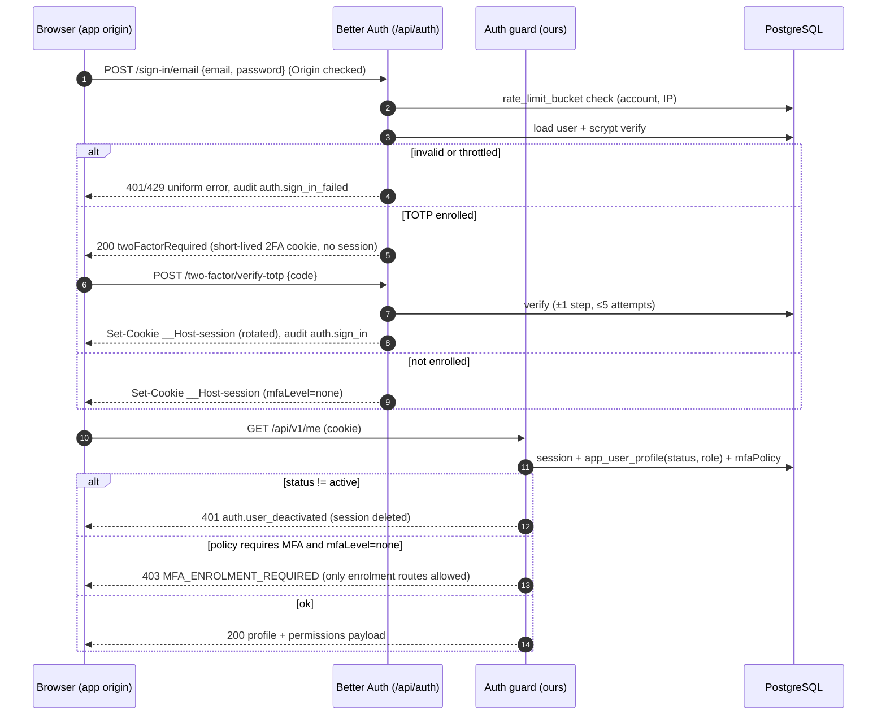
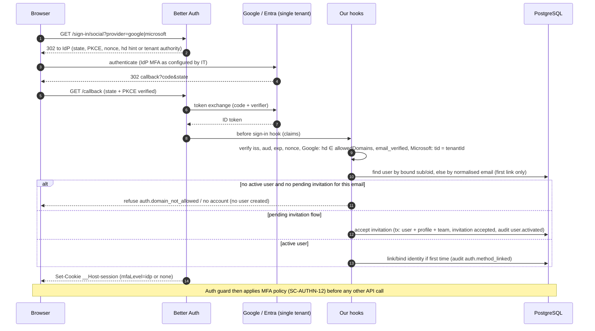
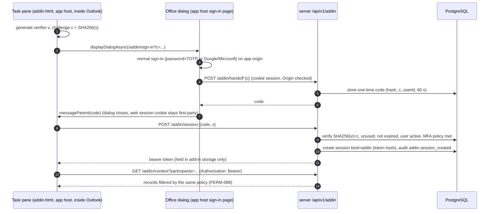
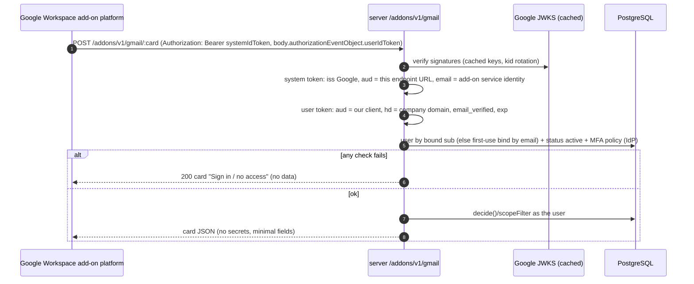
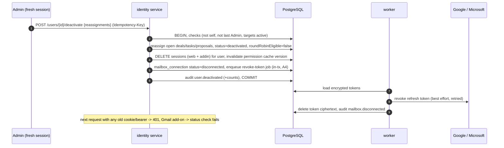
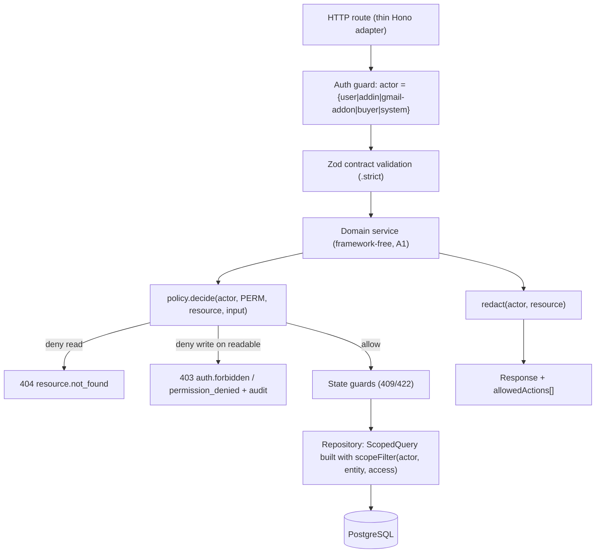
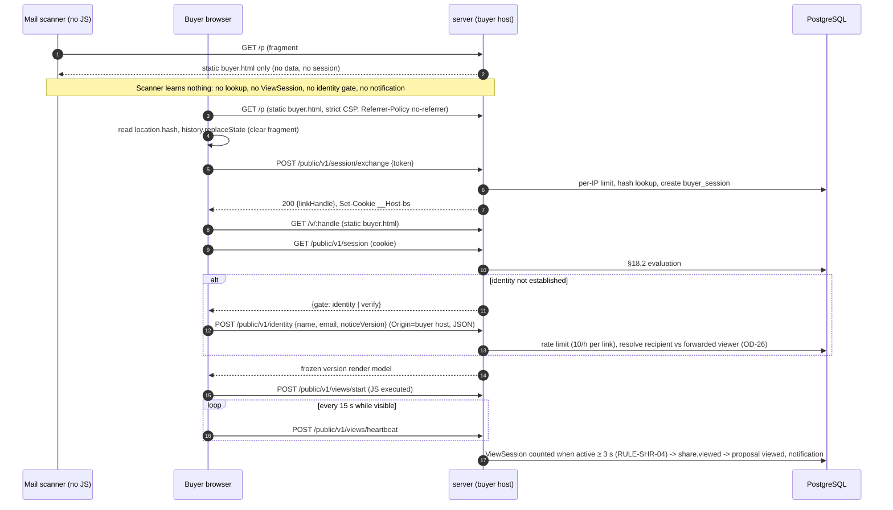
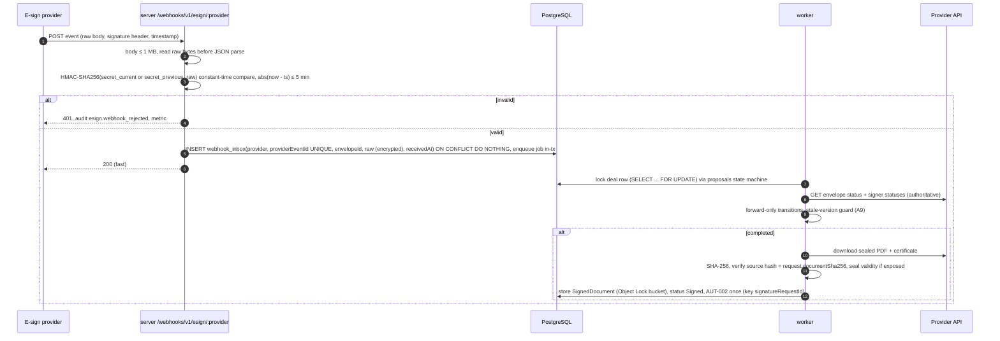

# Security Architecture — Internal Sales CRM (Phase 1, HLD)

| Item | Detail |
|---|---|
| Document | SECURITY-ARCHITECTURE.md (High-Level Design, security view) |
| Applies to | BRD v2.0 Phase 1, single-company single-tenant internal production deployment (IDD-01..IDD-16) |
| Binding inputs | Design foundation §6 (ADR-006, ADR-013, ADR-016, ADR-017), §8, §10, §11 (A9–A11, A14–A16), §12, §13 ADR numbering |
| Specifications used | ROLE-PERMISSION-MATRIX.md (authoritative permissions), DOMAIN-MODEL.md, OPEN-DECISIONS.md, BUSINESS-RULES.md, FUNCTIONAL-REQUIREMENTS.md (PLT, SHR, SIG, EML, AIA, NFR) |
| Status | Draft for review, v0.1, 17 Nov 2026 |
| Owner | Security Architect; reviewers: Tech Lead, IT/Security, DPO/Legal |

Conventions:
- BRD IDs, `OD-NN`, `IDD-NN`, `PERM-NNN`, `RULE-*`, `DR-*`, `ADR-NNN` are used exactly as defined in the foundation and specifications.
- This document introduces **security control IDs** `SC-<AREA>-NN` (areas: AUTHN, AUTHZ, BUY, HOOK, KEY, DATA, APP, AUD, AI, INF, MON). They are local to the HLD/TLD and are referenced by tests and the TLD.
- Threat IDs `TH-NN` and residual risk IDs `RR-NN` are local to this document.
- Anything that depends on an unresolved decision cites the `OD-NN`. Decisions proposed by this document are listed in §19 without numbers (the OD register owner numbers them). New ADRs proposed here start at **ADR-045** (foundation §13).
- No application code. Configuration sketches, TypeScript-like type sketches and pseudo-code are design specifications only.

---

## 1. Scope and security posture

### 1.1 What is protected
| Asset | Why it matters | Primary owner module |
|---|---|---|
| Customer (buyer-side) personal data: contacts, email bodies, meetings, view tracking, forwarded-viewer identities | GDPR-class personal data of third parties; NFR-002 | crm, comms, sharing |
| Commercial data: deals, pricing, proposals, discount warnings | Confidential business data; competitive harm if leaked | crm, proposals, catalog |
| Signed documents, completion certificates, signature evidence | Legal evidence (NFR-004); must be immutable and retained (OD-36) | esign |
| Credentials and secrets: passwords, sessions, add-in tokens, TOTP secrets, mailbox OAuth refresh tokens, share-link tokens, provider API keys, webhook secrets, KMS keys | Compromise yields account takeover or mailbox access for every connected user | identity, comms, sharing, platform |
| Employee mailbox content (sync) | Employee monitoring and third-party privacy risk (OD-52) | comms |
| Audit log | Accountability (NFR-009); contains personal data (foundation §9) | platform |
| Integrity of automated outcomes (Closed Won, deal amounts, stage moves) | Revenue reporting and legal state of contracts | automation, proposals, esign |

### 1.2 Posture principles (apply everywhere)
1. **Backend is the only enforcement point** (ADR-006). UI permission data is display-only.
2. **Default deny**: every route declares its permission or is explicitly public; every list/search/report query carries `scopeFilter` (A10).
3. **Separate origins for separate trust levels**: internal app origin, buyer origin (A2/ADR-020); add-ins use bearer tokens, never cookies (A11/ADR-027).
4. **Untrusted content never executes**: synced email, buyer input, proposal rich text, uploaded files, AI output are data — sanitised, schema-allowlisted, rendered in sandboxes (A10, A15).
5. **Secrets are encrypted with key ids and AAD** and never logged (A10/ADR-026).
6. **Least privilege below the application**: DB roles `app`/`migrator`/`readonly`, append-only audit, no-egress renderer (A10, A14).
7. **Evidence over trust for e-signature**: verified webhooks are hints; authoritative state is re-read from the provider (A9/ADR-025).
8. **Privacy by design**: minimise before persisting (OD-29, A16), redact on read (OD-30), anonymise on erasure (OD-36).

### 1.3 Out of scope for this document
Code-level secure coding standards and SAST rule authoring (AppSec/TLD), SOC operations runbooks, legal text of notices (§17 lists the tasks), Phase 2–3 features (IDD-13).

---

## 2. Security objectives and requirement mapping

| Objective | Requirement (verbatim intent) | Design response (controls) | Verification |
|---|---|---|---|
| O1 Confidentiality in transit and at rest | NFR-001 "Data encrypted in transit and at rest" | TLS 1.2+ (1.3 preferred) at edge and to every backend dependency; managed encryption at rest for Postgres, backups, object storage; application-level envelope encryption for secrets (SC-KEY-01..08, SC-DATA-01..04) | TLS scan; provider config evidence; encryption unit tests (NFR-001 acceptance) |
| O2 Data separation | NFR-001 "complete separation of each organization's data"; BR-PLT-001 (Modified, IDD-01) | Dedicated deployment, database and bucket; within-org separation by role + scope (SC-AUTHZ-*) | Deployment checklist; authorization matrix suite |
| O3 Role-based access | NFR-001 "role-based access"; BR-PLT-005; ROLE-PERMISSION-MATRIX | Central policy `decide()` + mandatory `scopeFilter` + redaction (SC-AUTHZ-01..12) | Route × role × scope test matrix 100% pass (NFR-001) |
| O4 Strong authentication | BR-PLT-003 individual credentials, password or Google/Microsoft; BR-PLT-004 MFA admins can require; NFR-001 "MFA available" | Better Auth, invite-only, domain/tenant claim checks, TOTP MFA policy enforced by our middleware, session controls, add-in tokens (SC-AUTHN-01..20) | Auth E2E suite; MFA enforcement tests |
| O5 Privacy compliance | NFR-002 GDPR, user control over synced email, deletion honoured; BR-EML-003 exclusions/private | Pre-persist filtering, exclusions purge, private-email redaction, retention and anonymising erasure, notices (SC-DATA-05..14) | NFR-002 acceptance tests; DPIA (§17) |
| O6 AI governance | NFR-003; BR-AIA-006 never send without user; BR-AIA-009 no training, separation | Server-side only, scoped per-request context, no AI write/send capability, labelled pending output, usage log without prompts, provider terms (SC-AI-01..12) | Tests prove no AI path reaches send endpoints; 100% calls in `ai_usage` |
| O7 E-signature integrity and evidence | NFR-004; BR-SIG-003..013 | Partner provider (OD-02), frozen version + SHA-256, DB immutability trigger, webhook inbox + authoritative re-read, sealed PDF + certificate stored immutably (SC-HOOK-01..10, SC-DATA-08) | NFR-004 E2E: seal validates; tamper breaks seal |
| O8 Auditability | NFR-009; BR-PLT-009 | Synchronous in-transaction audit, append-only grants, hash chain sealed and anchored externally (SC-AUD-01..09) | NFR-009 matrix: each listed action → exactly one entry; no API can modify |
| O9 Secure buyer access | BR-SHR-001 unique secure link; BR-SHR-006 email verification; BR-SHR-007 revoke/expiry | 256-bit tokens, hash + encrypted copy (ADR-034), token→cookie exchange, no-referrer, scanner-safe view counting, OTP, rate limits, strict CSP on separate origin (SC-BUY-01..22) | DAST on buyer origin; token tests |
| O10 Availability of security-relevant functions | NFR-006 99.5% (app and buyer links) | Edge WAF/rate limits, per-tier limits, graceful degradation of AI/provider outages (DR-AIA-03), DLQ alerting | Uptime monitor; load tests |
| O11 Recoverability without security regression | NFR-008, A14 | PITR, encrypted backups, restore drill incl. erasure replay and key availability (SC-DATA-15, SC-KEY-08) | Quarterly restore drill report |

Requirement-to-section index:

| Requirement | Sections |
|---|---|
| NFR-001 | 6, 7, 10, 11, 15, 16 |
| NFR-002 | 11, 17 |
| NFR-003 | 14 |
| NFR-004 | 9.1, 11.3 |
| NFR-009 | 13 |
| BR-PLT-003 | 6.2–6.6 |
| BR-PLT-004 | 6.4 |
| BR-PLT-009 | 13 |
| BR-SHR-001 | 8.2 |
| BR-SHR-006 | 8.5 |
| BR-SHR-007 | 8.2, 8.7 |
| BR-SIG-001..013 | 8.8, 9.1, 11.3 |
| BR-AIA-006, BR-AIA-009 | 14 |
| BR-EML-003 | 11.5 |

---

## 3. System context and trust boundaries

### 3.1 Trust zones and boundaries

| TB | Boundary | From (trust) | To (trust) | Authentication of the caller | Primary controls |
|---|---|---|---|---|---|
| TB-01 | Internet → edge → server | Untrusted | App zone | None at edge | TLS termination, WAF managed rules, per-IP rate limits, host allow-list, body size limits (SC-INF-03..06) |
| TB-02 | Internal user browser → internal app origin (`app.<domain>`): SPA + `/api/v1` + `/api/auth/*` | Authenticated employee | App | Better Auth session cookie (+TOTP per policy) | SC-AUTHN-*, SC-AUTHZ-*, CSRF Origin check, strict CSP |
| TB-03 | Buyer browsers / scanners → buyer origin (`proposals.<domain>`): `/p/*`, `/v/*`, `/public/v1/*`, `/f/*` (forms), `/t/*` (pixel) | Anonymous holder of a bearer token | App | Share token → buyer session cookie; identity gate; optional OTP | SC-BUY-* |
| TB-04 | Add-in contexts → `/api/v1/addin/*` (Outlook task pane), `/addons/v1/gmail/*` (Gmail add-on, server-to-server) | Authenticated employee via third-party host | App | Add-in bearer token; Google-signed system + user ID tokens | SC-AUTHN-14..17 |
| TB-05 | Third party → webhooks (`/webhooks/v1/esign/<provider>`; `/webhooks/v1/leads/<source>` if BR-LED-007 Could is built) | Provider | App | HMAC over raw body + timestamp; optional mTLS/IP allow-list | SC-HOOK-* |
| TB-06 | Server/worker → third-party APIs | App | Provider | OAuth tokens / API keys from secrets store | Egress allow-list, TLS verification, minimal scopes (A16), provider DPAs |
| TB-07 | Worker (untrusted proposal content) → renderer sandbox (Chromium) | Semi-trusted content | Sandbox | Job payload only | Offline rendering (A10), no egress, low privilege (SC-APP-10..14) |
| TB-08 | App/worker/renderer → PostgreSQL | App | Data | DB role credentials (IAM/managed identity where offered) | Roles `app`/`migrator`/`readonly`, TLS, private endpoint (SC-INF-08..12) |
| TB-09 | App/worker/renderer → object storage | App | Data | Workload identity | Private bucket, signed URLs, versioning + Object Lock for signed artefacts (ADR-036) |
| TB-10 | App/worker → KMS / secrets store | App | Key custody | Workload identity | Decrypt-only key policy, audit trail of key use (SC-KEY-*) |
| TB-11 | Operators / CI/CD → production | Privileged humans/pipelines | All zones | SSO + MFA, OIDC federation for pipelines | Separation of duties, migrator-only DDL, break-glass procedure (SC-INF-13..17) |
| TB-12 | Content trust boundary: synced email/calendar bodies, buyer free text, form submissions, uploaded files → storage, UI, AI prompts | Untrusted data | App/AI | n/a (data) | Sanitisation, sandboxed iframe, delimited prompts, schema allow-listing (SC-APP-*, SC-AI-*) |

### 3.2 Host and route allow-lists (SC-INF-05)
| Host | Allowed path prefixes | Everything else |
|---|---|---|
| `app.<domain>` | `/` (SPA `index.html` + assets), `/addin/*` (`addin.html` + assets), `/api/v1/*`, `/api/auth/*`, `/addons/v1/gmail/*`, `/webhooks/v1/*`, `/healthz` (internal-only via LB rule) | 404 |
| `proposals.<domain>` (`buyerLinkDomain`, OrganizationSettings) | `/p/*`, `/v/*`, `/public/v1/*`, `/f/*` (hosted lead form), `/t/*` (pixel, RULE-EML-12), buyer static assets | 404; internal cookies are never set or read on this host |

The same `server` process serves both hosts (A2) but mounts two **disjoint Hono sub-apps**; middleware stacks differ (session middleware is not mounted on the buyer sub-app). A request whose `Host` does not match a configured host is rejected (prevents host-header attacks and cache poisoning).

### 3.3 Data classification
| Class | Examples | Storage rule | Access rule | Logging rule |
|---|---|---|---|---|
| S — Secret | Passwords (hash), session and add-in tokens, TOTP secrets, recovery codes, mailbox OAuth tokens, share-link tokens, invitation/reset tokens, OTP codes, API keys, webhook secrets, DEKs | Hash (one-way) or envelope-encrypt with key id + AAD (§10); never in object storage exports | Code paths only; never returned by API except one-time display or audited reveal (ADR-034) | Never logged; redaction enforced (SC-APP-20) |
| R — Restricted personal | Email/meeting bodies, private-email content, IP addresses, user agents, view sessions, forwarded-viewer identities, signer evidence, audit log, AI generations, lead submissions, import source files | Encrypted at rest (platform); retention per category (OD-36) | Need-to-know; private content mailbox owner only (OD-30); audit Admin only (PERM-150) | Ids only in logs (ADR-017) |
| C — Confidential business | Companies, contacts (business fields), deals, proposals, pricing, templates, reports | Encrypted at rest (platform) | Role + scope (ROLE-PERMISSION-MATRIX) | Ids only |
| I — Internal | Pipeline config, settings (non-secret), catalog, branding | Platform encryption | All authenticated users read (PERM-014) | Allowed |
| P — Public by design | Buyer-visible frozen version for a valid token holder, hosted lead form, branding on buyer view | — | Token scope only | Allowed (no tokens) |

---

## 4. Threat model (STRIDE per boundary)

Risk = Likelihood × Impact on a High/Medium/Low scale before mitigation. "Residual" after the listed controls.

| TH | TB | STRIDE | Threat | Risk | Mitigations | Residual |
|---|---|---|---|---|---|---|
| TH-01 | TB-02 | S | Credential stuffing / password spraying against `/api/auth/sign-in` | High | Breached-password check and 12-char minimum (RULE-PLT-07, DR-PLT-05); per-account and per-IP throttling in Postgres buckets (A10); uniform error; MFA policy; Admin can disable passwords (OD-12) | Low |
| TH-02 | TB-02 | S | OAuth sign-in with an account from another Google domain / Entra tenant, or "nOAuth" (unverified/mutable email claim) | High | Single-tenant authority; server-side `hd`/`tid`/`iss`/`email_verified` checks; bind to immutable `sub`/`oid` at first link; invite-only, implicit sign-up disabled (A11, SC-AUTHN-05..07) | Low |
| TH-03 | TB-02 | S | Session theft (XSS, malware, DB read of session table) | High | HttpOnly `__Host-` cookie, strict CSP, sanitised content; idle/absolute timeouts (DR-PLT-08); revocation on deactivation/password change; `readonly` role cannot read auth tables | Medium (DB-level session token storage, RR-05) |
| TH-04 | TB-02 | T | CSRF on state-changing API | Medium | SameSite=Lax + Origin check on unsafe methods (ADR-016) + JSON-only content type (SC-APP-07) | Low |
| TH-05 | TB-02 | E | IDOR / broken object-level authorization (salesperson reads a colleague's deal, proposal, email) | High | `decide()` on every handler, `scopeFilter` on every list/search/report, 404 for out-of-scope reads, child inheritance (SC-AUTHZ-01..08) | Low–Medium (no RLS backstop, RR-03) |
| TH-06 | TB-02 | E | Function-level escalation (salesperson calls Admin endpoints; Manager without flag edits templates) | High | Capability grants per PERM; CI check that every OpenAPI operation declares `x-perm` (SC-AUTHZ-10) | Low |
| TH-07 | TB-02 | E | Mass assignment (set `ownerId`, `status`, `role`, `rowVersion` through generic update) | Medium | `.strict()` Zod command schemas; server-owned fields only through dedicated commands (SC-APP-02) | Low |
| TH-08 | TB-02 | I | Stored XSS via proposal rich text, notes, custom fields, email bodies, SVG logo | High | Schema-allowlisted ProseMirror serializer (no raw HTML node), React escaping, sanitised email bodies in sandboxed iframe, SVG sanitise/rasterise, CSP without `unsafe-inline` scripts (A10, SC-APP-04..06) | Low |
| TH-09 | TB-02 | R | User denies a destructive or privileged action (export, role change, erasure) | Medium | Synchronous audit in-tx with request id, IP, UA; hash chain + external anchor (SC-AUD-*) | Low |
| TH-10 | TB-02 | I | Data exfiltration by an authorised insider (export, CSV reports, bulk API) | Medium | Admin-only full export, audited, 24 h link, single concurrent job (RULE-PLT-20); report export audited; anomaly alerts on export/reveal (SC-MON-*) | Medium (RR-06) |
| TH-11 | TB-03 | I | Share-link token leakage via Referer, logs, browser history, analytics | High | `Referrer-Policy: no-referrer`; token → cookie exchange + 303 to clean URL; no third-party scripts; token redaction in app logs; fragment-carried token (ADR-071) (SC-BUY-03..07) | Medium (token lives in emails and edge logs, RR-01) |
| TH-12 | TB-03 | S | Token guessing / enumeration | Low | 256-bit tokens; uniform 404 for unknown/revoked; per-IP limits; alert on unknown-token rate (SC-BUY-05, SC-MON-04) | Very low |
| TH-13 | TB-03 | S | Forwarded link used by an unintended person to impersonate the recipient (accept/decline) | Medium | Identity gate; optional email OTP (BR-SHR-006); accept/decline only for recipient identity with can-accept flag; evidence captured (RULE-SHR-15); signing only through provider-verified identity (BR-SIG-004) | Medium when OTP off (RR-02) |
| TH-14 | TB-03 | T | Mail scanners prefetch links and trigger "first open", identity gate, or state changes | Medium | GET handlers side-effect free except an expiring buyer session row; views counted only after JS heartbeat; gate submitted by POST from JS (A10, DR-SHR-04) | Low |
| TH-15 | TB-03 | D | Flooding of identity gate, OTP sending (email bombing), forward feature (spam relay), lead forms | High | Postgres buckets per link/email/IP; OTP 5/h per email+link; forward 10/day per link (DR-SHR-07); honeypot + optional Turnstile (OD-46); WAF | Low–Medium |
| TH-16 | TB-03 | E | Buyer accesses another version, proposal or internal data via `/public/v1` | High | Every public request resolves the link → exactly one version; no internal ids accepted from client; responses limited to frozen snapshot + owner display name/email/branding (ROLE-PERMISSION-MATRIX §5.3); §18 precedence re-evaluated per request, no cached authorization | Low |
| TH-17 | TB-03 | I | Clickjacking of accept/decline | Low | `frame-ancestors 'none'` on proposal view | Very low |
| TH-18 | TB-04 | S | Forged Gmail add-on requests | High | Verify Google-signed system ID token (audience = our endpoint) and user ID token (`hd`, `email_verified`, active invited user) on every request (SC-AUTHN-16) | Low |
| TH-19 | TB-04 | S | Theft of add-in bearer token (stored in add-in storage) | Medium | Opaque token, hashed in DB, `kind=addin`, short lifetime with refresh, route allow-list, revoked on deactivation (SC-AUTHN-14, -15) | Medium |
| TH-20 | TB-05 | S/T | Forged or replayed e-sign webhook marks a deal Closed Won | High | HMAC over raw body, timestamp tolerance, dedupe on provider event id, authoritative re-read of envelope status from provider API before any transition, forward-only state machine (A9, SC-HOOK-*) | Low |
| TH-21 | TB-05 | D | Webhook floods / large payloads | Medium | WAF rate limit per path, 1 MB body cap, fast 2xx after persist, async processing | Low |
| TH-22 | TB-06 | I | Over-broad OAuth scopes expose whole mailbox; token theft from DB | High | Narrowest scopes (A16); login scopes separate from mailbox scopes (A10); envelope-encrypted tokens with AAD; no domain-wide delegation | Medium (gmail.readonly is still whole-mailbox read, RR-04) |
| TH-23 | TB-06 | I | AI provider retains or trains on our data | Medium | Commercial terms no-training + ZDR (OD-05); DPA; minimal context; no prompts in logs | Low–Medium (contractual) |
| TH-24 | TB-07 | E/I | Proposal content triggers SSRF, local file read or Chromium exploit during PDF render | High | Request interception denies all network except in-process asset handler; JS disabled; no `file://`; separate no-egress container; low privilege; timeouts; patched Chromium (A10, ADR-045 proposed) | Low–Medium (browser 0-day, RR-07) |
| TH-25 | TB-08 | T | SQL injection via filters, sort, search, saved views | High | Drizzle parameterisation; no `sql.raw` outside migrations; sort/filter fields mapped from allow-lists; structured filter AST validated by Zod (SC-APP-08) | Low |
| TH-26 | TB-08 | T/R | Tampering with audit log or signed-version content by app-level compromise | Medium | `app` role has INSERT/SELECT only on `audit_log`; immutability trigger on `proposal_version` (A9); hash chain + Object Lock anchors (SC-AUD-*) | Low |
| TH-27 | TB-09 | I | Public bucket / guessable object keys / long-lived URLs | Medium | Private bucket, random keys, server-mediated tracked downloads, signed URLs ≤ 5 min, versioning + Object Lock for signed artefacts (ADR-011, ADR-036) | Low |
| TH-28 | TB-10 | I | KMS/secret misuse by compromised workload | Medium | Decrypt-only permissions scoped to the key; separate identities for server, worker, renderer (renderer has no KMS access); key-use audit trail | Low–Medium |
| TH-29 | TB-11 | E | Supply-chain compromise (malicious npm package, CI token theft) | High | Lockfile + frozen installs, install scripts disabled by default with allow-list, SCA, provenance, pinned actions, OIDC federation, signed images (SC-APP-21..25, SC-INF-14) | Medium (RR-08) |
| TH-30 | TB-11 | E | Misuse of bootstrap CLI or break-glass Admin | Medium | CLI refuses when any Admin exists (RULE-PLT-02); break-glass credentials vaulted, MFA, use alerts (proposed OD) | Low |
| TH-31 | TB-12 | E | Prompt injection in synced email steers AI drafts or summaries (e.g. inserts a malicious link, wrong figures) | High | Delimited untrusted data, hidden-text stripping, no tools, output schema-allowlisted, unknown URLs flagged, pending-AI blocks send, deterministic checks authoritative (A15, DR-AIA-01) | Medium (RR-09) |
| TH-32 | TB-12 | I | AI context leaks data from records the requester cannot see or private emails | High | Context built per request through the same `scopeFilter`; private content excluded; no cross-user cache (IDD-07, A15) | Low |
| TH-33 | TB-12 | D | Zip bombs / decompression bombs / huge spreadsheets | Medium | Size, entry-count, ratio and pixel limits; processing in worker with timeouts (SC-APP-15..19) | Low |
| TH-34 | TB-02 | I | CSV/formula injection in exports opened in spreadsheet tools | Medium | Prefix `'` for cells starting with `= + - @ TAB CR` in all CSV outputs (RULE-RPT-11 extended to BR-PLT-010 export) | Low |
| TH-35 | TB-02/03 | I | Notification e-mails leak proposal content | Low | Notification emails carry title, deal name, viewer, deep link requiring sign-in only (RULE-NTF-11) | Very low |

---

## 5. Security-relevant architecture summary

| Concern | Decision | ADR |
|---|---|---|
| Identity | Better Auth (password, Google, Microsoft, TOTP two-factor, bearer for add-in); role and team in app tables; `app_user_profile.role` single source | ADR-006, ADR-027 |
| Authorization | Central policy module in `apps/server` + shared matrix in `packages/shared`; repository scoping; no Postgres RLS in Phase 1 | ADR-006, ADR-026 |
| Buyer access | Separate origin; 32-byte tokens; SHA-256 hash for lookup + envelope-encrypted copy | ADR-013, ADR-020, ADR-034 |
| Signing chain | Webhook inbox, authoritative re-read, forward-only, DB immutability, one open request index | ADR-025 |
| Hardening | Offline PDF, CSP, token hygiene, envelope encryption, rate-limit tiers, audit chain, DB roles, scopeFilter | ADR-026 |
| AI | Server-side adapter, per-request scoped context, deterministic checks authoritative, caps, no prompt logging | ADR-014, ADR-035 |
| Email | Polling with minimal scopes, pre-persist filtering | ADR-031 |
| Storage | Single driver, immutability for signed artefacts | ADR-036 |
| Operations | PITR, restore drills, migrator release job, mandatory observability | ADR-030 |

---

## 6. Authentication architecture

### 6.1 Components
| Component | Responsibility | Notes |
|---|---|---|
| Better Auth (mounted at `/api/auth/*` on the app host only) | Credentials (scrypt hashes), social sign-in, sessions, TOTP + backup codes, bearer plugin | Owns `user`, `session`, `account`, `verification`, `two_factor` tables (ADR-006). Admin plugin role **not used** (A11). |
| `identity` module | Invitations, `app_user_profile` (role, status, flags), teams, organization settings (login methods, allowed domains, MFA policy) | Single source for role/status |
| Auth guard middleware (ours) | Resolves session or bearer → actor; enforces user status, MFA policy, session kind/route allow-list, freshness for step-up | Runs on every `/api/v1/*` request |
| Add-in token exchange (ours, on top of bearer plugin) | Converts dialog hand-off code or Entra NAA token into an add-in session | §6.6 |
| Gmail add-on verifier (ours) | Verifies Google-signed tokens per request; maps to active user | §6.7 |

### 6.2 Controls catalogue (authentication)
| SC | Control | Source |
|---|---|---|
| SC-AUTHN-01 | Self sign-up disabled for every method (`emailAndPassword.disableSignUp`, social implicit sign-up disabled). A `user.create` before-hook rejects creation unless it runs inside a valid invitation acceptance or the bootstrap CLI. | IDD-02, A11, RULE-PLT-02/03 |
| SC-AUTHN-02 | Invitation token: 32 random bytes, single use, SHA-256 stored, expiry 7 days (DR-PLT-02), resend invalidates the previous token; acceptance requires the authenticated identity's normalised email = invited email (`invitation.email_mismatch`). | BR-PLT-002, DR-PLT-02 |
| SC-AUTHN-03 | Password policy 12–128 chars, not containing the email local part, breached-list check (k-anonymity range API or bundled list — TLD choice; no plaintext password leaves the server); no composition rules. | RULE-PLT-07, DR-PLT-05 |
| SC-AUTHN-04 | Sign-in throttling in Postgres buckets per account and per IP; uniform error and timing for unknown accounts; lockout notification email to the account owner. Parameters: see conflict C-04 (§19.1). | RULE-PLT-08, DR-PLT-05, A10 |
| SC-AUTHN-05 | Google sign-in: authorization request carries `hd=<domain>` as a hint only; the server accepts only ID tokens with `iss` ∈ {`https://accounts.google.com`, `accounts.google.com`}, `aud` = our client id, `email_verified=true`, `hd` ∈ `organizationSettings.loginMethods.allowedDomains`. | A11, OD-12 |
| SC-AUTHN-06 | Microsoft sign-in: single-tenant authority `https://login.microsoftonline.com/<tenantId>/v2.0`; accept only tokens with `tid` = configured tenant id and matching `iss`; identity bound to immutable `oid` (+`tid`); email taken from the directory (`email` or UPN) only at first link and must equal the invited email; thereafter matching is by `oid`, never by a mutable email claim. | A11, OD-12 |
| SC-AUTHN-07 | Account linking: a social identity may link to an existing user only if domain/tenant checks pass and the normalised email equals the user's email; linking events audited (`auth.method_linked`). Login OAuth requests only `openid email profile` and does **not** persist provider access/refresh tokens; if the library persists them, they are nulled or envelope-encrypted by a database hook (TLD verifies for the pinned Better Auth version). | A10, A11 |
| SC-AUTHN-08 | Session cookie: name with `__Host-` prefix, `Secure`, `HttpOnly`, `SameSite=Lax`, `Path=/`, no `Domain`; issued only on the app host. Session id rotated on sign-in, MFA completion, password change and role change. | ADR-016 |
| SC-AUTHN-09 | Session lifetime: idle 12 h, absolute 30 days (DR-PLT-08 WA) for non-Admins; **proposed** shorter Admin sessions (idle 2 h, absolute 7 days) — proposed OD (§19.2). Better Auth cookie cache disabled or ≤ 60 s so revocation and role changes apply within 60 s (RULE-PLT-10). | DR-PLT-08, RULE-PLT-10 |
| SC-AUTHN-10 | Step-up ("fresh session") required for: role change, MFA reset of another user, login-method/MFA policy change, full export, erasure, audit export, retention change, token reveal (ADR-034), mailbox connect. Fresh = signed in or TOTP-verified within 15 min. | Derived — pending confirmation |
| SC-AUTHN-11 | MFA: TOTP (RFC 6238, SHA-1/30 s/6 digits for authenticator compatibility, ±1 step), 10 single-use backup codes stored hashed/encrypted by the library; ≤ 5 failed codes per sign-in attempt; Admin MFA reset audited and requires step-up. | BR-PLT-004, OD-13 |
| SC-AUTHN-12 | MFA policy enforcement by our middleware (not only by the library): `mfaPolicy` ∈ {optional, required_admins, required_all}. If the actor's role requires MFA and the session has `mfaLevel < totp`, only the enrolment/verification endpoints are reachable (`MFA_ENROLMENT_REQUIRED` 403). Applies to password **and** OAuth sessions unless the Admin explicitly accepts IdP MFA for OAuth (see proposed OD in §19.2). | RULE-PLT-09, A11 |
| SC-AUTHN-13 | Password reset: single-use link, 60 min (DR-PLT-05), hashed token, revokes all sessions on success, notification email; responses identical for unknown emails. | DR-PLT-05, DR-PLT-08 |
| SC-AUTHN-14 | Add-in session: Better Auth bearer session with `kind=addin`, opaque 32-byte token (stored hashed — TLD verifies library behaviour, otherwise our own `addin_token` table), absolute lifetime 30 days, idle 7 days, accepted only in the `Authorization` header (never query string), only on `/api/v1/addin/*` and the shared read endpoints the add-in needs (route allow-list), cookies ignored on those routes. | A11, PERM-088, RULE-EML-14 |
| SC-AUTHN-15 | Revocation on deactivation, role change to a lower role, password change and "sign out other sessions": delete all `session` rows (web and add-in) in the same transaction as the status change; permission caches invalidated (ROLE-PERMISSION-MATRIX §7 rule 3); mailbox tokens revoked at provider by job (RULE-EML-03). | BR-PLT-011, DR-PLT-03, A11 |
| SC-AUTHN-16 | Gmail add-on: every request must carry (a) the Google-signed system ID token in `Authorization: Bearer` with `aud` = the exact endpoint URL configured in the deployment and `email` = the add-on's Google service identity, and (b) the user ID token from the event object with `aud` = our add-on OAuth client, `hd` = company domain, `email_verified`. Both verified against Google JWKS (`iss`, `exp`, signature). Maps by `sub` (bound at first use) to an active invited user; otherwise returns the sign-in-required card. No CRM session is created; the request is evaluated statelessly with the same policy module. | A11, OD-07 |
| SC-AUTHN-17 | Outlook add-in sign-in uses the Office dialog API to open our sign-in page on the app host (no third-party cookies inside the task pane), or Nested App Authentication when available for the company's clients (decision at TLD, OD-07). The session token never travels in a URL; hand-off uses a one-time code bound to a PKCE-style verifier (ADR-074 proposed). | A11 |
| SC-AUTHN-18 | Bootstrap CLI (DR-PLT-01) runs only with the `migrator`/release identity, refuses if any Admin exists, writes an audit entry with operator reason; it sends an invitation rather than setting a password. | IDD-02, RULE-PLT-02 |
| SC-AUTHN-19 | Client IP for throttling and audit is taken only from the load balancer's trusted forwarding header (right-most trusted hop); spoofed `X-Forwarded-For` from clients is ignored. | A10 |
| SC-AUTHN-20 | Auth events audited: `auth.sign_in`, `auth.sign_in_failed`, `auth.locked`, `auth.mfa_enrolled`, `auth.mfa_reset`, `auth.mfa_failed_threshold`, `auth.password_reset`, `auth.method_linked`, `auth.session_revoked`, `addin.session_created`. | BR-PLT-009, RULE-PLT-19 |

Login method administration (PERM-012): at least one method enabled (OrganizationSettings invariant); disabling password sign-in keeps the break-glass Admin path described by RULE-PLT-06 only if the proposed break-glass OD is accepted (§19.2).

### 6.3 Password sign-in with TOTP

### 6.4 Google / Microsoft sign-in (invite-only, claim verification)

### 6.5 Mailbox connection is a separate consent (A10, A16)
Login OAuth never requests mailbox scopes. Connecting a mailbox (PERM-074) is a distinct OAuth flow on `/api/v1/mailbox/connect/<provider>` with `offline_access`, narrow scopes (Gmail `gmail.readonly` + `gmail.send` + Calendar read-only; Graph `Mail.Read`, `Mail.Send`, `Calendars.Read`, `offline_access`), PKCE, state bound to the user session, step-up freshness (SC-AUTHN-10), employee privacy notice acknowledgement (DR-EML-05), and verification that the consented account address equals the user's email or an approved alias (RULE-EML-01). Tokens are envelope-encrypted with AAD = `userId|provider` (A10). Google domain-wide delegation and Graph application permissions are **not** used: no component can read a mailbox whose owner did not consent.

### 6.6 Outlook add-in (Office dialog hand-off)

With Nested App Authentication, steps 2–8 are replaced by an Entra access token for our API (audience = our app id URI, `tid` verified, `oid` mapped to the user) exchanged once at `/addin/session`; the CRM still issues its own add-in session so revocation stays under our control.

### 6.7 Gmail add-on request verification

### 6.8 Deactivation and session revocation

---

## 7. Authorization architecture

### 7.1 Model (consistent with ROLE-PERMISSION-MATRIX)
- Roles: `admin`, `sales_manager`, `salesperson` (BR-PLT-005); flags `canManageContent`, `canManageSharedEmailTemplates` (§9.17 "Optional", OD-31).
- Scopes: All, Team (TeamScope per ROLE-PERMISSION-MATRIX §2.2 **as amended by foundation R7**: members and co-managers of managed teams + own), Own, Own + view-only (OD-31), Assoc-R (ROLE-PERMISSION-MATRIX §4.4, foundation R6), Self.
- Read vs write scope per ROLE-PERMISSION-MATRIX §2.3; view-only never grants writes on children (§4.3).
- Visibility roots and inheritance per ROLE-PERMISSION-MATRIX §4.2 (proposal/share/signature → deal; task/note → related record; email → mailbox owner or any linked readable record; timeline event → source record).
- Field redaction after decision: private email/meeting subject/body/attachments for non-owners, including Admin (OD-30, PERM-080); secrets in settings never returned (PERM-014).
- Non-human actors per ROLE-PERMISSION-MATRIX §5: `system` components with fixed authority; `ai` always on behalf of the requesting user; external actors via token scope only.

### 7.2 Enforcement points

| SC | Control |
|---|---|
| SC-AUTHZ-01 | Every route handler calls `decide()` with a PERM key from the shared matrix before any side effect. Routes declare `x-perm` (or `x-public: buyer|webhook|gmail-addon`, `x-self`) in the OpenAPI document generated by `@hono/zod-openapi` (ADR-003). |
| SC-AUTHZ-02 | Repositories for scoped entities expose only functions that take a `ScopedQuery` produced by `scopeFilter(actor, entity, access)`; the type is branded so an unscoped query does not compile. Route handlers and other modules cannot import the Drizzle client (dependency-cruiser rule, ADR-021). |
| SC-AUTHZ-03 | `scopeFilter` is mandatory for every list, board, search (PERM-063), saved view (PERM-061/062 — views never widen scope), dashboard and report query (PERM-145..147), export of report data, SSE poke resolution, notification content rendering (PERM-142 "re-checked against recipient's read scope") and AI context building. Reporting SQL views take the actor's owner-id set as a bound parameter (no string building). |
| SC-AUTHZ-04 | Child records resolve their visibility root in SQL (join/EXISTS to the root predicate) — never post-filtered in memory (PERM-063 "applied in SQL, not post-filtered"). |
| SC-AUTHZ-05 | Timeline: each event is filtered by its **source** record's readability, not only by the anchor (PERM-148); private emails render as metadata (OD-30). |
| SC-AUTHZ-06 | Out-of-scope reads return 404; writes on readable-but-not-writable records return 403 `permission_denied`; business-state failures return 409/422 after `decide()` (ROLE-PERMISSION-MATRIX §7 rules 1–2). |
| SC-AUTHZ-07 | Input-referenced ids are authorised too: e.g. new owner ∈ TeamScope (PERM-057), recipient/signer is a deal contact (RULE-SHR-02, RULE-SIG-04), task assignee can read the record (PERM-066), linking an email requires write on the target and read on the email (PERM-081), dashboard filter values within scope (PERM-146 → 400). |
| SC-AUTHZ-08 | Bulk operations evaluate per record and report partial failures (PERM-059/060); max batch 500. |
| SC-AUTHZ-09 | Permission cache (TeamScope ids, flags, cross-visibility, AI switches) keyed by a `permission_version` counter; bumped in the same transaction as `user.role_changed`, `team.membership_changed`, `organization.settings_updated`, `user.deactivated`; per-instance cache TTL ≤ 60 s (RULE-PLT-10). |
| SC-AUTHZ-10 | CI gate: build fails if any OpenAPI operation lacks `x-perm`/`x-public`/`x-self`, or if a PERM key referenced in code is not in the shared matrix. |
| SC-AUTHZ-11 | `/api/v1/me/permissions` returns `{ role, flags, capabilities, scopes, teamScopeUserIds, crossVisibility, aiFeatures, permissionVersion }` (ROLE-PERMISSION-MATRIX §7 rule 4). It is display data; resources carry `allowedActions` computed by `decide()`. Clients refetch when the SSE stream sends `permissions.changed` (id-only payload, A5). |
| SC-AUTHZ-12 | Every write DENY and every privileged action marked "audit" in ROLE-PERMISSION-MATRIX is audited (§7 rule 5). Repeated denies by one actor (≥ 20 in 10 min) raise an alert (SC-MON-05). |
| SC-AUTHZ-13 | System actors: automation, scheduler, mail_sync, esign_webhook, lead_intake, import act only through service functions listed for them (ROLE-PERMISSION-MATRIX §5.1); the policy module refuses system actors on any user-facing PERM not in their catalogue. AI actor is rewritten to `onBehalfOf` and never reaches send/share/sign endpoints (BR-AIA-006). Send endpoints additionally assert `actor.type ∈ {user, addin}` (BR-AIA-006 validation). |

### 7.3 Why no Postgres RLS (ADR-006 trade-off) and compensating controls
RLS is not used in Phase 1 (ADR-006, ADR-019). The residual risk is that a single missing predicate exposes data across salespeople (RR-03). Compensations: SC-AUTHZ-02 (type-level enforcement), SC-AUTHZ-03/04 (SQL scoping incl. reporting), SC-AUTHZ-10 (CI gate), §7.4 test matrix, `readonly` role restricted to non-secret views, and periodic access-log review. RLS remains a Phase 2 option: scope predicates are already expressed as SQL so they can be lifted into policies.

### 7.4 Authorization test matrix (NFR-001 "every API route × role × scope")
Fixture organization (seeded per test run):
| Actor | Role | Team facts |
|---|---|---|
| A1 | admin | — |
| M1 | sales_manager | manages T1; member of T1 |
| M2 | sales_manager | co-manager of T1 (not a member) — validates foundation R7 |
| M3 | sales_manager, `canManageContent` | manages T2 |
| S1 | salesperson | member T1 |
| S2 | salesperson | member T2 |
| S3 | salesperson | no team |
| D1 | deactivated salesperson | historical member T1, owns records |
| X | external buyer (token) | recipient on S1's proposal |

Records: for each owner in {A1, M1, M2, S1, S2, S3, D1} one company, contact, deal with proposal (draft + sent version), share link, signature request, task, note, linked email (one private, mailbox owner S1), AI generation.

Generation rule: for each OpenAPI operation × actor × record owner, the expected outcome is computed from the shared `PERMISSIONS` grants (not hand-written) and asserted: status (200/201, 403, 404, 409), absence of out-of-scope ids in lists/search/reports/exports, `allowedActions` equality, redaction of private email content (Admin included), Assoc-R reads allowed but writes denied, cross-visibility toggles per object type (on/off), flags on/off for M3, deactivated actor → 401, add-in bearer on non-allow-listed route → 403, buyer token on `/api/v1` → 401. Additional targeted suites: TeamScope after membership change takes effect ≤ 60 s; system actors outside catalogue denied; AI context builder returns only readable record ids; notification bodies re-checked against recipient scope. Pass criterion: 100% (NFR-001).

---

## 8. Buyer-surface security

### 8.1 Origin isolation (ADR-020)
| SC | Control |
|---|---|
| SC-BUY-01 | Buyer surface served only on `proposals.<domain>` (separate registrable subdomain from the app host; app cookies are host-only `__Host-` so they are never sent to the buyer host). No internal session middleware is mounted on buyer routes; buyer endpoints never accept internal cookies or bearer tokens as authority (RULE-PLT-23). |
| SC-BUY-02 | Buyer bundle is a separate Vite entry (`buyer.html`), minimal dependencies, no internal API client, no third-party scripts, analytics or fonts from CDNs (BR-SHR-009 "no third-party trackers"). |

### 8.2 Token lifecycle (ADR-013, ADR-034)
| SC | Control |
|---|---|
| SC-BUY-03 | Token = 32 bytes from a CSPRNG, base64url (43 chars). Stored as `token_hash = SHA-256(token)` (unique index, lookup) **and** `token_ciphertext` = envelope-encrypted token (purpose `share_token`, AAD = `share_link|<shareLinkId>`), so authorised users can copy the existing link again (ADR-034, foundation R5). Conflicting text in PERM-118, DOMAIN-MODEL §12.2 and RULE-SHR-01 is superseded (C-01, §19.1). |
| SC-BUY-04 | Revealing a stored token (copy link) requires PERM-118 (edit scope on the deal), step-up freshness (SC-AUTHN-10), is rate-limited (20/h per user) and audited `share_link.token_revealed`. The plaintext is returned once in the response body with `Cache-Control: no-store`; never in logs or notifications. |
| SC-BUY-05 | **Binding (ADR-071, architect decision after review):** URL form `https://proposals.<domain>/p#<token>` — the token is carried only in the URL **fragment**, which browsers never send to servers, edge logs or mail-scanner GETs. `GET /p` serves the static buyer bundle (no data). The bundle reads `location.hash`, immediately replaces it via `history.replaceState`, and calls `POST /public/v1/session/exchange {token}` (per-IP limit; hash lookup; unknown/revoked → uniform 404 problem with no proposal data, RULE-SHR-19, §18.2 row 1). On success the server creates a `buyer_session` (random 32-byte id, stored hashed, bound to `shareLinkId`, 30-day expiry per RULE-SHR-06), sets `__Host-bs=<id>; Secure; HttpOnly; SameSite=Lax; Path=/` and returns `{linkHandle}`; the bundle navigates to `/v/<linkHandle>`. `linkHandle` is a non-secret random 128-bit public id that grants nothing without the cookie. |
| SC-BUY-06 | All buyer responses: `Referrer-Policy: no-referrer`, `Cache-Control: no-store`, `X-Robots-Tag: noindex, nofollow`; the token is never echoed into HTML, JS state or API responses after exchange. |
| SC-BUY-07 | Token redaction: application logs record `/p/[REDACTED]`; error tracking scrubs path segments after `/p/`; edge (WAF/LB) access logs are classified Secret-bearing with restricted access and ≤ 30-day retention, or `/p/*` path logging is disabled where the platform allows — with ADR-071 the token is in the URL fragment and never reaches these logs; redaction remains as defence in depth. |
| SC-BUY-08 | Every public request re-resolves `buyer_session → shareLink → version → proposal → deal` and evaluates BUSINESS-RULES §18.2 precedence (revoked, void, validity, link expiry, identity, superseded, signed, accepted/declined, deal closed, action-specific). No authorization is cached in the cookie (ROLE-PERMISSION-MATRIX §5.3). |
| SC-BUY-09 | Responses expose only the frozen version snapshot, owner display name/email, branding, status banners and the viewer's own identity; no internal ids except opaque handles; no other recipients' identities; superseded banner never reveals the newer version (BR-SHR-001, RULE-SHR-17). |
| SC-BUY-10 | Revocation (PERM-119) and expiry (PERM-120) take effect on the next request (no cache). Revoking a link deletes its buyer sessions. |

### 8.3 Buyer link open, scanner prefetch and view counting

| SC | Control |
|---|---|
| SC-BUY-11 | `GET` and `HEAD` handlers on the buyer host are free of business side effects; `buyer_session` creation is the only write, rate-limited and expiring (unused sessions purged after 24 h). Known scanner user agents get the same response but sessions are flagged and never counted (DR-SHR-04). |
| SC-BUY-12 | Views count only after `views/start` + heartbeats from executed JS; sessions < 3 s are stored but not counted (RULE-SHR-04); internal viewers (internal user email or internal domain) recorded as internal and never notify (RULE-SHR-05). Heartbeat rate-limited in memory per instance (A10). |

### 8.4 Identity gate (BR-SHR-005, OD-26)
| SC | Control |
|---|---|
| SC-BUY-13 | Gate submitted by `POST` with JSON from the buyer page; shows the Legal-approved notice (DR-SHR-05) and records `privacyNoticeVersionAccepted`. Rate limit 10 identity submissions per link per hour (BR-SHR-005) and per IP. Inputs validated by Zod (name 1–200, email RFC + length). |
| SC-BUY-14 | Forwarded viewers: view + download only; never accept/decline/sign (OD-26). Contact creation through the crm service with fill-empty-only semantics and owner = deal owner (RULE-SHR-07). Identity claims without OTP are **unverified**: the access history and notifications label them "unverified identity" (proposed; mitigates RR-02 spoofed names). Whether original recipients must pass the gate in every new browser is conflict C-03 (§19.1); the design supports both via a per-org setting. |

### 8.5 Email verification OTP (BR-SHR-006)
| SC | Control |
|---|---|
| SC-BUY-15 | 6-digit code from CSPRNG; stored as HMAC-SHA256(pepper, challengeId‖code); 10-min expiry; max 5 attempts per code; max 5 codes per email+link per hour (RULE-SHR-08) and 20 per IP per hour; constant-time compare; sent via transactional email (OD-14) from the authenticated notification subdomain (NFR-013); the email contains the code only (no link token); masked address shown (`j***@example.com`). |
| SC-BUY-16 | Successful verification binds `emailVerifiedAt` to the `buyer_session` and the ViewerIdentity; the verified state is per link and per browser (30 days). For forwarded viewers verification applies to the email they entered (BR-SHR-005). |

### 8.6 Rate limits (three tiers, A10)
| Surface | Key | Limit (WA) | Tier / store | Source |
|---|---|---|---|---|
| Edge, app host | IP | 1,000 req / 5 min (tunable) | WAF | A10 |
| Edge, buyer host | IP | 300 req / min | WAF | RULE-SHR-19 |
| Buyer per token/session | token / session | 60 req / min | In-memory per instance | RULE-SHR-19, A10 |
| Unknown token lookups | IP | 30 / 10 min → temporary block + alert | WAF rule + in-memory counter | SC-MON-04 |
| Password sign-in | account; IP | See C-04 (RULE-PLT-08 vs DR-PLT-05) | Postgres bucket | A10 |
| Password reset request | email; IP | 3 / h per email; 20 / h per IP | Postgres | DR-PLT-05 |
| TOTP verification | sign-in attempt | 5 failures → restart | Postgres | BR-PLT-004 |
| Invitation accept / add-in hand-off | IP | 10 / h | Postgres | Derived |
| Identity gate | link; IP | 10 / h per link | Postgres | BR-SHR-005 |
| OTP send / verify | email+link; IP; code | 5 / h; 20 / h; 5 attempts | Postgres | RULE-SHR-08 |
| Accept / decline | link | 5 / h (first response wins) | Postgres | RULE-SHR-15 |
| Buyer forward (DR-SHR-07) | link; IP | 10 / day per link; 20 / day per IP | Postgres | DR-SHR-07 |
| Lead form submit | IP+form | 10 / 10 min | Postgres | RULE-LED-04 |
| Tracking pixel | token | 60 / h | In-memory | RULE-EML-12 |
| Webhooks | path | 600 / min; 1 MB body | WAF | §9 |
| Authenticated API | user | 600 / min | In-memory | Derived |
| Token reveal | user | 20 / h | Postgres | SC-BUY-04 |
| Signature resend | signer | 1 / h | Postgres | RULE-SIG-11 |
| AI calls | user, org | Budgets / caps (OD-53, DR-AIA-02) | Postgres | A15 |

### 8.7 Buyer actions, downloads and forward
| SC | Control |
|---|---|
| SC-BUY-17 | Accept/decline: POST JSON, Origin = buyer host, buyer session cookie, identity = original recipient with can-accept, version current, §18.2 rows 1–10; one response per version (DB unique); evidence per RULE-SHR-15 (typed name, checkbox, UTC time, IP, UA, email, version id, PDF SHA-256, terms text shown). |
| SC-BUY-18 | Downloads: server-mediated `GET /public/v1/download` → audit/track → 302 to an object-storage signed URL valid ≤ 5 min with `Content-Disposition: attachment` (or streamed). Frozen PDF only; sealed PDF after Signed (RULE-SHR-18). Hash re-verified on read for signed artefacts (SC-DATA-08). |
| SC-BUY-19 | Buyer forward (DR-SHR-07): sends from the transactional domain a fixed-template email naming the forwarder; recipient address validated; no free-text body (prevents spam/phishing relay); limits per §8.6; creates a general link per forward (model gap C-07). |
| SC-BUY-20 | "Review and sign": the buyer page never mints a provider signing session on the basis of link possession alone. It either directs signers to the provider's emailed link or requests an embedded signing URL only for the signer identity after provider-side email OTP (BR-SIG-004). Signing URLs are single use and not logged. |

### 8.8 Content Security Policy and headers per entry (SC-BUY-21 buyer; SC-APP-06 app)
| Entry / response | Policy (WA; TLD validates against the built bundles) |
|---|---|
| Internal app `index.html` (`app` host) | `default-src 'none'; script-src 'self'; style-src 'self'; img-src 'self' data: blob:; font-src 'self'; connect-src 'self'; frame-src 'self'; manifest-src 'self'; worker-src 'self'; base-uri 'none'; form-action 'self'; frame-ancestors 'none'; object-src 'none'; upgrade-insecure-requests; report-to csp` + `require-trusted-types-for 'script'` in report-only first (TipTap compatibility to verify). No inline scripts (Vite output). If a dependency sets style attributes in markup, add `style-src-attr 'unsafe-inline'` only. |
| Synced email body render endpoint `/api/v1/emails/{id}/body` (loaded into `<iframe sandbox>` without `allow-scripts`/`allow-same-origin`) | `default-src 'none'; style-src 'unsafe-inline'; img-src data: cid:; sandbox; frame-ancestors 'self'` — remote images blocked by default (A10); sanitised server-side before storage (A16). |
| Add-in `addin.html` (`app` host, `/addin/*`) | `default-src 'none'; script-src 'self' https://appsforoffice.microsoft.com; style-src 'self'; img-src 'self' data:; connect-src 'self'; frame-ancestors https://outlook.office.com https://outlook.office365.com https://outlook.live.com https://*.officeapps.live.com (exact list confirmed at TLD); base-uri 'none'; form-action 'self'` |
| Buyer proposal view `buyer.html` (`/v/*`) | `default-src 'none'; script-src 'self'; style-src 'self'; img-src 'self' data:; font-src 'self'; connect-src 'self'; base-uri 'none'; form-action 'self'; frame-ancestors 'none'; object-src 'none'` (+ `frame-src <provider>` only if embedded signing is chosen, OD-03) |
| Hosted lead form `/f/<publicKey>` | As buyer, but `frame-ancestors <LeadForm.allowedOrigins>` per form (iframe embed only, ADR-020; conflict C-06), and `script-src 'self' https://challenges.cloudflare.com; frame-src https://challenges.cloudflare.com` only when CAPTCHA is enabled (OD-46). |
| JSON APIs (both hosts) | `Content-Security-Policy: default-src 'none'; frame-ancestors 'none'`, `Content-Type: application/json; charset=utf-8` |
| All responses | `Strict-Transport-Security: max-age=63072000; includeSubDomains` (preload after domain review); `X-Content-Type-Options: nosniff`; `Cross-Origin-Opener-Policy: same-origin` (add-in pages: `same-origin-allow-popups` if the Office dialog requires it); `Cross-Origin-Resource-Policy: same-origin`; `Permissions-Policy: camera=(), microphone=(), geolocation=(), payment=(), usb=()`; `Referrer-Policy: strict-origin-when-cross-origin` (app) / `no-referrer` (buyer); `X-Frame-Options: DENY` except add-in and lead form. |
| CSP reporting | `Reporting-Endpoints: csp="/api/v1/csp-report"` (rate-limited, body ≤ 8 KB, stored aggregated) — SC-MON-09. |

SC-BUY-22: Tracking pixel `/t/<token>` (RULE-EML-12) returns a 1×1 image with `Cache-Control: no-store`, records an approximate open (pixel token hashed), never sets cookies, never counts as buyer activity (RULE-EML-12).

---

## 9. Webhook and inbound integration security

### 9.1 E-signature webhooks (ADR-025)

| SC | Control |
|---|---|
| SC-HOOK-01 | Signature verification over the **raw** request body with the provider's scheme (HMAC or provider certificate); constant-time comparison; reject without processing on failure (BR-SIG-007 "rejected (401) and security-logged"). |
| SC-HOOK-02 | Replay protection: timestamp tolerance where the provider signs it; dedupe by `(provider, providerEventId)` unique; idempotent processing keyed by `signatureRequestId` for completion (DR-SIG-03, OD-24). |
| SC-HOOK-03 | Webhook payload is a hint: the worker re-reads authoritative status from the provider API before any transition (A9). A forged-but-signed or out-of-order event cannot move state backwards (RULE-SIG-14). |
| SC-HOOK-04 | Defense in depth where the provider supports it: mTLS client certificate or published source IP ranges enforced at WAF; provider "include documents in webhook" options disabled (minimise PII in transit). |
| SC-HOOK-05 | Dual-secret rotation window (current + previous) with audited rotation; secret stored in the secrets store, never in DB plaintext. |
| SC-HOOK-06 | Webhook routes bypass session/CSRF middleware but have their own WAF rule set, body cap and per-path rate limit; they return no internal data. |
| SC-HOOK-07 | Stale/voided/expired request completions are stored (legal record) but never trigger AUT-002; deal flagged "Signed on stale version" (A9). |
| SC-HOOK-08 | Reconciliation job polls open requests (cadence conflict C-05, §19.1) and repairs missed events using the same forward-only path. |
| SC-HOOK-09 | Webhook inbox raw bodies are Restricted data (signer PII): envelope-encrypted, retained per OD-36 with signature evidence (RULE-SIG-23). |
| SC-HOOK-10 | Provider API credentials (OAuth JWT grant or API key) scoped to the company account, least privilege (send, void, read status/documents), stored in secrets store, rotated per §10.4. |

### 9.2 Other inbound surfaces
| Surface | Controls |
|---|---|
| Lead form submit `/public/v1/forms/<publicKey>/submit` | Published-only; Zod validation, payload ≤ 64 KB, unknown fields ignored (RULE-LED-03); honeypot, per-IP rate limit, optional server-side Turnstile verification (OD-46; fail mode is a proposed OD); stored first then processed asynchronously (RULE-LED-05); fill-empty-only on matched records (RULE-LED-06) so anonymous visitors cannot overwrite CRM data; IP stored as keyed hash (`ipHash`). |
| Lead webhook intake (BR-LED-007, Could) | Per-source secret, HMAC-SHA256 over raw body + timestamp header, 5-min tolerance (RULE-LED-13); same pipeline as forms. |
| Mail/calendar provider push | Not used in Phase 1 (polling, A16/ADR-031) — no inbound mail webhook surface. |
| Gmail add-on | §6.7 |

---

## 10. Secrets and key management

### 10.1 Inventory and custody (foundation §10)
| Secret | Custody | Consumer identities | Rotation |
|---|---|---|---|
| KMS key-encryption key (KEK) `crm-kek-<env>` | Cloud KMS (AWS KMS CMK or Azure Key Vault key, OD-11), non-exportable | server, worker (decrypt/unwrap only); renderer none | Provider automatic yearly; manual on incident |
| Data-encryption keys (DEKs) per purpose | Wrapped by KEK, stored in `encryption_key` table | server, worker (in memory after unwrap) | Every 12 months or on incident (§10.4) |
| Better Auth secret (cookie signing, library-level encryption) | Secrets store | server | Planned rotation with dual-secret support if available; otherwise forced re-login window (TLD) |
| HMAC peppers (OTP codes, IP hashing, pixel tokens) | Secrets store | server, worker | Yearly; versioned (`pepperId` stored with hash) |
| Google OAuth client secret(s); Workspace add-on config; Entra app credential (prefer certificate/federated credential over client secret) | Secrets store | server, worker | Per IT policy (≤ 12 months); Entra federated credential preferred |
| AI provider API key | Secrets store | worker, server (if synchronous calls) | 90 days |
| E-sign provider credentials + webhook secret(s) | Secrets store | worker; server (webhook verify) | 12 months; dual-secret window |
| Transactional email API key / SMTP credentials; DKIM private key (held by provider) | Secrets store / provider | worker | 12 months |
| CAPTCHA secret key (PERM-091 "write-only") | Envelope-encrypted DB column (purpose `integration_secret`) or secrets store | server | On Admin change |
| PostgreSQL credentials (`app`, `migrator`, `readonly`) | Secrets store; prefer IAM/managed-identity auth | server/worker (`app`), release job (`migrator`), reporting/support (`readonly`) | 90 days or token-based |
| Object storage access | Workload identity (no static keys); MinIO keys only in local dev | server, worker, renderer (scoped prefixes) | n/a |
| TLS certificates (app, buyer, notification domains) | Managed certificate service at the LB | edge | Automatic |

Rules (SC-KEY-01): no secret in source, images, environment files committed to git, CI logs or client bundles; containers receive secrets at runtime from the secrets store via workload identity; `.env` only in local dev with dev-only values.

### 10.2 Envelope encryption design (A10, ADR-026; ADR-073 proposed)
| SC | Control |
|---|---|
| SC-KEY-02 | Algorithm AES-256-GCM via the platform crypto library (Node `crypto`), 96-bit random nonce per encryption, 128-bit tag. No custom crypto. |
| SC-KEY-03 | Ciphertext envelope stored as text: `enc:v1:<keyId>:<nonce_b64>:<ciphertext+tag_b64>`; `keyId` identifies the DEK (and thus purpose and generation). |
| SC-KEY-04 | AAD binds ciphertext to its context so a ciphertext copied to another row fails: mailbox tokens `oauth|<userId>|<provider>` (A10); share token `share_link|<shareLinkId>`; integration secrets `integration|<settingKey>`; webhook inbox `webhook|<inboxId>`; Better Auth account tokens (if persisted) `auth_account|<accountId>`. |
| SC-KEY-05 | DEKs: one active DEK per purpose (`oauth_token`, `share_token`, `integration_secret`, `webhook_payload`, `auth_secret_material`), generated via KMS GenerateDataKey/wrapKey, stored wrapped with status `active | decrypt_only | retired`. Unwrapped at process start into memory only; never logged or serialised; process memory is the trust anchor (containers non-root, no core dumps). |
| SC-KEY-06 | Purpose separation: a DEK for one purpose cannot decrypt another purpose's ciphertext (AAD + keyId purpose check). |
| SC-KEY-07 | KMS key policy: unwrap/decrypt allowed only to the server and worker workload identities; GenerateDataKey/rotation only to the release/ops identity; renderer has no KMS permissions; KMS usage logs retained and alerted for unexpected principals. |
| SC-KEY-08 | Backups contain only wrapped DEKs; restore requires KMS access in the target environment (restore drill verifies key availability, A14). KEK deletion is protected by the provider's scheduled-deletion window and requires two-person approval. |

### 10.3 Key placement per hosting option (OD-11)
| Function | AWS (WA option) | Azure (WA option) | Local dev |
|---|---|---|---|
| KEK | KMS customer-managed key, automatic rotation | Key Vault key (RSA-HSM or software per tier) with wrap/unwrap, rotation policy | File-based dev key (dev-only, never shared) |
| Secrets | Secrets Manager | Key Vault secrets | `.env.local` (git-ignored) |
| Workload identity | ECS task role / EKS IRSA | Managed identity | n/a |
| DB auth | RDS IAM auth or Secrets Manager rotation | Entra ID auth for PostgreSQL Flexible Server | Docker Compose password |
| Audit of key use | CloudTrail | Key Vault diagnostics → Log Analytics | n/a |

### 10.4 Rotation procedure (DEK)
1. Release identity creates a new DEK for the purpose → status `active`; previous → `decrypt_only`.
2. Processes reload keyring (startup or signal; ≤ 10 min).
3. Background job re-encrypts rows still using the old `keyId` (batch, idempotent, audited count).
4. When no ciphertext references the old key, mark `retired`; keep the wrapped key for backup-restore horizon (≥ backup retention), then destroy.
Incident rotation additionally revokes the exposed external credentials (e.g. forces mailbox reconnect if OAuth refresh tokens are suspected leaked).

---

## 11. Data protection

### 11.1 In transit
| SC | Control |
|---|---|
| SC-DATA-01 | Edge: TLS 1.2 minimum, TLS 1.3 preferred, modern AEAD cipher suites only, HSTS; HTTP → HTTPS redirect only on the app host (buyer links are always `https`). |
| SC-DATA-02 | Internal hops: LB → server over TLS (or within a private network with platform encryption, per OD-11 capability); server/worker → Postgres with `sslmode=verify-full`; → object storage, KMS, providers over TLS with certificate verification (no `rejectUnauthorized=false`). |

### 11.2 At rest
| SC | Control |
|---|---|
| SC-DATA-03 | Managed encryption at rest for PostgreSQL, its backups/snapshots/PITR logs, object storage (SSE with KMS key), and log storage. Evidence collected for NFR-001 acceptance. |
| SC-DATA-04 | Field-level protection (in addition to SC-DATA-03): |

| Data | Protection | Reason |
|---|---|---|
| Passwords | scrypt (Better Auth) | One-way |
| Session / add-in tokens | Library storage (TLD verifies hashing; if plaintext, see RR-05 compensations) | Bearer secrets |
| Invitation, password-reset, add-in hand-off codes | SHA-256 hash | One-way, high entropy |
| Buyer OTP codes | HMAC-SHA256 with pepper | Low entropy |
| TOTP secrets, backup codes | Library encryption (Better Auth secret) — wrap with our envelope via hook if the library permits (TLD) | Needed in plaintext for verification |
| Mailbox OAuth access/refresh tokens | Envelope AES-256-GCM, AAD `userId|provider` | A10, RULE-EML-02 |
| Login OAuth tokens (Better Auth `account`) | Not persisted, or envelope-encrypted | A10 |
| Share-link token copy | Envelope, AAD `shareLinkId` + SHA-256 lookup hash | ADR-034 |
| Pixel tokens, buyer session ids | SHA-256 | Lookup only |
| Integration secrets set in UI (CAPTCHA, lead webhook) | Envelope | PERM-091 |
| Webhook inbox raw payloads | Envelope | Signer PII |
| IP addresses in lead submissions | Keyed hash (`ipHash`) | Minimisation |
| Email bodies, notes, proposals | Not field-encrypted (platform encryption + access control) | Full-text search and rendering need plaintext; documented trade-off |

### 11.3 Integrity of legal artefacts (NFR-004, BR-SIG-009..011)
| SC | Control |
|---|---|
| SC-DATA-08 | Sent version: canonical snapshot JSON SHA-256 and PDF SHA-256 stored; DB trigger rejects UPDATE of content columns once state ∈ (sent, superseded, signed) (A9); PDF sent to provider must match the frozen hash; signed PDF + certificate stored in an Object Lock (compliance or governance mode, retention per OD-36) + versioned bucket/prefix (ADR-036); hash re-verified on download; signed artefacts exempt from erasure (OD-36). |

### 11.4 Data classification handling in exports and backups
| SC | Control |
|---|---|
| SC-DATA-09 | Full export (BR-PLT-010): Admin only, step-up, background job, private email bodies excluded (OD-30), CSV formula-injection guard on every CSV, ZIP stored encrypted in a private prefix, signed URL 24 h for the requester only, deleted after 7 days (DR-PLT-06), `export.requested` / `export.downloaded` audited and alerted (SC-MON-03). Secrets (tokens, hashes, ciphertexts, TOTP data) are never exported. |
| SC-DATA-10 | Report CSV export (PERM-147): same scope as dashboards, formula guard (RULE-RPT-11), audited. |

### 11.5 Privacy controls for email and calendar sync (BR-EML-001..007, A16, OD-29/30)
| SC | Control |
|---|---|
| SC-DATA-05 | Per-user consent flow with employee notice acknowledgement and version (DR-EML-05); no domain-wide delegation; mailbox must belong to the user (RULE-EML-01). Obligation to connect is OD-52. |
| SC-DATA-06 | Filtering **before persisting**: store only messages with a non-internal participant matching a non-archived contact, or in an already-linked thread (OD-29, RULE-EML-05); internal-only mail never stored; unknown-sender messages discarded keeping only a hash of the message id (DR-EML-01); attachments metadata only (A16). Backfill window per OD-51 (DR-EML-06 default 90 days, Admin cap). |
| SC-DATA-07 | Exclusions (user and organization lists) applied before persisting; adding an exclusion purges matching stored messages and timeline entries (DR-EML-04, RULE-EML-06). |
| SC-DATA-11 | Private email (OD-30): metadata only to non-owners (Admin included); excluded from AI context, search, report content and export bodies; enforced in `redact()` and in SQL projections (bodies not selected for non-owners). |
| SC-DATA-12 | Bodies sanitised server-side at ingestion (allow-list HTML sanitizer, hidden text stripped for AI, remote resources rewritten to blocked placeholders); displayed only in the sandboxed iframe (§8.8). |
| SC-DATA-13 | Open tracking off by default; org enablement + per-email opt-in (OD-37); approximate opens only; never used for automation (RULE-EML-12). |

### 11.6 Retention and erasure (NFR-015, NFR-002, OD-36)
| SC | Control |
|---|---|
| SC-DATA-14 | `retention_policy` per category within platform min/max (synced email, calendar, view sessions, lead submissions, AI generations, AI usage, import source files (30 days, DR-MIG-01), exports (7 days), webhook inbox, buyer sessions, CSP reports, application logs). Nightly retention job deletes or anonymises; audit-logged counts. IP addresses in view sessions truncated after 90 days (RULE-SHR-04; conflict C-08). |
| SC-DATA-15 | Governed erasure (PERM-018, NFR-002 30-day target): two-step Admin confirmation + step-up; per-module anonymise handlers (A12) blank personal fields of the contact across crm, comms (bodies of messages where the person is a participant, subject to OD-36), sharing (viewer identities, IPs), leads (submission payloads), ai (generations referencing the contact), notifications; financial records kept; **exempt**: signed documents, completion certificates, signature evidence, audit log (OD-36, RULE-PLT-21). An `erasure_request` ledger (ids only) is replayed after any backup restore so erased data does not reappear (restore drill step, A14). Backups age out within their retention (≥ 30 days, NFR-008) — disclosed in the privacy notice. |
| SC-DATA-16 | Legal hold (proposed OD): ability to suspend retention/erasure for records under dispute. |

---

## 12. Application security controls

### 12.1 Input validation and output encoding
| SC | Control |
|---|---|
| SC-APP-01 | Every request body, query and path param validated by Zod v4 contracts from `packages/shared` (ADR-003) at the route boundary; limits per DR-PLT-10 (lengths, numeric ranges, email/URL rules: `http/https` only, ≤ 2,048 chars); rich text ≤ 50,000 chars plain-text equivalent; global body limit 1 MB except upload routes. Validation errors as RFC 9457 problem details without echoing raw input. |
| SC-APP-02 | Command schemas are `.strict()` (unknown keys rejected); server-owned fields (`id`, `ownerId` outside reassignment commands, `status`, derived totals, `createdBy`, `rowVersion` except as concurrency token, `amountSource`, `isAutomated`) are never accepted from clients (mass-assignment guard). |
| SC-APP-03 | Proposal and template content validated server-side against the section + ProseMirror schema (A13): node/mark allow-list, attribute allow-list (e.g. link `href` must be `https:`/`mailto:`), image nodes reference our `file_object` ids only (no external URLs), `schemaVersion` checked. |
| SC-APP-04 | Output encoding: React escaping in all UIs; `dangerouslySetInnerHTML` banned by lint except the single proposal renderer component that consumes the allow-listed serializer output; placeholder and custom-field values escaped in HTML and XML (DOCX) renderers (A10). |
| SC-APP-05 | SVG uploads (logo, template images): sanitised with an SVG-profile sanitizer (no `script`, event handlers, `foreignObject`, external `href`) and rasterised to PNG for PDF/DOCX and buyer view; original kept only for Admin download with `Content-Disposition: attachment`. |
| SC-APP-06 | CSP per entry as §8.8; CSP violation reports monitored. |

### 12.2 CSRF, CORS and request integrity
| SC | Control |
|---|---|
| SC-APP-07 | App host: cookies `SameSite=Lax`; unsafe methods require `Origin` (or `Sec-Fetch-Site: same-origin`) equal to the app origin (ADR-016) and `Content-Type: application/json` (rejects form posts); Better Auth `trustedOrigins` = app origin only (buyer origin is **not** trusted). Buyer host: same rule with buyer origin. Bearer-authenticated add-in routes ignore cookies, so CSRF does not apply. |
| SC-APP-08 | SQL injection: Drizzle parameterised queries; `sql` template tag only with bound parameters; `sql.raw` forbidden outside migrations (Semgrep rule); sort fields, filter fields and custom-field keys mapped through allow-lists derived from definitions; full-text search via `websearch_to_tsquery($1)`; `pg_trgm` similarity with bound parameters. |
| SC-APP-09 | CORS: no CORS headers on any route (same-origin only); Gmail add-on and webhooks are server-to-server and need none. `Idempotency-Key` required on send/sign/import/email-send/export (ADR-016, RULE-PLT-25) — also prevents double submission abuse. Optimistic concurrency `rowVersion` (409). |

### 12.3 SSRF-free document rendering (A10; ADR-045 proposed)
| SC | Control |
|---|---|
| SC-APP-10 | Server-side URL fetching from user-controlled input does not exist in Phase 1: no "import image from URL", no link previews, no favicon/logo scraping, no remote-image proxy for email (blocked instead), lead-form `redirectUrl` is used client-side only (validated `https` + allow-list of company domains). |
| SC-APP-11 | PDF rendering: Playwright request interception aborts every request except the in-process asset handler serving our own fonts/CSS and images already copied to object storage (A10); JavaScript disabled in the page; `file://`, `data:` frames and navigations blocked; render timeout 30 s; page size/count limits; one browser context per job, closed after use. |
| SC-APP-12 | Renderer process isolation: dedicated deployment of the worker image subscribed only to the `pdf` queue (concurrency 1–2), running as non-root, read-only root FS (tmpfs for Chromium profile), dropped Linux capabilities, seccomp default profile, Chromium sandbox enabled (no `--no-sandbox`), memory/CPU limits; network policy allows only Postgres and the object-storage private endpoint — **no internet egress**, no KMS, no secrets beyond DB/storage access (ADR-045 proposed). |
| SC-APP-13 | Output checks: generated PDF size limit; SHA-256 recorded; tagged PDF with embedded fonts (A10, NFR-011). |
| SC-APP-14 | DOCX generation (OD-43) uses the `docx` library from the block model (no template macros, no external relationships). |

### 12.4 Upload validation
| SC | Upload | Limits and checks |
|---|---|---|
| SC-APP-15 | All uploads | Size cap at LB and route; content type by magic-byte sniffing (declared MIME ignored); random object key; stored private; served with correct `Content-Type`, `nosniff`, `Content-Disposition: attachment` unless an image rendered inline from our origin. |
| SC-APP-16 | Images (logo ≤ 2 MB, template/content images) | PNG/JPEG/WebP/SVG only; max 40 megapixels before decode (decompression bomb guard); re-encoded (metadata/EXIF stripped); SVG per SC-APP-05. |
| SC-APP-17 | DOCX (BR-MIG-006, Admin) | `.docx` only (macro-enabled `.docm`/`.dotm` rejected); ZIP limits: ≤ 2,000 entries, ≤ 100 MB total uncompressed, per-entry compression ratio ≤ 100; external relationships and embedded OLE objects ignored; parsed in the worker with timeout; XML parser with DTD/external entities disabled (XXE). |
| SC-APP-18 | CSV/XLSX import (BR-MIG-001) | ≤ 25 MB, ≤ 50,000 rows, ≤ 300 columns (DR-MIG-01; RULE-MIG-02 says 100,000 rows — not security-critical); XLSX zip limits as above; formulas read as cached values only (RULE-MIG-02); source files retained 30 days, Admin only (PERM-033). |
| SC-APP-19 | Malware scanning of DOCX/XLSX/attachments uploaded by users: recommended via the cloud provider's storage malware scanning or a ClamAV sidecar in the worker — proposed OD (§19.2). Until decided, files are never executed or opened server-side except by the parsers above. |

### 12.5 Error handling and logging
| SC | Control |
|---|---|
| SC-APP-20 | Errors: RFC 9457 problem details with stable `code`, correlation id; no stack traces, SQL, paths or library versions to clients (5xx → generic message). Logs (pino, ADR-017): ids only, no PII beyond ids, redaction paths for `authorization`, `cookie`, `set-cookie`, `*.token`, `*.password`, `*.code`, `*.secret`, `*Ciphertext`, `body` of email/AI payloads, and any legacy `/p/<token>` path segments; logs shipped to a restricted store with retention per §16. |

### 12.6 Dependency and supply-chain controls
| SC | Control |
|---|---|
| SC-APP-21 | pnpm lockfile committed; CI installs with `--frozen-lockfile`; dependency lifecycle scripts disabled by default with an explicit allow-list for packages that need builds (e.g. native image libraries, Playwright browser download pinned by version). |
| SC-APP-22 | Software composition analysis on every PR and nightly (`pnpm audit` / OSV-Scanner); Critical/High with a fix block merge; automated update PRs (Renovate) with grouped, reviewed updates; new direct dependencies require review (maintenance, licence, install scripts). |
| SC-APP-23 | SBOM (CycloneDX) generated per build and stored with the image; container images built from pinned digests of a minimal Node 26 LTS base, scanned (critical CVE gate), signed (cosign or registry-native signing) and verified at deploy. |
| SC-APP-24 | CI hardening: third-party actions pinned by commit SHA; least-privilege workflow tokens; cloud access via OIDC federation (no long-lived keys); secrets scanning (gitleaks) pre-commit and in CI with push protection. |
| SC-APP-25 | Front-end integrity: all scripts self-hosted from our origin (no CDNs) except Office.js from Microsoft (required) and Turnstile when enabled — both pinned by host in CSP. |

---

## 13. Audit logging integrity (BR-PLT-009, NFR-009)

### 13.1 What is audited
The minimum set is BR-PLT-009 behaviour + RULE-PLT-19, plus the security events defined here:

| Category | Actions (dot.case) |
|---|---|
| Authentication | `auth.sign_in`, `auth.sign_in_failed`, `auth.locked`, `auth.mfa_enrolled`, `auth.mfa_disabled`, `auth.mfa_reset`, `auth.password_reset`, `auth.method_linked`, `auth.session_revoked`, `addin.session_created`, `auth.break_glass_used` (if adopted) |
| Users/teams/settings | `user.invited`, `user.invitation_revoked`, `user.activated`, `user.role_changed`, `user.flag_changed`, `user.deactivated`, `user.reactivated`, `team.*`, `settings.updated` (diff), `settings.login_methods_changed`, `settings.mfa_policy_changed`, `settings.cross_visibility_changed`, `settings.ai_switch_changed`, `settings.open_tracking_changed`, `settings.retention_changed` |
| Configuration | pipeline/stage/custom field/lost reason/contact role/automation setting/lead form/assignment rule/tax/discount limit/template publish/lock changes |
| Data movement | `import.committed`, `import.undone`, `export.requested`, `export.downloaded`, `report.exported`, `audit.exported`, `file.downloaded` (sent/signed artefacts) |
| Records | archive/restore/reassign/merge/erasure (`erasure.completed`), closed-deal edits, reopen |
| Proposals/sharing/signing | `proposal.version_sent`, `proposal.voided`, `proposal.version_created`, `share_link.created`, `share_link.revoked`, `share_link.expiry_changed`, `share_link.token_revealed`, `signature.requested`, `signature.voided`, `signature.resent`, `esign.webhook_rejected` |
| Automation/AI | `automation.executed`, `automation.reversed`, `ai.generation_accepted`, `ai.generation_rejected`, AI switch changes |
| Integrations | `mailbox.connected`, `mailbox.disconnected`, `mailbox.reauth_required`, integration secret changes (value never logged) |
| Authorization | every write DENY (`authz.denied`) with PERM key |

### 13.2 Controls
| SC | Control |
|---|---|
| SC-AUD-01 | Written synchronously via `audit.record(tx, …)` in the originating transaction (ADR-008/A12); failure rolls back the action (`system.audit_unavailable`, BR-PLT-009). |
| SC-AUD-02 | Entry fields: `id` (UUIDv7), `occurredAt`, actor (ActorRef incl. on-behalf-of for AI), action, target RecordRef, minimised before/after diff (business fields; personal data by reference where possible; secrets never), `requestId`, IP, user agent, outcome (`success`/`denied`). IP retention per audit retention (DR-PLT-07); see C-08. |
| SC-AUD-03 | DB grants: `app` role has `INSERT, SELECT` on `audit_log` and `audit_chain`, no `UPDATE/DELETE/TRUNCATE`; table owned by `migrator`; a trigger additionally raises on UPDATE/DELETE (defence against grant drift); `readonly` has no access (personal data). |
| SC-AUD-04 | Hash chain (A10) by an asynchronous **sealer** job (ADR-072 proposed): every minute it takes unsealed entries in `id` order and inserts `audit_chain(seq, auditId, prevHash, hash = SHA-256(prevHash ‖ canonical(entry)))`. Asynchronous sealing avoids serialising all audited transactions on a chain lock; entries are unsealed for ≤ 2 min. |
| SC-AUD-05 | Anchoring: hourly, the latest `(seq, hash)` is written to an Object Lock (WORM) bucket prefix separate from application artefacts; daily full export of the day's entries to the same WORM store (A10 "periodic export to immutable storage"). |
| SC-AUD-06 | Verification job daily: recompute chain from the last verified anchor; mismatch, gap or unsealed entry older than 10 min → high-severity alert (SC-MON-06). |
| SC-AUD-07 | Access: Admin only (PERM-150/151); viewing and export are themselves audited; filter range ≤ 366 days (BR-PLT-009). |
| SC-AUD-08 | Retention: configurable, default 7 years (DR-PLT-07, Legal to confirm via OD-36); exempt from contact erasure. Retention deletion is performed by a dedicated maintenance role (not `app`) with a chain "checkpoint" record so verification continues from the oldest retained anchor. |
| SC-AUD-09 | Separation from operational logs: application logs are for debugging (ids only, shorter retention); the audit log is the system of record for accountability (NFR-009). `ai_usage` (metadata only) and `timeline_event` are append-only but separate from `audit_log`. |

---

## 14. AI security (BR-AIA-001..009, NFR-003, ADR-014, ADR-035)

```mermaid
flowchart LR
  U["User action (PERM-134..138)"] --> P["policy.decide + feature switch + budget check"]
  P --> CB["Context builder (scopeFilter as requester)"]
  CB --> F["Filters: exclude private emails, archived, other deals,<br/>strip hidden text, cap size"]
  F --> PT["Versioned prompt template: system rules + delimited untrusted data"]
  PT --> AP["AiProvider adapter (server-side, TLS, ZDR terms)"]
  AP --> OV["Output validation: schema allow-list, link/URL check, length"]
  OV --> G["ai_generation (pending, labelled)"]
  G --> HR["Human review: accept / edit / reject (PERM-139)"]
  HR -->|accepted| C["Content as user, aiAssisted provenance"]
  AP --> UL["ai_usage (metadata only)"]
```

| SC | Control |
|---|---|
| SC-AI-01 | Server-side only; no AI calls or keys in any browser bundle (BR-AIA-009 (4)); provider credentials in secrets store; egress to the provider endpoint only from server/worker. |
| SC-AI-02 | Provider terms: no training on inputs/outputs, zero-data-retention requested, DPA in place, processing region recorded (OD-05; non-software task §17). |
| SC-AI-03 | Context built per request from the requesting user's read scope via the same `scopeFilter` (IDD-07); private email content never included (OD-30); context records are stored as ids on `ai_generation.contextRefs` for audit (BR-AIA-009 validation). No AI summary or context cache is shared across users with different scope (A15). |
| SC-AI-04 | Prompt-injection guard (DR-AIA-01, RULE-AIA-05): untrusted text (email/meeting bodies, notes, buyer reasons, form submissions) passed as clearly delimited data blocks with instructions not to follow embedded directives; hidden text (CSS-hidden, zero-width, white-on-white, HTML comments) stripped before prompting (A15); no tool/function calling in Phase 1. |
| SC-AI-05 | No capability: the AI module has no dependency on MailProvider, sharing, esign, or any write service (dependency-cruiser rule); AI outputs cannot change CRM records except through a user's acceptance (BR-AIA-006, RULE-AIA-04). Tests prove no AI code path reaches send endpoints (NFR-003). |
| SC-AI-06 | Output sanitisation: model output converted to the restricted ProseMirror node set (paragraphs, lists, emphasis, links); images and raw HTML dropped; links kept only if the URL appears in the context, others removed or flagged (DR-AIA-01); placeholders preserved as placeholder nodes (BR-AIA-004); output length limits. |
| SC-AI-07 | Pending AI content is labelled internally, never rendered to buyers, and is a **blocking** deterministic pre-send finding (RULE-AIA-06); deterministic checks are authoritative and cannot be suppressed by LLM output (A15, R4). |
| SC-AI-08 | Logging: prompts and outputs never in application logs or traces; `ai_usage` stores metadata only (feature, model, prompt version, tokens, latency, cost, user, record, outcome); `ai_generation` stores output text under retention (OD-36, A15). |
| SC-AI-09 | Budgets: org monthly token/cost cap and per-user daily limit checked before each call; 80% Admin alert, 100% refuse (`AI_QUOTA_EXCEEDED`) (DR-AIA-02, OD-53). |
| SC-AI-10 | Switches: org master + per-feature (BR-AIA-008) evaluated per request; disabled → `AI_DISABLED`, logged as `blocked_disabled`. |
| SC-AI-11 | Timeouts and degradation: 60 s timeout, one retry on transient errors, no partial content stored (RULE-AIA-09); provider outage never blocks non-AI work (DR-AIA-03). |
| SC-AI-12 | Evaluation: a red-team prompt-injection test corpus (malicious emails with embedded instructions, hidden text, fake links, competitor names) runs in CI against the prompt templates; regressions block prompt version release (DR-AIA-04). |

---

## 15. Infrastructure security (OD-11, A14)

### 15.1 Network segmentation
| Zone | Contents | Inbound | Outbound |
|---|---|---|---|
| Z1 Edge | WAF + TLS LB (two hostnames; third optional for webhooks) | Internet 443 | Z2 only |
| Z2 App | `server` containers | From Z1 only | Z5 private endpoints; Turnstile verify; Google JWKS (allow-listed FQDNs) |
| Z3 Worker | `worker` container(s) (ADR-037 single instance default) | None | Z5; allow-listed FQDNs: Google APIs, Microsoft Graph/Entra, AI provider, e-sign provider, transactional email — via egress firewall/proxy |
| Z4 Renderer | `pdf` worker + Chromium (ADR-045 proposed) | None | Z5 Postgres + object-storage endpoint only |
| Z5 Data | PostgreSQL, object storage, KMS, secrets via private endpoints | From Z2/Z3/Z4 (and ops via bastion) | None |
| Z7 Ops | CI/CD runners (OIDC), bastion / session manager | SSO + MFA | Release job → Z5 with `migrator` |

| SC | Control |
|---|---|
| SC-INF-01 | No public IPs on Z2–Z5; database and storage only via private endpoints; storage bucket policy denies non-TLS and non-VPC access. |
| SC-INF-02 | Egress default-deny with FQDN allow-lists per zone (blocks data exfiltration via SSRF or compromised dependency). |
| SC-INF-03 | WAF: managed OWASP core rule set (tuned to avoid blocking rich-text JSON), bot signatures, per-host rate rules (§8.6), geo rules optional; request body caps (1 MB API; upload routes 25 MB). |
| SC-INF-04 | TLS policy at LB per SC-DATA-01; certificates managed. |
| SC-INF-05 | Host and route allow-lists (§3.2); unknown `Host` rejected at LB and in app. |
| SC-INF-06 | Health/readiness endpoints exposed only to the LB health checker (not routed publicly). |
| SC-INF-07 | Containers: non-root UID, read-only root filesystem, no privilege escalation, all capabilities dropped, resource limits, no SSH, minimal base image, `NODE_ENV=production`, no debug ports. |

### 15.2 Database roles (A10)
| Role | Privileges | Used by |
|---|---|---|
| `migrator` | Owner of schemas/tables; DDL; runs drizzle-kit migrations and pg-boss schema migrations in the one-shot release job with advisory lock (A14) | Release job only |
| `app` | `SELECT/INSERT/UPDATE/DELETE` on application tables; `INSERT/SELECT` only on `audit_log`, `audit_chain`, append-only tables (`timeline_event`, `signature_event`, `ai_usage`, `domain_event`, `deal_stage_history`, `automation_execution` except listed status fields); no DDL; no `TRUNCATE`; no superuser/`BYPASSRLS`; pg-boss started with schema migration disabled (TLD verifies option for pinned version) | server, worker, renderer (renderer: separate login with grants limited to pg-boss tables, `proposal_version` read, `generated_file`/`file_object` insert) |
| `readonly` | `SELECT` on curated reporting/support views that exclude secrets, auth tables, private email content, audit log | Reporting/support tooling |
| `maintenance` (proposed) | Retention deletes on append-only tables incl. audit retention with checkpoint | Retention job identity |

| SC | Control |
|---|---|
| SC-INF-08 | Separate credentials per role. The `app` role must read wrapped DEKs in `encryption_key` (to unwrap at start), so the KMS key policy, not DB grants, protects DEKs (SC-KEY-07); `readonly` has no access to `encryption_key`, auth tables or ciphertext columns. |
| SC-INF-09 | `statement_timeout` and `idle_in_transaction_session_timeout` set for `app`; connection limits per role. |
| SC-INF-10 | DB audit logging (pgaudit or managed equivalent) for `migrator`, `readonly` and interactive sessions; alerts on DDL outside release windows. |
| SC-INF-11 | Backups: automated, encrypted, PITR (A14), retained ≥ 30 days, copied cross-region/zone per OD-11; restore drill quarterly including KMS access, erasure replay, provider reconciliation and mailbox resync (A14). |
| SC-INF-12 | Migrations never via `drizzle-kit push` in production (A14); reviewed SQL committed; expand/contract. |

### 15.3 Operations and change control
| SC | Control |
|---|---|
| SC-INF-13 | Production access: SSO + MFA, just-in-time elevation, session recording where available; no shared accounts; quarterly access review (also of Admin role holders in the CRM). |
| SC-INF-14 | CI/CD: protected main branch, required review, required checks (tests, authz matrix, SAST, SCA, secrets scan, image scan), signed images, deploy by digest; migrations run by the release job before rollout. |
| SC-INF-15 | Environments separated (dev/staging/prod) with separate KMS keys, buckets, OAuth clients, e-sign sandbox accounts and AI keys; production data never copied to lower environments without anonymisation. |
| SC-INF-16 | Bootstrap CLI and break-glass procedures documented, executed by named operators, audited (SC-AUTHN-18). |
| SC-INF-17 | Code repository outside OneDrive (ADR-033); repository access restricted; branch protections. |

---

## 16. Security testing and monitoring

### 16.1 Testing
| Activity | Scope | Gate |
|---|---|---|
| SAST (Semgrep with TypeScript rules + custom rules: no `sql.raw`, no `dangerouslySetInnerHTML` outside renderer, every route has `x-perm`, no logging of token/secret fields, no `rejectUnauthorized:false`, no `eval`/`new Function`) | Every PR | Block on High |
| Dependency audit / SCA, licence check | Every PR + nightly | Block on Critical/High with fix |
| Secrets scanning | Pre-commit + CI + history | Block |
| Container and IaC scanning | Every build | Block Critical |
| Authorization matrix suite (§7.4) | Every PR | 100% pass (NFR-001) |
| Security unit/integration tests: token hashing/encryption round-trip with AAD tamper, OTP limits, identity gate limits, scanner prefetch does not count, CSRF Origin rejection, CSP headers present per entry, host allow-list, webhook HMAC/replay/out-of-order, immutability trigger, audit append-only + chain verification, private-email redaction (Admin), AI cannot reach send endpoints, export excludes secrets and private bodies, CSV formula guard, upload bombs | Every PR | Pass |
| Prompt-injection corpus (SC-AI-12) | Prompt changes | Pass |
| DAST: OWASP ZAP baseline + API scan (OpenAPI-driven) | Buyer origin (unauthenticated and with test tokens) and app (authenticated, staging) | Weekly in staging; no new High |
| External penetration test | Before internal go-live (OD-48) and after R2 (e-sign, mailbox) and R3 (add-in) | No open Critical/High (NFR-001) |
| Restore drill | Quarterly | RTO/RPO met; erasure replay verified |

### 16.2 Monitoring and alerting
| SC | Signal | Threshold (WA) | Severity |
|---|---|---|---|
| SC-MON-01 | Failed sign-ins per IP / per account; lockouts | > 50 / 10 min per IP; any Admin lockout | Medium / High |
| SC-MON-02 | MFA disabled/reset; role elevated to Admin; login methods or MFA policy changed; break-glass used | Any | High |
| SC-MON-03 | Full export requested/downloaded; audit export; erasure; bulk reassign > 500 | Any | Medium |
| SC-MON-04 | Share-token reveals per user; unknown-token lookups per IP | > 20 / h; > 30 / 10 min | Medium |
| SC-MON-05 | Authorization denies per actor | ≥ 20 / 10 min | Medium |
| SC-MON-06 | Audit chain verification failure; unsealed entries > 10 min | Any | Critical |
| SC-MON-07 | Webhook signature failures; webhook inbox backlog; reconciliation drift | > 5 / h; backlog > 15 min | High |
| SC-MON-08 | OTP send volume; identity gate rate-limit hits; buyer forward volume | Spike × 5 baseline | Medium |
| SC-MON-09 | CSP violation reports (app/buyer) | New directive/source | Low (triage) |
| SC-MON-10 | Renderer blocked-request count (attempted egress from proposal content) | > 0 per job | Medium |
| SC-MON-11 | DLQ depth, queue lag, mailbox sync failures (A14) | Per ADR-030 | Medium |
| SC-MON-12 | AI spend 80/100%; `blocked_permission` outcomes | Threshold / any | Low / Medium |
| SC-MON-13 | KMS decrypt by unexpected principal; DDL outside release window | Any | Critical |
| SC-MON-14 | New Critical CVE in deployed SBOM | Any | High |

Log retention (WA, proposed OD with security monitoring ownership): application logs 30–90 days; security events and edge logs 1 year in a restricted store; audit log per SC-AUD-08. Alert routing to the on-call owner named by IT/Security (proposed OD).

---

## 17. Compliance-related controls and non-software tasks

### 17.1 Software controls supporting compliance
| Obligation | Software control |
|---|---|
| Lawfulness/transparency for buyers and forwarded viewers | Identity-gate notice with version capture (DR-SHR-05, SC-BUY-13); lead-form privacy text and consent capture (DR-LED-02) |
| Employee transparency for mailbox sync | Notice acknowledgement before connection (DR-EML-05, SC-DATA-05) |
| Data minimisation | Pre-persist filtering (OD-29), attachment metadata only, IP truncation/hashing, no domain-wide delegation |
| Storage limitation | Retention policies and jobs (NFR-015, OD-36) |
| Data subject rights | Governed erasure (PERM-018), full export for access requests (BR-PLT-010) |
| Security of processing | This document's controls; penetration test; restore drills |
| Accountability | Audit log with integrity (NFR-009) |
| E-sign evidence | Provider certificate + our signature events + immutable storage (NFR-004) |
| AI governance | NFR-003 controls (§14) |
| ePrivacy for tracking | Open tracking off by default, opt-in (OD-37); buyer view tracking disclosed in the gate notice |

### 17.2 Non-software tasks (owners outside engineering)
| Task | Owner | Linked OD / item | Needed by |
|---|---|---|---|
| DPIA covering: employee mailbox sync (monitoring), buyer view tracking and forwarded-viewer record creation, AI processing, e-signature evidence | DPO / Legal | IDD-09, OD-52, OD-26, OD-05 | Before R2 data processing (R1 for buyer tracking) |
| Legitimate Interest Assessments: buyer tracking; forwarded-viewer contact creation; unknown-sender handling | DPO | OD-26, OD-29 | R1/R2 |
| Privacy notices: identity-gate notice text; buyer privacy policy; lead-form notice and consent wording; employee mailbox notice; HR/works-council consultation where applicable | Legal / HR | OD-26, OD-52, DR-LED-02, DR-EML-05 | R1 (buyer, forms), R2 (mailbox) |
| Retention schedule incl. audit log (7 y WA), IP retention, backup disclosure | Legal / DPO | OD-36 | R1 |
| Processor DPAs and transfer mechanisms: cloud host, AI provider (no training + ZDR), e-sign provider, transactional email, CAPTCHA provider; Google/Microsoft workspace terms | Legal + Tech Lead | OD-05, OD-03, OD-11, OD-14, OD-46 | Before each service goes live |
| Records of processing (RoPA) | DPO | IDD-09 | R1 |
| E-signature jurisdiction sign-off and ERSD/consent wording, withdrawal and paper-copy process | Legal | OD-01, OD-42 | R2 |
| Open-tracking consent basis | Legal | OD-37 | R3 |
| Google Workspace "Internal" OAuth app and add-on deployment; Entra single-tenant app registration, admin consent, add-in centralized deployment | IT | OD-06, OD-07 | R2/R3 |
| Breach response procedure (72-hour regulator notification path), contact list, tabletop exercise | IT/Security + DPO | — | Before go-live |
| Security monitoring ownership and on-call | IT/Security | Proposed OD | Before go-live |
| Penetration test procurement and scope | IT/Security | Proposed OD | Before go-live |
| Quarterly access reviews (CRM Admins, cloud, DB) | IT/Security | — | Ongoing |

---

## 18. Residual risk register

| RR | Risk | Likelihood / impact after controls | Owner | Treatment |
|---|---|---|---|---|
| RR-01 | Share-link tokens are bearer secrets present in recipients' mailboxes, forwards and edge logs; a leaked link grants view access until revoked/expired | Medium / Medium | Product + Security | Accept with controls; offer OTP by default for sensitive proposals (Admin default setting, BR-SHR-006); ADR-071 edge-log hygiene |
| RR-02 | Without OTP, identity-gate names/emails are self-asserted; access history may attribute views to the wrong person; accept on recipient links relies on link possession | Medium / Medium | Product + Legal | Label unverified identities; accept evidence is lightweight (BR-SHR-010 "not an e-signature"); conflict C-03 decides friction level |
| RR-03 | No RLS: one missing `scopeFilter` exposes records across users | Low / High | Tech Lead | SC-AUTHZ-02/10 + matrix tests; reconsider RLS in Phase 2 |
| RR-04 | Mailbox scope `gmail.readonly` / `Mail.Read` reads the whole mailbox; token theft = full mailbox read for every connected user | Low / High | Tech Lead + IT | Envelope encryption, KMS policy, revocation, internal-only OAuth app; IT can revoke org-wide at IdP |
| RR-05 | Library-managed secrets (session tokens, TOTP secrets) may be stored in a form readable by anyone with DB read access | Medium / High | Tech Lead | TLD verification of pinned Better Auth; restrict DB access; hash/encrypt via hooks if supported; short lifetimes |
| RR-06 | Malicious or compromised Admin can export all data and change policies | Low / High | Leadership + IT | Step-up, alerts, WORM-anchored audit, Admin MFA required (recommended OD-13), quarterly review |
| RR-07 | Chromium/renderer 0-day exploited by crafted proposal content | Low / Medium | Tech Lead | No-egress sandbox, JS disabled, fast patching (SC-MON-14) |
| RR-08 | npm supply-chain compromise | Medium / High | Tech Lead | SC-APP-21..24; limited dependency set |
| RR-09 | Prompt injection produces plausible but wrong content accepted by a hurried user | Medium / Medium | Product | Human review, deterministic checks, URL flagging, user guidance |
| RR-10 | E-sign provider compromise or misconfiguration (webhook secret leak) | Low / High | Tech Lead | Authoritative re-read, dual secrets, reconciliation, stale-version guard |
| RR-11 | Data in backups survives erasure for the backup window | Certain / Low | DPO | Disclose; erasure replay after restore (SC-DATA-15) |
| RR-12 | Buyer forward feature abused for spam/phishing via our transactional domain | Low / Medium | Product | Fixed template, limits, monitoring (SC-BUY-19, SC-MON-08) |

---

## 19. Open items

### 19.1 Conflicts found between specifications and the foundation (security-relevant)
| ID | Conflict | Sources | Resolution in this document |
|---|---|---|---|
| C-01 | Share-link tokens: "only the hash is stored … copying later re-issues the link" vs hash **plus encrypted copy** | PERM-118, ROLE-PERMISSION-MATRIX §9 item 9, DOMAIN-MODEL §12.2 ("token never stored"), RULE-SHR-01, BR-SHR-001 vs foundation R5 / ADR-034 | Follow ADR-034 (binding). Specs need updating. |
| C-02 | Co-manager visibility: RPM §2.2 (co-manager seen only if a member) vs foundation R7 (members and co-managers) | ROLE-PERMISSION-MATRIX §2.2 vs foundation §12 R7 | Follow R7; matrix fixture M2 tests it. |
| C-03 | Identity gate for original recipients: FR BR-SHR-005 assumes the opener is the recipient unless "I'm not X" vs RULE-SHR-06 gate in every new browser | FUNCTIONAL-REQUIREMENTS BR-SHR-005 vs BUSINESS-RULES RULE-SHR-06 (and §19 item 2) | Design supports both via org setting; needs OD decision. |
| C-04 | Sign-in lockout parameters: 10 failures / 15 min → 15 min lock vs 5 consecutive → exponential backoff (max 15 min) | DR-PLT-05 vs RULE-PLT-08 | Parameterised; needs the "session/lockout parameters" OD (foundation R12). |
| C-05 | E-sign reconciliation cadence: hourly vs every 15 min vs requests silent for 24 h | Foundation A9 vs DR-SIG-03 / BR-SIG-007 vs RULE-SIG-14 | Use A9 hourly as default, configurable; specs to align. |
| C-06 | Lead-form embed: "script snippet or iframe" / "embed snippet (script + container)" vs iframe-only | RULE-LED-01, BR-LED-001 (FR) vs foundation A2 / ADR-020 | Iframe-only with per-form `frame-ancestors` (binding). |
| C-07 | General (non-recipient) links and buyer-initiated forward links vs Recipient 1:1 ShareLink model | BR-SHR-001, DR-SHR-07 (FR) vs DOMAIN-MODEL §12.1/12.2, REL-15 | Model needs `recipientId` nullable + `linkKind` (recipient / general / forward) — data-model update. |
| C-08 | IP address retention: full IP "stored for security, retention per OD-36" vs 90 days then truncated vs `ipTruncated` only | BR-SHR-004 (FR) vs RULE-SHR-04 vs DOMAIN-MODEL §12.4/§18 | SC-DATA-14 follows RULE-SHR-04; proposed OD below. |
| C-09 | Break-glass password Admin exempt from "password sign-in disabled" | RULE-PLT-06 (not in foundation/OD-12) | Not adopted until the proposed OD is decided. |
| C-10 | MFA for OAuth sign-ins defaults to IdP MFA (CRM TOTP off) while `required_admins` policy exists | BR-PLT-004 (FR) vs OD-13 recommendation / A11 "MFA-required policies enforced by our middleware" | SC-AUTHN-12 enforces CRM TOTP for MFA-required roles on all methods unless Admin accepts IdP MFA; needs OD. |
| C-11 | (Resolved — DOMAIN-MODEL updated to ADR-022/024) DOMAIN-MODEL described `DomainEvent` as the dispatch outbox and `AutomationRule` rows | DOMAIN-MODEL §18/§16.1 vs ADR-022, ADR-024 | Not security-specific; noted for the data-model owner. |

Challenges to the foundation (followed, but flagged):
- A10 places Chromium in "a no-egress, low-privilege worker container" while A8/ADR-037 defaults to one worker instance that needs internet egress for providers — resolved by a separate renderer deployment (ADR-045 proposed).
- A10 "URL token exchanged for a cookie" kept the token in the request path, which edge logs capture — resolved by ADR-071 (fragment-carried token).
- A10 "hash chain" — asynchronous sealing (ADR-072 proposed) is preferred over an in-transaction chain lock for throughput and simplicity.

### 19.2 Proposed new open decisions (to be numbered by the OD owner)
| Topic | Working value used here | Owner |
|---|---|---|
| Break-glass Admin account (existence, password-only path when passwords are disabled, vaulting, alerting) | Not provided until decided | IT/Security |
| Admin session lifetimes and step-up window | Admin idle 2 h / absolute 7 days; step-up 15 min | IT/Security |
| CRM TOTP for OAuth sign-ins of MFA-required roles | Required for Admins regardless of method | IT/Security |
| IP address retention in view sessions and audit | 90 days full then truncated (views); audit full IP for audit retention | Legal/DPO |
| Malware scanning of uploads (DOCX/XLSX/attachments) | Recommended; provider-native or ClamAV | IT/Security |
| Security monitoring ownership, on-call and log retention | App logs 30–90 days; security/edge logs 1 year | IT/Security |
| Penetration test vendor, scope and timing | Before go-live, after R2 and R3 | IT/Security |
| Default "require email verification" for buyer links | Off (BRD default); recommend Admin default on for high-value deals | Product + Security |
| Legal hold on records under dispute | Supported flag blocking retention/erasure | Legal |
| Data residency for hosting, AI and e-sign providers | Same region as company entity | Legal + Tech Lead (ties OD-01/05/11) |
| CAPTCHA outage behaviour (already listed in FR §19) | Fail-open marked "unverified" | Product + Security |

### 19.3 Proposed ADRs
| ADR | Title | Summary |
|---|---|---|
| ADR-045 | Separate no-egress PDF renderer deployment | Same image, worker entrypoint restricted to the `pdf` queue, own DB login with minimal grants, no internet egress, no KMS; refines A8/ADR-037 and A10. |
| ADR-071 | Buyer token hygiene at the edge | **Accepted:** token carried in the URL fragment `/p#<token>` and exchanged by the buyer bundle via `POST /public/v1/session/exchange` for a link-bound HttpOnly cookie; tokens never appear in request paths, query strings, edge logs or scanner prefetches. Edge-log controls kept as defence in depth. |
| ADR-072 | Asynchronous audit hash-chain sealer with WORM anchoring | `audit_chain` table, minute sealer, hourly anchors and daily export to Object Lock storage, daily verification. |
| ADR-073 | Application keyring: per-purpose DEKs wrapped by cloud KMS | Envelope format with key id, AAD conventions, rotation and re-encryption job. |
| ADR-074 | Add-in session establishment | Office dialog hand-off with one-time code + PKCE-style verifier (or NAA token exchange) producing a CRM `kind=addin` session restricted to add-in routes. |
| ADR-075 | Host-based sub-apps and per-entry security headers | Disjoint Hono sub-apps for app and buyer hosts, route allow-lists, CSP/headers matrix (§8.8). |
| ADR-076 | Compile-time scoped repositories | Branded `ScopedQuery` type and dependency rules making unscoped data access fail the build (compensates for no RLS). |

---

## Appendix A — Control index by area
| Area | Controls | Section |
|---|---|---|
| AUTHN | SC-AUTHN-01..20 | 6 |
| AUTHZ | SC-AUTHZ-01..13 | 7 |
| BUY | SC-BUY-01..22 | 8 |
| HOOK | SC-HOOK-01..10 | 9 |
| KEY | SC-KEY-01..08 | 10 |
| DATA | SC-DATA-01..16 | 11 |
| APP | SC-APP-01..25 | 12 |
| AUD | SC-AUD-01..09 | 13 |
| AI | SC-AI-01..12 | 14 |
| INF | SC-INF-01..17 | 15 |
| MON | SC-MON-01..14 | 16 |
