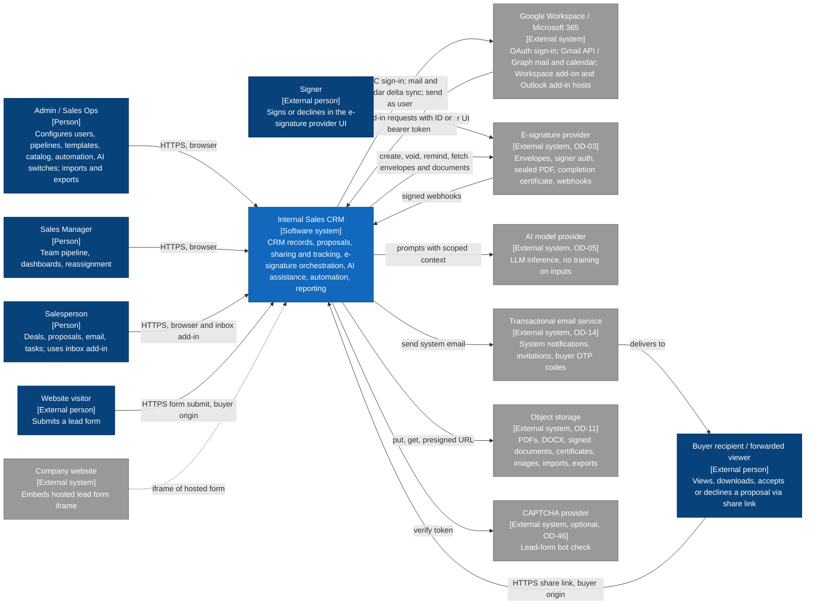
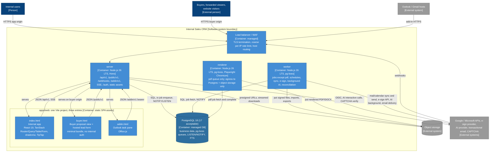
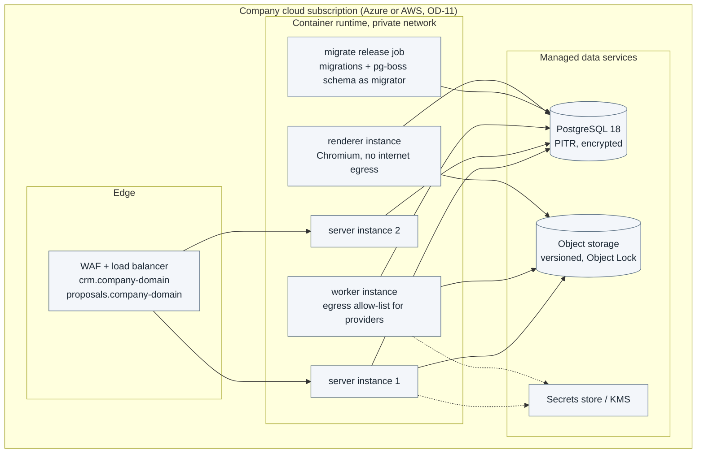
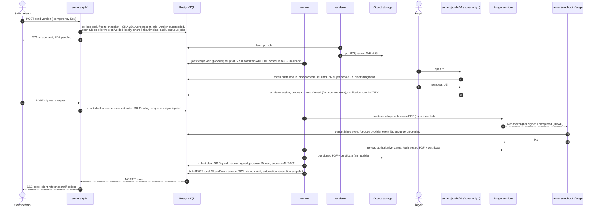

# System Architecture — Internal Sales CRM (Phase 1)

| Item | Detail |
|---|---|
| Document | 02-hld/SYSTEM-ARCHITECTURE.md (High-Level Design, system view) |
| Applies to | BRD v2.0 Phase 1, single-company internal deployment (IDD-01..IDD-16) |
| Binding inputs | Design foundation §3–§16 (incl. addenda §11 A1–A18, §12 R1–R12, §13 ADR numbering, §14 R13, §15 HLD decisions, §16 S1–S8); 01-specifications (DOMAIN-MODEL, ROLE-PERMISSION-MATRIX, BUSINESS-RULES with RULE-* and SM-01..SM-10, WORKFLOWS WF-01..WF-39, OPEN-DECISIONS, SCOPE-RECONCILIATION, PRD, FUNCTIONAL-REQUIREMENTS); sibling HLD: SECURITY-, AI-, DEPLOYMENT-, DATA-FLOW-ARCHITECTURE |
| Companion HLD documents | COMPONENT-ARCHITECTURE.md (inside each process), MODULE-ARCHITECTURE.md (backend modules and their contracts), ARCHITECTURE-DECISIONS.md (ADR-001..ADR-076) |
| Status | Draft for review |

Conventions: BRD IDs (`BR-*`, `NFR-*`, `AC-*`) are cited unchanged. Working assumptions are cited by `OD-NN`; internal deployment decisions by `IDD-NN`; architecture decisions by `ADR-NNN`. This document specifies structure and responsibilities only; it contains no application code. Behaviour is defined by the specifications and is not changed here.

---

## 1. Purpose, drivers and constraints

### 1.1 What the system is
A single-tenant, internal production Sales CRM for one company's sales team (roles Admin, Sales Manager, Salesperson) that also serves external buyers who view, forward, accept/decline and sign proposals, and website visitors who submit lead forms. Phase 1 covers BRD modules PLT, MIG, CRM, EML, LED, TPL, PRC, PRP, AIA, SHR, NTF, SIG, AUT, RPT, TIM (100 in-scope Musts, SCOPE-RECONCILIATION §4; release plan foundation §12 R1).

### 1.2 Architecture drivers
| Driver | Source | Architectural consequence |
|---|---|---|
| Single tenant, ≤ 150 users, ≤ 200k contacts, ≤ 5M synced emails | IDD-01, IDD-06, OD-45 | One deployment, one PostgreSQL database; no tenant id; vertical sizing first; no distributed data stores (ADR-001, ADR-019) |
| External, unauthenticated buyer surface with legal significance (tracking, accept, forwarded viewers) | BR-SHR-001..010, OD-17, OD-22, OD-26 | Separate buyer origin, token-scoped public API, strict CSP, server-side tracking (ADR-013, ADR-020, ADR-026, ADR-034) |
| Legally binding e-signature via a partner | BR-SIG-001..013, NFR-004, OD-01..03 | `ESignatureProvider` adapter, webhook inbox, reconciliation, DB-enforced immutability (ADR-012, ADR-025) |
| Mailbox and calendar sync per user | BR-EML-001..007, OD-06, OD-28..30 | Polling worker with per-mailbox singleton jobs; minimal scopes; filtering before persistence (ADR-031) |
| AI assistance with human approval and strict data scoping | BR-AIA-001..009, NFR-003, IDD-07 | Server-side `AiProvider` adapter, per-request scoped context builder, deterministic checks authoritative (ADR-014, ADR-035) |
| Automation with reversal and idempotency | BR-AUT-001..008, OD-23, OD-24 | Built-in rules in code, `automation_execution` snapshots, idempotency keys (ADR-024) |
| Auditability and production-grade security | NFR-001, NFR-009, BR-PLT-009 | Central policy module, audit hash chain, DB roles, envelope encryption (ADR-006, ADR-026, ADR-027) |
| Small team, unknown capacity | OD-08 | Modular monolith, three runtime roles from one codebase, one database, no broker/cache; boring, well-supported libraries (ADR-001, ADR-019) |
| Phases 2–3 must be addable without rework | NFR-014, IDD-13, OD-41 | Explicit module boundaries, domain event history, provider adapters, versioned REST + OpenAPI, section-based proposal model (§12) |

### 1.3 Hard constraints (from the project objective)
- No microservices, no Redis, no message broker, no search cluster without demonstrated need (foundation §0, ADR-019).
- No SaaS tenant provisioning, subscriptions or billing (IDD-02, IDD-03).
- The code repository lives outside OneDrive (ADR-033); this documentation may stay in OneDrive.
- Windows-friendly developer tooling (ADR-018).

---

## 2. Architectural style

**Modular monolith in TypeScript, one repository, one PostgreSQL database, three long-running runtime roles built from the same codebase** (ADR-001 as refined by ADR-045; images per ADR-046):

| Runtime role | Image / entry point | Role | Scaling |
|---|---|---|---|
| `server` | `crm-app`, `PROCESS_ROLE=server` | Serves all HTTP surfaces (internal API, buyer/public API, webhooks, add-in endpoints, SSE, auth, static SPA assets) | Stateless; horizontally scalable behind the load balancer (≥ 2 instances for NFR-006) |
| `worker` | `crm-app`, `PROCESS_ROLE=worker` | Executes all pg-boss queues **except `pdf`** and all cron schedules (mail sync, e-sign dispatch/webhook processing/reconciliation, automation, notification delivery, background AI, imports, retention, exports, metrics collection) | One instance by default (ADR-037); safe to run > 1 because all handlers are idempotent and per-resource jobs use singleton keys |
| `renderer` | `crm-renderer` (same codebase + Chromium), `PROCESS_ROLE=renderer` | Consumes only the `pdf` queue (PDF, and DOCX if the TLD keeps it on that queue): warm Playwright Chromium, offline rendering | 1 instance, scale to 2 on queue lag; **network egress only to Postgres and object storage private endpoints; no third-party credentials** (ADR-045, ADR-048) |
| `migrate` (one-shot) | `crm-app`, `PROCESS_ROLE=migrate` | Release job: Drizzle migrations and pg-boss schema as `migrator` role (ADR-030, ADR-050) | Once per release |

All roles load the same domain modules (MODULE-ARCHITECTURE.md). Deployment detail (platform, networks, rollout) is in DEPLOYMENT-ARCHITECTURE.md (ADR-046..ADR-052). Domain services are framework-free functions that take an actor context and a unit of work; Hono routes and pg-boss handlers are thin adapters around them (foundation A1, ADR-028).

Principles:
1. **Modules own their tables**; other modules use the owning module's service API, never its tables (ADR-028). Reporting is the documented read-only exception.
2. **One transaction per business operation**: state change + timeline entry + audit entry + job enqueue + domain event history row commit atomically (ADR-022, ADR-028).
3. **Authorization in the backend only**; the UI is permission-aware for convenience (ADR-006).
4. **Everything external behind an adapter** (mail, calendar, e-sign, AI, transactional email, object storage, CAPTCHA) (ADR-012).
5. **Snapshot over reference** for anything sent externally (DOMAIN-MODEL §21 rule 2; ADR-029).
6. **At-least-once background processing with idempotent handlers** (ADR-022).
7. **Postgres does the infrastructure jobs** a broker/cache would otherwise do: queue (pg-boss), pub/sub (LISTEN/NOTIFY), rate-limit buckets, full-text search (ADR-005, ADR-007, ADR-023, ADR-054).

---

## 3. System context (C4 level 1)

### 3.1 Actors
| Actor | Channel | Authentication | Scope of access | Source |
|---|---|---|---|---|
| Admin, Sales Manager, Salesperson | Browser SPA on app origin; Outlook task pane; Gmail add-on | Better Auth session cookie (email+password or Google/Microsoft OAuth restricted to company domain/tenant, optional/required TOTP); add-in bearer token or Google ID token | Role + scope (all / team / own / view-only) per ROLE-PERMISSION-MATRIX | BR-PLT-003..006, OD-12, OD-13, ADR-006, ADR-027 |
| Buyer recipient | Browser on buyer origin | Share-link token (exchanged for short-lived HttpOnly cookie), optional email OTP | One proposal version | BR-SHR-001..010, ADR-013, ADR-034 |
| Forwarded viewer | Browser on buyer origin | Same token + identity gate (name, email, privacy notice) | View/download only | BR-SHR-005, OD-26 |
| Signer | E-signature provider UI | Provider (email verification, optional SMS) | Provider envelope only; never a CRM endpoint | BR-SIG-004/005, ROLE-PERMISSION-MATRIX §5.3 |
| Website visitor | Hosted form on buyer origin (iframe on company site) | Form public key, honeypot, rate limit, optional CAPTCHA | Submit only | BR-LED-001/006, OD-46 |

### 3.2 External systems and credentials
Every row below needs credentials or configuration owned by IT/Tech Lead and stored in the managed secrets store (OD-11). None are committed to the repository.

| External system | Purpose | Interaction | Credentials / configuration required | Decision |
|---|---|---|---|---|
| Google Cloud project (if Google Workspace) | OAuth sign-in; Gmail API + Calendar API; Workspace add-on | OIDC; REST polling (historyId); send as user; add-on HTTP card endpoints | OAuth client id/secret (Internal app); separate consent for mailbox scopes (`gmail.readonly`, `gmail.send`, Calendar read-only); add-on deployment; allowed `hd` domain | OD-06, OD-07, OD-12, ADR-027, ADR-031 |
| Microsoft Entra ID app registration (if Microsoft 365) | OAuth sign-in; Graph Mail/Calendars; Outlook add-in | OIDC single-tenant authority; Graph delta queries; send as user; Nested App Authentication / Office dialog | App registration (client id, secret or certificate), tenant id, delegated scopes `Mail.Read`, `Mail.Send`, `Calendars.Read`, `offline_access`; add-in manifest via centralized deployment | OD-06, OD-07, OD-12, ADR-027, ADR-031 |
| E-signature provider | Envelopes, signer auth, sealed PDF, certificate | REST API; HMAC-signed webhooks | Account, API key/OAuth credentials, webhook signing secret, brand/consent text configuration | OD-02, OD-03, OD-42, ADR-025 |
| AI model provider | Drafting, summaries, rewrites, consistency check | HTTPS API from server/worker only | API key; commercial terms with no training and zero-data-retention (to confirm); spend limits | OD-05, OD-53, ADR-035 |
| Transactional email service | Invitations, password reset, notifications, buyer OTP, link-expiry notices | SMTP or HTTPS API | API key/SMTP credentials; DNS SPF, DKIM, DMARC on a company subdomain | OD-14, NFR-013 |
| Object storage | All binaries | S3-compatible API or Azure Blob (one driver, ADR-036) | Bucket(s), access credentials or workload identity, versioning + Object Lock/immutability for signed artifacts | OD-11, ADR-011, ADR-036 |
| CAPTCHA provider (optional) | Lead-form bot check | Server-side token verification | Site key + secret key | OD-46 |
| PostgreSQL (managed) | System of record, queue, pub/sub | TLS connection | Three DB roles: `app` (DML), `migrator` (DDL), `readonly` (reporting/support); PITR enabled | ADR-005, ADR-026, ADR-030, ADR-032 |
| Platform secrets | Crypto and session | — | Token-encryption key-encryption key(s) with key ids; Better Auth secret; share-token encryption key; webhook secrets per lead form (BR-LED-007, Could) | ADR-026, ADR-034 |
| DNS / TLS | Origins | — | Certificates and names for the app origin (e.g. `crm.<company-domain>`) and the buyer origin (e.g. `proposals.<company-domain>`, also hosting lead forms and the tracking pixel) | ADR-020 |
| Error tracking / metrics backend | Mandatory observability | OTLP or vendor SDK | DSN/API key (vendor per OD-11 hosting) | ADR-017, ADR-030 |

---

## 4. Containers (C4 level 2)

### 4.1 Container responsibilities
| Container | Technology (ADR) | Responsibilities | Does NOT |
|---|---|---|---|
| `apps/web` – `index.html` | React 19, Vite, TanStack Router/Query/Table/Form, Zod, Tailwind v4 + shadcn/ui, TipTap (ADR-002, ADR-020) | Internal UI for all roles; permission-aware rendering from `/api/v1/me/permissions` and `allowedActions`; proposal/template editor; preview; dashboards; notification centre (poll + SSE poke) | Enforce authorization; hold secrets; call external providers |
| `apps/web` – `buyer.html` | Same toolchain, minimal dependency set (ADR-020) | Buyer proposal view (branded, mobile, WCAG 2.1 AA), identity gate, OTP, heartbeat tracking, download, accept/decline; hosted lead form (iframe auto-resize via postMessage) | Use internal cookies or internal API; render anything not returned by `/public/v1` |
| `apps/web` – `addin.html` | Office.js task pane (ADR-020, ADR-027) | Outlook context: show/create/link contact, company, deal for the open message | Hold long-lived credentials (short-lived bearer only) |
| Gmail add-on | No frontend: server-generated Card JSON (ADR-020) | Same use cases as Outlook pane, rendered by Google | — |
| Load balancer / WAF | Managed (OD-11) | TLS, HSTS, host routing, coarse per-IP rate limiting, request size caps, health checks | Application authorization |
| `server` | Node.js 26 LTS, Hono, `@hono/zod-openapi`, Better Auth, Drizzle (ADR-003, ADR-005, ADR-006) | HTTP surfaces, authentication, authorization (policy), validation, domain services in-request, SSE fan-out, static asset serving, OpenAPI document | Long-running work (> a few seconds), PDF rendering, mailbox polling |
| `worker` | Node.js 26 LTS, pg-boss (ADR-007, ADR-037) | Queues (except `pdf`) and cron schedules; same domain services; provider calls with retries; background AI; reconciliation; retention; exports | Serve HTTP (except health probe); render documents; run Chromium |
| `renderer` | Node.js 26 LTS, pg-boss, Playwright Chromium, `docx` (ADR-010, ADR-026, ADR-045) | `pdf` queue only: render frozen snapshot HTML to tagged PDF (and DOCX), store file + SHA-256, complete job | Hold any third-party credential; reach the internet; serve HTTP |
| PostgreSQL | Managed PostgreSQL 18 preferred, 17 acceptable (ADR-032) | System of record; pg-boss schema; LISTEN/NOTIFY; FTS (`tsvector`, `pg_trgm`); constraints that guard invariants (immutability trigger, one-open-signature-request index, audit append-only grants) | Business logic beyond integrity guards; RLS (ADR-019) |
| Object storage | S3-compatible or Azure Blob, one driver (ADR-036) | Binary storage; versioning; immutability for signed PDFs and certificates | Public access (private buckets only) |

### 4.2 Deployment view (summary; authoritative detail in DEPLOYMENT-ARCHITECTURE.md)

Notes: the renderer has network-level egress only to the Postgres and object-storage private endpoints and holds no third-party credentials (ADR-045); the server's and worker's provider calls pass a two-layer egress control (application allow-list + NAT static IP, ADR-048). Platform: managed containers, no Kubernetes (ADR-047); single application image + renderer image promoted by digest (ADR-046). Migrations and the pg-boss schema run as a one-shot release job with an advisory lock before new versions start (ADR-030, ADR-050); rollout/rollback per ADR-052; database HA + 35-day PITR per ADR-049.

---

## 5. Responsibilities by tier

### 5.1 Frontend (apps/web)
| Concern | Responsibility | Not responsible for |
|---|---|---|
| Routing and state | File-based TanStack Router routes with typed search params (filters, sort, cursor in URL); TanStack Query cache for server state; no global client store for server data | Business rules beyond input hints |
| Forms and validation | TanStack Form + the same Zod schemas from `packages/shared` for immediate feedback | Being the validation authority (server re-validates) |
| Permission-aware UI | Hide/disable actions from `/api/v1/me/permissions` and per-resource `allowedActions` (ROLE-PERMISSION-MATRIX §7) | Security (backend authoritative) |
| Editor and preview | TipTap editor constrained to the section/ProseMirror schema of `packages/proposal`; preview uses the same HTML renderer as buyer view and PDF (ADR-029) | Final PDF generation (worker) |
| Real-time | Poll `GET /api/v1/notifications?since=` every 30 s; SSE poke triggers immediate refetch (ADR-023) | Delivering notification payloads via SSE |
| Buyer entry | Render returned snapshot; heartbeat; identity gate; OTP; responses | Any decision on access (every request re-evaluated server-side) |

### 5.2 Backend (apps/server: server + worker)
| Concern | Responsibility |
|---|---|
| Authentication | Better Auth sessions, OAuth domain/tenant checks, invite-only, TOTP, add-in tokens (ADR-006, ADR-027) |
| Authorization | Central policy `decide()` and repository `scopeFilter()` from the shared permission matrix (ROLE-PERMISSION-MATRIX §7, ADR-026) |
| Validation | Zod contracts at the edge; domain invariants in services; DB constraints as the last line |
| Business logic | Module services: state machines (deal, proposal, version, signature request, share link, task, import, lead submission, mailbox), calculations (BUSINESS-RULES §7.2), automation |
| Integration | Adapters for all external systems; retries, idempotency, reconciliation |
| Background work | pg-boss jobs and schedules (COMPONENT-ARCHITECTURE §4) |
| Cross-cutting writes | `timeline.record`, `audit.record`, `jobs.enqueue`, domain event history in the caller's transaction (ADR-022, ADR-028) |
| Delivery of assets | Static SPA assets with CSP per entry/origin; server-mediated downloads for tracked files |

### 5.3 Database (PostgreSQL)
| Concern | Responsibility |
|---|---|
| Integrity | FKs, check constraints, unique indexes (e.g. normalised email/domain among non-archived records; one open signature request per deal; one uncleared flag per deal and kind) |
| Immutability guards | Trigger rejecting updates of content columns of sent/superseded/signed `proposal_version` (ADR-025); `app` role has INSERT/SELECT only on `audit_log` (ADR-026) |
| Concurrency | `row_version` optimistic locking; `SELECT … FOR UPDATE` on the deal row for proposal/signature transitions (ADR-025) |
| Queue and schedules | pg-boss schema (jobs, schedules, archive, DLQ) (ADR-007, ADR-022) |
| Pub/sub | `LISTEN/NOTIFY` for SSE pokes and cache invalidation (ADR-023, ADR-054) |
| Search | Generated `tsvector` columns + GIN; `pg_trgm` for fuzzy duplicate suggestions (OD-27) |
| Reporting | Read-only SQL views/queries with mandatory scope predicates (MODULE-ARCHITECTURE §5) |
| Recovery | PITR (RPO ≤ 5 min target), daily snapshots, restore drills (ADR-030, NFR-008) |

---

## 6. Communication paths

| # | From → To | Mechanism | Payload / contract | Reliability semantics | ADR |
|---|---|---|---|---|---|
| C1 | Internal SPA → server | HTTPS JSON REST `/api/v1`, session cookie (SameSite=Lax) + Origin check | Zod contracts in `packages/shared`; OpenAPI 3.1; RFC 9457 errors; cursor pagination; `Idempotency-Key` on unsafe sensitive POSTs; `rowVersion` | Synchronous; client retries only idempotent calls | ADR-003, ADR-016 |
| C2 | Buyer page → server (buyer origin) | HTTPS JSON `/public/v1`; share token only in the URL fragment, posted by page JS to `/public/v1/session/exchange` for a short-lived HttpOnly cookie bound to the link | Version snapshot DTO, heartbeat, response, identity gate, OTP | Synchronous; every request re-evaluates link, proposal status and three clocks (BUSINESS-RULES §18) | ADR-013, ADR-026, ADR-034, ADR-071, ADR-075 |
| C3 | Outlook task pane / Gmail add-on → server | HTTPS JSON `/addin/v1` (add-in session bearer) / Card JSON (Google ID token) | Add-in DTOs; Card JSON | Synchronous | ADR-020, ADR-027, ADR-074 |
| C4 | Server → SPA (real-time) | SSE `GET /api/v1/events/stream`, id-only "poke" events, 20 s heartbeat | `{type, id}` only | Best effort; correctness guaranteed by 30 s cursor polling of `notification` table | ADR-009, ADR-023 |
| C5 | Any process → worker | pg-boss jobs enqueued **inside the business transaction** (or minimal outbox fallback) | Job name + Zod-validated payload of ids; idempotency key | At-least-once; retries with backoff; DLQ per queue; admin replay | ADR-007, ADR-022 |
| C6 | Worker/server → server instances | Postgres `NOTIFY` on commit; one dedicated non-pooled `LISTEN` connection per server instance | Channel + id (notification id, cache key) | Transactional (sent on commit), lossy across disconnects → polling/TTL backstop | ADR-023, ADR-054 |
| C7 | E-sign provider → server | HTTPS webhooks `/webhooks/esign/{provider}`, HMAC over raw body + timestamp tolerance | Raw event persisted to webhook inbox, 2xx fast, processed by worker | Dedupe on provider event id; authoritative re-read from provider API; forward-only transitions; hourly reconciliation | ADR-025, ADR-053 |
| C8 | Website → server | Lead form POST to `/public/v1/forms/{key}/submissions` from hosted page on buyer origin; optional webhook intake `/webhooks/leads/{formKey}` (BR-LED-007, Could, HMAC) | Submission persisted first, processed async | Persist-then-process (DR-LED-03) | ADR-053 |
| C9 | Worker → Google/Microsoft | Gmail API / Microsoft Graph REST with per-user OAuth offline tokens | Delta sync (historyId / delta link), send as user | Polling every 2–5 min; per-mailbox singleton; bounded full resync on cursor expiry | ADR-012, ADR-031 |
| C10 | Worker → e-sign provider | Provider REST API | Create envelope with frozen PDF (hash asserted), void, remind, fetch signed document/certificate | Retried jobs; idempotency by request id; reconciliation | ADR-012, ADR-025 |
| C11 | Server (interactive, streamed to the client per request) / worker (pre-send LLM layer, AUT-004 drafts) → AI provider | HTTPS API | Versioned prompt + scoped context; model per feature; constrained Markdown or JSON-Schema output, no tools | Timeouts; budget checked before call; failures never block non-AI flows | ADR-014, ADR-035, ADR-040..ADR-044 |
| C15 | Renderer → PostgreSQL / object storage | pg-boss `pdf` queue; storage SDK over private endpoints | Version id → rendered file + SHA-256 | At-least-once, idempotent by `versionId:format`; no other egress | ADR-045, ADR-048 |
| C12 | Worker → transactional email | SMTP/API | Rendered notification/invitation/OTP | Retried job; idempotent by notification id | OD-14 |
| C13 | Server/worker → object storage | SDK; presigned short-lived URLs for untracked assets; server-streamed for tracked downloads | Binary + SHA-256 | Write-once keys; versioned bucket | ADR-011, ADR-036 |
| C14 | Server → CAPTCHA | HTTPS verify | Token | Fail mode is an Admin setting (proposed OD) | OD-46 |

Explicitly **not** used: synchronous HTTP between processes, a message broker, or browser-to-provider calls (all provider calls are server-side).

### 6.1 End-to-end flow: send → view → sign → Closed Won

---

## 7. Quality attributes (NFR-001..NFR-015)

| NFR | Requirement (BRD, as modified by SCOPE-RECONCILIATION §7.2) | How the architecture meets it | Verification |
|---|---|---|---|
| NFR-001 Security | Encryption in transit/at rest; data separation (dedicated deployment, IDD-01); RBAC; MFA available | TLS everywhere (HSTS); managed DB and storage encryption at rest; OAuth tokens and share tokens envelope-encrypted via KMS keyring (AES-256-GCM, key id, AAD) (ADR-026, ADR-034, ADR-073); dedicated deployment and DB (IDD-01); central policy + repositories scoped by construction (ADR-006, ADR-026, ADR-076); TOTP MFA with Admin-required policy enforced by middleware (OD-13, ADR-027); strict CSP per origin via host-based sub-apps (ADR-075); buyer token only in URL fragment (ADR-071); renderer isolated (ADR-045); DB roles least privilege | Permission test matrix per PERM row; security tests; CSP report-only stage; pen test before go-live |
| NFR-002 Privacy | GDPR obligations as controller (IDD-09); user control of synced email; deletion honoured | OD-29 filtering before persistence; exclusions purge stored mail; private emails redacted (OD-30); per-module erasure handlers orchestrated by platform (OD-36); retention sweeps per category (NFR-015); privacy notice at identity gate (OD-26); no PII in logs | Erasure integration tests per module; retention job reports |
| NFR-003 AI governance | No training; human approval before external send; label and log AI; provider terms | AI server-side only behind `AiProvider`; no-training/ZDR terms (OD-05); `ai_generation` pending → accepted/rejected with labels (BR-AIA-007); AI cannot call write endpoints or send (BR-AIA-006); `ai_usage` metadata log; prompts/outputs excluded from logs; per-request scoped context; budget enforcement (ADR-035, ADR-043); no tools exposed to the model (ADR-042); eval gate on prompt/model changes (ADR-044) | AI guardrail tests (scope leakage, injection fixtures); usage reports |
| NFR-004 E-sign compliance | Legal process, consent and evidence; tamper-evident | Partner provider supplies SES evidence, consent (OD-01, OD-02, OD-42); frozen version hash asserted before dispatch; sealed PDF + certificate stored immutably (Object Lock) with SHA-256; webhook inbox and reconciliation keep the legal record even for stale versions (ADR-025, ADR-036) | Provider sandbox E2E; hash assertion tests; Legal review of consent |
| NFR-005 Performance | Screens < 2 s p95; proposal generation < 10 s; notifications < 1 min | Single-region monolith close to DB; indexed cursor pagination; FTS with GIN; read-only report queries on indexed columns with materialised summaries only if measured; warm Chromium pool in the renderer (concurrency 1–2, scale to 2 instances on lag, ADR-045) for PDF; notifications: table + 30 s poll guarantees < 1 min, SSE poke gives seconds (design target < 5 s) (ADR-023) | k6 load test at OD-45 volumes; PDF render-time metric; notification latency metric |
| NFR-006 Availability 99.5 % (app + buyer links) | ≤ ~3.6 h downtime/month | ≥ 2 stateless server instances behind LB; managed Postgres zone-redundant HA (ADR-049); worker outage does not affect buyer links or API (jobs queue up); zero-downtime expand/contract migrations and rollout/rollback policy (ADR-030, ADR-052); health/readiness endpoints | Uptime monitoring of app and buyer origin; failover test |
| NFR-007 Scalability (replaced, IDD-06) | ≤ 150 users, ≤ 200k contacts, ≤ 100k companies/deals, ≤ 5M emails, ≤ 20k proposals/year (OD-45) | Well within one Postgres instance; email tables indexed by mailbox and participants; server horizontally scalable; worker can scale out later (ADR-037); partitioning of `email_message`/`view_session`/`timeline_event` reserved as a later option | Volume test with synthetic data at 2× OD-45 |
| NFR-008 Backup and recovery | Daily backups, RPO 24 h, RTO 8 h | Managed PITR with 35-day window (RPO ≤ 5 min, ADR-049), geo backup, versioned object storage with replication; quarterly restore drill; post-restore reconciliation with e-sign provider and mailbox resync (ADR-030) | Restore drill record |
| NFR-009 Auditability | Key user/admin/system/AI actions audited | `audit.record` in the originating transaction; append-only (`app` role INSERT/SELECT only); hash chain computed by an ordered asynchronous audit sealer (ADR-072); periodic export to immutable storage; Admin-only access (ADR-026, ADR-028) | Audit coverage tests per privileged PERM |
| NFR-010 Usability | First proposal without training; admin onboarding < 1 day | Internal setup checklist (IDD-04); templates with defaults; deterministic pre-send checks; consistent shadcn/ui patterns | Usability sessions (AC-15..18 internal rollout) |
| NFR-011 Accessibility WCAG 2.1 AA | App, buyer view, add-in | Radix-based shadcn/ui primitives; tagged PDF with embedded fonts (ADR-026); axe checks in CI on all three entries | Automated axe + manual screen-reader audit |
| NFR-012 Compatibility | Current Chrome/Edge/Safari/Firefox; responsive; PDF/DOCX open correctly; add-in hosts | Evergreen-browser build target; responsive layouts; one block model → HTML, PDF, DOCX with golden-file tests (ADR-029, OD-43) | Playwright cross-browser matrix; golden-file tests |
| NFR-013 Email deliverability | Users' mailboxes; authenticated system domain | Proposal/follow-up email sent via user's mailbox (Gmail API/Graph) (ADR-031); system mail via transactional provider with SPF/DKIM/DMARC on a subdomain (OD-14) | DMARC reports |
| NFR-014 Maintainability | Phase 2/3 addable without rework | Module boundaries enforced by dependency-cruiser (ADR-021); domain event history; adapters; versioned API + OpenAPI; section-based content model; built-in automation in code with setting table; extension points (§12) | Boundary lint in CI; ADR log |
| NFR-015 Data retention | Admin-configurable within platform limits | `retention_policy` per category with min/max limits; daily retention sweep job calling per-module handlers; exemptions for signed documents, certificates, audit log (OD-36) | Retention job tests |

---

## 8. Cross-cutting concerns (overview; details in COMPONENT-ARCHITECTURE and TLD)

| Concern | Approach | ADR / source |
|---|---|---|
| Identity and sessions | Better Auth (email/password, Google/Microsoft OAuth restricted by `hd`/`tid`, invite-only, TOTP); session cookies on app origin only; add-in sessions (bearer) and Google ID tokens for add-ins (ADR-074); deactivation revokes all sessions/tokens | ADR-006, ADR-027 |
| Authorization | Shared permission matrix in `packages/shared`; `decide()` in services; `scopeFilter()` in every list/search/report query; 404 for out-of-scope reads, 403 for out-of-scope writes on readable records | ROLE-PERMISSION-MATRIX §7, ADR-026 |
| Validation | Zod contracts shared FE/BE; server authoritative; DB constraints final guard | ADR-003 |
| Error handling | RFC 9457 problem+json with stable `code` (BUSINESS-RULES §20 index) and field `errors[]`; error mapper middleware; no stack traces to clients | ADR-016 |
| Concurrency | `rowVersion` optimistic locking (409); deal-row `FOR UPDATE` for proposal/signature transitions; automation re-checks guards in-tx and skips on conflict | ADR-016, ADR-025, RULE-AUT-04 |
| Idempotency | `Idempotency-Key` table for sensitive POSTs; business idempotency keys for automation, webhooks, jobs | ADR-016, ADR-022, ADR-024 |
| Transactions and side effects | Unit of work: state + `timeline.record` + `audit.record` + `jobs.enqueue` + domain event history in one tx | ADR-022, ADR-028 |
| Logging and tracing | pino JSON logs with request id, user id, job id; no PII/tokens/prompts in logs; OpenTelemetry-compatible traces; error tracking | ADR-017, ADR-030, ADR-051 |
| Metrics and alerts | Queue lag, DLQ depth, mailbox-sync lag, webhook failures, PDF render time, AI spend, SSE connections, HTTP p95; in-DB metrics collector job; external uptime monitor | ADR-030, ADR-051 |
| Rate limiting | Tier 1 LB/WAF per IP; tier 2 Postgres buckets (auth, form submissions, identity gate/OTP); tier 3 in-memory per instance (heartbeats) | ADR-026 |
| Secrets and keys | Managed secrets store; KMS keyring with envelope encryption, key ids and rotation | ADR-026, ADR-073 |
| Files | Upload validation (size, MIME sniffing, zip-bomb limits, image re-encode); private buckets; tracked downloads via server | ADR-011, ADR-026, ADR-036 |
| Time and money | UTC `timestamptz`; org time zone for business dates and schedules; `numeric` money; half-up line rounding (BUSINESS-RULES §0.3, R11) | ADR-005 |
| Configuration | Environment config validated at boot (Zod); business settings in `organization_settings` and module setting tables, audited | ADR-024 |
| Feature switches | AI org + per-feature switches (IDD-08); automation per-rule enable | ADR-024, ADR-035 |
| Retention, erasure, export | Platform orchestrates; modules register handlers (anonymise, purge, export) | ADR-028, OD-36, IDD-12 |
| Caching | No shared cache; TanStack Query on the client; small in-process caches (permission context, settings) invalidated by NOTIFY with short TTL | ADR-054 |
| Accessibility and i18n | WCAG 2.1 AA; locale/currency formatting from organization settings; English UI in Phase 1 | NFR-011 |

---

## 9. What is deliberately NOT used (ADR-019)

| Not used | Why not (for this system) | What we use instead | Revisit trigger |
|---|---|---|---|
| Microservices | One team, one domain, ≤ 150 users; distributed transactions would complicate the proposal/signature state machine that needs one transaction (ADR-025) | Modular monolith with enforced module boundaries | A module with independent scaling or release cadence that cannot be met by the worker split |
| Redis (cache, queue, rate limit, pub/sub) | Postgres covers queueing (pg-boss), pub/sub (LISTEN/NOTIFY), rate-limit buckets and sessions at this scale; one less stateful system to secure, back up and monitor | pg-boss, LISTEN/NOTIFY, Postgres buckets, in-process caches | Measured DB contention from rate limits/sessions, or SSE fan-out beyond a few hundred concurrent connections per instance |
| Kafka / RabbitMQ / cloud broker | No cross-system event streaming; jobs need transactional enqueue with business data, which a broker cannot give without an outbox | pg-boss with in-transaction enqueue (ADR-022) | Phase 3 open API/event subscriptions to external systems at volume |
| Elasticsearch / OpenSearch | ≤ 200k contacts; Postgres FTS + `pg_trgm` meets search and duplicate suggestions | Generated `tsvector` + GIN, `pg_trgm` | Search p95 > 2 s at real volume, or multilingual relevance needs |
| GraphQL | Small set of first-party clients; REST + OpenAPI is simpler to secure (per-endpoint authorization, rate limits, caching) and is the Phase 3 open-API shape | REST `/api/v1` with Zod/OpenAPI | Many heterogeneous external API consumers |
| PostgreSQL RLS (Phase 1) | Single tenant; authorization depends on team scope, view-only settings and associated-read paths that are easier to test in the policy module; RLS would need per-request role/GUC plumbing through the pool | Policy module + mandatory `scopeFilter` + least-privilege DB roles | Phase 3 open API or direct DB access by other tools |
| SSR framework (Next.js, TanStack Start, Remix) | Internal app, no SEO; buyer view is a small client bundle; stable explicit HTTP surface required for add-ins, webhooks, buyer API (ADR-004) | Hono API + Vite SPA multi-entry | Measured buyer-view first-paint problems on mobile that a small bundle cannot fix |
| Generic rule engine | BR-AUT-007 is Could; built-in rules are six well-specified behaviours | Rules in code + `automation_setting` (ADR-024) | BR-AUT-007 delivered (Phase 2/3) |
| Own e-signature cryptography | Legal evidence, signer authentication and sealing are commodity provider capabilities (OD-02) | `ESignatureProvider` adapter | Never in Phase 1 |
| Kubernetes | Three long-running units and one release job do not need a scheduler or mesh (ADR-047) | Azure Container Apps or AWS ECS Fargate (OD-11), images promoted by digest (ADR-046) | About 10+ runtime units or a company platform standard |

---

## 10. Interfaces with Phase 1 release plan
| Release (foundation §12 R1) | Architectural elements that must be live |
|---|---|
| R1 | server, worker, renderer, migrate job, Postgres, object storage, transactional email; identity/crm/import/templates/catalog/proposals/sharing (copy link + "mark as shared manually")/notifications/automation/reporting/timeline/leads (incl. spam protection: honeypot, Postgres rate-limit, CAPTCHA adapter) ; buyer origin; PDF/DOCX rendering |
| R2 | comms (mail/calendar sync and send via mailbox, OD-06 provider first), AI adapter and guardrails, e-sign adapter + webhook inbox + reconciliation; OAuth mailbox consent flow |
| R3 | Inbox add-in surfaces (`addin.html`, Gmail Card endpoints, `/addin/v1`), HubSpot/Pipedrive import mappers (OD-09) |

---

## 11. Extension points for Phases 2–3 (IDD-13, NFR-014)
Not designed in detail; these are the seams Phase 1 keeps stable.

| Extension point | Phase 1 element | Enables (BRD §8.2 / §15) |
|---|---|---|
| Domain event history | `domain_event` append-only rows written in-tx for every catalogued event (DOMAIN-MODEL §22) | Analytics, win/loss, risk scoring (§8.2-05/06), future event subscriptions (§8.2-12) |
| Job subscriptions | New consumers subscribe to existing event jobs without changing producers (ADR-055) | Deal agents, Slack/Teams notifications (§8.2-02/07) |
| Provider adapters | `MailProvider`, `CalendarProvider`, `ESignatureProvider`, `AiProvider`, `TransactionalEmail`, `ObjectStorage`, `Captcha` | Second mail provider, other e-sign/AI vendors, data residency (§8.2-12) |
| Notification channels | Channel abstraction (in-app, email) in notifications module | Slack/Teams, browser push (BR-NTF-004 Could) |
| Automation | Built-in rules in code + `automation_setting` + `automation_execution` | Configurable rules (BR-AUT-007), approvals (§8.2-04), autonomous agents (§8.2-09) |
| Proposal content model | Sections + ProseMirror nodes + `schemaVersion`; pricing tables with recurring lines + term (OD-44) | Tiered options/add-ons (§8.2-03), section analytics (§8.2-06), invoicing/renewals (§8.2-10) |
| View sessions | Per-session heartbeat data | Section-level analytics (§8.2-06) |
| Policy module | Central `decide()` / `scopeFilter()` with capability grants | Autonomous agents with permissions (§8.2-09), SSO roles |
| Versioned REST + OpenAPI | `/api/v1` with stable contracts | Open API, marketplace (§8.2-12) |
| Buyer origin + token model | Separate origin, token-scoped API | Customer portal, buyer comments (§8.2-07/11) |
| Auth | Better Auth providers | Enterprise SAML SSO (Phase 3) |

---

## 12. Conflicts found between specifications and the foundation (foundation followed)

| # | Specification text | Foundation (binding) | Resolution in HLD |
|---|---|---|---|
| CF-01 | DOMAIN-MODEL §16.1 `AutomationRule` entity; BUSINESS-RULES RULE-AUT-01/70 "built-in rules are seeded rows in `automation_rule` (ADR-015)" | §11 A6 / ADR-024: rules in code; `automation_setting`; ADR-015 superseded | Rules in code; Admin parameters in `automation_setting`; `automation_execution.rule_key` replaces `ruleId`. Behaviour (enable/disable, parameters) unchanged |
| CF-02 | DOMAIN-MODEL §18 `DomainEvent` as transactional outbox with status `pending/dispatched/failed`; §21 rule 1 "outbox atomicity"; §22 consumers via outbox | §11 A4 / ADR-022: pg-boss jobs enqueued in-tx; `domain_event` history only (no dispatch status) | Dispatch via jobs; `domain_event` keeps envelope without dispatch status |
| CF-03 | DOMAIN-MODEL §21 "voiding open SignatureRequest on supersede/void — same transaction, synchronous through esign service" | §11 A9: provider void is asynchronous | Local SR status → Voided synchronously in the proposals transaction (via esign port, ADR-055); provider void is a retried job; late completion webhooks handled as "Signed on stale version" |
| CF-04 | DOMAIN-MODEL §21 Notification row "SSE fan-out via LISTEN/NOTIFY (ADR-009)" as delivery | §11 A5 / ADR-023: table + 30 s polling is source of truth; SSE is a poke | Implemented as ADR-023 |
| CF-06 | BUSINESS-RULES RULE-SIG-20 "sending a newer version voids the older request before new links become active" (implies provider void completes first); no rule for a completion webhook arriving on a voided/superseded/expired request | §11 A9: provider void is asynchronous; such completions are accepted and stored (legal record), do NOT trigger AUT-002, raise deal flag "Signed on stale version" and notify the owner | Local void is synchronous (signing via CRM impossible); provider void retried by job; stale completions handled per A9 (`deal_flag.kind = signed_on_stale_version`, an extension of DOMAIN-MODEL §16.3) |
| CF-05 | OPEN-DECISIONS index: OD-46 lead-form spam protection "Needed by R2" | §12 R1: LED incl. BR-LED-006 in R1; public forms must not go live without it | Spam protection components in R1; OPEN-DECISIONS index should say R1 |
| CF-07 | PRD §7.1–§7.3 place LED in R2 and BR-LED-006 in R3 | §12 R1: LED incl. BR-LED-006 in R1 | R1 per foundation; PRD needs reconciliation |
| CF-08 | DOMAIN-MODEL §22 event names (`signature.completed`, `deal.won`, `share.viewed`, …) differ from the WORKFLOWS §0.3 catalogue | §15: WORKFLOWS is authoritative for event names | HLD uses WORKFLOWS names; events not in the catalogue are marked "proposed" (`signature_request.completed_on_stale_version`, `share_link.expiring`) |
| CF-09 | OPEN-DECISIONS OD-11 WA and PRD §8.3 say "managed PostgreSQL 17" | §15 / ADR-032: PostgreSQL 18 target, 17 fallback | PostgreSQL 18 |
| CF-10 | ADR-013 (foundation §6) and the share-link rules do not fix the token transport; a path/query token would reach edge logs and be opened by mail-scanner prefetch | §16 S2 / ADR-071: token only in URL fragment, exchanged for an HttpOnly cookie | Fragment + `/public/v1/session/exchange` |
| CF-11 | BUSINESS-RULES/DOMAIN-MODEL audit "hash chain" written with the row | §16 S5 / ADR-072: rows inserted in-tx with a sequence number; chain computed by an ordered async sealer | Async sealer |

---

## 13. Open issues (architecture)
| # | Issue | Proposed handling |
|---|---|---|
| OI-01 | pg-boss in-transaction enqueue with a caller-supplied executor must be verified for the pinned pg-boss version (foundation A4) | Spike in R1 sprint 1; fallback = minimal `job_outbox` table drained by the worker (ADR-022) |
| OI-02 | OD-11 hosting (Azure vs AWS) decides the object-storage driver, secrets store/KMS and container platform | Keep adapters; PostgreSQL 18 target (ADR-032); platform per ADR-047 |
| OI-03 | Event names: resolved by foundation §15 (WORKFLOWS authoritative); DOMAIN-MODEL §22 and BUSINESS-RULES references need alignment (e.g. BUSINESS-RULES already uses `signature_request.completed`) | Documentation reconciliation pass |
| OI-04 | Error codes: resolved by foundation §15 (BUSINESS-RULES §20 authoritative); FUNCTIONAL-REQUIREMENTS codes such as `conflict.stale_version` must align; `NOT_FOUND`, `INTERNAL_ERROR`, `CONFIRMATION_REQUIRED` usage to confirm | Reconciliation pass; registry in `packages/shared` |
| OI-05 | AI transport: resolved by ADR-040 (interactive streamed from `server`; pre-send LLM layer and AUT-004 drafts in `worker`) | — |
| OI-06 | CAPTCHA fail mode, notification lead times, AUT-004 defaults and other proposed ODs (foundation §12 R12, OD-55+) are not yet numbered | Implemented as settings/constants, cited when numbered |
