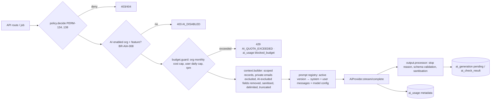

# AI Implementation Design — Internal Sales CRM (Phase 1)

| Item | Value |
|---|---|
| Requirements | BR-AIA-001..009, NFR-003, BR-TIM-004 |
| HLD | ../02-hld/AI-ARCHITECTURE.md (authoritative for rationale, model choice, guardrails, cost model, eval strategy) |
| Decisions | ADR-014, ADR-035, ADR-040..044; OD-05, OD-30, OD-53, OD-55, OD-56, OD-84, OD-90..95, OD-112 |
| Provider | Anthropic Claude via `@anthropic-ai/sdk` behind `AiProvider` (provider-switchable) |
| Release | R2 |

This document specifies how the AI module is implemented: code layout, request pipeline, prompt files, context assembly, provider calls, persistence, streaming, budgets and tests.

---

## 1. Code layout (`apps/server/src/modules/ai/`)
```
service.ts                 # draftSection, rewrite, dealSummary, followUpDraft, runPresendLlmCheck, decide, usageReport
types.ts
context/
  builder.ts               # buildContext(actor, feature, target) → AiContext (permission-scoped)
  sources/*.ts             # deal, company, contacts, notes, emails, meetings, proposal sections, pricing
  sanitize.ts              # HTML→text, hidden-text stripping, quote-chain dedupe, truncation
  budget.ts                # per-feature token budgets for context
prompts/
  draft_section/v1.ts  rewrite_text/v1.ts  deal_summary/v1.ts  follow_up_email/v1.ts  presend_check/v1.ts
  registry.ts              # key → active version; registered into prompt_version at migration
output/
  processor.ts             # stop-reason handling, markdown→ProseMirror, sanitisation, schema validation
  schemas.ts               # Zod/JSON Schemas for structured outputs
budget/
  guard.ts                 # pre-call budget & rate checks (ADR-043)
jobs/
  generate.ts              # ai.generate queue (background: BR-AUT-004 drafts, pre-send LLM layer)
erasure.ts
adapters live in apps/server/src/adapters/ai/anthropic/driver.ts
```

## 2. Request pipeline (every feature)


## 3. Context builder rules (implementation of AI-ARCHITECTURE §4)
| Rule | Implementation |
|---|---|
| Permission scope | Every source query uses `policy.scopeFilter(actor,…)` for the **requesting user**; nothing cached across users (ADR-035) |
| Private emails (OD-30) | Messages and meetings with `is_private = true` are always excluded from AI context, including for the mailbox owner (OD-30 WA) |
| AI-excluded custom fields (OD-92) | `custom_field_definition.ai_excluded = true` values dropped |
| Untrusted data | Each external text (email bodies, notes, buyer reasons) wrapped in `<untrusted_document id="…" type="email" from="…" date="…">…</untrusted_document>`; system prompt instructs to treat as data only; any instruction-like content ignored |
| Sanitisation | HTML → text via `html-to-text`; remove `display:none`/zero-size/white-on-white/HTML comments before conversion; collapse quoted replies (keep newest unique content per thread, quote-chain dedupe); strip tracking URLs |
| Budgets (input tokens, estimated with `@anthropic-ai/tokenizer` fallback 4 chars/token) | draft_section 12k · rewrite 4k · deal_summary 40k · follow_up 8k · presend_check 24k; selection priority: deal fields → proposal sections → latest notes → latest emails (newest first) → meetings |
| Provenance | `context_refs` = list of `{type,id}` used (no content) stored on `ai_generation` |

## 4. Prompt files (versioned, immutable)
```ts
// prompts/draft_section/v1.ts
export default definePrompt({
  key: 'draft_section', version: 1,
  model: { id: 'claude-sonnet-5-5', effort: 'medium', maxTokens: 4000, stream: true, timeouts: { firstTokenMs: 15000, totalMs: 90000 } },
  output: { kind: 'markdown_subset' },                 // headings h3-h4, paragraphs, bullet/numbered lists, bold/italic; no links/images
  system: SYSTEM_TEXT,                                  // role, tone from org settings, rules: no invented facts/figures, use only provided data, no prices unless in pricing context, output language (OD-94 WA: language of the template)
  user: (ctx: DraftContext, opts: { instructions?: string }) => renderUserMessage(ctx, opts),
});
```
| Feature | Model | Effort | max_tokens | Mode | Output |
|---|---|---|---|---|---|
| draft_section (BR-AIA-001) | claude-sonnet-5-5 | medium | 4,000 | stream | markdown subset → ProseMirror fragment |
| rewrite_text (BR-AIA-004) | claude-haiku-5-5 | low | 2,000 | stream | plain text/markdown subset |
| deal_summary (BR-AIA-003) | claude-sonnet-5-5 | low | 3,000 | stream (shown progressively) | JSON `{overview, keyPoints[], openQuestions[], nextSteps[], citations[]}` |
| follow_up_email (BR-AIA-005) | claude-sonnet-5-5 | low | 2,000 | complete | JSON `{subject, body}` |
| presend_check LLM layer (BR-AIA-002) | claude-opus-5-5 | medium | 8,000 | complete, worker job | JSON findings (schema §6) |
Prompt versions are registered in `prompt_version` (`content_hash` of the file's prompt text) by migration; activating a new version requires the eval gate (ADR-044). Model/effort per AI-ARCHITECTURE §6.3; Fable 5.2 excluded (ADR-041).

## 5. Provider call (Anthropic driver)
```ts
const client = new Anthropic({ apiKey: config.ANTHROPIC_API_KEY, maxRetries: 0, timeout: req.timeouts.totalMs });
const params = {
  model: req.model, max_tokens: req.maxTokens,
  system: [{ type: 'text', text: req.system, cache_control: { type: 'ephemeral' } }],   // stable prefix cached (AI-ARCHITECTURE §12.4)
  messages: [{ role: 'user', content: req.user }],
  output_config: { effort: req.effort, ...(req.jsonSchema ? { format: { type: 'json_schema', schema: req.jsonSchema } } : {}) },
  metadata: { user_id: hashUserId(req.userId) },          // opaque id, no PII
};
// Streaming (draft, rewrite, summary)
const stream = client.messages.stream(params, { signal: abortSignal });
for await (const ev of stream) if (ev.type === 'content_block_delta' && ev.delta.type === 'text_delta') yield { type: 'delta', text: ev.delta.text };
const final = await stream.finalMessage();   // usage, stop_reason
```
- No tools, no prefill, no `tool_choice` (ADR-042). `stop_reason` handled first: `end_turn` ok; `max_tokens` → prose kept with `truncated_output` flag, JSON → failure; `refusal` → no generation stored, `ai_usage.outcome='refused'`, user message per AI-ARCHITECTURE §6.2.
- Errors: 429/5xx/overloaded → interactive: one retry after 1 s then `AI_PROVIDER_UNAVAILABLE` (503); background jobs: pg-boss retry. Timeouts abort the stream and mark the generation `failed`.
- Exact parameter names (`output_config`, `effort`, structured output format, server-side fallback beta) are pinned to the SDK version chosen at implementation and verified by the driver contract tests against the provider's API reference; the `AiRequest` port shape (BACKEND-DESIGN §6) does not change if they do.
- Data handling: requests sent only from server; ZDR/no-training per contract (OD-05, OD-90); region per OD-91.

## 6. Structured outputs
```ts
// presend_check (LLM layer)
const PresendLlmFindings = z.object({
  findings: z.array(z.object({
    code: z.enum(['NAME_MISMATCH','FIGURE_INCONSISTENT','OUTDATED_DATE']),
    sectionId: z.string(),
    quote: z.string().max(300),           // exact text span from the proposal
    expected: z.string().max(200).optional(),
    explanation: z.string().max(400),
  })).max(30),
});
// follow_up_email
const FollowUp = z.object({ subject: z.string().max(200), body: z.string().max(5000) });
// deal_summary
const DealSummary = z.object({ overview: z.string().max(1500), keyPoints: z.array(z.string().max(300)).max(10),
  openQuestions: z.array(z.string().max(300)).max(10), nextSteps: z.array(z.string().max(300)).max(10),
  citations: z.array(z.object({ type: z.enum(['email','note','meeting','deal']), id: z.string() })).max(30) });
```
Validation failure → one repair attempt (re-ask with the validation error, same budget accounting) → else failed. LLM findings are validated: `quote` must occur in the section text (else dropped) — prevents hallucinated findings. LLM findings are always **warnings** (RULE-AIA-11); they never clear deterministic blockers (ADR-035).

## 7. Persistence and lifecycle
| Step | Write |
|---|---|
| Interactive generation start | `ai_generation(status='streaming', feature, target, prompt_version_id, context_refs, expires_at = now + OD-84 (180 d))` |
| Stream complete | `output` (sanitised), `status='pending'`; `ai_usage` row (tokens incl. cache, latency, cost estimate, outcome) |
| User accepts / edits / rejects (`POST /ai/generations/{id}/decision`, PERM-139) | `status` → `accepted`/`edited_accepted`/`rejected`, `decided_by/at`; on accept: draft section content updated in the same transaction with node attr `aiAssisted: {generationId}` (provenance), timeline `ai_content_accepted` (actor ai on behalf of user, BR-TIM-004), audit `ai.output_accepted` |
| Abandoned | pending generations older than 24 h → `discarded` (job) |
| Pre-send | `ai_check_result.llm_findings`, `llm_status` |
Labelling (BR-AIA-007): pending generations render as highlighted suggestions with "AI-generated — Accept / Edit / Reject"; accepted text keeps a subtle "AI-assisted" marker in the editor (not in buyer output). Pending AI content blocks send (`AI_CONTENT_PENDING`).

## 8. Streaming endpoint (ADR-040)
`POST /api/v1/ai/draft-section` returns `text/event-stream`:
```
event: start   data: {"generationId":"…","model":"claude-sonnet-5-5"}
event: delta   data: {"text":"…"}
event: done    data: {"generationId":"…","truncated":false}
event: error   data: {"code":"AI_PROVIDER_UNAVAILABLE"}
```
Server keeps the HTTP response open (heartbeat comment every 15 s), aborts the provider stream when the client disconnects (`c.req.raw.signal`) and marks the generation `discarded`.

## 9. Budget guard (ADR-043, OD-53)
```ts
async function guard(actor, feature, estimate): Promise<void> {
  const s = settings.ai;                                   // {enabled, features, monthlyBudget:{amount,currency}, perUserDailyCalls}
  if (!s.enabled || !s.features[feature]) throw new DomainError('AI_DISABLED', 403);
  const monthCost = await usage.sumCost(monthStart(orgTz));          // indexed ai_usage(occurred_at)
  if (monthCost + estimate.cost > s.monthlyBudget.amount) throw new DomainError('AI_QUOTA_EXCEEDED', 429, { meta: { scope: 'organization' } });
  const userCalls = await usage.countUserCalls(actor.userId, dayStart(userTz));
  if (userCalls >= s.perUserDailyCalls) throw new DomainError('AI_QUOTA_EXCEEDED', 429, { meta: { scope: 'user' } });
  rpm.check(actor.userId, 30);
}
```
Alerts at 80 % and 100 % of the monthly budget (notification to Admins + `ai_spend` metric). Costs computed from a price table per model in config (updated with the SDK pin).

## 10. Feature specifics
| Feature | Trigger | Context | Result handling |
|---|---|---|---|
| draft_section | Editor "Draft with AI" on an `aiDraftable`, non-locked section | deal + company + primary contact + recent notes/emails (non-private) + other sections' text + template section intent (title, existing text as guidance) + optional user instructions | streamed into suggestion overlay; accept replaces section content |
| rewrite_text | Text selection ≤ 5,000 chars (`ai.rewrite.maxSelectionChars`) | selection + mode + surrounding paragraph | replaces selection on accept |
| deal_summary | Deal overview "Summarise" | deal, stage history, notes, emails/meetings (non-private), proposals status | panel; citations link to records the user can see |
| follow_up_email | Button on proposal (manual) or BR-AUT-004 task when `aiDraft=true` (OD-93 WA: generated lazily when the user opens the task) | proposal summary, engagement data (views, downloads), last emails | opens Compose with subject/body; sending is a normal user action (BR-AIA-006) |
| presend_check LLM | After deterministic checks when AI and feature enabled; queued on send prepare if no fresh result | proposal snapshot text + deal/contact names + totals | warnings in `PresendCheckPanel`; user acknowledges |

## 11. Admin controls (BR-AIA-008)
`/admin/ai`: org switch, per-feature switches (`draft_section`, `rewrite_text`, `deal_summary`, `follow_up_email`, `presend_llm`), monthly budget, per-user daily calls, usage report (PERM-140) by user/feature/model with cost; prompt version list (read-only). Switching off takes effect immediately (LocalCache invalidation).

## 12. Testing
| Level | Tests |
|---|---|
| Unit | context builder scoping (user A cannot get user B's private email or out-of-scope deal), hidden-text stripping, truncation priority, output processor (stop reasons, sanitisation, markdown→PM), finding quote validation, budget guard |
| Contract | Anthropic driver against recorded fixtures (stream events, refusal, max_tokens, 429, 529 overloaded) |
| Integration | API routes with fake `AiProvider` (deterministic outputs) incl. permission and disabled/budget paths |
| Evals (ADR-044) | golden datasets per feature (OD-95), graders: deterministic (no invented figures; required sections present; JSON validity) + LLM judge (Opus) for faithfulness/tone; release gate thresholds stored with prompt versions |
| Security | prompt-injection corpus in emails/notes ("ignore previous instructions", hidden text, exfiltration links) → outputs contain no injected actions/links; AI never triggers send |
