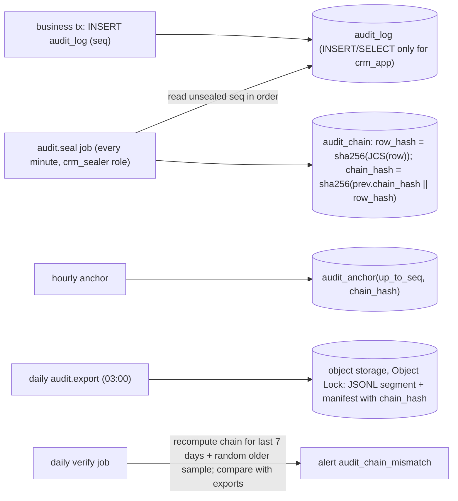

# Audit Logging Design — Internal Sales CRM (Phase 1)

| Item | Value |
|---|---|
| Requirements | BR-PLT-009 (audit log of key user, admin and system actions), NFR-009 (user, admin, system **and AI** actions), BR-AIA-007 (AI usage logged), BR-AUT-008, NFR-002/015 |
| Decisions | ADR-026, ADR-028, ADR-072 (async hash-chain sealer), ADR-083 (partitioning); OD-36, OD-84, OD-88 |
| Related | AUTHENTICATION-AUTHORIZATION §8, SECURITY-ARCHITECTURE §13, DATABASE-DESIGN §16 |

Audit log ≠ timeline: the **timeline** (BR-TIM-*) is a business history shown to sales users; the **audit log** is a tamper-evident security/compliance record visible to Admins only (PERM-150/151; PERM-152 edit/delete is denied to everyone).

---

## 1. What is audited

### 1.1 Entry format
```ts
type AuditEntry = {
  id: Uuid; seq: bigint; occurredAt: string;
  actor: ActorRef; actorType: 'user'|'buyer'|'system'|'ai';
  action: string;                 // dot.case from §3
  targetType?: string; targetId?: Uuid;
  changes?: { field: string; from?: unknown; to?: unknown }[];   // redacted (§1.3)
  requestId?: string; ipTruncated?: string; userAgent?: string;
  outcome: 'success' | 'denied' | 'failed';
};
```
### 1.2 Write path
`uow.audit(entry)` inserts into `audit_log` **in the same transaction** as the business change (no audit entry without the change and vice versa). `seq` comes from `audit_log_seq` (gapless ordering is not required; the sealer orders by `seq`). Denied/failed attempts that have no business transaction are written in their own short transaction by the error mapper (sampled per §4).

### 1.3 Redaction rules
| Data | Treatment |
|---|---|
| Personal data of contacts (names, emails, phones) | Not copied; reference ids only (`targetId`) — so erasure never needs to edit audit rows |
| Field diffs on CRM records | Field names + values for non-personal business fields (stage, amount, owner id, status); personal fields recorded as `"changed"` without values |
| Secrets/tokens/OAuth data/passwords | Never logged (`[REDACTED]`) |
| Email/AI content | Never logged; references to message/generation ids only |
| IP addresses | Truncated (IPv4 /24, IPv6 /48); nulled after OD-84 period by a retention job **via partition-level rewrite of the IP column only** (permitted exception executed by the `crm_migrator` role, recorded in `audit_anchor` notes) |

## 2. Integrity (ADR-072)

- Grants: `crm_app` INSERT/SELECT on `audit_log`; no UPDATE/DELETE; `crm_sealer` SELECT `audit_log`, INSERT `audit_chain`/`audit_anchor`; only `crm_migrator` can detach/drop partitions (retention) — every such action is itself recorded in the next export manifest.
- Sealing lag alert: unsealed rows older than 10 min → alert.
- Verification CLI: `cli verify-audit-chain --from <date> --to <date>` recomputes hashes and checks against WORM exports.

## 3. Action catalogue (minimum set)

| Area | Actions |
|---|---|
| Authentication | `auth.sign_in` (method, outcome), `auth.sign_out`, `auth.lockout`, `auth.password_reset_requested`, `auth.password_changed`, `auth.mfa_enrolled`, `auth.mfa_removed`, `auth.session_revoked`, `auth.reauth_required` |
| Users & teams (PLT) | `user.invited`, `invitation.revoked`, `invitation.accepted`, `user.role_changed`, `user.flags_changed`, `user.deactivated` (with reassignment summary), `user.reactivated`, `team.created/updated/archived` |
| Settings | `settings.updated` (section + changed keys), `settings.login_methods_changed`, `settings.mfa_policy_changed`, `settings.cross_visibility_changed`, `settings.ai_changed`, `settings.retention_changed` |
| Configuration | `pipeline.*`, `stage.*`, `custom_field.*`, `lost_reason.*`, `contact_role.*`, `tax_category.*`, `discount_limit.updated`, `exchange_rate.*`, `automation.setting_changed`, `lead_form.published/unpublished`, `assignment_rule.*`, `template.published`, `template.section_lock_changed`, `content_block.*`, `product.*`, `email_template.shared_*` |
| Data movement | `import.uploaded/committed/undone`, `export.requested/downloaded`, `erasure.requested/executed`, `retention.sweep_executed`, `report.exported` |
| CRM records | `company/contact/deal.created`, `.updated` (changed fields), `.archived/.restored`, `.owner_changed`, `deal.closed_won/closed_lost/reopened`, `records.bulk_updated`, `records.merged` |
| Proposals & sharing | `proposal.created`, `proposal.version_sent` (channel, recipients count), `proposal.voided`, `proposal.deleted`, `proposal.deal_amount_updated`, `share_link.copied`, `share_link.revoked`, `share_link.expiry_changed`, `buyer.identity_established` (buyer actor), `buyer.verification_failed`, `buyer.response_recorded` |
| E-signature | `signature_request.created/voided/reminded`, `signature_request.completed` (system), `signature_request.stale_completion`, `signed_document.stored` (hashes) |
| Email | `mailbox.connected/disconnected`, `email.sent` (no content), `email.marked_private`, `email_exclusion.created/deleted` |
| AI (NFR-009, BR-AIA-007) | `ai.generation_requested` (feature, target id; actor ai on behalf of user), `ai.output_accepted/rejected`, `ai.disabled_blocked`, `ai.budget_blocked`; per-call metrics in `ai_usage` |
| Automation | `automation.applied` (rule, target, diff), `automation.reversed`, `automation.failed` |
| Security | `permission.denied` (§4), `webhook.signature_invalid`, `rate_limit.triggered` (aggregated), `keyring.rotated`, `job.dlq_replayed` |

## 4. Denied-access logging
- Admin routes: every 403 recorded.
- Other routes: 403/404-from-scope recorded at most once per (user, route template, target) per 10 min to avoid volume amplification; buyer surface: failed exchanges and OTP failures aggregated per link per hour.

## 5. Access, search and export
- `GET /api/v1/audit-log` (Admin, PERM-150): filters actor, action prefix, target, date range; keyset pagination on `(occurred_at, id)`; partitions pruned by date.
- `POST /api/v1/audit-log/exports` (PERM-151): CSV/JSONL for a date range, with the chain hash at range end for verification.
- No UI or API to edit/delete entries (PERM-152 denied).

## 6. Retention (OD-36, OD-84, OD-88)
| Item | Default | Notes |
|---|---|---|
| `audit_log` partitions | 7 years (configurable 1–10) | detached after export verified; legal hold (OD-88) blocks detach |
| WORM exports | per Object Lock retention (OD-102) | |
| IPs in audit rows | nulled after 90 days | OD-84 |
| Erasure | audit rows never altered (ids only) | ERASURE_EXEMPT category |

## 7. Operational logs vs audit
Application logs (pino) are operational, short retention (30–90 days, OD-84), may contain ids but no personal data or content, and are not tamper-evident. Security investigations use the audit log as the system of record.
