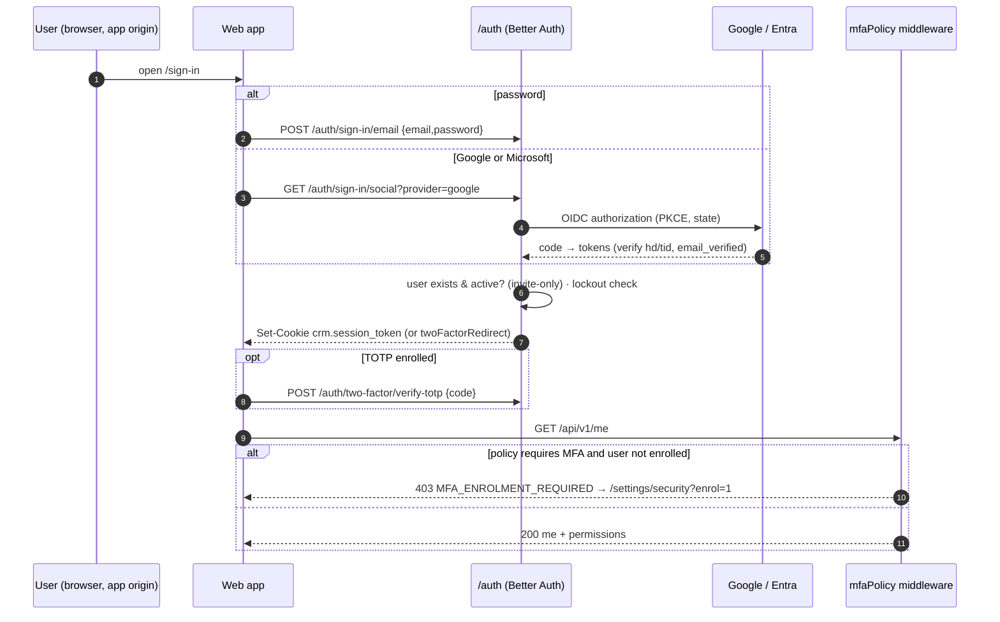
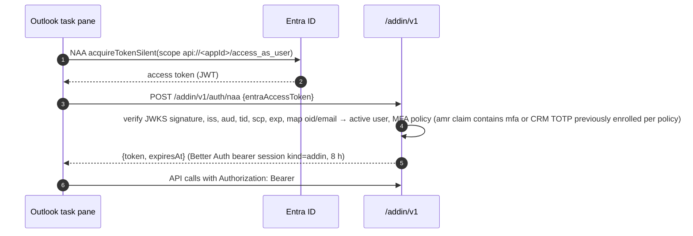
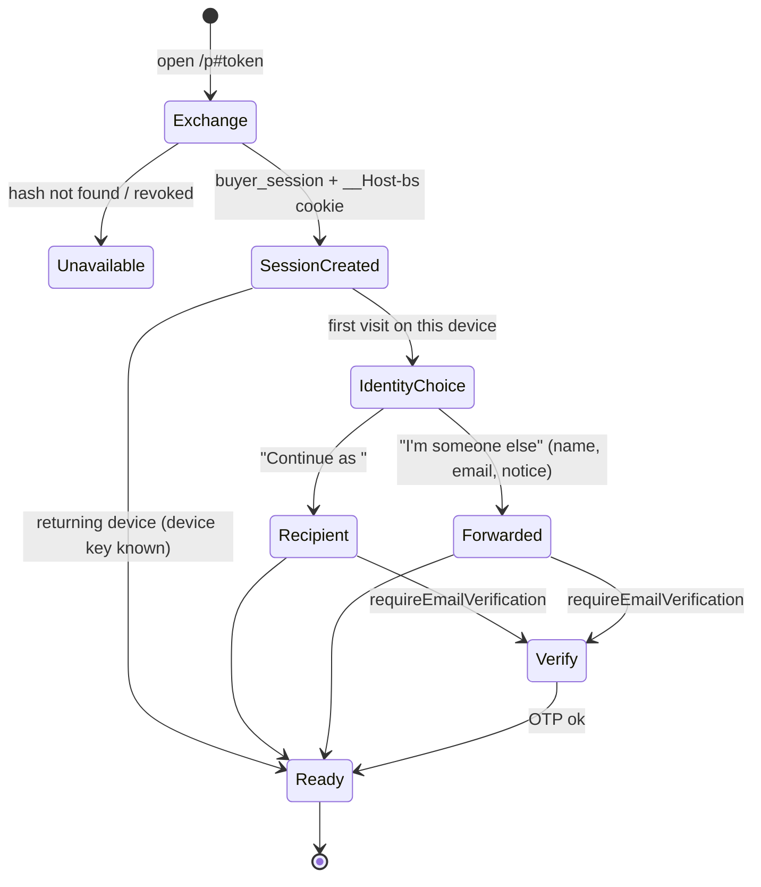

# Authentication and Authorization Design — Internal Sales CRM (Phase 1)

| Item | Value |
|---|---|
| Requirements | BR-PLT-002/003/004/005/006/011, §9.17, NFR-001, NFR-009; OD-12, OD-13, OD-31, OD-32, OD-69, OD-75..77, OD-82, OD-83 |
| Decisions | ADR-006, ADR-027, ADR-034, ADR-071, ADR-073, ADR-074, ADR-075, ADR-076, ADR-085 |
| Authoritative permissions | ../01-specifications/ROLE-PERMISSION-MATRIX.md (PERM-001..152) |

---

## 1. Principals

| Principal | Authenticates with | Session artefact | Can call |
|---|---|---|---|
| Internal user (web) | Email+password, Google, Microsoft (+ TOTP per policy) | Better Auth session cookie `crm.session_token` (app origin) | `/api/v1`, SSE |
| Internal user (Outlook add-in) | NAA Entra token or dialog sign-in | Better Auth bearer session `kind=addin`, 8 h | `/addin/v1` + documented `/api/v1` subset |
| Internal user (Gmail add-on) | Google-signed ID token per request | none (stateless) | `/addin/v1/gmail/*` |
| Buyer (recipient / forwarded viewer) | Share token (URL fragment) → exchange | `__Host-bs` cookie (buyer origin), 30 days, bound to one share link | `/public/v1` for that link only |
| Signer | E-sign provider (email possession, optional SMS) | provider-side | provider UI |
| Provider webhook | HMAC / ADR-086 baseline | none | `/webhooks/*` |
| System jobs | n/a (internal) | `system` actor | services |

## 2. Better Auth configuration (server)

```ts
export const auth = betterAuth({
  appName: 'Sales CRM',
  baseURL: config.APP_ORIGIN,
  secret: config.BETTER_AUTH_SECRET,
  database: drizzleAdapter(db, { provider: 'pg', schema: authSchema /* auth_user, auth_session, auth_account, auth_verification, auth_two_factor */ }),
  advanced: { database: { generateId: () => uuidv7() }, cookiePrefix: 'crm', useSecureCookies: true,
              defaultCookieAttributes: { sameSite: 'lax', httpOnly: true, secure: true } },
  emailAndPassword: { enabled: true, disableSignUp: true, minPasswordLength: 12, maxPasswordLength: 128,
                      requireEmailVerification: false /* invite proves email */, sendResetPassword: txEmailReset,
                      resetPasswordTokenExpiresIn: 3600 },
  socialProviders: {
    google:    { clientId, clientSecret, disableSignUp: true, prompt: 'select_account', hd: allowedGoogleDomain },
    microsoft: { clientId, clientSecret, tenantId: config.MICROSOFT_TENANT_ID /* single tenant */, disableSignUp: true },
  },
  session: { expiresIn: 60 * 60 * 12 /* 12 h absolute, OD-76 */, updateAge: 60 * 15, freshAge: 60 * 10,
             cookieCache: { enabled: false } /* always check DB so revocation is immediate */ },
  account: { accountLinking: { enabled: true, trustedProviders: ['google', 'microsoft'] } },
  rateLimit: { enabled: true, storage: 'database', window: 60, max: 10,
               customRules: { '/sign-in/email': { window: 60, max: 5 }, '/two-factor/verify-totp': { window: 60, max: 5 } } },
  plugins: [ twoFactor({ issuer: 'Sales CRM', skipVerificationOnEnable: false }), bearer() ],
  databaseHooks: {
    user:    { create: { before: requireAcceptedInvitation } },          // invite-only (IDD-02)
    account: { create: { before: enforceDomainOrTenant }, update: { before: encryptTokens } },
    session: { create: { before: rejectInactiveUser } },
  },
});
```
- **Domain/tenant enforcement** (`enforceDomainOrTenant`): Google — verify ID token `hd` claim ∈ `loginMethods.allowedDomains` and `email_verified=true`; Microsoft — verify `tid` = configured tenant and `preferred_username/email` domain ∈ allowed domains. Failure → `AUTH_DOMAIN_NOT_ALLOWED`. `hd` request parameter is only a hint and never trusted (ADR-027).
- **Method toggles**: middleware rejects disabled methods per `organization_settings.login_methods` (`AUTH_METHOD_DISABLED`).
- **Lockout** (RULE-PLT-08 values, OD-76): 5 failed password attempts in 15 min → account locked 15 min (stored in `auth_verification` keyed `lockout:<userId>`), audit `auth.lockout`.
- **Storage hardening (foundation §16 S8):**
  - `auth_session.token`: Better Auth stores the session token value; the cookie carries the token signed with `BETTER_AUTH_SECRET`. Mitigations: DB column privileges deny `crm_readonly` access to `auth_*` tables; sessions short-lived (12 h absolute, 15 min update age); on implementation, if the pinned version supports hashed session storage it is enabled; otherwise a custom `session.create.before` hook stores `sha256(token)` and a matching lookup override is added — **acceptance test:** a DB dump must not allow session hijack.
  - `auth_two_factor.secret`: the twoFactor plugin encrypts the TOTP secret with the auth secret; we additionally wrap it with the keyring (`purpose='totp'`) via hooks. Backup codes are stored hashed. **Acceptance test:** secrets unreadable from DB dump.
  - `auth_account.access_token/refresh_token/id_token` (login providers): encrypted by `encryptTokens` hook (keyring `auth_accounts`); login scopes are `openid email profile` only — no mailbox scopes here (ADR-031).
  - Passwords: Better Auth scrypt hashing (default).

## 3. Sign-in flows


- **MFA policy** (OD-13 WA `required_admins`; OD-77 TOTP also after Google/Microsoft sign-in WA: yes when the policy applies): enforced by `mfaPolicy` middleware for every `/api/v1` and `/addin/v1` request except enrolment and sign-out routes.
- **Step-up** (OD-83 WA): Admin-sensitive operations (role change, login-method change, export, erasure, key rotation, audit export) require a session `freshAge` ≤ 10 min, else 403 `REAUTH_REQUIRED` → re-enter password/TOTP.
- **Invitation acceptance**: `/invite/$token` → validates token hash, status pending, not expired (OD-75: 7 days) → user chooses password or SSO; on SSO the provider email must equal the invited email (case-insensitive) → `auth_user` + `app_user_profile(status=active)` in one transaction → invitation `accepted`.
- **Bootstrap**: `cli bootstrap --org-name --currency --timezone --admin-email` creates settings and an invitation for the first Admin; prints the one-time link to stdout (never logged elsewhere).
- **Break-glass** (OD-82 WA): one Admin account with password + TOTP kept in the company vault; password login cannot be disabled for it; every use alerts.

## 4. Add-in authentication (ADR-074/085)


- Fallback dialog flow: `Office.context.ui.displayDialogAsync(APP_ORIGIN/addin-sign-in?challenge=<S256>)` → user signs in normally (cookies first-party inside the dialog) → server issues a one-time code bound to the challenge → `messageParent(code)` → `POST /addin/v1/auth/dialog/exchange {code, codeVerifier}`.
- `kind=addin` sessions are accepted only on `/addin/v1/*` and the explicit `/api/v1` allow-list (search, deals/contacts/companies create, proposals read, send-attempt links).
- Gmail add-on: each request carries `authorizationEventObject.userIdToken`; verify with Google certs, `aud` = add-on project number, `email_verified`, domain allowed → active user; no session issued.

## 5. Buyer authentication (ADR-071, OD-69)


- Cookie: `__Host-bs=<32 random bytes base64url>`; Secure; HttpOnly; SameSite=Lax; Path=/; stored as SHA-256 in `buyer_session.session_hash`; bound to `share_link_id` and `device_key_hash` (random device id cookie `__Host-bd`).
- Each buyer session can only act on its own link's version (actor `{type:'buyer', shareLinkId}`); all `/public/v1` queries are keyed by the session's `share_link_id` — there is no id parameter that can be tampered with.
- OTP: 6 digits, 10 min, max 5 attempts, max 3 codes/hour/session, sent via TransactionalEmail to the identified email (BR-SHR-006).
- Accept/decline restricted to `is_original_recipient = true` viewer identities (OD-26).

## 6. Authorization model

### 6.1 Inputs
`Actor` (BACKEND-DESIGN §2.1): role, flags (`canManageContent`, `canManageSharedEmailTemplates`), `teamScopeIds` (R7: self + members active/inactive + co-managers of managed teams), `crossVisibility` (OD-31), AI flags. Built per request from LocalCache (TTL 60 s; `NOTIFY crm_cache` on role/team/flag/settings change → immediate invalidation on all instances).

### 6.2 Shared permission matrix (`packages/shared/src/permissions/matrix.ts`)
```ts
export const PERMISSIONS = {
  'deal.view':        { perm: 'PERM-049', roles: { admin: 'all', sales_manager: 'team', salesperson: 'own_or_view_only' } },
  'deal.edit':        { perm: 'PERM-050', roles: { admin: 'all', sales_manager: 'team', salesperson: 'own' } },
  'deal.reassign':    { perm: 'PERM-057', roles: { admin: 'all', sales_manager: 'team', salesperson: 'none' } },
  'deal.close':       { perm: 'PERM-052', roles: { admin: 'all', sales_manager: 'team', salesperson: 'own' } },
  'template.manage':  { perm: 'PERM-095', roles: { admin: 'all', sales_manager: 'flag:canManageContent', salesperson: 'none' } },
  'template.lockSections': { perm: 'PERM-096', roles: { admin: 'all', sales_manager: 'none', salesperson: 'none' } },  // R8
  'proposal.send':    { perm: 'PERM-110', roles: { admin: 'all', sales_manager: 'team', salesperson: 'own' } },
  'audit.view':       { perm: 'PERM-150', roles: { admin: 'all', sales_manager: 'none', salesperson: 'none' } },
  // … one entry per PERM-001..152 (generated from ROLE-PERMISSION-MATRIX.md and reviewed)
} as const satisfies Record<PermKey, PermissionRule>;
```
Scope values: `all | team | own | own_or_view_only | flag:<name> | self | none`. The same object drives backend `policy.decide`, SQL `scopeFilter`, and the frontend `me.permissions` payload — one definition (ROLE-PERMISSION-MATRIX §7).

### 6.3 Decision algorithm
```ts
function decide(actor: Actor, key: PermKey, resource?: VisibilityRoot): Decision {
  if (actor.type !== 'user') return systemOrBuyerRule(actor, key, resource);   // explicit allow-lists
  const rule = PERMISSIONS[key].roles[actor.role];
  switch (rule) {
    case 'none': return deny('FORBIDDEN');
    case 'all':  return allow();
    case 'self': return resource?.userId === actor.userId ? allow() : deny('FORBIDDEN');
    case 'own':  return resource && resource.ownerId === actor.userId ? allow() : deny(resource ? 'FORBIDDEN' : 'NOT_FOUND');
    case 'team': return resource && actor.teamScopeIds.includes(resource.ownerId) ? allow() : deny('FORBIDDEN');
    case 'own_or_view_only': return resource?.ownerId === actor.userId || viewOnlyGranted(actor, resource) ? allow() : deny('NOT_FOUND');
    default:     return rule.startsWith('flag:') && actor.flags[rule.slice(5)] ? allow() : deny('FORBIDDEN');
  }
}
```
- **Visibility root resolution**: child records resolve to their root (proposal → deal; task → related record; email → linked records ∪ mailbox owner) before `decide`.
- **Deal-derived read (R6)**: if the actor can view a deal, `company.view` and `contact.view` are allowed for that deal's company and deal contacts (read only).
- **Not-found vs forbidden**: when the actor cannot even view the record → 404; when they can view but not perform the action → 403 (`FORBIDDEN` / `VIEW_ONLY` / `FORBIDDEN_REASSIGN`).
- **State-dependent rules** (closed deals, terminal proposals, locked sections) are checked by the domain state machines after authorization and return 409/422 codes.
- **Field-level redaction** (`policy.redact`): private email subject/body (OD-30), secret-bearing settings fields (OAuth client secrets, webhook secrets) for non-admins, token ciphertexts never serialised.

### 6.4 Data-level enforcement
- Lists, search, reports, timelines, exports by managers use `scopeFilter` (ADR-076); see BACKEND-DESIGN §2.3 for predicates.
- DB roles enforce coarse protections: `crm_app` cannot UPDATE/DELETE `audit_log`; immutability triggers on sent versions; unique partial index for one open signature request per deal.

### 6.5 Role summary (from §9.17 + derived rows)
| Capability | Admin | Sales Manager | Salesperson |
|---|---|---|---|
| Users, teams, settings, login/MFA policy, billing (N/A IDD-03) | ✓ | – | – |
| Pipelines, custom fields, automation settings, lead forms, lists | ✓ | – | – |
| Import, full export, retention, erasure, audit log | ✓ | – | – |
| Templates, content library, product catalog | ✓ | if `canManageContent` (no section locking, no DOCX upload — R8) | – |
| View/edit records | all | own team (+co-managers, inactive members) | own; others view-only per Admin setting |
| Reassign deals/companies/contacts | all | within team | – |
| Create/send proposals, request signatures | ✓ | ✓ (team deals) | own deals |
| Revoke links, void signature requests | all | own team | own deals |
| Dashboards | organization | own team | own performance |
| AI on/off and budgets | ✓ | – | – |

## 7. Session lifecycle and revocation
| Event | Effect |
|---|---|
| Sign-out | delete current `auth_session` |
| Password change / reset | delete all sessions except current; audit |
| Role or flag change | sessions kept; LocalCache invalidated → new permissions on next request |
| Deactivation (BR-PLT-011) | delete all `auth_session` rows (web + addin); mailbox tokens revoked at provider; LocalCache invalidation; subsequent requests 401 |
| MFA policy tightened | next request → 403 `MFA_ENROLMENT_REQUIRED` until enrolled |
| Admin "sign out user everywhere" | delete sessions (PERM-006 scope) |
| Buyer link revoked | all `buyer_session` rows for the link deleted; next request → `Unavailable` |

## 8. Audit of security events
`auth.sign_in` (success/failure, method), `auth.lockout`, `auth.mfa_enrolled/removed`, `auth.password_reset`, `user.invited/role_changed/deactivated/reactivated`, `settings.login_methods_changed`, `settings.mfa_policy_changed`, `permission.denied` (sampled 1:1 for admin routes, rate-limited elsewhere), `share_link.copied/revoked`, `buyer.identity_established`, `buyer.verification_failed` — all to `audit_log` (AUDIT-LOGGING-DESIGN.md).

## 9. Test obligations
- Permission matrix test: for every PERM row × role × scope case (own / team member / co-manager record / inactive member record / other team / view-only enabled / deal-derived company/contact) assert API status (200/403/404) — generated from `matrix.ts` (TESTING-STRATEGY §5).
- Auth tests: invite-only (unknown Google account rejected), wrong `hd`/`tid` rejected, lockout, MFA enforcement, session revocation on deactivation, add-in bearer restricted routes, buyer cookie bound to link (cannot read another link), DB-dump test for session/TOTP secrets.
