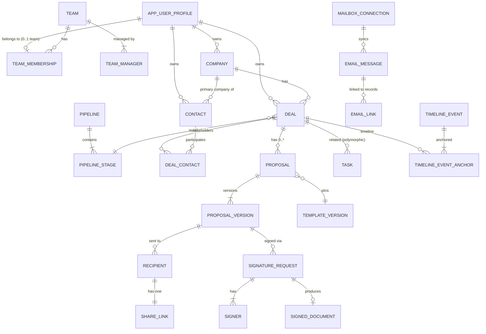
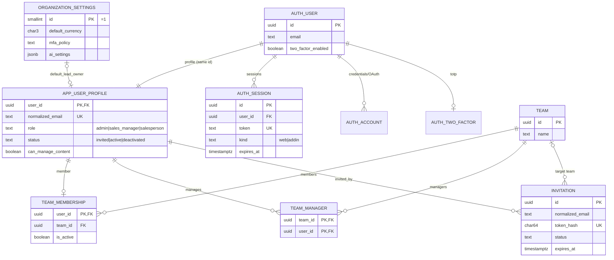
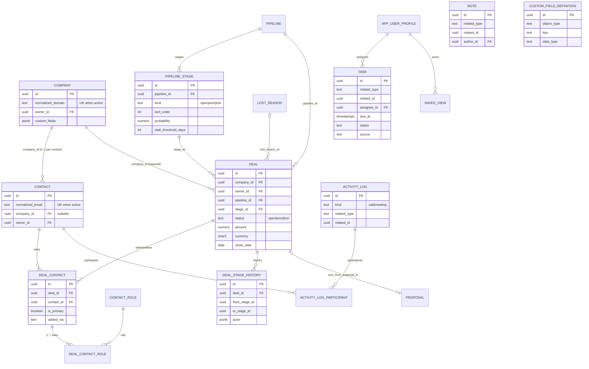
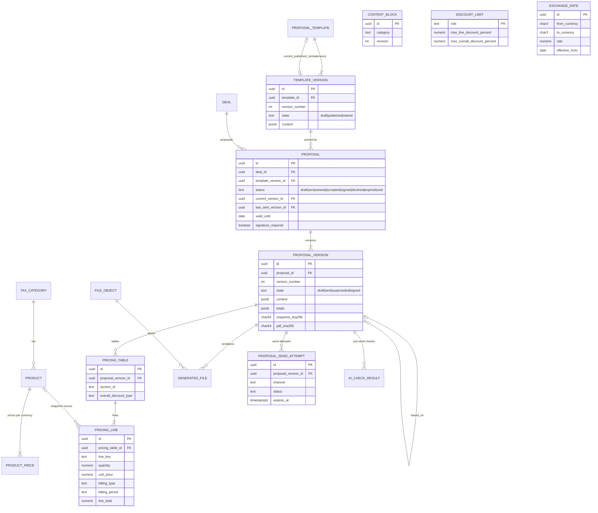
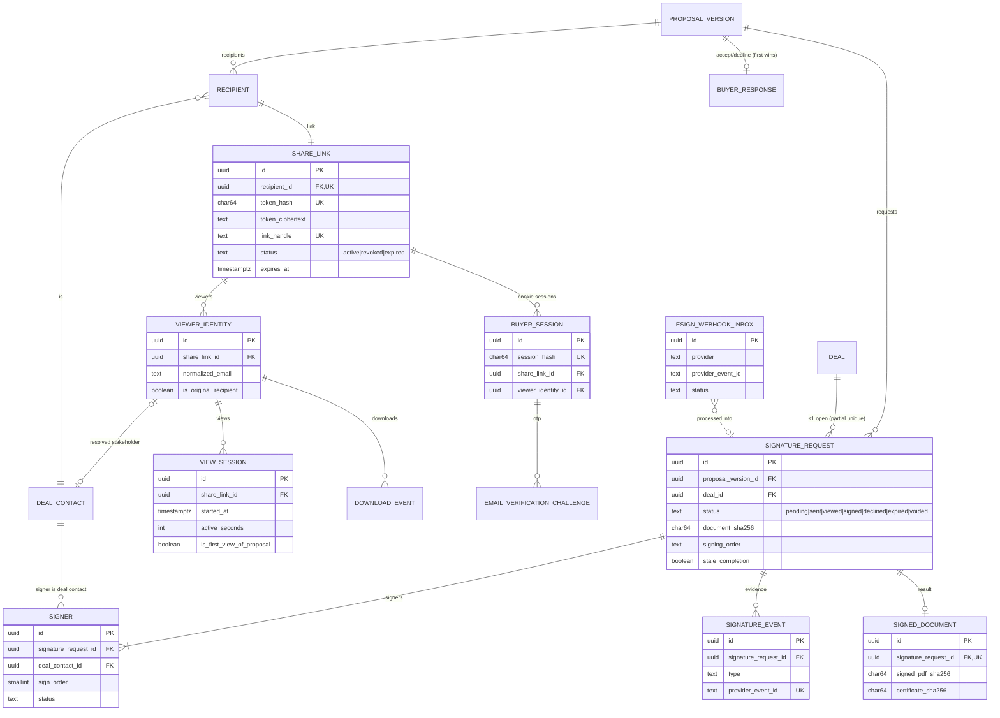
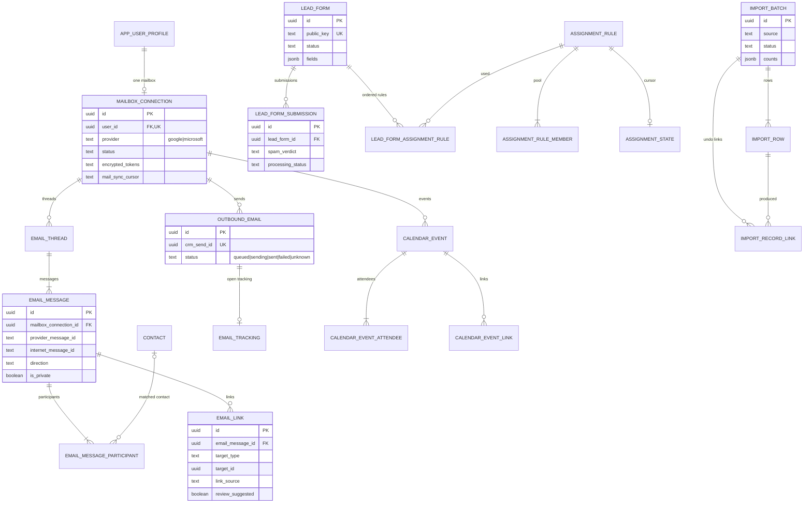

# Database ER Diagrams — Internal Sales CRM (Phase 1)

Physical ER diagrams for the schema specified in DATABASE-DESIGN.md (authoritative for columns, types, constraints and indexes). Diagrams show primary keys, foreign keys and the attributes that matter for relationships and lifecycle; audit columns (`created_*`, `updated_*`, `row_version`, `archived_*`) are omitted for readability.

Cardinality notation (Mermaid `erDiagram`): `||--o{` one-to-zero-or-many, `||--|{` one-to-one-or-many, `|o--o{` zero-or-one to many, `||--||` one-to-one.

## 1. Overview (aggregate roots and principal relationships)

## 2. Identity

## 3. CRM core

## 4. Catalog, templates and proposals

## 5. Sharing and e-signature

## 6. Communications, leads and import

## 7. AI, notifications, automation, timeline and platform

```mermaid
erDiagram
  PROMPT_VERSION ||--o{ AI_GENERATION : "ran with"
  PROMPT_VERSION ||--o{ AI_USAGE : "ran with"
  AI_GENERATION |o--|| AI_USAGE : "cost record"
  PROPOSAL_VERSION ||--o{ AI_CHECK_RESULT : checks
  APP_USER_PROFILE ||--o{ NOTIFICATION : receives
  APP_USER_PROFILE ||--o{ NOTIFICATION_PREFERENCE : prefers
  APP_USER_PROFILE ||--o{ DIGEST_RUN : digests
  PIPELINE |o--o{ AUTOMATION_SETTING : "per-pipeline config"
  AUTOMATION_EXECUTION ||--o{ DEAL_FLAG : raises
  DEAL ||--o{ DEAL_FLAG : flags
  TIMELINE_EVENT ||--|{ TIMELINE_EVENT_ANCHOR : anchors
  AUDIT_LOG ||--|| AUDIT_CHAIN : "sealed as"
  AUDIT_CHAIN }o--o| AUDIT_ANCHOR : "anchored up to"
  FILE_OBJECT ||--o{ EXPORT_JOB : archive
  ENCRYPTION_KEY ||--o{ MAILBOX_CONNECTION : "kid in ciphertext"

  AI_GENERATION { uuid id PK text feature uuid requested_by FK jsonb target text status }
  AI_USAGE { uuid id PK text feature text model int input_tokens int output_tokens numeric estimated_cost text outcome }
  NOTIFICATION { uuid id PK bigint seq UK uuid recipient_user_id FK text event_type text dedupe_key UK timestamptz read_at }
  AUTOMATION_SETTING { uuid id PK text rule_key uuid pipeline_id FK boolean enabled jsonb config }
  AUTOMATION_EXECUTION { uuid id PK text rule_key text idempotency_key UK text status jsonb before_snapshot jsonb related_changes }
  DEAL_FLAG { uuid id PK uuid deal_id FK text kind "stalled|past_close_date|signed_on_stale_version" timestamptz cleared_at }
  TIMELINE_EVENT { uuid id PK text event_type text source_type uuid source_id text actor_type boolean is_automated }
  TIMELINE_EVENT_ANCHOR { text record_type PK uuid record_id PK timestamptz occurred_at PK uuid timeline_event_id PK,FK }
  AUDIT_LOG { uuid id PK bigint seq text action text target_type uuid target_id text outcome }
  AUDIT_CHAIN { bigint seq PK char64 row_hash char64 chain_hash }
  DOMAIN_EVENT { uuid id PK text name text aggregate_type uuid aggregate_id }
  FILE_OBJECT { uuid id PK text storage_key UK char64 sha256 text purpose boolean immutable }
  IDEMPOTENCY_KEY { text scope PK text key PK char64 request_hash text status }
  RETENTION_POLICY { text category PK int retention_days text action boolean exempt }
  ERASURE_REQUEST { uuid id PK uuid subject_id text status }
```

## 8. Workflow → entity coverage check

| Workflow (WORKFLOWS.md) | Entities written | Covered |
|---|---|---|
| Lead capture → assignment (BR-LED-001..005) | lead_form_submission, company, contact, deal, deal_contact, assignment_state, notification, timeline | ✓ |
| Import + undo (BR-MIG-001..005) | import_batch, import_row, import_record_link, company/contact/deal | ✓ |
| Mailbox sync & linking (BR-EML-001..003, 006) | mailbox_connection, email_thread/message/participant/link, calendar_event/attendee/link, email_exclusion | ✓ |
| Send from CRM (BR-EML-004, 007) | outbound_email, email_tracking, email_template | ✓ |
| Proposal create/edit/version (BR-PRP-001..010, BR-PRC-002..007) | proposal, proposal_version, pricing_table, pricing_line, generated_file, discount_limit, exchange_rate | ✓ |
| AI drafting / pre-send / summary (BR-AIA-001..009) | ai_generation, ai_check_result, ai_usage, prompt_version | ✓ |
| Send + share + track (BR-SHR-001..009, BR-NTF-001) | proposal_send_attempt, recipient, share_link, buyer_session, viewer_identity, view_session, download_event, notification | ✓ |
| Accept/decline without signature (BR-SHR-010, OD-17) | buyer_response, proposal, task | ✓ |
| E-signature (BR-SIG-001..013) | signature_request, signer, signature_event, signed_document, esign_webhook_inbox | ✓ |
| Automation + reversal (BR-AUT-001..008) | automation_setting, automation_execution, deal_flag, deal_stage_history, task | ✓ |
| Reporting (BR-RPT-001..010) | read-only over deal, deal_stage_history, proposal, proposal_version, share_link, view_session, signature_request, email_message, calendar_event, task, activity_log | ✓ |
| Timeline (BR-TIM-001..004) | timeline_event, timeline_event_anchor | ✓ |
| Audit/export/erasure (BR-PLT-009/010, NFR-002/015) | audit_log, audit_chain, audit_anchor, export_job, file_object, retention_policy, erasure_request | ✓ |
