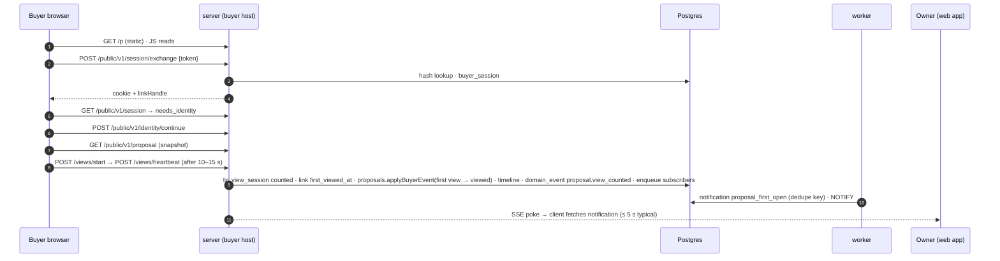

# Document Sharing and Tracking Design — Internal Sales CRM (Phase 1)

| Item | Value |
|---|---|
| Requirements | BR-SHR-001..010, BR-NTF-001, BR-AUT-001/004, BR-RPT-004/005, BR-TIM-001 |
| Rules | BUSINESS-RULES §10 (RULE-SHR-01..19), §18 expiry clocks and buyer-access precedence, SM-06 |
| Decisions | ADR-013, ADR-020, ADR-034, ADR-071, ADR-075, ADR-081; OD-21, OD-22, OD-26, OD-69, OD-70, OD-73, OD-87 |
| API | API-SPECIFICATION §10 (internal) and §11 (`/public/v1`) |

---

## 1. Objects and responsibilities
| Object | Created when | Owner module |
|---|---|---|
| `recipient` | send commit, one per intended recipient (deal contact with email) | sharing |
| `share_link` | send commit, one per recipient per sent version | sharing |
| `buyer_session` | token exchange | sharing |
| `viewer_identity` | identity gate (recipient continue / forwarded viewer) | sharing |
| `view_session`, `download_event` | buyer activity | sharing |
| `buyer_response` | accept/decline | sharing (status change via proposals) |
| `email_verification_challenge` | OTP flow | sharing |

## 2. Link generation and delivery
1. At send prepare (ADR-081), for each recipient: `token = randomBytes(32).toString('base64url')`; `token_hash = sha256(token)`; `token_ciphertext = keyring.encrypt('share_tokens', token, aad = shareLinkId)`; `link_handle = randomBytes(16).toString('base64url')`.
2. URL: `https://<buyerOrigin>/p#<token>` (ADR-071). The email body built by comms inserts one personalised URL per recipient (separate messages per recipient when `crm_email` has multiple recipients, so each person gets their own link — BR-SHR-003/004 per-person tracking).
3. Manual channel: links shown once in the send dialog; afterwards re-copy through `POST /share-links/{id}/copy` (PERM-118, audited).
4. Defaults: `require_email_verification = shareDefaults.requireEmailVerificationDefault` (OD-87), `expires_at = now + shareDefaults.defaultLinkExpiryDays` when configured.

## 3. Buyer access evaluation (BUSINESS-RULES §18.2, first matching row decides)
| # | Condition | Buyer sees | Actions allowed |
|---|---|---|---|
| 1 | token/session unknown or link revoked | Uniform "This proposal is not available" (no data) | none |
| 2 | proposal `void` | "This proposal has been withdrawn" | none |
| 3 | proposal validity passed (clock a) | "This proposal has expired" (no content, R13) | none |
| 4 | link `expires_at` passed (clock b) | "This link has expired — contact <owner name>" (no content) | none |
| 5 | identity not established on this device | identity choice (OD-69) | identify |
| 6 | verification required and not verified | OTP screen | verify |
| 7 | version superseded | content of this (old) version, banner "A newer version was sent to you" (read-only, no accept/decline) | view, download |
| 8 | proposal signed / response recorded / deal closed | content + outcome banner | view, download |
| 9 | otherwise | content | view, download, accept/decline (original recipient, `accept_decline_enabled`), signature message if a request is open |

## 4. Identity gate and forwarded viewers (BR-SHR-005, OD-26, OD-69)
- First open on a device: "Continue as **<recipient name>**" or "I'm someone else".
- "Continue as": viewer identity `is_original_recipient=true` (one per link+email); device cookie remembered.
- "Someone else": form name (1–200), email (valid), privacy notice (text + version from settings) → server:
  1. Normalise email; reject internal domains (`internal_domains`) with a neutral message (internal users use the app).
  2. Match contact by normalised email (incl. additional emails) → else create contact (owner = deal owner; company = deal company if email domain = company `normalized_domain` and not free-mail (R3), else none; source `forwarded_viewer`).
  3. `deal_contact` with system role `forwarded_viewer` if not already a stakeholder (BR-SHR-005 "recorded as new stakeholders").
  4. `viewer_identity(is_original_recipient=false)`; timeline `stakeholder_added` (actor buyer) + `proposal_forwarded`; event `share.forwarded_viewer_identified` → notification `proposal_forwarded_new_viewer` (BR-NTF-001).
- Rate limit 10 identities/hour/link; duplicates (same email) reuse the identity.
- Forwarded viewers can view and download only (OD-26); the salesperson may add them as recipient/signer (PERM-122).

## 5. View tracking (BR-SHR-004)
| Event | Rule |
|---|---|
| View start | `POST /views/start` after the proposal render model is displayed; creates `view_session` with `started_at` but **not counted** |
| Counted view | first `heartbeat` (≥ 10 s after start, document visible) marks the session counted: sets link `first_viewed_at` (if null), `last_viewed_at`; emits `proposal.view_counted {isFirstViewOfProposal, isReopen}` |
| Active time | heartbeat every 15 s while visible; `active_seconds += min(Δ, 20)`; idle tab (hidden) pauses |
| End | `sendBeacon` to `/views/end`; sessions without heartbeat for 2 min are closed by the next heartbeat or a cleanup job |
| First open (BR-NTF-001) | first counted view across all links of the proposal's current sent version → `proposal_first_open` notification; proposal `sent → viewed` |
| Reopen | a counted view by the same viewer identity starting ≥ 30 min after their previous session ended (OD-73); notification `proposal_reopen` throttled to 1 per viewer per 4 h |
| Download | `GET /download?format=pdf` → `download_event` + `proposal.downloaded` → notification `proposal_downloaded`; DOCX only if OD-70 enables |
| Internal preview | never tracked (separate internal endpoint, ADR-013) |
| Bots/scanners | cannot trigger anything: token is in the fragment (no server request) and counting needs JS heartbeats (ADR-071) |
| Privacy | `ip_truncated` (IPv4 /24, IPv6 /48), user agent; IP nulled after OD-84 period |

## 6. Accept / decline without signature (BR-SHR-010, OD-17, OD-68)
- Enabled when `proposal.signature_required = false` at send (copied to `version.accept_decline_enabled`).
- Accept: typed name (optional), shows the exact terms text (from snapshot); evidence stored (name, email, IP truncated, user agent, timestamp, `snapshot_sha256`, terms text) (ADR-025 A9). Proposal → `accepted`; event `proposal.accepted` → owner notification + OD-17 task "Confirm Closed Won" (automation `od17_task_on_accept`).
- Decline: reason required (`DECLINE_REASON_REQUIRED`); proposal → `declined`; BR-AUT-003 task.
- One response per version (`buyer_response.proposal_version_id` unique → `RESPONSE_ALREADY_RECORDED`).
- Only `is_original_recipient` identities (`RESPONSE_NOT_ALLOWED` otherwise).

## 7. Revocation, expiry and new versions
| Action | Effect |
|---|---|
| Revoke link (PERM-119) | `status=revoked`, buyer sessions deleted, next request → row 1; irreversible (new link via "add recipient") |
| Change expiry (PERM-120) | future dates only (`LINK_EXPIRY_IN_PAST`); `expiring_notified_at` reset |
| Link expiry scan (hourly) | `expires_at < now` → `expired`; `expires_at − linkExpiringNoticeHours` → `link_expiring` notification once |
| New version sent (OD-21) | previous version superseded; its links stay viewable read-only (row 7) unless revoked; new links issued for the new version |
| Proposal void | links show row 2 |
| Proposal expired (validity) | links show row 3 |

## 8. Access history (BR-SHR-008)
`GET /deals/{id}/access-history` aggregates per proposal → version → link: recipient, status, expiry, views (start, duration, device summary), downloads, forwarded viewers (name, email, first seen), responses, signature status; visible to anyone who can view the deal (OD-31).

## 9. Security controls (summary; SECURITY-ARCHITECTURE §8)
Separate buyer origin; strict CSP; `Referrer-Policy: no-referrer`; `X-Robots-Tag: noindex, nofollow`; tokens hashed + encrypted; `__Host-` cookies; uniform 404 for unknown links; per-IP and per-link rate limits; snapshot-only data exposure (no internal ids/emails); assets served through `/public/v1/assets/<fileId>` only if referenced by the session's snapshot.

## 10. Sequence — buyer first open to notification

