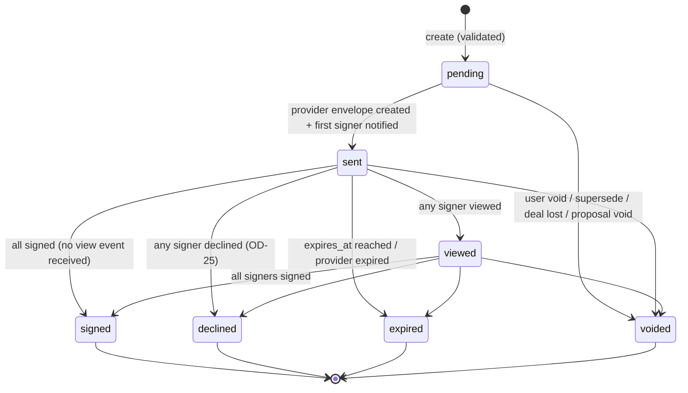
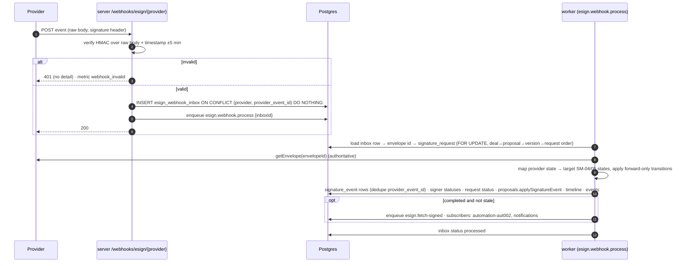

# E-Signature Design — Internal Sales CRM (Phase 1)

| Item | Value |
|---|---|
| Requirements | BR-SIG-001..013, BR-AUT-002/003, BR-NTF-001, NFR-004 |
| Rules | BUSINESS-RULES §12 (RULE-SIG-01..23), SM-04 (SignatureRequest), SM-05 (Signer), §18 |
| Decisions | ADR-012, ADR-025, ADR-036, ADR-053, ADR-086; OD-01, OD-02 (partner), OD-03 (provider TBD), OD-18, OD-19, OD-21..25, OD-42, OD-71, OD-102, OD-111 |
| Release | R2 |

---

## 1. Approach
Signing is delegated to an e-signature provider behind `ESignatureProvider` (OD-02 WA). The CRM owns: which version is signed, who signs and in what order, the lifecycle mirror (SM-04/05), automation (Closed Won), immutable storage of the sealed PDF and completion certificate, and the evidence index. The provider owns: signer authentication (email, optional SMS), consent/ERSD capture (BR-SIG-006, wording per OD-42), signature capture, sealing (tamper evidence), certificate generation, signer emails and reminders.

| BRD requirement | Fulfilled by |
|---|---|
| BR-SIG-001 request on a specific version | `signature_request.proposal_version_id` = current sent version; PDF hash asserted |
| BR-SIG-002 multiple signers, order | signers ≤ 10, `sequential` (order 1..n) or `parallel` |
| BR-SIG-003 legally valid (ESIGN/UETA, eIDAS SES) | provider evidence + OD-01 legal confirmation |
| BR-SIG-004 email verification minimum | provider email-link authentication (possession) |
| BR-SIG-005 SMS code (Should) | provider SMS authentication when `sms_verification` (phone required) |
| BR-SIG-006 consent captured | provider consent screen; `signer.consent_captured_at` + `signature_event(consented)` |
| BR-SIG-007 statuses | SM-04 mirror |
| BR-SIG-008 reminders + manual resend | provider reminder schedule (or `esign.remind` job), manual remind (1/h/signer) |
| BR-SIG-009 completion certificate | provider certificate PDF stored + hashed; `signed_document` |
| BR-SIG-010 tamper-evident, stored, sent to all | provider PAdES-sealed PDF; Object Lock storage; provider distributes to all signers; owner notified with download |
| BR-SIG-011 locked to exact version | DB immutability trigger, version `signed`, Signed final (R13) |
| BR-SIG-012 decline with reason (Should) | provider decline → OD-25 |
| BR-SIG-013 void | user void → local `voided` + provider void job |

## 2. Lifecycle

Signer states: `waiting` (sequential, earlier signer pending) → `sent` → `viewed` → `signed`; or `declined`; remaining signers → `cancelled` when the request becomes declined/expired/voided.

Late completion after local void/supersede/expiry: the request keeps its terminal local status, `stale_completion=true`, signed documents are still fetched and stored (legal record), deal flag `signed_on_stale_version`, owner notified; **no BR-AUT-002** (ADR-025).

## 3. Create request
Preconditions (RULE-SIG-*): PERM-123 on the deal; version = `proposal.last_sent_version_id` and state `sent` (not superseded) (`SIGNATURE_VERSION_NOT_ELIGIBLE`); proposal status ∈ {sent, viewed, accepted}; deal open; no open request on the deal (`sr_one_open_per_deal`, `SIGNATURE_REQUEST_ALREADY_OPEN`); signers: 1–10, each a deal contact with email (`SIGNER_NOT_DEAL_CONTACT`), unique emails (`SIGNER_DUPLICATE`), sequential orders 1..n without gaps (`SIGNING_ORDER_INVALID`), phone when SMS (`SIGNER_PHONE_REQUIRED`); internal countersigners not supported (OD-71).
Transaction: lock deal → proposal → version; insert request (`pending`, `document_sha256 = version.pdf_sha256`, `expires_at = now + esignDefaults.requestExpiryDays` default 30, reminders default `[3,7,14]`); signers (`waiting`/`sent` per order); add role `signer` to deal contacts if missing; timeline `signature_requested`; audit; enqueue `esign.dispatch`.

## 4. Dispatch job (`esign.dispatch`, key = requestId)
1. Load request; abort if no longer `pending` (voided meanwhile).
2. Download `version.pdf_file_id` bytes; `sha256(bytes) == document_sha256` else fail hard (alert `esign_hash_mismatch`, no retry).
3. `provider.createEnvelope({ name: '<Proposal number> v<n>', document, signers: [{name,email,order,phone?,auth: sms?}], routing: sequential|parallel, anchors: '[[sig:N]]', reminders, expiresAt, callbackUrl, metadata: {signatureRequestId, proposalVersionId} })`.
4. Store `provider_envelope_id`, signer `provider_recipient_id`s; status `sent`; first signers `sent`; event `signature_request.sent`.
5. Errors: retryable (5xx/429/timeouts) → pg-boss retry (5 attempts); non-retryable (4xx validation) or attempts exhausted → request stays `pending`, owner notification `signature_dispatch_failed`, user can void and recreate (SM-04 S3).

## 5. Webhooks and reconciliation (ADR-025, ADR-053)

- Forward-only mapping: status rank `pending 0 < sent 1 < viewed 2 < terminal 3`; terminal statuses never change except recording `stale_completion`.
- Unknown envelope id → inbox `ignored` (alert if repeated).
- Hourly `esign.reconcile`: for each non-terminal request, `getEnvelope` and apply; requests past `expires_at` → `expired` (provider void to stop signing).
- Missing webhook resilience: reconciliation guarantees convergence within 1 hour; UI shows "last synced" time.

## 6. Completion handling
1. `esign.fetch-signed`: `downloadCompleted(envelopeId)` → signed PDF + certificate; compute SHA-256 of each; `ObjectStorage.put(..., {immutable: true})` under `signed/<yyyy>/<mm>/<requestId>.pdf` and `certificates/...`; `signed_document` row (`source_document_sha256 = request.document_sha256`, `sealed_at` from provider); timeline `signature_completed`.
2. Proposal: `applySignatureEvent(completed)` → proposal `signed`, version `signed`, `outcome_version_id`, `signed_at`.
3. BR-AUT-002 (automation module, idempotency `aut_002:{requestId}`): deal → Closed Won stage, `amount = version.totals.tcvExclTax` (OD-16) with `amount_source = {kind:'automation', proposalVersionId}`, `close_date = completion date (org TZ)`; sibling open proposals → void (automation, OD-23); skipped with flag if deal already won/lost (R13).
4. Notifications: `proposal_signed` to owner (in-app + email), `signer_signed` per signer as they sign.
5. Distribution: provider emails the completed document to all signers; the CRM marks `distributed_at` when the provider reports it (or at completion if the provider always distributes).

## 7. Decline, void, expiry
| Event | CRM handling |
|---|---|
| Signer declines (BR-SIG-012, OD-25) | request `declined` (`declined_by_signer_id`, reason); remaining signers `cancelled`; proposal → `declined` (`decline_reason`); BR-AUT-003 task "Record outcome" for owner; notification `proposal_declined` |
| User voids request (BR-SIG-013) | PERM-125; local `voided` immediately (reason required), signers `cancelled`; enqueue `esign.void` (retries); proposal status unchanged (OD-18) |
| Proposal voided / new version sent / deal closed lost | port `esign.voidFor*` → same as user void with system reason |
| Proposal validity reached (OD-22a) | proposal expiry job voids the request (`void_reason='proposal_expired'`) |
| Request expires (clock c) | `expired`; proposal returns to its prior sent/viewed status; owner notified `signature_request_expired` |

## 8. Reminders and resend (BR-SIG-008)
- Automatic: provider reminders configured from `reminder_schedule_days` when the provider supports schedules; otherwise daily `esign.remind-scan` sends reminders on day offsets to signers in `sent`/`viewed`.
- Manual: `POST /signature-requests/{id}/remind {signerId?}` (PERM-126) → provider resend; throttled 1 per signer per hour (`RESEND_THROTTLED`); `signature_event(reminder_sent|resent)`.

## 9. Evidence and retention
| Artefact | Storage | Retention |
|---|---|---|
| Sealed signed PDF | object storage, Object Lock (OD-102), SHA-256 in DB | erasure-exempt; retention per legal schedule (OD-36) |
| Completion certificate | same | same |
| `signature_event` mirror | DB append-only | with request |
| Raw webhook payloads | `esign_webhook_inbox.raw_body` 30 days; optionally archived as `webhook_payload` file | 30 days / legal schedule |
| Version PDF sent for signature | `proposal_version.pdf_file_id` + `pdf_sha256` | with proposal |
Verification utility: `cli verify-signed --request <id>` recomputes hashes of stored artefacts and compares with DB and the provider's certificate fingerprint.

## 10. UI behaviour
- Proposal page shows signature panel: status, signing order, per-signer status/time, "Signing in progress (x of n)" badge (OD-19), actions (remind, void), downloads when signed.
- Buyer view (row 9 of §18.2) shows "A signature has been requested — please check your email" when a request is open; no embedded signing (OD-111).
- `stale_completion` requests display a warning card with the flagged deal action "Review signed stale version".

## 11. Test scenarios (must pass)
Sequential 3-signer happy path; parallel 2-signer; decline by second signer; void while signer is signing (late completion → stale handling); duplicate and out-of-order webhooks; lost webhook recovered by reconciliation; PDF hash mismatch abort; request on superseded version rejected; concurrent creation → one succeeds (unique index); BR-AUT-002 fires once under duplicate completion events; reversal of BR-AUT-002 restores deal and siblings (OD-24).
