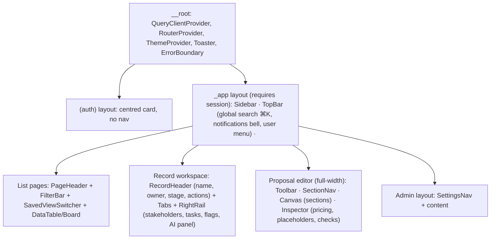

# Frontend Design — Internal Sales CRM (Phase 1)

| Item | Value |
|---|---|
| Project | `apps/web` — one Vite project, three HTML entries (ADR-020) |
| Stack | React 19, TypeScript strict, TanStack Router (file-based), TanStack Query, TanStack Table, TanStack Form + Zod, Tailwind CSS v4, shadcn/ui (Radix), TipTap (ProseMirror), dnd-kit, Recharts, date-fns + date-fns-tz, lucide-react |
| Contracts | `packages/shared` Zod schemas and types; typed API client generated from OpenAPI (`openapi-typescript` + `openapi-fetch`) |
| Accessibility | WCAG 2.1 AA (NFR-011): Radix primitives, visible focus, keyboard support for board and editor, axe checks in CI |
| Browsers | Current Chrome, Edge, Safari, Firefox; responsive down to 360 px (NFR-012) |

---

## 1. Entries and bundles

| Entry | Origin | Purpose | Bundle rules |
|---|---|---|---|
| `index.html` → `src/app/main.tsx` | App origin | Internal CRM | Route-level code splitting; editor (TipTap) and charts lazy-loaded |
| `buyer.html` → `src/buyer/main.tsx` | Buyer origin | Buyer proposal view, identity gate, accept/decline; hosted lead form page | No TanStack Router (two views, tiny state machine); target < 120 KB gzip JS; shares `packages/proposal` renderer and the branding theme only |
| `addin.html` → `src/addin/main.tsx` | App origin (loaded in Outlook) | Outlook task pane | Office.js from Microsoft CDN; bearer-token API client; 320 px layout |

Shared code: `src/shared/ui` (shadcn components, theme), `src/shared/api` (client, query keys), `src/shared/permissions` (from `packages/shared`), `src/shared/format` (money/date by org locale), `src/shared/editor` (TipTap extensions mirroring `packages/proposal` schema).

## 2. Route map (internal app)

File-based routes under `src/app/routes/`. Search params are validated with Zod (`validateSearch`) so filters/sort/pagination are shareable URLs. `beforeLoad` guards check `me.permissions`; loaders prefetch with TanStack Query (`ensureQueryData`).

| Route | Page | Guard (PERM) | Main API calls | BRD |
|---|---|---|---|---|
| `/sign-in`, `/sign-in/mfa`, `/invite/$token`, `/reset-password` | Auth pages | public | `/auth/*`, `/auth/invitations/accept` | BR-PLT-002/003/004 |
| `/` → redirect `/my-day` | | | | |
| `/my-day` | My Day | PERM-073 | `GET /my-day`, `PATCH /tasks/{id}` | BR-CRM-009 |
| `/deals` | Deals list (table) / `?layout=board` board | PERM-049 | `GET /deals`, `GET /deals/board`, `POST /deals/{id}/stage`, `GET /saved-views` | BR-CRM-011 |
| `/deals/new` (dialog route) | Create deal | PERM-048 | `POST /deals`, company/contact pickers | BR-CRM-003 |
| `/deals/$dealId` | Deal workspace (tabs below) | PERM-049 | `GET /deals/{id}` | BR-CRM-003..014 |
| `/deals/$dealId/` (Overview) | Summary, stakeholders, flags, AI summary panel | PERM-049, PERM-136 | `GET /deals/{id}/contacts`, `POST /ai/deal-summary` | BR-AIA-003 |
| `/deals/$dealId/timeline` | Timeline with type filter | PERM-148 | `GET /deals/{id}/timeline` | BR-TIM-001..004 |
| `/deals/$dealId/emails` | Email threads + compose | PERM-078, PERM-082 | `GET /emails`, `POST /emails/send` | BR-EML-002..004 |
| `/deals/$dealId/proposals` | Proposals list + create | PERM-104, PERM-103 | `GET /proposals?dealId`, `POST /deals/{id}/proposals` | BR-PRP-001 |
| `/deals/$dealId/tasks` | Tasks + notes + call logs | PERM-065..072 | `/tasks`, `/notes`, `/activity-logs` | BR-CRM-008/010 |
| `/deals/$dealId/access` | Access history | PERM-121 | `GET /deals/{id}/access-history` | BR-SHR-008 |
| `/proposals/$proposalId/edit` | Proposal editor | PERM-105 | `GET /proposals/{id}`, `PUT /proposals/{id}/draft`, AI endpoints, `POST /presend-check` | BR-PRP-002..004, BR-AIA-001/002/004 |
| `/proposals/$proposalId/preview` | Exact buyer preview (iframe, no tracking) | PERM-108 | `GET /proposals/{id}/preview` | BR-PRP-004 |
| `/proposals/$proposalId/send` (dialog route) | Send wizard | PERM-110, PERM-117 | `POST /proposals/{id}/send`, `GET /send-attempts/{id}` | BR-SHR-002/003/006/007 |
| `/proposals/$proposalId/compare?from&to` | Version compare | PERM-112 | `GET /proposals/{id}/compare` | BR-PRP-006 |
| `/proposals/$proposalId/sign` (dialog route) | Request signatures | PERM-123 | `POST /proposals/{id}/signature-requests` | BR-SIG-001..006 |
| `/proposals` | All proposals list | PERM-104 | `GET /proposals` | BR-PRP-007 |
| `/companies`, `/companies/$id` (+`/timeline`) | Companies list/detail | PERM-038 | `/companies*` | BR-CRM-001 |
| `/contacts`, `/contacts/$id` (+`/timeline`) | Contacts list/detail | PERM-043 | `/contacts*` | BR-CRM-002 |
| `/tasks` | My tasks / team tasks | PERM-067 | `GET /tasks` | BR-CRM-008 |
| `/reports` (`/pipeline`, `/won-lost`, `/reps`, `/proposals`, `/attention`, `/activity`) | Dashboards | PERM-145..147 | `GET /reports/*` | BR-RPT-001..010 |
| `/notifications` | Notification centre | PERM-143 | `GET /notifications` | BR-NTF-001 |
| `/settings/profile`, `/settings/security`, `/settings/notifications`, `/settings/mailbox` | Personal settings | PERM-010/011/141/074 | `/me`, `/auth/two-factor/*`, `/notification-preferences`, `/mailbox*`, `/email-exclusions` | BR-PLT-004, BR-EML-001/003, BR-NTF-002/003 |
| `/settings/email-templates` | Email templates | PERM-085/086 | `/email-templates` | BR-EML-004 |
| `/admin/users`, `/admin/teams` | User & team admin | PERM-001..009 | `/users`, `/invitations`, `/teams` | BR-PLT-005/006/011 |
| `/admin/organization` | Org settings, branding, currencies, login methods, MFA policy, cross-visibility | PERM-012/013/015 | `/settings` | BR-PLT-012, BR-TPL-006 |
| `/admin/pipelines`, `/admin/custom-fields`, `/admin/lists` (lost reasons, contact roles) | CRM configuration | PERM-020..024 | config endpoints | BR-CRM-005..007/014 |
| `/admin/catalog` (products, tax categories, discount limits, exchange rates) | Catalog | PERM-025..028, PERM-101 | catalog endpoints | BR-PRC-001/005..007 |
| `/admin/templates`, `/admin/templates/$id/edit`, `/admin/content-blocks` | Template builder, content library | PERM-095..099 | template endpoints | BR-TPL-001..008 |
| `/admin/lead-forms`, `/admin/lead-forms/$id`, `/admin/assignment-rules` | Lead capture config | PERM-089..093 | lead endpoints | BR-LED-001..007 |
| `/admin/imports`, `/admin/imports/$id` | Import wizard and history | PERM-029..033 | `/imports*` | BR-MIG-001..006 |
| `/admin/automation` | Built-in rule settings + execution log | PERM-130/132 | `/automation/*` | BR-AUT-001..008 |
| `/admin/ai` | AI toggles, budgets, usage | PERM-133/140 | `/settings`, `/ai/usage` | BR-AIA-008 |
| `/admin/data` | Export, retention, erasure, audit log, jobs/DLQ | PERM-016/018/035/150 | `/exports`, `/settings/retention`, `/erasure-requests`, `/audit-log`, `/admin/jobs` | BR-PLT-009/010 |
| `/setup` | Onboarding checklist | PERM-019 | `/setup-checklist` | BR-PLT-008 |
| `*` | Not found / forbidden pages | | | |

Navigation (sidebar) items are filtered by `me.permissions.can.*`; admin section visible to Admins (and to managers with `canManageContent` for templates/content/catalog only).

## 3. Layout structure

## 4. Major components

| Component | Responsibility | Notes |
|---|---|---|
| `DataTable<T>` | TanStack Table with server-side sort/filter/cursor pagination, column chooser, row selection for bulk actions, CSV export button where permitted | virtualised rows (`@tanstack/react-virtual`) > 200 rows |
| `FilterBar` / `SavedViewSwitcher` | Typed filter builders incl. custom fields; saves `definition` to `/saved-views` | URL search params are the source of truth |
| `DealBoard` | Columns per stage with count and amount; dnd-kit drag (pointer + keyboard sensors); optimistic stage move with rollback on 409/422; Won/Lost drop opens close dialogs | BR-CRM-011 |
| `RecordPicker` (company/contact/user) | Async combobox over `/search` with create-inline option and duplicate warning | |
| `CustomFieldsForm` | Renders fields from definitions (7 data types) with Zod schema generated at runtime | BR-CRM-007 |
| `Timeline` | Infinite list grouped by day; filter chips by event type; actor badges (user/buyer/system/AI); "Automated" label with Reverse action (PERM-129) | BR-TIM-001..004, BR-AUT-008 |
| `EmailThreadView` | Sanitised HTML in `<iframe sandbox="" srcdoc>` (no scripts, no same-origin), remote images blocked with "show images" toggle; private emails show metadata card | OD-30, ADR-026 |
| `ComposeEmail` | TipTap mini editor, template picker, placeholder resolution preview, tracking toggle (if org allows) | BR-EML-004/007 |
| `ProposalEditor` | TipTap per section; locked sections rendered read-only with lock icon; placeholder chips (resolved value tooltip, missing = red); `pricingTable` node renders `PricingTableEditor`; content block insert; AI draft/rewrite actions with streaming preview and Accept/Edit/Reject bar; AI-generated ranges highlighted until accepted (BR-AIA-007) | autosave every 3 s idle via `PUT /draft` with rowVersion; conflict → reload prompt |
| `PricingTableEditor` | Line grid (product picker, qty, unit price, discount, tax, billing type/period), live totals using `packages/shared/pricing` (same decimal logic as server) with server recompute as authority; discount-limit warning badges | BR-PRC-002..004/007 |
| `PresendCheckPanel` | Shows deterministic findings (blockers) and LLM findings (warnings with acknowledge) | BR-AIA-002, OD-56 |
| `SendWizard` | Steps: recipients (deal contacts with email; add contact) → delivery (CRM email with template / copy links manually) → options (verification, link expiry) → confirmations (amount differs, discount, open signature void) → progress (polls send attempt) | ADR-081 |
| `SignatureRequestDialog` | Signers from deal contacts, order (drag), parallel toggle, SMS phone, reminders/expiry; status tracker with per-signer progress (OD-19 badge) | BR-SIG-001..013 |
| `VersionCompare` | Side-by-side section diffs (word-level), pricing changes table, totals delta | BR-PRP-006 |
| `NotificationBell` | Unread count; dropdown list; uses `useNotifications` (poll 30 s + SSE poke) | BR-NTF-001 |
| `ReportCard`/charts | Recharts bar/funnel/line; tables with CSV export | RPT-* |
| `ImportWizard` | Upload → map columns → validate (progress) → resolve duplicates → commit (progress) → result + undo | BR-MIG-001..005 |
| `TemplateBuilder` | Section list (add/reorder/lock/required/AI-draftable), TipTap canvas with placeholder inserter (catalogue), image upload, pricing table placement, publish dialog with version notes | BR-TPL-001..004 |
| `LeadFormBuilder` | Field list mapped to CRM fields, preview iframe of hosted page, embed snippet copy | BR-LED-001 |

## 5. Forms and validation
- TanStack Form with Zod adapters; the **same Zod schema** from `packages/shared/contracts` validates on the client (field-level, on blur + submit) and on the server.
- Server `problem+json` `errors[].path` are mapped back to form fields (`form.setErrorMap`); non-field errors shown in a form-level `Alert`.
- `CONFIRMATION_REQUIRED` responses open a confirmation dialog listing `meta.confirmations`; on confirm the request is replayed with `confirm: [...]` (same Idempotency-Key where applicable).
- Money inputs: string-based decimal input with locale formatting on blur; never JS floats for arithmetic (use `decimal.js` via shared utils).
- Dates: stored ISO; displayed and entered in the user's/org's time zone (`date-fns-tz`).

## 6. State management and data fetching
| Kind | Tool | Rules |
|---|---|---|
| Server state | TanStack Query | Query keys from `src/shared/api/keys.ts` (e.g. `['deal', id]`, `['deals', filters]`); `staleTime` 30 s lists / 10 s details; mutations invalidate precise keys; optimistic updates only for stage moves, task completion, notification read |
| URL state | TanStack Router search params | filters, sort, cursor, tabs, layout |
| Local UI state | React state / `useReducer` | dialogs, editor UI |
| Editor document | TipTap editor state | serialised to API on autosave; never kept in Query cache while editing |
| Real-time | `useEventStream` (EventSource with retry/backoff) | on `notification` → invalidate `['notifications']`; on `invalidate {resource,id}` → invalidate matching keys (e.g. proposal status changed by buyer view) |
| Permissions | `useMe()` (`GET /me`) + per-record `permissions` object | UI never computes visibility; buttons hidden or disabled with tooltip |

API client: `openapi-fetch` with middleware adding `X-Request-Id`, `Idempotency-Key` (generated per user action and kept across retries), CSRF Origin is automatic (same-origin), JSON problem parsing into `ApiError {status, code, detail, errors, meta}`. 401 → redirect to `/sign-in?next=`; 403 `MFA_ENROLMENT_REQUIRED` → `/settings/security?enrol=1`.

## 7. Permission-aware UI rules
1. Route guard: `beforeLoad` redirects to `/forbidden` when the PERM is false (defence only; API enforces).
2. Record actions come from the record's `permissions` object (`deal.permissions.reassign`). Hidden when never possible for the role; disabled with reason tooltip when state-dependent (e.g. "Closed deals can be edited by owner/manager/admin").
3. View-only records (cross-visibility) render forms read-only with a "View only" badge (`VIEW_ONLY`).
4. Locked proposal sections: read-only for every role (R8).
5. AI actions hidden when `settings.ai.enabled=false` or feature off; budget exhausted → disabled with message.

## 8. Loading, empty and error states
| State | Pattern |
|---|---|
| Initial load | Skeletons matching layout (table rows, record header); no spinners for < 300 ms (delayed indicator) |
| Background refresh | Subtle progress bar in TopBar |
| Empty | Purposeful empty states with primary action (e.g. "No deals yet — Create deal / Import data"); filtered-empty shows "Clear filters" |
| Error (query) | Inline `ErrorState` with retry and request id; 404/forbidden → dedicated pages that do not reveal existence |
| Error (mutation) | Toast for transient errors; inline field errors for validation; conflict (409 CONCURRENT_MODIFICATION) → dialog "This record changed. Reload / Overwrite not allowed" with diff summary |
| Offline | Banner when `navigator.onLine=false`; mutations disabled |
| Long jobs (import, PDF, export, send) | Progress components polling job/attempt status; safe to leave page (status visible on return) |

## 9. Buyer app (`buyer.html`)
- Boot: read `location.hash` → `history.replaceState(null, '', '/p')` → `POST /public/v1/session/exchange` → navigate to `/v/<linkHandle>`; on reload of `/v/<handle>` use cookie (`GET /public/v1/session`).
- Views: `Unavailable` (uniform message, no data) · `IdentityGate` ("Continue as <name>" / "I'm someone else" with name, email, privacy notice) · `VerifyEmail` (6-digit OTP) · `ProposalView` (renders frozen snapshot via `packages/proposal` React renderer with org branding; sticky action bar: Download PDF, Accept / Decline when enabled; signing status message "Check your email to sign" when a signature request exists, OD-111) · `Superseded` banner · `Expired` notice.
- Tracking: `views/start` after render; heartbeat every 15 s while `document.visibilityState === 'visible'` with active-seconds counting; `views/end` via `navigator.sendBeacon`.
- Mobile-first layout, pinch-zoom allowed, pricing tables scroll horizontally, WCAG AA contrast enforced against brand colours (fallback to accessible text colour) (BR-SHR-009, NFR-011).
- Hosted lead form route `/f/<publicKey>`: renders fields, honeypot, Turnstile widget when enabled, postMessage height to parent; success message or redirect.
- Strict CSP: `default-src 'self'; script-src 'self' https://challenges.cloudflare.com (form only); img-src 'self' data: blob:; frame-ancestors 'none'` (proposal) / allowed origins (form).

## 10. Outlook add-in (`addin.html`) — R3
- Office.js `Office.onReady`; auth via NAA (`createNestablePublicClientApplication`) → `/addin/v1/auth/naa`; fallback dialog sign-in.
- Read mode: shows matched contacts/companies/deals for sender/recipients (`/addin/v1/context`), quick create, link email, AI summary of the deal.
- Compose mode: pick deal → proposal → recipients → "Insert proposal links" (inserts per-recipient links into body via `item.body.setSelectedDataAsync`); listens to `ItemSend` (where supported) or offers "Confirm sent" to commit the send attempt.
- Gmail add-on uses server-rendered cards (no frontend code).

## 11. Testing (frontend)
Component tests with Vitest + Testing Library (forms, table filters, permission rendering, pricing totals parity with server vectors), Playwright E2E per TESTING-STRATEGY.md, axe accessibility scans on key pages, visual regression for the buyer proposal renderer (golden screenshots).
