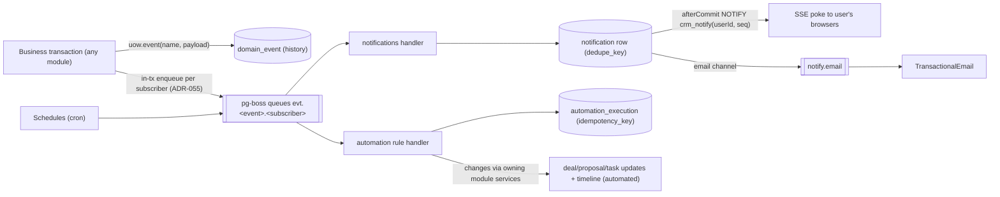

# Notification, Automation and Background-Job Design — Internal Sales CRM (Phase 1)

| Item | Value |
|---|---|
| Requirements | BR-NTF-001..004, BR-AUT-001..008, BR-LED-003, BR-CRM-008/009, BR-RPT-005, BR-PLT-008 (setup checklist completion events), NFR-005 |
| Rules | BUSINESS-RULES §11 (RULE-NTF-*, §11.1 trigger catalogue), §13 (RULE-AUT-01..70) — authoritative |
| Events | WORKFLOWS.md §0.3 domain-event catalogue — authoritative names |
| Decisions | ADR-007, ADR-022, ADR-023, ADR-024, ADR-037, ADR-054, ADR-055, ADR-087; OD-17, OD-23, OD-24, OD-35, OD-47, OD-72..74, OD-93 |

---

## 1. Event → job → effect pipeline

Every handler is idempotent (unique `notification.dedupe_key`, unique `automation_execution.idempotency_key`), runs with a `system` actor, and calls owning-module services (never foreign tables).

## 2. Notifications (BR-NTF-001..004)

### 2.1 Catalogue (from BUSINESS-RULES §11.1)
| eventType | Trigger event | Recipient | Default channels (OD-72) | Dedupe key |
|---|---|---|---|---|
| `proposal_first_open` | `proposal.view_counted` (first on version) | current deal owner | in-app + email | `first_open:{versionId}` |
| `proposal_reopen` | `proposal.view_counted` (isReopen, OD-73) | owner | in-app | `reopen:{viewerIdentityId}:{4h bucket}` |
| `proposal_forwarded_new_viewer` | `share.forwarded_viewer_identified` | owner | in-app + email | `fwd:{proposalId}:{contactId}` |
| `proposal_downloaded` | `proposal.downloaded` | owner | in-app | `dl:{viewerIdentityId}:{versionId}:{4h bucket}` |
| `proposal_accepted` | `proposal.accepted` | owner | in-app + email | `accepted:{versionId}` |
| `proposal_declined` | `proposal.declined` | owner | in-app + email | `declined:{versionId}` |
| `signer_signed` | `signature.signer_signed` (not last) | owner | in-app | `signer:{signerId}` |
| `proposal_signed` | `signature_request.completed` | owner | in-app + email | `signed:{signatureRequestId}` |
| `signature_request_expired` | `signature_request.expired` | owner | in-app + email | `sr_expired:{id}` |
| `signature_dispatch_failed` | `signature_request.dispatch_failed` | requester + owner | in-app + email | `sr_dispatch_failed:{id}` |
| `link_expiring` | link-expiry scan | owner | in-app + email | `link_expiring:{shareLinkId}:{expiresAt}` |
| `proposal_expired` (derived, R13) | `proposal.expired` | owner | in-app | `expired:{proposalId}:{validUntil}` |
| `new_lead_assigned` | `lead.assigned` | assignee | in-app + email (immediate, BR-LED-003) | `lead:{submissionId}` |
| `task_assigned` | `task.created` (assignee ≠ actor) | assignee | in-app | `task_assigned:{taskId}` |
| `task_due` | `task.reminder_due` (scan) | assignee | in-app + email (OD-47) | `task_due:{taskId}:{reminderAt}` |
| `task_overdue` | `task.overdue` (scan) | assignee | in-app | `task_overdue:{taskId}:{dueAt}` |
| `deal_stalled` | `deal.flagged` (stalled) | owner | in-app | `stalled:{dealId}:{lastActivityAt}` |
| `signed_on_stale_version` | `deal.flagged` (stale) | owner | in-app + email | `stale:{signatureRequestId}` |
| `mailbox_reauth_required` | `mailbox.reauth_required` | mailbox owner | in-app + email | `reauth:{connectionId}:{day}` |
| `ai_budget_threshold` | budget guard 80 %/100 % | Admins | in-app + email | `ai_budget:{month}:{80|100}` |

Recipient resolution happens **when the handler runs** using the deal's current owner (reassignment re-targets, foundation §9). Deactivated recipients are skipped (their manager is not auto-substituted in Phase 1).

### 2.2 Handler algorithm
```ts
async function onEvent(evt) {
  const spec = CATALOGUE[evt.name].filter(s => s.guard(evt));
  for (const s of spec) {
    const recipient = await s.resolveRecipient(evt);            // e.g. crm.getDealOwner(dealId)
    if (!recipient?.active) continue;
    const prefs = await prefsFor(recipient, s.eventType);       // user prefs ∪ org defaults
    if (!prefs.inApp && !prefs.email) continue;
    await uow(system, async u => {
      const inserted = await notifications.insertIfAbsent(u, { dedupeKey: s.dedupeKey(evt), recipient, eventType: s.eventType,
        subject, dealId, title: s.title(evt), body: s.body(evt), linkPath: s.link(evt), channels: prefs });
      if (inserted && prefs.email) await u.enqueue('notify.email', { notificationId: inserted.id });
      if (inserted) u.afterCommit(() => notifyChannel('crm_notify', `${recipient.id}:${inserted.seq}`));
    });
  }
}
```
- Titles/bodies contain names and proposal titles only (no email content); links are relative app paths.
- Email channel renders React Email templates; `email_status` tracked; failures retried 5×, then `failed` + `notification.email_failed` event (in-app still delivered).
- Delivery latency target: < 5 s typical (in-tx enqueue → worker poll interval 1 s for `evt.*` queues → NOTIFY → SSE), guaranteed ≤ 60 s by the 30 s client poll (NFR-005).

### 2.3 Preferences (BR-NTF-002) and digest (BR-NTF-003)
- `notification_preference` per user × eventType (in-app/email); missing rows fall back to `organization_settings.notification_defaults` (Admin, PERM-144).
- Digest: schedule `notify.digest` every 15 min selects users whose `local_time` falls in the window (user TZ), builds a summary for the previous 24 h of their deals (views, forwards, downloads, responses, signatures, new leads, overdue tasks, stalled deals), sends one email, `digest_run(user, date)` unique → idempotent; empty → `skipped_empty`.
- Browser push (BR-NTF-004, Could) deferred (OD-47).

## 3. Automation (BR-AUT-001..008, ADR-024)

### 3.1 Built-in rules
| rule_key | Trigger | Guard (RULE-AUT) | Action | Idempotency key | Reversal |
|---|---|---|---|---|---|
| `aut_001_stage_on_send` | `proposal.version_sent` | deal open; target stage configured for pipeline; current stage order < target (RULE-AUT-11); not imported, not re-share (RULE-AUT-07) | `crm.deals.applyAutomation(moveStage target)` | `BR-AUT-001:{proposalVersionId}` | restore previous stage if deal still at target (RULE-AUT-14) |
| `aut_002_won_on_signed` | `signature_request.completed` (non-stale) | deal open (won → skip + notify; lost → skip + task, RULE-AUT-21) | stage = Closed Won; amount = TCV excl. tax; close date = completion date (RULE-AUT-22); child execution `od23_void_siblings` | `BR-AUT-002:{signatureRequestId}` | restore stage/amount/close date + optionally child voids (RULE-AUT-25); recorded as reopen |
| `od23_void_siblings` | child of BR-AUT-002 | sibling status ∈ {draft, sent, viewed, accepted} | `proposals.voidByAutomation(siblings)` storing prior statuses | `OD23:{signatureRequestId}:{proposalId}` | `proposals.restoreFromAutomation` |
| `aut_003_task_on_decline` | `proposal.declined` | deal open | task "Record outcome — <title> was declined" due next day | `BR-AUT-003:{proposalVersionId}` | cancel task if open |
| `od17_task_on_accept` | `proposal.accepted` | deal open | task "Confirm Closed Won — <title> accepted" due today | `OD17:{proposalVersionId}` | cancel task if open |
| `aut_004_follow_up_unanswered` | `proposal.version_sent` → delayed job at `sentAt + followUpAfterDays` (default 3) | version still current; proposal status `sent`; not answered (RULE-AUT-61) | task "Follow up on <title> — not yet viewed"; AI draft per OD-93 | `BR-AUT-004:{proposalVersionId}` | cancel task; discard draft |
| `aut_005_stalled_flag` | hourly scan | open; stage `stall_threshold_days = N`; `now − last_activity_at > N d`; not dismissed | `deal_flag(stalled)` + `deal_stalled` notification | `BR-AUT-005:{dealId}:{lastActivityAt}` | dismiss for N days |
| `aut_006_overdue_flag` | daily 00:15 org TZ + on close-date change | open; `close_date < today` | `deal_flag(past_close_date)` (no notification, RULE-AUT-41) | `BR-AUT-006:{dealId}:{closeDate}` | dismiss until close date changes |

### 3.2 Execution algorithm (RULE-AUT-02..08)
```ts
async function execute(rule, trigger) {
  const key = rule.idempotencyKey(trigger);
  if (await executions.exists(key)) return;                       // RULE-AUT-03
  await uow(systemActor('automation'), async u => {
    const target = await rule.lockTarget(u, trigger);             // SELECT … FOR UPDATE (deal first)
    const settings = await automation.settings(rule.key, target.pipelineId);
    if (!settings.enabled) return record(u, key, 'skipped_precondition', 'RULE_DISABLED');
    const plan = rule.evaluate(trigger, target, settings);        // pure domain function
    if (plan.skip) return record(u, key, 'skipped_precondition', plan.reason);
    const { before, after, created, related } = await rule.apply(u, plan);   // via owning services
    const exec = await record(u, key, 'applied', null, { before, after, created, related, rowVersionAfter: target.rowVersion + 1 });
    await u.timeline({ eventType: 'automation_applied', isAutomated: true, automationExecutionId: exec.id, actor: systemActor, ... });
    await u.audit({ action: 'automation.applied', target, changes: diff(before, after) });
    await u.event({ name: 'automation.executed', ... });
  });
}
```
Unique-violation on `idempotency_key` inside the transaction (concurrent duplicate) → treated as already executed. Failures retried 3× (RULE-AUT-08) then `failed` execution row in a separate transaction + Admin-visible log.

### 3.3 Reversal (BR-AUT-008, OD-24, RULE-AUT-06)
`POST /automation/executions/{id}/reverse` (PERM-129, actor must be able to edit the target):
1. Lock target(s); for each changed field compare current value with `after_snapshot`; any difference → 409 `AUTOMATION_REVERSAL_STALE` with `meta.diff` (fields, current vs expected).
2. Restore `before_snapshot` fields through owning services (deal stage/amount/close date; proposals' prior statuses for `related_changes`; cancel created tasks if open).
3. Execution → `reversed` (`reversed_by/at/reason`), timeline `automation_reversed` (actor user), audit, event `automation.reversed`. Idempotency key retained → same trigger never re-fires (RULE-AUT-03). Reversal of a reversal not supported (`AUTOMATION_ALREADY_REVERSED`).

### 3.4 Activity tracking for stalled detection (OD-35, RULE-AUT-31)
`crm.deals.recordActivity(u, dealId, occurredAt)` is called by: stage change by user, email stored/sent linked to the deal (incl. private metadata), meeting linked, note created, activity log, task completed on the deal, version sent, counted buyer view, download, buyer response, signer events. Not called by automation or internal previews (RULE-AUT-09). It sets `last_activity_at = greatest(last_activity_at, occurredAt)` and clears an open stalled flag (RULE-AUT-34).

### 3.5 Admin settings (PERM-130)
`/admin/automation` lists the built-in rules with enable toggles and parameters: BR-AUT-001 target stage per pipeline; BR-AUT-004 follow-up days (1–60) + AI draft toggle; BR-AUT-005 stall days per stage (edited on pipeline stages); BR-AUT-006 on/off; OD-17 task on/off; OD-23 void siblings on/off. Changes audited; apply to future triggers only (RULE-AUT-01). Execution log (PERM-132) with filters and reversal action.

## 4. Background job catalogue (complete)

| Queue / schedule | Cadence / trigger | Role | Concurrency | Retry | Purpose |
|---|---|---|---|---|---|
| `evt.<event>.<subscriber>` | domain events | worker | 5 | 5×, exp. 30 s | notifications, automation, follow-ups |
| `notify.email` | notification with email channel | worker | 4 | 5× | transactional email |
| `notify.digest` | every 15 min | worker | 1 | 3× | daily digest |
| `task.reminder-scan` | every 5 min | worker | 1 | — | `task.reminder_due`, `task.overdue` events |
| `automation.aut004-check` | delayed (`startAfter`) | worker | 5 | 5× | BR-AUT-004 guard + action |
| `automation.aut005-stalled` | hourly | worker | 1 | 3× | stalled flags |
| `automation.aut006-overdue` | daily 00:15 org TZ | worker | 1 | 3× | overdue flags |
| `proposal.expiry-scan` | every 15 min | worker | 1 | 3× | validity expiry (OD-22a) |
| `share.link-expiry-scan` | hourly | worker | 1 | 3× | link expiry + expiring notices |
| `pdf` (`render_pdf`, `render_docx`) | send prepare, previews, exports | **renderer** | 1–2 | 3× | documents |
| `mail.sync-dispatch` → `mail.sync` | every 3 min → per mailbox | worker | 4 (bulkhead per provider) | 5× | email/calendar sync |
| `mail.send` | user send / proposal send | worker | 4 | 3× (never on ambiguous) | send via mailbox |
| `mail.purge-excluded` | exclusion created | worker | 1 | 3× | retroactive purge |
| `lead.submission.process` | submission | worker | 4 | 5× | lead processing |
| `import.validate/commit/undo` | admin action | worker | 1 each (singleton batch) | 1× (resume by chunk) | imports |
| `esign.dispatch/void/remind/webhook.process/fetch-signed` | see E-SIGNATURE-DESIGN | worker | 2–4 | 5× | e-signature |
| `esign.reconcile` | hourly | worker | 1 | — | convergence |
| `ai.generate` | BR-AUT-004 drafts, pre-send LLM layer | worker | 2 | 2× | background AI |
| `ai.discard-stale` | hourly | worker | 1 | — | discard pending generations > 24 h |
| `audit.seal` | every minute | worker (sealer DB role) | 1 ordered | — | hash chain |
| `audit.export` | daily 03:00 | worker | 1 | 3× | WORM export |
| `export.full` | admin | worker | 1 | 2× | data export |
| `erasure.execute` | admin | worker | 1 | 3× | erasure handlers |
| `retention.sweep` | daily 02:00 | worker | 1 | 3× | retention |
| `purge.*` (idempotency, rate limits, webhook inbox, preview files, buyer sessions) | daily | worker | 1 | — | housekeeping |
| `ops.queue-health` | every 5 min | worker | 1 | — | metrics/alerts |
| `ops.integrity-check` | daily | worker | 1 | — | orphan polymorphic refs, hash verification sample |

DLQ: every queue `<queue>.dlq`; Admin jobs view (`/admin/data` → Jobs) shows depth and allows replay (`POST /api/v1/admin/jobs/{queue}/dlq/{jobId}/replay`); alert when DLQ depth > 0 for 15 min (ADR-051).

## 5. Real-time channel (ADR-023)
- Server: one dedicated `pg` client per instance `LISTEN crm_notify, crm_invalidate, crm_cache`; SSE connections registered per user (max 5 per user); on `crm_notify` payload `userId:seq` → write `event: notification\ndata: {"seq":…}` to that user's streams; on `crm_invalidate` payload `resource:id[:dealId]` → forward to users who have the resource open (best-effort, client refetches with its own permissions).
- Client: `EventSource('/api/v1/events/stream')` with exponential reconnect; independent 30 s polling of `GET /notifications?since=<latestSeq>`; on reconnect always polls.
- Proposal workspace invalidation events (`proposal:{id}`) let the owner see "Viewed"/"Signed" status changes live.
