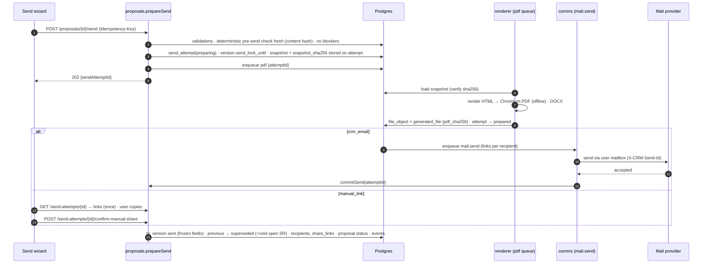

# Proposal Engine Design — Internal Sales CRM (Phase 1)

| Item | Value |
|---|---|
| Requirements | BR-TPL-001..008, BR-PRC-001..007, BR-PRP-001..010, BR-AIA-001/002/007, BR-SIG-009/011, BR-MIG-006 |
| Rules | BUSINESS-RULES §6–§8 (RULE-TPL/PRC/PRP), §7.2 calculation spec (TV-PRC-01), SM-02, SM-03 |
| Decisions | ADR-010, ADR-025, ADR-029, ADR-045, ADR-081; OD-15/16/43/44/49/57/65/66/67/105 |
| Package | `packages/proposal` (schema, validation, placeholder resolution, renderers, diff) used by server, renderer and web |

---

## 1. Content model (ADR-029)

### 1.1 Document structure
```ts
type ProposalDocument = {
  schemaVersion: 1;
  sections: Section[];
};
type Section = {
  id: string;            // nanoid(10), stable across template → proposal → versions
  title: string;         // shown in section navigation and as H2 unless hideTitle
  hideTitle?: boolean;
  locked: boolean;       // BR-TPL-003 (Admin-only to change, R8)
  required: boolean;     // pre-send check: section must have non-empty content
  aiDraftable: boolean;  // BR-AIA-001 offered for drafting
  doc: PMDoc;            // ProseMirror JSON with the restricted schema below
  source?: { contentBlockId?: string; revision?: number };   // when inserted from library
};
```

### 1.2 Restricted ProseMirror schema (supported by HTML **and** DOCX renderers)
| Node | Attributes | DOCX mapping |
|---|---|---|
| `doc`, `paragraph`, `heading` (levels 2–4), `text` | `textAlign` | Paragraph / Heading2–4 styles |
| `bulletList`, `orderedList`, `listItem` | `start` | numbering definitions |
| `table`, `tableRow`, `tableHeader`, `tableCell` | `colspan`, `rowspan`, `colwidth` | Table |
| `image` | `fileId`, `alt` (required), `width` (px ≤ 800), `align` | ImageRun (bytes from storage) |
| `horizontalRule`, `pageBreak` | — | border paragraph / page break |
| `placeholder` (inline atom) | `ref: "deal.name" | "deal.cf.region" | "contact.first_name" | "owner.full_name" | "organization.name" | "company.*" | "proposal.valid_until" | "proposal.number"`, `fallback?: string` | text run with resolved value |
| `pricingTable` (block atom) | `tableId` | Table with totals rows |
| `contentBlockRef` | — (content is copied at insertion; node only marks provenance) | content |
| `signatureBlock` (block atom) | `signerOrder` (1..10), `label` | signature line + invisible anchor text `[[sig:N]]` for e-sign tab placement |
| Marks: `bold`, `italic`, `underline`, `strike`, `link` (`href` http(s)/mailto only, `rel=noopener noreferrer`), `textColor` (from brand palette only), `highlight` | | run properties / hyperlink |
Not allowed: raw HTML, iframes, scripts, embeds, custom fonts, arbitrary CSS. The server validates every saved document with `validateDocument()` (Zod + ProseMirror `Node.check()` via `prosemirror-model` schema) and rejects unknown nodes/attributes (`VALIDATION_FAILED`).

### 1.3 Schema evolution
`schemaVersion` stored with every template version, proposal version and content block; `packages/proposal/migrations/` contains pure functions `v1→v2…`; documents are migrated on read for drafts and **never** for frozen snapshots (renderer keeps support for every published schema version).

---

## 2. Templates

| Concern | Design |
|---|---|
| Authoring | `TemplateBuilder` (FRONTEND-DESIGN §4) edits the draft `template_version` (only one draft per template) |
| Placeholders | Inserted from the catalogue `GET /api/v1/placeholders` = standard fields of company, contact, deal, owner, organization + all active custom fields (`<ns>.cf.<key>`) + proposal fields; unknown refs rejected (`TEMPLATE_PLACEHOLDER_UNKNOWN`); archived custom fields flagged (`TEMPLATE_PLACEHOLDER_ARCHIVED` warning, BR-TPL-008) |
| Locking | `locked` per section set only by Admin (PERM-096, R8) |
| Publishing | Creates immutable `template_version` (trigger), increments `version_number`, updates `current_published_version_id`; previous published version becomes `retired` only when explicitly retired (proposals keep pinning their version) |
| Branding (BR-TPL-006) | Not stored in templates; applied at render time from `organization_settings.branding` (logo, colours, font from the allowed list: Inter, Source Sans 3, Merriweather, Roboto — embedded WOFF2/TTF) |
| DOCX starting point (BR-MIG-006, Admin) | `mammoth` converts DOCX → semantic HTML (styles map: Heading 1/2/3 → heading 2/3/4, lists, tables, images) → `prosemirror-model` DOMParser with our schema (unsupported elements dropped and listed in a conversion report) → each Heading 1 starts a new section → new template draft; images extracted, validated and stored |
| Starter templates (IDD-11) | Delivered as JSON seed files in `packages/proposal/starters/` imported by `cli seed-starter-templates` |

---

## 3. Placeholder resolution (BR-TPL-002, BR-PRP-002, BR-TPL-008)

```ts
resolvePlaceholders(doc: ProposalDocument, ctx: { deal; company; primaryContact?; owner; organization; customFieldDefs; proposal; locale; timeZone })
  → { bindings: Record<string, { value: string; source: string; resolvedAt: string }>; missing: PlaceholderRef[] }
```
| Namespace | Source |
|---|---|
| `deal.*` | deal row (`name, amount, currency, close_date, pipeline, stage`) + `deal.cf.<key>` |
| `company.*` | deal.company (`name, domain, address, phone, website, industry`) + `company.cf.<key>` |
| `contact.*` | `proposal.primary_contact_id` (must be a deal contact; default: deal contact with `is_primary`, OD-65) + `contact.cf.<key>` |
| `owner.*` | deal owner profile (`full_name, title, email, phone`) |
| `organization.*` | `organization_settings` (`name`, address fields in settings) |
| `proposal.*` | `title`, `valid_until`, `number` (`P-<deal short id>-<proposal seq>-v<version>`), `version` |
Formatting (foundation §9): numbers/currency via `Intl.NumberFormat(locale, {style:'currency', currency})`; dates `Intl.DateTimeFormat(locale, {dateStyle:'long', timeZone})`; multi-select joined `", "`; checkbox `Yes`/`No`; empty/null → **missing** (unless `fallback` provided).
Resolution happens: at proposal creation, on explicit "refresh placeholders" (returns diff), on new version creation (re-resolve with diff, foundation §9), and **once more at send prepare** (frozen into the snapshot). Missing placeholders are deterministic **blocker** findings at send (RULE-AIA-11/OD-56).

---

## 4. Pricing engine (BR-PRC-002..007)

Implemented once in `packages/shared/src/pricing/` (used by web for live totals and by server as authority) with `decimal.js` (precision 30, `ROUND_HALF_UP`).

```
for each line:
  subtotal       = round2(quantity × unitPrice)
  discountAmount = percent ? round2(subtotal × pct/100) : min(amount, subtotal)
  net            = subtotal − discountAmount
  overall share  = allocate table overall discount (OD-66 scope one_time|recurring|both) pro-rata over eligible lines' net,
                   largest-remainder to keep Σ shares = overall discount amount
  netAfter       = net − overallShare
  tax            = round2(netAfter × taxRate/100)
  total          = netAfter + tax
group totals (one-time; recurring per billing period): Σ of rounded line values
periodsInTerm(period, termMonths) = termMonths / {month:1, quarter:3, year:12}[period]  → must be integer (PRICING_TERM_PERIOD_MISMATCH, OD-67)
TCV (excl. tax) = Σ oneTime.netAfter + Σ_recurring(netAfter × periodsInTerm)            (OD-16, OD-44)
grandTotalFirstPeriod = oneTime.total + Σ recurring.total (one period each)
```
- Validation: quantity > 0, unitPrice ≥ 0, discount amount ≤ subtotal, percent 0–100, ≤ 20 tables per proposal, ≤ 200 lines per table (`PRICING_TABLE_LIMIT`), recurring lines require `billingPeriod`.
- Currency (OD-15/57, R10): proposal currency = deal currency; a catalog product without a price in that currency uses the default-currency price × `exchange_rate` effective today (rounded to 4 dp unit price, editable); no rate → user must enter the price (`PRICING_UNIT_PRICE_REQUIRED`), warning `FX_RATE_MISSING`.
- Discount limits (BR-PRC-007, OD-39): compare per-line percent and overall percent (amount discounts converted to percent of affected net) with `discount_limit` for the actor's role → `discountWarnings` stored on the version and acknowledged at send (`DISCOUNT_LIMIT_EXCEEDED` confirmation).
- Deal amount prompt (BR-PRC-004): after each save, if `deal.amount ≠ totals.tcvExclTax` the editor shows "Update deal amount to X?" → `POST /proposals/{id}/deal-amount`; at send, `DEAL_AMOUNT_DIFFERS` confirmation (not blocking).
- Mandatory test vectors: TV-PRC-01 (BUSINESS-RULES §7.2) plus rounding edge cases (0.005 boundaries, 100 % discount, mixed periods, multi-table).

---

## 5. Proposal lifecycle implementation

### 5.1 Creation (BR-PRP-001/002, BR-TPL-004)
1. Check PERM-103 on the deal and `deal.status = open` (`DEAL_CLOSED`).
2. Load template's `current_published_version_id` (`TEMPLATE_NOT_PUBLISHED`).
3. Copy sections → version 1 `draft`; resolve placeholders; create default pricing table(s) for `pricingTable` nodes (empty or from `default_pricing_config`).
4. `proposal.status=draft`, `signature_required` default true (OD-68), `valid_until = today + proposalDefaults.defaultValidityDays` (if set), `term_months = defaultTermMonths`.
5. Timeline `proposal_created`; audit.

### 5.2 Editing (BR-PRP-003)
- Autosave `PUT /draft` with full sections + pricing tables; server rejects any change to a section where `template section.locked = true` by comparing the section `doc` hash to the pinned template version's section hash (`SECTION_LOCKED`).
- Content block insertion copies content and records `source` (BR-TPL-005); later library edits show "newer revision available" (no automatic change).
- AI content: inserted only by accepting an `ai_generation` (AI-IMPLEMENTATION-DESIGN §5); until accepted it lives in the generation, displayed as an overlay suggestion — never in the saved document (BR-AIA-007 labelling).

### 5.3 Versions and comparison (BR-PRP-006)
- `createVersion`: allowed when the latest version is sent/superseded and proposal not signed/void; copies the last **sent** version's content and pricing (lines keep `line_key`), re-resolves placeholders and returns the change list.
- Compare: `diffSections(a, b)` — section matching by `id`; per section, ProseMirror doc → normalised plain text with block boundaries → word-level diff (`diff` package `diffWordsWithSpace`), plus structural changes (added/removed sections, table cell changes); `diffPricing(a, b)` by `line_key` (added/removed/field changes) and totals delta.

### 5.4 Send — two-phase (ADR-081)

Failure handling: render failure (3 retries) → attempt `failed` (`DOCUMENT_GENERATION_FAILED`), lock released; mail `rejected` → attempt `failed` (`PROVIDER_SEND_FAILED`), version stays draft; mail `ambiguous` → attempt stays `committing`, resolved by next sync (found → commit; not found after 30 min → `failed`, user informed; never auto-resend, ADR-084); attempt not committed within OD-105 (30 min) → `expired`.

### 5.5 Freezing and fingerprints (BR-SIG-009/011)
- `frozen_snapshot` = `{schemaVersion, sections (placeholders replaced by resolved text nodes), pricingTables (with computed values), totals, branding (resolved colours/font/logo file id + sha256), organization display data, proposal meta (number, validUntil, versionNumber), rendererVersion}`.
- `snapshot_sha256 = sha256(canonicalJson(frozen_snapshot))` where canonical JSON = RFC 8785 JCS (`canonicalize` package).
- `pdf_sha256 = sha256(pdf bytes)`; stored on version and `generated_file`; e-sign dispatch re-hashes before upload.
- DB trigger forbids content changes after `sent` (DATABASE-DESIGN §6).

### 5.6 Statuses (BR-PRP-007, SM-02) — owner of transitions
| Trigger | Transition | Caller |
|---|---|---|
| commitSend | draft/declined/expired → sent; (sent/viewed/accepted with new version) → sent | proposals |
| first counted buyer view of current sent version | sent → viewed | sharing → proposals |
| buyer accept (signature not required) | sent/viewed → accepted | sharing → proposals |
| buyer decline / signer decline | sent/viewed → declined | sharing / esign → proposals |
| all signers signed (non-stale) | sent/viewed/accepted → signed (terminal) | esign → proposals |
| validity date passed | sent/viewed/accepted → expired | schedule |
| user void / OD-23 automation void | non-terminal → void | proposals / automation |

---

## 6. Rendering

### 6.1 HTML renderer (`packages/proposal/render/html.tsx`)
- React server components-free pure function `renderToStaticMarkup(<ProposalDocumentView snapshot mode="pdf|buyer|preview" />)`; the same component tree is used in the buyer app (client render) and server/renderer (static render) → BR-PRP-004 parity.
- All text output escaped by React; links limited to http(s)/mailto with `rel="noopener noreferrer" target="_blank"`; images referenced as `asset://<fileId>` and resolved by mode (buyer: signed URL via `/public/v1/assets/<fileId>` scoped to the snapshot; PDF: in-process asset handler).
- CSS: one print-aware stylesheet generated from branding tokens (`--brand-primary`, font family) with `@page { size: A4 | Letter (org locale); margin: 18mm }`, page header (logo) and footer (proposal number, page x/y via Chromium header/footer templates), `break-inside: avoid` for pricing tables rows/signature blocks.
- Signature blocks render a visible signature line and an invisible anchor `[[sig:N]]` (white 1 pt text) used by the e-sign provider for tab placement.

### 6.2 PDF (renderer role, ADR-045)
```ts
const browser = await chromium.launch({ args: ['--disable-gpu','--no-sandbox=false'] });  // runs as non-root user in container
const context = await browser.newContext({ javaScriptEnabled: false, offline: false, bypassCSP: false });
await context.route('**/*', route => isAsset(route.request().url()) ? route.fulfill(assetFromStorage(...)) : route.abort());
const page = await context.newPage();
await page.setContent(html, { waitUntil: 'load', timeout: 8000 });
const pdf = await page.pdf({ format, printBackground: true, tagged: true, outline: true, displayHeaderFooter: true, headerTemplate, footerTemplate, margin });
```
- Network: every request aborted except the in-process `asset://` handler (SSRF guard); container has no internet egress (ADR-045/048).
- Pool: 1 browser, ≤ 2 concurrent contexts; browser recycled every 200 renders or on crash; render timeout 8 s → retry.
- Fonts bundled in the image (`/usr/share/fonts/crm`), no network fonts.
- Output metadata: Title, Author (organization), Subject (proposal number), `CreationDate`; tagged PDF for accessibility (NFR-011).

### 6.3 DOCX (OD-43)
`packages/proposal/render/docx.ts` maps the snapshot with the `docx` library: styles derived from branding (font, heading colours), header with logo, footer with proposal number + page numbers, pricing tables as native tables with right-aligned money columns, images from storage, signature blocks as labelled lines. Same content and order as PDF; layout not pixel-identical. Produced by the renderer role on the same `pdf` queue (job type `docx`).

### 6.4 Generated file policy
| Purpose | When | Retention |
|---|---|---|
| `preview` PDF/DOCX (internal download of drafts) | on demand | 7 days, then deleted |
| `sent` PDF (+DOCX if requested) | send prepare | permanent with proposal (retention per OD-36) |
| signed PDF + certificate | from provider | immutable, erasure-exempt |

---

## 7. Pre-send checks integration (BR-AIA-002)
Deterministic checks (`proposals/domain/presendChecks.ts`, authoritative, run with AI off — OD-55) + optional LLM consistency check (AI-IMPLEMENTATION-DESIGN §6). Result stored in `ai_check_result` with `content_sha256` of the draft; send requires a check whose `content_sha256` equals the current draft hash and zero unacknowledged blocker findings.

| Code (RULE-AIA-11, authoritative) | Severity | Origin | Check |
|---|---|---|---|
| `PLACEHOLDER_UNRESOLVED` | blocking | deterministic | any entry in `missing_placeholders` (BR-TPL-008) |
| `REQUIRED_SECTION_EMPTY` | blocking | deterministic | a `required` section has no non-whitespace content |
| `AI_CONTENT_PENDING` | blocking | deterministic | an AI generation targeting this draft is still `pending` (not accepted/rejected) — BR-AIA-007 |
| `VALIDITY_DATE_PAST` | blocking | deterministic | `valid_until` < today (org TZ) |
| `CURRENCY_REVIEW_REQUIRED` | blocking | deterministic | a line price was FX-converted and not yet reviewed, or a required FX rate is missing (OD-57) |
| `PRICING_DEAL_AMOUNT_MISMATCH` | warning | deterministic | `deal.amount` ≠ `totals.tcvExclTax` (BR-PRC-004) |
| `DISCOUNT_LIMIT_EXCEEDED` | warning | deterministic | `discount_warnings` not empty (BR-PRC-007) |
| `DATE_IN_PAST_IN_TEXT` | warning | deterministic | explicit dates in section text earlier than today |
| `NAME_MISMATCH` | warning | LLM | company/contact/person names in text differ from deal data |
| `FIGURE_INCONSISTENT` | warning | LLM | amounts/quantities in narrative text inconsistent with the pricing table or deal |
| `OUTDATED_DATE` | warning | LLM | references to past events/dates presented as future |
LLM unavailable or AI disabled → result shows "AI check not run" and send proceeds on deterministic results (RULE-AIA-11, OD-55). Send preconditions and the `PROPOSAL_NOT_SENDABLE` 409 `reasons[]` list follow RULE-PRP-08.
