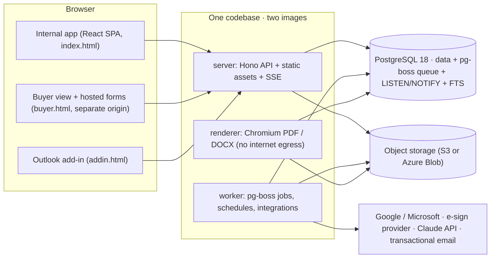

# Technology Stack Recommendation — Internal Sales CRM (Phase 1)

| Item | Value |
|---|---|
| Status | Recommended (Principal Solution Architect); versions checked against the npm registry on 2026-11-17 — pin exact versions in the lockfile at project start |
| Inputs | BRD v2.0, specifications (docs/01), HLD (docs/02), TLD (docs/03); team preferences: React, TypeScript, TanStack, Hono, Drizzle, Better Auth, Zod, PostgreSQL, Tailwind, shadcn/ui; Windows development |
| Principle | Simplest architecture that satisfies the requirements: one modular monolith, one PostgreSQL, no Redis/broker/microservices (ADR-001, ADR-019) |

---

## 1. Recommended architecture in one picture

## 2. Stack decisions

### 2.1 Language and runtime
| Choice | Version | Why |
|---|---|---|
| TypeScript (strict) | 7.0.x (native compiler); fall back to 6.x if any tool in §2.2–2.6 lacks support at project start | One language across web, server, shared contracts; TS 7's native compiler cuts typecheck time on Windows |
| Node.js | 26 LTS (Active LTS since Oct 2026) | Long support window; native `fetch`/`undici`, test-friendly; matches local Node 26 |
| pnpm | 12.x workspaces | Fast, disk-efficient monorepo installs; strict dependency isolation (Windows: keep repo outside OneDrive, ADR-033) |

### 2.2 Backend
| Concern | Choice | Version | Why / alternatives rejected |
|---|---|---|---|
| HTTP framework | **Hono** + `@hono/node-server` | 4.13 / 2.1 | Lightweight, Web-standard, first-class Zod + OpenAPI; host-based sub-apps for app vs buyer origin. Express (older ergonomics), Fastify (fine, but weaker Zod/OpenAPI story), NestJS (heavy) |
| API contracts | **Zod v4** + `@hono/zod-openapi` | 4.6 / 1.6 | One schema → validation + types + OpenAPI 3.1 for web client, add-in and tests |
| ORM / migrations | **Drizzle ORM** + drizzle-kit | 0.45 / 0.31 | SQL-first, typed, supports partial indexes, generated columns, raw SQL for triggers; generated migrations reviewed and committed. Prisma rejected (less SQL control, heavier runtime) |
| DB driver | `pg` (node-postgres) | 8.23 | Required by pg-boss; one pool type; LISTEN support |
| Jobs / schedules | **pg-boss** | 12.x | Postgres-backed queue with cron, retries, singleton keys, DLQ; in-transaction enqueue (ADR-022). No Redis/BullMQ |
| Authentication | **Better Auth** (+ twoFactor, bearer plugins) | 1.7 | Email/password, Google, Microsoft, TOTP, sessions and bearer tokens in our DB; invite-only via hooks. Auth.js/Lucia less complete; Keycloak adds infrastructure |
| Decimal math | `decimal.js` | 10.6 | Exact money arithmetic shared by server and web |
| Logging | `pino` | 10.x | Fast structured JSON logs with redaction |
| Error tracking / tracing | Sentry SDK (`@sentry/node`, `@sentry/react`) or vendor per OD-98; OpenTelemetry SDK optional | 11.x / 0.30x | Mandatory observability (ADR-051) |
| HTML sanitisation | `dompurify` + `jsdom` (server-side email HTML), `html-to-text` (AI context) | 3.4 / 31 / 10 | Proven sanitiser; email bodies shown in sandboxed iframes |
| Files | `sharp` (image re-encode), `file-type` (magic bytes), `exceljs`, `papaparse` | 0.35 / 22 / 4.4 / 5.7 | Upload validation and imports |
| Email composition | `nodemailer` (MIME building / SMTP driver), React Email (`@react-email/components`, `@react-email/render`) | 10 / 1.0 / 2.3 | RFC 5322 messages for Gmail raw send; maintainable notification templates |

### 2.3 Documents and AI
| Concern | Choice | Version | Why |
|---|---|---|---|
| Editor model | **TipTap 3** on ProseMirror (`@tiptap/react`, `@tiptap/pm`, `@tiptap/starter-kit`, open-source extensions only) | 3.34 | Schema control for locked sections, placeholders, pricing tables; no paid Pro extensions (ADR-029) |
| PDF | **Playwright** Chromium (renderer image) | 1.65 | Same HTML as preview and buyer view → BR-PRP-004 parity; tagged PDF |
| DOCX | `docx` (generate), `mammoth` (DOCX import for templates, BR-MIG-006) | 9.15 / 1.13 | Pure JS, no LibreOffice |
| Canonical hashing | `canonicalize` (RFC 8785 JCS) + Node `crypto` SHA-256 | 5.1 | Deterministic snapshot fingerprints |
| Diff | `diff` | 9.0 | Version comparison |
| AI provider | **Anthropic Claude** via `@anthropic-ai/sdk` behind `AiProvider` (OD-05) | 1.9 | Sonnet 5.5 drafting/summaries, Haiku 5.5 rewrite, Opus 5.5 pre-send check (ADR-041) |

### 2.4 Frontend
| Concern | Choice | Version | Why |
|---|---|---|---|
| UI library | **React 19** | 19.3 | Team standard |
| Build | **Vite 8** + `@vitejs/plugin-react`, multi-page (index/buyer/addin) | 8.3 / 6.3 | Fast dev server on Windows; multi-entry builds (ADR-020) |
| Routing | **TanStack Router** (file-based, `@tanstack/router-plugin`) | 1.170 | Typed routes and search params; future migration path to Start |
| Server state | **TanStack Query** | 5.108 | Caching, invalidation, optimistic updates |
| Tables | **TanStack Table** + `@tanstack/react-virtual` | 9.3 / 3.14 | Headless, server-side sort/filter/pagination |
| Forms | **TanStack Form** + Zod | 1.33 | Same Zod schemas as the API |
| Styling / components | **Tailwind CSS v4** (`@tailwindcss/vite`) + **shadcn/ui** (Radix primitives, copied into repo) | 4.3 | Accessible primitives, full control of branding |
| Board drag & drop | `@dnd-kit/core` (+ sortable) | 6.3 | Keyboard-accessible DnD |
| Charts | `recharts` | 3.10 | Dashboards (BR-RPT-*) |
| Dates | `date-fns` + `date-fns-tz` | 4.4 / 3.2 | Time-zone-aware formatting |
| Icons | `lucide-react` | — | shadcn default |
| API client | `openapi-typescript` + `openapi-fetch` | 7.13 / 0.17 | Typed client generated from the server's OpenAPI |
| Office add-in | Office.js (Microsoft CDN), `@azure/msal-browser` (NAA) | — | ADR-085 |

### 2.5 Data and infrastructure
| Concern | Choice | Why |
|---|---|---|
| Database | **PostgreSQL 18** managed (Azure Database for PostgreSQL Flexible Server or Amazon RDS), HA + 35-day PITR (ADR-049); 17 fallback | Data, queue, pub/sub, FTS in one service |
| Object storage | S3 or Azure Blob (one driver, OD-11), versioning + Object Lock for signed artefacts | Durable, immutable evidence |
| Containers | Docker images `crm-app`, `crm-renderer`; Azure Container Apps or AWS ECS Fargate (ADR-047) | Managed, no Kubernetes |
| Secrets / keys | Azure Key Vault or AWS Secrets Manager + KMS (keyring, ADR-073) | Envelope encryption, rotation |
| Edge | Managed LB/WAF (Front Door/App Gateway or ALB+WAF), TLS for `crm.` and `proposals.` hosts | Rate limiting tier 1, TLS |
| Transactional email | One provider (SES / Postmark / Azure Communication Services) per OD-14 | NFR-013 |
| CAPTCHA | Cloudflare Turnstile (OD-46) | Privacy-friendly, free tier |
| CI/CD | Per OD-100 (GitHub Actions or Azure DevOps); same pipeline stages either way | DEPLOYMENT-ARCHITECTURE §8 |

### 2.6 Quality tooling
| Concern | Choice | Version |
|---|---|---|
| Lint + format | Biome | 2.6 |
| Architecture boundaries | dependency-cruiser | 18.8 |
| Unit/integration tests | Vitest | 5.1 |
| E2E / a11y / visual | `@playwright/test`, `@axe-core/playwright` | 1.65 / 4.14 |
| Property-based tests | fast-check | 4.10 |
| Load tests | k6 (binary) | — |
| SAST / SCA / secrets | Semgrep, OSV-Scanner / `pnpm audit`, Gitleaks | — |
| Dev runner | `tsx` (watch for server/worker) | 4.23 |

## 3. TanStack Start vs separate Hono API — evaluation (ADR-004)

| Requirement driver | What it needs | TanStack Start alone | Hono API + Vite SPA |
|---|---|---|---|
| Outlook add-in (BR-EML-005) | Stable bearer-auth REST endpoints callable from Office task pane | Server routes possible, but server functions are framework RPC, not a public contract | Explicit `/addin/v1` routes in OpenAPI |
| Gmail add-on (BR-EML-005) | HTTP endpoints returning Card JSON to Google | Server routes | `/addin/v1/gmail/*` |
| E-sign provider webhooks (BR-SIG-007..010) | Raw-body HMAC verification, fast 200, persist-then-process | Server routes; raw body handling per adapter | Native (`c.req.arrayBuffer()`) |
| Buyer view (BR-SHR-*) on a separate origin with its own CSP | Host-based routing, cookies isolated per origin | Possible with custom server config | Host-based sub-apps (ADR-075) |
| Lead-form intake (BR-LED-001/007) | Public POST + webhook | Server routes | Native |
| Background jobs (sync, PDF, reminders, automation) | A long-running worker sharing domain services | Separate Node entry outside Start's server runtime → two runtime styles | Same services in `server`, `worker`, `renderer` |
| SSR / SEO | None required (internal app; buyer page small) | Strength unused | Not needed |
| Simplicity | One full-stack framework, but most endpoints become server routes anyway | Two API styles (server functions + server routes) + worker | One API style, one server, one worker codebase |

**Recommendation: Hono API + Vite SPA (TanStack Router/Query/Table/Form).** TanStack Start alone *could* serve the internal UI, but more than half of the server surface must be stable external HTTP contracts and a shared worker, which is exactly what a small Hono app does best. Using TanStack Router file routes keeps a low-cost migration path to Start if SSR ever becomes valuable.

## 4. What we deliberately do not use
Redis, message brokers, Elasticsearch, GraphQL, microservices, Kubernetes, Postgres RLS (Phase 1), SSR frameworks, paid editor extensions, browser-side direct uploads to storage, LibreOffice. Each would add infrastructure or complexity without a demonstrated Phase 1 requirement (ADR-019).

## 5. External services requiring credentials or configuration
| Service | Needed for | Decision ref |
|---|---|---|
| Google Workspace (OAuth client(s), Gmail/Calendar APIs, add-on deployment) | Login, mailbox sync/send, Gmail add-on | OD-06, OD-07, OD-12 |
| Microsoft Entra / Microsoft 365 (app registration, admin consent, add-in deployment) | Login, Graph mail/calendar, Outlook add-in | OD-06, OD-07, OD-12 |
| E-signature provider account + API + webhook secret | BR-SIG-* | OD-02, OD-03 |
| Anthropic API key (ZDR terms) | BR-AIA-* | OD-05, OD-90, OD-112 |
| Transactional email provider + DNS (SPF/DKIM/DMARC) | Notifications, invitations, OTP | OD-14 |
| Cloud account: managed PostgreSQL, object storage, KMS, secrets manager, container platform, LB/WAF | Hosting | OD-11, OD-89, OD-96, OD-97 |
| Cloudflare Turnstile keys | Lead form spam protection | OD-46 |
| Error-tracking vendor DSN | Observability | OD-98 |
| Domains + TLS certificates (`crm.`, `proposals.`, `notify.`) | All surfaces | OD-11 |

## 6. Risks of the stack and mitigations
| Risk | Mitigation |
|---|---|
| pg-boss in-transaction enqueue API differs in pinned version | Startup self-test + outbox fallback (BACKEND-DESIGN §2.2) |
| Better Auth session/TOTP storage defaults | Acceptance tests + hooks (AUTHENTICATION-AUTHORIZATION §2) |
| TypeScript 7 tool compatibility | Pin 6.x if any blocker at project start; no code changes needed |
| Chromium image size and memory | Separate renderer image, concurrency 1–2, recycle browser |
| OneDrive path breaks pnpm | Repo outside OneDrive (ADR-033) |
| Rapid release cadence of TanStack/Vite | Exact pins + Renovate weekly PRs with CI gate |
