# Solution Architecture Document
## Internal Sales CRM — Phase 1

| | |
|---|---|
| **Document** | Solution Architecture Document (SAD) |
| **Version** | 1.0 — for leadership review |
| **Date** | 17 November 2026 |
| **Author** | Principal Solution Architect |
| **Basis** | BRD v2.0 (Phase 1) and the engineering documentation set in `docs/01`–`05` (specifications, HLD, TLD, engineering) |
| **Audience** | CEO, Sales leadership, IT, Technical Lead, Engineering team |
| **Status** | Architecture recommended; decisions marked *Open* in §10 must be confirmed before or during Release 1 |

> This document is the single, consolidated view of the solution. It does not repeat requirement analysis; it summarises *what we will build, how it fits together, and why*. Detailed designs are referenced in the right-hand "Detail" columns.

---

## Executive summary

**What.** One internal web application in which our sales team manages companies, contacts and deals; builds branded proposals with pricing from a product catalogue; shares them through tracked links; gets real-time alerts when buyers open or forward them; collects legally valid e-signatures; and sees a self-updating pipeline. AI drafts and checks proposals, always under human control.

**Why.** It replaces today's mix of spreadsheets / light CRM, Word proposals and a separate e-signature tool (BRD P1–P9): faster proposals, visibility after sending, fewer manual updates, and one source of truth for management.

**How (in one sentence).** A **single-tenant modular monolith** — one TypeScript codebase, one PostgreSQL database, three runtime roles (web/API server, background worker, isolated document renderer) — integrated with our Microsoft 365 or Google Workspace tenant, an e-signature provider and the Claude AI API, deployed as managed containers on our cloud.

**Why this shape.** It is the simplest architecture that meets the requirements with production-grade security and auditability: no microservices, no Redis, no message broker, no Kubernetes. The database does triple duty (data, job queue, notifications), which keeps operations small for a team of our size while leaving clean extension points for Phase 2 (deal intelligence) and Phase 3 (AI agents).

| Key figure | Value |
|---|---|
| Users | ≤ 150 internal users (Admin, Sales Manager, Salesperson) + external buyers/signers via links |
| Scope | 130 BRD requirements → 127 in scope (100 Must), traced end-to-end |
| Runtime units | 3 application roles + 1 managed database + 1 object store |
| Releases | R1 core CRM + proposals + sharing → R2 email/calendar, AI, e-signature (recommended go-live) → R3 inbox add-in, HubSpot/Pipedrive import |
| Indicative run cost (production) | ~USD 550–900 / month (AWS) or ~USD 900–1,300 / month (Azure) infrastructure, plus AI usage (~USD 1,300 / month at full adoption, budget-capped) and e-signature licences |

---

## 1. Solution architecture overview

### 1.1 Business context
| Pain today (BRD) | Solution capability |
|---|---|
| Proposals slow to build, error-prone (P1) | Templates bound to CRM data, product catalogue and pricing tables, AI drafting, deterministic pre-send checks |
| No visibility after sending (P2) | Per-recipient tracked links, forward detection, real-time alerts, follow-up automation |
| Version confusion (P3) | Immutable sent versions, side-by-side comparison, signing locked to an exact version |
| Signing delays (P4) | Integrated e-signature with signing order, reminders, completion certificate |
| Managers can't see the real pipeline (P5) | Role-scoped dashboards, weighted pipeline, stalled-deal flags |
| Admin overhead (P6) | Email/calendar sync, automatic stage moves and Closed Won, unified timeline |
| Lost / manual leads (P7) | Embeddable web forms with assignment rules and instant alerts |
| Knowledge silos (P8) | Shared templates and content library |
| Hard to switch (P9) | CSV/Excel (and HubSpot/Pipedrive export) import with duplicate handling and undo |

### 1.2 Objectives and measures
Reduce time-to-proposal by 50 %, time-to-sign by 30 %, deals going quiet after a proposal by 30 %; capture ≥ 80 % of email/meeting activity automatically; ≥ 80 % weekly active salespeople by week 4 (BRD §12; baselines to be measured — OD-10).

### 1.3 Users and actors
| Actor | Uses | Access |
|---|---|---|
| **Salesperson** | Deals, proposals, email, tasks, own dashboard | Own records (+ read-only colleagues' records if enabled) |
| **Sales Manager** | Team pipeline, coaching, proposals for team deals; optionally templates/catalogue | Own team |
| **Admin / Sales Ops** | Users, pipelines, fields, templates, imports, automation, AI controls, audit | Whole organisation |
| **Leadership sponsor** | Dashboards, outcomes | Via Admin/Manager role |
| **Buyer / recipient** (external) | Views, downloads, forwards, accepts/declines a proposal | One proposal version through a secure link |
| **Signer** (external) | Signs through the e-signature provider | Provider-controlled |
| **Website visitor** (external) | Submits a lead form | Public form only |

### 1.4 System boundary
**Inside the solution:** CRM records, pipelines, tasks, timelines; proposal templates, catalogue, pricing, document generation; sharing and tracking; signature orchestration and evidence storage; automation; notifications; reporting; AI orchestration; audit; import/export.

**Outside (integrated, not built):** identity provider and mailboxes (Google Workspace or Microsoft 365), e-signature provider (signing ceremony, sealing, certificates), Claude API (language model), transactional email service, CAPTCHA, cloud hosting services.

**Explicitly out of scope:** multi-tenant SaaS features (sign-up, trials, billing — IDD-01/02/03), marketing automation, payments, phone dialer, native mobile apps, Phase 2/3 capabilities (call recording, deal scoring, AI agents, open API, SSO via SAML).

---

## 2. End-to-end solution architecture

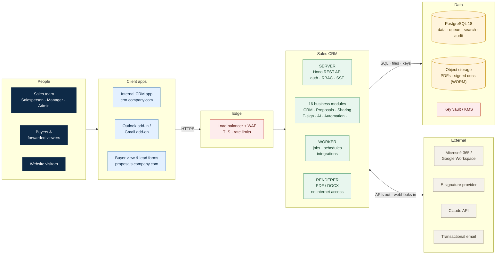

**How a typical deal flows through the system**

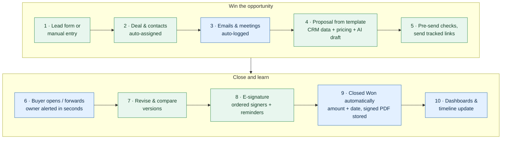

---

## 3. C4 architecture views

### 3.1 Level 1 — System context
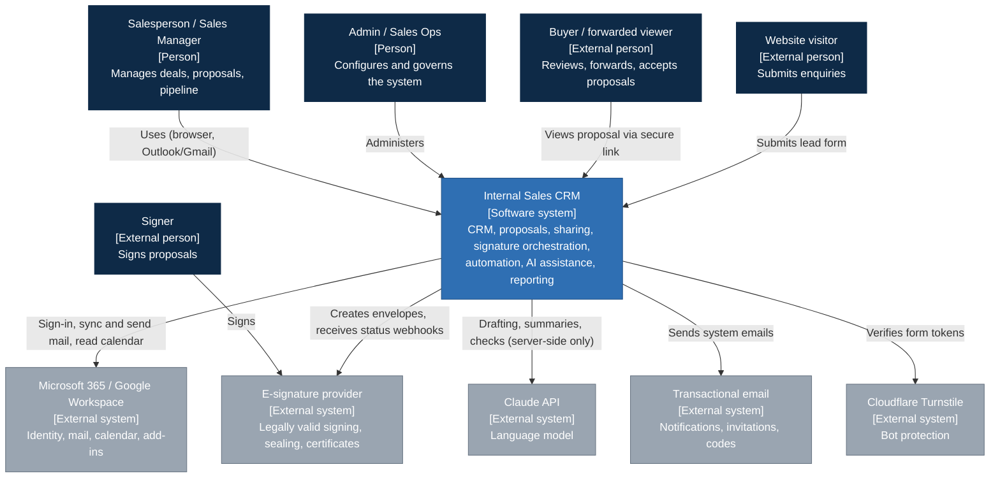

### 3.2 Level 2 — Containers
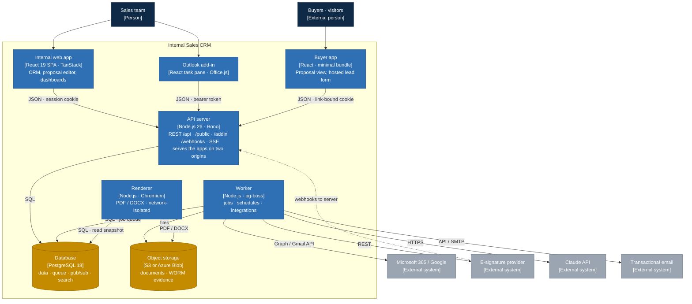

*Also: the API server calls Microsoft/Google for user sign-in (OIDC) and Claude for interactive, streamed AI features; the server reads and writes object storage for uploads and downloads. These edges are omitted above for readability.*

### 3.3 Level 3 — Components of the API server and worker
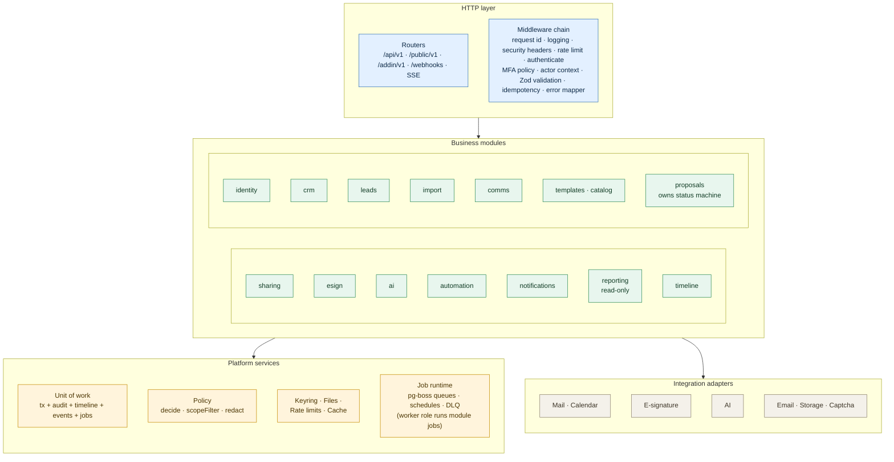

Detail: COMPONENT-ARCHITECTURE, MODULE-ARCHITECTURE (HLD); BACKEND-DESIGN (TLD).

---

## 4. Application architecture

### 4.1 Codebase and runtime
| Package / app | Role | Key technology |
|---|---|---|
| `apps/web` | Three HTML entries from one Vite project: internal app, buyer app (separate origin), Outlook add-in | React 19, TanStack Router/Query/Table/Form, Tailwind v4, shadcn/ui, TipTap |
| `apps/server` | One Node.js package started as `server`, `worker`, `renderer`, `migrate` or `cli` | Hono, Drizzle ORM, pg-boss, Better Auth, Zod |
| `packages/shared` | Contracts used by both sides: Zod schemas, enums, **permission matrix**, pricing/money maths, error codes | Zod, decimal.js |
| `packages/proposal` | Proposal content model, placeholder resolution, HTML renderer (same in browser, server and PDF), DOCX mapper, version diff | ProseMirror schema, React static render, docx |

### 4.2 How the pieces interact
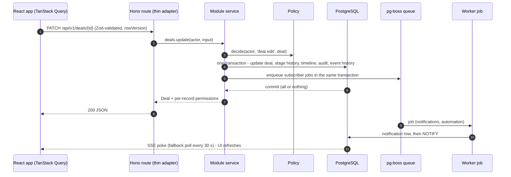

### 4.3 Architectural rules that keep the monolith modular
| Rule | Enforcement |
|---|---|
| A module owns its tables; others call its service, never its tables | dependency-cruiser in CI |
| Domain logic (state machines, pricing, checks) is pure and unit-tested | `domain/` folders, no I/O imports |
| Every data read is permission-scoped | Repositories only accept a `ScopedQuery` (compile-time) |
| Cross-cutting writes (audit, timeline, events, jobs) happen in the business transaction | Unit-of-work API |
| The same Zod schema validates in the browser and on the server | `packages/shared` contracts, generated OpenAPI client |
| Integrations only through adapters | Ports in `adapters/`, contract-tested |

Detail: MODULE-ARCHITECTURE (HLD), BACKEND-DESIGN, FRONTEND-DESIGN, API-SPECIFICATION (TLD).

---

## 5. Data architecture

### 5.1 Data platform
| Store | Holds | Notes |
|---|---|---|
| **PostgreSQL 18** (managed, HA, 35-day point-in-time recovery) | ~75 tables: CRM, proposals, sharing, signatures, email metadata/bodies, automation, notifications, audit; plus the `pgboss` job schema | UUIDv7 keys, numeric money, optimistic concurrency, full-text + trigram search, monthly partitions for audit/event history |
| **Object storage** (S3 or Azure Blob) | Proposal PDFs/DOCX, signed PDFs and completion certificates (immutable/WORM), template images, import files, exports, audit exports | Private, server-mediated access, versioning |
| **Key vault / KMS** | Secrets and the master key for envelope encryption | OAuth tokens, share-link tokens, TOTP secrets encrypted per field |

Sizing at planned limits (150 users, 200k contacts, 5M emails, 20k proposals/year): ~80–90 GB database in year 1 (mostly email bodies), ~30 GB/year documents.

### 5.2 Core entities and relationships
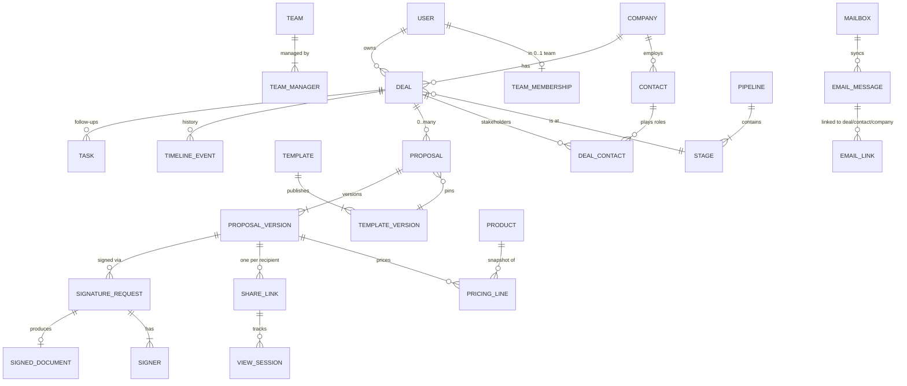

**Integrity guarantees built into the database**
- A sent proposal version cannot be modified (database trigger); its content and PDF carry SHA-256 fingerprints.
- At most one open signature request per deal (partial unique index).
- The application database account cannot update or delete audit records; a background sealer hash-chains them and exports daily to write-once storage.
- Every change runs in one transaction together with its audit, timeline and follow-up jobs — no partial updates.

### 5.3 Data movement
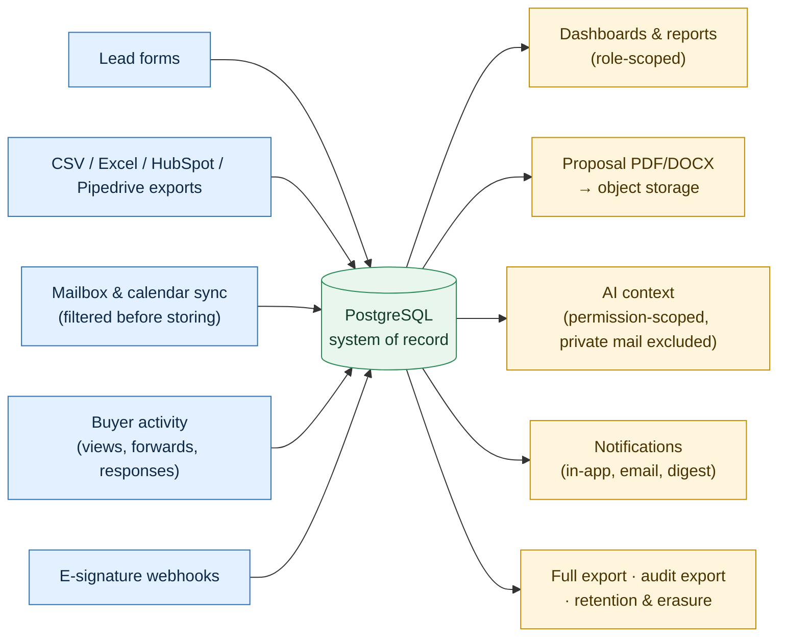

### 5.4 Data governance
| Data class | Examples | Protection | Retention (defaults, configurable) |
|---|---|---|---|
| Credentials & secrets | OAuth tokens, share tokens, TOTP secrets | Field-level envelope encryption, key rotation | Lifetime of connection/link |
| Personal data | Contacts, email participants, buyer identities, IPs (truncated) | Role-based access, private-email masking, erasure by anonymisation | Emails 5 y; IPs 90 days |
| Commercial confidential | Proposals, pricing, deals | Role scope, immutable sent versions | Life of the record |
| Legal evidence | Signed PDFs, certificates, audit log | WORM storage, hash verification, erasure-exempt | Legal schedule (OD-36); audit 7 y |

Detail: DATABASE-ERD, DATABASE-DESIGN (TLD); DATA-FLOW-ARCHITECTURE (HLD).

---

## 6. Integration architecture

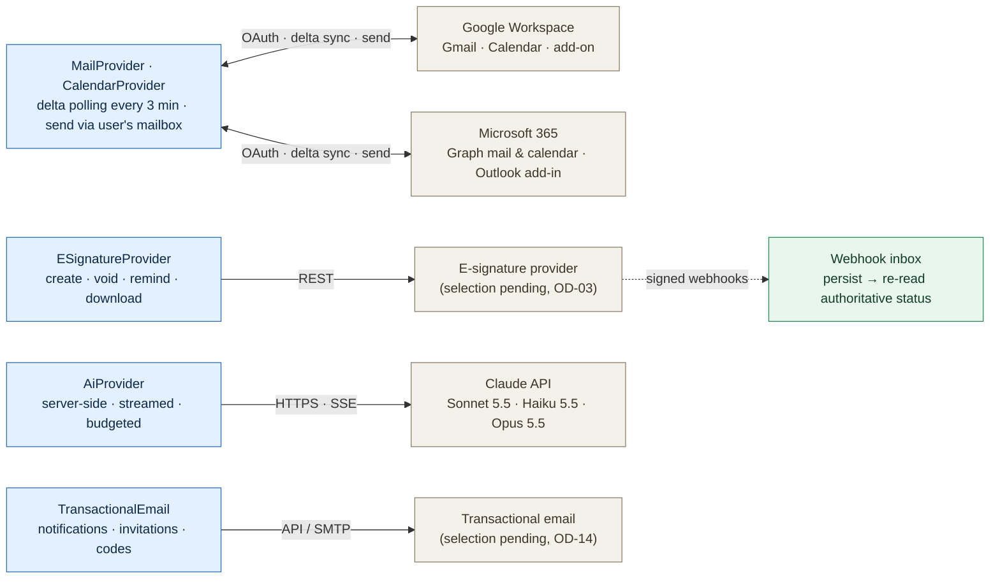

| Integration | Purpose | Pattern | Key controls | Release |
|---|---|---|---|---|
| **Microsoft Graph / Gmail API** | Sign-in, mailbox & calendar sync, send email from CRM | OAuth per user (separate consent from login), delta polling, headers-first filtering | Minimal scopes (read + send, calendar read); unknown senders not stored; private/excluded mail filtered; tokens encrypted; internal-only tenant app avoids public verification | R2 |
| **Outlook add-in / Gmail add-on** | Look up records, create records, insert proposal links from the inbox | Office.js task pane (Nested App Auth) / server-rendered Google cards | Restricted add-in sessions; Google ID-token verification | R3 |
| **E-signature provider** | Legally valid signing, sealing, certificates | Adapter; provider emails signers; webhooks → inbox → authoritative re-read → forward-only state; hourly reconciliation | HMAC-verified webhooks; document hash asserted before upload; signed artefacts stored write-once | R2 |
| **Claude API** | Draft sections, summaries, rewrite, follow-up drafts, pre-send consistency check | Server-side only; versioned prompts; structured outputs; streaming | Permission-scoped context; untrusted-text delimiting; budgets; never sends anything; outputs labelled until accepted; no prompt logging | R2 |
| **Transactional email** | System notifications, digests, invitations, buyer one-time codes | Provider API/SMTP from a dedicated subdomain | SPF/DKIM/DMARC; bounce suppression | R1 |
| **Cloudflare Turnstile** | Lead-form bot protection | Server-side token verification | Fails open with honeypot + rate limits if unavailable | R1 |

Resilience pattern for all integrations: calls run in background jobs with retries and dead-letter queues, per-provider concurrency limits and circuit breaking; inbound events are persisted before processing so nothing is lost.

Detail: INTEGRATION-ARCHITECTURE (HLD), INTEGRATION-DESIGN, E-SIGNATURE-DESIGN, AI-IMPLEMENTATION-DESIGN (TLD).

---

## 7. Infrastructure and deployment architecture

### 7.1 Production topology
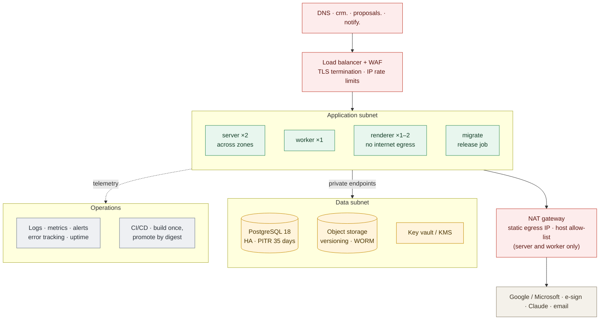

### 7.2 Environments
| Environment | Purpose | Hosting | Data |
|---|---|---|---|
| Local (Windows) | Development | Docker Compose: PostgreSQL 18, MinIO, Mailpit, provider simulators | Synthetic |
| CI | Automated tests on every change | Ephemeral containers with real PostgreSQL | Synthetic |
| Staging | Integration with real provider sandboxes, UAT, performance and security tests | Same as production, smaller | Test data only (no production copies, OD-104) |
| Production | Live use | Managed containers (Azure Container Apps **or** AWS ECS Fargate — OD-11), managed PostgreSQL, object storage, key vault | Live |

### 7.3 Delivery pipeline
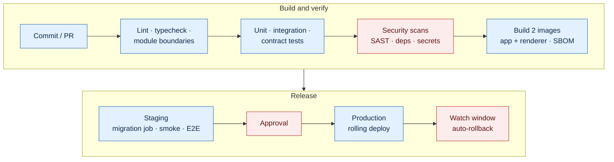
Database changes are forward-only "expand/contract" migrations run as a one-shot release job; application rollback is always to a schema-compatible version.

### 7.4 Operations
| Area | Approach |
|---|---|
| Availability (target 99.5 %) | ≥ 2 server instances across zones, HA database, stateless app tier |
| Backup & recovery | Database point-in-time recovery 35 days (RPO ≤ 5 min, RTO ≤ 8 h), object versioning + replication, quarterly restore drill with provider reconciliation |
| Monitoring | Structured logs, error tracking, metrics and alerts: error rate, latency, job queue lag, dead-letter queue, mailbox-sync lag, webhook failures, PDF render time, AI spend; external uptime checks for app and buyer links |
| Scaling | Server scales horizontally; one worker; renderer 1→2; database vertically (ample headroom at planned volumes) |
| Run cost | Infrastructure ~USD 550–900/month (AWS) or ~900–1,300 (Azure) + AI usage (budget-capped) + e-signature licences |

Detail: DEPLOYMENT-ARCHITECTURE (HLD), DEVELOPMENT-ENVIRONMENT (engineering).

---

## 8. Security architecture

### 8.1 Trust zones
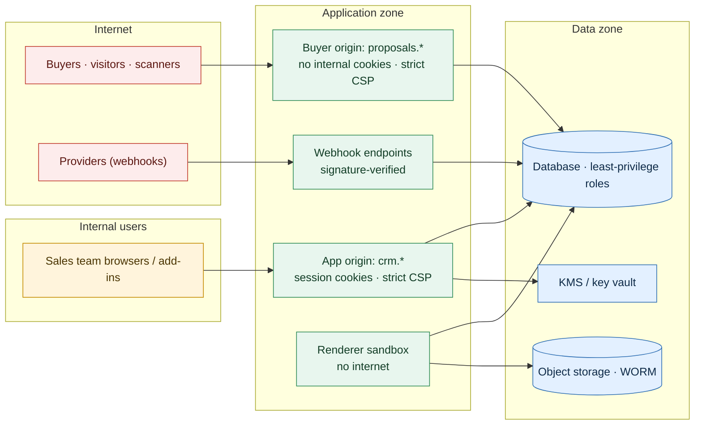

### 8.2 Controls by concern
| Concern | Design |
|---|---|
| **Authentication** | Invite-only accounts; sign-in with company Microsoft or Google account (tenant/domain verified server-side) or password; TOTP MFA required for Admins (policy can require all); account lockout; session revocation on deactivation; step-up re-authentication for sensitive admin actions |
| **Authorisation (RBAC)** | Three roles × three scopes (own / team / all), plus optional read-only cross-visibility. One permission matrix drives the API, the database query filters and the UI. Out-of-scope records return "not found" |
| **Data access** | Every query passes a mandatory, compile-time-enforced scope filter (no reliance on UI hiding); private emails show metadata only to non-owners; AI sees only what the requesting user may see |
| **External buyer links** | One link per recipient per version; 256-bit random token carried in the URL fragment, so it never reaches logs or email scanners; exchanged for a short-lived cookie bound to that link; separate web origin; optional email one-time code; revocable and expiring; views counted only by real browsers; forwarded viewers must identify themselves |
| **Sensitive documents** | Sent versions immutable and fingerprinted; PDFs generated in a network-isolated renderer (no data exfiltration or server-side request forgery); signed PDFs and certificates on write-once storage; downloads via short-lived signed URLs |
| **Secrets & encryption** | TLS everywhere; encryption at rest; field-level envelope encryption with rotating keys from the cloud KMS; secrets only in the key vault |
| **Application security** | Zod validation on every input; allow-listed rich-text rendering; sanitised email HTML in sandboxed frames; CSRF and origin checks; tiered rate limiting; upload validation |
| **Audit** | Tamper-evident audit log (hash chain + daily write-once export) of user, admin, system and AI actions |
| **AI** | Server-side only; no training on our data; zero data retention requested; prompt-injection defences; human approval before anything leaves the system |
| **Assurance** | Generated permission test suite, SAST/dependency scanning, DAST on the buyer surface, penetration test before go-live (OD-86) |

Non-software compliance tasks (owned by Legal/DPO): DPIA and legitimate-interest assessment for email sync, privacy notices for contacts, staff and forwarded viewers, processor agreements with every provider, e-signature consent wording, retention schedule.

Detail: SECURITY-ARCHITECTURE (HLD), AUTHENTICATION-AUTHORIZATION, DOCUMENT-SHARING-DESIGN, AUDIT-LOGGING-DESIGN (TLD).

---

## 9. Key architecture decisions

| # | Decision | Why it is right for us | Alternatives rejected | ADR |
|---|---|---|---|---|
| 1 | **Single-tenant deployment** | One company; complete data isolation by dedicated database; no tenant logic to build or test | Multi-tenant platform (BRD's commercial framing) | IDD-01 |
| 2 | **Modular monolith, three runtime roles** | Strong transactional consistency across the deal-to-signature chain; one deployable; small ops footprint; module boundaries enforced by tooling so it stays maintainable | Microservices (distributed transactions, many deployables, no scaling need) | ADR-001, -045 |
| 3 | **Hono API + React SPA** (not TanStack Start alone) | Over half the server surface is external HTTP contracts (add-ins, webhooks, buyer API, forms) plus a shared worker; Hono does this simply; TanStack Router keeps a path to Start | TanStack Start alone; NestJS; Express | ADR-003, -004 |
| 4 | **PostgreSQL as data + queue + pub/sub + search** | Removes Redis, broker and search engine; transactional job enqueue means no lost or phantom jobs | Redis/BullMQ, Kafka/RabbitMQ, Elasticsearch | ADR-005, -007, -022, -023 |
| 5 | **TypeScript end-to-end with shared Zod contracts** | One language and one validation schema for UI, API and tests; fewer integration defects | Separate backend language | ADR-003, -021 |
| 6 | **Drizzle ORM, Better Auth** | SQL-level control for triggers/partial indexes; complete auth (SSO, MFA, sessions) inside our database | Prisma; Auth.js; Keycloak (extra infrastructure) | ADR-005, -006, -027 |
| 7 | **Application-level RBAC with compile-time scoped queries** | Expresses own/team/view-only rules that row-level security cannot express cheaply; tested per permission | Postgres RLS | ADR-006, -076 |
| 8 | **Partner e-signature** | Legal validity, evidence and sealing are the provider's speciality; no in-house cryptography | Build in-house | OD-02, ADR-025 |
| 9 | **Immutable proposal versions and signing-chain integrity** | A signed contract must match exactly what the buyer saw; webhook duplicates/losses cannot corrupt deal status | Mutable documents, trusting webhooks | ADR-025, -081 |
| 10 | **One rendering pipeline (HTML → PDF in isolated Chromium)** | Preview, buyer view and PDF are identical; renderer cannot reach the internet | Second layout engine (react-pdf), LibreOffice | ADR-010, -029, -045 |
| 11 | **AI behind an adapter, human-in-the-loop** | Model choice per feature (quality vs cost), budgets, provider switchable, nothing sent without a person | Embedding AI calls in the UI; autonomous AI actions | ADR-014, -035, -041..044 |
| 12 | **Managed containers, no Kubernetes** | Four runtime units do not need an orchestrator; lower cost and skills burden | Kubernetes, serverless | ADR-046, -047 |
| 13 | **Buyer links in URL fragment, separate origin** | Prevents token leakage and false "opened" alerts from email scanners; isolates buyers from internal sessions | Token in URL path; same origin | ADR-020, -071, -075 |

Full register: ARCHITECTURE-DECISIONS (ADR-001..087).

---

## 10. Contradictions and unresolved decisions

### 10.1 Contradictions in the source material (resolved in the design — confirm)
| # | Contradiction | Resolution in the architecture | Confirm with |
|---|---|---|---|
| C1 | BRD describes a commercial multi-tenant SaaS (sign-up, trials, billing, data separation between customers) | Single-tenant internal deployment; billing out of scope; tenant separation satisfied by a dedicated deployment (IDD-01..03) | Leadership |
| C2 | BRD §9.16 says 100 Must; the requirements list contains 101 | Corrected to 101 / 25 / 4; 100 Musts in scope after billing is removed | Product |
| C3 | Acceptance criteria require both Gmail and Outlook; BRD risk plan says launch one first | Build our company's provider first; second provider only if needed (OD-06) | IT / Product |
| C4 | SSO is listed as Phase 3, yet Google/Microsoft sign-in is a Phase 1 Must | Google/Microsoft OIDC sign-in in Phase 1; enterprise SAML remains Phase 3 | IT |
| C5 | Several Musts depend on Should items (decline, expiry, overdue, weighted pipeline) | Those Shoulds are delivered with their dependent Musts; BRD priorities unchanged (OD-40) | Product |
| C6 | BR-AIA-002 says "AI shall check"; checks must still run when AI is switched off | Deterministic checks always run and are authoritative; the AI check is an extra layer (OD-55) | Product |
| C7 | "Void" (proposal) vs "Voided" (signature request); no "Accepted" or "partially signed" status in the BRD | Keep BRD labels; add "Accepted" for accept-without-signature; show "x of n signed" as a badge (OD-17..19) | Sales leadership |
| C8 | Inbox add-in is a Must but is the largest integration effort | Kept as Must, delivered in R3 after email sync; go-live recommended at end of R2 (OD-07, OD-48) | Product |
| C9 | Documentation housekeeping: the functional requirements use dotted error codes while business rules use UPPER_SNAKE; field-length limits not cross-checked one by one | Business rules are authoritative; to be harmonised before build starts | Engineering |

### 10.2 Open decisions that shape the architecture
| Decision | Options | Working assumption used | Architecture impact if changed | Owner | Needed by |
|---|---|---|---|---|---|
| **OD-06** Mail/calendar provider | Microsoft 365 / Google Workspace / both | Build our actual provider first | Only an adapter changes | IT / Product | R2 (before R1 ends) |
| **OD-11** Hosting | Azure / AWS | Managed containers + managed PostgreSQL on whichever cloud we already use | Only infrastructure code and the storage/KMS adapter | IT / Tech Lead | R1 |
| **OD-02 / OD-03** E-signature provider | DocuSign, Dropbox Sign, Adobe Acrobat Sign, BoldSign | Partner via adapter | One adapter + webhook verification | Product / Legal | R2 |
| **OD-01** Jurisdictions of entity and signers | US / EU / other | ESIGN/UETA + eIDAS simple e-signature | Provider choice, consent wording, retention | Legal | R2 |
| **OD-05 / OD-90** AI provider terms | Anthropic with zero-data-retention / other | Anthropic Claude, ZDR requested | Model routing, which features may use caching/fallback | Tech Lead / Legal | R2 |
| **OD-14** Transactional email | SES / Postmark / Azure Communication Services | Any, via adapter | None beyond adapter | Tech Lead | R1 |
| **OD-48 / OD-08** Go-live release and capacity | Go-live at R1 pilot or R2 | Pilot R1, go-live R2 | Release plan only | Leadership | Now |
| **OD-36 / OD-84** Retention schedule | Per data category | Defaults in §5.4 | Configuration only | Legal / DPO | R2 |
| **OD-89** Region / data residency | — | Company's primary region | Hosting region, AI region | Legal / IT | R1 |
| **OD-96 / OD-97 / OD-98 / OD-100** HA tier, egress firewall, error tracking, CI platform | — | HA on, app allow-list, any vendor, existing CI | Operations only | IT / DevOps | R1 |

The full register (OD-01..OD-112) is in OPEN-DECISIONS; none of the remaining items changes the architecture's shape — they are parameters, policies or vendor choices behind adapters.

### 10.3 Documentation status note
At the time of writing, the folder `docs/02-hld/` (9 HLD documents, including ARCHITECTURE-DECISIONS) is **not present** in the OneDrive documentation folder, although it was produced earlier the same day. Its diagrams are preserved in `docs/05-diagrams/` (files prefixed `02-`), and this document consolidates its content. References to HLD documents in this SAD point to that folder and will resolve once it is restored (see the project owner's decision).

---

## 11. Roadmap alignment and next steps

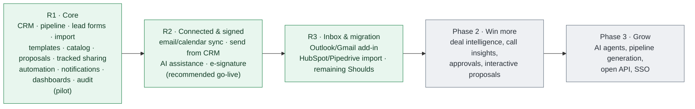

Extension points already in the design for Phases 2–3: event history and job subscriptions (new consumers without changing producers), provider adapters, the block-based proposal model, the automation execution log, and an OpenAPI-described REST surface.

**Immediate next steps**
1. Leadership confirms C1–C8 and the decisions marked "Needed by R1" in §10.2.
2. IT provisions the cloud subscription, tenant app registrations (Microsoft and/or Google) and DNS names.
3. Engineering creates the repository outside OneDrive and starts R1 in vertical slices (identity → CRM → templates/pricing → proposals → sharing → automation/notifications → reporting).
4. Legal starts the DPIA, privacy notices and e-signature provider due diligence in parallel (they gate R2).

---

## Appendix A — Where the detail lives
| Topic | Documents |
|---|---|
| Scope, requirements, decisions | `01-specifications/` PRD, SCOPE-RECONCILIATION, FUNCTIONAL-REQUIREMENTS, BUSINESS-RULES, WORKFLOWS, DOMAIN-MODEL, ROLE-PERMISSION-MATRIX, USER-STORIES, ACCEPTANCE-CRITERIA, REQUIREMENT-TRACEABILITY-MATRIX, OPEN-DECISIONS |
| High-level design | `02-hld/` SYSTEM-, COMPONENT-, MODULE-, DATA-FLOW-, INTEGRATION-, SECURITY-, DEPLOYMENT-, AI-ARCHITECTURE, ARCHITECTURE-DECISIONS |
| Technical design | `03-tld/` DATABASE-ERD, DATABASE-DESIGN, API-SPECIFICATION, BACKEND-, FRONTEND-DESIGN, AUTHENTICATION-AUTHORIZATION, INTEGRATION-DESIGN, PROPOSAL-ENGINE-DESIGN, DOCUMENT-SHARING-DESIGN, E-SIGNATURE-DESIGN, AI-IMPLEMENTATION-DESIGN, NOTIFICATION-AUTOMATION-DESIGN, AUDIT-LOGGING-DESIGN, TESTING-STRATEGY, ERROR-HANDLING-AND-VALIDATION |
| Engineering | `04-engineering/` TECH-STACK, DEPENDENCY-PLAN, PROJECT-STRUCTURE, DEVELOPMENT-ENVIRONMENT |
| Diagrams | `05-diagrams/` (all Mermaid sources) and this document |

## Appendix B — Technology summary
| Layer | Technology |
|---|---|
| Frontend | React 19, Vite 8, TanStack Router / Query / Table / Form, Tailwind CSS v4, shadcn/ui, TipTap 3 |
| Backend | Node.js 26 LTS, TypeScript, Hono 4, Zod 4, Drizzle ORM, pg-boss, Better Auth |
| Documents | Playwright Chromium (PDF), docx, mammoth |
| Data | PostgreSQL 18, S3 or Azure Blob, cloud KMS / key vault |
| AI | Anthropic Claude (Sonnet 5.5, Haiku 5.5, Opus 5.5) via official SDK |
| Integrations | Microsoft Graph / Gmail & Calendar APIs, Office.js add-in, Google Workspace add-on, e-signature provider API, transactional email, Cloudflare Turnstile |
| Hosting & ops | Docker images on Azure Container Apps or AWS ECS Fargate, managed LB + WAF, CI/CD, error tracking, metrics and alerts |
| Quality | Vitest, Playwright, axe, fast-check, k6, Biome, dependency-cruiser, SAST/SCA scanners |
